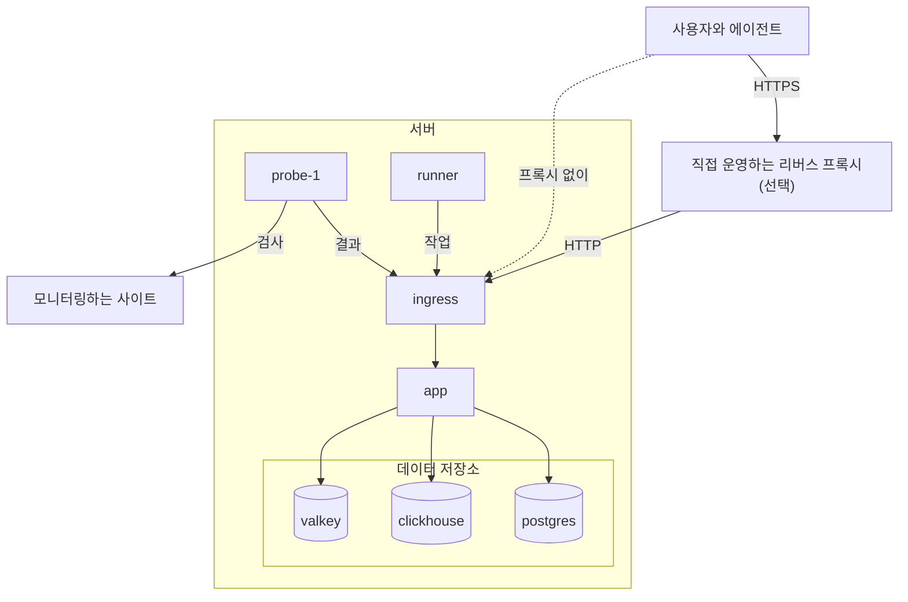

# Docker Compose

Docker Compose로 완전한 무료 OneUptime 인스턴스를 Linux 서버 한 대에서 실행합니다. 이 페이지는 새 서버에서 인스턴스가 실행되기까지를 안내한 뒤 HTTPS, 프로덕션 강화, 백업, 업데이트, 제거를 다룹니다.

:::cards
- [OneUptime 설치](#oneuptime-설치): 새 서버에서 첫 계정까지 여섯 단계.
- [HTTPS 설정](#https-설정): OneUptime이 인증서를 받게 하거나, 직접 운영하는 프록시를 앞에 둡니다.
- [프로덕션 체크리스트](#프로덕션-체크리스트): 실제 트래픽이 들어오기 전에 정리할 것.
- [OneUptime 업데이트](#oneuptime-업데이트): 최신 릴리스로 옮깁니다.
:::

## 작동 방식

Docker Compose는 OneUptime의 모든 부분을 서버의 컨테이너로 실행합니다. 모든 트래픽은 `ingress` 컨테이너로 들어오며, 이 컨테이너가 `app`으로 라우팅합니다. 앱은 데이터를 PostgreSQL, ClickHouse, Valkey에 보관합니다. 함께 제공되는 프로브가 모니터의 검사를 실행하고 ingress를 통해 결과를 보고합니다.



| 서비스 | 이미지 | 하는 일 |
| --- | --- | --- |
| `ingress` | `oneuptime/nginx` | 포트 80과 443으로 들어오는 모든 트래픽을 받아 앱으로 라우팅합니다. OneUptime이 인증서를 관리할 때 HTTPS를 제공합니다. |
| `app` | `oneuptime/app` | 대시보드, API, 상태 페이지, 텔레메트리 수집, 백그라운드 워커. |
| `probe-1` | `oneuptime/probe` | 모니터의 검사를 실행하는 글로벌 프로브. 호스트의 네트워크를 사용합니다. |
| `runner` | `oneuptime/runner` | AI 코드 수정을 실행하는 인스턴스의 Runner. 호스트의 네트워크를 사용합니다. |
| `postgres` | `postgres:15` | 구성과 상태: 모니터, 인시던트, 사용자. `postgres` 볼륨에 저장됩니다. |
| `clickhouse` | `clickhouse/clickhouse-server:26.7` | 텔레메트리: 로그, 메트릭, 트레이스, 예외. `clickhouse` 볼륨에 저장됩니다. |
| `valkey` | `valkey/valkey:9.1-alpine` | 캐시와 큐. 디스크에는 아무것도 보관하지 않습니다. |

> [!NOTE]
> `valkey` 서비스는 Redis 7.2의 BSD 라이선스 포크인 [Valkey](https://valkey.io)를 실행하며, `config.env`의 `VALKEY_*` 설정으로 구성합니다. Redis 프로토콜을 쓰는 서버라면 무엇이든 동작합니다. 원한다면 관리형 Redis로 `VALKEY_HOST`를 지정하세요. 이 설정들은 13.0.0까지 `REDIS_*`라는 이름이었습니다. 예전 이름도 계속 읽히고, 컨테이너는 여전히 호스트 이름 `redis`에도 응답하며, `npm run update`는 이를 다시 쓰지 않으므로 이전 `config.env`는 수정할 필요가 없습니다.

대규모 프로덕션이나 고가용성이 필요한 경우에는 대신 Kubernetes에서 [Helm 차트](https://artifacthub.io/packages/helm/oneuptime/oneuptime)를 사용하세요. Docker Compose는 서버 한 대에서 각 서비스를 하나씩만 실행합니다.

## 요구 사항

서버 크기는 그 위에서 무엇을 실행할지에 따라 고르세요. 메모리와 디스크를 좌우하는 것은 텔레메트리(로그, 메트릭, 트레이스)입니다. 데이터 양을 알게 되면 [사이징 및 용량 계획](/docs/installation/sizing)을 참고하세요.

| | 권장 | 홈랩 최소 사양 |
| --- | --- | --- |
| **메모리** | 16 GB | 8 GB |
| **CPU** | 8코어 | 4코어 |
| **디스크** | 400 GB | 20 GB |
| **시스템** | Ubuntu 22.04, 또는 Debian, Ubuntu, RHEL 기반의 다른 Linux | 동일 |
| **아키텍처** | x86-64(`amd64`) 또는 ARM(`arm64`) | 동일 |

홈랩 최소 사양은 개인용과 실험용에 알맞습니다. Raspberry Pi에서 OneUptime을 실행하는 사용자도 있습니다.

다음도 필요합니다.

- **Docker**와 **Docker Compose v2** 플러그인(`docker compose` 명령).
- **Git**, OneUptime을 가져오는 데 씁니다.
- **Node.js와 npm**, Docker Compose를 감싸는 `npm start`와 `npm run update` 스크립트를 실행합니다.
- 서버에서 **비어 있는 포트 80과 443**. 아래 표에 OneUptime이 호스트에서 사용하는 모든 포트가 나와 있습니다.

| 호스트 포트 | 사용하는 곳 | 설정 | 용도 |
| --- | --- | --- | --- |
| 80 | `ingress` | `ONEUPTIME_HTTP_PORT` | 대시보드, API, 텔레메트리 수집, Let's Encrypt 검증. |
| 443 | `ingress` | `STATUS_PAGE_HTTPS_PORT` | OneUptime이 인증서를 관리할 때 인스턴스의 HTTPS, 그리고 사용자 지정 도메인의 상태 페이지와 대시보드. |
| 5400 | `postgres` | `docker-compose.yml`에서 설정 | `npm run backup`이 PostgreSQL에 접근하게 합니다. 인터넷에는 닫아 두세요. |
| 3874 | `probe-1` | `GLOBAL_PROBE_1_PORT` | 프로브 자체의 서버. 서버 바깥에서는 필요하지 않습니다. |
| 3876 | `runner` | `ONEUPTIME_RUNNER_PORT` | Runner 자체의 서버. 서버 바깥에서는 필요하지 않습니다. |

설치 과정을 보여 주는 [동영상](https://youtu.be/j1SWmMW2oL4)도 있습니다.

## OneUptime 설치

:::steps
### release 브랜치 클론

`release` 브랜치에는 최신 릴리스의 파일이 있습니다.

```bash
git clone --depth 1 --single-branch --branch release https://github.com/OneUptime/oneuptime.git
cd oneuptime
```

### config.env 만들기

OneUptime의 모든 설정은 `config.env`에 있습니다. 예제에서 시작하세요.

```bash
cp config.example.env config.env
```

### 호스트 이름 설정

`config.env`를 열고 `HOST`를 사람들이 OneUptime에 접근할 때 쓸 도메인 이름이나 IP 주소로 설정합니다. `http://`는 붙이지 않습니다. `localhost`는 자신의 컴퓨터에서 OneUptime을 시험해 볼 때만 그대로 두세요.

```ini title="config.env"
HOST=oneuptime.example.com
```

### 임의의 비밀 값 생성

예제 파일에는 GitHub에 공개된 자리 표시자 비밀 값이 들어 있습니다. 각각을 고유한 임의 값으로 바꾸세요.

```bash
while grep -q "please-change-this-to-random-value" config.env; do
  sed -i "0,/please-change-this-to-random-value/{s/please-change-this-to-random-value/$(openssl rand -hex 32)/}" config.env
done
grep -c "please-change-this" config.env
```

마지막 명령은 `0`을 출력합니다. 남은 자리 표시자가 없다는 뜻입니다. 이 반복문은 모든 Linux 서버에 있는 GNU `sed`를 사용합니다. 채워지는 설정은 다음과 같습니다.

| 설정 | 보호하는 것 |
| --- | --- |
| `ONEUPTIME_SECRET` | OneUptime 내부 서비스 간의 호출. |
| `ENCRYPTION_SECRET` | 통합 토큰과 SMTP 비밀번호처럼 OneUptime이 저장하는 비밀 값과, OneUptime이 발급하는 로그인 토큰. |
| `DATABASE_PASSWORD`, `CLICKHOUSE_PASSWORD`, `VALKEY_PASSWORD` | 세 데이터 저장소. |
| `REGISTER_PROBE_KEY` | 인스턴스에 프로브를 등록하는 일. |
| `GLOBAL_PROBE_1_KEY`, `GLOBAL_PROBE_2_KEY` | Docker Compose가 실행할 수 있는 글로벌 프로브(기본적으로 `probe-1`이 실행됩니다). |
| `ONEUPTIME_RUNNER_KEY` | 함께 제공되는 Runner. |

> [!IMPORTANT]
> 비밀 값은 처음 시작하기 전에 설정하고, 그 뒤로는 유지하세요. PostgreSQL은 데이터베이스를 만들 때만 비밀번호를 받으며, 나중에 `ENCRYPTION_SECRET`을 바꾸면 이전 값으로 암호화된 모든 값을 읽을 수 없게 됩니다.

### OneUptime 시작

:::tabs
@tab npm
```bash
npm start
```
@tab Docker CLI
```bash
(export $(grep -v '^#' config.env | xargs) && docker compose up --remove-orphans -d)
```
:::

첫 시작에는 몇 분이 걸립니다. Docker가 이미지를 내려받고 OneUptime이 데이터베이스를 만들기 때문입니다. `npm start`는 모든 부분이 응답할 때까지 기다린 뒤 마지막에 다음을 출력합니다: **OneUptime is up!**

### 첫 계정 만들기

`http://` 뒤에 `HOST`를 붙인 주소(예: `http://localhost`)를 열고 가입합니다. 새 인스턴스의 첫 계정은 마스터 관리자가 되며, `/admin`에서 Admin Dashboard를 열 수 있습니다.

페이지에 접근할 수 있는 사람은 누구나 여러분 다음에 가입할 수 있습니다. 이를 막으려면 Admin Dashboard를 열고 **설정 > 인증**으로 가서 **가입 허용**을 끄세요. 프로젝트에 초대한 사람은 여전히 계정을 만들 수 있습니다.
:::

## HTTPS 설정

HTTPS를 추가하는 두 가지 방법 중 하나를 고르기 전까지 OneUptime은 일반 HTTP로 제공됩니다.

| | OneUptime이 인증서를 받게 하기 | 직접 운영하는 리버스 프록시 사용 |
| --- | --- | --- |
| **TLS 종료 위치** | OneUptime의 `ingress`. 무료 Let's Encrypt 인증서를 스스로 갱신합니다 | 여러분의 프록시: Caddy, Nginx 또는 로드 밸런서 |
| **필요한 것** | 서버를 가리키는 공개 도메인 이름, 그리고 인터넷에서 접근할 수 있는 포트 80과 443 | 프록시와 도메인용 인증서 |
| **설정** | `PROVISION_SSL=true`, `HTTP_PROTOCOL=https` | `PROVISION_SSL=false`, `HTTP_PROTOCOL=https`, `TRUSTED_PROXY_HOPS=2` |
| **사용자 지정 도메인의 상태 페이지** | 추가 설정 없이 동작합니다 | 프록시가 그 도메인들도 제공해야 합니다 |

상태 페이지나 대시보드를 사용자 지정 도메인에 둔다면 OneUptime에 TLS를 맡기는 편이 더 간단합니다. ingress가 그 도메인들의 인증서를 직접 주문하고 제공합니다.

### OneUptime이 인증서를 받게 하기

:::steps
#### 도메인이 서버를 가리키게 하기

도메인에 DNS `A` 레코드(IPv6라면 `AAAA`)를 만들고, 값으로 서버의 공개 IP 주소를 넣습니다.

#### 인증서 발급 켜기

`config.env`에 다음 값을 설정합니다.

```ini title="config.env"
HOST=oneuptime.example.com
PROVISION_SSL=true
HTTP_PROTOCOL=https
```

`HOST`는 도메인 이름이어야 합니다. OneUptime은 IP 주소나 `localhost`에 대한 인증서는 받을 수 없습니다.

#### 새 설정으로 다시 시작

```bash
npm start
```

#### HTTPS로 인스턴스 열기

`https://oneuptime.example.com`을 엽니다. OneUptime은 시작할 때 인증서를 주문하고, 그 뒤로 매시간 확인하며 남은 기간이 30일 미만이 되면 갱신합니다. 첫 인증서가 도착하기 전까지(보통 몇 분 안에) ingress는 임시 자체 서명 인증서를 제공하고 브라우저가 경고를 표시합니다.
:::

### 직접 운영하는 리버스 프록시 사용

이 단계에서는 OneUptime과 같은 서버에서 프록시를 실행합니다. 프록시가 다른 머신에서 실행된다면 첫 단계를 건너뛰고, 프록시가 이 서버의 포트 80을 가리키게 하세요.

:::steps
#### ingress를 포트 80과 443에서 옮기기

프록시에 포트 80과 443이 필요하므로 ingress를 다른 포트로 옮깁니다. 프로브와 Runner는 호스트의 네트워크를 사용해 `http://localhost`로 OneUptime에 접근하므로 함께 옮겨집니다.

```ini title="config.env"
ONEUPTIME_HTTP_PORT=8080
STATUS_PAGE_HTTPS_PORT=8443
GLOBAL_PROBE_1_ONEUPTIME_URL=http://localhost:8080
ONEUPTIME_RUNNER_ONEUPTIME_URL=http://localhost:8080
```

#### OneUptime에 프록시 뒤에 있다고 알리기

```ini title="config.env"
HOST=oneuptime.example.com
HTTP_PROTOCOL=https
PROVISION_SSL=false
TRUSTED_PROXY_HOPS=2
```

`HTTP_PROTOCOL=https`는 OneUptime이 만드는 링크가 HTTPS를 쓰게 합니다. `TRUSTED_PROXY_HOPS=2`는 여러분의 프록시와 OneUptime의 ingress를 세므로, OneUptime은 IP 허용 목록과 속도 제한에 방문자의 실제 주소를 사용합니다. CDN이나 로드 밸런서처럼 `X-Forwarded-For`에 값을 덧붙이는 프록시가 더 있다면 그 수만큼 하나씩 더하세요.

#### 새 포트로 OneUptime 다시 시작

```bash
(export $(grep -v '^#' config.env | xargs) && docker compose up --remove-orphans -d)
bash Tests/Scripts/status-check.sh localhost:8080
```

`npm start`는 포트 80의 `http://localhost`를 확인하는데, 그 자리에는 프록시가 들어가므로 새 포트는 직접 확인하세요. 스크립트는 마지막에 다음을 출력합니다: **OneUptime is up!**

#### 프록시 구성

:::tabs
@tab Caddy
```text title="Caddyfile"
oneuptime.example.com {
	reverse_proxy localhost:8080
}
```
Caddy는 인증서를 직접 받아 갱신하고, HTTP를 HTTPS로 리디렉션하며, WebSocket 연결을 통과시킵니다. 파일을 바꾼 뒤에는 `sudo systemctl reload caddy` 등으로 Caddy를 다시 불러오세요.
@tab Nginx
```nginx title="/etc/nginx/conf.d/oneuptime.conf"
map $http_upgrade $oneuptime_connection_upgrade {
    default upgrade;
    ""      close;
}

server {
    listen 80;
    server_name oneuptime.example.com;
    return 301 https://$host$request_uri;
}

server {
    listen 443 ssl;
    server_name oneuptime.example.com;

    ssl_certificate     /etc/letsencrypt/live/oneuptime.example.com/fullchain.pem;
    ssl_certificate_key /etc/letsencrypt/live/oneuptime.example.com/privkey.pem;

    # The limits OneUptime's own ingress uses.
    client_max_body_size 50M;
    proxy_read_timeout 300s;
    proxy_send_timeout 300s;

    proxy_http_version 1.1;
    proxy_set_header Host $host;
    proxy_set_header X-Forwarded-For $proxy_add_x_forwarded_for;
    proxy_set_header X-Forwarded-Proto $scheme;
    proxy_set_header Upgrade $http_upgrade;
    proxy_set_header Connection $oneuptime_connection_upgrade;

    location / {
        proxy_pass http://127.0.0.1:8080;
    }

    # MCP clients keep a stream open.
    location /mcp {
        proxy_pass http://127.0.0.1:8080;
        proxy_buffering off;
        proxy_read_timeout 86400s;
        proxy_send_timeout 86400s;
    }
}
```
인증서 경로는 Certbot이 Let's Encrypt 인증서를 두는 위치입니다. 인증서를 다른 곳에서 받았다면 그 경로를 사용하세요. `sudo nginx -t && sudo systemctl reload nginx`로 파일을 확인하고 Nginx를 다시 불러옵니다.
:::

#### 프록시를 통해 인스턴스 열기

`https://oneuptime.example.com`을 엽니다. 프록시의 인증서로 제공되는 OneUptime 로그인 페이지가 보여야 합니다.
:::

> [!NOTE]
> 직접 운영하는 프록시 뒤에서는 텔레메트리를 OTLP/HTTP(`/otlp`)로 보내세요. gRPC를 통한 OTLP는 OneUptime 자체의 ingress가 TLS를 종료할 때(`PROVISION_SSL=true`)만 OneUptime에 도달합니다.

## 프로덕션 체크리스트

Docker Compose는 서버 한 대에서 각 서비스를 하나씩 실행하므로 작은 팀과 홈랩에 알맞습니다. 이에 의존하기 전에 이 목록을 점검하세요.

| 영역 | 할 일 |
| --- | --- |
| **비밀 값** | `config.env`의 어떤 값도 `please-change-this-to-random-value` 자리 표시자로 남아 있지 않습니다. [임의의 비밀 값 생성](#임의의-비밀-값-생성)을 참고하세요. |
| **HTTPS** | 사람들이 HTTPS로 OneUptime에 접근하고 `HTTP_PROTOCOL=https`가 설정되어 있습니다. [HTTPS 설정](#https-설정)을 참고하세요. |
| **가입** | 팀의 계정이 갖춰지면 Admin Dashboard의 **설정 > 인증**에서 **가입 허용**을 끕니다. |
| **방화벽** | 인터넷에는 포트 80과 443(그리고 SSH)만 열려 있습니다. PostgreSQL은 백업을 위해 포트 5400으로 게시되어 있습니다. `ufw` 규칙은 Docker가 게시하는 포트에 적용되지 않으므로 클라우드 공급자의 방화벽으로 닫으세요. |
| **백업** | PostgreSQL을 매일 백업하고 사본을 서버 밖으로 옮깁니다. [백업과 복원](#백업과-복원)을 참고하세요. |
| **이메일** | OneUptime이 초대와 알림을 보낼 수 있도록 Admin Dashboard의 **설정 > 알림 > 이메일**에 메일 서버가 설정되어 있습니다. [SMTP](/docs/emails/smtp)를 참고하세요. |
| **디스크** | 여유 공간을 지켜봅니다. ClickHouse는 보관하는 텔레메트리에 따라 커집니다([사이징 및 용량 계획](/docs/installation/sizing) 참고). 각 컨테이너의 로그는 최대 1000 MB로 제한됩니다. |
| **업데이트** | OneUptime을 적어도 일주일에 한 번 업데이트합니다. 릴리스는 자주 나옵니다. [OneUptime 업데이트](#oneuptime-업데이트)를 참고하세요. |
| **고가용성** | 필요하다면 Kubernetes의 [Helm 차트](https://artifacthub.io/packages/helm/oneuptime/oneuptime)로 옮기세요. |

## 백업과 복원

PostgreSQL에는 모니터, 인시던트, 상태 페이지, 사용자 등 여러분이 구성한 모든 것이 들어 있습니다. `npm run backup`은 이를 `Backups` 폴더의 파일로 덤프합니다.

:::steps
### 백업 스크립트에 데이터베이스 비밀번호 알려 주기

`config.env`에서 `DATABASE_BACKUP_PASSWORD`를 `DATABASE_PASSWORD`의 값으로 설정합니다. 스크립트는 `config.env`를 일반 텍스트로 읽으므로, 함께 제공되는 `${DATABASE_PASSWORD}`는 절대 채워지지 않습니다.

### 백업 실행

```bash
npm run backup
```

sudo 비밀번호를 묻고 `Backups/db-<day of the month>.backup`을 기록하므로, 매일의 백업이 한 달 전의 백업을 대체합니다. 적어도 하루에 한 번 실행하세요.

### 백업을 서버 밖으로 복사

데이터베이스와 같은 디스크에 있는 백업은 그 디스크를 잃으면 함께 사라집니다.
:::

ClickHouse는 텔레메트리를 Docker 볼륨 `oneuptime_clickhouse`에 보관하며, 이를 백업하는 스크립트는 없습니다. 그 텔레메트리를 남겨야 한다면 [clickhouse-backup](https://github.com/Altinity/clickhouse-backup) 같은 ClickHouse 도구로 볼륨을 백업하거나, OneUptime을 멈춘 상태에서 복사하세요.

PostgreSQL을 복원하려면 `config.env`에서 `DATABASE_RESTORE_*` 값을 설정합니다. `DATABASE_RESTORE_PASSWORD`는 백업할 때처럼 `DATABASE_PASSWORD`의 값으로, `DATABASE_RESTORE_FILENAME`은 복원할 백업(예: `db-31.backup`)으로 설정합니다. 그런 다음 `bash restore.sh`를 실행합니다. 복원 대상 데이터베이스는 이미 있어야 하며, 실행 중인 설치라면 이미 있습니다.

> [!CAUTION]
> `restore.sh`는 백업에 있는 각 객체를 대상 데이터베이스에서 삭제한 뒤 다시 만듭니다. 시작하기 전에 확인을 요청하니, 표시되는 데이터베이스 이름을 확인하세요.

## OneUptime 업데이트

먼저 백업한 다음 실행합니다.

```bash
git checkout release
git pull
npm run update
```

`npm run update`는 sudo 비밀번호를 묻고, `config.example.env`의 새 설정을 `config.env`에 추가하며(직접 넣은 값은 그대로 남습니다), 새 이미지를 받아 OneUptime을 다시 시작합니다. `npm start`처럼 마지막에 다음을 출력합니다: **OneUptime is up!**

새 메이저 버전으로 옮길 때(예: 13에서 14로)는 더 많은 작업이 필요할 수 있습니다. 시작하기 전에 [OneUptime 업그레이드](/docs/installation/upgrading)를 읽으세요.

`config.env`의 `APP_TAG=release`는 항상 Community Edition의 최신 릴리스를 받습니다. 한 버전에 머무르려면 `APP_TAG`를 그 번호(예: `14.0.22`)로 설정하세요. Enterprise Edition의 태그는 `enterprise-release`와 `enterprise-14.0.22`입니다.

## OneUptime 제거

OneUptime을 멈추고 컨테이너와 네트워크를 제거합니다.

```bash
npm run down
```

데이터는 `oneuptime_postgres`와 `oneuptime_clickhouse` 볼륨에 남고, `oneuptime` 폴더에는 `config.env`와 백업이 남습니다. 데이터까지 삭제하려면 다음을 실행합니다.

```bash
(export $(grep -v '^#' config.env | xargs) && docker compose down --volumes --remove-orphans)
```

그런 다음 `oneuptime` 폴더를 삭제합니다.

> [!CAUTION]
> `--volumes`는 모든 모니터, 인시던트, 사용자, 텔레메트리를 영구히 삭제합니다. 그중 무엇이든 필요할 수 있다면 먼저 백업하세요.

## 문제 해결

:::details npm start를 실행하면 Docker가 "permission denied"를 표시함
사용자가 Docker 데몬에 접근할 수 없습니다. 사용자를 `docker` 그룹에 추가한 뒤 로그아웃했다가 다시 로그인하세요.

```bash
sudo usermod -aG docker $USER
```
:::

:::details 포트 80 또는 443이 사용 중이라 ingress를 시작할 수 없음
서버의 다른 프로그램(대개 웹 서버)이 포트를 쓰고 있습니다. 그 프로그램을 멈추거나, ingress를 다른 포트로 옮기고 [직접 운영하는 리버스 프록시 사용](#직접-운영하는-리버스-프록시-사용)에 설명된 대로 그 프로그램을 OneUptime 앞에 두세요.
:::

:::details npm start가 "Maximum retries reached"로 끝남
`npm start`를 마무리하는 검사가 OneUptime이 응답하기 전에 포기했습니다. 이미지를 내려받고 데이터베이스를 만드는 첫 시작은 검사가 기다리는 시간보다 오래 걸릴 수 있습니다. 무엇이 실행 중인지 보고 로그를 읽으세요.

```bash
npm run ps
npm run logs
```

모든 컨테이너가 실행되면 `npm run status-check`로 검사를 다시 실행합니다. ingress를 포트 80에서 옮겼다면 대신 새 포트를 확인하세요: `bash Tests/Scripts/status-check.sh localhost:8080`.
:::

:::details 일부 페이지는 열리지만 실시간 업데이트나 업로드가 실패함
`HOST`의 주소로 OneUptime을 여세요. ingress는 호스트 이름으로 요청을 라우팅합니다. 애플리케이션 전체에 도달하는 것은 `HOST`와 `localhost`뿐이고, 서버의 IP 주소처럼 다른 이름은 상태 페이지 도메인으로 처리됩니다. `HOST`를 사람들이 쓰는 이름으로 설정한 다음 `npm start`를 실행하세요.
:::

:::details PROVISION_SSL을 설정한 뒤 브라우저가 인증서 경고를 표시함
Let's Encrypt가 인증서를 발급하기 전까지 ingress는 임시 자체 서명 인증서를 제공합니다. 몇 분이 지나도 경고가 사라지지 않으면 다음을 확인하세요.

- `HOST`가 IP 주소나 `localhost`가 아닌 도메인 이름인지.
- 도메인의 DNS 레코드가 이 서버를 가리키는지.
- Let's Encrypt가 도메인을 검증할 수 있도록 인터넷에서 포트 80에 접근할 수 있는지.

주문이 실패하면 앱은 `CoreSSL:EnsurePrimaryHostCertificate`로 시작하고 이유가 뒤따르는 오류를 기록합니다.

```bash
(export $(grep -v '^#' config.env | xargs) && docker compose logs app) | grep -A 5 CoreSSL
```
:::

:::details ingress 포트를 옮긴 뒤 함께 제공되는 프로브가 연결 끊김으로 표시됨
Admin Dashboard는 **설정 > 모니터링 > 글로벌 프로브**에서 프로브를 보여 줍니다. 프로브는 `GLOBAL_PROBE_1_ONEUPTIME_URL`로 OneUptime에 접근하며, 기본값은 `http://localhost`(포트 80)입니다. 이를 ingress의 새 포트(예: `http://localhost:8080`)로 설정하고, `ONEUPTIME_RUNNER_ONEUPTIME_URL`도 같은 방식으로 설정한 뒤 OneUptime을 다시 시작하세요.
:::

## 다음 단계

:::cards
- [OneUptime 업그레이드](/docs/installation/upgrading): 메이저 버전마다 필요한 작업입니다.
- [사이징 및 용량 계획](/docs/installation/sizing): 텔레메트리에 필요한 메모리와 디스크를 계획합니다.
- [자체 호스팅 아키텍처](/docs/self-hosted/architecture): 구성 요소가 어떻게 맞물리는지 설명합니다.
- [엔터프라이즈 에디션](/docs/self-hosted/enterprise): Enterprise 이미지가 더하는 것과 그 라이선스입니다.
:::
