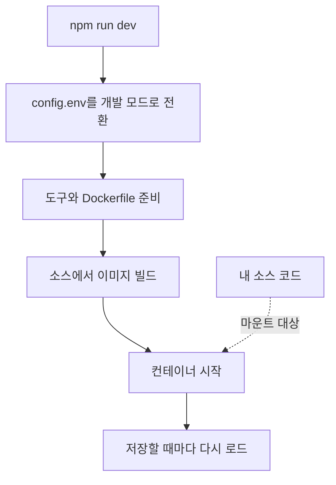

# 로컬 개발

소스 코드로 OneUptime을 자신의 컴퓨터에서 실행해 개발 작업을 합니다. 개발 스택은 체크아웃한 코드로 모든 서비스를 빌드하고, 소스 코드를 컨테이너에 마운트하며, 파일을 저장할 때마다 다시 로드합니다.

릴리스된 버전을 실행하려면 [Docker Compose](/docs/installation/docker-compose)를 사용하세요.

## 개발 스택의 작동 방식

`npm run dev`는 체크아웃을 준비한 다음 `Scripts/Dev/docker-compose.dev.yml`에 정의된 스택을 시작합니다.



| 단계 | 하는 일 |
| --- | --- |
| 개발 모드로 전환 | `config.env`에 `ENVIRONMENT=development`를 설정합니다. |
| 준비 | sudo 비밀번호를 묻고, 없는 도구(Git, curl, Node.js, Docker, gomplate, ts-node)를 설치하고, 현재 브랜치에서 `git pull`을 실행하고, `config.example.env`의 새 설정을 `config.env`에 추가하고, 모든 `Dockerfile.tpl`로 `Dockerfile`을 만듭니다. |
| 빌드 | 서비스마다 소스에서 이미지를 빌드합니다. 첫 빌드는 시간이 걸립니다. |
| 실행 | 소스 코드를 마운트한 상태로 컨테이너를 시작합니다. |
| 다시 로드 | App은 서버 파일이 바뀌면 API를 다시 시작하고, 대시보드를 편집하는 동안 다시 빌드합니다. |

저장소에 `ee/` 폴더가 있으면 App은 그곳에서 Enterprise Edition을 불러옵니다. 대신 Community Edition을 실행하려면 `config.env`에 `ONEUPTIME_EDITION=community`를 설정하세요.

## 시작하기 전에

| 필요한 것 | 참고 |
| --- | --- |
| **Docker** | macOS와 Windows에서는 Docker Desktop, Linux에서는 Docker Compose v2 플러그인이 있는 Docker Engine. |
| **Node.js 26 이상과 npm** | 저장소의 `package.json`이 요구하는 버전이며, CI도 이 버전을 사용합니다. |
| **Git** | 저장소를 클론하는 데 씁니다. |
| **sudo 권한** | `npm run dev`는 무언가를 설치하기 전에 비밀번호를 묻습니다. |
| **비어 있는 포트 80과 443** | 스택은 `http://localhost`(포트 80)에서 OneUptime을 제공하고, 포트 443에서 HTTPS를 제공합니다. |

## 개발 스택 시작하기

:::steps
### 저장소 클론하기

```bash
git clone https://github.com/OneUptime/oneuptime.git
cd oneuptime
```

### config.env 만들기

```bash
cp config.example.env config.env
```

예제 값은 개발용으로 그대로 사용할 수 있습니다. 바꿔도 되지만 꼭 바꿀 필요는 없습니다.

### 스택 시작하기

```bash
npm run dev
```

sudo 비밀번호를 물은 뒤 이미지를 빌드하고 컨테이너를 백그라운드에서 시작합니다. App이 시작되는 과정은 `docker logs -f oneuptime-app-1`로 확인하세요.

### OneUptime 열기

`http://localhost`를 열고 가입합니다. 첫 번째 계정이 마스터 관리자가 되며, `http://localhost/admin`에서 Admin Dashboard를 열 수 있습니다.
:::

## 코드 작업하기

`packages/` 아래의 파일을 편집하고 저장하면 컨테이너가 변경 사항을 반영합니다.

풀 리퀘스트를 열기 전에 컨테이너 밖, 즉 내 컴퓨터에서 변경 사항을 확인하세요. 이를 위한 의존성은 한 번만 설치하면 됩니다. 저장소 루트에서 `npm install`을 실행하고(ESLint와 마이그레이션 도구용), 이어서 `npm run install-modules`를 실행합니다. 이 명령은 모든 패키지의 `node_modules`를 지우고 다시 설치하므로 시간이 걸립니다.

:::steps
### 변경한 부분 컴파일하기

변경한 패키지마다 컴파일러를 실행합니다. 예를 들어 App의 경우:

```bash
cd packages/App
npm run compile
```

### 내 파일만 린트하기

저장소 루트에서 변경한 파일을 지정합니다.

```bash
npx eslint --fix packages/App/path/to/File.ts
```

`npm run lint`와 `npm run fix-lint`는 피하세요. 저장소 전체를 린트합니다.

### 변경에 해당하는 테스트 실행하기

패키지에서 전체 스위트 대신 관련 테스트 파일을 실행합니다.

```bash
cd packages/App
npx jest Tests/path/to/YourChange.test.ts
```
:::

### 데이터베이스 마이그레이션

| 데이터베이스 | 마이그레이션 추가 방법 |
| --- | --- |
| PostgreSQL | 모델을 변경한 뒤 마이그레이션을 직접 작성하지 말고 `npm run generate-postgres-migration`을 실행하세요. 새 파일을 `packages/Common/Server/Infrastructure/Postgres/SchemaMigrations/Index.ts`에 등록해야 합니다. 등록하기 전에는 실행되지 않습니다. `npm run check-postgres-schema-drift`는 아직 빠진 구문을 출력합니다. |
| ClickHouse | 기존 마이그레이션을 따라 `packages/App/FeatureSet/Workers/DataMigrations`에 직접 작성합니다. |

## 참고 자료

### 명령

저장소 루트에서 실행하세요.

| 작업 | 명령 |
| --- | --- |
| 스택 시작, 또는 `config.env` 변경 적용 | `npm run dev` |
| 의존성 변경 후 이미지 다시 빌드 | `npm run build` 다음 `npm run dev` |
| 이미지를 처음부터 다시 빌드 | `npm run force-build-dev` 다음 `npm run dev` |
| 실행 중인 컨테이너 목록 보기 | `docker ps` |
| 한 서비스의 로그 따라가기 | `docker logs -f oneuptime-app-1` |
| 스택을 중지하고 컨테이너 제거 | `npm run down` |

`npm run down`은 데이터를 유지합니다. PostgreSQL과 ClickHouse 볼륨은 그대로 남습니다.

### 포트

개발 스택은 데이터 저장소를 공개하므로 자신의 도구로 연결할 수 있습니다. 비밀번호는 `config.env`에 있습니다.

| 서비스 | 주소 | 로그인 정보 |
| --- | --- | --- |
| OneUptime | `http://localhost` | 직접 만든 계정 |
| PostgreSQL | `localhost:5400` | 사용자 `postgres`, 데이터베이스 `oneuptimedb`, 비밀번호 `DATABASE_PASSWORD` |
| ClickHouse | `localhost:8189`(HTTP), `localhost:9034`(네이티브) | 사용자 `default`, 데이터베이스 `oneuptime`, 비밀번호 `CLICKHOUSE_PASSWORD` |
| Valkey | `localhost:6310` | 비밀번호 `VALKEY_PASSWORD` |

## 문제 해결

:::details npm run dev가 git pull에서 멈춤
`npm run dev`는 빌드 전에 현재 브랜치에서 `git pull`을 실행합니다. 업스트림이 없는 브랜치이거나 pull이 커밋하지 않은 변경 사항을 덮어쓰게 되면 Git이 거부합니다. 브랜치의 업스트림을 설정하거나(예: `git push -u origin <branch>`로 푸시) 작업을 커밋한 뒤 `npm run dev`를 다시 실행하세요.
:::

:::details npm run dev가 도구 설치 중에 멈춤
해당 도구(예: gomplate나 ts-node)를 직접 설치하고 `npm run dev`를 다시 실행하세요. 이미 설치된 도구는 모두 건너뜁니다.
:::

:::details 의존성을 변경한 뒤 서비스가 실패함
이미지에 아직 이전 의존성이 들어 있습니다. `npm run build`로 다시 빌드한 다음 `npm run dev`로 스택을 다시 시작하세요. 그래도 안 되면 `npm run force-build-dev`로 처음부터 다시 빌드합니다.
:::

:::details 포트 80 또는 443이 이미 사용 중
컴퓨터의 다른 프로그램(흔히 로컬 웹 서버)이 해당 포트를 쓰고 있습니다. 그 프로그램을 중지한 뒤 `npm run dev`를 다시 실행하세요.
:::

## 다음 단계

:::cards
- [자체 호스팅 아키텍처](/docs/self-hosted/architecture): 방금 시작한 서비스가 어떻게 맞물리는지 알아봅니다.
- [Docker Compose](/docs/installation/docker-compose): 릴리스된 버전을 서버에서 실행합니다.
- [API 참조](/docs/api-reference/api-reference): 로컬 인스턴스의 API를 호출합니다.
:::
