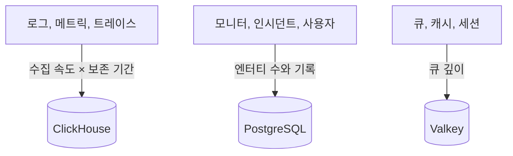

# 사이징 및 용량 계획

[Helm 차트](https://artifacthub.io/packages/helm/oneuptime/oneuptime)로 Kubernetes에 자체 호스팅하는 OneUptime의 CPU, 메모리, 디스크를 계획합니다. 세 데이터 저장소(**ClickHouse**, **PostgreSQL**, **Valkey**)와 애플리케이션을 따로 사이징하고, 아래 단계 중 하나에서 시작해 실제 수치가 나오면 조정하세요.

> [!IMPORTANT]
> 차트의 기본값은 프로덕션용 사이징이 아닙니다. 기본으로 실행되는 서비스는 **CPU와 메모리의 요청이나 제한을 설정하지 않으며**, PostgreSQL과 ClickHouse는 **25 Gi**의 작은 볼륨을 받습니다. 어떤 클러스터에도 차트를 설치할 수 있게 하기 위해서입니다. 시험 사용을 넘어서는 경우에는 이 페이지의 수치를 사용해 리소스와 스토리지를 직접 설정하세요.

대신 서버 한 대에 Docker Compose로 설치했나요? 사이징이 더 간단합니다. [요구 사항](/docs/installation/docker-compose#requirements)을 참고하세요(메모리 16 GB, 8코어, 디스크 400 GB 권장).

:::cards
- [각 데이터 저장소를 키우는 요인](#what-drives-each-datastore): 세 저장소는 각기 다른 요인으로 커집니다.
- [시작 단계](#starting-tiers): 소형, 중형, 대형 출발점.
- [고가용성](#high-availability): 데이터 저장소별 복제본과 장애 조치.
- [보존 기간](#retention-and-how-it-affects-storage): 디스크를 몇 배로 늘리는 설정.
:::

## 설치 규모 정하기

:::steps
1. 보내는 텔레메트리의 양, 즉 하루에 로그, 메트릭, 트레이스가 몇 GB인지 파악합니다. 가능하면 작은 설치에서 측정하세요.
2. 며칠 동안 보관할지 정합니다. 보존 기간은 ClickHouse의 디스크를 몇 배로 늘립니다([보존 기간](#retention-and-how-it-affects-storage) 참고).
3. [스토리지 공식](#storage-formula)으로 ClickHouse의 디스크를 계산한 다음, 각 섹션을 보고 PostgreSQL과 Valkey의 디스크를 계산합니다.
4. 수치에 가장 가까운 [시작 단계](#starting-tiers)를 고르고, 그 단계의 CPU, 메모리, 스토리지를 Helm values에 설정합니다.
5. 필요한 데이터 저장소에 [고가용성](#high-availability)을 켜고, 실제 사용량을 지켜보며 조정합니다.
:::

## 각 데이터 저장소를 키우는 요인

OneUptime을 프로덕션에서 운영하려면 데이터 저장소 세 개가 필요합니다. 저마다 다른 요인으로 커지므로 따로 사이징하세요.



| 데이터 저장소 | 저장하는 것 | 크기를 정하는 것 |
| --- | --- | --- |
| **ClickHouse** | 모든 텔레메트리(로그, 메트릭, 트레이스, 예외, 프로필) | 텔레메트리의 **수집 속도 × 보존 기간**. 스토리지의 약 95%를 차지하며 가장 큰 비용입니다. |
| **PostgreSQL** | 구성과 상태(모니터, 인시던트, 알림, 사용자, 팀, 프로젝트, 워크플로, 상태 페이지, 대시보드) | 텔레메트리 양이 아닌 **엔터티 수와 기록**. 천천히 커집니다. |
| **Valkey** | 캐시, 작업 큐, 세션 | **큐 깊이와 활성 세션**. 메모리에 좌우되며 크지 않습니다. 원본 데이터 저장소가 아닙니다. |

OneUptime은 실행에 객체 스토리지(S3, MinIO)가 전혀 필요 없으며, 오래된 텔레메트리를 객체 스토리지로 옮기지도 않습니다. 객체 스토리지는 객체 스토리지로 백업하기로 선택한 경우에만 필요합니다. CloudNativePG용 Barman Cloud 플러그인이나 ClickHouse용 [clickhouse-backup](https://github.com/Altinity/clickhouse-backup)이 그렇습니다. 차트 자체의 CloudNativePG 백업(`postgresOperator.cnpg.backup`)은 볼륨 스냅샷을 찍으며 객체 스토리지가 필요 없습니다. CloudNativePG는 오래된 스냅샷을 지우지 않으므로 직접 정리하세요. 그러지 않으면 계속 쌓입니다.

## ClickHouse: 가장 큰 요인

스토리지의 거의 전부와 메모리의 상당 부분이 ClickHouse에 쓰입니다. 모든 로그 줄, 메트릭 포인트, 트레이스 스팬, 예외가 그곳에 저장되기 때문입니다.

### 스토리지 공식

```text
ClickHouse disk ≈ (daily raw telemetry GB ÷ compression) × retention days × replicas × 1.3 (headroom)
```

압축률은 신호에 따라 다릅니다.

| 신호 | 일반적인 압축률 | 바뀌는 요인 |
| --- | --- | --- |
| 로그 | 약 5:1 | 로그는 압축이 잘 됩니다. |
| 메트릭 | 약 2:1 | 레이블의 **카디널리티**가 높으면 원본 양보다 빠르게 디스크와 메모리가 커집니다. 레이블의 카디널리티를 낮게 유지하세요. |
| 트레이스 | 둘의 중간 | 보내는 스팬 속성에 따라 다릅니다. |

### 계산 예시

**클러스터 10개**로 이루어진 환경에서 클러스터마다 노드 약 10개와 INFO 수준으로 로그를 남기는 파드 100개가 있다면, 대략 **클러스터당 30일 동안 50–150 GB의 원본 로그**(클러스터당 하루 약 1.7–5 GB)가 생깁니다. 전체 환경에서는 메트릭과 트레이스를 더하고 압축한 뒤 대략 **하루 5–15 GB의 압축된 텔레메트리**를 잡아 두세요.

| 보존 기간 | 복제본 1개 | 복제본 2개 + 30% 여유 |
| --- | --- | --- |
| 30일 | ~150–450 GB | **~0.4–1.2 TB** |
| 90일 | ~0.45–1.35 TB | **~1.2–3.5 TB** |

스토리지는 **보존 기간에 비례해** 늘어납니다. 90일 기간은 30일 기간의 약 세 배가 듭니다.

### 메모리와 디스크 종류

- **NVMe나 SSD를 사용하세요.** 텔레메트리는 쓰기가 많고 집계 읽기가 몰려서 발생합니다. 회전식 디스크에서는 ClickHouse가 버거워합니다.
- **ClickHouse에 메모리를 넉넉히 주세요.** 집계 쿼리는 메모리를 많이 씁니다. 대략 *핫* 데이터(최근에 조회된 압축 데이터)의 25–50%로 메모리를 잡고, 실제 프로덕션 환경이라면 실용적인 하한을 16 GB로 두세요.
- **메트릭 카디널리티를 관리하세요.** ClickHouse의 메모리와 디스크 모두에 가장 크게 작용하는 단일 요인입니다. 메트릭을 수집하는 곳에서 카디널리티가 낮은 레이블 규칙을 적용하고, 활성 시계열의 수를 지켜보세요.

## PostgreSQL: 구성과 상태

PostgreSQL은 텔레메트리가 아니라 구성과 운영 상태를 저장하므로 천천히 커지고 ClickHouse에 비해 작게 유지됩니다. 대규모 설치도 보통 수십 GB 수준입니다. 소규모 설치에는 기본 **25 Gi** 볼륨으로 충분하며, 대규모 설치에는 인시던트와 알림 기록의 여유분을 포함해 50–100 GB를 계획하세요.

앱, 워커, 프로브의 복제본이 많으면 스토리지보다 데이터베이스 연결이 먼저 부족해질 수 있습니다. 파드마다 기본적으로 최대 50개의 연결을 열고, 함께 제공되는 PostgreSQL은 500개까지 허용합니다. 바로 이런 경우를 위해 차트에는 선택 사항인 연결 풀러 **PgBouncer**(`pgbouncer.enabled`)가 들어 있습니다. 복제본이 많은 설치에서는 켜세요.

## Valkey: 캐시, 큐, 세션

캐시 계층은 Redis 7.2의 BSD 라이선스 포크인 [Valkey](https://valkey.io)를 캐시, 작업 큐, 세션 저장소로 실행합니다. Redis 프로토콜을 쓰는 서버라면 무엇이든 대신 쓸 수 있으며, 아래 사이징은 어느 쪽에나 적용됩니다. Valkey는 **메모리에 좌우되며**, 영속성은 **기본적으로 꺼져 있습니다**. 원본 데이터 저장소가 아니므로 다시 만들 수 있습니다. 큐 깊이와 동시 세션 수로 사이징하세요. 대부분의 설치에는 메모리 2–8 GB면 충분합니다. 축출 정책이 `noeviction`이므로, 지속적인 부하로 큐가 밀리면 메모리를 지켜보세요.

## 애플리케이션 컴퓨팅

데이터 저장소 외에 상태 없는 워크로드도 사이징합니다. 각 워크로드는 직접 설정하기 전까지 **리소스 요청도 제한도 없이** 실행되며, 복제본은 하나입니다. 단, 텔레메트리 라이터는 두 개입니다.

| 워크로드 | values 키 | 커지는 요인 |
| --- | --- | --- |
| App: 대시보드, API, 수집 | `app` | 사용자, API 호출, 들어오는 텔레메트리 |
| 워커(앱에서 분리한 경우) | `worker` | 텔레메트리와 백그라운드 작업 처리 |
| 프로브 | `probes` | 활성 모니터 수 |
| 인그레스 게이트웨이 | `nginx` | 요청량 |
| 텔레메트리 라이터(켠 경우) | `telemetryWriter` | 부하에 따라 커지지 않습니다. 모든 텔레메트리 삽입을 ClickHouse로 묶어 보내므로 ClickHouse가 감당할 수 있는 양에 맞춰 사이징합니다 |

차트에는 **KEDA**가 포함되어 있어, 앱, 워커, 프로브, Runner가 큐에 쌓인 작업량에 따라 확장될 수 있습니다. `keda.enabled`와 함께 각 서비스의 `keda.enabled`(예: `app.keda.enabled`)를 켜세요. 아직 KEDA가 없는 클러스터에서는 첫 설치에 추가 단계가 필요합니다. 차트의 [KEDA 가이드](https://github.com/OneUptime/oneuptime/blob/master/HelmChart/Docs/Keda.md)를 참고하세요. KEDA가 관리하지 않는 서비스는 대신 CPU나 메모리 기반 자동 확장기(`autoscaling`)를 쓸 수 있습니다.

## 시작 단계

환경에 가장 가까운 단계를 출발점으로 고른 다음, 실제 사용량(`kubectl top pods`, ClickHouse와 PostgreSQL의 디스크 증가)을 지켜보며 조정하세요.

- **소형 / PoC**: 클러스터 1–3개, 노드 30개 이하, 원본 텔레메트리 하루 5 GB 이하, 보존 기간 30일.
- **중형 / 프로덕션 환경**: 클러스터 약 10개, 노드 약 100개, 원본 텔레메트리 하루 10–30 GB, 보존 기간 30–90일.
- **대형 / 다중 환경**: 클러스터 50개 이상, 노드 500개 이상, 원본 텔레메트리 하루 100 GB 이상, 보존 기간 90일.

| | 소형 / PoC | 중형 / 프로덕션 환경 | 대형 / 다중 환경 |
| --- | --- | --- | --- |
| **ClickHouse** | 4 vCPU / 16 GB / 200 GB NVMe | 8 vCPU / 32 GB / 1–3 TB NVMe | 16+ vCPU / 64–128 GB / 5–15 TB NVMe, **샤딩** |
| **PostgreSQL** | 2 vCPU / 4 GB / 50 GB SSD | 4 vCPU / 8 GB / 100 GB SSD | 8 vCPU / 16–32 GB / 250 GB SSD (+ PgBouncer) |
| **Valkey** | 1 vCPU / 2 GB | 2 vCPU / 4 GB | 4 vCPU / 8–16 GB |
| **가정한 보존 기간** | 30일 | 30–90일 | 90일 |

이 단계는 OneUptime 백엔드의 사이징입니다. 모니터링하는 각 클러스터에 설치하는 에이전트는 [Kubernetes 에이전트](/docs/telemetry/kubernetes-agent) 페이지에서 다루며, 그 페이지에서 에이전트가 보내는 데이터 양을 줄이는 방법도 볼 수 있습니다.

## 고가용성

차트에 내장된 데이터 저장소는 기본적으로 **단일 인스턴스**로 실행됩니다. 프로덕션에서 고가용성을 갖추려면:

| 데이터 저장소 | 고가용성 구성 |
| --- | --- |
| **PostgreSQL** | 함께 제공되는 [CloudNativePG](https://cloudnative-pg.io) 오퍼레이터(`postgresOperator.cnpg.enabled`)를 **인스턴스 3개**(`postgresOperator.cnpg.instances`)로 켭니다. 기본 인스턴스 하나와 핫 스탠바이 둘로 구성되며 자동 장애 조치가 됩니다. |
| **ClickHouse** | 함께 제공되는 [Altinity](https://github.com/Altinity/clickhouse-operator) 오퍼레이터(`clickhouseOperator.altinity.enabled`)를 **샤드당 복제본 2개 이상**(`clickhouseOperator.altinity.cluster.replicasCount`)으로 켭니다. 함께 제공되는 ClickHouse Keeper는 쿼럼을 위해 **노드 3개**로 실행됩니다. 노드 하나의 디스크나 메모리가 한계가 되면 샤드(`shardsCount`)를 추가하세요. |
| **Valkey** | 차트는 Valkey를 복제하지 않습니다. 자동 장애 조치가 되는 외부 관리형 Redis나 Valkey를 OneUptime이 가리키게 하세요(`externalValkey`). OneUptime은 단일 호스트와 포트에 연결하므로, 클러스터 모드 엔드포인트가 아니라 서비스의 기본 엔드포인트를 사용하세요. |

> [!WARNING]
> 기존 설치에서 두 오퍼레이터 중 하나를 켜면 비어 있는 새 데이터베이스가 시작됩니다. 어느 쪽도 대체하는 단일 인스턴스 데이터베이스의 데이터를 복사하지 않습니다. 차트 가이드에 설명된 대로 데이터를 마이그레이션하세요. [PostgreSQL](https://github.com/OneUptime/oneuptime/blob/master/HelmChart/Docs/MigratePostgresStandaloneToOperator.md)용과 [ClickHouse](https://github.com/OneUptime/oneuptime/blob/master/HelmChart/Docs/MigrateClickhouseStandaloneToOperator.md)용이 있습니다.

## 보존 기간과 스토리지에 미치는 영향

텔레메트리 보존 기간은 **일 단위로 세는 ClickHouse TTL**입니다. 모든 에디션에는 프로젝트 기본값이 있으며, **프로젝트 설정 > 텔레메트리 및 APM > 데이터 보존**(**기본 보존(일)**)에서 설정합니다. 아무것도 설정하지 않으면 15일입니다. [Enterprise Edition](/docs/self-hosted/enterprise)은 재정의를 추가합니다. 신호별(로그, 트레이스, 메트릭, 프로필), 로그 심각도와 트레이스 상태별, 서비스나 리소스별 재정의입니다.

로그와 메트릭은 보존 기간이 끝난 뒤 첫 자정(ClickHouse 서버 시간)에 하루치씩 삭제됩니다. 덕분에 만료되는 동안 ClickHouse가 각 날짜의 데이터를 몇 시간마다 다시 쓰지 않아도 됩니다. 자정 직전에는 보존 기간보다 최대 하루치가 더 디스크에 남아 있으므로, 로그와 메트릭은 **보존 일수 + 1**로 사이징하세요.

보존 기간은 ClickHouse의 스토리지를 몇 배로 늘리므로 디스크를 사이징하기 전에 정하세요. OneUptime은 오래된 텔레메트리를 보관하거나 객체 스토리지로 옮기지 **않습니다**. 컴플라이언스를 위해 수년간 보관해야 한다면 보존 기간을 늘리고 그에 맞게 ClickHouse 스토리지를 사이징하거나, 원하는 외부 보관소로 내보내세요.

## 결정하기 전에 측정하기

텔레메트리 양은 애플리케이션 로그의 상세도, 네임스페이스 수, 스크레이프 간격, 어딘가에서 DEBUG 로깅이 켜져 있는지에 따라 크게 달라집니다. 위의 단계는 출발점으로 삼고, **최소 4주 동안 환경에서 데이터를 수집해**, 신호별로 하루 실제 GB를 측정한 다음 실제 데이터를 바탕으로 보존 기간과 스토리지를 정하세요.

## 다음 단계

:::cards
- [Docker Compose](/docs/installation/docker-compose): 서버 한 대에 설치할 때의 요구 사항.
- [자체 호스팅 아키텍처](/docs/self-hosted/architecture): 구성 요소가 어떻게 맞물리는지 알아봅니다.
- [Kubernetes 에이전트](/docs/telemetry/kubernetes-agent): 클러스터의 텔레메트리를 보내는 수집기.
- [Enterprise Edition](/docs/self-hosted/enterprise): 보존 기간 재정의와 그 밖의 Enterprise 기능.
:::
