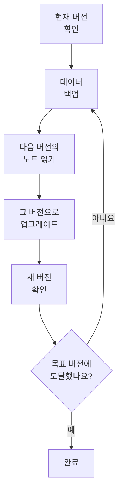

# 업그레이드

자체 호스팅 OneUptime 설치(Docker Compose 또는 Kubernetes와 Helm)를 새 버전으로 업그레이드합니다. 아래 절차를 따르고, 지금 실행 중인 버전부터 옮겨 갈 버전까지 사이에 있는 모든 메이저 버전의 노트를 읽으십시오.

:::cards
- [업그레이드하는 방법](#업그레이드하는-방법): Docker Compose와 Kubernetes의 절차입니다.
- [버전별 노트](#버전별-노트-찾기): 메이저 버전마다 해야 할 일을 한눈에 봅니다.
- [Community Edition과 Enterprise Edition 이미지](#community-edition과-enterprise-edition-이미지): 14부터 실행할 이미지입니다.
- [OneUptime 13 → 14 업그레이드](#oneuptime-13-14-업그레이드): 최신 메이저 버전입니다.
:::

## 업그레이드하는 방법

다음 세 가지 규칙을 지키면 업그레이드를 안전하게 할 수 있습니다.

- **메이저 버전은 한 번에 하나씩 업그레이드하십시오** (예: 6 → 7 → 8). 메이저 버전을 건너뛰지 마십시오.
- **마이너 릴리스와 패치 릴리스는 자유롭게 건너뛰어도 됩니다** (예: 8.1 → 8.4). 단, 해당 릴리스 노트를 따르십시오.
- **업그레이드할 때마다 먼저 백업하고**, 그 백업을 복원할 수 있는지 확인하십시오.



:::steps
### 현재 버전 확인하기

마스터 관리자로 관리자 대시보드 헤더의 에디션 라벨을 여십시오. **This installation** 에 실행 중인 버전이 표시됩니다. 인스턴스는 `/version` 에서도 버전을 알려 줍니다.

```bash
curl http://localhost/version
```

`http://localhost` 를 인스턴스 주소로 바꾸십시오. 응답은 `{"version":"14.0.22","commit":"..."}` 같은 JSON입니다.

### 데이터 백업하기

PostgreSQL을 백업하고, ClickHouse의 텔레메트리가 필요하면 ClickHouse도 백업하십시오. Docker Compose는 [백업 및 복원](/docs/installation/docker-compose#백업과-복원) 을 참조하십시오. Kubernetes에서는 볼륨 스냅샷이나 차트의 CloudNativePG 백업을 사용하십시오.

### 다음 메이저 버전의 노트 읽기

노트는 [아래 표](#버전별-노트-찾기) 에 있습니다. 업그레이드하기 전에 노트에서 요구하는 작업을 하십시오. Helm 값 이름 변경처럼 먼저 해야 하는 단계도 있습니다.

### 업그레이드 실행하기

:::tabs
@tab Docker Compose
```bash
git checkout release
git pull
npm run update
```
`npm run update` 는 기존 설정은 바꾸지 않고 새 설정을 `config.env` 에 추가하고, 새 이미지를 가져온 뒤 OneUptime을 다시 시작합니다.
@tab Kubernetes
```bash
helm repo update
helm upgrade my-oneuptime oneuptime/oneuptime -f values.yaml
```
자신의 릴리스 이름과 값 파일을 사용하십시오. 차트는 새 Pod가 트래픽을 처리하기 전에 별도의 Job에서 데이터베이스 마이그레이션을 실행합니다.
:::

### 새 버전 확인하기

Docker Compose에서는 `npm run update` 가 **OneUptime is up!** 으로 끝납니다. Kubernetes에서는 모든 Pod가 `Running` 이고 준비될 때까지 기다리십시오.

```bash
kubectl get pods -n <namespace>
```

그런 다음 첫 단계처럼 버전을 다시 확인하십시오. 아직 목표 버전에 도달하지 않았다면 [데이터 백업하기](#데이터-백업하기) 로 돌아가 다음 메이저 버전으로 진행하십시오.
:::

### 버전별 노트 찾기

| 업그레이드 | 해야 할 일 |
| --- | --- |
| [13 → 14](#oneuptime-13-14-업그레이드) | 에디션을 고릅니다. `IS_ENTERPRISE_EDITION=true` 를 설정한 Docker Compose 설치는 `APP_TAG=enterprise-release` 로 바꿉니다. Enterprise Edition에서는 라이선스를 활성화합니다. IPv6 Ping, Port, SSL 모니터를 다시 저장합니다. |
| [12 → 13](#oneuptime-12-13-업그레이드) | 보통은 없습니다. Redis가 Valkey로 바뀌고, 기존 설정 이름도 계속 동작합니다. Docker Compose를 직접 실행합니까? `--remove-orphans` 를 추가하십시오. 직접 운영하는 캐시를 씁니까? [직접 운영하는 캐시를 쓰는 경우](#직접-운영하는-캐시를-쓰는-경우) 를 읽으십시오. |
| [11 → 12](#oneuptime-11-12-업그레이드) | Runbook Agent를 Runner로 다시 배포합니다. Docker Compose에서는 `ONEUPTIME_RUNNER_KEY` 를 설정합니다. Helm에서는 `aiAgent:` 를 `runner:` 로 이름을 바꿉니다. API 키에 직접 부여되어 있던 Runner 권한을 다시 부여합니다. |
| [10 → 11](#oneuptime-10-11-업그레이드) | SCIM과 팀 규정 준수 설정에는 Enterprise Edition이 필요합니다. 텔레메트리 기록을 유지하려면 업그레이드하기 전에 기존 ClickHouse 테이블의 이름을 바꾸십시오. |
| [9 → 10](#oneuptime-9-10-업그레이드) | 없습니다. |
| [8 → 9](#oneuptime-8-9-업그레이드) | Helm에서는 값에서 `oneuptimeIngress` 재정의를 제거합니다. |
| [7 → 8](#oneuptime-7-8-업그레이드) | Helm에서는 Postgres, Redis, ClickHouse의 새 값 구조로 옮겨 갑니다. 먼저 백업하십시오. |

## Community Edition과 Enterprise Edition 이미지

OneUptime은 이제 애플리케이션을 두 가지 이미지로 제공합니다. **Community Edition** 은 Apache 2.0 라이선스의 오픈 소스이며, SAML과 OIDC 싱글 사인온, 전역 SSO, "Require SSO for login"을 포함합니다. **Enterprise Edition** 은 저장소의 `ee/` 디렉터리에 있는 엔터프라이즈 모듈인 SCIM, 팀 규정 준수, 감사 로그, 관리자 대시보드의 엔터프라이즈 Health 대시보드를 추가합니다. 이 변경 전에는 두 에디션이 같은 코드를 실행했고, 어떤 기능을 켤지는 `IS_ENTERPRISE_EDITION` 이 정했습니다. 이제는 이미지가 정하며, Community 이미지에는 `ee/` 디렉터리가 들어 있지 않습니다.

기능 전체 비교, 라이선스 세부 정보, 에디션을 바꿀 때 일어나는 일은 [엔터프라이즈 에디션](/docs/self-hosted/enterprise) 페이지에 있습니다.

### 업그레이드 전에 할 일

- **SCIM 없는 Community Edition:** 없습니다. 평소처럼 업그레이드하십시오.
- **`image.type: enterprise-edition` 을 쓰는 Helm:** 없습니다. 차트는 이미 `enterprise-` 이미지를 가져오며, 이제 이 이미지에 엔터프라이즈 모듈이 들어 있습니다.
- **`IS_ENTERPRISE_EDITION=true` 를 쓰는 Docker Compose:** 업그레이드할 때 `config.env` 에서 `APP_TAG=enterprise-release` (또는 `enterprise-<version>`)를 설정해 Enterprise 이미지로 바꾸십시오. `APP_TAG=release` 는 Community 이미지이며, `IS_ENTERPRISE_EDITION=true` 는 더 이상 아무것도 켜지 않습니다. `IS_ENTERPRISE_EDITION=true` 인 동안에는 `npm run update` 가 이 변경을 대신 해 주며(`release` 는 `enterprise-release` 가 되고, 고정한 `13.0.7` 은 `enterprise-13.0.7` 이 됩니다), 바꾼 내용을 출력합니다. 이제 Community 이미지에 `IS_ENTERPRISE_EDITION=true` 가 설정되어 있으면, 애플리케이션은 SCIM 프로비저닝과 감사 로깅을 조용히 멈추는 대신 **시작을 거부합니다**. 오류 메시지는 설정할 내용을 알려 줍니다. Enterprise Edition을 계속 쓰려면 `APP_TAG=enterprise-<version>`, Community Edition을 실행하려면 `IS_ENTERPRISE_EDITION=false` 입니다.
- **SCIM이 이미 설정된 Community 이미지:** 이 업그레이드로 디프로비저닝을 포함한 SCIM 프로비저닝이 멈춥니다. 계속 쓰려면 Enterprise 이미지로 바꾸십시오. 그렇지 않다면 업그레이드하기 전에 [Enterprise에서 Community로 전환](/docs/self-hosted/enterprise#switching-from-enterprise-to-community) 을 읽으십시오. 무엇이 멈추는지, 누구를 먼저 제거해야 하는지 설명합니다. Community Edition을 실행하려면 `IS_ENTERPRISE_EDITION=false` 도 설정하십시오. 싱글 사인온에는 영향이 없습니다. Community 이미지도 싱글 사인온을 제공합니다.

설정은 절대 삭제되지 않으며, 어느 방향으로 에디션을 바꾸든 마이그레이션이 필요 없습니다.

### 업그레이드 후의 라이선스

이제 Enterprise Edition은 자신의 라이선스를 확인합니다.

- **라이선스 키가 있는 설치** 는 계속 실행됩니다. 시작할 때와 하루에 한 번 OneUptime에서 라이선스를 확인합니다. 라이선스가 만료되어도 30일의 유예 기간 동안은 모든 것이 계속 동작하며, 그 뒤에는 라이선스가 없는 설치와 같은 일이 일어납니다.
- **라이선스가 없는 설치** (예: `IS_ENTERPRISE_EDITION=true` 만으로 Enterprise Edition을 실행하던 설치)는 이 버전을 처음 시작한 때부터 14일의 평가판 기간을 받습니다. **SCIM이나 감사 로깅을 쓴다면 평가판 기간이 끝나기 전에 라이선스를 활성화하십시오.** 평가판 기간이 끝나면 SCIM 프로비저닝이 멈추고 감사 로깅이 기록을 멈춥니다. 엔터프라이즈 설정도 읽기 전용이 되고, 엔터프라이즈 Health 대시보드는 잠깁니다. 싱글 사인온에는 영향이 없습니다. 라이선스를 활성화하면 다시 시작하지 않아도 바로 모든 것이 재개됩니다. 평가판 기간은 평가용입니다. Enterprise Edition을 프로덕션에서 쓰려면 OneUptime Enterprise 구독이 필요합니다. [라이선스가 만료되었거나 없을 때](/docs/self-hosted/enterprise#when-a-license-expires-or-is-missing) 를 참조하십시오.
- **네트워크와 분리된 설치** 는 키 대신 서명된 라이선스 토큰으로 활성화할 수 있습니다. [오프라인 활성화](/docs/self-hosted/enterprise#offline-activation-air-gapped-installs) 를 참조하십시오.

### OneUptime Cloud 고객

달라지는 것은 없습니다. OneUptime Cloud는 Enterprise Edition을 실행하며, 어떤 기능을 쓸 수 있는지는 여전히 요금제가 정합니다. SSO, OIDC, SCIM, 팀 규정 준수는 Scale 요금제 이상, 감사 로그는 Enterprise 요금제입니다. Scale 요금제 프로젝트에는 이전에 업그레이드 안내가 표시되던 SSO, OIDC, SCIM, 팀 규정 준수 설정이 이제 표시됩니다.

### API와 엔드포인트 변경

- `GET /api/global-config/license` 는 라이선스 키, 라이선스 토큰, 인스턴스 목록, 인스턴스 ID, 버전 세부 정보를 마스터 관리자에게만 반환합니다. 다른 호출자는 에디션과 라이선스 상태를 받습니다.
- 자체 호스팅 설치는 더 이상 `/api/enterprise-license/` 아래의 라이선스 서버 엔드포인트를 제공하지 않습니다. 이 엔드포인트는 oneuptime.com만 사용합니다.
- SCIM 엔드포인트는 Enterprise Edition에서 경로가 그대로 유지되므로 ID 공급자 설정은 바뀌지 않습니다. Community Edition에서는 `404` 를 반환합니다. Enterprise Edition에서는 라이선스가 만료된 동안(평가판 기간이나 유예 기간 이후) 요청을 거부하고, 라이선스가 활성화되면 바로 다시 응답합니다.
- SSO와 OIDC 엔드포인트(SAML 로그인 URL과 ACS URL, OIDC 리디렉션 URI, 전역 SSO 엔드포인트)는 경로가 그대로 유지되며, 라이선스 상태와 관계없이 두 에디션 모두에서 제공됩니다.

## OneUptime 13 → 14 업그레이드

OneUptime 14는 애플리케이션을 두 에디션으로 나누며, 어떤 에디션을 실행할지는 가져오는 이미지가 정합니다. **Community Edition** (Apache-2.0, 태그 `release` 와 `<version>`)에는 SAML SSO, OpenID Connect, 전역 SSO, "Require SSO for login"이 포함됩니다. 저장소의 `ee/` 디렉터리가 들어 있지 않으므로 SCIM 프로비저닝, 팀 규정 준수 설정, 감사 로그, 관리자 대시보드의 **Health** 대시보드, 관리자 대시보드의 **Query Console** 은 이 이미지에 전혀 없습니다. **Enterprise Edition** (태그 `enterprise-release` 와 `enterprise-<version>`)에는 이것들이 들어 있으며, 실행 중에 Enterprise 라이선스를 확인합니다. OneUptime 13은 이런 확인을 한 적이 없습니다. 싱글 사인온은 이 라이선스에 의존하지 않습니다.

위의 [Community Edition과 Enterprise Edition 이미지](#community-edition과-enterprise-edition-이미지) 가 이 변경의 참조 문서입니다. 에디션마다 무엇이 들어 있는지, 배포 유형마다 무엇을 설정해야 하는지, 라이선스가 무엇을 하는지 설명합니다. 이 섹션은 업그레이드 자체입니다. 13에서 업그레이드하십시오. 아직 12라면 먼저 12 → 13을 하십시오.

어느 에디션에서도 삭제되는 것은 없습니다. 싱글 사인온은 두 에디션에서 똑같이 동작하며, SSO와 OIDC 설정과 "Require SSO for login" 설정은 그대로 유지됩니다. SCIM 설정과 지금까지 기록된 감사 로그는 데이터베이스에 남습니다. Community Edition은 이것들을 제공하지 않을 뿐이며, 어느 방향으로 에디션을 바꾸든 마이그레이션이 필요 없습니다.

### 해야 할 일

1. **이 설치에서 실행할 에디션을 정하십시오.** SCIM 프로비저닝, 팀 규정 준수 설정, 감사 로그를 쓰거나 관리자 대시보드의 **Health** 대시보드가 필요하다면 Enterprise Edition입니다. 그 밖의 경우에는 정할 것이 없습니다. Community Edition이 지금 쓰고 있는 것이며, SAML SSO와 OpenID Connect를 포함합니다.
2. **Helm에서는 값 파일에 에디션을 설정하십시오:** `image.type: enterprise-edition` (기본값은 `community-edition`). `image.tag` 는 건드리지 마십시오. 차트가 알아서 `enterprise-` 접두사를 붙이므로 `image.tag: release` 는 `oneuptime/app:enterprise-release` 를 가져옵니다. 이 값은 새로운 것이 아닙니다. 이미 `enterprise-edition` 을 쓰고 있다면 바꿀 것이 없습니다. 이미 가져오는 태그에 이제 `ee/` 가 들어 있습니다.
3. **Docker Compose에서는 `config.env` 에 `APP_TAG=enterprise-release` 를 설정하십시오** (버전을 고정하려면 `enterprise-<version>`). `APP_TAG=release` 는 Community 이미지입니다. 13의 설치를 멈추게 하는 것은 이것뿐입니다. 13에서 Compose의 Enterprise 설치는 `APP_TAG=release` 에 `IS_ENTERPRISE_EDITION=true` 를 더한 조합이었는데, 이 조합은 이제 SCIM 프로비저닝과 감사 로깅이 조용히 멈춘 Community Edition으로 올라오는 대신 **시작을 거부합니다**. `IS_ENTERPRISE_EDITION=true` 인 동안에는 `npm run update` 가 `APP_TAG` 를 대신 다시 써 주며(`release` 는 `enterprise-release` 가 되고, 고정한 `13.0.8` 은 `enterprise-13.0.8` 이 됩니다), 바꾼 내용을 출력합니다. 대신 이미지를 직접 가져온다면 먼저 `APP_TAG` 를 직접 설정하십시오.
4. **Enterprise Edition에서는 라이선스를 활성화하십시오.** 라이선스가 없는 설치는 Enterprise Edition을 처음 시작한 때부터 세어 14일의 평가판 기간을 받습니다. 업그레이드의 경우 이는 OneUptime을 처음 설치한 날이 아니라 업그레이드한 날입니다. 마스터 관리자가 관리자 대시보드 헤더의 에디션 라벨에서 활성화합니다. 네트워크와 분리된 설치는 대신 서명된 토큰으로 활성화합니다. [라이선싱](/docs/self-hosted/enterprise#licensing) 을 참조하십시오.
5. **ID 공급자가 SCIM으로 사용자를 디프로비저닝하는 동안 이 설치를 Community Edition으로 실행한다면, 업그레이드하기 전에 누가 접근 권한을 가지고 있는지 검토하십시오.** SCIM 디프로비저닝이 멈추므로 ID 공급자에서 제거한 사람도 OneUptime 계정을 유지하며, "Require SSO for login"이 적용되지 않는 한 그 계정의 메일함에 아직 접근할 수 있는 사람은 누구나 "비밀번호 찾기"로 비밀번호를 설정하고 로그인할 수 있습니다. 먼저 그 사용자들을 제거하십시오: [Enterprise에서 Community로 전환](/docs/self-hosted/enterprise#switching-from-enterprise-to-community).
6. **Ping, Port, SSL 모니터로 IPv6 주소를 모니터링한다면 업그레이드 후에 그 모니터들을 다시 저장하십시오.** 14 이전에 저장한 대상은 잘린 채로 저장되었을 수 있습니다. [IPv6 Ping, Port, SSL 모니터](#ipv6-ping-port-ssl-모니터) 를 참조하십시오.

### 에디션: 바뀐 것과 바뀌지 않은 것

| | 13까지 | 14부터 |
| --- | --- | --- |
| 엔터프라이즈 코드 | 모든 이미지에 포함, `IS_ENTERPRISE_EDITION=true` 로 켬 | `ee/` 에 있으며 `enterprise-` 이미지에만 포함 |
| Helm의 선택자 | `image.type` | `image.type` – 바뀌지 않았지만 이제 이미지가 다름 |
| Compose의 선택자 | `IS_ENTERPRISE_EDITION=true` | `APP_TAG=enterprise-release` |
| Enterprise 라이선스 | 실행 중에 확인한 적 없음 | 시작할 때와 하루에 한 번 확인 |
| SSO와 OIDC 엔드포인트 | 두 에디션에서 같은 경로 | 두 에디션에서 같은 경로, 라이선스 상태와 무관 |
| SCIM 엔드포인트 | 두 에디션에서 같은 경로 | Enterprise에서 같은 경로, Community에서는 `404` |
| 엔터프라이즈 설정 | 저장되고 적용됨 | 어느 쪽이든 저장되고, Enterprise에서 적용됨 |

마이그레이션이 하나 실행됩니다. 행이 하나뿐인 `GlobalConfig` 테이블에 NULL을 허용하는 열 `enterpriseEditionFirstSeenAt` 을 추가하는 것이므로 즉시 끝납니다. ClickHouse 마이그레이션은 없고, 삭제되는 것도 없으며, 어느 방향으로 에디션을 바꾸든 마이그레이션이 필요 없습니다.

### Enterprise Edition의 라이선스 일정

- **라이선스가 없는 설치** 는 Enterprise Edition을 처음 시작한 때부터 세어 14일의 평가판 기간으로 실행됩니다. 평가판 기간에는 모든 엔터프라이즈 기능이 동작하며, 끝나기 전에 에디션 라벨이 경고합니다. 평가판 기간은 평가용입니다. Enterprise Edition을 프로덕션에서 쓰려면 OneUptime Enterprise License에 따른 구독이 필요합니다.
- **만료되는 라이선스** 는 만료일로부터 30일의 유예 기간을 받으며, 그동안 모든 엔터프라이즈 기능이 동작하고 에디션 라벨이 경고합니다.
- **평가판 기간 이후, 또는 그 유예 기간 이후** 라이선스가 활성화될 때까지: ID 공급자의 SCIM 요청이 거부되고 감사 로깅이 기록을 멈춥니다. 엔터프라이즈 설정은 읽기 전용이 됩니다. 여전히 보고, 삭제하고, SCIM 베어러 토큰을 재설정할 수 있으며, 인시던트 때 필요한 것은 이것입니다. 관리자 대시보드의 Health 대시보드와 Query Console은 잠깁니다.
- **삭제되는 것은 없으며, 핵심 모니터링은 전혀 영향을 받지 않습니다.** 모니터, 알림, 인시던트, 온콜, 상태 페이지, 텔레메트리는 라이선스의 대상이 아니며, 로그인도 마찬가지입니다. SSO와 OIDC 로그인, "Require SSO for login", 마스터 관리자를 포함한 모든 사용자의 비밀번호 로그인은 라이선스 상태와 관계없이 똑같이 동작합니다. 라이선스를 활성화하면 다시 시작하지 않아도 이미 있는 설정 그대로 SCIM 프로비저닝과 감사 로깅이 복원됩니다.
- **이미 가지고 있는 라이선스 키는 받아들여집니다**. "unverified" 라이선스로 취급되며, 만료일과 좌석 한도는 라이선스 서버가 이 설치에 이미 알려 준 내용에서 가져오고, 그 만료일 이후 같은 30일의 유예 기간을 받습니다. 앞으로 발급되는 라이선스는 서명되어 있으며 애플리케이션이 직접 검증합니다. 이번 업그레이드에 새 키는 필요 없습니다.
- **이 설치가 만료일을 한 번도 기록하지 않은 키** 는 멈추지 않고 평가판 기간 동안 계속 동작합니다. 라이선스 서버는 키와 만료일을 따로 기록하므로, 만료일을 한 번도 전달받지 못한 키를 가진 설치가 있을 수 있습니다. 그런 설치는 라이선스가 없는 설치와 똑같이 취급됩니다. Enterprise Edition을 처음 시작한 때부터 세어 14일의 평가판 기간 동안 모든 엔터프라이즈 기능이 동작하고, 평가판 기간 이후에는 위와 같은 것들이 멈춥니다. 라이선스가 이 상태인 동안에는 설치가 가진 라이선스 기록이 이미 불완전하므로 좌석 한도가 적용되지 않습니다. 마스터 관리자가 에디션 라벨에서 라이선스를 다시 활성화하거나, 매일 실행되는 라이선스 동기화가 oneuptime.com에서 만료일을 가져오면 다시 시작하지 않아도 복원됩니다.

전체 상태 표는 [라이선스가 만료되었거나 없을 때](/docs/self-hosted/enterprise#when-a-license-expires-or-is-missing) 에 있습니다.

### Docker Compose: 이미지 태그 고르기

```bash
git checkout release # Please make sure you're on release branch.
git pull
npm run update
```

- **`IS_ENTERPRISE_EDITION=true` 인 동안에는 `npm run update` 가 `APP_TAG` 를 옮깁니다**. 같은 버전의 Enterprise 이미지로 옮기고, 바꾼 내용을 출력합니다. 주석과 따옴표는 유지하고, 이미 `enterprise-` 태그인 `APP_TAG` 는 그대로 두며, 두 번째 실행에서는 아무것도 바꾸지 않습니다.
- **이미지를 직접 가져오면 이 단계를 건너뛰게 되며**, 그러면 애플리케이션은 시작할 때 설정할 내용을 정확히 알려 주는 오류와 함께 종료됩니다. Enterprise Edition을 계속 쓰려면 `APP_TAG=enterprise-<version>`, Community Edition을 실행하려면 `IS_ENTERPRISE_EDITION=false` 입니다.
- **의도적으로 Community Edition으로 옮기려면** `APP_TAG=release` 와 `IS_ENTERPRISE_EDITION=false` 를 설정하십시오. ID 공급자가 SCIM으로 사용자를 디프로비저닝한다면 먼저 위의 5번을 읽으십시오.
- 이번 릴리스를 위해 `config.env` 에서 그 밖에 바꿀 것은 없습니다.

### Helm: 이미지 유형 고르기

```bash
helm repo update
helm upgrade my-oneuptime oneuptime/oneuptime -f values.yaml
```

- **이미 `image.type: enterprise-edition` 인 설치는 값을 바꿀 필요가 없습니다.** 차트는 오래전부터 태그 앞에 접두사를 붙여 왔으며, 새로운 점은 `enterprise-` 이미지에 `ee/` 가 들어 있다는 것입니다. 이번 릴리스부터 위의 일정에 따라 라이선스가 적용됩니다.
- **`image.tag: release` 가 기본값입니다**. 따라서 유동 태그에 머물러 있는 차트는 값을 전혀 바꾸지 않아도 다음 업그레이드에서 14로 옮겨 갑니다. 그 설치가 `community-edition` 에서 SCIM을 설정해 두었다면 같은 업그레이드에서 `image.type: enterprise-edition` 을 설정하십시오.
- **`IS_ENTERPRISE_EDITION` 은 여전히 차트가 내보냅니다**. 두 값이 어긋나지 않도록 `image.type` 에서 파생됩니다. 이 값은 아무것도 제어하지 않습니다. Community 이미지에서 `extraEnv` 로 `true` 를 강제하면 애플리케이션이 시작을 거부할 뿐입니다. 차트를 통해 `ONEUPTIME_EDITION` 을 설정하지 마십시오.
- **차트의 프로브는 다시 `probes.<key>.allowPrivateNetworkMonitors` 를 따릅니다** ([#3879](https://github.com/OneUptime/oneuptime/issues/3879)). 설정하지 않으면 아무것도 바뀌지 않으며(기본값은 계속 `false`), 차트의 프로브는 전역 프로브이므로 인스턴스의 모든 프로젝트의 모니터에 적용됩니다. 루프백, 링크 로컬, `169.254.169.254` 는 무엇을 설정하든 계속 차단됩니다.

### 14의 다른 변경 사항

이 변경 사항들은 업그레이드 후 OneUptime의 동작을 바꾸며, 대부분은 따로 할 일이 없습니다. 개별 권한으로 구성한 사용자 지정 역할이나 API 키, 인시던트·알림·유지 관리의 사용자 지정 상태, Terraform이나 API, SSO, Slack과 Microsoft Teams 앱을 쓴다면 읽으십시오.

:::details 14의 다른 변경 사항 읽기
- **OTLP 수집은 큐가 배치를 받아들인 뒤에만 배치를 확인합니다.** 13은 먼저 `200` 으로 응답한 뒤 나중에 큐에 넣었기 때문에, 큐가 거부한 배치는 조용히 사라졌습니다. 14는 대신 `Telemetry queue unavailable. Please retry.` 와 함께 `503` 으로 응답하고, gRPC 엔드포인트는 `UNAVAILABLE` 을 반환합니다. 둘 다 다시 시도할 수 있으며, 익스포터는 다시 시도합니다. 이는 로그, 메트릭, 트레이스, 프로파일에 적용됩니다. 따로 할 일은 없지만, 예전에는 데이터가 사라지던 곳에서 이제 익스포터의 재시도와 큐의 배압이 보입니다. 수집 용량을 산정한다면 알아 두면 좋습니다.
- **관리자 대시보드의 Health 대시보드와 Query Console에는 Enterprise Edition이 필요합니다**. PostgreSQL과 Valkey의 상태 알림도 마찬가지입니다. 13에서는 `IS_ENTERPRISE_EDITION=true` 만으로 쓸 수 있었으므로, 이것들을 쓰던 Community 설치에는 눈에 보이는 손실입니다. ClickHouse 용량 모니터링과 그 정리, 마이그레이션 상태, 전역 프로브, 지원 번들은 두 에디션 모두에 있습니다.
- **프로브의 프록시를 통해 IP 주소에 접근하는 HTTPS 모니터가 다시 동작합니다.** 프로브는 IP를 TLS 서버 이름으로 보냈는데, 이는 유효한 서버 이름이 아니어서 Node가 바로 거부하므로, `PROBE_ALLOW_PRIVATE_NETWORK_MONITORS` 를 설정한 전역 프로브에서 `https://<private IP>` 를 대상으로 하는 모니터는 핸드셰이크에 실패했습니다. 이제 프로브는 IP 대상에 대해 서버 이름을 생략하고, IP 자체를 기준으로 인증서를 확인합니다. 호스트 이름 대상은 바뀌지 않습니다.
- **`oneuptime` CLI가 실제 버전을 알려 줍니다**. `--version` 에서 자리 표시자 대신 실제 버전을 반환합니다.
- **새 알림이나 에피소드는 생성할 때 지정한 상태에서 시작합니다.** API, Terraform(`current_alert_state_id`, `current_incident_state_id`), 워크플로는 대시보드의 **초기 상태** 필드처럼 알림, 알림 에피소드, 인시던트 에피소드가 시작할 상태를 지정할 수 있습니다. 예전에는 그 상태가 프로젝트의 생성 상태로 바뀌었기 때문에, 이를 설정한 Terraform 구성은 계획과 다른 값을 받았습니다. 상태를 지정하지 않은 생성은 여전히 생성 상태에서 시작하며, 다른 프로젝트의 상태는 거부됩니다. [새 레코드가 시작하는 상태](/docs/api-reference/api-reference) 를 참조하십시오.
- **이미 인지됨이나 해결됨으로 생성된 레코드는 아무도 호출하지 않습니다.** **초기 상태**, 템플릿의 시작 상태, API, Terraform, 워크플로를 통해 나중 상태로 생성된 인시던트, 알림, 에피소드는 더 이상 온콜 정책을 실행하지 않으며, 대신 피드에 그 사실이 기록됩니다. 해결됨으로 생성된 레코드는 에피소드로 그룹화되거나, 해결 조치가 실행되거나, OneUptime AI가 조사하거나, Slack이나 Microsoft Teams 채널을 받는 일도 더 이상 없으며, 해결됨으로 생성된 인시던트는 모니터의 상태와 모니터링을 건드리지 않고 SLA도 시작하지 않습니다. 인지됨으로 생성된 레코드는 SLA를 이미 응답한 상태로 시작합니다. 모니터가 여는 모든 레코드처럼 생성 상태로 생성된 레코드는 바뀌지 않습니다. [이미 인지되었거나 해결된 상태로 선언](/docs/incidents/declaring-incidents#이미-인지되었거나-해결된-상태로-선언된-인시던트) 을 참조하십시오.
- **해결 상태 이후의 상태는 어디서나 해결된 것으로 집계됩니다.** 해결 상태 뒤에 둔 상태(예: **해결됨** 아래의 **Closed** 상태)에 있는 인시던트, 알림, 에피소드는 어떤 곳에서는 해결된 것으로, 다른 곳에서는 열린 것으로 집계되었습니다. 이제 모두 하나의 규칙을 따릅니다. 프로젝트의 해결 상태와 그 이후의 모든 상태는 해결된 것입니다. 그런 상태의 레코드는 **활성 인시던트** 와 **활성 알림** 목록과 사이드 메뉴의 카운터, 대시보드의 인시던트와 알림 목록, 활성 에피소드, 모바일 앱의 열린 레코드 목록에서 빠집니다. Slack과 Microsoft Teams 요약은 이를 해결된 것으로 집계하고, 상태 페이지의 타임라인은 그런 행을 해결된 것으로 표시합니다. 인시던트나 알림이 그런 상태에 있는 모니터나 SLO 소진율 규칙은, 예전에는 기존 것을 아직 열려 있는 것으로 보았지만 이제 다음에 발동할 때 새 것을 엽니다. 인시던트를 그런 상태로 바로 옮기면 **해결됨** 처럼 해결되며, **해결됨** 을 지나 옮겨도 더 이상 에피소드를 다시 열거나 인시던트의 새 SLA를 시작하지 않습니다. 사용자 지정 상태가 모두 해결 상태보다 위에 있는 프로젝트에서는 달라지는 것이 없습니다. [활성 인시던트 목록](/docs/incidents/states-and-severities#활성-인시던트-목록) 을 참조하십시오.
- **인지 상태 이후의 상태는 어디서나 인지된 것으로 집계됩니다.** 인지 상태와 해결 상태 사이에 둔 상태(예: **인지됨** 아래의 **Investigating** 상태)에 있는 인시던트, 알림, 에피소드는 이미 온콜 호출을 멈추었지만, 모바일 앱과 Microsoft Teams는 여전히 **Acknowledge** 를 표시했고, 그 상태의 알림이나 에피소드를 (Teams, Slack, 온콜 페이지에서) 인지하면 **인지됨** 으로 되돌아갔습니다. 이제 모두 하나의 규칙을 따릅니다. 프로젝트의 인지 상태, 그 이후의 모든 상태, 해결 상태는 인지된 것으로 집계됩니다. 그런 레코드에는 어디에서도 **Acknowledge** 가 표시되지 않으며, 인지하려고 하면 되돌리는 대신 거부됩니다("... is already acknowledged."). 그 레코드에 대한 자신의 호출을 인지한 대응자는 그 호출을 완료할 뿐입니다. 레코드를 그런 상태로 바로 옮기면 이제 인시던트의 SLA가 응답됨으로 표시되며(예전에는 인시던트가 해결될 때까지 응답되지 않은 채로 남아 응답 목표를 위반할 수 있었습니다), 개요의 인지까지 걸린 시간, **Time to Acknowledge** 메트릭, 측정값, Slack과 Microsoft Teams 요약의 MTTA에서 그 레코드의 인지로 집계됩니다. 인지되지 않고 해결된 레코드는 개요가 이미 보여 주던 대로 해결된 시점에 인지된 것으로 집계됩니다. **인지됨** 목록 필터도 그런 상태의 레코드를 표시하며, **Time in State** 메트릭의 `isAcknowledgedState` 속성은 그런 레코드에 대해 `true` 입니다. 사용자 지정 상태가 모두 인지 상태보다 위에 있는 프로젝트에서는 달라지는 것이 없습니다. [인지가 하는 일](/docs/incidents/states-and-severities#인지가-하는-일) 을 참조하십시오.
- **에피소드는 인시던트와 알림이 따르는 규칙에 따라 상태를 거칩니다.** 인시던트나 알림의 에피소드는 대시보드의 상태 타임라인, Slack, Microsoft Teams, API, Terraform에서 상태 목록의 위쪽으로 되돌릴 수 있었고(예: 해결된 에피소드를 **인지됨** 으로 되돌리기), 그 이동은 에피소드의 인시던트나 알림에도 전달되었습니다. 이제 순서상 에피소드의 현재 상태보다 앞에 있는 상태로의 이동은 인시던트가 받는 것과 같은 오류("Episode cannot transition to Acknowledged state from Resolved state because Acknowledged is before Resolved in the order of incident states.")로 거부되며, 아무것도 바뀌지 않습니다. 그룹화 규칙의 **최근 해결된 에피소드 다시 열기** 옵션은 OneUptime 자체의 이동으로서 여전히 에피소드를 다시 엽니다. 실수로 설정한 상태를 바로잡으려면 인시던트처럼 에피소드의 상태 타임라인에서 그 행을 삭제하십시오. 에피소드는 남아 있는 마지막 행의 상태로 돌아가며, 에피소드를 해결한 행을 삭제하면 해결 시각이 지워집니다. 에피소드는 각 인시던트나 알림을 그 자체의 상태가 갈 곳으로만 옮깁니다. 이미 그 상태이거나 그보다 뒤에 있는 것은 그 자리에 머뭅니다.
- **레코드의 현재 상태를 쓰는 것도 같은 규칙을 따릅니다.** API나 Terraform(`currentIncidentStateId`, `currentAlertStateId`, `currentScheduledMaintenanceStateId`)으로 인시던트, 알림, 에피소드, 예정된 유지 관리 이벤트의 현재 상태를 업데이트할 때, 그것이 레코드를 목록의 위쪽으로 되돌리는 것이면 무엇이든 저장되기 전에 같은 오류로 거부됩니다. 예전에는 쓰기가 레코드에 도달한 뒤 상태 타임라인이 그것을 거부해, 레코드가 타임라인에 한 번도 없었던 상태로 남았습니다. 인시던트 에피소드의 상태를 쓰면 이제 알림 에피소드의 상태 쓰기가 이미 그랬던 것처럼 에피소드의 상태 타임라인에 기록되고 그 인시던트들이 옮겨집니다. 이전 상태를 설정하는 Terraform 계획은 apply에서 실패합니다. 상태를 순서대로 설정하거나, 상태 타임라인의 행으로 상태를 바꾸십시오.
- **Slack과 Microsoft Teams의 Change State는 레코드가 다음으로 옮겨 갈 수 있는 상태만 제시합니다.** 도달할 수 있는 마지막 상태에 있는 레코드는 모든 선택이 거부될 양식 대신 "There is no later state to move this incident to." 라는 응답을 받습니다. 대시보드 헤더의 **Change state to** 메뉴도 같은 규칙을 따릅니다.
- **목록의 위쪽으로 되돌려진 예정된 유지 관리 이벤트의 오류는 다른 오류와 같은 형식으로 바뀌었습니다:** "Scheduled Maintenance cannot transition to Scheduled state from Ongoing state because Scheduled is before Ongoing in the order of scheduled maintenance states." (예전에는 `ScheduledMaintenance` 와 `scheduledMaintenance states` 라고 되어 있었습니다). 예전 문구와 비교하던 스크립트에는 새 문구가 필요합니다. [순서는 실제 제약입니다](/docs/incidents/states-and-severities#순서는-표시-취향이-아니라-실제-제약입니다) 를 참조하십시오.
- **인시던트를 해결하면 그 인시던트가 붙잡고 있는 모니터만 돌려줍니다.** OneUptime은 이제 인시던트가 모니터의 상태를 붙잡고 있는지 기록합니다. 한 번 해결된 뒤 다시 열린 인시던트는 다시 해결될 때 더 이상 모니터를 정상 상태로 돌려놓지 않으므로, 그동안 모니터가 받은 상태(프로브, 유지 관리, 수동 설정에서 온 것)는 그대로 남습니다. 인시던트가 열려 있는 동안 그 모니터나, 모니터를 옮기는 상태를 바꾸면 인시던트가 다시 그것들을 붙잡습니다. 업그레이드 전의 인시던트는 늘 그랬듯이 다음 해결 때 모니터를 돌려줍니다. [해결이 하는 일](/docs/incidents/states-and-severities#해결이-하는-일) 을 참조하십시오.
- **인시던트나 알림의 에피소드는 에피소드의 구성원을 통해서만 설정됩니다.** `incidentEpisodeId` 와 `alertEpisodeId` (그리고 관계 `incidentEpisode` 와 `alertEpisode`)는 읽기 전용입니다. API, Terraform(`incident_episode_id`, `alert_episode_id`), MCP 도구, 워크플로는 레코드를 에피소드에 추가하지 않고도 이것들을 쓸 수 있었기 때문에, 에피소드 개요에 그 **구성원** 페이지에 없는 인시던트나 알림이 표시되었고, 에피소드를 설정해 생성한 레코드는 그룹화되지 않았습니다. 이제 이 값 중 하나를 보내는 생성이나 업데이트는 에피소드의 구성원을 안내하는 메시지와 함께 거부됩니다. `POST /api/incident-episode-member` (또는 `/api/alert-episode-member`)로 레코드를 추가하고, 그 구성원을 삭제해 빼면 에피소드 참조도 그에 따라 바뀝니다. 읽기는 바뀌지 않습니다. `incident_episode_id` 나 `alert_episode_id` 를 설정하는 Terraform 구성은, 이제 이 값을 읽기만 하는 공급자로 업그레이드하는 즉시 그 설정을 제거해야 합니다. 구성원 자격은 리소스 `oneuptime_incident_episode_member` 와 `oneuptime_alert_episode_member` 로 관리합니다. [인시던트나 알림이 속한 에피소드](/docs/api-reference/api-reference) 를 참조하십시오.
- **새 수신 전화 에스컬레이션 규칙은 30초가 아니라 20초 동안 벨이 울립니다.** 많은 전화기는 받지 않은 전화를 30초 안에 음성 사서함으로 보내며, 응답한 음성 사서함은 전화를 다음 규칙으로 넘기지 않고 거기서 끊습니다. 대시보드의 **벨 울림 시간(초)** 필드, API(`escalateAfterSeconds`), Terraform 공급자(`escalate_after_seconds`)는 이제 새 규칙을 20으로 시작합니다. 기존 규칙은 벨 울림 시간을 유지하며, 업그레이드는 열의 기본값만 바꿉니다. `escalate_after_seconds` 를 생략한 Terraform 구성은 공급자를 업그레이드하는 즉시 관리하는 규칙에 대해 `30 -> 20` 을 계획합니다. 30을 유지하려면 `escalate_after_seconds = 30` 을 설정하십시오. [수신 전화 정책](/docs/on-call/incoming-call-policy) 을 참조하십시오.
- **Slack과 Microsoft Teams 요약은 시계가 바뀌어도 같은 시각을 유지합니다.** 이제 요약에는 시간대가 있으며, 일정은 그 시계로 읽힙니다. 지금까지는 UTC로 읽혔기 때문에, 베를린에서 09:00으로 설정한 요약은 겨울 시간으로 돌아가면 현지에서 08:00에 도착했습니다. 업그레이드는 기존의 각 요약에 생성자 프로필의 시간대(대시보드가 그 요약을 보여 주던 시계)를 주고, 시간대가 있는 생성자가 없는 경우(API 키가 만든 경우)에는 지금까지 읽히던 UTC를 줍니다. 업그레이드 중에 다음 발송이 밀리지 않습니다. 다음 발송부터는 한 시간 밀렸던 요약이 첫 요약의 시각으로 돌아가고, 29일에서 31일 사이의 월간 요약도 더 이상 28일로 밀리지 않습니다. API와 Terraform(`timezone`)은 IANA 시간대 이름을 받습니다. 시간대 없이 생성한 요약은 생성자 프로필의 시간대를, API 키가 생성한 경우에는 UTC를 받으며, 시간대가 아닌 이름은 거부됩니다. [요약](/docs/workspace-connections/slack) 을 참조하십시오.
- **인시던트나 알림 피드의 "업데이트됨" 항목에는 바뀐 것만 기록됩니다.** 제목만 바꾼 뒤 **인시던트 세부 정보** 카드를 저장하거나, API 클라이언트, 워크플로, 스크립트가 인시던트나 알림을 그대로 다시 쓰면, 그 레코드가 가지고 있던 제목, 설명, 근본 원인, 해결 메모, 라벨을 되풀이하는 항목이 추가되었고(인시던트나 알림의 Slack과 Microsoft Teams 채널에도 게시되었습니다), 라벨이나 **리마인더 보내기** 스위치를 포함한 모든 쓰기는 아무것도 바뀌지 않아도 리마인더 간격을 다시 시작했기 때문에, 자주 편집되는 인시던트는 리마인더를 계속 미루었습니다. 이제 바뀐 값마다 한 줄이 기록되고, 아무것도 바꾸지 않은 저장에는 아무것도 기록되지 않습니다. 리마인더 규칙이 다시 적용되고 간격이 다시 시작되는 것은 심각도나 라벨이 바뀌거나 **리마인더 보내기** 를 전환할 때뿐입니다. 똑같이 읽히는 텍스트는(줄 바꿈과 앞뒤 공백을 제외하고) 같은 것으로 보며, 라벨은 순서와 관계없이 같은 집합으로 봅니다. 알림은 이제 예전에는 제목이 함께 바뀌지 않으면 사라지던, 페이지에서 바꾼 근본 원인도 기록하며, 비운 설명, 근본 원인, 해결 메모도 기록합니다. 모든 라벨을 제거하면 "All labels removed." 로 기록됩니다. [피드에 기록되는 내용](/docs/incidents/notes-owners-and-feed#피드가-기록하는-것) 을 참조하십시오.
- **예정된 유지 관리 이벤트나 모니터 피드의 "업데이트됨" 항목에도 바뀐 것만 기록됩니다.** 아무것도 바꾸지 않고 이벤트의 **Maintenance Details** 카드나 **영향받는 리소스** 카드, 또는 모니터의 세부 정보를 저장하거나, API 클라이언트, 워크플로, Terraform, 스크립트가 이벤트나 모니터를 그대로 다시 쓰면, 그 레코드가 가지고 있던 제목(모니터의 이름), 기간, 설명, 리마인더, 상태 페이지, 영향받는 리소스, 라벨을 되풀이하는 항목이 추가되었고(그 Slack과 Microsoft Teams 채널에도 게시되었습니다), 이벤트의 라벨이나 **리마인더 보내기** 스위치를 포함한 모든 쓰기는 그 리마인더 간격을 다시 시작했습니다. 이제 바뀐 값마다 한 줄이 기록되고, 아무것도 바꾸지 않은 저장에는 아무것도 기록되지 않습니다. 이벤트의 리마인더 규칙이 다시 적용되는 것은 라벨이 바뀌거나 **리마인더 보내기** 를 전환할 때뿐입니다. 시각은 어떻게 쓰였든 같은 순간을 가리키면 같은 것으로 보며, 리마인더, 상태 페이지, 영향받는 리소스, 라벨은 순서와 관계없이 같은 집합으로 봅니다. 이벤트의 설명, 리마인더, 상태 페이지, 라벨, 또는 모니터의 설명이나 라벨을 비운 것도 이제 기록되며, 모니터의 이름, 설명, 라벨 이름은 Markdown으로 읽히지 않고 입력한 그대로 표시됩니다. **예정됨** 에서 **진행 중** 과 **종료됨** 사이에 둔 사용자 지정 상태로 바로 옮긴 이벤트는 이제 **진행 중** 처럼 시작합니다. 모니터는 지금까지 그대로 머물던 대신 이벤트의 **모니터 상태를 다음으로 변경** 값으로 옮겨 갑니다. [예정된 유지 관리 이벤트](/docs/status-pages/subscribers) 를 참조하십시오.
- **진행 중 이전의 사용자 지정 상태에 있는 유지 관리 이벤트는 정해진 시각에 시작하며, 예정된 이벤트로 목록에 표시됩니다.** **예정됨** 에서 **진행 중** 위에 둔 사용자 지정 상태(예: "Confirmed" 단계)로 옮긴 예정된 유지 관리 이벤트는 **시작** 시각이 되어도 시작되지 않았습니다. 누군가 직접 옮길 때까지 모니터는 유지 관리에 들어가지 않았고, 소유자와 구독자도 알림을 받지 못했습니다. 상태 페이지와 그 RSS 및 Atom 피드의 예정된 이벤트, Microsoft Teams 앱의 예정된 유지 관리에서도 사라졌으며, 이벤트 전의 구독자 리마인더는 버려졌습니다. 이제 **예정됨** 에 남겨 둔 이벤트처럼 정해진 시각에 시작하며, 그때까지는 다가오는 이벤트로 목록에 표시되고 리마인더도 발송됩니다. 그런 상태에 있으면서 시작 시각이 이미 지난 이벤트는 업그레이드 후 1분 안에 시작되고(**종료** 시각도 지났다면 1분 뒤에 종료되고), 모든 시작과 종료처럼 소유자와 구독자에게 알립니다. 따라서 업그레이드하기 전에 뒤에 남겨진 그런 이벤트를 모두 앞으로 진행시키거나 삭제하십시오. **예정됨** 앞에 둔 사용자 지정 상태(초안이나 승인 단계)는 예전처럼 여전히 사람의 판단에 맡겨집니다. 이와 함께 작은 변경 네 가지가 있습니다. 이벤트의 상태가 바뀔 때마다 이벤트가 다루는 네트워크 사이트의 상태가 바로 계산됩니다. 현재 상태의 항목이 **상태 타임라인** 에서 삭제되어 이벤트가 되돌아가는 경우에도 마찬가지이며, 지금까지는 되돌아갈 때 5분마다의 스캔을 기다렸습니다. 이벤트는 **완료됨** 과 그 뒤에 둔 모든 사용자 지정 상태("Archived")에서 완료된 것으로 봅니다. 리마인더 규칙을 바꾼 뒤에도 소유자의 리마인더가 그 이벤트에 대해 다시 예약되지 않으며, Microsoft Teams는 노트로 바꿀 반응을 찾을 때 그 이벤트를 닫힌 것으로 취급하고, 피드와 상태 페이지의 타임라인은 그 이벤트를 완료된 것으로 표시합니다. 이벤트의 **측정** 카드는 헤더처럼 **종료됨** 뒤에 둔 사용자 지정 상태의 이벤트를 끝난 것으로 취급하며, "종료 상태 진입"과 "완료 상태 진입"은 이벤트가 끝났거나 완료된 상태로의 전환이므로, **진행 중** 에서 바로 완료된 이벤트는 그 시점에 종료를 기록합니다. 그리고 네 가지 기본 플래그 중 둘 이상을 가진 상태는 이제 이벤트 헤더와 서버에서 똑같이 읽힙니다. 사용자 지정 상태가 없는 프로젝트에서는 네트워크 사이트와 측정에 대한 변경만 보입니다. [예정된 유지 관리 이벤트](/docs/status-pages/subscribers) 를 참조하십시오.
- **진행 중 이후의 사용자 지정 상태에 있는 유지 관리 이벤트는 어디서나 진행 중으로 집계됩니다.** **진행 중** 에서 **종료됨** 위에 둔 사용자 지정 상태(예: "Verifying" 단계)로 옮긴 예정된 유지 관리 이벤트는 모니터를 유지 관리 중으로 두었지만, 그 밖의 어떤 것도 그 이벤트를 진행 중으로 보지 않았습니다. 상태 페이지의 개요에서는 완전히 빠졌고, 이벤트가 다루는 네트워크 사이트와 텔레메트리 시계열은 더 이상 음소거되지 않았으며, 그 모니터의 SLO 소진율 알림이 발동했고, **예정된 유지 관리** 와 **홈** 아래의 **진행 중** 목록, 그 메뉴 배지, **진행 중인 유지 관리** 타일에서도 빠졌고, Microsoft Teams 앱에도 표시되지 않았으며, **종료** 시각이 되어도 아무것도 그 이벤트를 종료하지 않았습니다. 누군가 옮길 때까지 모니터를 유지 관리 중으로 둔 채 그 상태에 머물렀습니다. 이제 모두 하나의 규칙을 따릅니다. 이벤트는 진행 중 상태와, **진행 중** 과 **종료됨** 사이에 둔 모든 사용자 지정 상태에서 진행 중입니다. 그런 이벤트는 진행 중인 이벤트처럼 **종료** 시각에 종료되며, **이벤트가 종료될 때** 가 켜져 있으면 구독자에게 알립니다. 따라서 종료 시각이 지나도 "Verifying" 에 남아 있는 이벤트는 업그레이드 후 1분 안에 종료됩니다. **종료됨** 뒤에 둔 사용자 지정 상태("Reviewing")는 끝난 상태입니다. **진행 중** 이나 "Verifying" 에서 이벤트를 그곳으로 옮기면, 지금까지는 모니터가 계속 유지 관리 중으로 남았지만 이제 **종료됨** 처럼 이벤트를 종료하며, 이벤트 헤더는 더 이상 그 이벤트에 **종료됨(으)로 표시** 를 제시하지 않습니다. **진행 중** 앞에 둔 상태는 여전히 시작을 기다립니다. 이벤트를 시작하거나 종료하는 사용자 지정 상태로 이벤트를 직접 옮기면, **진행 중(으)로 표시** 나 **종료됨(으)로 표시** 처럼 **상태 페이지 구독자에게 알림** 이 실행됩니다. 상태 페이지의 예정된 이벤트 페이지와 그 RSS 및 Atom 피드는 페이지의 기록 기간보다 먼저 시작된 진행 중인 이벤트도 표시합니다. 사용자 지정 상태가 모두 **진행 중** 앞에 있는 프로젝트에서는 달라지는 것이 없습니다. 이와 함께 작은 수정 세 가지가 있습니다. 리마인더 규칙이 시작을 기다리는 경우 이벤트의 **시작** 시각을 옮기면 첫 리마인더도 함께 옮겨 갑니다. 모니터를 제외한 마지막 영향받는 리소스를 빼면 피드에 "No other affected resources." 로 기록됩니다. 시간대 없이 쓴 **시작** 이나 **종료** 시각은 저장되는 방식대로 UTC로 비교되므로, UTC가 아닌 시간대로 실행되는 서버가 실제로 없었던 이동을 기록하지 않습니다. [예정된 유지 관리 이벤트](/docs/status-pages/subscribers) 를 참조하십시오.
- **비밀을 그대로 다시 저장해도 아무것도 바뀌지 않습니다.** 모니터 비밀, 워크플로 변수, 런북 비밀이나 자격 증명, LLM 공급자의 API 키, OIDC 클라이언트 비밀 등 OneUptime이 암호화해 저장하는 값은 저장할 때마다 다시 암호화되기 때문에, 그 값을 바꾸지 않고 다시 보내는 저장이 변경처럼 보였습니다. 레코드의 **On Update** 워크플로를 실행하고, 열려 있는 대시보드에 레코드를 보내고, 감사 로그에 항목을 추가했습니다. 이제 그대로 다시 쓴 값은 바뀌지 않은 것으로 봅니다. 새 값은 여전히 이 세 가지를 모두 하며, 암호화된 채로 저장됩니다.
- **OneUptime Cloud에서는 요금제 아래로 내려가면 API 키가 동작을 멈추고, SCIM은 사람을 제거하는 일만 합니다.** 프로젝트의 API 키에는 **Growth** 가 필요하고, SCIM 연결(프로젝트와 그 상태 페이지의 것)에는 **Scale** 이 필요합니다. 지금까지는 평가판 기간이 끝나거나 프로젝트가 하위 요금제로 옮겨도 계속 동작했습니다. 이제 프로젝트의 API 키로 하는 모든 요청(REST API, Terraform, CLI, API 키로 연결한 MCP 클라이언트)은 요금제를 알려 주는 메시지와 함께 `402` 로 거부되고, 사람이나 그룹을 추가하거나 바꿀 모든 SCIM 요청은 SCIM 오류 형식으로 `402` 로 거부됩니다. SCIM은 모든 요금제에서 사람을 비활성화하고, 삭제하고, 제거하는 일을 계속하므로, 떠나는 사람은 여전히 접근 권한을 잃습니다. 삭제되는 것은 없습니다. 프로젝트가 요금제로 돌아오면 1분 안에 그대로 완전히 다시 동작합니다. 요금제 변경으로 이것들이 멈추면 프로젝트 소유자가 이메일을 받으며, 이미 이 요금제 아래에 있던 프로젝트의 소유자는 이번 업그레이드 후 무엇이 멈췄고 어떻게 다시 켜는지 알려 주는 이메일을 한 통 받습니다. **프로젝트 설정** > **결제** 에서 하위 요금제가 멈추거나 제한하는 개수를 알려 줍니다. 로그인하는 사람, 로그인으로 연결한 MCP 클라이언트, 텔레메트리 수집 키, 프로브 키, 에이전트 키는 영향을 받지 않으며, 자체 호스팅 설치(요금제 없음)에서는 달라지는 것이 없습니다. [요금제 아래의 API 키와 SCIM](/docs/api-reference/api-reference) 을 참조하십시오.
- **텍스트로 쓴 스위치는 그대로 저장되는 스위치가 되며, 아무것도 바꾸지 않는 저장은 아무것도 시작하지 않습니다.** API, Terraform, 워크플로는 켜짐/꺼짐 필드를 텍스트나 숫자로 보낼 수 있습니다. 켜짐은 `"true"`, `"yes"`, `"on"`, `"1"`, `1`, 꺼짐은 `"false"`, `"no"`, `"off"`, `"0"`, `0` 입니다. 데이터베이스는 이것들을 늘 켜짐이나 꺼짐으로 저장했지만, OneUptime 자체는 텍스트를 읽었습니다. `"isVisibleOnStatusPage": "true"` 로 보낸 예정된 유지 관리 이벤트는 이미지가 비공개로 남은 채 상태 페이지에 나타나서 그곳에서 이미지가 로드되지 않았고, `"isArchived": "false"` 로 보낸 모니터는 보관되지 않은 채로 남았지만 누가 언제 보관했는지가 표시되었습니다. 이제 OneUptime이 읽는 모든 곳에서 이 값들은 데이터베이스가 저장하는 켜짐이나 꺼짐입니다. `"maybe"`, `""`, `2` 처럼 데이터베이스가 저장할 수 없는 값은 서버 오류 대신 필드를 알려 주는 메시지(`isEnabled must be true or false.`)와 함께 `400` 으로 거부됩니다. 여기에는 예전에는 기본값으로 읽히던, SLO 소진율 규칙의 알림과 인시던트 옵션에 대한 `""` 도 포함됩니다. 레코드가 이미 가지고 있는 값(꺼짐으로 보낸 꺼진 스위치, 0으로 보낸 0인 개수, 순서만 다른 같은 라벨)으로 레코드를 다시 쓰면 더 이상 **On Update** 워크플로가 실행되지 않고, 실시간 업데이트도 보내지 않으며, 감사 로그에 항목도 추가하지 않습니다. 실제 변경에 대한 항목에는 바뀐 필드만 나열됩니다. 워크플로의 **Listen on** 은 이제 업데이트가 바꾸는 필드만 감지하며, 그 필드의 모든 변경을 감지합니다. 스위치를 감시하는 워크플로는 예전에는 놓치던, 스위치가 꺼질 때도 실행됩니다. [스위치](/docs/api-reference/api-reference) 를 참조하십시오.
- **Runner가 프로젝트 설정에서 런북으로 옮겨 갔습니다.** 이제 Runner는 **런북 → Runbook 에이전트** (`…/runbooks/runners`)에, Runner 자격 증명은 **런북 → Runbook 에이전트 → 자격 증명** (`…/runbooks/runner-credentials`)에, 단계를 실행하는 런북 옆에 있습니다. 기존 URL `…/settings/runners` 와 `…/settings/runner-credentials` 는 리디렉션되므로 북마크는 계속 동작합니다. 그 밖에 바뀌는 것은 없습니다. Runner는 ID, 키, 기능, 권한을 유지하며, 여전히 AI 코드 수정과 AI 해결 명령을 실행합니다. 이번 릴리스보다 오래된 Runner 이미지는 여전히 로그 메시지에 "Project Settings > Runners" 라고 기록합니다. 이는 런북 → Runbook 에이전트로 읽으십시오.
- **실시간 업데이트는 그것을 연 로그인과 함께 끝나며, 모든 요청이 요구하는 것을 똑같이 요구합니다.** 열려 있는 페이지의 실시간 업데이트(헤더의 카운터, 라이브 로그, AI 채팅)는 이제 그 로그인이 끝나면 멈춥니다. 로그아웃, 비밀번호 변경, 차단, 또는 15분짜리 액세스 토큰이 만료될 때입니다. 토큰이 만료되기 1분 전에 페이지가 로그인을 갱신하고 스스로 다시 연결하므로 실시간 업데이트는 계속됩니다. 갱신할 수 없는 로그인은 예전처럼 사용자를 로그인 페이지로 보냅니다. SSO를 요구하는 프로젝트나 인스턴스는 SSO로 로그인한 페이지에만 실시간 업데이트를 주며, 그렇지 않은 페이지에는 요청이 이미 그랬던 것처럼 SSO로 로그인하게 합니다. 요구 사항을 켤 때 이미 열려 있던 페이지도 포함됩니다. 누군가의 권한 변경, 차단, 마스터 관리자 역할의 상실은 변경을 한 서버뿐 아니라 모든 앱 서버에서 그 사람의 열린 페이지에 바로 도달합니다. 각 앱 서버는 채널 `oneuptime:realtime:access-changes` 를 구독하는 Valkey 연결을 하나 더 유지합니다. 그 채널에 도달할 수 없으면 서버는 권한은 30초 안에, 차단은 1분 안에, 세션이나 새로 요구된 SSO 로그인은 액세스 토큰의 15분 안에 따라잡습니다. [사용자, 팀 및 권한](/docs/permissions/index) 을 참조하십시오.
- **프로젝트의 SSO 공급자를 끄거나 삭제하면 그 공급자가 준 로그인이 끝납니다.** SSO가 필요한 곳에서는 꺼지거나 삭제된 SAML 또는 OIDC 공급자로 로그인한 사람이 다음 요청에서 다시 SSO로 로그인해야 하고, 열려 있는 페이지는 실시간 업데이트를 받지 못하며, 그 로그인으로 연결한 MCP 클라이언트는 다시 연결해야 합니다. 공급자를 다시 켜도 그 로그인은 돌아오지 않으며, 업그레이드 시점에 이미 꺼져 있던 공급자는 업그레이드 때 꺼진 것으로 봅니다. 새 인증서나 클라이언트 비밀을 쓰면 모두 로그인 상태로 유지됩니다. 프로젝트가 SSO를 요구하는 동안에는 "Require SSO for Login"을 끌 때까지 마지막 공급자와 요구하는 공급자를 끄거나 삭제할 수 없습니다. 서버 전체가 SSO를 요구할 때는 다른 공급자가 켜질 때까지 프로젝트의 마지막 공급자를 끄거나 삭제할 수 없습니다. [SSO](/docs/identity/sso#공급자-끄기-또는-삭제) 를 참조하십시오.
- **전역 SSO 공급자와 상태 페이지 SSO 공급자도 같은 방식으로 로그인을 끝내며, "Require SSO for Login"을 켜려면 공급자가 필요합니다.** 전역 SAML 또는 OIDC 공급자를 끄거나 삭제하면 프로젝트의 공급자처럼 그 공급자가 준 로그인이 끝나며, 다시 켜도 돌아오지 않습니다. 업그레이드 시점에 이미 꺼져 있던 전역 공급자는 업그레이드 때 꺼진 것으로 봅니다. SSO를 요구하는 프로젝트(스스로 요구하거나 서버 전체가 요구하기 때문에)에 로그인할 공급자가 없어지게 만드는 전역 공급자나 그 연결된 프로젝트에 대한 변경은, 해당 프로젝트를 알려 주며 거부됩니다. 프로젝트나 서버 전체에서 "Require SSO for Login"을 켜는 것은 그곳에 사람을 로그인시킬 공급자가 없는 한 거부되며, 메시지는 먼저 설정할 것을 알려 줍니다. 상태 페이지의 SSO 또는 OIDC 공급자를 끄거나 삭제하면 그 공급자가 로그인시킨 비공개 사용자가 로그아웃되며, SSO를 요구하는 상태 페이지는 더 이상 비밀번호로 시작한 세션을 유지하지 않습니다. SSO로만 로그인했던 비공개 사용자는 업그레이드 후 한 번 더 로그인합니다. [전역 SSO](/docs/identity/global-sso#공급자-끄기-또는-삭제) 와 [상태 페이지](/docs/status-pages/index) 를 참조하십시오.
- **프로젝트 생성도 SSO 규칙을 따르며, 사람의 로그인을 허용하는 변경은 모든 앱 서버에 바로 도달합니다.** 서버 전체가 로그인에 SSO를 요구하는 동안에는, 새 프로젝트에는 아직 자체 공급자가 없으므로 프로젝트를 생성하려면 모든 프로젝트에 사람을 로그인시키는 활성화된 전역 SSO 공급자가 필요합니다. 그런 공급자가 없으면 프로젝트 생성이 거부되며, 메시지는 서버 관리자에게 공급자를 활성화하도록 요청합니다. 마스터 관리자는 여전히 프로젝트를 생성할 수 있습니다. "Require SSO for Login"을 이미 켠 채로 생성한 프로젝트도 같은 것을 요구합니다. 공급자나 전역 공급자의 연결을 활성화하는 것, 전역 공급자의 연결된 프로젝트 제한을 해제하는 것, 프로젝트나 서버 전체에서 "Require SSO for Login"을 끄는 것은, 로그인을 끝내는 변경이 이미 그랬던 것처럼, 다른 서버의 캐시된 응답이 1분 뒤 만료될 때를 기다리지 않고 이제 모든 앱 서버에 바로 도달합니다. 같은 설정에 대한 두 변경이 정확히 같은 순간에 저장된 경우에만, 앱 서버가 따라잡는 데 여전히 최대 1분이 걸릴 수 있습니다. [SSO](/docs/identity/sso#프로젝트에-sso-필수-지정) 와 [전역 SSO](/docs/identity/global-sso#sso-필수-지정) 를 참조하십시오.
- **"Require SSO for Login"을 켠 채로 다시 저장하면 켤 때처럼 검사합니다.** 프로젝트나 서버 전체의 "Require SSO for Login"을 켬으로 보내는 저장이나, 프로젝트의 필수 공급자를 지정하는 저장은 이제 설정이 이미 그 값이어도 검사합니다. API, Terraform 등 저장할 때마다 모든 설정을 보내는 도구의 저장이 여기에 해당합니다. 그곳에 사람을 로그인시킬 공급자가 없거나 프로젝트의 필수 공급자가 꺼져 있는 동안에는, 그 밖에 무엇이 바뀌든 그런 저장은 켤 때와 같은 메시지로 거부됩니다. 먼저 공급자를 활성화하거나 설정을 끄십시오. 설정을 끄는 것과 필수 공급자를 비우는 것은 거부되지 않습니다. [SSO](/docs/identity/sso#프로젝트에-sso-필수-지정) 를 참조하십시오.
- **읽을 수 없는 레코드는 더 이상 변경하거나 삭제할 수 없으며, 아무것에도 도달하지 않는 ID 기반 변경은 그 사실을 알려 줍니다.** 대시보드, API, Terraform, MCP 도구, 워크플로에서의 변경이나 삭제는 이제 호출자가 읽을 수 있는 레코드에만 도달하며, 다른 레코드를 통해 읽는 레코드에는 호출자가 읽을 수 있는 레코드를 통해서만 도달합니다. OneUptime이 제공하는 역할은 예전처럼 동작합니다. 어떤 종류의 레코드를 변경하거나 삭제할 수 있는 역할은 모두 그것을 읽을 수 있고, 알림 역할은 여전히 알림이 어느 인시던트에 연결되어 있는지 볼 수 있으며, 텔레메트리 역할은 여전히 메트릭 파이프라인의 규칙과 소스 맵을 읽을 수 있고, 모두 여전히 자신에게 보낸 알림의 로그를 읽을 수 있습니다. 바뀌는 것은 개별 권한으로 구성한 사용자 지정 역할과 API 키입니다.
  - 어떤 종류의 레코드를 변경하거나 삭제할 권한에는 그것을 읽을 권한이 필요합니다. 인시던트를 읽을 권한이 없는 `EditProjectIncident` 는 어떤 인시던트도 변경하지 않습니다. 읽기가 일부 라벨이나 일부 소유자로 제한된 역할은 변경이나 삭제 권한이 아무리 넓어도 그 레코드만 변경하고 삭제하며, 읽기에 대한 차단은 변경과 삭제도 없앱니다.
  - 다른 레코드를 통해 읽는 레코드(인시던트나 알림의 노트, 상태 페이지의 공지와 도메인, 온콜 정책의 에스컬레이션 규칙 등)에는 그 다른 레코드를 읽을 권한이 필요합니다. 인시던트를 읽을 권한이 없는 `ReadIncidentInternalNote` 는 예전에는 모든 인시던트의 노트에 도달했지만, 이제 어떤 노트에도 도달하지 않습니다. 인시던트 읽기에 대한 라벨 기반 차단은 그 라벨이 있는 인시던트의 노트를 제외합니다.
  - ID로 레코드를 변경하거나 삭제하는 것(`PUT` 또는 `DELETE /api/<resource>/<id>`, 그리고 경로 `update-item` 과 `delete-item`)은 레코드가 없거나 호출자가 읽을 수 없으면 `404` 를, 호출자가 읽을 수는 있지만 변경할 수 없으면 `422` 를 반환합니다. 예전에는 삭제가 아무것도 삭제하지 않고 `200` 을 반환했고, 업데이트는 두 경우 모두 `422` 를 반환했습니다. Terraform은 destroy 중의 `404` 를 이미 삭제된 것으로 읽습니다.

  사용자 지정 역할이나 API 키에는 변경이나 삭제 권한마다 읽기 권한을, 노트나 공지의 권한에는 부모의 읽기 권한을 함께 주십시오. Project Admin이 있는 API 키는 이제 이미 변경할 수 있던 프로젝트의 SSO와 OIDC 공급자도 읽습니다. [읽을 수 없는 레코드의 변경이나 삭제](/docs/api-reference/api-reference) 와 [사용자, 팀 및 권한](/docs/permissions/index) 을 참조하십시오.
- **다른 레코드를 통해 읽는 레코드는 생성자가 읽을 수 있는 레코드 아래에만 생성됩니다.** 인시던트, 알림, 에피소드, 예정된 유지 관리 이벤트의 노트, 상태 타임라인, 피드, 상태 페이지의 공지, 도메인, 그룹, 소유자, 온콜 정책의 에스컬레이션 규칙 등 다른 레코드를 통해 읽는 레코드는, 대시보드, API, Terraform, MCP 도구 어디에서든 호출자가 읽을 수 있는 레코드 아래에만 생성됩니다. 판단은 읽기와 같은 규칙을 따릅니다. 호출자의 읽기 권한이 도달하는 라벨이나 소유자에서 읽기에 대한 라벨 기반 차단이 없애는 것을 뺀 것입니다. 호출자가 읽을 수 없는 레코드는 없는 것처럼, 필드와 ID를 알려 주는 `400` 으로 거부되며, 아무것도 기록되지 않습니다. 비공개 인시던트, 알림, 에피소드는 직접 또는 팀을 통한 소유자와 프로젝트 소유자 및 관리자에게서만 이것들을 받습니다. 공지는 호출자가 읽을 수 있는 상태 페이지(그 모든 페이지)에만 생성되며, 상태 페이지를 읽을 권한이 일부에만 도달하는 호출자는 적어도 하나를 지정합니다. OneUptime이 제공하는 역할은 예전처럼 동작하며, 생성 위치의 레코드를 프로젝트 전체에서 읽는 사용자 지정 역할이나 API 키도 마찬가지입니다. 바뀌는 것은 개별 권한으로 구성한 것입니다. 인시던트를 읽을 권한이 없는 `CreateIncidentInternalNote` 는 예전에는 어떤 인시던트에도 노트를 추가할 수 있었지만 이제 노트를 생성하지 않으며, 일부 라벨이나 **소유** 범위로 제한된 `ReadProjectIncident` 가 있으면 그 인시던트에만 노트를 추가합니다. 모니터의 상태 타임라인도 같은 규칙을 따릅니다. 누군가 선언하거나 변경한 인시던트는 그 사람이 읽을 수 있는 모니터의 상태를 바꾸고, 나머지는 그대로 둡니다. 사용자 지정 역할이나 API 키에는 이 생성 권한마다 생성 위치의 레코드를 읽을 권한을 함께 주십시오. [요청이 지정하는 레코드](/docs/api-reference/api-reference) 와 [사용자, 팀 및 권한](/docs/permissions/index) 을 참조하십시오.
- **다른 레코드 아래로 옮기거나 목록에 레코드를 더할 때는 변경하는 사람이 읽을 수 있는 레코드만 대상이 되며, 라벨이나 소유 범위로 제한된 만들기 권한은 만드는 레코드에도 적용됩니다.** 다른 레코드를 통해 읽는 레코드를 옮기는 변경(더 많은 상태 페이지에 게시하는 공지, 다른 서비스로 옮기는 규칙)은 생성과 같은 규칙을 따릅니다. 부모로 추가하는 각 레코드는 호출자가 읽을 수 있는 것이어야 하며, 그렇지 않으면 변경은 필드와 ID를 알려 주는 `400` 으로 거부되고 아무것도 기록되지 않습니다. 생성이나 변경이 나열하는 레코드(인시던트의 모니터, 알림의 서비스, 예정된 유지 관리 이벤트의 상태 페이지)는, 호출자에게 그 종류의 레코드를 읽을 권한이 있으면 그 권한을, 어떤 경우든 읽기에 대한 라벨 기반 차단을 따릅니다. 변경이 부모나 목록으로 그대로 두는 것은 다시 검사하지 않습니다. 라벨로 제한된 만들기 권한은, 같은 종류의 레코드를 만드는 다른 권한이 프로젝트 전체에 도달하지 않는 한, 그 라벨 중 하나가 있는 레코드(자체 라벨이 없는 레코드라면 라벨이 있는 레코드 아래의 레코드)만 만들며, 만들기 권한에 대한 라벨 기반 차단은 그 라벨 중 하나가 있는 레코드를 거부합니다. 둘 다 라벨을 알려 주는 `422` 로 거부됩니다. **소유** 범위의 만들기 권한은 모니터, 상태 페이지, 그 밖에 자체 소유자가 있는 레코드를 그 소유자가 되는 사람을 위해서만 만들며, 노트는 그 사람이나 그 사람의 팀이 소유한 인시던트에만 만듭니다. 권한이 프로젝트 전체에 도달하는 역할과 API 키는 예전처럼 동작합니다. 라벨로 제한된 역할에는 만드는 모든 레코드에 그 라벨 중 하나를 붙이십시오. 모니터, 인시던트, 알림, 예정된 유지 관리 이벤트, 상태 페이지, 템플릿을 생성할 때 고른 소유자와, 온콜 정책을 생성할 때 고른 첫 에스컬레이션 규칙은, 생성자의 읽기가 새 레코드에 도달하지 않아도 생성자를 위해 추가됩니다. 추가할 권한이 도달하지 않는 선택(예: 새 레코드에 없는 라벨로 제한된 경우)은 생성을 거부시키며, 아무것도 저장되지 않습니다. [요청이 지정하는 레코드](/docs/api-reference/api-reference) 와 [사용자, 팀 및 권한](/docs/permissions/index) 을 참조하십시오.
- **쓰기가 지정하는 레코드 하나와 레코드 라벨의 변경도 호출자의 권한을 따릅니다.** 생성이나 변경이 자체 필드에서 지정하는 레코드 하나(알림의 모니터, 상태 페이지 리소스가 보여 주는 모니터, 비용 예산의 서비스, 런북 실행이 연결된 인시던트)는 두 이름 중 어느 것으로 지정하든 쓰기가 나열하는 레코드와 같은 규칙을 따릅니다. 그 종류의 레코드를 읽을 호출자 권한 밖에 있거나, 읽기에 대한 차단이 없애는 라벨을 가진 레코드는 필드와 ID를 알려 주는 `400` 으로 거부되며, 아무것도 기록되지 않습니다. 변경은 다른 레코드를 지정할 때만 이를 검사합니다. OneUptime의 전역 프로브와 AI 에이전트는 계속 모든 프로젝트에 열려 있습니다. 서비스가 호출자를 위해 채우는 레코드(인시던트 템플릿이 그 템플릿으로 선언한 인시던트에 추가하는 모니터, 상태 페이지, 온콜 정책)도 무엇이든 저장되기 전, 인시던트가 번호를 받기 전에 같은 방식으로 검사합니다. 레코드가 가진 라벨의 변경은 그 레코드를 변경할 호출자 권한 안에 머무릅니다. 권한이 라벨로 제한되어 있으면 레코드는 그 라벨 중 하나를 유지하고, 레코드 변경에 대한 라벨 기반 차단은 그 라벨 중 하나를 붙이는 것을 거부합니다. 둘 다 라벨을 알려 주는 `422` 로 거부됩니다. 만들기 권한이 자신이 소유한 것에만 도달하는 생성자는 저장 직후, 레코드에 다른 일이 일어나기 전에 소유자가 되며, 그것이 실패하면 레코드가 다시 제거되고 생성은 `500` 으로 거부됩니다. 모니터, 인시던트, 알림, 예정된 유지 관리 이벤트와 그 템플릿의 소유자는 이제 상태 페이지와 서비스의 소유자처럼 소유한 레코드를 통해 읽습니다. 권한이 프로젝트 전체에 도달하는 역할과 API 키는 예전처럼 동작합니다. 라벨로 제한된 사용자 지정 역할이나 API 키에는 그것이 지정하는 레코드의 읽기 권한을 주십시오. [요청이 지정하는 레코드](/docs/api-reference/api-reference) 와 [사용자, 팀 및 권한](/docs/permissions/index) 을 참조하십시오.
- **구독, 규칙의 Run Now, LLM 공급자 목록, AI 명령 계획의 승인이 도달하는 범위는 허용된 범위 안에 머무릅니다.**
  - 상태 페이지 구독은 자기 상태 페이지의 리소스만 지정합니다. 상태 페이지에서의 가입이나 변경은 페이지가 보여 주는 리소스만 지정하므로 모니터가 보관된 리소스는 지정하지 않으며, 팀, API 키, 워크플로가 하는 생성이나 변경은 구독자 페이지의 리소스만 지정합니다. 그 밖의 리소스는 존재하지 않는 리소스처럼 필드와 ID를 알려 주는 `400` 으로 거부됩니다. 변경은 추가하는 리소스에 대해서만 확인하므로, 구독은 이미 지정한 것을 유지합니다. 이전에 저장된, 다른 페이지의 리소스를 지정하는 구독은 그대로 남습니다. 늘 그랬듯이 자기 페이지의 리소스를 통해서만 이벤트 알림을 받습니다.
  - 네트워크의 사이트 할당, 장치 라벨, 자동 가져오기 규칙의 **Run Now** 에는 다른 모든 규칙의 **Run Now** 처럼 프로젝트 전체에 도달하는 권한이 필요합니다. 규칙 편집과 `EditNetworkDevice`, 자동 가져오기 규칙이라면 `CreateNetworkDevice`, 규칙에 모니터 템플릿이 있으면 `CreateProjectMonitor` 입니다. 라벨이나 소유 리소스로 제한된 권한은 `422` 로 거부되며, 실행이 바꾸는 리소스에 대한 팀의 라벨 기반 차단도 모든 규칙의 **Run Now** 에서 마찬가지로 거부됩니다. 실행이 그 라벨을 가진 리소스도 바꾸게 되기 때문입니다. 규칙을 실행하는 역할이나 API 키에는 이 권한들을 프로젝트의 모든 리소스를 범위로 하여 주십시오.
  - LLM 공급자는 프로젝트의 설정을 읽을 수 있는 프로젝트 구성원(`ProjectOwner`, `ProjectAdmin`, `ProjectMember`, `Viewer`, `SettingsAdmin`, `SettingsMember`, `SettingsViewer`, `ReadProjectLlm`)만 읽습니다. 로그인하지 않은 요청은 `401` 을 받습니다. **프로젝트 설정 → AI → LLM 공급자** 의 전역 LLM 공급자 목록은 로그인한 누구에게나 이름, 설명, 가격을 보여 줍니다.
  - SSH 명령이 있는 AI 명령 계획을 승인하려면 런북 단계에서 자격 증명을 지정할 때처럼 런북 자격 증명을 읽을 권한(`ReadRunbookCredential`, 또는 `ProjectOwner` 나 `ProjectAdmin`)이 필요합니다. 이 권한이 없으면 승인은 `422` 로 거부되고 아무것도 실행되지 않습니다. OneUptime AI가 묻지 않고 명령을 실행하게 하는 자동 해결 규칙(OneUptime AI의 명령 구성, **승인 없이 수정**, 명령 허용 목록)을 저장하려면, 저장으로 그것이 켜지거나(그런 규칙을 켜는 경우 포함) 허용 목록 패턴이나 Runner가 추가될 때 같은 권한이 필요합니다. 이미 그렇게 실행되는 규칙은 계속 실행되며, 범위를 좁히거나 그것을 끄는 데는 더 필요한 것이 없습니다. SSH 자격 증명을 가진 Runner에서 **AI 해결 명령 실행** 을 켜려면 같은 권한이 필요합니다. 이미 그것을 실행하는 Runner는 계속 실행합니다. `ProjectMember` 와 런북 역할은 팀에 `ReadRunbookCredential` 이 추가되면 그런 계획을 승인합니다.
  [구독자가 리소스와 이벤트 유형을 고르게 하기](/docs/status-pages/subscribers), [기존 리소스에 규칙 실행](/docs/configuration/run-rules-now#시작하기-전에), [사용자, 팀 및 권한](/docs/permissions/index) 을 참조하십시오.
- **리소스의 소유자와 자격 증명을 담은 설정은 그것을 읽을 수 있는 사람만 지정할 수 있습니다.** 모든 리소스(온콜 정책과 일정, 모니터 그룹, 대시보드, 수신 전화 정책, 워크플로, 런북, 프로브, 호스트와 클러스터, SLO 등)의 소유자는 이제 모니터, 상태 페이지, 서비스의 소유자처럼 소유한 리소스를 통해 나열, 읽기, 추가, 제거됩니다. 라벨로 제한된 역할이나 API 키는 그 라벨을 가진 리소스의 소유자에 도달하고, 리소스 읽기에 대한 라벨 기반 차단은 그 소유자를 제외하며, 소유자에만 대한 권한은 어떤 소유자에도 도달하지 않습니다. 수신 전화 정책의 소유자는 이제 온콜 역할 대신 정책 자체의 역할(`SettingsAdmin`, `SettingsMember`, `SettingsViewer`)을 따릅니다. SMTP 서버, 통화 및 SMS 공급자, 런북 자격 증명, SNMP 자격 증명, 화상 통화 연결, API 키를 지정하는 생성이나 변경(상태 페이지의 SMTP 서버나 통화 및 SMS 공급자, 수신 전화 정책의 공급자, Kubernetes 클러스터가 OneUptime AI에 주는 자격 증명, 네트워크 장치나 사이트의 SNMP 자격 증명, 화상 통화의 연결, API 키 권한의 키, 런북의 SSH 및 Kubernetes 단계의 자격 증명)에는 그 종류의 설정을 읽을 권한이 필요하며, 없으면 필드와 ID를 알려 주는 `400` 으로 거부됩니다. 레코드가 이미 지정한 설정을 유지하는 변경은 검사하지 않습니다. `StatusPageAdmin` 처럼 상태 페이지는 편집하지만 프로젝트의 SMTP 서버나 통화 및 SMS 공급자를 읽을 수 없는 역할은 더 이상 상태 페이지에 그것을 고르지 못합니다. 런북 작성자가 단계에서 자격 증명을 지정하려면 `ReadRunbookCredential` 이 필요합니다. 구매할 번호를 검색하는 것과 통화 및 SMS 공급자가 소유한 번호를 나열하는 것에는 지정한 공급자에 대해 같은 읽기 권한이 필요합니다. 프로젝트를 어디서 구매했는지(리셀러, 리셀러 요금제, 라이선스)는 OneUptime만 설정합니다. `resellerId`, `resellerPlanId`, `resellerLicenseId` 나 그 관계를 보내는 프로젝트 생성은, 그 값들의 변경이 이미 그랬던 것처럼 필드를 알려 주는 `400` 으로 거부됩니다. [요청이 지정하는 레코드](/docs/api-reference/api-reference) 와 [사용자, 팀 및 권한](/docs/permissions/index) 을 참조하십시오.
- **모든 부여와 범위는 도달하는 곳을 좁히며, 읽을 수 없는 레코드를 ID로 읽으면 `404` 가 반환됩니다.** 같은 규칙이 이제 아직 닿지 않던 곳에도 적용됩니다.
  - ID로 레코드 하나를 읽으면(`POST /api/<resource>/<id>/get-item`) 레코드가 없거나, 다른 프로젝트에 있거나, 호출자가 읽을 수 없을 때 `404` 를 반환합니다. ID 기반 변경이나 삭제가 이미 그렇듯이 어느 경우든 같은 응답입니다. 예전에는 빈 본문과 함께 `200` 을 반환했습니다. 대시보드는 그런 레코드를 예전처럼 찾을 수 없는 것으로 표시합니다. MCP 도구는 목록 도구를 안내하는 찾을 수 없음 오류로 응답하고, CLI는 코드 `3` 으로 종료합니다. Terraform 공급자는 새로 고칠 때 더 이상 읽을 수 없는 리소스를 상태에서 제거하고, 다음 계획에서 그것을 다시 생성합니다. Terraform이 쓰는 API 키에는 관리하는 모든 리소스를 읽을 권한과 라벨을 주십시오([문제 해결](/docs/terraform/troubleshooting#a-resource-leaves-the-state-and-the-next-apply-creates-it-again) 참조).
  - 라벨로 제한된 **All Operational Resources** 권한(`ReadAllOperationalResources`, `EditAllOperationalResources`, `DeleteAllOperationalResources`)은 라벨과 관계없이 프로젝트의 모든 모니터, 인시던트, 상태 페이지와 그 밖의 운영 리소스에 도달했습니다. 이제는 같은 라벨로 제한된 각 리소스 자체의 권한처럼 그 라벨 중 하나를 가진 리소스에 도달하며, 그 권한에 대한 라벨 기반 차단은 그 라벨을 가진 리소스를 부여 범위에서 뺍니다. 모든 리소스가 필요한 팀이나 API 키는 이 권한을 **전체** 범위로 가집니다.
  - 역할이 **소유** 범위로만 인시던트를 읽을 수 있다면, 인시던트를 통해 읽는 레코드(노트, 상태 타임라인, 피드 등)는 레코드 자체에 대한 권한의 범위와 관계없이 읽기, 변경, 삭제 모두에서 그 역할의 사람이나 그 팀이 소유한 인시던트의 것입니다. 알림, 에피소드, 예정된 유지 관리, 모니터, 온콜 정책, 상태 페이지 등 다른 레코드를 그것을 통해 읽는 모든 레코드도 마찬가지입니다. 에피소드의 노트나 상태 페이지의 공지는 예전에는 모든 에피소드나 상태 페이지의 것에 도달했습니다.
  - 텔레메트리(로그, 트레이스, 메트릭, 예외, 프로파일, 세션 재생) 삭제는 호출자가 텔레메트리를 읽고 삭제할 수도 있는 리소스에서 라벨 기반 차단이 없애는 것을 뺀 범위에 머무르며, 한 번에 한 프로젝트에서 이루어집니다. 호출자의 모든 프로젝트에 걸친 요청은 거부됩니다. 아무것에도 도달하지 않는 ID 기반의 한 행 삭제는 `404` 를, 호출자가 행을 읽을 수는 있지만 삭제할 수 없으면 `422` 를 반환합니다.
  - 상태 페이지의 SAML과 OIDC 로그인 공급자는 `ProjectOwner`, `ProjectAdmin`, `ProjectMember`, `Viewer` 와 **Read Status Page SSO** 및 **Read Status Page OIDC** 권한이 읽으며, 상태 페이지를 읽을 수 있는 모든 구성원이 읽는 것은 아닙니다. 상태 페이지 자체의 로그인 페이지에는 영향이 없습니다.

  [ID로 레코드 하나 읽기](/docs/api-reference/api-reference) 와 [사용자, 팀 및 권한](/docs/permissions/index) 을 참조하십시오.
- **Runbook Member는 런북을 실행하며 만들지 않습니다.** `RunbookMember` 는 편집은 못 해도 런북, Runner, 그 소유자를 만들고 삭제할 수 있었습니다. 이제는 런북과 그 실행을 열고 실행하며(실행 시작, 단계 완료나 건너뛰기, 취소), 그중 어느 것도 만들거나 바꾸거나 삭제하지 않습니다. 런북을 만드는 사람에게는 `RunbookAdmin` 을 주십시오. 역할은 또한 그 역할 자체의 부여로 읽은, 라벨과 소유 범위가 도달하는 런북만 실행합니다. 예전에는 일부 라벨로 제한된 `RunbookMember` 가 런북 페이지, 그 API, 해결 제안 승인을 통해 프로젝트의 모든 런북을 실행할 수 있었습니다. 런북을 실행할 수 없는 사람에게는 **Run Now** 가 잠기고, 툴팁에 이유가 표시됩니다. `WorkflowMember` 는 더 이상 워크플로의 소유자를 추가하거나 제거하지 않습니다. [권한](/docs/runbooks/configuration#권한) 을 참조하십시오.
- **결제 역할은 이름 그대로의 일을 합니다.** `BillingViewer` 는 프로젝트의 결제 페이지와 레코드(요금제와 구독, 청구서, 사용량, 잔액, AI 크레딧, 결제 수단, 결제 연락처)를 읽으며 아무것도 바꾸지 않습니다. `BillingMember` 는 청구서도 내려받고 결제 연락처를 바꾸며, `BillingAdmin` 은 `BillingMember` 가 하는 일을 하고 SMS, 전화, WhatsApp, Telegram을 켜고 끕니다. 예전에는 `BillingViewer` 나 `BillingMember` 만 가진 팀이나 API 키는 이 중 아무것도 읽을 수 없었고, 결제 페이지는 소유자를 제외한 모두에게 실패했습니다. **Manage Billing** 은 이제 청구서를 읽고 결제하는 일도 합니다. 요금제, 결제 수단, 잔액을 바꾸고 청구서를 결제하려면 여전히 `ProjectOwner` 나 **Manage Billing** 이 필요합니다. 다른 모든 사람에게는 이 버튼들이 잠기며, 누가 할 수 있는지 표시됩니다.
- **소유자에게 가는 이메일은 팀 차단을 따릅니다.** 프로젝트 소유자가 받는 이메일(요금제 변경, 요금제에 따른 중단, AI 한도와 크레딧, 잔액 부족)은 `ProjectOwner` 를 가진 구성원에게 가며, 팀이 그것을 차단한 사람에게는 더 이상 가지 않습니다. 대기 중인 초대는 구성원 자격이 아닙니다.
- **모든 역할의 설명이 그 역할이 하는 일을 말합니다.** 역할 선택기의 설명을 각 역할의 권한과 대조했습니다. 역할이 실제로 하는 것보다 많은 것을 약속하던 설명(`SettingsAdmin` 의 API 키, 팀, 라벨, SSO, 도메인, `TelemetryAdmin` 의 파이프라인과 수집 키, `MonitorAdmin` 의 프로브와 비밀, `StatusPageAdmin` 의 SSO)은 이제 역할이 하는 일을 말하고, `ProjectMember` 의 "can view most resources"처럼 너무 적게 말하던 설명은 역할이 바꾸는 것을 말합니다. 다른 어떤 역할도 할 수 있던 일을 잃지 않았습니다. 잃은 것은 위의 `RunbookMember` 와 `WorkflowMember` 뿐입니다. **Create Team** 은 더 이상 `ProjectMember`, `SettingsAdmin`, `SettingsMember` 에 제시되지 않습니다. 팀 이름에는 `ProjectAdmin` 이나 **Create Team** 이 필요하므로, 이 역할들은 팀을 만들 수 없었습니다.
- **완료되지 않은 Slack, Microsoft Teams, GitHub 연결은 시작한 페이지에서 이유를 알려 줍니다.** 완료 중에 실패한 연결(Slack이 거부한 토큰 교환, 실패한 읽기나 쓰기)은 브라우저를 아무 응답 없이 기다리게 둘 수 있었습니다. 거부된 Slack이나 GitHub 연결은 빈 오류 페이지로 끝났고, Microsoft Teams와 GitHub 연결은 Microsoft나 GitHub가 응답한 내용을 그대로 보여 줄 수 있었습니다. 이제 브라우저는 항상 연결을 시작한 페이지(프로젝트 설정이나 자신의 사용자 설정의 Slack 또는 Microsoft Teams, 코드 저장소의 GitHub)로 돌아가며, 그 페이지가 연결되지 않았다는 사실과 이유를 사용자의 언어로 알려 주고, 바로 그 자리에 연결 버튼을 보여 줍니다. 공급자가 응답한 내용은 서버 로그에만 남습니다. 더 이상 쓸 수 없는 링크는 `/dashboard/connect-return` 으로 가며, 여기서 열려 있는 프로젝트에서 공급자 페이지를 엽니다. 설정할 것은 없습니다. Slack 앱, Microsoft 앱 등록, GitHub App의 리디렉션 URL은 그대로입니다. [Slack](/docs/self-hosted/slack-integration#문제-해결), [Microsoft Teams](/docs/self-hosted/microsoft-teams-integration#연결이-완료되지-않음), [GitHub](/docs/self-hosted/github-integration#문제-해결) 을 참조하십시오.
- **서버 관리자는 프로젝트 안에서 어떤 요금제에도 묶이지 않습니다.** 결제가 켜진 곳에서는 서버 관리자가 API 자체의 경로로 프로젝트 안에서 한 요청(테스트 알림, GitHub 연결 시작)은 프로젝트의 요금제에 묶였지만, 레코드 생성은 묶이지 않았습니다. 이제는 어디서나 하나의 규칙이 적용됩니다. 프로젝트 안에서 작업하는 서버 관리자는 어떤 요금제에도 묶이지 않고, 그 밖의 모든 사람은 프로젝트의 요금제에 묶입니다. 결제가 꺼진 설치(자체 호스팅의 기본값)에서는 달라지는 것이 없습니다.
- **상태를 바꾸는 데는 상태 타임라인의 권한만 필요합니다.** 인시던트, 알림, 에피소드, 예정된 유지 관리 이벤트는 상태를, 모니터는 상태값을 상태 타임라인의 새 행으로 바꾸며, 그 뒤 레코드가 새 상태를 갖습니다. 이 두 번째 쓰기는 사용자 자신의 권한으로 이루어졌기 때문에, **Create Incident State Timeline** 은 있지만 **Edit Incident** 는 없는 사용자 지정 역할(또는 **Edit Incident** 에 차단이 있는 팀)은 변경이 타임라인에 기록되어도 인시던트에서는 거부되어 인시던트가 예전 상태로 남았습니다. 이제는 타임라인 행이 허용되면 OneUptime이 직접 레코드의 상태를 쓰므로, 그런 역할도 상태를 바꿉니다. 팀이 상태를 바꾸지 못하게 하려고 편집에 대한 차단을 쓰고 있었다면, 대신 상태 타임라인의 만들기 권한을 차단하십시오. 변경과 함께 게시하는 노트에는 여전히 노트 자체의 권한이 필요합니다. 시작한 뒤 실패한 상태 변경도 더 이상 같은 레코드의 다음 변경을 붙잡지 않습니다. 다음 변경은 바로 진행되며, 예전에는 약 10초를 기다린 뒤 두 변경이 엇갈리지 않게 하는 잠금 없이 진행했습니다. [상태 바꾸기](/docs/permissions/index#상태-변경) 를 참조하십시오.
- **인시던트를 선언하면서 알림을 인지하는 데 필요한 것은 다른 곳에서 알림을 인지하는 데 필요한 것과 같습니다.** 알림을 인지하는 확인란을 선택한 채로 알림에서 인시던트를 선언하면(API에서는 `acknowledgeAlertsToLink`), 인지하는 알림마다 **Create Alert State Timeline** 에 더해 **Edit Alert** 가 필요해서, 같은 알림을 각 페이지에서 하나씩 인지할 때보다 더 많은 것을 요구했습니다. 이제는 알림 페이지에서처럼 라벨, 소유자, 각 알림의 공개 범위로 좁혀진 **Create Alert State Timeline** 만 필요합니다. 따라서 이 권한은 있지만 **Edit Alert** 는 없는 사용자 지정 역할(또는 **Edit Alert** 에 차단이 있는 팀)도 선언하면서 알림을 인지합니다. **Create Alert State Timeline** 에 대한 차단은 여전히 팀이 이를 하지 못하게 하며, 기본 제공 역할에는 달라지는 것이 없습니다. 대시보드의 확인란도 같은 것을 요구하며, Terraform은 알림에서 인시던트를 선언하지 않으므로 그쪽은 바뀌지 않습니다. [선언하면서 알림 인지하기](/docs/incidents/linked-alerts#선언하면서-알림-인지하기) 를 참조하십시오.
- **수신 전화 정책의 전화번호는 정책의 역할을 따릅니다.** 번호 조회(`POST /api/notification/phone-number/search` 와 `/list-owned`)에는 수신 전화 정책을 읽을 권한과 통화 및 SMS 구성을 읽을 권한이 필요합니다. 그래서 이제 **Viewer** 와 **Settings** 역할이 번호를 조회할 수 있으며, **Read Incoming Call Policy** 만 가진 사용자 지정 역할은 예전에는 들어간 뒤 구성을 찾을 수 없다는 말을 들었지만 이제 "Looking up phone numbers needs permission to read incoming call policies and call and SMS settings."로 거부됩니다. 번호 구매, 연결, 해제(`/purchase`, `/assign-existing`, `/release`)에는 수신 전화 정책을 편집할 권한이 필요하며, 이제 **Settings Admin** 과 **Settings Member** 가 정책 자체에서처럼 여기서도 그 권한을 가집니다. 어느 한 권한에 대한 팀의 라벨 없는 차단은 예전에는 무시되었지만 이제 그 권한을 없앱니다. 대시보드의 **Add Phone Number** 와 **해제** 버튼은 API가 거부할 사람에게도 잠긴 채로 화면에 남습니다. 번호 구매는 여전히 사용자 자신의 Twilio 계정에 청구되며, 결제 권한은 필요 없습니다. Terraform은 전화번호를 관리하지 않으므로 그쪽은 바뀌지 않습니다. [전화번호를 추가하고 해제할 수 있는 사람](/docs/on-call/incoming-call-policy#전화번호를-추가하고-해제할-수-있는-사람) 을 참조하십시오.
- **Slack과 Microsoft Teams 양식은 그것을 쓰는 OneUptime 구성원으로 동작합니다.** Slack의 `/incident` 와 `/maintenance`, Microsoft Teams의 `create incident` 와 `create maintenance` 카드, **Execute On-Call Policy** 선택기는 프로젝트의 모든 심각도, 모니터, 모니터 상태, 온콜 정책, 라벨을 나열했으며, Slack의 `/incident` 는 연결 여부와 관계없이 작업 공간의 누구에게나 열려 있었습니다. 이제는 채팅 계정을 OneUptime에 연결하지 않은 사람에게 연결하도록 요청하고, 인시던트를 선언하거나 이벤트를 만들거나 정책을 실행할 수 없는 사람에게는 양식이 열리기 전에 그 사실을 알리며, 각 목록에는 그 구성원이 읽을 수 있는 것만 담고, 제출은 구성원 자신의 권한으로 이루어집니다. 그 구성원이 읽을 수 없는 레코드나 다른 프로젝트의 레코드는 프로젝트에 없는 레코드처럼 거부되며, 아무것도 만들어지지 않습니다. Teams의 모니터와 온콜 정책 보기도 구성원으로서 읽으며, 카드에서 정책을 에스컬레이션하려면 정책을 실행할 권한이 필요합니다. 연결된 계정 없이 Slack에서 선언하는 것을 되살리는 프로젝트 설정은 없습니다. REST API와 Terraform은 바뀌지 않습니다. [Slack](/docs/workspace-connections/slack) 과 [Microsoft Teams](/docs/workspace-connections/microsoft-teams) 를 참조하십시오.
- **Slack과 Microsoft Teams 버튼은 그것을 누른 OneUptime 구성원으로 동작합니다.** 인시던트, 알림, 에피소드, 예정된 유지 관리 이벤트의 **Acknowledge**, **Resolve**, **Change State**, **Mark as Ongoing**, **Mark as Complete**, **Add Note**, **Execute On-Call Policy** 와 반응으로 메시지에서 저장하는 노트는, 이제 같은 동작에 대해 대시보드가 하는 것과 같은 변경을 구성원 자신의 권한으로 하며, 그 구성원이 한 것으로 기록합니다. OneUptime에서 그 변경을 할 수 없는 구성원, 구성원의 라벨 밖이나 다른 프로젝트의 레코드, 프로젝트의 요금제에 포함되지 않는 변경은 거부되며, 아무것도 바뀌지 않습니다. Microsoft Teams의 **Acknowledge** 와 **Resolve** 에는 인시던트나 알림을 편집할 권한이 필요했지만, 대시보드의 상태 패널처럼 이제는 상태를 바꿀 권한(**Create Incident State Timeline**, **Create Alert State Timeline**)이 필요합니다. 둘 중 하나만 가진 사용자 지정 역할을 검토하십시오. **Change State** 는 구성원이 읽을 수 있는 상태만 나열합니다. Teams의 **Escalate** 는 카드가 다루는 인시던트, 알림, 에피소드에 대해 정책을 실행하며, 그중 어느 것도 다루지 않는 카드에는 대신 응답을 보냅니다. 보관된 온콜 정책을 실행해도, 레코드의 **온콜 정책 실행** 에서든 API에서든 아무도 호출하지 않으며, 실행 로그에 그 이유가 기록됩니다. 그런 정책으로 인시던트를 선언할 때 이미 그랬던 것과 같습니다. [Slack](/docs/workspace-connections/slack) 과 [Microsoft Teams](/docs/workspace-connections/microsoft-teams) 를 참조하십시오.
- **Ask AI의 동작은 질문한 사람으로 이루어집니다.** Ask AI에서 인시던트나 알림을 인지하거나 해결하는 것, 온콜 정책으로 호출하는 것, 런북을 실행하는 것, 인시던트의 심각도를 바꾸는 것, AI 조사를 시작하는 것, 저장소에 코드를 쓰는 것은, 이제 같은 동작에 대해 대시보드가 하는 것과 같은 변경을 질문한 사람 자신의 권한, 라벨, 소유자로 하며, 그 사람이 한 것으로 기록합니다. 인지와 해결에는 인시던트나 알림을 편집할 권한이 필요했지만, 대시보드의 상태 패널처럼 이제는 상태를 바꿀 권한(**Create Incident State Timeline**, **Create Alert State Timeline**)이 필요합니다. 호출에는 인시던트를 편집할 권한이 필요했지만 이제는 온콜 정책을 실행할 권한(**Create On-Call Duty Policy Execution Log**)이 필요하고, 런북 실행에는 런북을 편집할 권한이 필요했지만 이제는 런북 실행을 시작할 권한(**Create Runbook Execution**)이 필요합니다. 예전 권한만 있고 새 권한이 없는 사용자 지정 역할을 검토하십시오. 거부된 동작은 아무것도 바꾸지 않으며, Ask AI가 이유를 알려 줍니다. Slack과 Microsoft Teams에서의 AI 응답과 자율 AI 조사는 이 동작 중 어느 것도 하지 않습니다. [Ask AI](/docs/ai/ask-ai#actions-are-made-as-you) 를 참조하십시오.
- **SSH 자격 증명은 런북 자격 증명을 읽을 수 있는 사람을 통해서만 OneUptime AI의 명령을 실행하는 Runner에 도달합니다.** **AI 해결 명령 실행** 이 켜진 Runner로 SSH 런북 자격 증명을 만들거나 그런 Runner를 자격 증명에 추가하려면, SSH 자격 증명을 가진 Runner에서 그 스위치를 켤 때 이미 그렇듯이 이제 런북 자격 증명을 읽을 권한(`ReadRunbookCredential`, 또는 `ProjectOwner` 나 `ProjectAdmin`)이 필요합니다. 이 권한이 없으면 저장은 Runner를 알려 주는 `422` 로 거부됩니다. 자격 증명은 업그레이드 전에 할당된 Runner를 유지하며, Runner 제거, 가지고 있는 Runner 그대로의 자격 증명 저장, Kubernetes 자격 증명에는 더 필요한 것이 없습니다. 그 권한이 없는 사람이 그런 자격 증명을 만들거나 스위치를 켜는 것은 프로젝트에서 한 번에 하나씩 저장됩니다. 다른 저장을 너무 오래 기다리거나 Valkey에 도달할 수 없는 그런 저장은 잠시 후 다시 시도하라는 `400` 으로 거부됩니다. 스위치를 바꾸지 않고 Runner를 저장하는 것(예: 설명 편집)은 누가 저장하든 기다리지 않으며 Valkey도 필요 없습니다. 워크플로의 단계는 Project Admin으로 동작하지만, 런북 자격 증명이나 자격 증명을 담은 다른 설정의 읽기를 빌려 받지는 않습니다. OneUptime AI의 명령이 런북 자격 증명을 쓰게 할 단계나, SMTP 서버, 통화 및 SMS 공급자, SNMP 자격 증명, 화상 통화 연결, API 키, 런북 자격 증명을 지정하는 단계는 거부되며, 실행 로그에 그것을 읽을 수 있는 사람이 변경해야 한다고 기록됩니다. 14.0.26부터 14.0.31까지에서 업그레이드하는 경우: 이 릴리스들은 대신 워크플로의 단계를 마지막으로 저장한 사람에 대해 확인했으며, 그 사람은 워크플로의 읽기 전용 열 `lastSavedByUserId` 에 기록되었습니다. 이 열은 시작할 때 삭제되고, API와 Terraform은 더 이상 이 열을 반환하지 않으며, 단계는 누가 워크플로를 저장했든 거부됩니다. [OneUptime AI의 명령을 실행하는 Runner](/docs/runbooks/credentials#oneuptime-ai의-명령을-실행하는-runner) 와 [워크플로 단계가 할 수 있는 일](/docs/workflows/configuration#워크플로-단계가-할-수-있는-일) 을 참조하십시오.
- **LLM 공급자의 추가 매개변수는 API 키처럼 읽히며, 기본 URL은 그것을 읽을 수 있는 사람만 바꿉니다.** 공급자의 **추가 매개변수** 는 요청마다 공급자에게 전송되며 토큰이나 헤더를 담을 수 있으므로, 이제 **API 키** 처럼 프로젝트 소유자와 관리자(`ProjectOwner`, `ProjectAdmin`)만 읽습니다. 다른 구성원과 그 역할을 가진 API 키는 `additionalParams` 를 요청하면 `422` 를 받습니다. 대신 새 읽기 전용 필드 `hasAdditionalParams` 를 읽을 수 있으며, 이 필드는 매개변수가 저장되어 있는지 알려 주고 읽을 때마다 매개변수에서 계산됩니다. 공급자를 편집할 수 있는 구성원은 여전히 API 키와 매개변수를 바꿀 수 있습니다. API 키와 매개변수는 공급자의 **기본 URL** 로 전송되므로, 이제 `baseUrl` 을 바꾸는 데도 `ProjectOwner` 나 `ProjectAdmin` 이 필요합니다. 그 밖의 사람은 누가 바꿀 수 있는지 알려 주는 `422` 를 받습니다. Terraform 공급자와 MCP 서버는 API 키가 읽을 수 없는 것을 빼므로, `additional_params` 나 `base_url` 을 관리하는 Terraform API 키에는 `ProjectOwner` 나 `ProjectAdmin` 이 필요합니다. 공급자를 읽는 사람은 모두 그 **기본 URL** 을 읽으므로, 여기에 키와 토큰을 넣지 마십시오. [공급자를 볼 수 있는 사람](/docs/ai/llm-provider#llm-공급자-설정) 을 참조하십시오.
- **프로브와 AI 에이전트는 그 프로젝트의 구성원만 읽습니다.** 프로젝트의 프로브나 AI 에이전트를 읽으려면 **Viewer**, **Settings Viewer**, **Read Probe**, **Read AI Agent** 처럼 그것을 읽을 수 있는 역할(프로브의 경우 모니터 역할도)이 필요하며, 로그인한 사용자도 API 키도 없는 요청에는 `401` 로 응답합니다. 모니터, 모니터의 프로브, 네트워크 장치, 그 검색 스캔, 네트워크 사이트를 읽거나 만들거나 편집할 수 있는 사람은 프로브 선택기가 프로젝트의 프로브에 대해 보여 주는 것(이름, 설명, 아이콘, 상태, 새 모니터가 그 프로브로 시작하는지 여부)을 읽지만, 프로브의 키, 버전, 라벨, 패킷 캡처 보고서는 읽지 못합니다. 프로브의 키는 프로젝트 소유자와 관리자에게만 남습니다. 전역 프로브와 전역 AI 에이전트 목록은 로그인한 사용자에게만 응답합니다.
- **업데이트나 삭제는 자기 프로젝트를 지정합니다.** 로그인한 사용자의 프로젝트 레코드 업데이트나 삭제 중, 프로젝트를 지정하지 않거나(`tenantid` 헤더 없음) 자신의 모든 프로젝트에 걸쳐 요청하는 것(`is-multi-tenant-query` 헤더)은 프로젝트 ID를 전달하라는 `400` 으로 거부됩니다. 예전에는 그런 요청이 `500` 으로 실패했습니다. API 키는 자기 프로젝트에서 동작하고, Dashboard와 모바일 앱은 변경과 함께 항상 프로젝트를 보내므로, 둘 다 영향을 받지 않습니다. [변경은 한 번에 한 프로젝트에서 이루어집니다](/docs/api-reference/api-reference) 를 참조하십시오.
- **앱이 기다리기를 멈춘 데이터베이스 문장은 취소됩니다.** 문장이 `DATABASE_QUERY_TIMEOUT_MS` (기본값 35초)를 넘겨 실행되면, 앱은 이제 그것을 그냥 포기하는 대신 데이터베이스에서 취소하고 그 문장이 실행되던 연결을 닫습니다. PgBouncer 뒤에서는 그런 문장이 계속 실행되었고, 그 문장이 포함된 생성은 첫 요청이 실패했다는 통보를 받은 뒤에, 그 연결을 쓰는 다음 요청에 의해 커밋될 수 있었습니다. 문장이 그렇게 오래 실행되는 요청은 이제 데이터베이스가 취소를 확인할 때까지 최대 5초 더 기다린 뒤 예전처럼 실패합니다. 차트의 PgBouncer는 이제 빈 서버 연결을 기다리며 큐에서 30초를 기다린 문장을 거부하므로(`pgbouncer.queryWaitTimeoutSeconds`. PgBouncer 자체의 기본값은 120초), 앱이 포기한 뒤에 그 문장이 시작되는 일은 없습니다. 자체 PgBouncer나 관리형 풀링 엔드포인트를 운영한다면 그 `query_wait_timeout` 을 `DATABASE_QUERY_TIMEOUT_MS` 보다 작게 설정하고, 앱의 데이터베이스 역할에 `statement_timeout` 을 계속 설정해 두십시오. 취소가 데이터베이스에 도달하지 못하는 문장은 여전히 이것으로 끝납니다. SSO 로그인 설정이나 OneUptime AI가 쓸 수 있는 Runner와 자격 증명에 대한 변경 중 쓰기가 취소된 것은, 이제 다른 그런 변경을 최대 1분 붙잡는 대신 바로 잠금을 돌려줍니다.
- 옮겨지거나 엄격해진 엔드포인트(`GET /api/global-config/license` 와 자체 호스팅 설치가 더 이상 제공하지 않는 라이선스 서버 엔드포인트 포함)는 위의 [API와 엔드포인트 변경](#api와-엔드포인트-변경) 을 참조하십시오.
:::

### 워크플로 단계는 Project Admin으로 동작합니다

워크플로의 Find, Create, Update, Delete 단계와 On Create, On Update, On Delete 트리거는 지금까지 OneUptime 자체로 동작했기 때문에, 권한, 열, 요금제 검사가 전혀 적용되지 않았습니다. 이제는 워크플로 프로젝트의 **Project Admin** 으로, 프로젝트의 요금제에 따라 동작합니다. [워크플로 단계가 할 수 있는 일](/docs/workflows/configuration#워크플로-단계가-할-수-있는-일) 을 참조하십시오.

기존 워크플로에서 바뀌는 점:

- Project Admin이 갖지 않은 권한(**Project Owner**, 결제나 프로젝트 삭제, 그 밖에 Project Admin의 권한 밖에 있는 모든 권한)을 팀이나 API 키에 부여하던 단계는 거부되며, 소유자 팀처럼 Project Admin보다 많은 권한을 가진 팀에 누군가를 추가하는 단계도 마찬가지입니다.
- 피드 항목을 편집하거나 삭제하던 단계, 알림 로그를 쓰던 단계, OneUptime이 스스로 관리하는 값(검증된 CNAME, 팀의 보호 스위치, 주요 인시던트 역할, 알림과 리마인더 필드, 현재 온콜 담당자, SLO의 결과, 비공개 사용자의 비밀번호 재설정 토큰…)을 설정하던 단계, 레코드를 다른 부모로 옮기던 단계는 거부됩니다. 목록은 그 페이지에 있습니다.
- `createdIncidentTemplateId` 를 보내 템플릿에서 선언하던 **Create One Incident** 단계는 거부됩니다. 대신 단계의 **Incident Template** 설정에서 템플릿을 고르고, **JSON Object** 에서 `createdIncidentTemplateId` 를 빼십시오. 그러면 단계는 대시보드처럼 템플릿에서 인시던트를 선언하고(단계가 설정하는 것은 상태를 포함해 모두 우선합니다), 템플릿의 소유자를 추가하며, 템플릿을 기록합니다. 아직 이 열을 보내는 단계의 실행 로그는 그 설정을 안내합니다. [템플릿에서 인시던트 선언하기](/docs/workflows/components#템플릿으로-인시던트-선언하기) 를 참조하십시오.
- 프로브나 AI 에이전트를 누가 만들었는지 선택하는 단계는 거부됩니다.
- SMTP 서버, 통화 및 SMS 공급자, SNMP 자격 증명, 화상 통화 연결, API 키, 런북 자격 증명을 지정하는 단계는 거부됩니다. 예를 들어 상태 페이지의 SMTP 서버를 설정하거나 API 키에 권한을 부여하는 단계입니다. 단계는 자격 증명을 담은 설정의 읽기를 절대 빌려 받지 않습니다. 그 변경은 그것을 읽을 수 있는 사람이 해야 합니다. 레코드가 이미 지정한 것을 유지하거나 비우는 단계는 거부되지 않습니다.
- OneUptime Cloud에서는 프로젝트 요금제에 포함되지 않는 것을 만들거나 바꾸는 단계가 대시보드처럼 필요한 요금제를 알려 주며 거부됩니다.
- Update 단계는 더 이상 프로젝트를 쓰지 않습니다. 레코드는 예전처럼 자기 프로젝트에 머무릅니다.

거부된 단계는 거부된 변경을 하지 않고 **Error** 출력으로 진행하며, 실행 로그에 단계와 이유가 기록됩니다(Create Many 단계는 거부된 레코드에서 멈추고, 그 전에 만든 레코드는 유지합니다). 업그레이드 후 워크플로의 **실행 기록** 에서 거부된 단계가 있는지 확인하십시오.

바뀌지 않는 점: API, Terraform, MCP 서버는 이미 호출자에게 이런 검사를 적용했고 지금도 그러므로, 이것들에는 바뀌는 것이 없습니다. 다른 시스템과 통신하는 워크플로 단계(API, 이메일, 채팅, Custom Code, AI)는 영향을 받지 않습니다. 워크플로를 편집하거나 실행할 수 있는 사람도 바뀌지 않습니다.

이제 감사 로그는 워크플로 단계가 하는 변경을 기록하며, 당시의 이름으로 워크플로를 표시합니다. 예전에는 시스템 이벤트였고, **시스템 이벤트 저장** 이 켜져 있을 때만 기록되었습니다. 감사 로그의 새 열 두 개 `workflowId` 와 `workflowName` 은 시작할 때 추가되며, 업그레이드 전에 기록된 항목은 예전처럼 읽힙니다.

Slack과 Microsoft Teams 동작도 프로젝트의 요금제를 따릅니다. 온콜이 포함되지 않은 요금제에서 채팅으로 온콜 정책을 호출하면 대시보드에서처럼 필요한 요금제를 알려 주며 거부됩니다.

### IPv6 Ping, Port, SSL 모니터

앞뒤에 공백이 붙은 채 붙여 넣은 Ping이나 Port 대상(루킹 글래스나 라우터 설정에서 주소를 복사하면 이렇게 됩니다)은 잘린 채로 저장되었습니다. `2001:518:2800:9::2 ` 는 호스트 `2001` 과 포트 `518` 이 되었습니다. 두 부분 모두 유효하기 때문에 아무것도 실패하지 않았고 오류도 표시되지 않았으며, 모니터는 아무도 입력하지 않은 호스트를 감시했을 뿐입니다. IPv4 주소는 나눌 콜론이 없으므로 영향을 받지 않았습니다. 14는 구문 분석을 고치며, 함께 macOS와 FreeBSD 프로브에서 IPv6 Ping 모니터가 즉시 영구적으로 실패하던 문제(실제 장애로 보고되었습니다)와 IPv6 SSL 모니터가 `ENOTFOUND` 로 실패하던 문제도 고칩니다.

이미 저장된 대상에 대한 마이그레이션은 없으므로, **업그레이드 후 IPv6 Ping, Port, SSL 모니터를 하나씩 다시 열어 다시 저장하고**, 표시되는 대상을 확인하십시오. macOS나 FreeBSD 프로브에서 계속 실패하던 모니터가 사실대로 보고하기 시작할 것이며, 그 결과 인시던트가 해결되거나 새 인시던트가 생길 수 있습니다.

### Kubernetes 에이전트 차트: Kubernetes AI 에이전트

`kubernetes-agent` 차트는 이제 기본으로 **Kubernetes AI 에이전트** 를 실행합니다. 이는 작은 읽기 전용 Pod 하나(`component=ai-agent`, 이미지 `oneuptime/kubernetes-ai-agent`)로, OneUptime AI가 그 클러스터의 인시던트나 알림을 조사하는 동안 `kubectl` 을 실행할 수 있게 합니다. `aiAccess.enabled=true` 가 설치하던 클러스터 내 Runner를 대체합니다. OneUptime 12에서 폐지된 AI Agent와는 관련이 없습니다([독립 실행형 AI Agent를 실행했다면](#독립-실행형-ai-agent를-실행했다면)).

- **차트보다 OneUptime 서버를 먼저 업그레이드하십시오.** AI 에이전트에는 오래된 서버에는 없는 API가 필요합니다. 그런 서버에 대해서는 "This OneUptime server does not have the Kubernetes AI agent API"를 로그에 남기고 5분마다 다시 시도하는데, 그때는 차트 업그레이드가 이미 기존 클러스터 내 Runner를 제거한 뒤입니다. 서버를 업그레이드할 수 있을 때까지는 서버에 맞는 차트 버전을 설치하십시오(`--version <your OneUptime version>`).
- **업그레이드가 대기한다면 이미지를 미러링하거나 에이전트를 끄십시오.** 차트 업그레이드는 `docker.io/oneuptime/kubernetes-ai-agent` 를 가져오는 Pod를 추가합니다. 노드가 미러나 이미지 허용 목록을 통해 이미지를 가져오고, `--wait` 나 `--atomic`, Terraform, Flux로 업그레이드한다면, 이미지를 미러링하고 `aiAgent.image.repository` (비공개 레지스트리라면 `aiAgent.imagePullSecrets` 도)를 설정하거나 `--set aiAgent.enabled=false` 를 전달하십시오. 그렇지 않으면 Pod가 준비되지 않고, 업그레이드가 시간 초과되며, `--atomic` 이 릴리스 전체를 롤백합니다.
- **`aiAccess` 설정은 이어집니다.** 쓰기 접근, 네임스페이스 목록, 노드 작업 스위치, `aiAccess.extraEnv` 는 대응하는 `aiAgent.*` 값을 설정할 때까지 계속 적용되며, 그 값이 항상 우선합니다. `aiAccess.enabled=false` 는 AI 에이전트를 끄지 않으며(끄는 것은 `--set aiAgent.enabled=false` 입니다), `aiAccess.image` 와 `aiAccess.resources` 는 이어지지 않습니다.
- **클러스터의 AI 설정은 유지되며**, 서버 업그레이드가 두 가지를 바꿉니다. 누군가 Runner(클러스터 내 Runner든 다른 Runner든)의 연결을 해제하거나 삭제한 클러스터는 kubectl 접근이 꺼진 상태로 시작하고, 프로젝트가 **Enable AI Command Execution** 을 한 번도 켜지 않은 클러스터의 **자동** 이나 **승인 건너뛰기** 는 **승인 요청** 이 됩니다.
- **차트를 다운그레이드하려면 `helm rollback` 을 쓰고**, `helm upgrade --version <older version>` 은 쓰지 마십시오. 오래된 차트의 스키마는 릴리스에 저장된 `aiAgent` 값을 거부합니다. 업그레이드 후 일주일 안에는 롤백이 클러스터 내 Runner를 되돌리며, AI 에이전트가 멈추면 Runner가 스스로 다시 연결됩니다. 그 뒤에는 OneUptime이 기존 Runner를 제거했을 수 있으며, 롤백한 Runner는 API나 Terraform으로 클러스터에 다시 연결하거나(클러스터의 **AI Access Runner**. Project Owner, Project Admin, **Edit Auto Remediation Rule** 이 할 수 있습니다) 차트를 다시 업그레이드할 때까지 쓰이지 않습니다.

```bash
helm repo update
helm upgrade kubernetes-agent oneuptime/kubernetes-agent \
  --namespace oneuptime-agent --reset-then-reuse-values \
  --set aiAgent.enabled=true
```

릴리스 이름과 네임스페이스가 다르면 자신의 것을 사용하십시오. 자세한 내용은 Kubernetes 에이전트 페이지의 [에이전트 업그레이드](/docs/telemetry/kubernetes-agent) 에 있으며, [AI SRE – 클러스터 접근](/docs/ai/ai-sre#cluster-access-let-oneuptime-ai-run-kubectl) 은 에이전트가 할 수 있는 일과 찾은 문제를 고치게 하는 방법을 설명합니다.

### AI가 할 수 있는 일은 AI 에이전트에서 설정합니다

Kubernetes 클러스터나 인프라 리소스에서의 조사와 수정은 이제 AI 에이전트 자체의 설정입니다. 차트의 `aiAgent.investigation` 과 `aiAgent.fixes`, 또는 리소스 AI 에이전트가 실행되는 곳의 `ONEUPTIME_AI_INVESTIGATION` 과 `ONEUPTIME_AI_FIXES` 입니다. 에이전트가 이를 보고하고, OneUptime이 이를 적용하며, AI 에이전트 페이지는 이를 읽기 전용으로 보여 줍니다. **변경** 은 무언가를 저장하는 대신 각 옵션의 명령을 보여 줍니다.

- **고른 설정은 유지됩니다.** 누군가 AI 에이전트 페이지에서 AI 설정을 고른 클러스터나 리소스는, 에이전트의 구성이 그 설정을 지정할 때까지 그것을 유지합니다. 이번 릴리스보다 오래된 에이전트나 차트는 아무것도 보고하지 않으며, 페이지가 예전처럼 설정합니다.
- **설정을 지정하는 구성이 우선합니다.** 그러면 OneUptime은 구성이 더 이상 그것을 지정하지 않을 때까지 다른 곳(AI 에이전트 페이지, API, Terraform)에서 한 변경을 거부합니다. 명령 허용 목록은 페이지에 남습니다.
- **아직 아무것도 고르지 않았다면: 에이전트의 기본값.** 조사는 켜짐, 수정은 에이전트에 쓰기 접근이 있으면 **승인 요청**, 없으면 **꺼짐** 입니다.
- 연결한 Runner를 통해 AI 명령을 실행하는 클러스터는 페이지에서 설정을 유지합니다.

명령은 [AI SRE – 클러스터 접근](/docs/ai/ai-sre#cluster-access-let-oneuptime-ai-run-kubectl) 과 [인프라 AI 에이전트](/docs/ai/infrastructure-ai-agents#what-ai-may-do-set-by-the-agent) 에 있습니다.

### AI 활성화가 유일한 AI 스위치입니다

**프로젝트 설정 → AI Features** 에는 스위치가 세 개 있었습니다. **Enable Auto-Remediation** 과 **Enable AI Command Execution (for Runners)** 는 없어졌으며, 자동 해결과 Runner의 AI 명령은 **AI 활성화** 가 켜져 있으면 실행됩니다. **AI 활성화** 를 끄면 AI 없이 런북을 시작하는 자동 해결 규칙을 포함해 다른 모든 AI 기능과 함께 이것들도 멈춥니다. 따라서 이미 **AI 활성화** 가 꺼진 프로젝트는 업그레이드 후 그 규칙을 더 이상 실행하지 않습니다. 규칙을 유지하려면 **AI 활성화** 를 켜십시오.

이 두 스위치는 일부 수정을 막고 있었습니다. 스위치가 사라져도 사람의 판단 없이 시스템을 바꾸기 시작하는 일이 없도록, 서버 업그레이드는 그런 수정을 먼저 묻는 방식으로 바꿉니다.

- **Enable Auto-Remediation** 을 꺼 두었던 프로젝트에서는 **Full Auto** 규칙이 **Suggest** 가 되고, **자동** 이나 **승인 건너뛰기** 로 설정된 클러스터와 리소스는 **승인 요청** 이 됩니다.
- **Enable AI Command Execution** 을 한 번도 켜지 않은 프로젝트에서는 AI가 명령을 구성하게 하는 **Full Auto** 규칙이 **Suggest** 가 됩니다. 클러스터에 연결한 Runner를 통해(Kubernetes 자격 증명으로) AI가 접근하는 Kubernetes 클러스터는 **자동** 이나 **승인 건너뛰기** 에서 **승인 요청** 으로 바뀝니다. Kubernetes AI 에이전트를 통해 접근하는 클러스터는 모드를 유지하며, 리소스도 마찬가지입니다. 이것들에는 그 스위치가 필요한 적이 없었습니다.

꺼지는 것은 없습니다. 스위치 중 하나가 조용히 붙잡고 있던 규칙, 클러스터, 리소스가 수정을 제안하기 시작하며, 각 수정은 여전히 사람을 기다립니다. 프로젝트에서 자동 해결을 막으려면 **AI 활성화** 를 끄거나, **새 인시던트 자동 수정** 과 **새 경고 자동 수정** 을 끄십시오(인시던트 또는 알림 → AI → 설정. [새 인시던트와 알림의 수정에는 자체 스위치가 있습니다](#새-인시던트와-알림의-수정에는-자체-스위치가-있습니다) 참조). `enableAutoRemediation` 이나 `enableAiCommandExecution` (Terraform에서는 `enable_auto_remediation` 이나 `enable_ai_command_execution`)을 설정하는 API 클라이언트와 Terraform 구성은 이것들의 설정을 멈춰야 합니다.

### 새 프로젝트는 모든 AI 기능이 켜진 채로 시작합니다

업그레이드 후에 만든 프로젝트는 인시던트와 알림의 자동 조사뿐 아니라 모든 AI 기능이 켜진 채로 시작합니다. 포스트모템 초안(인시던트 → AI → 설정)과, 수정 풀 리퀘스트 및 예상된 거부 예외의 자동 보관을 포함한 AI Insights(AI → 인사이트 → 설정)입니다. OneUptime AI가 인시던트와 알림을 위해 여는 풀 리퀘스트는 수정의 일부이며, 수정은 꺼진 채로 시작합니다. [풀 리퀘스트 스위치는 수정의 일부입니다](#풀-리퀘스트-스위치는-수정의-일부입니다) 를 참조하십시오.

이미 있는 프로젝트는 현재 설정을 유지하며, 업그레이드가 무언가를 켜지는 않습니다. 켜져 있다고 해서 실행되는 것도 아닙니다. 각 기능에는 여전히 LLM 공급자(OneUptime Cloud에서는 AI 크레딧도)가 필요하고, 풀 리퀘스트를 여는 기능에는 연결된 저장소와 코드 수정 기능을 가진 Runner가 필요합니다. 각 설정 페이지에서 하나씩 끄거나, **AI 활성화** 로 모두 끄십시오.

API로 만든 프로젝트에서 이 필드 중 하나를 `false` 로 설정하면 그 기능은 꺼진 채로 유지됩니다. 이 속성들에 대한 Terraform 공급자의 기본값은 여전히 `false` 이므로, Terraform으로 만든 프로젝트는 구성에서 이것들을 `true` 로 설정하지 않는 한 꺼진 채로 시작합니다.

### AI에는 기본적으로 한도가 없습니다

AI가 스스로 하는 작업에 대한 모든 한도는 이제 선택 사항이며, 아무도 설정하지 않은 한도는 적용되지 않습니다. 기존 프로젝트에서 이 설정 중 하나를 비워 두었다면, 예전에는 기본값이 적용되었지만 이제는 한도가 없습니다.

| 설정 | 이전 | 현재 |
| --- | --- | --- |
| **Minimum Severity To Investigate** (알림) | 프로젝트의 상위 두 심각도 단계 | 모든 심각도 |
| **Re-investigation Cooldown (Minutes)** (인시던트와 알림) | 30분 | 대기 시간 없음: 모든 인시던트와 알림을 조사 |
| **Max Concurrent Incident Investigations**, **Max Concurrent Alert Investigations** | 3, 설정한 값은 1–25로 제한됨 | 한도 없음: 모든 조사가 바로 시작 |
| **Daily Incident AI Fix Task Limit**, **Daily Alert AI Fix Task Limit** | UTC 기준 하루 25개 | 한도 없음 |
| 인시던트와 알림 밖의 AI 작업: 인사이트 분류, 그리고 예외, 인사이트, 성능에 대한 수정 작업 | 한 번에 3회 실행, UTC 기준 하루 25개 수정 작업 | 한도 없음 |
| **Max Open Fix Pull Requests** (저장소의 **설정** 페이지) | 5 | 상한 없음 |

프로젝트가 이미 설정한 값은 그대로 유지되며, 아무것도 마이그레이션되지 않습니다. 동시 실행 상한이 더 이상 25로 제한되지 않는다는 점을 빼면 예전처럼 동작하며, 상한은 1 이상의 어떤 숫자든 될 수 있습니다. 조사는 상한이 있는 레인에서만 빈자리를 기다리며 대기열에 들어가고, 대기 중인 조사는 여전히 30분 뒤 만료됩니다. 0은 예전에 일시 중지하던 곳에서 여전히 일시 중지합니다. 하루 수정 작업 한도가 0이면 그 레인의 수정 작업을 일시 중지하고, **Max Open Fix Pull Requests** 가 0이면 그 저장소에서 AI 수정 풀 리퀘스트를 막습니다. 대기 시간은 여전히 최대 1440분(하루)으로 제한됩니다.

예전 한도를 유지하려면 직접 설정하십시오. **인시던트 → AI → 설정** 과 **알림 → AI → 설정** 에서 **Minimum Severity To Investigate**, 대기 시간, 동시 실행 상한, 하루 수정 작업 한도를, 각 저장소의 **설정** 페이지에서 **Max Open Fix Pull Requests** 를 설정합니다. 인시던트와 알림 밖의 AI 작업에는 설정이 없으므로 이 한도 없이 실행됩니다. **Daily Incident AI Token Limit** 과 **Daily Alert AI Token Limit** (0은 여전히 그 레인을 일시 중지합니다)이나 조사 시간 한도는 바뀌지 않습니다. 이것들은 이미 기본적으로 설정되지 않은 상태, 즉 한도가 없는 상태였습니다.

인시던트와 알림의 사이드 메뉴에서도 AI 페이지가 바뀌었습니다. 각 메뉴의 **AI** 섹션은 **에피소드** 바로 다음에 있고 열 때까지 접혀 있으며, OneUptime AI가 그 신호 유형에 대해 하는 모든 일을 담고 있습니다. 새로 생긴 **인사이트** 와 **로그**, 그다음 **조사** 라고 불리던 페이지인 **설정**, **해결** 이라고 불리던 페이지인 **자동 해결 규칙** 입니다. 주소는 `…/settings/ai` 와 `…/settings/auto-remediation-rules` 에서 `…/ai/settings` 와 `…/ai/auto-remediation-rules` 로 옮겨졌습니다. 기존 주소는 새 페이지를 열므로 북마크는 계속 동작합니다.

### 하루 AI 한도를 위해 AI Logs에 인덱스가 추가됩니다

프로젝트의 하루 AI 한도(**프로젝트 설정 → AI Features → 추가 설정**)와 인시던트 및 알림의 하루 토큰 한도는 AI를 호출할 때마다 그날의 AI Logs를 합산합니다. 지금까지는 프로젝트가 기록한 모든 AI Logs를 읽었으며, 자체 호스팅 설치는 그것을 모두 보관합니다. 업그레이드는 AI Logs(`LlmLog`)에 프로젝트와 각 호출 시각에 대한 인덱스를 추가하므로, 각 검사는 그날의 것만 읽습니다. AI Logs 페이지도 프로젝트의 로그를 더 빨리 나열합니다.

할 일은 없습니다. 인덱스는 업그레이드 중에 온라인으로 만들어지며(`CREATE INDEX CONCURRENTLY`), 만드는 동안에도 AI 호출은 계속 동작합니다. 큰 AI Logs 테이블에서는 몇 분 걸립니다. 생성은 백업처럼 오래 실행 중인 트랜잭션 하나 뒤에서 최대 2분 기다리며, 최대 15분 동안 실행됩니다. 끝내지 못하더라도 업그레이드는 완료되며, 한도는 인덱스 없이 계속 동작하고, 로그에 그 사실과 인덱스를 만드는 방법이 기록됩니다. OneUptime 데이터베이스에서 트랜잭션 밖에서 언제든 다음을 실행하십시오.

```sql
CREATE INDEX CONCURRENTLY IF NOT EXISTS "IDX_LLM_LOG_PROJECT_CREATED_AT"
  ON "LlmLog" ("projectId", "createdAt");
```

완료되지 않은(INVALID) 사본이 남았다고 로그에 나오면, 먼저 `DROP INDEX CONCURRENTLY IF EXISTS "IDX_LLM_LOG_PROJECT_CREATED_AT";` 로 삭제하십시오. 이는 업그레이드 중에 백업이 실행될 때 일어납니다. 백업은 끝날 때까지 테이블을 붙잡습니다. 업그레이드 전에 이 방법으로 만든 인덱스는 그대로 유지됩니다.

`migrate.hook: true` 인 Helm에서는 `helm upgrade` 가 마이그레이션을 기다리며, 기본값은 5분입니다. AI Logs 테이블이 매우 크다면 이번 업그레이드를 `--timeout 20m` 으로 실행하십시오.

### 새 인시던트와 알림의 수정에는 자체 스위치가 있습니다

**인시던트 → AI → 설정** 과 **알림 → AI → 설정** 에는 각각 새 스위치 **새 인시던트 자동 수정** 과 **새 경고 자동 수정** 이 있습니다. 꺼져 있는 동안에는 그 종류의 새로운 것이 아무것도 수정되지 않습니다. Kubernetes 클러스터나 호스트의 수정도, 자동 해결 규칙도 없습니다. OneUptime AI가 인프라를 바꾸게 하므로 새 프로젝트에서도 꺼진 채로 시작합니다. **AI 활성화** 는 여전히 모든 AI를 한 번에 끕니다.

업그레이드는 각 프로젝트가 예전에 수정하던 것을 계속 수정하게 합니다.

- 인시던트(또는 알림)에 대한 활성화된 자동 해결 규칙이 있던 프로젝트나, Kubernetes 클러스터나 호스트 중 어느 하나에 수정이 켜져 있던 프로젝트에서는 스위치가 켜집니다. 그 밖의 경우에는 꺼집니다.
- 규칙이 설정되어 있으면 이제 그중 하나와 일치하는 인시던트만 수정됩니다. 지금까지 OneUptime AI는 규칙 내용과 관계없이 연결된 클러스터와 호스트의 모든 인시던트를 수정했기 때문에, 활성화된 규칙이 있고 클러스터나 호스트에 수정이 켜진 프로젝트에는 모든 인시던트와 일치하고 OneUptime AI가 수정하게 하는 규칙 **Fix every incident with OneUptime AI** (또는 **Fix every alert with OneUptime AI**)가 하나 더 생깁니다. 다른 규칙과 일치하는 것만 수정하려면 이 규칙을 삭제하십시오.
- 자동 해결 규칙은 이제 세 가지를 묻습니다. 어떤 인시던트인지(조건), **수정 방법** (**OneUptime AI** 또는 **런북**), **승인** (**수정 전에 승인 요청** 또는 **승인 없이 수정**)입니다. AI 설정이 없는 기존 규칙은 **런북** 규칙이며 예전처럼 런북을 실행합니다. AI가 명령을 구성하거나 런북을 고르게 하던 규칙은 계속 그렇게 합니다. 그 밖의 설정(명령 허용 목록, 명령 Runner, 검증 기간, 자동 해결)은 유지되며, API나 Terraform으로 설정합니다. 대시보드는 더 이상 이것들을 보여 주지 않습니다.
- 규칙은 별도의 페이지에서 AI 설정 페이지의 **추가 설정** 으로 옮겨졌으며, 어떤 인시던트(또는 알림)를 조사할지 좁히는 새 **조사 규칙** 옆에 있습니다. 조사 규칙이 없으면 모두 조사합니다. `…/ai/auto-remediation-rules` 와 `…/settings/auto-remediation-rules` 는 AI 설정 페이지를 엽니다.

API 클라이언트와 Terraform 구성은 프로젝트의 `enableAutomaticIncidentRemediation` 과 `enableAutomaticAlertRemediation` (Terraform에서는 `enable_automatic_incident_remediation` 과 `enable_automatic_alert_remediation`)으로 수정을 켤 수 있으며, 규칙의 `remediationAction` (`OneUptimeAI` 또는 `Runbooks`)으로 수정 방법을 지정할 수 있습니다. 이를 지정하지 않고 만든, 런북이 있고 AI 설정이 없는 규칙은 예전에 실행되던 대로 **런북** 규칙입니다.

### 풀 리퀘스트 스위치는 수정의 일부입니다

**조사에서 코드 변경이 발견되면 수정 풀 리퀘스트 열기** 와 **누락된 텔레메트리를 추가하는 풀 리퀘스트 열기** (인시던트 또는 알림 → AI → 설정)는 이제 **새 인시던트 자동 수정** (또는 **새 경고 자동 수정**) 아래에 있습니다. 수정이 켜져 있는 동안에만 표시되며, 수정을 켜면 둘 다 켜지고 끄면 둘 다 꺼집니다. 수정이 켜져 있는 동안에는 둘 중 어느 것이든 따로 끌 수 있습니다.

업그레이드 후 바뀌는 점:

- 풀 리퀘스트는 자체 스위치에 더해 수정도 켜져 있는 동안에만 스스로 열립니다. 풀 리퀘스트 스위치는 켜고 수정은 꺼 두었던 프로젝트는 그 풀 리퀘스트를 더 이상 스스로 열지 않습니다. 되돌리려면 수정을 켜십시오. OneUptime AI가 클러스터나 호스트를 바꾸지 못하게 하려면, 그것들의 **AI 에이전트** 페이지에서 **수정** 을 꺼 둔 채로 두고(기본값) 자동 해결 규칙을 추가하지 마십시오.
- 업그레이드는 저장된 설정을 바꾸지 않습니다. 꺼진 수정 아래에서 켜져 있던 풀 리퀘스트 스위치는 켜진 채로 기다리며, 수정이 켜지면 설정 페이지에 표시되고, 수정을 켜면 어쨌든 켜집니다.
- 새 프로젝트는 수정처럼 풀 리퀘스트 스위치가 꺼진 채로 시작합니다. 조사, 포스트모템 초안, AI Insights는 여전히 켜진 채로 시작합니다.
- 조사의 **Open Fix PR from this analysis** 는 바뀌지 않습니다. 어느 스위치도 필요 없습니다.

API 클라이언트와 Terraform 구성은 필드(`enableAutomaticIncidentCodeFixes`, `enableIncidentInstrumentationFixTasks`, `enableAutomaticAlertCodeFixes`, `enableAlertInstrumentationFixTasks`, 또는 Terraform의 `enable_automatic_incident_code_fixes` 등)를 유지합니다. 서버는 쓰인 것을 저장하며, `enableAutomaticIncidentRemediation` (또는 알림 필드)에 맞춰 풀 리퀘스트 필드를 켜거나 끄지 않습니다. 풀 리퀘스트와 함께 수정을 켜려면 세 가지를 모두 한 요청에서 설정하십시오.

### 에디션과 라이선스 확인하기

- **관리자 대시보드 헤더의 에디션 라벨** 은 실행 중인 에디션을 알려 주며, Enterprise Edition에서는 라이선스 상태도 함께 알려 줍니다.
- **Compose:** `docker compose images` 는 실행 중인 태그를 나열합니다. Enterprise Edition에서는 모든 OneUptime 이미지에 `enterprise-` 접두사가 붙습니다.
- **Helm:** `kubectl get pods -n <namespace> -o jsonpath='{..image}'` 는 Pod가 실행하는 이미지를 출력하며, 같은 접두사 규칙이 적용됩니다.
- SCIM 엔드포인트로 두 경우를 구분할 수 있습니다. `404` 는 이 이미지에 `ee/` 가 없다는 뜻(Community Edition)이고, `402` 나 `403` 은 Enterprise Edition이 주의가 필요한 라이선스로 실행 중이라는 뜻입니다.

### 13으로 롤백하기

- 두 에디션과 두 릴리스는 같은 데이터를 읽으며, 스키마 변경은 13이 무시하는 NULL 허용 열 하나뿐이므로, 이미지를 롤백해도 데이터베이스 작업은 필요 없습니다.
- **Docker Compose:** `APP_TAG` 를 실행하던 13 태그(`13.0.8`, 또는 `enterprise-13.0.8`)로 되돌리고 `npm run update` 를 실행하십시오. 13에서는 `IS_ENTERPRISE_EDITION=true` 가 엔터프라이즈 기능을 켜므로, 쓰고 있었다면 되돌려 두십시오.
- **Helm:** `helm rollback my-oneuptime`, 또는 `image.tag` 를 `13.0.8` 로 고정합니다.
- 14를 실행해도 엔터프라이즈 설정은 건드려지지 않으므로, 롤백하면 원래대로의 설정을 찾게 됩니다.

> [!TIP]
> Enterprise Edition에서는 평가판 기간이 끝날 때가 아니라 업그레이드하는 날 라이선스를 활성화하십시오. SCIM 프로비저닝과 감사 로깅을 계속 실행하게 하는 것은 활성화이며, 평가판 기간은 처음 설치한 날이 아니라 이번 업그레이드부터 계산됩니다.

## OneUptime 12 → 13 업그레이드

OneUptime 13은 내장 캐시 및 큐 엔진을 Redis에서 [Valkey](https://valkey.io) 로 바꿉니다. Redis 7.4는 BSD 라이선스를 떠났고, 원래 Redis 기여자 대부분이 Valkey로 옮겨 갔습니다. Valkey는 Redis 7.2의 포크이며 같은 프로토콜을 씁니다. 소켓 위로는 아무것도 바뀌지 않았으며, 원한다면 여전히 OneUptime이 실제 Redis나 Redis 호환 관리형 서비스를 쓰게 할 수 있습니다.

설정하는 모든 것의 이름이 이제 Valkey를 따릅니다. 설정은 `VALKEY_*`, Helm 값은 `valkey:` / `externalValkey:`, Kubernetes 객체는 `<release>-valkey*` 입니다. **기존 이름도 모두 계속 동작하므로**, 손대지 않은 `config.env` 나 `values.yaml` 은 그대로 업그레이드되어 계속 실행됩니다. 꼭 수정해야 하는 설정은 없고, 마이그레이션할 데이터도 없습니다. 캐시는 신뢰할 수 있는 원본이 아니며, Postgres와 ClickHouse는 건드리지 않습니다.

해야 할 일은 배포 방식에 따라 다릅니다.

- **Docker Compose:** 평소처럼 업그레이드하되, 중요한 플래그가 하나 있습니다. [Docker Compose 업그레이드](#docker-compose-업그레이드) 를 참조하십시오.
- **Helm:** 값은 바꿀 필요가 없지만, 캐시 Pod가 다시 만들어지고 빈 상태로 돌아옵니다. [Helm 업그레이드](#helm-업그레이드) 를 참조하십시오.
- **직접 운영하는 캐시를 OneUptime이 쓰게 하는 경우** (관리형 Redis, ElastiCache, Memorystore, 자체 Valkey): [직접 운영하는 캐시를 쓰는 경우](#직접-운영하는-캐시를-쓰는-경우) 를 읽으십시오. 이것은 조용히 서버에 도달하지 못하게 될 수 있는 유일한 구성입니다.
- **Kubernetes 객체 이름을 기준으로 한 대시보드, 알림, 네트워크 정책, 스크립트가 있는 경우:** 그 이름이 바뀝니다. [Helm 업그레이드](#helm-업그레이드) 를 참조하십시오.

### 바뀐 것과 바뀌지 않은 것

| | 12까지 | 13부터 |
| --- | --- | --- |
| 엔진 | `redis:7.0.12` | `valkey/valkey:9.1-alpine` |
| 설정 | `REDIS_*` | `VALKEY_*` – `REDIS_*` 도 여전히 읽음 |
| Compose 서비스 | `redis` | `valkey` – 여전히 호스트 이름 `redis` 에 응답 |
| Helm 값 | `redis:`, `externalRedis:` | `valkey:`, `externalValkey:` – 기존 키도 여전히 적용 |
| Kubernetes 객체 | `<release>-redis`, `<release>-redis-master` | `<release>-valkey`, `<release>-valkey-master` |
| 생성되는 Secret | `<release>-redis` 의 `redis-password` | `<release>-valkey` 의 `valkey-password` |
| 외부 캐시 Secret | `<release>-external-redis` | `<release>-external-valkey` |

이름이 바뀐 설정 열 개는 `VALKEY_HOST`, `VALKEY_PORT`, `VALKEY_DB`, `VALKEY_USERNAME`, `VALKEY_PASSWORD`, `VALKEY_IP_FAMILY`, `VALKEY_TLS_CA`, `VALKEY_TLS_CERT`, `VALKEY_TLS_KEY`, `VALKEY_TLS_SENTINEL_MODE` 입니다. 두 이름 모두로 설정이 있으면 앱은 `VALKEY_*` 쪽을 우선합니다. Helm 차트는 이 충돌을 반대로 해결합니다. 기존 `redis:` 키가 새 기본값보다 우선하므로, 손대지 않은 값 파일은 예전과 똑같이 동작합니다.

**캐시는 한 번 다시 시작합니다**. 컨테이너가 교체되므로 두 배포 방식 모두 마찬가지입니다. 캐시는 디스크에 아무것도 저장하지 않으므로(`appendonly no`, `save ""`) 빈 상태로 돌아옵니다. 캐시된 값은 사라지고, 대기 중이거나 지연되었거나 백오프 중이던 BullMQ 작업은 잃게 됩니다. 반복 작업과 cron 작업은 다시 연결할 때 스스로 다시 등록됩니다. 전송 중인 텔레메트리나 워크플로 재시도가 중요하다면 한가한 시간에 업그레이드하십시오.

### Docker Compose 업그레이드

일반 업데이트만 하면 됩니다.

```bash
git checkout release # Please make sure you're on release branch.
git pull
npm run update
```

- **Compose를 직접 실행한다면 `--remove-orphans` 를 쓰십시오.** `npm run update` 와 `npm run start` 는 이미 이 플래그를 전달하며, 기존 `redis` 컨테이너를 제거하는 것이 바로 이 플래그입니다. 그 컨테이너를 계속 실행해 두면 컨테이너 두 개가 호스트 이름 `redis` 에 응답하며, 연결이 무작위로 오래된 컨테이너에 도달합니다.
- **`config.env` 는 다시 쓰이지 않습니다.** `npm run update` 는 보통 `config.example.env` 에 있고 파일에 없는 설정을 모두 추가하지만, 이 열 개는 이름 변경으로 인식하고 값(`REDIS_PASSWORD` 포함)을 그 자리에 그대로 둡니다. 유지한 설정은 출력됩니다.
- 자신의 키를 `VALKEY_*` 로 바꾸는 것은 선택 사항이며, 나중에 안전하게 할 수 있습니다. 설정 하나에는 이름 하나만 설정하십시오.
- **`docker-compose.override.yml` 에서 캐시 변수를 설정한다면 `VALKEY_*` 로 이름을 바꾸십시오.** 기본 파일은 이제 `REDIS_HOST` 에서 `VALKEY_HOST` 를 설정하고, 앱은 `VALKEY_HOST` 를 먼저 읽으므로, `REDIS_HOST` 만 설정하는 재정의는 더 이상 우선하지 않습니다.

### Helm 업그레이드

```bash
helm repo update
helm upgrade my-oneuptime oneuptime/oneuptime -f values.yaml
```

- **값을 바꿀 필요는 없습니다.** `redis:` 와 `externalRedis:` 는 여전히 동작합니다. 그 아래에 설정한 것은 새 기본값 `valkey:` / `externalValkey:` 위에 덧입혀지며, `helm upgrade` 는 찾은 기존 키를 나열한 `DEPRECATED VALUES` 알림을 출력합니다. 편할 때 이름을 바꾸십시오.
- **바뀌는 비밀번호는 없습니다.** 차트는 기존 Secret `<release>-redis` 에서 비밀번호를 읽어, 새 비밀번호를 만들지 않고 `<release>-valkey` 로 옮깁니다.
- **기존 Secret 두 개는 모두 유지됩니다.** `<release>-redis` 와, 자체 캐시를 쓰는 경우의 `<release>-external-redis` 에는 `helm.sh/resource-policy: keep` 주석이 붙어 있어, 이제 쓰이지 않는 사본을 담은 채 남습니다. 업그레이드가 안정되면 삭제하십시오. 단, 먼저 [롤백](#12로-롤백하기) 을 읽으십시오.
- **객체 이름이 바뀝니다.** `<release>-redis` 나 `<release>-redis-master` 를 기준으로 하는 모든 것(Grafana 대시보드, 알림 규칙, NetworkPolicy, ServiceMonitor, 백업 작업)을 업데이트하십시오.
- Service는 기존 이름 `<release>-redis-master` 로도 게시되므로, 아직 교체되지 않은 Pod는 롤아웃 내내 이름을 확인하지 못하는 대신 스스로 다시 연결합니다. 모든 워크로드가 교체되면 `valkey.legacyServiceAlias: false` 를 설정해 이 이름을 없애십시오.
- **`persistence.enabled: true` 를 설정했다면**, 새 StatefulSet이 새 볼륨 `data-<release>-valkey-0` 을 요청합니다. 기존 `data-<release>-redis-0` 에는 아무것도 저장된 적이 없으므로, 비용이 나가지 않도록 삭제하십시오.

### 직접 운영하는 캐시를 쓰는 경우

OneUptime이 운영하지 않는 캐시를 쓰게 하는 것은 여전히 완전히 지원되며, 반대편 서버는 Valkey, Redis, Redis 호환 관리형 서비스 중 무엇이든 될 수 있습니다. 바뀌는 것은 그것을 설정하는 블록의 이름입니다.

- 값 파일에서 `externalRedis:` 를 `externalValkey:` 로 바꾸십시오. 선택 사항이지만(기존 키도 여전히 적용됩니다), 이제 차트가 문서화하는 것은 이쪽입니다.
- 차트는 새 이름 `<release>-external-valkey` 로 Secret을 다시 만듭니다. 기존 `<release>-external-redis` 는 유지되지만 더 이상 업데이트되지 않으므로, 자신의 매니페스트가 이름으로 그것을 참조한다면 참조 대상을 바꾸십시오.
- **`extraEnv` 재정의는 캐시에 도달하지 않게 되며, 이 실패는 조용히 일어납니다.** `externalValkey:` 블록 대신 `extraEnv: [{name: REDIS_HOST, ...}]` 로 관리형 캐시를 가리킨다면, 항목은 여전히 `REDIS_HOST` 자리를 차지하지만 이제 앱은 `VALKEY_HOST` 를 먼저 읽으며, 차트는 그 값을 자체 클러스터 내 캐시로 설정합니다. 재정의는 Pod 사양에 있지만 무시됩니다. 그 항목들을 `VALKEY_*` 로 이름을 바꾸거나, 지원되는 방법인 `externalValkey:` 로 설정을 옮기십시오. `helm upgrade` 는 차트 전체의 `extraEnv` 항목에 대해 경고하지만, 서비스별 `<service>.extraEnv` 목록은 볼 수 없으므로 그것들은 직접 확인하십시오. Compose에서 같은 경우는 `REDIS_HOST` 만 설정하는 재정의 파일입니다.

### 업그레이드 확인하기

- **관리자 대시보드 → OneUptime 상태 → Valkey** 에 메모리 수치와 함께 "Connected"가 표시되어야 합니다. 이는 상태 경고 이메일이 쓰는 것과 같은 도달 가능성 검사입니다.
- **Compose:** `docker compose ps` 에 `valkey` 서비스가 나오고 `redis` 컨테이너는 나오지 않습니다.
- **Helm:** `kubectl get pods,svc -n <namespace>` 에 Running 상태의 `<release>-valkey-0` 과 Service `<release>-valkey-master` 가 나옵니다. 업그레이드가 출력한 사용 중단 알림을 다시 보려면 `helm get notes my-oneuptime` 을 실행하십시오.
- 더 자세히 보려면 `HelmChart/Public/diagnose.sh` 가 캐시 메모리, 제거, 연결 상태를 보고하며, 기존 객체 이름과 새 객체 이름을 모두 이해합니다.

### 12로 롤백하기

- **Helm:** `helm rollback` 은 동작합니다. 12 차트가 자신이 만든 Secret `<release>-redis` 가 아직 그 자리에 있는 것을 찾아 비밀번호를 재사용하기 때문입니다. 기존 Secret을 유지하는 이유가 이것입니다. 13에 머무를 것이 확실해질 때까지 삭제하지 마십시오.
- **Docker Compose:** 확실해질 때까지 `config.env` 에서 `REDIS_*` 이름을 유지하십시오. OneUptime 12는 `REDIS_*` 만 읽으므로, 키 이름을 바꾼 `config.env` 로 롤백하면 캐시에 비밀번호가 설정되지 않은 채로 남고, 캐시는 Compose 네트워크에서 완전히 열린 채로 시작하며 앱은 인증하지 못합니다. 두 이름을 같은 값으로 모두 유지하는 방법도 동작합니다.
- 롤백하면 캐시가 다시 한 번 재시작되며, 같은 콜드 스타트 비용이 듭니다.

### 의도적으로 Redis로 남긴 이름

이것들은 실수가 아니며, 어느 것도 조치가 필요하지 않습니다.

- **API의 형태는 그대로입니다.** 인스턴스 상태 페이로드의 `components.redis` 와 `summary.redis`, 경로 `/api/admin/health/redis`, 관리자 Query Console의 엔진 값 `redis` 는 표시용 텍스트가 아니라 프로토콜 키입니다. 이것들을 기준으로 작성한 스크립트는 계속 동작합니다.
- **Redis 프로토콜 용어:** `redis-cli`, `INFO` 의 `redis_version` 필드, 상태 알림이 비교에 쓰는 메모리 기준선의 저장 키. 이 키의 이름을 바꾸면 모든 인스턴스의 기록이 버려집니다.
- **기본 호스트 이름은 여전히 `redis` 입니다**. 직접 작성한 매니페스트와 단순한 `docker run` 구성을 위한 것입니다. `VALKEY_HOST` 와 `REDIS_HOST` 가 모두 설정되지 않았을 때만 쓰이며, 우리의 Compose와 Helm에서는 그런 일이 일어나지 않습니다.
- 내부 클래스 이름과 Postgres 열 이름. 독자가 볼 일이 없으며, 이름을 바꾸면 마이그레이션이 필요합니다.

## OneUptime 11 → 12 업그레이드

OneUptime 12는 두 구성 요소를 하나로 합칩니다. **Runbook Agent** (런북 단계를 실행하려고 자신의 호스트에 설치하던 컨테이너)와 **AI Agent** (AI 코드 수정을 하던 서비스)는 이제 하나의 구성 요소인 **OneUptime Runner** 가 되었으며, Docker 이미지 `oneuptime/runner` 로 제공됩니다. 기존 이미지 `oneuptime/runbook-agent` 와 `oneuptime/ai-agent` 는 더 이상 빌드하거나 게시하지 않습니다. 기존 태그는 계속 가져올 수 있지만, 앞으로 업데이트되지 않습니다.

Runner는 대시보드에서 Runner마다 켜고 끄는 여러 **기능** 을 가질 수 있는 설치된 컨테이너 하나입니다. **런북 실행** (기본으로 켜짐), **AI 코드 수정 실행** (기본으로 꺼짐), **AI 해결 명령 실행** (기본으로 꺼짐)입니다. 기능 변경은 Runner의 다음 하트비트에서 반영되며, 다시 시작할 필요가 없습니다. 이 구성 요소가 평소 어떻게 동작하는지는 [Runner](/docs/runbooks/agents) 를 참조하십시오.

해야 할 일은 배포 방식에 따라 다릅니다.

- **모두:** [자동으로 일어나는 일](#자동으로-일어나는-일) 과 [옮겨진 대시보드 페이지](#옮겨진-대시보드-페이지) 를 읽으십시오.
- **호스트에 Runbook Agent를 설치한 경우:** 새 이미지로 다시 배포하십시오. [Runbook Agent 다시 배포하기](#runbook-agent-다시-배포하기) 를 참조하십시오.
- **Docker Compose:** 환경 변수 이름 변경과 **보안에 관련된 단계 하나** 가 있습니다. [Docker Compose 배포](#docker-compose-배포) 를 참조하십시오.
- **Helm:** 값 파일의 이름 변경이며, 건너뛰면 검증에 실패합니다. [Helm 배포](#helm-배포) 를 참조하십시오.
- **에이전트 권한을 직접 부여받았던 API 키:** 다시 부여하십시오. [권한: 팀은 마이그레이션되고 API 키는 마이그레이션되지 않습니다](#권한-팀은-마이그레이션되고-api-키는-마이그레이션되지-않습니다) 를 참조하십시오.

### 자동으로 일어나는 일

데이터베이스에서 손으로 할 일은 없습니다. v12는 처음 시작할 때 다음을 하는 마이그레이션을 실행합니다.

- Postgres 테이블과 열의 이름을 바꿉니다(`RunbookAgent` → `Runner`, `RunbookAgentJob` → `RunnerJob`, 그리고 그에 맞는 소유자, 라벨, 조인 테이블). Runner의 ID, 키, 작업 기록은 건드리지 않습니다. 이는 이름 변경이지 재등록이 아닙니다.
- **팀** 에 대한 모든 권한 부여를 기존 권한 이름 `…RunbookAgent…` 에서 새 이름 `…Runner…` 로 옮기므로, 팀 역할은 다시 할당하지 않아도 계속 동작합니다. (API 키에 대한 직접 부여는 예외입니다. 아래를 참조하십시오.)

API도 호환성을 유지합니다.

- `/api/runbook-agent`, `/api/runbook-agent-job`, `/api/runbook-agent-owner-team`, `/api/runbook-agent-owner-user` 에 대한 요청은 서버에서 해당하는 `/runner…` 로 다시 쓰이므로, 기존 스크립트는 계속 동작합니다.
- 에이전트용 수집 경로 `/runbook-agent-ingest` 는 새 `/runner-ingest` 와 함께 계속 제공되므로, **아직 다시 배포하지 않은 Runbook Agent 컨테이너는 v12 서버에 대해 하트비트를 보내고 Bash와 JavaScript 단계를 계속 실행합니다**. 각 컨테이너는 다시 배포해야 할 에이전트를 알려 주는 사용 중단 경고를 서버에 기록합니다.

### Runbook Agent 다시 배포하기

기존 에이전트는 Bash와 JavaScript 단계를 그대로 계속 실행하므로 이것이 업그레이드를 막지는 않지만, 곧 하십시오.

- **SSH와 Kubernetes 단계(v12에서 추가)는 기존 에이전트에서 실패합니다.** 서버는 기존 에이전트가 그것을 가져가는 것을 막지 않으므로, 아직 `runbook-agent` 이미지에 있는 에이전트는 SSH나 Kubernetes 작업을 가져가서 `Unsupported step type` 으로 실패시킵니다. 보통은 런북이 실행되는 인시던트 한가운데서입니다. 그 에이전트를 대상으로 하는 SSH나 Kubernetes 단계를 작성하기 **전에** 에이전트를 다시 배포하십시오.
- 기존 이미지는 앞으로 어떤 종류의 업데이트도 받지 않습니다.

다시 배포한다는 것은 새 이미지와 새 변수 이름으로 설치 명령을 다시 실행한다는 뜻입니다. 에이전트의 ID와 키는 **바뀌지 않습니다** (같은 데이터베이스 행). 이름은 바꾸고 값은 그대로 두십시오.

```bash
docker rm -f oneuptime-runbook-agent

docker run --name oneuptime-runner --restart unless-stopped \
  -e ONEUPTIME_RUNNER_ID=<agent-id> \
  -e ONEUPTIME_RUNNER_KEY=<agent-key> \
  -e ONEUPTIME_URL=https://oneuptime.yourdomain.com \
  -d oneuptime/runner:release
```

(또는 **런북 → Runbook 에이전트** 에서 Runner를 열고 **설정 지침 표시** 를 써서 미리 채워진 명령을 얻으십시오.)

환경 변수로 에이전트를 조정했다면 이름을 바꾸십시오. 새 이미지는 기존 이름을 **조용히 무시합니다**.

| 이전 (Runbook Agent) | 새 이름 (Runner) |
| --- | --- |
| `RUNBOOK_AGENT_ID` | `ONEUPTIME_RUNNER_ID` |
| `RUNBOOK_AGENT_KEY` | `ONEUPTIME_RUNNER_KEY` |
| `RUNBOOK_AGENT_POLL_INTERVAL_MS` | `ONEUPTIME_RUNNER_POLL_INTERVAL_MS` |
| `RUNBOOK_AGENT_HEARTBEAT_INTERVAL_MS` | `ONEUPTIME_RUNNER_HEARTBEAT_INTERVAL_MS` |
| `RUNBOOK_AGENT_JOB_HEARTBEAT_INTERVAL_MS` | `ONEUPTIME_RUNNER_JOB_HEARTBEAT_INTERVAL_MS` |
| `RUNBOOK_AGENT_CONCURRENCY` | `ONEUPTIME_RUNNER_CONCURRENCY` |

### 독립 실행형 AI Agent를 실행했다면

**설정 → AI → AI 에이전트** 페이지는 없어졌고, `oneuptime/ai-agent` 이미지는 더 이상 빌드되지 않습니다. AI Agent 컨테이너를 직접 설치했다면 Runner로 바꾸십시오.

:::steps
1. **런북 → Runbook 에이전트** 에서 Runner를 만들고, **설정 지침 표시** 의 명령으로 설치하십시오.
2. 그 Runner에서 **AI 코드 수정 실행** 을 켜십시오. 변경은 다음 하트비트에서 반영됩니다.
:::

기존 AI Agent 자격 증명으로도 기존 방식의 대체 경로(코드 수정만 가능하며, 실제 Runner를 만들라는 경고가 로그에 기록됩니다)를 통해 새 `oneuptime/runner` 이미지가 시작됩니다. 이는 마이그레이션 동안의 다리로 여기고, 최종 형태로 삼지 마십시오.

### Docker Compose 배포

Compose 서비스 `ai-agent` 는 이제 `runner` 입니다. 일반적인 `npm run update` 흐름으로 업그레이드하면 새 변수가 `config.env` 에 자동으로 추가되고 스택이 시작되지만, 아래의 키 경고를 읽으십시오. `config.env` 나 재정의를 직접 관리한다면 이름 변경은 다음과 같습니다.

| 이전 | 새 이름 |
| --- | --- |
| `AI_AGENT_KEY` | `ONEUPTIME_RUNNER_KEY` |
| `AI_AGENT_ONEUPTIME_URL` | `ONEUPTIME_RUNNER_ONEUPTIME_URL` |
| `AI_AGENT_PORT` | `ONEUPTIME_RUNNER_PORT` |
| `DISABLE_TELEMETRY_FOR_AI_AGENT` | `DISABLE_TELEMETRY_FOR_RUNNER` |
| `ENABLE_PROFILING_FOR_AI_AGENT` | `ENABLE_PROFILING_FOR_RUNNER` |

기존 `AI_AGENT_*` 줄은 `config.env` 에 남겨 두어도 됩니다. 이제 아무것도 그것을 읽지 않습니다.

**중요: `ONEUPTIME_RUNNER_KEY` 를 무작위 값으로 설정하십시오.** 템플릿 병합은 이 키를 문자 그대로의 자리 표시자 `please-change-this-to-random-value` 로 추가합니다. 기존 `AI_AGENT_KEY` 값은 이어지지 **않습니다**. 이 키는 인스턴스 전체의 Runner를 등록하고 AI 코드 수정 프로토콜(저장소 접근 토큰 발급 포함)을 인증하므로, 공개적으로 알려진 자리 표시자를 그대로 두면 보안 구멍이 됩니다. v12를 시작하기 전에 긴 무작위 값으로 설정하십시오(기존 `AI_AGENT_KEY` 값을 재사용해도 됩니다).

**고아가 된 `ai-agent` 컨테이너를 제거하십시오.** `npm start` 는 `--remove-orphans` 와 함께 Compose를 실행해 이 컨테이너를 정리합니다. `docker compose up -d` 를 직접 실행한다면 `--remove-orphans` 를 추가하십시오(또는 `docker rm -f` 로 기존 컨테이너를 제거하십시오). 그렇지 않으면 기존 AI Agent가 계속 실행되면서 새 Runner와 나란히 코드 수정 작업을 계속 가져갑니다.

### Helm 배포

- 값 재정의에 있는 `aiAgent:` 블록의 이름을 `runner:` 로 바꾸십시오. 모든 하위 키(`enabled`, `replicaCount`, `resources`, `keda` 등)는 그대로입니다. 이는 호환되지 않는 변경입니다. 차트 스키마가 알 수 없는 키를 거부하므로, `aiAgent:` 블록이 남아 있는 동안 `helm upgrade` 는 **검증에 실패합니다**.
- 워크로드 이름이 `<release>-ai-agent` 에서 `<release>-runner` 로 바뀝니다. 기존 이름을 기준으로 하는 모든 것(대시보드, 알림, 네트워크 정책)을 업데이트하십시오.
- 릴리스 Secret의 키가 `ai-agent-key` 에서 `runner-key` 로 바뀝니다. 업그레이드할 때 새 키가 생성되고 클러스터 내 Runner가 자동으로 다시 등록되므로, 외부의 무언가가 기존 Secret 값을 참조하지 않는 한 할 일은 없습니다.
- 의도적으로 바꾸지 않은 것: KEDA 확장 메트릭의 이름은 여전히 `oneuptime_ai_agent_queue_size` 입니다. 사용자 지정 스케일러에서 이름을 바꾸지 마십시오.

### 권한: 팀은 마이그레이션되고 API 키는 마이그레이션되지 않습니다

권한 열두 개의 이름이 바뀌었습니다(`CreateRunbookAgent` → `CreateRunner`, `EditRunbookAgent` → `EditRunner`, `DeleteRunbookAgent` → `DeleteRunner`, `ReadRunbookAgent` → `ReadRunner`, 그리고 `…RunbookAgentOwnerTeam` → `…RunnerOwnerTeam` 과 `…RunbookAgentOwnerUser` → `…RunnerOwnerUser` 에 대해서도 같은 네 동사). **팀** 을 통한 부여는 자동으로 마이그레이션됩니다. **API 키에 직접** 붙인 부여는 마이그레이션되지 않습니다. 이 열두 권한 중 하나를 가지고 있던 키는 업그레이드 후 그 접근 권한을 잃습니다. 대시보드에서 그 키들에 새 `…Runner…` 권한을 다시 부여하십시오. 권한 계열 `RunbookSecret`, `RunbookCredential`, `RunbookExecution` 은 이름이 그대로입니다.

또한 v12는 구멍을 하나 막습니다. 런북 실행을 시작하려면 이제 `ProjectOwner`, `ProjectAdmin`, `ProjectMember`, `CreateRunbookExecution`, `RunbookAdmin`, `RunbookMember` 중 하나를 가진 인증된 호출자가 필요하며, 실행을 진행하거나 취소하는 데는 `EditRunbookExecution` 도 허용됩니다. 인증 없는 실행은 더 이상 동작하지 않으며, 읽기 전용 역할(예: `RunbookViewer`)은 더 이상 실행을 시작할 수 없습니다. 런북을 실행하는 API 자동화에는 `CreateRunbookExecution` 이 필요합니다.

### 옮겨진 대시보드 페이지

기존 URL에서의 리디렉션은 없습니다. 북마크와 내부 위키 링크를 업데이트하십시오.

| 페이지 | 이전 위치 | 새 위치 |
| --- | --- | --- |
| Runner (이전 이름 "Agents") | 런북 → 설정 → Agents (`…/runbooks/settings/agents`) | 설정 → Runner (`…/settings/runners`) |
| Runner 자격 증명 | 런북 → 설정 → 자격 증명 (`…/runbooks/settings/credentials`) | 설정 → Runner 자격 증명 (`…/settings/runner-credentials`) |
| AI 에이전트 | 설정 → AI → AI 에이전트 (`…/settings/ai-agents`) | 제거됨 – **AI 코드 수정 실행** 기능을 가진 Runner가 대체 |

런북 비밀은 원래 자리인 런북 → 설정 → 비밀에 그대로 있습니다.

12와 13에서는 페이지가 이 위치에 있었습니다. 14에서는 두 Runner 페이지가 다시 옮겨져 **런북 → Runbook 에이전트** (`…/runbooks/runners`)와 **런북 → Runbook 에이전트 → 자격 증명** (`…/runbooks/runner-credentials`)이 되었으며, 표에 있는 12와 13의 URL은 그곳으로 리디렉션됩니다. [14의 다른 변경 사항](#14의-다른-변경-사항) 을 참조하십시오.

### 12의 새 기능, 실수로 켤 것은 없습니다

v12는 AI가 구성한 해결 명령을 추가합니다. AI가 명령 계획을 제안하고, 그것을 Runner에 넘겨 실행하게 할 수 있습니다. 이와 관련된 모든 것은 기본으로 꺼져 있으며, 두 번 동의할 때까지 꺼진 채로 있습니다. 프로젝트 수준의 **AI command execution** 설정과 Runner별 **AI 해결 명령 실행** 기능이 모두 켜져 있어야 하며, 그 용도로 설정한 런북과 규칙만 참여합니다. 업그레이드는 여기서 아무것도 바꾸지 않습니다.

> [!TIP]
> 모든 메이저 업그레이드와 마찬가지로, 업그레이드하기 전에 Postgres를 백업하고(v11로 롤백한다는 것은 그 백업을 복원한다는 뜻입니다), 먼저 스테이징에서 테스트하고, 단계별로 업그레이드하십시오. 11 → 12 순서로, 오래된 메이저 버전에서 건너뛰지 마십시오.

## OneUptime 10 → 11 업그레이드

OneUptime 11에는 업그레이드하기 전에 주의해야 할 변경이 두 가지 있습니다.

1. **SCIM 프로비저닝과 팀 규정 준수 설정이 Enterprise Edition으로 옮겨졌습니다** – 자체 호스팅 Community 빌드에서 이것들을 쓴다면 이 부분을 먼저 읽으십시오.
2. **ClickHouse 텔레메트리 저장소가 다시 구축되었습니다** – 과거 텔레메트리를 이어 가고 싶다면 관련이 있습니다.

이 페이지는 두 가지 모두에 대해 무엇이 바뀌는지, 누가 조치해야 하는지, 그리고 (텔레메트리 재구축의 경우) 기록을 마이그레이션하는 데 필요한 모든 쿼리를 설명합니다.

### SCIM과 팀 규정 준수 설정에는 이제 Enterprise Edition이 필요합니다

v11에서는 다음 접근 관리 기능이 **OneUptime Enterprise Edition** 으로 옮겨졌으며, 더 이상 무료 오픈 소스(Community) 빌드에 포함되지 않습니다.

- **SCIM 사용자 프로비저닝** – 프로젝트와 상태 페이지
- **팀 규정 준수 설정**

프로젝트 로그인과 상태 페이지 로그인 모두에 대해 SAML SSO, OpenID Connect(OIDC), 전역(인스턴스 전체) SSO는 Community Edition에 포함됩니다. [Community Edition과 Enterprise Edition 이미지](#community-edition과-enterprise-edition-이미지) 를 참조하십시오.

**업그레이드 후에 보게 되는 것:** Community Edition 빌드에서 SCIM이나 팀 규정 준수 설정을 구성했다면, 설정 페이지에 구성 양식 대신 업그레이드 안내가 표시되고 구성을 더 이상 바꿀 수 없습니다. 기존 구성은 **데이터베이스에 보존되며**, 아무것도 삭제되지 않고, 인스턴스가 Enterprise Edition을 실행하면 바로 다시 동작합니다.

**이용 조건:**

- **자체 호스팅:** **Enterprise Edition** 빌드가 필요합니다.
- **OneUptime Cloud:** **Scale** 요금제(또는 그 이상)가 필요합니다.

**SCIM에 의존하고 자체 호스팅한다면**, [support@oneuptime.com](mailto:support@oneuptime.com) 으로 Enterprise Edition 라이선스를 요청하는 이메일을 보내고 v10에서 v11로 업그레이드했다고 알려 주십시오. 다시 사용할 수 있도록 도와드립니다. 팀이 업그레이드 도중이고 이 때문에 프로비저닝이 막혔다면, 프로덕션을 업그레이드하기 전에 연락 주십시오. 함께 계획하겠습니다.

### v11에서 바뀌는 점(텔레메트리 저장소)

텔레메트리(로그, 트레이스, 메트릭, 예외, 프로파일, 모니터 로그, 감사 로그)는 시간 기반 파티셔닝, 열별 압축 코덱, 새 엔터티 모델 열을 갖춘 새 ClickHouse 테이블로 옮겨집니다.

| 이전 테이블 | 새 테이블 |
| --- | --- |
| `LogItemV2` | `LogItemV3` |
| `MetricItemV2` | `MetricItemV3` |
| `SpanItemV2` | `SpanItemV3` |
| `ExceptionItemV2` | `ExceptionItemV3` |
| `ProfileItemV2` | `ProfileItemV3` |
| `ProfileSampleItemV2` | `ProfileSampleItemV3` |
| `MonitorLogV2` | `MonitorLogV3` |
| `AuditLogV1` | `AuditLogV2` |

모든 텔레메트리 테이블에서 열 두 개의 이름이 바뀝니다. `serviceId` → `primaryEntityId`, `serviceType` → `primaryEntityType` 입니다. 이는 호환되지 않는 이름 변경입니다. **`serviceId`/`serviceType` 필터로 OneUptime 분석 API를 직접 쿼리한다면 새 이름으로 업데이트하십시오.** OneUptime 안의 대시보드, 모니터, 알림은 자동으로 마이그레이션됩니다.

전환은 **앞으로만** 진행됩니다. 새 테이블은 빈 상태로 시작하고, 업그레이드 후 수집된 모든 텔레메트리는 바로 그곳에 들어가며, 기록은 시간이 지나면서 자연스럽게 채워집니다. 기존 테이블은 디스크 공간을 되찾기 위해 업그레이드 중에 **자동으로 삭제됩니다**. 기록을 이어 갈 선택지를 남기고 싶다면 업그레이드 **전에** 이름을 바꾸십시오([업그레이드 전에 기존 테이블 이름 바꾸기](#업그레이드-전에-기존-테이블-이름-바꾸기)).

> [!IMPORTANT]
> **이미 11.0.0이나 11.0.1을 쓰고 있습니까?** 이 릴리스들은 기존 테이블을 유지했습니다(TTL로 비워졌으며, 복사는 "업그레이드 후 언제든" 실행할 수 있었습니다). 그 이후의 모든 업데이트는 **시작할 때 그것들을 삭제합니다**. 기록 복사가 아직 필요한데 하지 않았다면, 업데이트를 적용하기 전에 기존 테이블의 이름을 바꾸십시오([업그레이드 전에 기존 테이블 이름 바꾸기](#업그레이드-전에-기존-테이블-이름-바꾸기)).

### 조치가 필요한 사람

- **새 설치:** 할 일이 없습니다.
- **업그레이드 전 텔레메트리를 UI에서 볼 필요가 없는 업그레이드:** 할 일이 없습니다. 텔레메트리 페이지는 업그레이드 시점 이후의 데이터만 보여 줍니다. 기존 테이블은 업그레이드 중에 삭제됩니다.
- **업그레이드 전 텔레메트리를 보고 싶은 업그레이드:** 업그레이드 **전에** 기존 테이블의 이름을 바꾸고([업그레이드 전에 기존 테이블 이름 바꾸기](#업그레이드-전에-기존-테이블-이름-바꾸기)), 그 뒤 언제든 수동 복사를 실행하십시오.

늘 그렇듯이 메이저 버전은 단계별로 업그레이드하고(10 → 11, 건너뛰지 마십시오), 업그레이드하기 전에 Postgres와 ClickHouse를 백업하십시오.

### 선택 사항: 텔레메트리 기록 이어 가기

첫 단계는 **업그레이드 전에** 실행하고, 그 뒤의 모든 단계는 **업그레이드가 완전히 시작된 뒤에** 실행합니다(새 테이블과 그 구체화된 뷰가 있어야 합니다). ClickHouse 호스트에서 직접 연결하십시오. 네이티브 프로토콜에는 HTTP 시간 제한이 없으므로, 몇 시간 걸리는 문장도 문제없습니다.

```bash
clickhouse-client --database oneuptime
```

시작하기 전에 알아 두면 좋은 점:

- 복사는 OneUptime이 실행 중일 때도 안전하게 할 수 있습니다. 새 텔레메트리는 새 테이블에 독립적으로 기록되고, 복사한 기록은 그 뒤에 채워집니다.
- 규모가 크면 몇 시간(수백 GB)이 걸린다고 예상하십시오.
- 아래의 모든 문장에는 `insert_deduplication_token` 이 있고, 새 테이블에는 중복 제거 기간이 있습니다. 따라서 **중간에 실패한 문장을 다시 실행해도 안전합니다** (이미 삽입된 블록은 메트릭 롤업에서도 건너뜁니다). 단, 너무 늦지 않게 다시 실행하십시오. 실시간 수집이 많으면 이 기간(테이블당 최근 10,000개의 삽입 블록)이 결국 오래된 토큰을 밀어냅니다.
- 메트릭을 복사하면 미리 집계된 대시보드 롤업도 자동으로 다시 만들어집니다(복사한 각 행이 롤업의 구체화된 뷰에 다시 들어갑니다). 그래서 메트릭 복사는 다른 복사보다 느리므로, 마지막에 실행하십시오.

:::details 복사 단계별 안내
:::steps
#### 업그레이드 전에 기존 테이블 이름 바꾸기

업그레이드는 시작할 때 기존 테이블을 삭제하므로, 복사 원본으로 쓸 테이블을 먼저 그 대상에서 빼십시오. 아무것도 테이블에 쓰거나 다시 만들 수 없도록 OneUptime을 멈춘 뒤(배포를 축소합니다) 이름을 바꾸십시오. `RENAME TABLE` 은 즉시 끝나는 메타데이터 작업이며, `IF EXISTS` 덕분에 설치에 없었던 테이블은 일괄 작업에서 건너뜁니다(10.0.x 중반보다 오래된 배포에는 `AuditLogV1` 이나 일부 `…V2` 테이블이 아예 없을 수 있으며, 그 경우 복사할 그 유형의 기록은 없습니다).

```sql
RENAME TABLE IF EXISTS LogItemV2 TO LogItemV2_backup;
RENAME TABLE IF EXISTS MetricItemV2 TO MetricItemV2_backup;
RENAME TABLE IF EXISTS SpanItemV2 TO SpanItemV2_backup;
RENAME TABLE IF EXISTS ExceptionItemV2 TO ExceptionItemV2_backup;
RENAME TABLE IF EXISTS ProfileItemV2 TO ProfileItemV2_backup;
RENAME TABLE IF EXISTS ProfileSampleItemV2 TO ProfileSampleItemV2_backup;
RENAME TABLE IF EXISTS MonitorLogV2 TO MonitorLogV2_backup;
RENAME TABLE IF EXISTS AuditLogV1 TO AuditLogV1_backup;
RENAME TABLE IF EXISTS MetricItemAggMV1mByHost TO MetricItemAggMV1mByHost_backup;
```

그런 다음 업그레이드하고, OneUptime이 완전히 시작될 때까지 기다린 뒤 계속하십시오.

> [!WARNING]
> 이름을 바꾼 뒤 v10으로 롤백한다면(v10은 시작할 때 기존 이름의 빈 테이블을 다시 만듭니다), v10을 다시 시작하기 전에 `_backup` 테이블의 이름을 원래대로 되돌리십시오. 그렇지 않으면 롤백 중에 수집된 텔레메트리가 다시 만들어진 테이블에 들어가고, 이후 업그레이드에서 삭제됩니다.

#### 원본 파티션 나열하기

각 기존 테이블에는 파티션이 최대 16개 있습니다. 원본 테이블마다 다음을 실행합니다.

```sql
SELECT DISTINCT _partition_id FROM LogItemV2_backup ORDER BY _partition_id;
```

#### 복사 문장 생성하기

열 구성은 설치마다 조금씩 다를 수 있으므로(오래된 배포에는 최근 추가된 열이 없을 수 있습니다), 고정된 문장을 복사해 붙여 넣는 대신 실행 중인 스키마에서 문장을 생성하십시오. `WITH` 절의 `src` 와 `dst` 를 위 표의 테이블 쌍 중 하나로 설정하고(원본에는 첫 단계의 `_backup` 접미사가 붙어 있습니다), 실행하십시오.

```sql
WITH 'LogItemV2_backup' AS src, 'LogItemV3' AS dst
SELECT concat(
  'INSERT INTO ', dst, ' (`', arrayStringConcat(groupArray(name), '`, `'), '`)',
  ' SELECT ', arrayStringConcat(groupArray(selectExpr), ', '),
  ' FROM ', src,
  ' WHERE _partition_id = ''{PARTITION}''',
  ' ORDER BY ', (SELECT sorting_key FROM system.tables WHERE database = currentDatabase() AND name = dst), ', _id',
  ' SETTINGS max_execution_time = 0, max_partitions_per_insert_block = 0, insert_deduplication_token = ''v3copy:', dst, ':{PARTITION}'', deduplicate_blocks_in_dependent_materialized_views = 1'
) AS copy_sql
FROM (
  SELECT name,
    multiIf(name = 'primaryEntityId', 'serviceId', name = 'primaryEntityType', 'serviceType', name) AS srcName,
    if(srcName = name, concat('`', name, '`'), concat('`', srcName, '` AS `', name, '`')) AS selectExpr,
    position
  FROM system.columns
  WHERE database = currentDatabase() AND table = dst
    AND srcName IN (SELECT name FROM system.columns WHERE database = currentDatabase() AND table = src)
  ORDER BY position
);
```

생성된 문장은 두 테이블에 공통인 열만 복사하고(새 열은 기본값을 받습니다), `serviceId`/`serviceType` 의 이름을 그 자리에서 바꾸며, 재시도할 때 중복 제거가 가능한 동일한 블록이 나오도록 행을 결정적으로 정렬하고, 이 크기의 문장에 필요한 실행 시간과 파티션 수 제한을 풉니다.

#### 한 번에 파티션 하나씩 실행하기

생성된 문장의 `{PARTITION}` (`WHERE` 와 토큰, 두 곳에 나옵니다)을 나열한 각 파티션 ID로 바꾸십시오. 문장을 하나씩 실행한 다음, 테이블 쌍마다 나열, 생성, 실행을 반복하십시오.

> [!NOTE]
> 설치에 원본 테이블이 없었다면 첫 단계에서 건너뛰었으므로, 그 파티션을 나열하면 `UNKNOWN_TABLE` 로 실패합니다. 그 쌍은 그냥 건너뛰십시오. 복사할 그 유형의 기록은 없습니다.

문장이 중간에 실패하면 **같은** 문장을 바로 다시 실행하십시오. 이미 커밋된 블록은 중복 제거됩니다. 훨씬 나중에 다시 실행한다면 먼저 행 수를 비교하십시오([복사 검증하기](#복사-검증하기)).

#### 선택 사항: 호스트별 메트릭 롤업 복사하기

복사한 원시 메트릭 행은 서비스 수준의 롤업을 자동으로 다시 만들지만, **호스트별** 롤업은 다시 만들지 않습니다(기존 행에는 호스트 엔터티 키가 없습니다). 첫 단계에서 이름을 바꾼 기존 롤업 테이블이 이 기록의 유일한 원본입니다. 호스트 이름에서 새 키를 계산해 이어 가십시오.

```sql
INSERT INTO MetricItemAggMV1mByHostV2 (projectId, name, hostEntityKey, bucketTime, valueSumState, valueCountState, valueMinState, valueMaxState, retentionDate)
SELECT
  projectId,
  name,
  substring(lower(hex(SHA256(concat(projectId, '|host|host.name=', lower(trimBoth(hostIdentifier)))))), 1, 16) AS hostEntityKey,
  bucketTime,
  valueSumState,
  valueCountState,
  valueMinState,
  valueMaxState,
  retentionDate
FROM MetricItemAggMV1mByHost_backup
ORDER BY projectId, name, hostIdentifier, bucketTime, _id
SETTINGS max_execution_time = 0, insert_deduplication_token = 'v3copy:MetricItemAggMV1mByHostV2:all';
```

`ORDER BY` 가 중요합니다. 다시 실행할 때 동일한 삽입 블록이 나오게 하여 중복 제거 토큰이 그것을 알아볼 수 있게 합니다. 이것이 없으면 재시도가 조용히 건너뛰어지거나 두 번 집계될 수 있습니다. (예외적인 경우: `\`, `|`, `=` 가 들어간 호스트 이름은 RFC-1123에서 유효한 호스트 이름 문자가 아니므로 애플리케이션과 다른 키가 계산됩니다. 그런 호스트가 있다는 것을 알지 않는 한 무시하십시오.)

#### 복사 검증하기

테이블 쌍마다 합계를 비교하십시오(새 테이블에는 업그레이드 후의 행도 들어 있으므로, 기존 테이블보다 크거나 같아야 합니다).

```sql
SELECT
  (SELECT count() FROM LogItemV2_backup) AS old_rows,
  (SELECT count() FROM LogItemV3) AS new_rows;
```

#### 백업 삭제하기

이름을 바꾼 테이블은 보존 TTL을 유지하므로 스스로 비워지고 줄어들지만, 복사가 만족스러우면 디스크 공간을 바로 되찾기 위해 삭제하십시오.

```sql
DROP TABLE IF EXISTS LogItemV2_backup SETTINGS max_table_size_to_drop = 0;
DROP TABLE IF EXISTS MetricItemV2_backup SETTINGS max_table_size_to_drop = 0;
DROP TABLE IF EXISTS SpanItemV2_backup SETTINGS max_table_size_to_drop = 0;
DROP TABLE IF EXISTS ExceptionItemV2_backup SETTINGS max_table_size_to_drop = 0;
DROP TABLE IF EXISTS ProfileItemV2_backup SETTINGS max_table_size_to_drop = 0;
DROP TABLE IF EXISTS ProfileSampleItemV2_backup SETTINGS max_table_size_to_drop = 0;
DROP TABLE IF EXISTS MonitorLogV2_backup SETTINGS max_table_size_to_drop = 0;
DROP TABLE IF EXISTS AuditLogV1_backup SETTINGS max_table_size_to_drop = 0;
DROP TABLE IF EXISTS MetricItemAggMV1mByHost_backup SETTINGS max_table_size_to_drop = 0;
```

(`max_table_size_to_drop = 0` 은 그 한 문장에 대해 서버의 50 GB 삭제 보호를 풉니다.)
:::
:::

> [!TIP]
> 모든 메이저 업그레이드와 마찬가지로, 먼저 스테이징 환경에서 테스트하고, 프로덕션에서 복사에 의존하기 전에 텔레메트리가 새 테이블로 들어오는지 확인하십시오.

## OneUptime 9 → 10 업그레이드

수동 조치가 필요한 변경은 없습니다. [업그레이드하는 방법](#업그레이드하는-방법) 을 따르십시오.

## OneUptime 8 → 9 업그레이드

Helm 차트는 더 이상 Kubernetes Ingress 리소스를 만들지 않습니다. OneUptime에는 이미 TLS를 종료하고, 상태 페이지 도메인을 관리하며, 플랫폼의 트래픽을 라우팅하는 인그레스 게이트웨이 컨테이너가 포함되어 있으므로, 클러스터 인그레스 컨트롤러가 더 이상 필요하지 않습니다.

- 업그레이드하기 전에 자신의 `values.yaml` 파일에서 `oneuptimeIngress` 재정의를 모두 제거하십시오. 이 키들은 이제 무시되며, 남겨 두면 검증 오류가 발생합니다.
- 내장 인그레스 게이트웨이를 노출하려는 방식(예: `LoadBalancer`, `NodePort`, 또는 외부 로드 밸런서와 함께 쓰는 `ClusterIP`)이 `nginx.service.type` 에 반영되어 있는지 확인하십시오.
- 상태 페이지나 기본 호스트의 DNS 레코드가 여전히 OneUptime 인그레스 게이트웨이 앞에 있는 Service나 로드 밸런서를 가리키는지 확인하십시오.
- 업그레이드 후 내장 게이트웨이를 통해 TLS 인증서가 계속 갱신되는지, 상태 페이지 도메인이 올바르게 확인되는지 확인하십시오.

## OneUptime 7 → 8 업그레이드

Kubernetes에서 실행한다면 호환되지 않는 중요한 변경이 있습니다.

- [Bitnami 라이선스 변경](https://github.com/bitnami/charts/issues/35164) 때문에 더 이상 Postgres, Redis, ClickHouse에 Bitnami 차트를 쓰지 않습니다
- 이 변경은 이전 버전과 호환되지 않습니다. Helm 차트 `values.yaml` 의 새 구조를 따라야 합니다.
- 업그레이드하기 전에 데이터(Postgres, ClickHouse, 그리고 모든 영구 볼륨)를 백업하십시오.

> [!TIP]
> 먼저 스테이징 환경에서 업그레이드를 테스트하십시오. 프로덕션을 업그레이드하기 전에 워크로드가 정상이고 데이터가 온전한지 확인하십시오.

## 다음 단계

:::cards
- [Docker Compose](/docs/installation/docker-compose): 단일 서버 인스턴스를 설치하고, 백업하고, 업데이트합니다.
- [엔터프라이즈 에디션](/docs/self-hosted/enterprise): 에디션, 라이선스, 에디션 간 전환입니다.
- [사이징 및 용량 계획](/docs/installation/sizing): 설치가 커지기 전에 리소스를 계획합니다.
- [아키텍처](/docs/self-hosted/architecture): 구성 요소가 어떻게 맞물리는지 설명합니다.
:::
