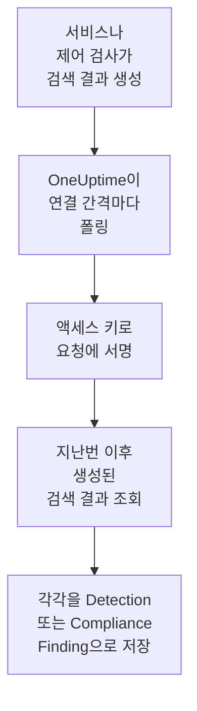

# AWS Security Hub

[AWS Security Hub](https://aws.amazon.com/security-hub/) 검색 결과를 OneUptime의 보안 이벤트로 가져옵니다. GuardDuty, Inspector, Macie, IAM Access Analyzer의 검색 결과, Security Hub 자체의 제어 검사, 파트너 제품의 검색 결과가 대상입니다. 그곳에서 로그, 트레이스, 메트릭과 나란히 검색하고, 다른 모든 소스와 상관 분석하고, 중요한 것에 대해 온콜을 호출할 수 있습니다. OneUptime은 읽기 전용 작업 하나만 허용된, 직접 만든 액세스 키로 이를 읽으며, AWS에서는 아무것도 바꾸지 않습니다. 설정할 에이전트, EventBridge 규칙, S3 내보내기는 없습니다.

:::cards
- [연결 설정](#연결-설정): IAM 정책, 액세스 키, 연결 양식.
- [가져오는 내용](#가져오는-내용): 각 검색 결과가 보안 이벤트가 되는 방식.
- [폴링 작동 방식](#폴링-작동-방식): 각 폴링이 읽는 구간과, 그 구간이 이전 구간과 30분 겹치는 이유.
- [문제 해결](#문제-해결): 각 오류의 의미와 바꿔야 할 점.
:::

## 작동 방식



OneUptime은 1분마다, 폴링 간격이 지난 활성화된 연결을 각각 폴링합니다. 폴링은 지난 폴링 이후 생성된 검색 결과를 대상으로, [Signature Version 4](https://docs.aws.amazon.com/IAM/latest/UserGuide/reference_sigv-create-signed-request.html)로 서명한 요청으로 리전의 Security Hub `GetFindings`를 호출합니다. 그리고 각 검색 결과를 [OCSF](https://schema.ocsf.io/) 이벤트로 저장합니다. 제어 검사는 Compliance Finding(클래스 `2003`)으로, 그 밖의 검색 결과는 Detection Finding(클래스 `2004`)으로 저장됩니다. 그 뒤 탐지 규칙, 모니터, 대시보드는 이를 다른 소스의 보안 이벤트와 똑같이 다룹니다.

## 사전 요건

- OneUptime에서 Project Owner, Project Admin 또는 Security Admin 역할. Security Member와 Security Viewer는 연결과 그 실행 기록을 볼 수 있지만 변경할 수는 없습니다.
- 연결하는 리전에서 Security Hub가 활성화된 AWS 계정. Security Hub는 리전 단위입니다. 하나의 연결은 한 계정이 한 리전에 가진 검색 결과를 읽습니다.
- 모든 계정과 리전의 검색 결과를 하나의 연결로 읽으려면, [리전 간 집계](https://docs.aws.amazon.com/securityhub/latest/userguide/finding-aggregation.html)를 켠 홈 리전에서 Security Hub 위임 관리자 계정을 사용합니다. 홈 리전은 **Security Hub → Settings → Regions**에 나옵니다.
- OneUptime 앱과 워커에서 `securityhub.<region>.amazonaws.com`(중국에서는 `securityhub.<region>.amazonaws.com.cn`)으로 나가는 아웃바운드 HTTPS와, 그 호스트의 정확한 시계. AWS는 5분 넘게 어긋나게 서명된 요청을 거부합니다.

## 연결 설정

연결은 IAM 액세스 키로 요청에 서명합니다. 키의 자격 증명에 필요한 것은 `securityhub:GetFindings` 작업 하나뿐이며, 그 밖의 것은 필요 없습니다. 연결은 검색 결과를 절대 바꾸지 않습니다.

:::steps
### 검색 결과 읽기 허용하기

[IAM 콘솔](https://console.aws.amazon.com/iam/)에서 **Policies → Create policy**를 열고 **JSON**을 고른 뒤 이 정책을 붙여 넣습니다. 이름을 지정합니다(예: `OneUptimeSecurityHubRead`):

```json
{
  "Version": "2012-10-17",
  "Statement": [
    {
      "Effect": "Allow",
      "Action": "securityhub:GetFindings",
      "Resource": "*"
    }
  ]
}
```

`GetFindings`는 리소스로 제한할 수 없으므로 `Resource`는 `*`로 둡니다. 관리형 정책 `AWSSecurityHubReadOnlyAccess`도 작동하지만 더 많은 것을 허용합니다.

### 액세스 키 만들기

1. **Users → Create user**를 열고 사용자 이름을 지정한 뒤(예: `oneuptime-security-hub`), 콘솔 접근은 끈 채로 정책을 연결합니다. 다른 계정의 검색 결과를 읽으려면 위임 관리자 계정에서 이 작업을 합니다.
2. 사용자를 연 다음 **Security credentials → Access keys → Create access key**를 열고 **Third-party service**를 고릅니다.
3. **액세스 키 ID**와 **비밀 액세스 키**를 복사합니다. AWS는 시크릿을 한 번만 보여 줍니다.

### OneUptime에서 연결 추가

**제품 → Security Events → 연결**(`/dashboard/{projectId}/security-events/connections`)를 열고 **연결 추가**를 클릭한 뒤 **AWS Security Hub**를 고르고 **다음**을 클릭합니다. 아래 표의 설정을 채우고 **다음**을 클릭한 뒤, 시크릿을 **비밀 액세스 키**에 붙여 넣습니다.

### 저장하기 전에 테스트

**저장하기 전에 테스트** 아래의 **이 설정 테스트**를 클릭합니다. 테스트는 양식의 값으로 요청에 서명하며 아무것도 저장하지 않으므로, 잘못된 키나 빠진 권한이 연결을 만들기 전에 드러납니다. 그런 다음 **다음**을 클릭하고 연결에 **이름**을 지정해 만듭니다.
:::

| 설정 | 입력할 값 |
| --- | --- |
| **지역** | 리전 코드. 예: `us-east-1`, `eu-central-1`, `us-gov-west-1`. 다른 계정의 검색 결과를 읽을 때는 관리자 계정의 홈 리전입니다. |
| **액세스 키 ID** | 키의 ID. 16~128자의 영문자나 숫자로, 보통 `AKIA`로 시작하는 20자이며, 임시 자격 증명이면 `ASIA`로 시작합니다. |
| **비밀 액세스 키** | 키의 시크릿. 암호화되며, API가 반환하지 않고 다시 표시되지도 않습니다. 교체하려면 연결의 **자격 증명 업데이트**를 사용합니다. |
| **Session token** | 임시 자격 증명에만 필요합니다. `ASIA` 키는 이것이 없으면 거부되고, `AKIA` 키는 이것이 있으면 거부됩니다. |

`aws sts assume-role`이나 `aws sts get-session-token`에서 받은 임시 자격 증명은 만료되며(수임한 역할은 최대 12시간), 만료되면 **자격 증명 업데이트**로 새 값을 붙여 넣을 때까지 폴링이 멈춥니다. 이 좁은 정책을 가진 장기 키를 자체 일정에 따라 교체하면 사람이 지켜보지 않아도 폴링이 계속됩니다. 임시 자격 증명에서 장기 키로 바꾸려면 **자격 증명 업데이트**에 새 키를 입력하고 **Remove the stored Session token**을 켭니다.

**폴링** 단계에는 선택 사항인 **설명**, `1`부터 `1440`까지의 정수이며 처음 값이 `5`인 **폴링 간격(분)**, 그리고 처음에 켜져 있는 **활성화됨**도 있습니다.

## 가져오는 내용

각 검색 결과는 공급업체 `Amazon Web Services`, 제품 `AWS Security Hub`의 이벤트 하나가 됩니다. `Compliance` 객체가 있는 검색 결과, 즉 AWS Foundational Security Best Practices나 CIS 같은 표준에 대한 제어 검사는 Compliance Finding(OCSF 클래스 `2003`)이 됩니다. 그 밖의 검색 결과는 Detection Finding(OCSF 클래스 `2004`)이 됩니다.

| 검색 결과 필드 | OneUptime 열 |
| --- | --- |
| `Id`(AWS가 만드는 검색 결과는 ARN) | 이벤트 UID. 중복을 걸러 내는 기준이기도 합니다 |
| `CreatedAt`, 없으면 `UpdatedAt`, 없으면 `FirstObservedAt` | 이벤트 시각 |
| `Title` | 규칙 이름 |
| `GeneratorId`(GuardDuty 검색 결과 유형이나 제어의 ID 등) | 규칙 ID |
| `Title`, 없으면 `Description` | 메시지 |
| `Severity.Label`, 없으면 `Severity.Normalized`의 구간 | 심각도 |
| `Workflow.Status`: `NEW`, `NOTIFIED`, `RESOLVED` 또는 `SUPPRESSED`, 없으면 예전의 `WorkflowState` | 상태 |
| `TTPs/` 아래의 `Types`: `TTPs/Initial Access/...`는 `TA0001`이 됩니다 | MITRE ATT&CK 전술과 기법 |
| 액세스 키나 사용자 리소스의 IAM 사용자, `Network.SourceIpV4` 또는 `SourceIpV6`, `Process.Name` 또는 `Process.Path` | 주체 사용자, IP, 프로세스 |
| `Process.Name` 및 `Process.Path` | 프로세스 이름과 경로. 검색 결과에는 명령줄도 부모 프로세스도 없습니다. |
| `AwsEc2Instance` 리소스의 인스턴스 ID, `Network.DestinationIpV4` 또는 `DestinationIpV6`, `Network.DestinationPort`, 첫 번째 `Resources[].Id` | 대상 호스트, IP, 포트, 리소스 |
| 그것들과 함께 모든 `Resources[].Id`, `AwsAccountId`, 네트워크의 도메인, 맬웨어 이름, 위협 인텔리전스 값 | Observable |
| 검색 결과 전체. `Compliance.Status`, `Remediation.Recommendation.Url` 같은 점 구분 키로 펼침 | `attributes` |

검색 결과에 `Severity.Label`이 없으면 `Severity.Normalized`로 정합니다. `0`은 Informational, `1`~`39`는 Low, `40`~`69`는 Medium, `70`~`89`는 High, `90`~`100`은 Critical입니다. Security Hub가 나중에 업데이트하는 검색 결과(새 `Workflow.Status`나 이제 통과하는 제어)는 같은 `Id`를 유지하므로 다시 가져오지 않습니다. 이벤트에는 가져올 당시의 검색 결과가 남습니다.

## 폴링 작동 방식

각 폴링은 자신의 구간에서 생성된 검색 결과를 오래된 것부터 한 페이지에 100개씩 나열하고, 구간 전체를 읽을 때까지 `NextToken`을 따라갑니다:

```text
POST https://securityhub.{region}.amazonaws.com/findings
    {"Filters": {"CreatedAt": [{"Start": "{window start}", "End": "{window end}"}]},
     "SortCriteria": [{"Field": "CreatedAt", "SortOrder": "asc"}],
     "MaxResults": 100}
```

- **생성 시각이 커서입니다.** 검색 결과는 `FirstObservedAt`이 아니라 `CreatedAt` 기준으로 나열됩니다. GuardDuty는 활동을 충분히 본 뒤에 검색 결과를 만들고, 제어 검사는 Security Hub가 리소스를 처음 검사할 때 만들어지는데, 둘 다 활동이 시작되고 몇 시간이나 며칠 뒤일 수 있습니다. 관찰 시각을 기준으로 한 커서는 그것들을 건너뛰게 됩니다.
- **첫 폴링은 24시간 전까지 거슬러 올라가므로**, 새 연결에서 최근 검색 결과가 바로 보입니다.
- **이후의 모든 폴링은 저장된 커서보다 30분 앞에서 시작합니다.** `CreatedAt`은 문제를 찾은 서비스가 정하며, 검색 결과는 그보다 나중에 Security Hub에 도착합니다. GuardDuty는 새 검색 결과를 5분 안에 보내고, EventBridge를 통한 전달이 실패하면 최대 24시간 동안 다시 시도합니다. 겹치는 부분 덕분에 그런 검색 결과는 다음 폴링에서 읽힙니다. `CreatedAt`보다 30분 넘게 늦게 도착한 검색 결과는 커서 뒤로 떨어질 수 있으니, 그 시간 범위를 가져와 되찾으세요.
- **한 번의 폴링은 커서 이후 최대 24시간까지 읽습니다.** 커서가 뒤처진 연결은 24시간 구간을 연달아 읽으며 따라잡고, 그동안 **상태**는 **Catching up**으로 표시됩니다.
- **중복은 검색 결과의 `Id`로 걸러집니다.** 프로젝트 안에서 걸러지므로, 겹치는 부분, 다시 시도한 구간, 가져오기가 검색 결과를 두 번 저장하는 일은 없습니다.

### 한 번의 폴링으로 다 읽을 수 없는 구간

한 번의 폴링은 검색 결과 100개짜리 요청을 최대 20개, 즉 2,000개까지 보냅니다. 구간에 그보다 많은 검색 결과가 있으면 실행은 **부분**이 되며, 다음과 같은 경고가 나옵니다:

```text
Stopped after 20 findings requests (the per-run request limit) before the window was fully read. The last finding read was created at 2026-09-14T08:12:44.000Z.
```

검색 결과는 오래된 것부터 읽히므로, OneUptime은 커서를 마지막으로 읽은 검색 결과의 생성 시각으로 옮기고, 다음 폴링은 30분 겹침 없이 같은 구간 길이로 거기서 시작합니다. 바쁜 계정은 같은 것을 다시 읽는 대신 폴링마다 약 2,000개씩 따라잡습니다. 커서가 그 지점에서 30분을 지나면 겹침이 돌아옵니다.

예를 들어 30분의 겹치는 부분만으로도 2,000개가 넘는 검색 결과가 있어서 실행이 저장된 커서를 전혀 넘어서지 못하면, OneUptime은 대신 구간을 줄입니다:

1. **좁히기.** 다음 폴링은 같은 시작점에서 절반 길이의 구간을 읽으며, 구간을 끝까지 읽을 수 있게 될 때까지 계속 절반으로 줄이고, 가장 짧게는 1분까지 줄입니다. 실행의 경고에 그렇게 적힙니다: `This window holds more records than one poll can read; the next poll reads a {n} minute window from the same starting point.`
2. **다시 늘리기.** 구간을 끝까지 읽은 뒤에는 다음 구간이 다시 두 배가 되며, 최대 24시간까지 늘어납니다.
3. **1분 넘어가기.** 1분 안에조차 한 번의 폴링으로 읽을 수 있는 것보다 많은 레코드가 있으면, 더 새로운 검색 결과가 계속 도착하도록 폴링이 그 1분을 넘어가며, 이후 폴링의 겹치는 부분도 더 이상 그 1분까지 거슬러 가지 않습니다. 실행은 **부분**으로 남고, **마지막 오류**에는 `More records were created in the one minute from {cursor} to {end} than one poll can read. Polling moved past this minute so newer records keep arriving; use Import this time range in Diagnostics on this minute to recover what one run can read.`라고 나옵니다. 한 번의 실행이 읽을 수 있는 만큼 되찾으려면 **Import this time range**로 그 1분을 가져오세요.

AWS의 오류로 실행이 완전히 실패하면, 커서와 구간 길이는 그대로 유지되고 다음 폴링이 같은 구간을 다시 읽습니다. 단 하나의 예외는 요청 시간이 초과된 경우입니다. 커서는 그대로지만 다음 구간은 절반 길이가 됩니다. 제시간에 응답하기에는 너무 무거운 구간은 시도할 때마다 시간이 초과되기 때문입니다. **폴링 간격(분)** 값을 바꿔도 이 중 어느 것도 달라지지 않습니다. 이 설정은 폴링이 얼마나 자주 시작하는지를 정할 뿐, 구간이 어디서 시작하는지는 정하지 않습니다.

### 필요할 때 실행, 미리 보기, 가져오기

연결에서 **진단**을 클릭하면 최근 실행을 보고 연결을 직접 다룰 수 있습니다. 연결을 변경할 수 있는 사람은 누구나 이를 시작할 수 있고, 연결을 볼 수 있는 사람은 누구나 기록을 읽을 수 있습니다.

- **지금 실행**은 연결이 **활성화됨** 상태가 아닐 때에도 평소의 커서로 즉시 폴링을 시작합니다.
- **Preview findings**는 최대 7일의 시간 범위를 읽으며 아무것도 가져오지 않습니다.
- **Import this time range**는 확인을 거친 뒤 최대 7일의 범위를 가져오며, 커서는 옮기지 않습니다. 이미 가져온 검색 결과는 건너뜁니다.
- 실행의 **Copy diagnostics**는 지원팀에 보낼 보고서를 복사합니다. 자격 증명은 절대 포함되지 않습니다.

## 연결 테스트

연결 행의 **연결 테스트**와 양식의 **이 설정 테스트**는 백그라운드 워커가 아니라 API 프로세스에서 실행되므로, 워커가 문제일 때에도 테스트는 응답합니다. 다음 검사를 순서대로 실행합니다:

| 검사 | 확인하는 내용 |
| --- | --- |
| **구성** | 모든 설정이 있고 올바른 형식인지. 이 검사가 실패하면 아무 곳에도 연결하지 않습니다. |
| **Authenticate with AWS** | 지난 24시간 동안 생성된 검색 결과 하나에 대한 서명된 `GetFindings` 요청을 AWS가 받아들입니다. AWS는 IAM 정책보다 먼저 서명을 확인하므로, 정책에 의한 거부여도 이 검사는 통과합니다. 키는 올바르다는 뜻입니다. |
| **Read findings** | Security Hub가 그 요청에 응답합니다. 자격 증명이 `securityhub:GetFindings`를 호출할 수 있고, 그 리전에서 Security Hub가 활성화되어 있습니다. |
| **Findings available to import** | 지난 24시간과 지난 7일 동안 생성된 검색 결과의 수. 각각 100개짜리 한 페이지만 세므로 `100+`는 그보다 많다는 뜻입니다. 7일 동안 하나도 없으면 실패가 아니라 경고입니다. |
| **Background workers**, **Poll scheduler**, **Security event storage** | OneUptime 쪽: Worker 큐의 작업을 가져가는 프로세스가 있고, 폴링 작업이 매분 실행되고, 보안 이벤트 저장소가 응답하는지. |
| **Scheduled polling** | 저장된 연결의 경우: 폴링이 켜져 있고, 워커를 기다리며 멈춘 실행이 없고, 폴링이 제때 실행되는지. |

테스트의 모든 요청에는 20초 기한이 있습니다. 테스트는 아무것도 가져오지 않고 커서를 옮기지도 않으며, 실패한 각 검사는 무엇을 바꿔야 하는지 알려 줍니다.

## 문제 해결

연결의 **마지막 오류**는 실패한 단계를 나타내는 접두사 뒤에, 자격 증명을 가린 전체 오류 메시지를 보관합니다. 연결에 오류가 있으면 **작업** 열에서 **오류 보기**를 선택해 읽고, 대화 상자의 **오류 복사**로 복사하세요. 모든 메시지는 `AWS Security Hub findings request`로 시작하니, 그 뒤에 오는 내용을 읽으세요.

:::details Last Error에 `failed (HTTP 401)` 또는 `failed (HTTP 403)`이 나옴
AWS가 요청을 거부했습니다. 메시지에는 AWS의 오류 코드가 인용되며, 코드를 보내지 않았다면 AWS 자체의 문구가 인용됩니다:

- `AccessDeniedException` 또는 `is not authorized to perform`: 키는 올바르지만 그 자격 증명이 `securityhub:GetFindings`를 호출할 수 없습니다. [연결 설정](#연결-설정)의 정책을 연결하세요. 권한 경계나 서비스 제어 정책이 거부할 수도 있습니다.
- `InvalidAccessException` 또는 `is not subscribed to AWS Security Hub`: **지역**에 지정한 리전에서 이 계정에 대해 Security Hub가 활성화되어 있지 않거나, 그곳에서 이 계정이 관리자가 아닙니다.
- `InvalidSignatureException` 또는 `SignatureDoesNotMatch`, 또는 `The request signature we calculated does not match`: **비밀 액세스 키**가 **액세스 키 ID**에 속하지 않습니다. 새 액세스 키를 만들어 **자격 증명 업데이트**로 저장하세요.
- `UnrecognizedClientException` 또는 `InvalidClientTokenId`, 또는 `The security token included in the request is invalid`: AWS가 **액세스 키 ID**를 알지 못합니다. 잘못 입력했거나, 삭제되었거나, 비활성화되었거나, 다른 파티션의 것이거나, **Session token** 없는 임시 키입니다.
- `ExpiredTokenException` 또는 `The security token included in the request is expired`: 임시 자격 증명이 만료되었습니다. 새로 발급하거나 장기 키로 바꾸세요.
- `RequestTimeTooSkewed` 또는 `RequestExpired`, 또는 `Signature expired`: OneUptime 호스트의 시계가 5분 넘게 어긋나 있습니다. 앱과 워커 호스트의 NTP를 바로잡으세요.
- 코드가 전혀 없음: AWS가 키와 정책 중 무엇이 거부했는지 알려 주지 않았습니다. 먼저 키를, 그다음 정책을 확인하세요.
:::

:::details Last Error에 다른 상태와 함께 `failed (HTTP ...)`가 나옴
- `HTTP 404`: **지역**에 지정한 리전에서 응답한 Security Hub 엔드포인트가 없습니다. AWS 콘솔의 리전 메뉴와 비교하세요. `us-east1`이나 `N. Virginia`가 아니라 `us-east-1`입니다.
- `HTTP 429`: 계정이 Security Hub의 한도(리전당 초당 `GetFindings` 요청 3개)에 도달했습니다. 다음 폴링에서 다시 시도합니다. 계속 일어난다면 같은 계정과 리전을 읽는 다른 도구나 연결을 찾아보세요.
- `HTTP 5xx`: Security Hub 쪽에 문제가 있었습니다. 다음 폴링에서 다시 시도합니다.
- `HTTP 400`: Security Hub가 쿼리를 거부했습니다. 쿼리는 설정이 아니라 OneUptime이 만듭니다. 메시지를 OneUptime 지원팀에 보내세요.
:::

:::details Last Error에 `returned`, `timed out` 또는 `Could not reach data source`가 나옴
- `returned a non-JSON body` 또는 `returned an unrecognized response shape`: 프록시의 로그인 페이지나 응답을 다시 쓰는 게이트웨이처럼 Security Hub가 아닌 다른 것이 응답했습니다. 빈 구간으로 간주하지 않고 보고하므로, 아무도 읽지 않은 검색 결과를 커서가 지나치는 일은 없습니다.
- `timed out after 60 seconds with no response` 또는 `failed: Could not reach data source`: 요청이 응답을 받지 못했습니다. Security Hub 엔드포인트는 공개되어 있으므로, OneUptime 앱 및 워커와 `securityhub.<region>.amazonaws.com` 사이의 DNS, 방화벽, 프록시를 확인하세요.
:::

:::details Last Polled가 Never이고 Last Error가 비어 있음
이 연결에서 끝난 폴링이 없습니다. **연결 테스트**를 실행하세요. 그 **Background workers**와 **Poll scheduler** 검사가 원인을 알려 줍니다. 자체 호스팅 설치에서 흔한 원인은 앱에 `DISABLE_QUEUE_WORKERS=true`가 설정되어 있는데 작업을 가져가는 별도의 워커 배포가 없는 경우입니다. 이를 `false`로 설정하거나 워커 배포를 실행하세요(Helm: `worker.enabled: true`).
:::

:::details 실행이 Partial임
- `Stopped after 20 findings requests`: 구간에 한 번의 실행이 읽는 2,000개보다 많은 검색 결과가 있었습니다. 잃는 것은 없습니다. 다음 폴링은 마지막으로 읽은 검색 결과 다음부터 시작합니다. 폴링할 때마다 **부분**으로 남는 연결은 밀린 분량을 따라잡는 중이며, **마지막 폴링**과 **마지막으로 가져온 이벤트**는 계속 앞으로 나아갑니다. 끝내 따라잡지 못한다면 계정이 폴링 간격마다 2,000개가 넘는 검색 결과를 만들고 있는 것입니다. **폴링 간격(분)** 값을 줄이세요.
- `More records were created in the one minute from ... than one poll can read`: 폴링이 그 1분을 넘어갔습니다. **진단**에서 **Import this time range**로 그 1분을 가져오세요. 가져오기는 한 번의 폴링만큼 읽습니다.
:::

:::details 테스트는 통과하지만 아무것도 가져오지 않음
테스트 보고서에서 **Findings available to import**를 읽으세요. 지난 7일 동안 `0`이면 Security Hub가 이 계정과 리전에서 검색 결과를 하나도 만들지 않은 것입니다. 그곳에서 GuardDuty, Inspector 또는 보안 표준이 켜져 있는지 확인하세요. 다른 계정과 리전의 검색 결과를 보려면 관리자 계정을 그 홈 리전에서 연결하세요.
:::

:::details Security Hub 콘솔의 검색 결과가 도착하지 않음
그 `CreatedAt`을 Security Hub가 받은 시각인 `ProcessedAt`과 비교하세요. `CreatedAt`보다 30분 넘게 늦게 도착한 검색 결과는 커서 뒤로 떨어질 수 있으니, **Import this time range**로 그 `CreatedAt`을 가져오세요.
:::

## 얻을 수 있는 것

- **검색.** 보안 이벤트 탐색기에서 다른 모든 소스와 나란히, 심각도, 상태, 규칙, 계정, 리소스 또는 어떤 observable로든 검색 결과를 필터링합니다.
- **상관 분석.** 모든 검색 결과의 사용자, 인스턴스, IP, 리소스 ARN, 계정 ID는 observable로 색인되므로, 한 번의 검색으로 그것들을 언급하는 모든 것을 찾을 수 있습니다.
- **탐지 규칙.** 보안 이벤트에 대해 일정에 따라 실행되며, 온콜을 호출하는 알림을 여는 Sigma 규칙.
- **모니터.** 보안 이벤트 모니터는 새로운 심각한 GuardDuty 검색 결과나 실패한 제어 같은 일치하는 이벤트를 세고, 임곗값을 넘으면 인시던트나 알림을 엽니다.

보안 이벤트는 나머지 텔레메트리처럼 수집된 GB 단위로 청구됩니다. [요금](https://oneuptime.com/pricing)을 참고하세요.

## 다음 단계

:::cards
- [보안 이벤트](/docs/telemetry/security-events): 가져온 내용을 검색하고, 상관 분석하고, 알림을 받습니다.
- [Okta System Log](/docs/integrations/okta): ID 공급자의 로그인도 가져옵니다.
- [역할](/docs/permissions/reference#역할): Security 역할이 보고 바꿀 수 있는 것.
- [통합 개요](/docs/integrations/index): 연결할 수 있는 다른 도구.
:::
