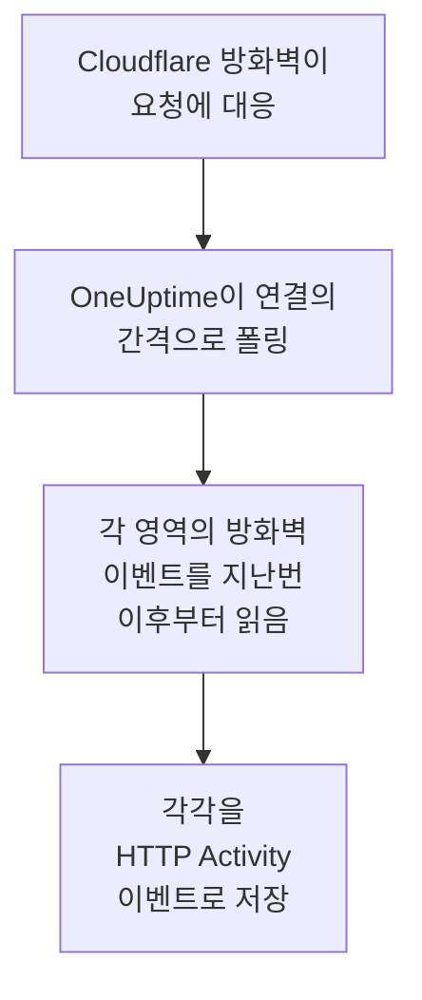

# Cloudflare

[Cloudflare](https://www.cloudflare.com) 방화벽이 엣지에서 한 일을 OneUptime의 보안 이벤트로 가져옵니다. 관리형 및 사용자 지정 WAF 규칙, 속도 제한, IP Access Rules, 봇 관리, HTTP DDoS 보호가 차단하거나 챌린지하거나 로그로 기록한 요청이 대상입니다. 각 요청은 앱 자체의 요청 옆에 놓이므로, 케이스에서 Cloudflare가 무엇을 막았고 무엇이 그래도 앱에 도달했는지 알 수 있습니다. OneUptime은 읽기만 할 수 있는 API 토큰으로 이를 읽으며, 차단을 켜지 않는 한 Cloudflare에서는 아무것도 바꾸지 않습니다. 차단을 켜면 그곳에서 차단 목록을 적용합니다.

:::cards
- [연결 설정](#연결-설정): 읽기 권한 두 개가 있는 API 토큰과 연결의 양식입니다.
- [가져오는 내용](#가져오는-내용): 어떤 이벤트를 가져오는지, 각 이벤트가 보안 이벤트가 되는 방식.
- [폴링 작동 방식](#폴링-작동-방식): 각 폴링이 읽는 시간 범위와, 그것이 10분 겹치는 이유입니다.
- [Cloudflare에서 주소 차단](#cloudflare에서-주소-차단): IP 목록 두 개와 목록마다 사용자 지정 규칙 하나로 적용되는 차단 목록.
- [문제 해결](#문제-해결): 각 오류의 의미와 바꿔야 할 점.
:::

## 작동 방식

OneUptime은 매분 폴링 간격이 지난 활성화된 연결을 각각 폴링합니다. 폴링은 계정의 영역을 나열하고, GraphQL Analytics API의 settings 노드에서 각 영역의 요금제가 허용하는 범위를 읽고, `firewallEventsAdaptive` 데이터 세트([Security Events](https://developers.cloudflare.com/waf/analytics/security-events/))에서 지난 폴링 이후 각 영역의 방화벽 이벤트를 오래된 것부터 읽습니다. 각 이벤트는 [OCSF](https://schema.ocsf.io/) HTTP Activity 이벤트로 저장됩니다.

## 사전 요건

- OneUptime에서 프로젝트 소유자, 프로젝트 관리자 또는 보안 관리자 역할. 보안 구성원과 보안 뷰어는 연결과 그 실행 기록을 볼 수 있지만 변경할 수는 없습니다.
- 계정의 영역에 대한 API 토큰을 만들 수 있는 Cloudflare 사용자.
- 트래픽이 Cloudflare를 거치는 영역: DNS 레코드가 프록시되어 있어야 합니다.
- OneUptime 앱과 워커에서 `api.cloudflare.com`으로 나가는 HTTPS.

## 연결 설정

이 연결은 Global API Key가 아니라 [API 토큰](https://developers.cloudflare.com/fundamentals/api/get-started/create-token/)으로 읽습니다. 토큰은 계정과 그 영역으로 범위가 제한되며, 따로 취소할 수 있습니다. 두 가지 [권한](https://developers.cloudflare.com/fundamentals/api/reference/permissions/)이 필요하며, 둘 다 읽기 전용입니다.

| 권한 | OneUptime이 이 권한으로 읽는 것 |
| --- | --- |
| `Zone > Zone > Read` | 영역과 그 계정 및 요금제. |
| `Zone > Analytics > Read` | GraphQL Analytics API를 통한 각 영역의 방화벽 이벤트. |

:::steps
### API 토큰 만들기

1. Cloudflare 대시보드에서 **My Profile → API Tokens**를 열고 **Create Token**을 선택한 뒤 **Create Custom Token**을 고릅니다.
2. 이름을 `oneuptime-security-events`로 정합니다. **Permissions**에서 `Zone > Zone > Read`와 `Zone > Analytics > Read`를 추가합니다.
3. **Zone Resources**에서 계정의 모든 영역 또는 가져올 영역을 포함합니다.
4. **Continue to summary**, 이어서 **Create Token**을 선택하고 토큰을 복사합니다. Cloudflare는 토큰을 한 번만 보여 줍니다.

### OneUptime에서 연결 추가

**제품 → 보안 이벤트 → 연결**(`/dashboard/{projectId}/security-events/connections`)을 열고 **연결 추가**를 클릭한 다음, **클라우드 보안** 아래의 **Cloudflare**를 선택하고 **다음**을 클릭합니다. 토큰을 **API 토큰**에 붙여 넣습니다. 그러면 OneUptime이 토큰으로 읽을 수 있는 계정과 영역을 나열합니다. **계정**을 고르고, **영역**은 **모든 영역**으로 두거나 가져올 영역을 고릅니다.

### 저장하기 전에 테스트

**저장하기 전에 테스트** 아래의 **이 설정 테스트**를 클릭합니다. 테스트는 양식의 값으로 각 권한을 확인하고, 빠진 권한을 알려 주며, 아무것도 저장하지 않습니다. 그런 다음 **다음**을 클릭하고 연결에 **이름**을 지정해 만듭니다.
:::

| 설정 | 입력할 값 |
| --- | --- |
| **계정** | 읽을 Cloudflare 계정으로, API 토큰이 읽는 계정 중에서 고릅니다. 계정 하나만 읽는 토큰이면 자동으로 선택됩니다. |
| **영역** | 선택 사항. 비워 두면 나중에 추가되는 영역을 포함해 계정의 모든 활성 영역을 읽습니다. 연결 하나는 최대 50개 영역을 읽습니다. |
| **API 토큰** | `Bearer` 없이 토큰만 입력합니다. 암호화되며, API가 반환하지 않고, 다시 표시되지 않습니다. 연결의 **자격 증명 업데이트**로 교체합니다. |

**폴링** 단계에는 선택 사항인 **설명**, `1`부터 `1440`까지의 정수로 `5`에서 시작하는 **폴링 간격(분)**, 켜진 상태로 시작하는 **활성화됨**도 있습니다. Cloudflare의 이벤트는 경고가 아니라 요청이므로, 양식은 **케이스를 여는 기준**을 묻지 않습니다. 케이스는 이벤트를 읽는 탐지 규칙에서 만들어집니다.

### 쓰기 권한은 별도의 선택입니다

이 연결은 해당 행에서 차단을 켜기 전까지 Cloudflare에서 아무것도 바꾸지 않습니다. 그때가 되어서야 OneUptime이 쓰기 권한을 요청하고, 무엇이든 차단하기 전에 그 권한을 확인합니다. 각 권한과 용도는 [Cloudflare에서 주소 차단](#cloudflare에서-주소-차단)에 있습니다. 권한은 차단을 켤 때만 토큰에 추가하세요.

## 가져오는 내용

모든 이벤트의 공급업체는 `Cloudflare`, 제품은 `Cloudflare WAF`이며, HTTP Activity(`4002`) 이벤트입니다.

| Cloudflare의 필드 | 보안 이벤트에서 |
| --- | --- |
| `clientIP` | 주체 IP와 `client.address` |
| `clientRequestHTTPHost`, `clientRequestPath`, `clientRequestQuery` | 대상 호스트, 대상 리소스(경로와 쿼리), `url.original` |
| `clientRequestHTTPMethodName`, `userAgent` | 활동, `http.request.method`, `user_agent.original` |
| `action` | 상태와 `oneuptime.edge.action` |
| `source`, `ruleId`, `description` | 규칙 ID, 규칙 이름, `cloudflare.source` |
| `rayName`, `clientCountryName`, `clientAsn` | `cloudflare.ray_id`, `cloudflare.client.country`, `cloudflare.client.asn` |
| `sampleInterval` | `oneuptime.edge.sample_interval` |

| Cloudflare가 한 일 | 상태 | `oneuptime.edge.action` | 요청 결과 | 심각도 |
| --- | --- | --- | --- | --- |
| 차단했거나, 연결을 닫았거나, 챌린지가 실패함 | Blocked, 닫힌 연결이면 Dropped | `blocked` | Rejected | Low |
| 관리형, JS 또는 대화형 챌린지로 응답함 | Challenge | `challenged` | Rejected | Low |
| 챌린지를 통과했거나, 이미 통과한 적이 있는 방문자 | Allowed | `passed-challenge` | 없음 | Informational |
| 로그로 기록하고 통과시킴 | Logged | `logged` | 원본의 상태 코드 | Medium, 원본이 실패하면 High, 원본이 요청을 거부하면 Low |
| 내 skip 또는 allow 규칙으로 통과시킴 | Allowed | `let-through` | 원본의 상태 코드 | 로그로 기록된 요청과 같음 |

내 skip 또는 allow 규칙이 통과시킨 요청은 공격(SQL 삽입, 경로 순회 또는 Log4Shell 조회)을 담고 있거나 Cloudflare의 WAF attack score가 공격으로 판단할 때만 가져옵니다. 나머지는 모니터처럼 일부러 허용한 트래픽이므로, 각 실행이 그 수를 세고 가져오지 않습니다.

Cloudflare는 바쁜 영역의 이벤트를 샘플링합니다. 각 이벤트는 자신이 대표하는 비슷한 요청의 수인 샘플 간격을 유지하며, OneUptime이 이로부터 만드는 모든 수에는 *약*이 붙습니다.

이벤트는 이벤트, 캠페인(주소별 공격 요청), 엔터티 위험, 탐지 규칙에 표시됩니다. 주소에 관한 케이스는 영향의 **엣지에서** 아래에, 그 주소의 요청에 Cloudflare가 한 일을 앱에 도달한 것과 나란히 보여 줍니다. 규칙 라이브러리의 Cloudflare 규칙은 여기서 가져오는 그대로 이벤트를 읽습니다. 한 주소에서 나온 많은 관리형 규칙 적중, 챌린지를 통과한 뒤 공격을 보낸 주소, Cloudflare가 통과시켜 앱에 도달한 공격입니다.

## 요금제 한도

모든 요금제에서 API로 방화벽 이벤트를 쓸 수 있습니다. **연결 테스트**의 **What each zone's plan gives**는 각 영역의 한도를 Cloudflare에서 읽습니다.

| 요금제 | Free | Pro | Business | Enterprise |
| --- | --- | --- | --- | --- |
| 보관되는 방화벽 이벤트 | 31일 | 31일 | 31일 | 31일 |
| 가장 긴 쿼리 | 30일 | 30일 | 30일 | 31일 |

Cloudflare의 Logpush도 방화벽 이벤트를 보낼 수 있으며, 2026년 9월 30일부터 모든 요금제에서 사용량에 따라 요금이 부과됩니다. 이 연결은 대신 폴링하므로 읽기 권한 두 개 외에는 아무것도 필요하지 않습니다.

## 폴링 작동 방식

- **이벤트는 엣지에서 발생한 시각을 기준으로 읽습니다.** Cloudflare의 분석 데이터는 요청 후 1~2분이면 쿼리할 수 있습니다.
- **첫 폴링은 24시간 전까지 거슬러 올라가므로**, 새 연결에서 최근 이벤트가 바로 보입니다.
- **이후의 각 폴링은 저장된 커서보다 10분 앞에서 시작합니다**. 그래서 Cloudflare가 늦게 읽을 수 있게 만든 이벤트도 다음 폴링에서 읽히며, 중복은 프로젝트 안에서 각 이벤트의 Ray ID로 걸러집니다.
- **한 번의 폴링은 커서 이후 최대 24시간까지 읽습니다.** 커서가 뒤처진 연결은 24시간 구간을 연달아 읽으며 따라잡습니다.
- **영역은 차례로 읽습니다**. 영역마다 최대 2,000개 이벤트의 한 페이지씩 읽으므로, 바쁜 영역이 조용한 영역을 읽기 전에 폴링을 다 써 버릴 수 없습니다.
- **Cloudflare의 속도 제한을 지킵니다.** Cloudflare는 5분에 REST 요청 1,200개와 GraphQL 쿼리 300개를 허용합니다. 30초 이하를 기다리라는 `429`는 기다린 뒤 다시 요청하고, 그보다 긴 것은 폴링을 멈추며 다음 폴링이 이어서 진행합니다.
- **토큰이 읽을 수 없는 영역이 있어도 아무것도 막히지 않습니다.** 다른 영역은 가져오고, 실행은 **부분**이 되며, 경고에 그 영역이 표시됩니다. 그 영역에서 토큰에 `Zone > Analytics > Read`를 부여한 다음 **이 시간 범위 가져오기**로 그 시간 범위를 되찾습니다.
- **실패한 실행은 아무것도 바꾸지 않습니다.** 네트워크 오류나 Cloudflare의 오류 상태가 있은 뒤에도 커서와 시간 범위 길이는 그대로이며, 다음 폴링이 같은 시간 범위를 다시 읽습니다. 유일한 예외는 시간 초과된 요청입니다. 커서는 그대로지만 다음 시간 범위는 절반 길이가 됩니다. 제시간에 응답하기에 너무 무거운 시간 범위는 매번 시간 초과될 것이기 때문입니다.

### 한 번의 폴링으로 다 읽을 수 없는 구간

한 번의 폴링은 최대 120개 요청을 보내고, 최대 20,000개 이벤트를 읽으며, 4분 후에 멈춥니다. 이벤트는 오래된 것부터 읽으므로, 예산 때문에 폴링이 멈추면 실행은 **부분**이 되고, 다음 폴링은 끝나지 않은 영역이 읽힌 가장 오래된 이벤트부터 다시 시작합니다. 모든 영역을 한 번씩 읽지 못했다면 OneUptime은 대신 시간 범위를 줄입니다.

1. **좁히기.** 다음 폴링은 같은 시작점에서 절반 길이의 시간 범위를 읽고, 시간 범위를 완전히 읽을 때까지 최소 1분까지 계속 절반으로 줄입니다. 실행의 경고가 이렇게 알려 줍니다: `This window holds more records than one poll can read; the next poll reads a {n} minute window from the same starting point.` 더 긴 시간 범위에서 이미 가져온 이벤트는 중복으로 건너뜁니다.
2. **다시 늘리기.** 구간을 끝까지 읽으면 커서가 그 끝으로 옮겨지고, 다음 구간은 다시 두 배가 되며, 최대 24시간까지 늘어납니다.
3. **한 분 건너뛰기.** 1분 안에도 한 번의 폴링이 읽을 수 있는 것보다 많이 있으면, 폴링은 그 분을 건너뛰어 새 이벤트가 계속 들어오게 합니다. 실행은 **부분**으로 남고, **마지막 오류**에는 `More records were created in the one minute from {cursor} to {end} than one poll can read. Polling moved past this minute so newer records keep arriving; use Import this time range in Diagnostics on this minute to recover what one run can read.`가 표시됩니다. 그 1분을 **이 시간 범위 가져오기**로 가져와 한 번의 실행이 읽을 수 있는 만큼 되찾습니다.

**폴링 간격(분)** 값을 바꿔도 이 중 어느 것도 달라지지 않습니다. 이 설정은 폴링이 얼마나 자주 시작하는지를 정할 뿐, 구간이 어디서 시작하는지는 정하지 않습니다.

### 필요할 때 실행, 미리 보기, 가져오기

연결에서 **진단**을 클릭하면 최근 실행을 보고 연결을 직접 다룰 수 있습니다. 연결을 변경할 수 있는 사람은 누구나 이를 시작할 수 있고, 연결을 볼 수 있는 사람은 누구나 기록을 읽을 수 있습니다.

- **지금 실행**은 연결이 **활성화됨** 상태가 아닐 때에도 평소의 커서로 즉시 폴링을 시작합니다.
- **방화벽 이벤트 미리 보기**는 최대 7일의 시간 범위를 읽고 아무것도 가져오지 않습니다.
- **이 시간 범위 가져오기**는 확인 후 최대 7일 범위를 가져오며, 커서는 움직이지 않습니다. 이미 가져온 이벤트는 건너뜁니다. Cloudflare는 방화벽 이벤트를 31일 동안 보관합니다.
- 실행의 **진단 복사**는 지원팀에 보낼 보고서를 복사합니다. 자격 증명은 절대 포함되지 않습니다.

## 연결 테스트

연결 행의 **연결 테스트**와 양식의 **이 설정 테스트**는 백그라운드 워커가 아니라 API 프로세스에서 실행되므로, 워커가 문제일 때에도 테스트는 응답합니다. 다음 검사를 순서대로 실행합니다:

| 검사 | 확인하는 내용 |
| --- | --- |
| **구성** | 토큰, 계정, 영역의 형식이 올바른지 확인합니다. 이것이 실패하면 아무 곳에도 연결하지 않습니다. |
| **Verify the API token** | Cloudflare가 사용자의 토큰이나 계정이 소유한 토큰을 받아들이고, 토큰이 활성 상태인지 확인합니다. 14일 안에 만료되는 토큰은 경고입니다. |
| **List the zones** | 토큰에 `Zone > Zone > Read`가 있어 계정의 영역과 선택한 각 영역을 나열하는지 확인합니다. |
| **Read firewall events** | 토큰에 모든 영역에서 `Zone > Analytics > Read`가 있는지 확인합니다. 실패하면 권한이 없는 영역을 알려 줍니다. |
| **What each zone's plan gives** | 각 영역의 요금제가 방화벽 이벤트를 얼마나 보관하는지, 쿼리 하나가 얼마나 길 수 있는지 보여 줍니다. 요금제에 이벤트가 없는 영역은 경고입니다. |
| **Firewall events available to import** | 지난 24시간과 지난 7일에 이벤트가 대략 몇 개인지 보여 줍니다. 하나도 없으면 경고입니다. |
| **Background workers**, **Poll scheduler**, **Security event storage** | OneUptime 쪽: Worker 큐의 작업을 가져가는 프로세스가 있고, 폴링 작업이 매분 실행되고, 보안 이벤트 저장소가 응답하는지. |
| **예약된 폴링** | 저장된 연결의 경우: 폴링이 켜져 있고, 워커를 기다리며 멈춘 실행이 없고, 폴링이 제때 실행되는지. |

테스트의 모든 요청에는 20초 기한이 있습니다. 테스트는 아무것도 가져오지 않고 커서를 옮기지도 않으며, 실패한 각 검사는 무엇을 바꿔야 하는지 알려 줍니다.

## Cloudflare에서 주소 차단

차단이 켜져 있으면 Cloudflare가 프로젝트의 [차단 목록](/docs/telemetry/security-cases#차단-목록)을 적용합니다. 차단한 각 주소는 1분 안에 Cloudflare 계정의 IP 목록에 추가되고, 각 영역에서는 목록마다 사용자 지정 규칙 하나가 목록의 주소를 차단하거나 챌린지합니다. **차단 목록**에서는 OneUptime이 Cloudflare에서 다시 읽은 각 차단의 **적용 위치**에 Cloudflare가 표시됩니다. 10분 안에 다시 읽지 못한 차단은 그곳에서 적용되지 않습니다. 그러면 케이스의 차단 단계에 차단 이후 Cloudflare가 그 주소에서 온 요청을 몇 개 막았는지도 표시됩니다.

차단에는 연결의 API 토큰에 다음 쓰기 권한이 필요합니다.

| 권한 | OneUptime이 이 권한으로 하는 일 |
| --- | --- |
| `Account > Account Filter Lists > Edit` | 자체 목록 두 개를 만들고, 목록의 주소를 추가하고 제거합니다. |
| `Zone > Zone WAF > Edit`, 차단할 각 영역에 | 자체 사용자 지정 규칙을 추가하고, 영역 자체의 규칙을 읽습니다. |
| `Account > Account Firewall Access Rules > Edit` | 남은 목록이나 사용자 지정 규칙이 없는 요금제에서 IP Access Rules를 추가하고 제거합니다. |

:::steps
### 토큰에 쓰기 권한 부여

Cloudflare에서 **My Profile → API Tokens**를 열고, 연결의 토큰을 편집해 위의 권한을 추가합니다. 또는 이 권한과 읽기 권한 두 개를 가진 토큰을 만듭니다.

### 차단 켜기

연결의 행에서 **주소 차단**를 선택합니다. **새 API 토큰**에 새 토큰을 붙여 넣거나 비워 두어 현재 토큰을 그대로 쓰고, **영역**는 **모든 영역**로 두거나 차단할 영역을 고릅니다. **권한 확인**는 토큰에 각 권한이 있는지 Cloudflare에 묻고, 아무것도 바꾸지 않습니다. **차단 켜기**은 모든 확인을 통과할 때만 차단을 켜며, OneUptime이 1분 안에 Cloudflare를 설정합니다.
:::

차단이 켜져 있는 동안 **연결 테스트**도 같은 확인을 실행합니다: **How blocking is set up**, **Edit the lists**, **Edit custom rules in each zone**, 그리고 IP Access Rules를 쓰는 경우 **Edit IP Access Rules**.

### OneUptime이 Cloudflare에 추가하는 것

| Cloudflare에서 | 무엇인지 |
| --- | --- |
| 목록 `oneuptime_block`과 `oneuptime_challenge` | 계정의 IP 목록 두 개로, 하나는 차단용이고 하나는 챌린지용입니다. 설명에 OneUptime 프로젝트가 적혀 있습니다. |
| 각 영역에 목록마다 사용자 지정 규칙 하나 | 작업 Block인 `(ip.src in $oneuptime_block)`과 작업 Managed Challenge인 `(ip.src in $oneuptime_challenge)`입니다. 설명에 OneUptime이 관리한다고 적혀 있습니다. |
| 차단마다 목록 항목 하나 | 주석에 케이스와 차단이 끝나는 시각이 적힙니다. 예: `OneUptime case CASE-42 until 2026-11-21 10:42 UTC`. |

각 규칙은 영역의 사용자 지정 규칙 중 맨 앞에 놓이므로 사용자의 규칙보다 먼저 실행됩니다. 사용자의 Skip 규칙은 차단된 주소를 통과시킬 수 없습니다. 모니터나 파트너의 주소처럼 Skip 규칙이 통과시키는 주소가 있으면 **차단 상태**에 표시됩니다. **이 주소 보호**는 이 주소를 **보호 대상 엔티티**에 추가하며, 여기에 있는 주소는 아무도 차단할 수 없습니다.

### 차단의 요금제 한도

| 요금제 | Free | Pro | Business | Enterprise |
| --- | --- | --- | --- | --- |
| 계정의 목록 | 1 | 10 | 10 | 1,000 |
| 계정의 목록 항목 | 10,000 | 10,000 | 10,000 | 500,000 |
| 영역의 사용자 지정 규칙 | 5 | 20 | 100 | 1,000 |

사용자 자신의 목록과 규칙도 포함해 계산합니다. 차단을 켜면 각 작업은 요금제에 남은 것이 있을 때 목록 하나와 각 영역의 규칙 하나를 쓰고(Block이 먼저), 남은 것이 없으면 IP Access Rules를 씁니다. 목록 하나가 비어 있는 Free 요금제에서는 차단이 목록을, 챌린지가 IP Access Rules를 씁니다. 계정 하나에는 IP Access Rules를 50,000개까지 둘 수 있으며, 각각은 주소, /16 또는 /24 IPv4 범위, /32, /48 또는 /64 IPv6 범위입니다. 그 밖의 범위에 대한 차단은 그곳에서 적용되지 않으며, **차단 목록**에 그 이유가 표시됩니다. **How blocking is set up**은 각 작업이 무엇을 쓰는지와 그 이유를 알려 줍니다.

### 누군가 규칙을 바꿨을 때

OneUptime은 3분마다 목록과 규칙을 다시 읽으며, 누군가 Cloudflare에서 한 변경을 되돌리지 않습니다. Cloudflare에서 꺼지거나 삭제되거나 변경된 규칙은 연결의 행과 **차단 상태**에 해당 영역과 함께 표시되고, **차단 목록**는 그 영역 규칙의 차단을 Cloudflare에서 적용되지 않음으로 보여 줍니다. **되돌리기**은 규칙을 다시 설정합니다. **영역**가 **모든 영역**인 동안에는 나중에 계정에 추가된 영역도 자동으로 설정됩니다.

### 차단 끄기

**차단 끄기**은 OneUptime의 목록과 규칙을 Cloudflare에서 제거할지 묻고, **Cloudflare에서 OneUptime의 목록과 규칙 제거**가 선택되어 있습니다. 제거는 OneUptime의 규칙, 목록 두 개, OneUptime이 추가한 IP Access Rules를 붙인 이름, 참조, 메모로 찾아 없애며, 그 밖의 것은 건드리지 않습니다. 남겨 두면 Cloudflare에 그대로 남아 담긴 주소를 계속 차단합니다. 주소를 차단하는 연결은 삭제할 수 없습니다. 먼저 차단을 끄고, 제거가 끝나면 연결을 삭제하세요.

## 문제 해결

연결의 **마지막 오류**는 자격 증명을 가린 전체 오류 메시지를 보관합니다. 연결에 오류가 있으면 **작업** 열의 **오류 보기**를 선택해 읽고, 대화 상자의 **오류 복사**로 복사합니다. 각 메시지는 실패한 요청을 밝히고 Cloudflare가 준 이유를 인용합니다.

:::details 마지막 오류가 `Invalid API Token (1000)`인 경우
Cloudflare가 토큰을 알지 못합니다. 토큰이 삭제되었거나, 갱신되었거나, 전체가 붙여 넣어지지 않았습니다. Global API Key는 보내기 전에 거부됩니다. 위와 같이 토큰을 만들고 **자격 증명 업데이트**로 저장합니다.
:::

:::details 마지막 오류가 `Unauthorized to access requested resource (9109)`인 경우
토큰이 영역을 나열할 수 없습니다. **Zone Resources**에 가져올 영역을 넣고 `Zone > Zone > Read`를 부여합니다.
:::

:::details 마지막 오류가 `cannot read the analytics of`인 경우
메시지가 밝힌 영역에서 토큰에 `Zone > Analytics > Read`가 없습니다. 그곳에 권한을 추가한 다음 **이 시간 범위 가져오기**로 가져오지 못한 것을 되찾습니다.
:::

:::details 마지막 오류가 `rate limit`인 경우
같은 Cloudflare 사용자를 쓰는 다른 무언가가 할당량을 다 썼습니다. 5분이 지나면 폴링은 저절로 이어집니다. 할당량을 나누려면 OneUptime에 전용 사용자의 토큰을 주세요.
:::

:::details 마지막 오류에 `did not complete`가 나옴
요청에 응답이 없었습니다. 시간 초과, 확인되지 않는 이름 또는 거부된 주소입니다. OneUptime 앱과 워커가 사용 중인 프록시를 통해 `api.cloudflare.com`에 닿을 수 있는지 확인합니다.
:::

:::details 케이스에 Cloudflare의 조치는 보이지만 앱에서는 그 주소의 요청이 보이지 않는 경우
Cloudflare 뒤에서는 앱의 요청이 Cloudflare의 주소에서 오며, 방문자의 주소는 Cloudflare가 `X-Forwarded-For`에 마지막으로 추가하는 주소입니다. 이 헤더(`http.request.header.x-forwarded-for`)와 연결 자체의 주소(`network.peer.address`)를 트레이스에 기록하세요. 이 연결이 있는 동안 OneUptime은 Cloudflare의 주소를 프록시로 신뢰하므로, 헤더에서 방문자를 읽고 앱의 요청을 Cloudflare가 조치한 주소와 맞춥니다. 앱이 `CF-Connecting-IP`에서 복사한 `client.address`는 신뢰하지 않습니다. 앱에 직접 접근하는 사람은 누구나 그 헤더를 보낼 수 있기 때문입니다.
:::

:::details 차단 상태가 `already exists in this Cloudflare account`인 경우
다른 OneUptime 프로젝트나 누군가가 `oneuptime_block` 또는 `oneuptime_challenge`라는 이름의 목록을 만들었으며, OneUptime은 이 프로젝트를 위해 만들지 않은 목록을 절대 바꾸지 않습니다. Cloudflare에서 그 목록의 이름을 바꾸거나 삭제하거나, 그 목록을 만든 프로젝트에서 차단을 끄세요. OneUptime이 5분 안에 차단을 다시 설정합니다.
:::

:::details 테스트는 통과하지만 Last Polled가 Never임
폴링 작업이 한 번도 실행되지 않았습니다. **Background workers**와 **Poll scheduler** 검사를 읽으세요. 자체 호스팅 설치에서 흔한 원인은 앱에 `DISABLE_QUEUE_WORKERS=true`가 설정되어 있는데 작업을 가져가는 별도의 워커 배포가 없는 경우입니다. 이를 `false`로 설정하거나 워커 배포를 실행하세요(Helm: `worker.enabled: true`, 기본값은 `false`).
:::

## 다음 단계

:::cards
- [보안 이벤트](/docs/telemetry/security-events): 가져온 내용을 검색하고, 상관 분석하고, 경고를 받습니다.
- [보안 케이스](/docs/telemetry/security-cases): Cloudflare가 한 일을 앱에 도달한 것과 나란히 봅니다.
- [통합 개요](/docs/integrations/index): 연결할 수 있는 다른 도구.
:::
