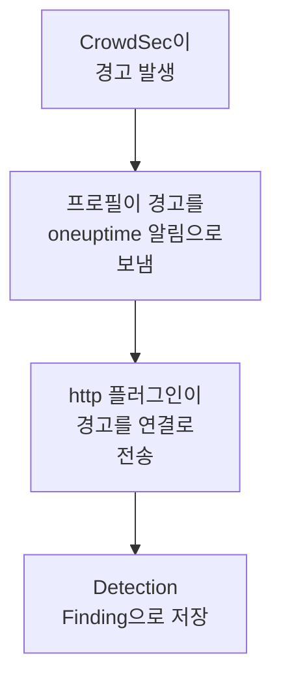

# CrowdSec

[CrowdSec](https://www.crowdsec.net/)이 경고를 발생시키는 즉시 OneUptime의 보안 이벤트에서 받고, 프로젝트의 차단 목록에 있는 주소를 CrowdSec으로 차단합니다. CrowdSec 자체 알림 플러그인이 각 경고를 CrowdSec 연결로 보내고, 연결은 CrowdSec의 탐지로부터 케이스를 엽니다. 차단을 켜면 OneUptime은 차단한 각 주소를 CrowdSec의 Local API를 통해 밴하고, 그 Local API를 읽는 모든 바운서가 해당 주소를 차단합니다.

:::cards
- [연결 설정](#연결-설정): 연결, 그리고 CrowdSec의 경고를 그 연결로 보내는 알림.
- [받는 내용](#받는-내용): 각 CrowdSec 경고가 보안 이벤트가 되는 방식.
- [CrowdSec으로 주소 차단](#crowdsec으로-주소-차단): 차단 목록에 있는 주소를 CrowdSec에서 밴합니다.
- [CrowdSec 차단 목록 읽기](#crowdsec-차단-목록-읽기): CrowdSec Console이 제공하는 목록을 위협 인텔리전스 피드로.
- [문제 해결](#문제-해결): 각 오류의 의미와 바꿔야 할 점.
:::

## 작동 방식



CrowdSec의 Local API는 프로필이 알림으로 보내는 각 경고를 그 알림의 플러그인에 넘깁니다. 연결의 알림은 CrowdSec의 `http` 플러그인을 씁니다. 이 플러그인은 경고를 CrowdSec 고유의 JSON 그대로, 수집 키와 함께 연결을 지정해 보안 이벤트 수집 엔드포인트로 POST합니다. OneUptime은 이를 [OCSF](https://schema.ocsf.io/) Detection Finding 이벤트(클래스 `2004`)로 저장하고, 탐지 규칙과 대조하며, 연결의 **케이스를 여는 기준** 이상인 CrowdSec 자체 탐지마다 케이스를 엽니다. 폴링은 없습니다. 경고는 CrowdSec이 발생시킨 지 몇 초 만에 도착합니다.

## 사전 요건

- OneUptime에서 프로젝트 소유자, 프로젝트 관리자 또는 보안 관리자 역할. 보안 구성원과 보안 뷰어는 연결을 볼 수 있지만 변경할 수는 없습니다.
- CrowdSec 1.5 이상과 그 Local API, 그리고 함께 제공되는 `http` 알림 플러그인. 이 페이지는 CrowdSec v1.8.2를 기준으로 작성되었습니다.
- CrowdSec의 Local API를 실행하는 호스트에서 OneUptime으로 나가는 HTTPS.
- 주소도 차단하려면: OneUptime이 도달할 수 있는 Local API와 OneUptime용 머신([CrowdSec으로 주소 차단](#crowdsec으로-주소-차단) 참고).

## 연결 설정

:::steps
### OneUptime에서 연결 추가

**제품 → 보안 이벤트 → 연결**(`/dashboard/{projectId}/security-events/connections`)을 열고 **연결 추가**를 클릭한 다음, **CrowdSec**을 선택하고 **다음**을 클릭합니다. 경고만 받으려면 아래 표의 설정을 모두 비워 둡니다. 주소도 차단하려면 설정을 채웁니다.

### 저장하기 전에 테스트

**저장하기 전에 테스트** 아래의 **이 설정 테스트**를 클릭합니다. Local API가 설정되지 않았으면 테스트는 그렇다고 알리고 아무 곳에도 연결하지 않습니다. 설정되어 있으면 Local API에 도달해 머신으로 로그인하며, 아무것도 저장하지 않습니다. 그런 다음 **다음**을 클릭하고, **경고** 단계에서 연결에 **이름**을 지정하고, **케이스를 여는 기준**을 고른 뒤 만듭니다.

### CrowdSec 호스트에 알림 저장

연결을 만들면 연결의 **경고 보내기**가 열리며, 나중에 연결 행에서 다시 열 수 있습니다. **수집 키 선택**에서 키를 고른 다음, 키와 연결이 채워진 상태로 표시되는 알림을 CrowdSec의 Local API를 실행하는 호스트에 저장합니다:

```yaml title="/etc/crowdsec/notifications/oneuptime.yaml"
type: http
name: oneuptime

# info or quieter: at debug, CrowdSec logs each request's headers.
log_level: info

format: |
  {{.|toJson}}

url: https://oneuptime.com/security-events/v1/ingest?connection=YOUR_CONNECTION_ID&format=crowdsec
method: POST
headers:
  Content-Type: application/json
  x-oneuptime-token: YOUR_INGESTION_TOKEN
```

### 프로필의 경고를 이 알림으로 보내기

`/etc/crowdsec/profiles.yaml`에서, OneUptime이 경고를 받아야 하는 각 프로필의 `notifications`에 `oneuptime`을 추가한 다음 CrowdSec을 다시 로드합니다:

```yaml title="/etc/crowdsec/profiles.yaml"
notifications:
  - oneuptime
```

```bash
sudo systemctl reload crowdsec
```

### 테스트 경고 보내기

```bash
sudo cscli notifications test oneuptime
```

**경고 보내기**는 경고가 도착하면 알려 주고, **경고 보기**는 보안 이벤트에서 그 경고를 엽니다. 심각도가 Informational인 이벤트이며, 케이스를 열지 않습니다.
:::

| 설정 | 입력할 값 |
| --- | --- |
| **Local API의 URL** | 주소를 차단할 때만: OneUptime이 CrowdSec의 Local API에 도달하는 곳입니다. 예: `https://crowdsec.example.com:8080`. 네트워크를 건너는 곳에서는 항상 `https`를 쓰세요. |
| **머신 ID** | 주소를 차단할 때만: OneUptime이 로그인할 머신으로, CrowdSec 호스트에서 `sudo cscli machines add oneuptime --auto -f -`로 추가합니다. |
| **CrowdSec으로 주소 차단** | 새 연결에서는 꺼져 있습니다. 켜면 차단 목록에 있는 주소와 범위를 CrowdSec에서 밴하며, 나머지 세 설정이 필요합니다([CrowdSec으로 주소 차단](#crowdsec으로-주소-차단) 참고). |
| **머신 비밀번호** | 주소를 차단할 때만: `cscli`가 머신에 대해 출력한 비밀번호. 암호화되며, API가 반환하지 않고, 다시 표시되지 않습니다. 연결의 **자격 증명 업데이트**로 교체합니다. |

**경고** 단계에는 선택 사항인 **설명**과, 켜진 상태로 시작하는 **활성화됨**도 있습니다. 활성화되지 않은 연결은 받은 경고를 이벤트로 보관하며, 그로부터 케이스를 열지 않습니다.

컨테이너에서는 알림을 `/etc/crowdsec/notifications/`에 마운트된 폴더에 두며, 컨테이너를 재시작하면 읽어 들입니다. Kubernetes 설치에서는 Helm 값의 `config.notifications` 아래에 알림을 지정하고, `profiles.yaml`은 그 옆의 `config` 아래에 둡니다.

## 받는 내용

CrowdSec이 보내는 각 경고는 공급업체와 제품이 `CrowdSec`인 Detection Finding 이벤트 하나(OCSF 클래스 `2004`)가 됩니다:

| CrowdSec 필드 | OneUptime 열 |
| --- | --- |
| `uuid`, 또는 이것이 없는 경고는 그 해시 | 이벤트 UID. 중복을 걸러 내는 기준이기도 합니다 |
| `stop_at`, 또는 `start_at` | 이벤트 시각 |
| `scenario` | 규칙 ID와 규칙 이름: CrowdSec Hub에 있는 시나리오의 제목, 또는 그 이름 |
| `source.ip`, 또는 `Ip` 경고의 `source.value` | 주체 IP |
| 경고나 그 이벤트의 `target_fqdn` 또는 `target_host`, 없으면 이벤트가 가리키는 `machine` | 대상 호스트 |
| `target_user`, `target_uri` | 대상 사용자와 리소스 |
| 첫 번째 결정의 `type` | 상태: 밴이면 `Blocked`, 캡차면 `Challenge`, 결정이 없거나 시뮬레이션 모드면 `Logged` |
| 시나리오의 행위 | 심각도, 그리고 그 MITRE ATT&CK 전술과 기법 |
| `source.cn`, `source.as_name`, `events_count` 같은 그 밖의 모든 것 | `attributes`: 점 구분 키로 펼친 경고의 필드, 처음 10개 이벤트 전체, 그리고 `crowdsec.` 아래의 OneUptime 해석 |

CrowdSec 경고에는 자체 심각도가 없으므로, OneUptime은 CrowdSec Hub가 붙이는 레이블(`ssh:bruteforce`, `http:exploit`)에 따라 시나리오가 탐지하는 것에서 심각도를 정합니다:

| 행위 | 심각도 |
| --- | --- |
| CVE나 AppSec 구성 요소가 차단한 것 같은 익스플로잇, 또는 공격자가 침투한 뒤 하는 일 | High |
| 무차별 대입, 서비스 거부, 사기, 불가능한 로그인, 또는 OneUptime이 분류할 수 없는 행위 | Medium |
| 스캔, 프로브, 크롤링, 봇, 스팸, 클라우드 감사에서 나온 변경 | Low |
| CrowdSec 자체 테스트 시나리오 | Informational |

**케이스를 여는 기준**이 **높음 이상**이면 CrowdSec의 익스플로잇은 케이스를 열고, 스캐너와 비밀번호 추측자에 대한 일상적인 밴은 탐지 규칙을 위한 이벤트로 남습니다. 케이스를 여는 것은 CrowdSec 자체 탐지뿐입니다. 누군가 `cscli`나 CrowdSec Console에서 추가한 결정, CrowdSec 차단 목록에 있는 주소, 테스트 경고, 그리고 되돌아온 OneUptime 자체 밴은 심각도가 Informational이며, 케이스를 열지 않습니다. `cscli notifications reinject`처럼 두 번 보낸 경고는 한 번만 저장됩니다.

## CrowdSec으로 주소 차단

연결에서 **CrowdSec으로 주소 차단**을 켜면 프로젝트의 [차단 목록](/docs/telemetry/security-cases#차단-목록)에 있는 주소와 범위가 CrowdSec에서 밴됩니다. 그 Local API를 읽는 모든 바운서(방화벽, nginx, Traefik 바운서 등)는 CrowdSec 자체 밴을 차단하듯이 자신이 실행되는 곳에서 이를 차단합니다. 차단은 차단 목록이 적용되는 다른 모든 곳과 같은 승인, 같은 자동 대응 한도, 같은 **차단 해제**를 거칩니다.

새 연결에서는 이 스위치가 꺼져 있습니다. 켜려면 다음과 같이 합니다.

1. CrowdSec 호스트에서 OneUptime용 머신을 추가합니다. 이 명령은 머신의 비밀번호를 출력합니다:

   ```bash
   sudo cscli machines add oneuptime --auto -f -
   ```

2. OneUptime이 Local API에 도달할 수 있게 합니다. Local API는 따로 지정하지 않으면 `127.0.0.1:8080`에서 수신 대기합니다. CrowdSec의 `config.yaml`에서 `api.server.listen_uri`를 설정하고, Local API를 TLS로 또는 `https` 프록시 뒤에서 제공하며, 방화벽에서 OneUptime의 주소를 허용합니다.
3. 연결을 편집해 **Local API의 URL**과 **머신 ID**를 채우고, 비밀번호를 **머신 비밀번호**에 넣고, **CrowdSec으로 주소 차단**을 켠 다음 저장합니다. 그러면 **연결 테스트**가 아무것도 바꾸지 않고 머신이 로그인해 OneUptime의 밴을 읽는지 확인합니다.

밴이 만들어지고 끝나는 방식:

- 각 차단은 `cscli decisions add`가 만드는 것과 같은 방식으로, 시나리오 `oneuptime/blocklist` 아래에 만들어지는 밴 결정 하나입니다. CrowdSec은 이를 수동 결정으로 보관하므로, 수동 결정을 공유하지 않는 한 CrowdSec의 Central API와 공유되지 않습니다. OneUptime은 자신의 밴만 읽고 제거하며, 사람이나 CrowdSec이 만든 밴은 건드리지 않습니다.
- 종료 시각이 있는 차단은 정확히 그 시각까지의 밴이며, 그때 CrowdSec이 OneUptime의 도달 여부와 관계없이 스스로 해제합니다. 해제할 때까지 이어지는 차단은 7일짜리 밴으로, 남은 기간이 3일 이하가 되면 갱신되므로, OneUptime이 더 이상 유지하지 않는 밴은 일주일 안에 끝납니다.
- **차단 해제**는 다음 처리 주기에 1분 안에 밴을 제거합니다. CrowdSec에서 `cscli decisions delete`나 flush로 제거된 밴은 차단이 지속되는 동안 다음 처리 주기에 다시 만들어집니다.
- CrowdSec의 허용 목록 중 하나에 있는 주소나 범위는 밴되지 않습니다. 차단에는 그곳에서 적용되지 않았다고 허용 목록의 이름과 함께 표시되며, 이미 만든 밴은 허용 목록에 주소가 들어가는 즉시 제거됩니다.
- **신뢰할 수 있는 프록시**, 로드 밸런서, 엣지 같은 프로젝트 자체의 주소는 CrowdSec을 포함해 어디에서도 차단되지 않습니다.
- CrowdSec은 밴만 합니다. 챌린지는 그곳에서 적용되지 않으며, 도메인, URL, 파일은 CrowdSec으로 보내지 않습니다.

Local API에 도달할 수 없으면 CrowdSec에서는 아무것도 바뀌지 않습니다. CrowdSec이 가진 밴은 그대로 남고, 기한이 되면 끝납니다. **차단 목록**의 **적용 위치**는 CrowdSec이 각 차단을 마지막으로 유지한 시각을 알려 주며, OneUptime은 1분 뒤 다시 시도하고, 그 뒤로는 매번 두 배씩 더 기다려 최대 30분까지 기다립니다. 새 차단은 만들 수 있을 때까지 기다립니다.

## CrowdSec 차단 목록 읽기

CrowdSec Console은 조직이 구독하는 차단 목록을 Raw IP List 연동으로 제공합니다. 한 줄에 주소 하나이며, 사용자 이름과 비밀번호로 보호됩니다. [위협 인텔리전스 피드](/docs/telemetry/threat-intelligence)가 이를 읽고 이벤트와 대조합니다:

1. CrowdSec Console에서 IP 집계(IP aggregation)를 끈 Raw IP List 연동을 만듭니다. OneUptime은 범위가 아니라 주소를 대조합니다. 연동의 엔드포인트, 사용자 이름, 비밀번호를 복사합니다.
2. OneUptime에서 **제품 → 보안 이벤트 → 탐지 → 위협 인텔리전스**를 열고, **위협 인텔리전스 피드 만들기**를 클릭한 다음 **지표 목록**을 고릅니다.
3. 엔드포인트를 **목록 URL**에 붙여 넣고, **로그인** 아래에서 **사용자 이름과 비밀번호**를 고른 다음 둘 다 붙여 넣습니다. 하루에 한 번만 다운로드할 수 있는 CrowdSec Community 플랜에서는 **폴링 간격(분)** 을 `1440`으로 설정합니다.

목록은 CrowdSec의 것입니다. 자체 도구에서 쓸 수는 있지만 다른 곳에 넘길 수는 없습니다. OneUptime은 자체 목록을 제공하지 않습니다.

## 연결 테스트

연결 행의 **연결 테스트**와 양식의 **이 설정 테스트**는 백그라운드 워커가 아니라 API 프로세스에서 실행됩니다. 다음 검사를 순서대로 실행합니다:

| 검사 | 확인하는 내용 |
| --- | --- |
| **구성** | 설정이 모두 비어 있거나 모두 입력되어 있고, 형식이 올바른지 확인합니다. 이것이 실패하면 아무 곳에도 연결하지 않습니다. |
| **Reach CrowdSec's Local API** | `GET /health`가 응답합니다. Local API가 설정되지 않았으면 검사는 연결이 경고만 받는다고 알리고, 다음 세 검사는 실행되지 않습니다. |
| **Sign in to the Local API** | `POST /v1/watchers/login`이 머신과 그 비밀번호를 받아들입니다. |
| **Read CrowdSec's allowlists** | `GET /v1/allowlists`가 응답하는지, 그리고 허용 목록에 주소와 범위가 몇 개 있는지. 허용 목록이 없는 1.6.8보다 오래된 Local API는 통과합니다. |
| **Block with CrowdSec** | **CrowdSec으로 주소 차단**이 켜져 있을 때만: 머신이 OneUptime의 밴을 다시 읽을 수 있는지, 그리고 몇 개가 유효한지. 아무것도 바꾸지 않습니다. |
| **Background workers**, **Security event storage** | OneUptime 쪽: CrowdSec이 보낸 것을 저장하는 Worker 큐의 작업을 가져가는 프로세스가 있고, 보안 이벤트 저장소가 응답하는지. |
| **Alerts received** | 저장된 연결의 경우: 마지막 경고가 도착한 시각. 아직 하나도 없으면 경고이며, 테스트 경고를 보내는 방법을 함께 알려 줍니다. |

테스트는 아무것도 밴하거나 제거하지 않습니다. **보고서 복사**는 비밀번호나 토큰 없이 체크리스트를 JSON으로 복사합니다.

## 문제 해결

연결의 **상태**는 첫 경고가 도착할 때까지 **경고 대기 중**, 그 뒤로는 다음 경고가 얼마나 늦게 오든 **경고 수신 중**으로 표시됩니다. **케이스 일시 중지됨**은 연결이 활성화되지 않았다는 뜻입니다. CrowdSec은 플러그인이 받은 응답을 자체 로그 `/var/log/crowdsec.log`에 `HTTP server returned non 200 status code`로 기록합니다.

:::details 경고가 도착하지 않음
- `sudo cscli notifications list`를 실행합니다. `oneuptime`이 목록에 있고 프로필에서 활성 상태여야 합니다. 어떤 프로필도 지정하지 않은 알림은 아무것도 보내지 않습니다.
- `401`: `x-oneuptime-token`의 수집 키가 없거나, 틀렸거나, 만료되었습니다. `422`: 키가 꺼져 있습니다. **경고 보내기**에서 키를 고르고 알림을 다시 복사합니다.
- `400`: 주소가 이 프로젝트의 CrowdSec 연결을 가리키지 않습니다. 연결의 **경고 보내기**에서 주소를 복사합니다. 주소는 연결의 ID로 끝납니다.
- 로그에 아무것도 없음: CrowdSec 호스트가 OneUptime에 도달할 수 없습니다. 그 호스트에서 나가는 HTTPS와 프록시를 확인합니다.
:::

:::details 연결 테스트가 Reach CrowdSec's Local API에서 실패함
`CrowdSec Local API health check could not be completed`는 아무것도 응답하지 않았다는 뜻입니다. Local API는 기본적으로 `127.0.0.1`에서 수신 대기하므로, `api.server.listen_uri`와 방화벽이 허용하기 전까지 OneUptime은 도달할 수 없습니다. `http`로 응답한다는 경고는 머신의 비밀번호가 암호화되지 않은 채 네트워크를 건넌다는 뜻입니다. Local API를 TLS로 제공하거나, 앞에 `https` 프록시를 두세요.
:::

:::details 연결 테스트가 Sign in to the Local API에서 실패함
`CrowdSec Local API login failed (HTTP 401)`의 끝에 해야 할 일이 나옵니다. `sudo cscli machines list`로 머신 ID와 비밀번호를 확인하거나, 아직 검증되지 않은 머신을 `sudo cscli machines validate oneuptime`으로 검증하거나, 비밀번호로 로그인하는 머신을 추가합니다. 새 비밀번호는 **자격 증명 업데이트**로 저장합니다.
:::

:::details CrowdSec에서 차단이 적용되지 않음
차단의 **적용 위치**에 마우스를 올립니다. 주소를 포함한 허용 목록, CrowdSec이 적용하지 않는 챌린지, 또는 Local API의 오류가 표시됩니다. Local API에 도달할 수 없는 동안 OneUptime은 계속 다시 시도하며, CrowdSec이 이미 가진 밴은 계속 유효합니다.
:::

:::details CrowdSec이 경고를 보내지만 아무것도 저장되지 않음
CrowdSec이 보낸 것은 백그라운드 워커가 저장합니다. 앱에 `DISABLE_QUEUE_WORKERS=true`가 설정되어 있고 별도의 워커 배포가 없는 자체 호스팅 설치에서는 경고를 받기만 하고 저장하지 않습니다. **연결 테스트**에서는 실패한 **Background workers** 검사로 나타납니다. 이를 `false`로 설정하거나 워커 배포를 실행하세요(Helm: `worker.enabled: true`).
:::

## 다음 단계

:::cards
- [보안 이벤트](/docs/telemetry/security-events): CrowdSec이 보내는 것을 검색하고, 상관 분석하고, 경고를 받습니다.
- [보안 케이스](/docs/telemetry/security-cases): CrowdSec의 탐지가 연 케이스를 처리하고, 그 케이스에서 차단합니다.
- [위협 인텔리전스](/docs/telemetry/threat-intelligence): 이벤트를 CrowdSec의 차단 목록과 대조합니다.
- [통합 개요](/docs/integrations/index): 연결할 수 있는 다른 도구.
:::
