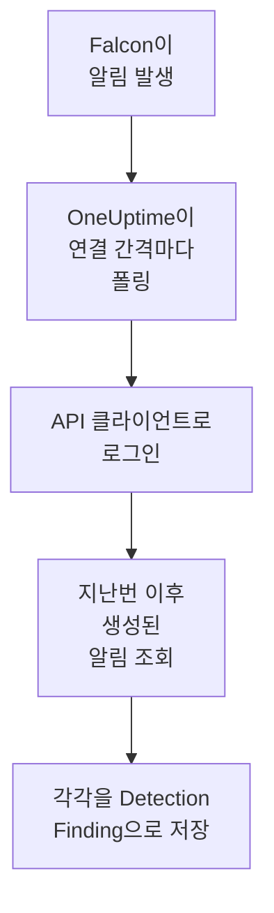

# CrowdStrike Falcon

엔드포인트, ID, 클라우드 탐지에서 나온 [CrowdStrike Falcon](https://www.crowdstrike.com/platform/) 알림을 OneUptime의 보안 이벤트로 가져옵니다. 그곳에서 로그, 트레이스, 메트릭과 나란히 검색하고, 다른 모든 소스와 상관 분석하고, 중요한 알림에 대해 온콜을 호출할 수 있습니다. OneUptime은 직접 만든 API 클라이언트로 Falcon Alerts API를 통해 알림을 읽으며, Falcon에는 아무것도 쓰지 않습니다.

:::cards
- [연결 설정](#연결-설정): 범위 하나를 가진 API 클라이언트와 연결 양식.
- [가져오는 내용](#가져오는-내용): 각 Falcon 알림이 보안 이벤트가 되는 방식.
- [폴링 작동 방식](#폴링-작동-방식): 각 폴링이 읽는 구간과, 바쁜 CID에서 일어나는 일.
- [문제 해결](#문제-해결): 각 오류의 의미와 바꿔야 할 점.
:::

## 작동 방식



OneUptime은 1분마다, 폴링 간격이 지난 활성화된 연결을 각각 폴링합니다. 폴링은 API 클라이언트의 ID와 시크릿으로 Falcon 클라우드에 로그인하고, 지난 폴링 이후 생성된 알림을 Alerts API에 요청한 다음, 각각을 [OCSF](https://schema.ocsf.io/) Detection Finding 이벤트(클래스 `2004`)로 저장합니다. 그러면 탐지 규칙, 모니터, 대시보드는 이를 다른 소스의 보안 이벤트와 똑같이 다룹니다.

## 사전 요건

- OneUptime에서 Project Owner, Project Admin 또는 Security Admin 역할. Security Member와 Security Viewer는 연결과 그 실행 기록을 볼 수 있지만 변경할 수는 없습니다.
- Falcon 고객 ID(CID)와, API 클라이언트를 관리할 수 있는 Falcon 콘솔 사용자. Falcon Administrator 역할이나, API clients and keys 권한이 있는 사용자 지정 역할이 필요합니다.
- OneUptime 앱과 워커에서 Falcon 클라우드의 API 호스트로 나가는 아웃바운드 HTTPS. 호스트는 아래 **Falcon cloud**에 나와 있습니다.

## 연결 설정

:::steps
### API 클라이언트 만들기

1. Falcon 콘솔에서 **Support and resources → API clients and keys**를 열고 **Create API client**를 선택합니다.
2. 이름을 정합니다. 예: `OneUptime security events`. **API scopes**에서 **Alerts → Read**를 켜고 다른 범위는 모두 끈 채로 둡니다. 연결은 Falcon에 아무것도 쓰지 않습니다.
3. 클라이언트를 만듭니다. Falcon은 클라이언트 ID, 시크릿, 기본 URL을 한 번만 보여 줍니다. 지금 세 가지를 모두 복사하세요. 시크릿은 나중에 재설정할 수 있지만 다시 표시되지는 않습니다.

### Falcon 클라우드 찾기

Falcon이 보여 준 기본 URL로 CID가 속한 클라우드를 알 수 있습니다. **API clients and keys** 페이지에도 각 클라이언트 옆에 표시됩니다. 한 클라우드의 클라이언트는 다른 클라우드에서 거부됩니다.

| Falcon이 보여 주는 기본 URL | Falcon 클라우드 |
| --- | --- |
| `https://api.crowdstrike.com` | US-1 |
| `https://api.us-2.crowdstrike.com` | US-2 |
| `https://api.eu-1.crowdstrike.com` | EU-1 |
| `https://api.laggar.gcw.crowdstrike.com` | US-GOV-1 |

### OneUptime에서 연결 추가

**제품 → Security Events → 연결**(`/dashboard/{projectId}/security-events/connections`)를 열고 **연결 추가**를 클릭한 다음, **CrowdStrike Falcon**을 고르고 **다음**을 클릭합니다. 아래 표의 설정을 채우고 **다음**을 클릭한 뒤, 시크릿을 **클라이언트 시크릿**에 붙여 넣습니다.

### 저장하기 전에 테스트

**저장하기 전에 테스트** 아래의 **이 설정 테스트**를 클릭합니다. 테스트는 양식의 값으로 로그인해 알림을 읽지만 아무것도 저장하지 않으므로, 잘못된 클라우드나 빠진 범위를 연결이 생기기 전에 알 수 있습니다. 그런 다음 **다음**을 클릭하고 연결에 **이름**을 지정해 만듭니다.
:::

| 설정 | 입력할 값 |
| --- | --- |
| **클라이언트 ID** | 클라이언트를 만들 때 Falcon이 보여 준 API 클라이언트의 ID. |
| **Falcon cloud** | CID가 속한 클라우드: **US-1 (api.crowdstrike.com)**, **US-2 (api.us-2.crowdstrike.com)**, **EU-1 (api.eu-1.crowdstrike.com)** 또는 **US-GOV-1 (api.laggar.gcw.crowdstrike.com)**. 모든 요청은 그 클라우드의 API 호스트로 갑니다. |
| **클라이언트 시크릿** | API 클라이언트의 시크릿. 암호화되며, API가 반환하지 않고 다시는 표시되지 않습니다. 연결의 **자격 증명 업데이트**로 교체합니다. |

**폴링** 단계에는 선택 사항인 **설명**, `1`부터 `1440`까지의 정수이며 처음 값이 `5`인 **폴링 간격(분)**, 그리고 처음에 켜져 있는 **활성화됨**도 있습니다. 활성화되지 않은 연결도 테스트할 수 있고, 직접 폴링할 수 있습니다.

## 가져오는 내용

연결은 Falcon의 알림을 읽습니다. Falcon 콘솔이 **Endpoint security → Endpoint detections**와 **Next-Gen SIEM → Alerts** 아래에 나열하는 알림으로, 알림을 내는 모든 제품의 것을 읽습니다. 각 알림은 공급업체 `CrowdStrike`, 제품 `Falcon`인 Detection Finding 이벤트 하나(OCSF 클래스 `2004`)가 됩니다:

| Falcon 필드 | OneUptime 열 |
| --- | --- |
| `composite_id` | 이벤트 UID. 중복을 걸러 내는 기준이기도 합니다 |
| `created_timestamp` | 이벤트 시각 |
| `display_name`, 또는 `name` | 규칙 이름 |
| `pattern_id` | 규칙 ID |
| `description`, 또는 규칙 이름 | 메시지 |
| `severity_name`, 또는 0부터 100까지의 `severity` | 심각도 |
| `new`, `in_progress`, `closed` 같은 `status` | 상태 |
| `tactic_id`, `technique_id` | MITRE ATT&CK 전술과 기법 |
| `device.hostname`, `device.local_ip`, `user_name`, `filename` 또는 `cmdline` | 주체 호스트, IP, 사용자, 프로세스 |
| `device.hostname`, `device.local_ip`, `device.external_ip`, `user_name`, `sha256` | Observable |
| `device.platform_name`, `falcon_host_link`, `product`, `timestamp` 같은 그 밖의 모든 것 | `attributes`. 점 구분 키로 펼침 |

이벤트 시각은 일부러 Falcon이 알림을 만든 시각으로 합니다. 알림 뒤에 있는 행위의 시각인 `timestamp`는 `attributes.timestamp`에 남습니다.

## 폴링 작동 방식

- **생성 시각이 커서입니다.** 알림은 그 뒤에 있는 행위의 시각이 아니라 `created_timestamp` 기준으로 나열됩니다. Falcon은 알림이 설명하는 활동보다 한참 뒤에 알림을 낼 수 있으며, 활동 시각을 기준으로 하는 커서라면 그런 알림을 모두 건너뛸 것입니다.
- **첫 폴링은 24시간 전까지 거슬러 올라가므로**, 새 연결에서 최근 알림이 바로 보입니다.
- **이후의 모든 폴링은 저장된 커서보다 1분 앞에서 시작하므로**, 두 구간의 경계에서 생성된 알림도 놓치지 않습니다.
- **한 번의 폴링은 커서 이후 최대 24시간까지 읽습니다.** 커서가 뒤처진 연결은 24시간 구간을 연달아 읽으며 따라잡습니다.
- **중복은 `composite_id`로 걸러집니다.** 프로젝트 안에서 걸러지므로, 겹치는 부분과 다시 시도한 구간이 알림을 두 번 저장하는 일은 없습니다.
- **각 구간에 드는 요청은** 토큰의 수명 동안 유지되는 토큰 요청 하나, 그리고 알림 1,000개마다 알림 쿼리 하나와 알림 가져오기 하나이며, 요청마다 고유한 시간 제한이 있습니다.

### 한 번의 폴링으로 다 읽을 수 없는 구간

한 번의 폴링은 최대 20개의 요청을 보냅니다. 토큰 요청 하나와 알림 1,000개마다 요청 두 개가 필요하므로, 최대 9,000개의 알림을 읽습니다. 구간에 그보다 많은 알림이 있으면 실행은 **부분**이 되고 다음과 같은 경고가 붙습니다:

```text
Stopped after 19 requests before reading the whole window. Alerts are read oldest first; every alert created before 2026-09-14T08:12:44.995Z was read.
```

알림 쿼리는 `created_timestamp` 기준으로 오래된 것부터 정렬되므로, OneUptime은 커서를 마지막으로 읽은 알림의 생성 시각으로 옮기고, 다음 폴링은 같은 구간 길이로 거기서, 오프셋 `0`부터 시작합니다. 바쁜 CID는 같은 알림을 다시 읽는 대신 폴링마다 약 9,000개씩 따라잡습니다. 바로 그 시각에 생성된 알림은 두 번 읽히지만, 중복 검사가 두 번째 사본을 걸러 냅니다.

Falcon의 알림 쿼리는 결과 10,000개(`limit` 더하기 `offset`)를 넘어 페이지를 넘길 수 없습니다. 요청 한도가 그 상한에 이르기 전, 알림 9,000개에서 실행을 멈춥니다. 그 상한 때문에 읽기가 멈추더라도 같은 방식으로 처리됩니다. 실행은 **부분**이 되고, 커서는 마지막으로 읽은 알림으로 옮겨지며, 다음 쿼리는 다시 오프셋 `0`부터 시작합니다.

예를 들어 9,000개가 넘는 알림이 겹치는 1분에 몰려 있어서 실행이 저장된 커서를 전혀 넘어서지 못하면, OneUptime은 대신 구간을 줄입니다:

1. **좁히기.** 다음 폴링은 같은 시작점에서 절반 길이의 구간을 읽으며, 구간을 끝까지 읽을 수 있게 될 때까지 계속 절반으로 줄이고, 가장 짧게는 1분까지 줄입니다. 실행의 경고에 그렇게 적힙니다: `This window holds more records than one poll can read; the next poll reads a {n} minute window from the same starting point.`
2. **다시 늘리기.** 구간을 끝까지 읽은 뒤에는 다음 구간이 다시 두 배가 되며, 최대 24시간까지 늘어납니다.
3. **1분 넘어가기.** 1분 안에조차 한 번의 폴링으로 읽을 수 있는 것보다 많은 레코드가 있으면, 더 새로운 알림이 계속 도착하도록 폴링이 그 1분을 넘어갑니다. 실행은 **부분**로 남고, **마지막 오류**에는 `More records were created in the one minute from {cursor} to {end} than one poll can read. Polling moved past this minute so newer records keep arriving; use Import this time range in Diagnostics on this minute to recover what one run can read.`가 표시됩니다. 그 1분을 **Import this time range**로 가져오면 한 번의 실행으로 읽을 수 있는 만큼 되찾을 수 있습니다.

Falcon의 오류로 실행이 완전히 실패하면, 커서와 구간 길이는 그대로 유지되고 다음 폴링이 같은 구간을 다시 읽습니다. 단 하나의 예외는 요청 시간이 초과된 경우입니다. 커서는 그대로지만 다음 구간은 절반 길이가 됩니다. 제시간에 응답할 수 없을 만큼 무거운 구간은 매번 시간 초과될 것이기 때문입니다. **폴링 간격(분)** 값을 바꿔도 이 중 어느 것도 바뀌지 않습니다. 이 값은 폴링이 얼마나 자주 시작되는지를 정할 뿐, 구간이 어디서 시작되는지는 정하지 않습니다.

### 필요할 때 실행, 미리 보기, 가져오기

연결에서 **진단**을 클릭하면 최근 실행을 보고 연결을 직접 다룰 수 있습니다. 연결을 변경할 수 있는 사람은 누구나 이를 시작할 수 있고, 연결을 볼 수 있는 사람은 누구나 기록을 읽을 수 있습니다.

- **지금 실행**은 연결이 **활성화됨** 상태가 아닐 때에도 평소의 커서로 즉시 폴링을 시작합니다.
- **Preview alerts**는 최대 7일의 시간 범위를 읽으며 아무것도 가져오지 않습니다.
- **Import this time range**는 확인을 거친 뒤 최대 7일의 범위를 가져오며, 커서는 옮기지 않습니다. 이미 가져온 알림은 건너뜁니다.
- 실행의 **Copy diagnostics**는 지원팀에 보낼 보고서를 복사합니다. 자격 증명은 절대 포함되지 않습니다.

## 연결 테스트

연결 행의 **연결 테스트**와 양식의 **이 설정 테스트**는 백그라운드 워커가 아니라 API 프로세스에서 실행되므로, 워커가 문제일 때에도 테스트는 응답합니다. 다음 검사를 순서대로 실행합니다:

| 검사 | 확인하는 내용 |
| --- | --- |
| **구성** | **클라이언트 ID**, **Falcon cloud**, **클라이언트 시크릿**이 있고 올바른 형식인지. 이 검사가 실패하면 아무 곳에도 연결하지 않습니다. |
| **Authenticate with CrowdStrike Falcon** | 클라우드의 호스트에서 API 클라이언트의 ID와 시크릿으로 보낸 `POST /oauth2/token`이 토큰을 반환하는지. |
| **Read alerts from the Falcon Alerts API** | 지난 24시간에 대해 알림 하나(`limit=1`)를 요청하는 알림 쿼리가 받아들여지는지. 이로써 **Alerts → Read** 범위가 확인됩니다. |
| **Alerts available to import** | 지난 24시간과 지난 7일 동안 생성된 알림 수. 7일 동안 하나도 없으면 실패가 아니라 경고입니다. 폴링은 Falcon이 새 알림을 만드는 대로 가져옵니다. |
| **Background workers**, **Poll scheduler**, **Security event storage** | OneUptime 쪽: Worker 큐의 작업을 가져가는 프로세스가 있고, 폴링 작업이 매분 실행되고, 보안 이벤트 저장소가 응답하는지. |
| **Scheduled polling** | 저장된 연결의 경우: 폴링이 켜져 있고, 워커를 기다리며 멈춘 실행이 없고, 폴링이 제때 실행되는지. |

테스트의 모든 요청에는 20초 기한이 있습니다. 테스트는 아무것도 가져오지 않고 커서를 옮기지도 않으며, 실패한 각 검사는 무엇을 바꿔야 하는지 알려 줍니다. **보고서 복사**는 자격 증명이나 토큰 없이 체크리스트를 JSON으로 복사합니다.

## 문제 해결

연결의 **마지막 오류**와 실패한 모든 검사는 실패한 단계를 나타내는 접두사 뒤에, 자격 증명을 가린 전체 오류 메시지를 보관합니다. 연결에 오류가 있으면 **작업** 열에서 **오류 보기**를 선택해 읽고, 대화 상자의 **오류 복사**로 복사합니다. 먼저 접두사를 읽으세요.

:::details Last Error가 `CrowdStrike Falcon token request`로 시작함
- `CrowdStrike Falcon token request failed (HTTP 401)` 또는 `(HTTP 403)`: Alerts API에 연결하기 전에 Falcon이 API 클라이언트의 ID와 시크릿을 거부했습니다. **Falcon cloud**가 CID의 클라우드인지(다른 클라우드의 클라이언트는 여기서 거부됩니다), **클라이언트 ID**가 그 클라이언트의 것인지, **클라이언트 시크릿**이 그 클라이언트와 함께 발급된 시크릿인지 확인합니다. 시크릿을 잃어버렸다면 Falcon 콘솔에서 재설정하고 **자격 증명 업데이트**로 저장합니다.
- `CrowdStrike Falcon token request returned ...`: Falcon이 JSON이 아니거나 `access_token`이 없는 본문처럼 쓸 수 없는 응답을 보냈습니다. 대개 자격 증명이 아니라 중간에 있는 프록시나 게이트웨이 때문입니다.
:::

:::details Last Error가 `CrowdStrike Falcon alerts`로 시작함
- `CrowdStrike Falcon alerts query failed (HTTP 403)`: 토큰은 받아들여졌지만 API 클라이언트에 **Alerts → Read** 범위가 없습니다. **API clients and keys**에서 클라이언트에 이 범위를 켜고 저장합니다. 다음 토큰부터 적용되므로 1분 뒤에 다시 테스트하세요.
- `CrowdStrike Falcon alerts query failed (HTTP 401)`: Alerts API가 토큰을 거부했습니다. 이는 거의 항상 **Falcon cloud**가 클라이언트를 발급한 클라우드가 아니라는 뜻입니다.
- `CrowdStrike Falcon alerts query failed (HTTP 429)` 또는 `CrowdStrike Falcon alerts fetch failed (HTTP 429)`: Falcon이 이 API 클라이언트의 요청 속도를 제한하고 있습니다. OneUptime의 HTTP 클라이언트는 오류 시 응답 헤더를 보관하지 않으므로, 메시지는 대개 헤더 값을 인용하는 대신 `the X-RateLimit-RetryAfter header was not available`로 끝납니다. 예약된 폴링은 스스로 다시 시도합니다. 계속 발생하면 다른 도구와 공유하는 클라이언트 대신 OneUptime 전용 API 클라이언트를 만들어 주세요.
- `CrowdStrike Falcon alerts query failed (HTTP 400)`: Falcon이 쿼리를 거부했습니다. 연결은 `created_timestamp`에 대한 고정된 FQL 필터를 보내므로, 보고서를 복사해 OneUptime 지원팀에 보내세요.
- `CrowdStrike Falcon alerts query returned ...` 또는 `CrowdStrike Falcon alerts fetch returned ...`: Falcon이 `200`으로 응답했지만, 본문이 JSON이 아니거나 연결이 아는 형태가 아니었습니다. 이는 빈 구간으로 간주되지 않고 보고되므로, 커서가 아무도 읽지 않은 알림을 건너뛰는 일은 없습니다.
- `CrowdStrike Falcon alerts fetch failed (HTTP ...)`: 알림은 나열되었지만, 쿼리와 같은 이유로 가져오기가 실패했습니다. 여기서 `403`이 나오면 두 호출 사이에 범위가 제거된 것입니다.
:::

:::details Last Error에 요청을 완료할 수 없었다고 나옴
`CrowdStrike Falcon token request could not be completed`, `CrowdStrike Falcon alerts query could not be completed`, `CrowdStrike Falcon alerts fetch could not be completed`는 아무 응답도 돌아오지 않았다는 뜻입니다. 시간 초과, DNS 실패, 또는 차단된 아웃바운드 트래픽입니다. OneUptime 앱과 워커에서 `api.crowdstrike.com` 같은 클라우드의 API 호스트로의 아웃바운드 HTTPS를 확인합니다.
:::

:::details Last Error에 알 수 없는 클라우드가 나옴
`CrowdStrike Falcon cloud "..." is not one of us-1, us-2, eu-1, us-gov-1` 메시지는 저장된 클라우드가 연결이 아는 클라우드가 아니라는 뜻입니다. 연결을 편집해 목록에서 클라우드를 고르세요.
:::

:::details 실행이 Partial임
- `Stopped after 19 requests before reading the whole window`: 구간에 한 번의 실행이 읽는 알림 9,000개보다 많은 알림이 있었습니다. 잃는 것은 없습니다. 다음 폴링은 마지막으로 읽은 알림 다음부터 시작합니다. 폴링할 때마다 계속 **부분**인 연결은 밀린 알림을 따라잡는 중이며, 그 **마지막 폴링**과 **마지막으로 가져온 이벤트**는 계속 움직입니다. 실행 중에 토큰이 갱신되면 횟수가 19보다 조금 클 수 있습니다.
- `Falcon returned alerts out of created_timestamp order, so this run cannot name a point to resume from.`: 쿼리가 오래된 것부터라는 순서를 무시했으므로 실행이 커서를 마지막 알림으로 옮길 수 없고, 다음 폴링은 대신 더 짧은 구간을 읽습니다. 계속 발생하면 실행 보고서를 OneUptime 지원팀에 보내세요.
- `More records were created in the one minute from ... than one poll can read`: 폴링이 그 1분을 넘어갔습니다. **진단**에서 **Import this time range**로 그 1분을 가져오세요. 가져오기는 한 번의 폴링만큼 읽습니다.
:::

:::details Last Polled가 Never이고 Last Error가 비어 있음
폴링이 실행된 적이 없으므로 Falcon에 닿은 것도 없습니다. **연결 테스트**에서는 실패한 **Background workers** 또는 **Poll scheduler** 검사로 나타납니다. 자체 호스팅 설치에서 흔한 원인은 앱에 `DISABLE_QUEUE_WORKERS=true`가 설정되어 있는데 작업을 가져가는 별도의 워커 배포가 없는 경우입니다. 이를 `false`로 설정하거나 워커 배포를 실행하세요(Helm: `worker.enabled: true`).
:::

:::details 테스트는 통과하지만 이벤트가 나타나지 않음
**Alerts available to import**를 읽으세요. 거기에 경고가 있으면 Falcon이 지난 7일 동안 알림을 만들지 않았다는 뜻이므로 아직 가져올 것이 없습니다. 그렇지 않다면 **진단**을 열어 마지막 폴링의 구간과 개수를 확인하고, 실행에서 **View events in this time range**를 사용해 그 실행이 가져온 알림의 시간 범위를 엽니다.
:::

## 얻을 수 있는 것

- **검색.** 보안 이벤트 탐색기에서 그 호스트의 로그와 메트릭과 나란히, 심각도, 상태, MITRE 전술, 호스트, 사용자 또는 어떤 observable로든 Falcon 알림을 필터링합니다.
- **상관 분석.** 모든 알림의 호스트 이름, IP, 사용자, 파일 해시는 observable로 색인되므로, 한 번의 검색으로 모든 소스에서 한 호스트를 언급하는 모든 것을 찾을 수 있습니다.
- **탐지 규칙.** 보안 이벤트에 대해 일정에 따라 실행되며, 온콜을 호출하는 알림을 여는 Sigma 규칙.
- **모니터.** 보안 이벤트 모니터는 일치하는 이벤트를 세고, 임곗값을 넘으면 인시던트나 알림을 엽니다.

보안 이벤트는 나머지 텔레메트리처럼 수집된 GB 단위로 청구됩니다. [요금](https://oneuptime.com/pricing)을 참고하세요.

## 다음 단계

:::cards
- [보안 이벤트](/docs/telemetry/security-events): 가져온 내용을 검색하고, 상관 분석하고, 알림을 받습니다.
- [Microsoft Defender XDR](/docs/integrations/microsoft-defender-xdr): Microsoft Defender 워크로드의 알림도 가져옵니다.
- [역할](/docs/permissions/reference#역할): Security 역할이 보고 바꿀 수 있는 것.
- [통합 개요](/docs/integrations/index): 연결할 수 있는 다른 도구.
:::
