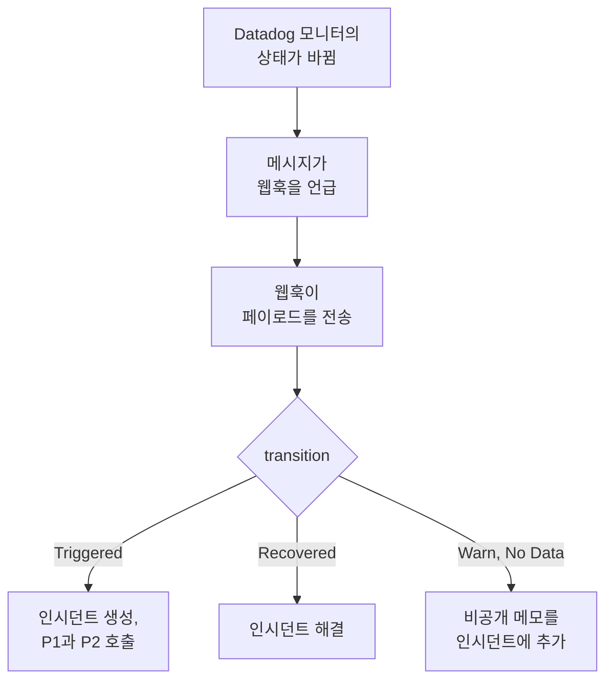

# Datadog

[Datadog](https://www.datadoghq.com) 모니터 알림을 OneUptime으로 보내면, 각 알림이 인시던트나 알림이 되고, 긴급하면 온콜 팀을 호출하며, Datadog 모니터가 복구되면 해결됩니다. Datadog은 [Webhooks 통합](https://docs.datadoghq.com/integrations/webhooks/)을 통해 알림을 보내므로 어느 쪽에도 설치할 것이 없습니다.

:::cards
- [OneUptime이 알림을 받는 방법 선택](#oneuptime이-알림을-받는-방법-선택): 워크플로 템플릿 또는 Incoming Request 모니터.
- [템플릿으로 시작하기](#템플릿으로-시작하기): 호출할 사람을 고르고, URL을 복사하고, 각 알림이 하는 일을 확인합니다.
- [모니터로 알림 받기](#모니터로-알림-받기): 알림마다 인시던트 하나, 복구 시 해결.
- [Datadog 구성](#datadog-구성): 웹훅과 이를 통지하는 모니터.
- [문제 해결](#문제-해결): 알림이 도착하지 않거나 인시던트가 계속 열려 있을 때.
:::

## 작동 방식



Datadog 모니터는 상태가 바뀔 때, 즉 발생하거나 경고하거나 복구되거나 데이터가 없을 때, 메시지에서 언급한 웹훅에 통지합니다. 웹훅의 JSON 본문은 Datadog의 [템플릿 변수](https://docs.datadoghq.com/integrations/webhooks/#usage)로 직접 작성하므로, 이 가이드에서는 각 알림에 이름을 붙이고 무슨 일이 있었는지 알려 주는 본문을 제공합니다.

## 사전 요건

- 통합을 구성하고 모니터를 편집할 수 있는 Datadog 계정.
- OneUptime에서 워크플로를 만들 권한, 또는 그 방법을 택한다면 모니터를 만들 권한. OneUptime Cloud에서는 워크플로에 **Growth** 플랜 이상이 필요합니다.

## OneUptime이 알림을 받는 방법 선택

먼저 OneUptime을 설정합니다. 그러면 Datadog이 보낼 URL을 얻습니다.

| 방법 | 사용하는 경우 |
| --- | --- |
| 워크플로 템플릿(권장) | 각 알림을 모니터의 우선순위에 맞는 심각도의 인시던트나 알림으로 만들고, P1과 P2에는 온콜을 호출하고, 경고는 메모로 남기고, 복구 시 해결하고 싶을 때. 따로 만들 것이 없습니다. |
| Incoming Request 모니터 | 워크플로 없이, 어떤 플랜에서든 인시던트를 만들고, 상태가 Datadog을 따르는 모니터를 원할 때. |

둘 다 같은 웹훅에서 같은 JSON을 받으므로, 하나로 시작한 뒤 Datadog의 URL 하나만 바꿔 나중에 전환할 수 있습니다.

## 템플릿으로 시작하기

**워크플로 만들기** 대화 상자의 카테고리 목록에서 **Datadog** 아래에 Datadog 템플릿 2개가 있습니다. **Declare an incident when a Datadog monitor triggers**는 인시던트용이고, **Create an alert when a Datadog monitor triggers**는 알림용입니다. 둘은 같은 일을 하며, 각각 자기 종류의 기록을 만듭니다.

:::steps
1. **워크플로**로 이동해 **워크플로 생성**을 클릭합니다. **또는 템플릿에서 시작**에서 카테고리 목록의 **Datadog**을 고르고, **Declare an incident when a Datadog monitor triggers**를 클릭하거나, **Create an alert when a Datadog monitor triggers**를 클릭한 다음 **이 템플릿 사용**을 클릭합니다.
2. **Who to page for P1 and P2 monitors** 아래에서 호출할 온콜 정책을 고르거나, 아무도 호출하지 않으려면 고르지 말고, **워크플로 생성**을 클릭합니다. 워크플로가 꺼진 상태로 **빌더**에서 열립니다.
3. **Webhook** 트리거를 클릭한 다음 **URL 복사**를 클릭하고, URL을 Datadog용으로 보관합니다.
4. **빌더** 상단에서 **활성화됨**을 켭니다. 꺼져 있는 워크플로는 Datadog에 `400`으로 응답합니다.
:::

그런 다음 [Datadog을 구성](#datadog-구성)해 그 URL로 알림을 보내게 합니다. 워크플로의 `read-event-1` 단계는 같은 설정으로 열리므로, **빌더**에서 다시 돌아왔을 때 참고할 수 있습니다.

### 워크플로가 하는 일

**Webhook** 트리거 다음에는 **Check With JavaScript** 단계 `read-event-1`이 Datadog이 보내는 `transition`을 읽고, **Incident From Another Tool**(알림 템플릿에서는 **Alert From Another Tool**)이 알림의 주기 키로 그 뜻대로 처리합니다. Datadog은 알림이 발생한 순간부터 복구될 때까지 그 키를 유지하고, 다시 발생하면 키가 새로 생기므로 매번 자체 인시던트를 갖습니다. 인시던트는 키를 사용자 지정 필드 `datadogAlertCycleKey`에 보관합니다.

| 전환 | 워크플로가 하는 일 |
| --- | --- |
| `Triggered`, `Re-Triggered` | `Datadog: <monitor>`라는 제목의 인시던트를 모니터의 우선순위에 대응하는 심각도로 선언하며, 상태 페이지에는 표시하지 않습니다. 설명에는 Datadog의 알림 링크와 우선순위, 호스트, 범위, 모니터의 메시지가 들어갑니다. 인시던트가 이미 있는 알림의 통지는 두 번째 인시던트를 열지 않고, 아무도 다시 호출하지 않습니다. |
| `Recovered` | 알림의 인시던트를 해결합니다. 이미 해결되었으면 그대로 둡니다. 이유는 타임라인에 남습니다. |
| `Warn`, `Re-Warn`, `No Data`, `Re-No Data` | 모니터의 현재 상태를 알리는 비공개 메모를 알림의 인시던트에 추가합니다. |
| `Renotify` | 없음: 알림이 아직 열려 있습니다. |

인시던트가 없는 알림의 경고나 복구는 아무것도 바꾸지 않습니다. 그 밖의 것, 예를 들어 다른 도구에서 온 요청은 그대로 둡니다. `read-event-1`이 **No**로 가고, 실행의 **단계**에 이유가 나옵니다. Datadog으로는 아무것도 돌아가지 않습니다. Datadog은 신호가 복구되면 자체 알림을 해결하고, 그것이 인시던트를 해결합니다.

### 우선순위와 호출

모니터가 P1 또는 P2이거나 우선순위가 없으면, 새 인시던트는 선택한 온콜 정책을 호출합니다. P3, P4, P5는 인시던트를 열고 아무도 호출하지 않습니다. 새 프로젝트에서 우선순위는 다음 인시던트 및 알림 심각도에 매핑됩니다:

| Datadog 우선순위 | 인시던트 | 알림 | 온콜 |
| --- | --- | --- | --- |
| P1 | Critical Incident | High | 호출함 |
| P2 | Critical Incident | High | 호출함 |
| 우선순위 없음 | Critical Incident | High | 호출함 |
| P3 | Major Incident | Low | 호출 안 함 |
| P4 | Minor Incident | Low | 호출 안 함 |
| P5 | Minor Incident | Low | 호출 안 함 |

직접 만든 심각도가 있으면 P1, P2, 우선순위 없음은 가장 심각한 것으로, P3은 중간 것으로, P4와 P5는 가장 덜 심각한 것으로 갑니다.

- 우선순위를 이름으로 직접 만든 심각도에 매핑하려면 `read-event-1` 단계의 `SEVERITY_BY_NAME`을 편집하세요. 예를 들어 `{ P3: 'Minor Incident' }`입니다.
- P3에도 호출하려면 `if-page-1` **If / Else** 단계의 **Compare with**를 `3`으로 설정하세요.

## 모니터로 알림 받기

[Incoming Request 모니터](/docs/monitor/incoming-request-monitor)는 URL을 제공하고, 그 기준이 각 알림이 할 일을 결정합니다.

:::steps
### 모니터 만들기

**모니터**로 이동해 **모니터 생성**을 클릭합니다. **모니터 유형**에서 **Incoming Request**를 고르고, 이름을 `Datadog`으로 정한 다음 **다음**을 클릭합니다.

### 알림마다 인시던트 선언

**기준** 단계에서 첫 번째 기준, 즉 모니터를 오프라인으로 표시하는 기준을 엽니다. 필터를 **요청 본문**, **포함**, `"transition":"Triggered"`로 설정합니다. 이 기준은 필터가 일치하면 이미 인시던트를 선언합니다. 인시던트를 채웁니다:

- **인시던트 제목**: `{{requestBody.title}}`.
- **인시던트 설명**(**설명** 아래): `{{requestBody.body}}`, 그다음 줄에 `Datadog: {{requestBody.link}}`.
- **심각도**: 이 알림에 붙일 인시던트 심각도.
- **온콜 정책**(**온콜** 아래): 호출할 정책.
- **인시던트 자동 해결**(**추가 필드** 아래): 처음 상태대로 켜 둡니다. 이 설정이 없으면 복구가 무시되어 인시던트가 계속 열려 있습니다.

### 알림마다 인시던트 하나 열기

같은 기준에서 **설정**을 열고 **Group incidents and alerts by a payload field**를 켭니다. 아래와 같이 채우면 알림마다 별도의 인시던트가 생기고, 그 복구가 인시던트를 해결합니다:

| 필드 | 값 |
| --- | --- |
| **Open a separate incident for each…** | `requestBody.alert_key` |
| **Field that signals recovery** | `requestBody.transition` |
| **Value that means recovered** | `Recovered` |

### 모니터를 다시 온라인으로

두 번째 기준, 즉 모니터를 온라인으로 표시하는 기준을 열고 필터를 **요청 본문**, **포함**, `"transition":"Recovered"`로 설정합니다.

### URL 복사

**모니터 생성**을 클릭합니다. 모니터의 **개요** 페이지에 **Heartbeat URL**이 표시됩니다. Datadog에 쓸 수 있도록 복사합니다:

```text
https://oneuptime.com/heartbeat/<secret key>
```

자체 호스팅 설치에서는 `oneuptime.com` 대신 자체 호스트를 사용합니다.
:::

아래 페이로드는 `alert_key`를 Datadog 모니터의 ID와 알림을 낸 그룹의 태그로 설정하므로, 멀티 알림 모니터의 각 그룹이 자체 인시던트를 갖고 그 그룹의 복구가 인시던트를 해결합니다. 인시던트가 열려 있는 동안 모니터가 다시 발생하거나 다시 통지해도 두 번째 인시던트는 열리지 않습니다. 각 설정이 하는 일은 [다른 시스템의 알림 수신](/docs/monitor/incoming-request-monitor#다른-시스템의-알림-수신)을 참고하세요.

> [!NOTE]
> **Warn** 또는 **No Data** 통지는 이 필터로는 인시던트를 열지 않습니다. 경고에도 호출되려면 **기준 추가**를 클릭하고, 새 기준에 필터 **요청 본문**, **포함**, `"transition":"Warn"`, 고유한 **심각도**를 가진 인시던트, 같은 그룹화 설정을 지정한 다음, 첫 번째 기준 위로 끌어 올립니다. 기준은 위에서부터 확인되며, 처음 일치하는 기준이 결정합니다.

## Datadog 구성

:::steps
### 웹훅 추가

Datadog에서 [Webhooks 통합 타일](https://app.datadoghq.com/integrations/webhooks)을 열고, 아직 설치하지 않았다면 설치합니다. 다음 설정으로 웹훅을 추가하고 저장합니다:

- **Name**: `oneuptime`. 모니터는 이 이름을 사용해 `@webhook-oneuptime`으로 웹훅을 언급합니다.
- **URL**: OneUptime에서 복사한 URL.
- **Payload**:

  ```json
  {
    "alert_key": "$ALERT_ID $ALERT_SCOPE",
    "alert_cycle_key": "$ALERT_CYCLE_KEY",
    "transition": "$ALERT_TRANSITION",
    "alert_priority": "$ALERT_PRIORITY",
    "title": "$EVENT_TITLE",
    "body": "$TEXT_ONLY_MSG",
    "host": "$HOSTNAME",
    "scope": "$ALERT_SCOPE",
    "priority": "$PRIORITY",
    "link": "$LINK"
  }
  ```

### 모니터에서 웹훅 언급

OneUptime을 통해 호출해야 하는 각 Datadog 모니터에서, 모니터의 통지 메시지에 `@webhook-oneuptime`을 추가하고 모니터를 저장합니다. 그러면 Datadog이 그 모니터의 알림과 복구를 OneUptime으로 보냅니다.
:::

| 변수 | Datadog이 넣는 값 |
| --- | --- |
| `$ALERT_ID` | 알림을 낸 Datadog 모니터의 ID. |
| `$ALERT_SCOPE` | 알림을 낸 그룹의 태그. 예: `host:web-1`. |
| `$ALERT_CYCLE_KEY` | 알림이 발생한 순간부터 복구될 때까지 같게 유지되는 ID. |
| `$ALERT_TRANSITION` | 무슨 일이 있었는지. `Triggered`, `Re-Triggered`, `Warn`, `Recovered`, `No Data`, `Renotify` 등. |
| `$ALERT_PRIORITY` | Datadog 모니터의 우선순위. `P1`부터 `P5`까지, 우선순위가 없는 모니터는 없음. |
| `$EVENT_TITLE` | 이벤트 제목. 예: `[Triggered] High CPU`. |
| `$TEXT_ONLY_MSG` | Markdown을 뺀 모니터 메시지. |
| `$LINK` | Datadog의 이벤트 링크. |

하나의 페이로드가 두 방법 모두에 쓰입니다. 템플릿은 `alert_cycle_key`와 `alert_priority`를, 모니터는 `alert_key`를 사용합니다. 모두 유지하면 URL 하나만 바꿔 나중에 전환할 수 있습니다.

## 테스트하기

복사한 URL로 Datadog처럼 알림을 보냅니다:

```bash
curl -X POST "<url>" \
  -H "Content-Type: application/json" \
  -d '{
    "alert_key": "1234 host:web-1",
    "alert_cycle_key": "7151157925468446720",
    "transition": "Triggered",
    "alert_priority": "P1",
    "title": "[Triggered] High CPU",
    "body": "CPU is above 90% on web-1.",
    "host": "web-1",
    "scope": "host:web-1",
    "priority": "normal",
    "link": "https://app.datadoghq.com/event/event?id=1"
  }'
```

템플릿을 쓰면 `Datadog: High CPU`라는 제목의 인시던트가 열리고, 선택한 온콜 정책이 호출됩니다. 모니터를 쓰면 `[Triggered] High CPU`라는 제목의 인시던트가 열립니다. `transition`을 `Recovered`로 바꿔 같은 요청을 보내면 인시던트가 해결됩니다.

그런 다음 Datadog에서 테스트합니다. 웹훅을 언급하는 모니터를 열고 **Test Notifications**를 클릭한 뒤 그 **Alert** 통지를 보냅니다. 도착했는지 확인하려면 워크플로의 **로그 → 실행 기록**, 또는 OneUptime 모니터의 타임라인을 엽니다.

## 문제 해결

:::details OneUptime에 아무것도 도착하지 않음
- Datadog 모니터의 메시지가 웹훅 이름과 같은 철자로 `@webhook-oneuptime`을 언급하는지 확인합니다.
- 모니터는 무엇이든 확인하기 전에, 비밀 키가 틀려도 즉시 `200`으로 응답합니다. 알림이 도착하는지는 모니터의 타임라인에서 확인합니다.
- 꺼진 워크플로는 `400`으로 응답합니다. 그 **빌더** 상단에서 **활성화됨**을 켭니다.
:::

:::details 워크플로는 실행되지만 아무것도 열지 않음
**로그 → 실행 기록**에서 실행을 엽니다. **단계**의 `read-event-1` 항목에 **No**로 간 이유가 나옵니다.

- `Datadog named no alert cycle key`: Datadog의 웹훅 페이로드에 `"alert_cycle_key": "$ALERT_CYCLE_KEY"`를 추가합니다.
- `Datadog named no transition`: Datadog의 웹훅 페이로드에 `"transition": "$ALERT_TRANSITION"`을 추가합니다.
:::

:::details 온콜이 호출되지 않음
- P1과 P2 모니터와 우선순위가 없는 모니터만 호출합니다. [우선순위와 호출](#우선순위와-호출)을 참고하세요.
- 인시던트가 이미 있는 알림의 통지는 아무도 다시 호출하지 않습니다.
- **워크플로 만들기** 대화 상자에서 아무도 고르지 않았다면, 워크플로에 호출하는 단계가 없습니다.
:::

:::details 인시던트가 열리지만 해결되지 않음
- Datadog 모니터는 복구도 웹훅에 통지해야 합니다. 조건문 안에서 알림일 때만 웹훅을 언급하는 메시지는 복구를 보내지 않습니다.
- 템플릿을 쓰면 **로그 → 실행 기록**에서 복구의 실행을 엽니다. 마지막 단계에 이유가 나옵니다. 복구의 `alert_cycle_key`는 알림의 것과 같아야 하므로, 페이로드의 `$ALERT_CYCLE_KEY`는 그대로 두세요.
- 모니터를 쓰면 기준의 인시던트에 **추가 필드** 아래의 **인시던트 자동 해결**이 필요합니다.
- **Value that means recovered**는 정확히 `Recovered`여야 합니다. 비교는 대소문자를 구분합니다.
- 복구의 `alert_key`는 알림의 것과 같아야 합니다. 페이로드의 `$ALERT_ID $ALERT_SCOPE`는 그대로 두세요.
:::

:::details 필드에 변수 이름이 표시되거나 아무것도 표시되지 않음
Datadog은 이벤트에 해당하는 변수만 채웁니다. 테스트 통지를 보낸 뒤 도착한 내용을 확인합니다. 모니터의 타임라인에서, 워크플로라면 **로그 → 실행 기록**에서 확인할 수 있습니다.
:::

:::details 모니터의 모든 알림이 인시던트 하나로 합쳐짐
모니터를 쓰면 각 그룹에는 고유한 `alert_key`가 필요합니다. 페이로드가 `$ALERT_ID`와 `$ALERT_SCOPE`를 모두 사용해 이를 설정하는지, 그리고 그룹화 경로가 `requestBody.alert_key`인지 확인합니다.
:::

## 보안

- **URL을 비밀번호처럼 다루세요.** URL을 가진 사람은 누구나 인시던트를 열 수 있습니다. 유출되면 재설정하세요. 워크플로의 **Webhook** 트리거에서 **URL 재설정**을, 또는 모니터의 **설정** 페이지에서 **수신 요청 비밀 키 재설정**을 사용합니다. 그런 다음 Datadog에서 웹훅의 **URL**을 업데이트합니다.
- **링크는 Datadog으로 갑니다.** 템플릿은 요청 내용과 상관없이 Datadog 사이트에서만 알림으로 링크하고, Datadog이 보낸 내용은 텍스트로 씁니다.
- **자체 호스팅인가요?** Datadog은 인터넷에서 웹훅을 보내므로, OneUptime이 인터넷에서 HTTPS로 연결될 수 있어야 합니다.

## 다음 단계

:::cards
- [워크플로 템플릿](/docs/workflows/authoring): 템플릿으로 워크플로를 만들고 빌더에서 변경합니다.
- [수신 요청 모니터](/docs/monitor/incoming-request-monitor): 알림을 받는 모니터의 모든 설정.
- [New Relic](/docs/integrations/new-relic): New Relic 이슈를 위한 같은 템플릿.
- [에스컬레이션 규칙](/docs/on-call/escalation-rules): 온콜 정책이 누구를 언제 호출할지 정합니다.
- [통합 개요](/docs/integrations/index): 연결할 수 있는 다른 도구.
:::
