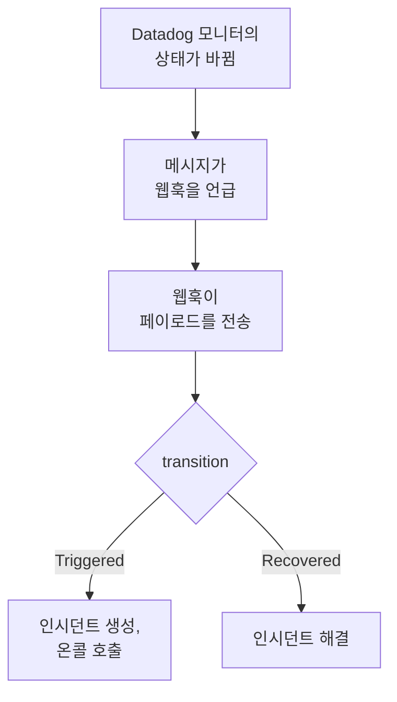

# Datadog

[Datadog](https://www.datadoghq.com) 모니터 알림을 OneUptime으로 보내면, 각 알림이 온콜 팀을 호출하는 인시던트가 되고 Datadog 모니터가 복구되면 해결됩니다. Datadog은 [Webhooks 통합](https://docs.datadoghq.com/integrations/webhooks/)을 통해 알림을 보내므로 어느 쪽에도 설치할 것이 없습니다.

:::cards
- [OneUptime이 알림을 받는 방법 선택](#oneuptime이-알림을-받는-방법-선택): Incoming Request 모니터 또는 직접 만든 워크플로.
- [모니터로 알림 받기](#모니터로-알림-받기): 알림마다 인시던트 하나, 복구 시 해결.
- [Datadog 구성](#datadog-구성): 웹훅과 이를 통지하는 모니터.
- [문제 해결](#문제-해결): 알림이 도착하지 않거나 인시던트가 계속 열려 있을 때.
:::

## 작동 방식



Datadog 모니터는 상태가 바뀔 때, 즉 발생하거나 경고하거나 복구되거나 데이터가 없을 때, 메시지에서 언급한 웹훅에 통지합니다. 웹훅의 JSON 본문은 Datadog의 [템플릿 변수](https://docs.datadoghq.com/integrations/webhooks/#usage)로 직접 작성하므로, 이 가이드에서는 각 알림에 이름을 붙이고 무슨 일이 있었는지 알려 주는 본문을 제공합니다.

## 사전 요건

- 통합을 구성하고 모니터를 편집할 수 있는 Datadog 계정.
- OneUptime에서 모니터를 만들 권한. 워크플로를 사용한다면 워크플로를 만들 권한.

## OneUptime이 알림을 받는 방법 선택

먼저 OneUptime을 설정합니다. 그러면 Datadog이 보낼 URL을 얻습니다.

| 방법 | 사용하는 경우 |
| --- | --- |
| Incoming Request 모니터(권장) | 모든 알림이 온콜을 호출하고 Datadog 모니터가 복구되면 해결되는 인시던트가 되기를 원할 때. 따로 만들 것이 없습니다. |
| 웹훅 트리거가 있는 워크플로 | 알림 필터링, 형태 변환, 다른 시스템 먼저 호출 등 자체 로직이 필요할 때. 워크플로는 받는 알림마다 인시던트를 선언하고, 복구 시 해결하지 않습니다. |

둘 다 같은 웹훅에서 같은 JSON을 받으므로, 하나로 시작한 뒤 Datadog의 URL 하나만 바꿔 나중에 전환할 수 있습니다.

## 모니터로 알림 받기

[Incoming Request 모니터](/docs/monitor/incoming-request-monitor)는 URL을 제공하고, 그 기준이 각 알림이 할 일을 결정합니다.

:::steps
### 모니터 만들기

**모니터**로 이동해 **모니터 생성**을 클릭합니다. **모니터 유형**에서 **Incoming Request**를 고르고, 이름을 `Datadog`으로 정한 다음 **다음**을 클릭합니다.

### 알림마다 인시던트 선언

**기준** 단계에서 첫 번째 기준, 즉 모니터를 오프라인으로 표시하는 기준을 엽니다. 필터를 **요청 본문**, **포함**, `"transition":"Triggered"`로 설정합니다. 이 기준은 필터가 일치하면 이미 인시던트를 선언합니다. 인시던트를 채웁니다:

- **인시던트 제목**: `{{requestBody.title}}`.
- **인시던트 설명**(**설명** 아래): `{{requestBody.body}}`, 그다음 줄에 `Datadog: {{requestBody.link}}`.
- **심각도**: 이 알림에 붙일 인시던트 심각도.
- **온콜 정책**(**온콜** 아래): 호출할 정책.
- **인시던트 자동 해결**(**추가 필드** 아래): 처음 상태대로 켜 둡니다. 이 설정이 없으면 복구가 무시되어 인시던트가 계속 열려 있습니다.

### 알림마다 인시던트 하나 열기

같은 기준에서 **설정**을 열고 **Group incidents and alerts by a payload field**를 켭니다. 아래와 같이 채우면 알림마다 별도의 인시던트가 생기고, 그 복구가 인시던트를 해결합니다:

| 필드 | 값 |
| --- | --- |
| **Open a separate incident for each…** | `requestBody.alert_key` |
| **Field that signals recovery** | `requestBody.transition` |
| **Value that means recovered** | `Recovered` |

### 모니터를 다시 온라인으로

두 번째 기준, 즉 모니터를 온라인으로 표시하는 기준을 열고 필터를 **요청 본문**, **포함**, `"transition":"Recovered"`로 설정합니다.

### URL 복사

**모니터 생성**을 클릭합니다. 모니터의 **개요** 페이지에 **Heartbeat URL**이 표시됩니다. Datadog에 쓸 수 있도록 복사합니다:

```text
https://oneuptime.com/heartbeat/<secret key>
```

자체 호스팅 설치에서는 `oneuptime.com` 대신 자체 호스트를 사용합니다.
:::

아래 페이로드는 `alert_key`를 Datadog 모니터의 ID와 알림을 낸 그룹의 태그로 설정하므로, 멀티 알림 모니터의 각 그룹이 자체 인시던트를 갖고 그 그룹의 복구가 인시던트를 해결합니다. 인시던트가 열려 있는 동안 모니터가 다시 발생하거나 다시 통지해도 두 번째 인시던트는 열리지 않습니다. 각 설정이 하는 일은 [다른 시스템의 알림 수신](/docs/monitor/incoming-request-monitor#다른-시스템의-알림-수신)을 참고하세요.

> [!NOTE]
> **Warn** 또는 **No Data** 통지는 이 필터로는 인시던트를 열지 않습니다. 경고에도 호출되려면 **기준 추가**를 클릭하고, 새 기준에 필터 **요청 본문**, **포함**, `"transition":"Warn"`, 고유한 **심각도**를 가진 인시던트, 같은 그룹화 설정을 지정한 다음, 첫 번째 기준 위로 끌어 올립니다. 기준은 위에서부터 확인되며, 처음 일치하는 기준이 결정합니다.

## Datadog 구성

:::steps
### 웹훅 추가

Datadog에서 [Webhooks 통합 타일](https://app.datadoghq.com/integrations/webhooks)을 열고, 아직 설치하지 않았다면 설치합니다. 다음 설정으로 웹훅을 추가하고 저장합니다:

- **Name**: `oneuptime`. 모니터는 이 이름을 사용해 `@webhook-oneuptime`으로 웹훅을 언급합니다.
- **URL**: OneUptime에서 복사한 URL.
- **Payload**:

  ```json
  {
    "alert_key": "$ALERT_ID $ALERT_SCOPE",
    "transition": "$ALERT_TRANSITION",
    "title": "$EVENT_TITLE",
    "body": "$TEXT_ONLY_MSG",
    "host": "$HOSTNAME",
    "priority": "$PRIORITY",
    "link": "$LINK"
  }
  ```

### 모니터에서 웹훅 언급

OneUptime을 통해 호출해야 하는 각 Datadog 모니터에서, 모니터의 통지 메시지에 `@webhook-oneuptime`을 추가하고 모니터를 저장합니다. 그러면 Datadog이 그 모니터의 알림과 복구를 OneUptime으로 보냅니다.
:::

| 변수 | Datadog이 넣는 값 |
| --- | --- |
| `$ALERT_ID` | 알림을 낸 Datadog 모니터의 ID. |
| `$ALERT_SCOPE` | 알림을 낸 그룹의 태그. 예: `host:web-1`. |
| `$ALERT_TRANSITION` | 무슨 일이 있었는지. `Triggered`, `Re-Triggered`, `Warn`, `Recovered`, `No Data`, `Renotify` 등. |
| `$EVENT_TITLE` | 이벤트 제목. 예: `[Triggered] High CPU`. |
| `$TEXT_ONLY_MSG` | Markdown을 뺀 모니터 메시지. |
| `$LINK` | Datadog의 이벤트 링크. |

## 테스트하기

Datadog처럼 OneUptime으로 알림을 보냅니다:

```bash
curl -X POST "https://oneuptime.com/heartbeat/<secret key>" \
  -H "Content-Type: application/json" \
  -d '{
    "alert_key": "1234 host:web-1",
    "transition": "Triggered",
    "title": "[Triggered] High CPU",
    "body": "CPU is above 90% on web-1.",
    "host": "web-1",
    "priority": "normal",
    "link": "https://app.datadoghq.com/event/event?id=1"
  }'
```

`[Triggered] High CPU`라는 제목의 인시던트가 열립니다. `transition`을 `Recovered`로 바꿔 같은 요청을 보내면 인시던트가 해결됩니다.

그런 다음 Datadog에서 테스트합니다. 웹훅을 언급하는 모니터를 열고 **Test Notifications**를 클릭한 뒤 그 **Alert** 통지를 보냅니다. OneUptime 모니터의 타임라인에서 도착했는지 확인합니다.

## 워크플로로 알림 받기

Datadog과 인시던트 사이에 직접 만든 단계가 필요하면 [워크플로](/docs/workflows/index)를 사용합니다.

:::steps
### 워크플로 만들기

**워크플로**로 이동해 **워크플로 생성**을 클릭한 다음 **처음부터 시작**을 클릭합니다. 이름을 `Datadog alerts`로 정하고 **워크플로 생성**을 클릭합니다.

### 웹훅 트리거 추가

점선으로 된 **이 워크플로를 시작할 항목 선택** 블록을 클릭하고 **Webhook**을 고릅니다. 트리거를 클릭한 다음 **URL 복사**를 클릭하고, 그 URL을 Datadog의 웹훅에 사용합니다.

### 모니터가 발생했는지 확인

**구성 요소 추가**를 클릭해 **If / Else** 블록을 추가하고, 트리거의 **Out** 점을 여기에 연결합니다. **Value to check**는 `{{local.components.webhook-1.returnValues.request-body.transition}}`, **Comparison**은 **is equal to**, **Compare with**는 `Triggered`로 설정합니다.

### 인시던트 선언

**Create One Incident** 블록을 추가하고 **If / Else** 블록의 **Yes** 쪽을 여기에 연결합니다. **Incident Template**에서 심각도와 호출할 온콜 정책을 정하는 템플릿을 고릅니다([인시던트 템플릿](/docs/incidents/settings#인시던트-템플릿) 참고). **JSON Object**에서 Datadog에서 오는 값을 설정합니다:

```json
{
  "title": "{{local.components.webhook-1.returnValues.request-body.title}}",
  "description": "{{local.components.webhook-1.returnValues.request-body.body}}\nDatadog: {{local.components.webhook-1.returnValues.request-body.link}}"
}
```

템플릿이 없으면 **JSON Object**에 프로젝트의 인시던트 심각도 중 하나의 ID인 `incidentSeverityId`도 있어야 합니다.

### 워크플로 켜기

**빌더** 상단에서 **활성화됨**을 켭니다. 꺼진 워크플로는 Datadog에 `400`으로 응답합니다.
:::

`Triggered` 통지는 매번 새 인시던트를 선언합니다. 복구는 **If / Else** 블록의 **No** 쪽으로 가는데, 그쪽에는 아무것도 연결되어 있지 않으므로 실행은 거기서 끝납니다. 알림마다 인시던트를 하나씩 열고 복구 시 해결하려면 모니터를 사용하세요.

## 문제 해결

:::details OneUptime에 아무것도 도착하지 않음
- Datadog 모니터의 메시지가 웹훅 이름과 같은 철자로 `@webhook-oneuptime`을 언급하는지 확인합니다.
- 모니터는 무엇이든 확인하기 전에, 비밀 키가 틀려도 즉시 `200`으로 응답합니다. 알림이 도착하는지는 모니터의 타임라인에서 확인합니다.
- 꺼진 워크플로는 `400`으로 응답합니다. 그 **빌더** 상단에서 **활성화됨**을 켭니다.
:::

:::details 인시던트가 열리지만 해결되지 않음
- Datadog 모니터는 복구도 웹훅에 통지해야 합니다. 조건문 안에서 알림일 때만 웹훅을 언급하는 메시지는 복구를 보내지 않습니다.
- 기준의 인시던트에는 **추가 필드** 아래의 **인시던트 자동 해결**이 필요합니다.
- **Value that means recovered**는 정확히 `Recovered`여야 합니다. 비교는 대소문자를 구분합니다.
- 복구의 `alert_key`는 알림의 것과 같아야 합니다. 페이로드의 `$ALERT_ID $ALERT_SCOPE`는 그대로 두세요.
:::

:::details 필드에 변수 이름이 표시되거나 아무것도 표시되지 않음
Datadog은 이벤트에 해당하는 변수만 채웁니다. 테스트 통지를 보낸 뒤 도착한 내용을 확인합니다. 모니터의 타임라인에서, 워크플로라면 **로그 → 실행 기록**에서 확인할 수 있습니다.
:::

:::details 모니터의 모든 알림이 인시던트 하나로 합쳐짐
각 그룹에는 고유한 `alert_key`가 필요합니다. 페이로드가 `$ALERT_ID`와 `$ALERT_SCOPE`를 모두 사용해 이를 만드는지, 그리고 그룹화 경로가 `requestBody.alert_key`인지 확인합니다.
:::

## 보안

- **URL을 비밀번호처럼 다루세요.** URL을 가진 사람은 누구나 인시던트를 열 수 있습니다. 유출되었다면 재설정합니다. 모니터의 **설정** 페이지에서 **수신 요청 비밀 키 재설정**을, 또는 워크플로의 **Webhook** 트리거에서 **URL 재설정**을 사용합니다. 그런 다음 Datadog에서 웹훅의 **URL**을 업데이트합니다.
- **자체 호스팅인가요?** Datadog은 인터넷에서 웹훅을 보내므로, OneUptime이 인터넷에서 HTTPS로 연결될 수 있어야 합니다.

## 다음 단계

:::cards
- [수신 요청 모니터](/docs/monitor/incoming-request-monitor): 알림을 받는 모니터의 모든 설정.
- [Prometheus Alertmanager](/docs/integrations/prometheus-alertmanager): Alertmanager를 위한 같은 설정.
- [에스컬레이션 규칙](/docs/on-call/escalation-rules): 온콜 정책이 누구를 언제 호출할지 정합니다.
- [통합 개요](/docs/integrations/index): 연결할 수 있는 다른 도구.
:::
