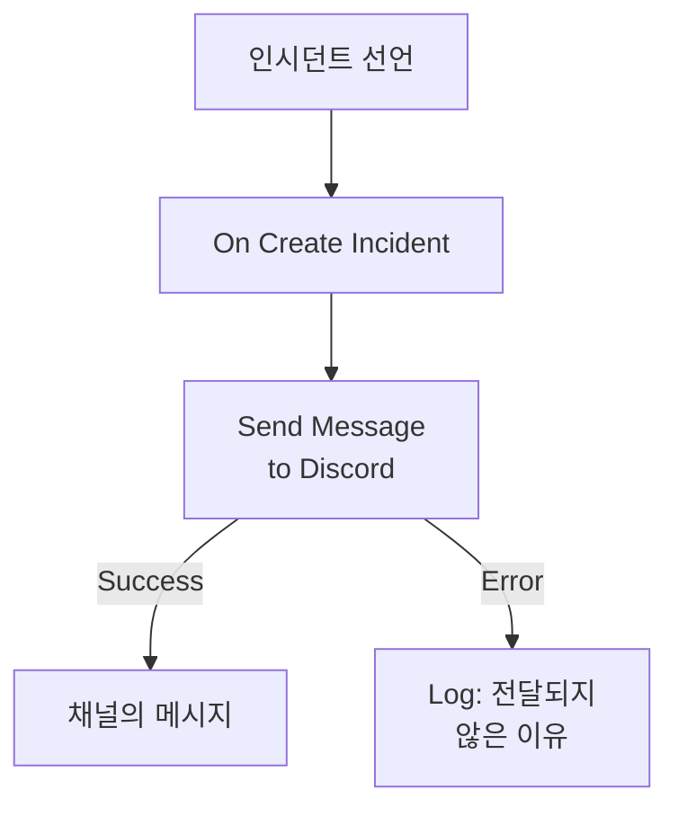

# Discord

인시던트가 열리면 [Discord](https://discord.com) 채널에 메시지를 게시해, 그 채널을 지켜보는 사람들이 바로 알 수 있게 합니다. OneUptime의 워크플로 단계 **Send Message to Discord**는 채널의 웹훅을 통해 게시하며, 미리 만들어진 템플릿이 워크플로 전체를 만들어 줍니다. 이 통합은 **아웃바운드**입니다. OneUptime은 채널에 게시만 하고, 그곳에서 오가는 말은 읽지 않습니다.

:::cards
- [작동 방식](#작동-방식): 인시던트가 열릴 때 워크플로가 하는 일.
- [설정](#통합-설정): Discord의 웹훅, 그리고 워크플로. 템플릿으로 또는 처음부터.
- [팁](#팁): 서식, 긴 메시지, 그 밖의 이벤트.
- [문제 해결](#문제-해결): 단계의 오류가 뜻하는 것과 고칠 곳.
:::

## 작동 방식



단계는 **Message Text**를 채널의 웹훅에 게시합니다. Discord가 메시지를 받으면 **Success** 출력으로, Discord가 거부하면 Discord의 이유와 함께 **Error** 출력으로 진행합니다. 템플릿은 **Log** 단계를 **Error**에 연결하므로, 게시하지 못한 실행은 그 이유를 알려 줍니다.

## 사전 요건

- Discord에서 채널의 **Manage Webhooks** 권한.
- OneUptime에서 워크플로와 변수를 만들 수 있는 권한. OneUptime Cloud에서는 워크플로에 **Growth** 이상의 플랜이 필요합니다.

## 통합 설정

:::steps
### Discord에서 웹훅 만들기

1. Discord에서 **Edit Channel**로 채널 설정을 연 다음 **Integrations → Webhooks**를 열고 **New Webhook**을 선택합니다.
2. 이름을 지정하고(예: `OneUptime`) 올바른 채널에 게시되는지 확인합니다.
3. **Copy Webhook URL**을 선택합니다.

URL을 가진 사람은 누구나 채널에 게시할 수 있으므로, 비밀번호처럼 안전하게 보관하세요.

### 워크플로 만들기

워크플로 전체를 만들어 주는 템플릿으로 시작하거나, 처음부터 시작합니다.

:::tabs
@tab 템플릿으로
1. **워크플로**를 열고 **워크플로 생성**을 클릭합니다.
2. **템플릿 검색…** 상자에 `Discord`를 입력하고 **Tell Discord when an incident opens**를 클릭한 다음 **이 템플릿 사용**을 클릭합니다.
3. 이름은 **Notify Discord on new incident** 그대로 두거나 바꾸고, **다음**을 클릭합니다.
4. URL을 **Discord Webhook URL**에 붙여 넣고 **워크플로 생성**을 클릭합니다.

워크플로는 세 단계로 **빌더**에서 열립니다. **On Create Incident**, 인시던트의 번호, 제목, 심각도, 상태를 게시하는 **Send Message to Discord**, 그 **Error** 출력에 연결된 **Log** 단계입니다. URL은 워크플로의 시크릿 변수 `discordWebhookUrl`로 저장됩니다.
@tab 처음부터
1. URL을 시크릿 전역 변수로 저장합니다. **워크플로 → 전역 변수**로 이동해 **워크플로 변수 만들기**를 클릭하고, 이름을 `DISCORD_WEBHOOK_URL`로 지정한 뒤 **다음**을 클릭합니다. URL을 **콘텐츠**에 붙여 넣고 **시크릿**을 켠 뒤 **워크플로 변수 만들기**를 클릭합니다.
2. **워크플로**로 이동해 **워크플로 생성**을 클릭하고 **처음부터 시작**을 고른 뒤, 워크플로 이름을 지정하고 **워크플로 생성**을 클릭합니다.
3. **빌더**에서 **이 워크플로를 시작할 항목 선택**을 클릭하고 **인기** 아래의 **On Create Incident**를 고릅니다. 트리거를 클릭합니다. **Fields to pass on**에는 **제목**이 이미 들어 있으므로, **필드 추가**를 클릭하고 메시지에 표시할 다른 필드(예: **Incident Number With Prefix**)를 고릅니다.
4. **구성 요소 추가**를 클릭하고 `discord`를 검색한 뒤 **Send Message to Discord**를 클릭합니다. 트리거의 **Success** 출력을 이 단계에 연결합니다.
5. 새 단계를 클릭합니다. **Discord Incoming Webhook URL**에서 **{ }** 버튼을 클릭하고 **Global variables** 아래의 `DISCORD_WEBHOOK_URL`을 고릅니다. **Message Text**에 메시지를 쓰고, **{ }** 버튼으로 인시던트의 필드를 넣습니다.
:::

처음부터 만든 메시지는 다음과 같은 참조로 인시던트의 필드를 읽습니다:

```text
🚨 **Incident {{local.components.incident-on-create-1.returnValues.model.incidentNumberWithPrefix}} declared**
**Title:** {{local.components.incident-on-create-1.returnValues.model.title}}
```

### 켜고 테스트하기

**빌더** 위쪽에서 **활성화됨**을 켭니다. 이제부터 새 인시던트는 모두 채널에 게시됩니다.

인시던트를 열지 않고 테스트하려면 **워크플로 실행**을 클릭하고, **인시던트**에서 이미 있는 인시던트를 고릅니다. 최근 인시던트가 목록에 나오며, 번호나 제목의 일부를 입력하면 다른 인시던트를 찾을 수 있습니다. **워크플로 수동 실행**을 클릭하고 **실행**으로 확인합니다. **워크플로 실행** 패널이 실행을 따라가며, 메시지가 채널에 나타납니다. 단계가 대신 **Error**로 진행하면 **Log** 단계의 줄에 이유가 나옵니다. [문제 해결](#문제-해결)을 참고하세요.
:::

## 팁

- **Discord Markdown으로 서식 지정하기.** 텍스트는 입력한 그대로 보내지므로 Discord의 Markdown이 작동합니다. 단어를 별표로 감싸면 굵게 표시되고, URL은 링크로 나타납니다.
- **2,000자 한도에 유의하기.** Discord는 최대 2,000자의 메시지를 받습니다. 더 긴 메시지는 거부되지 않고 잘리며, 끝에 "… (truncated — see OneUptime for the full text)"가 붙습니다.
- **새 인시던트 말고도 게시하기.** 상태 변경에는 **On Update Incident**로, 알림에는 **On Create Alert**로 같은 단계를 쓰는 다른 워크플로를 만드세요. 일부 인시던트만 게시하려면 단계 앞에 **If / Else** 블록을 두세요.
- **Discord 자체 주소만.** 단계는 `discord.com` 또는 `discordapp.com`의 `https` URL로 게시하며 리디렉션은 따라가지 않으므로, 다른 곳을 가리키는 URL은 실행을 멈춥니다.

## 문제 해결

단계가 **Error**로 진행하면 실행이 그 이유를 알려 줍니다. 템플릿의 **Log** 단계가 `❌ Discord could not deliver the incident notification:`과 Discord의 이유를 기록합니다.

:::details Discord가 "Unknown Webhook" 또는 "Invalid Webhook Token"으로 응답함
웹훅이 삭제되었거나 URL을 잘못 복사했습니다. 새 웹훅을 만들고 URL을 바꾸세요. 템플릿의 워크플로에서는 변수 `discordWebhookUrl`, 직접 만든 워크플로에서는 `DISCORD_WEBHOOK_URL`의 내용입니다.
:::

:::details Discord가 "You are being rate limited"로 응답함
Discord는 웹훅 하나가 게시할 수 있는 빈도를 제한합니다. 인시던트가 몰리면 이 한도에 걸릴 수 있습니다. 일부 심각도에만 게시하는 식으로 메시지를 줄이세요.
:::

:::details 실행이 "Discord Webhook URL must be an https URL on discord.com or discordapp.com"으로 멈춤
**Discord Incoming Webhook URL**에 Discord 웹훅이 아닌 다른 것이 들어 있거나, 읽는 변수가 비어 있습니다. **Copy Webhook URL**의 URL을 다시 붙여 넣으세요.
:::

## 다음 단계

:::cards
- [워크플로우 구성 요소](/docs/workflows/components#discord): 단계의 모든 설정과 출력의 의미.
- [Telegram](/docs/integrations/telegram): 같은 아이디어를 Telegram 채팅에서.
- [워크플로우 실행 기록](/docs/workflows/runs-and-logs): 워크플로의 각 실행이 무엇을 했는지 확인합니다.
- [통합 개요](/docs/integrations/index): 아웃바운드 패턴과 연결할 수 있는 다른 도구.
:::
