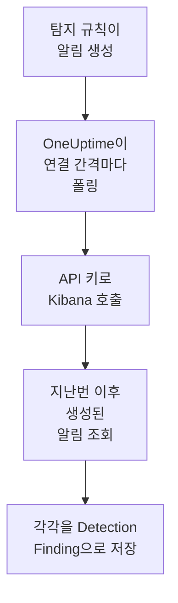

# Elastic Security

[Elastic Security](https://www.elastic.co/security) 규칙이 만드는 탐지 알림을 OneUptime의 보안 이벤트로 가져옵니다. 그곳에서 로그, 트레이스, 메트릭과 나란히 검색하고, 다른 모든 소스와 상관 분석하고, 중요한 것에 대해 온콜을 호출할 수 있습니다. OneUptime은 직접 만든 API 키로 Kibana의 탐지 엔진 API를 통해 이를 읽으며, Elastic에서는 아무것도 바꾸지 않습니다.

:::cards
- [연결 설정](#연결-설정): API 키, 그 권한, 연결 양식.
- [가져오는 내용](#가져오는-내용): 각 탐지 알림이 보안 이벤트가 되는 방식.
- [폴링 작동 방식](#폴링-작동-방식): 각 폴링이 읽는 구간과, 바쁜 스페이스에서 일어나는 일.
- [문제 해결](#문제-해결): 각 오류의 의미와 바꿔야 할 점.
:::

## 작동 방식



OneUptime은 1분마다, 폴링 간격이 지난 활성화된 연결을 각각 폴링합니다. 폴링은 지난 폴링 이후 스페이스에서 생성된 탐지 알림을 한 번에 1,000개씩 Kibana에 요청하고, 각각을 [OCSF](https://schema.ocsf.io/) Detection Finding 이벤트(클래스 `2004`)로 저장합니다. 사용자 지정 쿼리, 임곗값, EQL, 지표 일치, 머신 러닝, 새 용어 등 모든 규칙 유형이 대상입니다. 그 뒤 탐지 규칙, 모니터, 대시보드는 알림을 다른 소스의 보안 이벤트와 똑같이 다룹니다.

## 사전 요건

- OneUptime에서 Project Owner, Project Admin 또는 Security Admin 역할. Security Member와 Security Viewer는 연결과 그 실행 기록을 볼 수 있지만 변경할 수는 없습니다.
- Elastic Cloud 또는 직접 운영하는 Elastic 스택의 Elastic Security 8.x 이상. Kibana 스페이스에서 탐지 규칙이 실행되고 있어야 합니다.
- 그 스페이스의 탐지 알림을 볼 수 있는 Kibana 접근 권한. `.alerts-security.alerts-<space-id>`에 대한 인덱스 권한 `read`와 `view_index_metadata`, 그리고 그곳에서 알림을 읽을 수 있게 하는 Kibana Security 기능 권한이 필요합니다.
- OneUptime이 HTTPS로 접근할 수 있는 Kibana. OneUptime Cloud는 인터넷에서 연결하므로 Kibana에 Elastic Cloud 배포처럼 공개 주소가 필요하며, 사설 주소는 거부됩니다. 자체 호스팅 OneUptime은 앱과 워커 컨테이너에서 연결하며, `DATA_SOURCE_BLOCK_PRIVATE_ADDRESSES`가 `true`가 아닌 한 사설 네트워크의 Kibana에도 접근할 수 있습니다.

## 연결 설정

:::steps
### API 키 만들기

1. Kibana에서 **Stack Management → API keys**를 열고 **Create API key**를 선택합니다.
2. 이름을 지정합니다(예: `oneuptime-security-events`). 키는 권한을 줄이지 않는 한 키를 만든 사용자의 권한을 가집니다. 키에 필요한 것은 위의 권한뿐입니다.
3. 만료 시점을 고르거나 만료 없음으로 둡니다. 만료되는 키는 교체할 때까지 연결을 멈춥니다.
4. 키를 만들고 그 **Base64** 값을 복사합니다. Kibana는 이 값을 한 번만 보여 줍니다. 키의 ID나 `id:api_key` 쌍이 아닙니다.

### 스페이스 ID 찾기

알림은 스페이스별로 저장됩니다. 규칙이 실행되는 스페이스를 여세요. 그 ID는 Kibana 주소에서 `/s/` 뒤의 부분으로, 예를 들어 `https://kibana.example.com/s/security/app/security`의 `security`입니다. 기본 스페이스에는 `/s/` 부분이 없으며 ID가 필요 없습니다.

### OneUptime에서 연결 추가

**제품 → Security Events → 연결**(`/dashboard/{projectId}/security-events/connections`)를 열고 **연결 추가**를 클릭한 뒤 **Elastic Security**를 고르고 **다음**을 클릭합니다. 아래 표의 설정을 채우고 **다음**을 클릭한 뒤, 키를 **API 키**에 붙여 넣습니다.

### 저장하기 전에 테스트

**저장하기 전에 테스트** 아래의 **이 설정 테스트**를 클릭합니다. 테스트는 양식의 값으로 인증하고 알림을 읽으며 아무것도 저장하지 않으므로, 잘못된 스페이스나 빠진 권한이 연결을 만들기 전에 드러납니다. 그런 다음 **다음**을 클릭하고 연결에 **이름**을 지정해 만듭니다.
:::

| 설정 | 입력할 값 |
| --- | --- |
| **Kibana URL** | Kibana를 제공하는 주소. 예: `https://kibana.example.com` 또는 `https://<deployment>.kb.<region>.cloud.es.io`. 경로는 붙이지 않습니다. `/app/security`도, `/api`도, `/s/<space>` 부분도 없어야 합니다. |
| **Kibana space** | 스페이스의 이름이 아니라 ID. 영문자, 숫자, 하이픈, 밑줄로 이루어집니다. 기본 스페이스라면 비워 둡니다. |
| **API 키** | 키의 **Base64** 값 그대로. `ApiKey` 스킴은 OneUptime이 직접 붙입니다. 암호화되며, API가 반환하지 않고 다시 표시되지도 않습니다. 교체하려면 연결의 **자격 증명 업데이트**를 사용합니다. |

**폴링** 단계에는 선택 사항인 **설명**, `1`부터 `1440`까지의 정수이며 처음 값이 `5`인 **폴링 간격(분)**, 그리고 처음에 켜져 있는 **활성화됨**도 있습니다.

## 가져오는 내용

각 탐지 알림은 공급업체 `Elastic`, 제품 `Elastic Security`의 Detection Finding 이벤트(OCSF 클래스 `2004`)가 됩니다:

| 알림 필드 | OneUptime 열 |
| --- | --- |
| `_id`(알림의 ID) | 이벤트 UID. 중복을 걸러 내는 기준이기도 합니다 |
| `kibana.alert.original_time`, 없으면 `kibana.alert.start`, 없으면 `@timestamp` | 이벤트 시각 |
| `kibana.alert.rule.name` | 규칙 이름 |
| `kibana.alert.rule.uuid`, 없으면 `kibana.alert.rule.rule_id` | 규칙 ID |
| `kibana.alert.reason`, 없으면 규칙 이름, 없으면 `kibana.alert.rule.description` | 메시지 |
| `kibana.alert.severity`, 없으면 `kibana.alert.risk_score`의 구간 | 심각도 |
| `kibana.alert.workflow_status`: `open`, `acknowledged` 또는 `closed` | 상태 |
| `kibana.alert.rule.threat`(하위 기법 포함) | MITRE ATT&CK 전술과 기법 |
| `user.name`, `host.name`, `source.ip` 또는 `host.ip`, `process.name` 또는 `process.executable` | 주체 사용자, 호스트, IP, 프로세스 |
| `user.target.name`, `destination.domain`, `destination.ip`, `destination.port`, `file.path` | 대상 사용자, 호스트, IP, 포트, 리소스 |
| 그것들과 함께 `related.*`, `dns.question.name`, `url.domain`, 파일 해시 | Observable |
| 알림 전체. `_index`, `_id`와 함께 점 구분 키로 펼침 | `attributes` |

알림의 시각은 일부러 알림이 다루는 활동의 시각으로 합니다. 규칙이 알림을 만든 시각인 `@timestamp`를 폴링이 읽으므로, 어제의 활동에 대해 오늘 만들어진 알림은 보안 이벤트 탐색기에서 어제 날짜에 표시됩니다. 알림에 심각도가 없으면 위험 점수로 정합니다. `74` 이상은 Critical, `48` 이상은 High, `22` 이상은 Medium, 그 미만은 Low입니다.

## 폴링 작동 방식

각 폴링은 자신의 구간에서 생성된 알림을 오래된 것부터 한 페이지에 1,000개씩 나열합니다. 기본 스페이스가 아닌 스페이스에서는 경로가 `/s/{Kibana space}`로 시작합니다:

```text
POST {Kibana URL}/api/detection_engine/signals/search
    {"query": {"range": {"@timestamp": {"gte": "{window start}", "lt": "{window end}"}}},
     "size": 1000, "sort": [{"@timestamp": "asc"}]}
```

- **생성 시각이 커서입니다.** 알림은 다루는 활동의 시각이 아니라, 규칙 실행이 알림을 만든 시각인 자체 `@timestamp` 기준으로 나열됩니다. 매시간 실행되는 규칙은 최대 한 시간 전의 활동에 대해 알림을 만들므로, 활동 시각을 기준으로 한 커서는 그것들을 모두 건너뛰게 됩니다.
- **첫 폴링은 24시간 전까지 거슬러 올라가므로**, 새 연결에서 최근 알림이 바로 보입니다.
- **이후의 모든 폴링은 저장된 커서보다 1분 앞에서 시작하므로**, 두 구간의 경계에서 생성된 알림도 놓치지 않습니다.
- **한 번의 폴링은 커서 이후 최대 24시간까지 읽습니다.** 커서가 뒤처진 연결은 24시간 구간을 연달아 읽으며 따라잡고, 그동안 **상태**는 **Catching up**으로 표시됩니다.
- **중복은 알림의 `_id`로 걸러집니다.** 프로젝트 안에서 걸러지므로, 겹치는 부분, 다시 시도한 구간, 가져오기가 알림을 두 번 저장하는 일은 없습니다.

Kibana의 알림 검색은 크기와 정렬을 받지만 페이지 토큰은 받지 않습니다. 그래서 OneUptime은 범위의 시작을 각 페이지의 마지막 알림으로 옮기며 페이지를 넘기고, 그 순간에 이미 읽은 알림은 `_id`로 제외합니다. 한 번의 규칙 실행이 많은 알림에 같은 시각을 찍는 경우가 많은데, 그런 묶음도 페이지 단위로 읽히며, 두 번 읽히거나 건너뛰는 알림은 없습니다.

### 한 번의 폴링으로 다 읽을 수 없는 구간

한 번의 폴링은 최대 20개의 요청으로 최대 10,000개의 알림을 읽습니다. 구간에 그보다 많은 알림이 있으면 실행은 **부분**이 되며, 다음과 같은 경고가 나옵니다:

```text
Stopped after collecting 10000 alerts; the window holds more.
```

알림은 오래된 것부터 읽히므로, OneUptime은 커서를 마지막으로 읽은 알림의 생성 시각으로 옮기고, 다음 폴링은 같은 구간 길이로 거기서 시작합니다. 바쁜 스페이스는 같은 알림을 다시 읽는 대신 폴링마다 10,000개씩 따라잡습니다. 정확히 같은 순간에 만들어진 알림은 두 번 읽히며, 중복 검사가 두 번째 사본을 걸러 냅니다.

제외한 ID는 모든 요청에 함께 보내지며, Kibana는 요청의 크기를 제한합니다. 한 요청이 제외할 수 있는 것보다 많은 알림(약 7,800개)이 같은 순간을 공유하면, 실행은 거기서 **부분**로 멈추며 그 순간을 알려 주는 경고가 나옵니다.

실행이 저장된 커서를 전혀 넘어서지 못하면, OneUptime은 대신 구간을 줄입니다:

1. **좁히기.** 다음 폴링은 같은 시작점에서 절반 길이의 구간을 읽으며, 구간을 끝까지 읽을 수 있게 될 때까지 계속 절반으로 줄이고, 가장 짧게는 1분까지 줄입니다. 실행의 경고에 그렇게 적힙니다: `This window holds more records than one poll can read; the next poll reads a {n} minute window from the same starting point.`
2. **다시 늘리기.** 구간을 끝까지 읽은 뒤에는 다음 구간이 다시 두 배가 되며, 최대 24시간까지 늘어납니다.
3. **1분 넘어가기.** 1분 안에조차 한 번의 폴링으로 읽을 수 있는 것보다 많은 레코드가 있으면, 더 새로운 알림이 계속 도착하도록 폴링이 그 1분을 넘어갑니다. 실행은 **부분**로 남고, **마지막 오류**에는 `More records were created in the one minute from {cursor} to {end} than one poll can read. Polling moved past this minute so newer records keep arriving; use Import this time range in Diagnostics on this minute to recover what one run can read.`가 표시됩니다. 그 1분을 **Import this time range**로 가져오면 한 번의 실행으로 읽을 수 있는 만큼 되찾을 수 있습니다.

Kibana의 오류로 실행이 완전히 실패하면, 커서와 구간 길이는 그대로 유지되고 다음 폴링이 같은 구간을 다시 읽습니다. 단 하나의 예외는 요청 시간이 초과된 경우입니다. 커서는 그대로지만 다음 구간은 절반 길이가 됩니다. 제시간에 응답하기에는 너무 무거운 구간은 시도할 때마다 시간이 초과되기 때문입니다. **폴링 간격(분)** 값을 바꿔도 이 중 어느 것도 달라지지 않습니다. 이 설정은 폴링이 얼마나 자주 시작하는지를 정할 뿐, 구간이 어디서 시작하는지는 정하지 않습니다.

### 필요할 때 실행, 미리 보기, 가져오기

연결에서 **진단**을 클릭하면 최근 실행을 보고 연결을 직접 다룰 수 있습니다. 연결을 변경할 수 있는 사람은 누구나 이를 시작할 수 있고, 연결을 볼 수 있는 사람은 누구나 기록을 읽을 수 있습니다.

- **지금 실행**은 연결이 **활성화됨** 상태가 아닐 때에도 평소의 커서로 즉시 폴링을 시작합니다.
- **Preview alerts**는 최대 7일의 시간 범위를 읽으며 아무것도 가져오지 않습니다.
- **Import this time range**는 확인을 거친 뒤 최대 7일의 범위를 가져오며, 커서는 옮기지 않습니다. 이미 가져온 알림은 건너뜁니다.
- 실행의 **Copy diagnostics**는 지원팀에 보낼 보고서를 복사합니다. 자격 증명은 절대 포함되지 않습니다.

## 연결 테스트

연결 행의 **연결 테스트**와 양식의 **이 설정 테스트**는 백그라운드 워커가 아니라 API 프로세스에서 실행되므로, 워커가 문제일 때에도 테스트는 응답합니다. 다음 검사를 순서대로 실행합니다:

| 검사 | 확인하는 내용 |
| --- | --- |
| **구성** | 모든 설정이 있고 올바른 형식인지. 이 검사가 실패하면 아무 곳에도 연결하지 않습니다. |
| **Authenticate with Kibana** | Kibana의 `/api/status`가 전체 내용으로 응답합니다. Kibana는 인증하지 않은 호출자에게도 더 적은 내용으로 응답하므로, 짧은 응답이면 이 검사는 실패합니다. |
| **Read detection alerts** | 지난 24시간 동안 생성된 알림 하나를 읽을 수 있습니다. 이로써 권한과 스페이스가 확인됩니다. |
| **Alerts available to import** | 지난 24시간과 지난 7일 동안 생성된 알림의 수. Elasticsearch가 일부만 센 경우에는 `+`가 붙습니다. 7일 동안 하나도 없으면 실패가 아니라 경고입니다. |
| **Background workers**, **Poll scheduler**, **Security event storage** | OneUptime 쪽: Worker 큐의 작업을 가져가는 프로세스가 있고, 폴링 작업이 매분 실행되고, 보안 이벤트 저장소가 응답하는지. |
| **Scheduled polling** | 저장된 연결의 경우: 폴링이 켜져 있고, 워커를 기다리며 멈춘 실행이 없고, 폴링이 제때 실행되는지. |

테스트의 모든 요청에는 20초 기한이 있습니다. 테스트는 아무것도 가져오지 않고 커서를 옮기지도 않으며, 실패한 각 검사는 무엇을 바꿔야 하는지 알려 줍니다.

## Elastic Security로 보안 이벤트 보내기

OneUptime은 찾은 것을 데이터 스트림 안의 Elastic Common Schema(ECS) 문서로 Elasticsearch에도 보낼 수 있어, Elastic Security의 알림, 타임라인, 탐지 규칙에서 OneUptime의 탐지를 여러분의 탐지와 나란히 볼 수 있습니다. 탐지는 `event.kind` 가 `alert` 인 문서이고, 그 밖의 모든 이벤트는 `event.kind` 가 `event` 입니다.

:::steps
### 쓸 수 있는 API 키 만들기

Kibana에서 **Stack Management → API keys** 를 열고 **Create API key** 를 클릭한 뒤, 아래 권한을 주고 **Encoded** 값을 복사합니다.

### 대상 추가하기

**제품 → Security Events → 연결**를 엽니다. **SIEM으로 보내기**에서 **대상 추가**를 클릭하고, **SIEM** 에서 Elastic Security를 고른 뒤 **다음** 을 클릭합니다. **Elasticsearch URL** 에 Kibana가 아니라 배포의 Elasticsearch 엔드포인트를 입력하고, 키를 **API 키** 에 붙여 넣습니다. **데이터 스트림** 은 선택 사항입니다. 비워 두면 문서는 `logs-oneuptime.security-default` 로 가며, Elasticsearch가 처음 쓸 때 이를 만듭니다.

### 테스트 이벤트를 보내고 전송 시작하기

**테스트 이벤트 보내기** 를 클릭하면 데이터 스트림에 문서 하나가 도착합니다. 그런 다음 **보낼 내용** 에서 **탐지만** 을 그대로 두거나 **모든 보안 이벤트** 를 고르고, **전송 시작** 을 클릭합니다.
:::

기본 데이터 스트림에 대한 키의 권한:

```json title="oneuptime-writer-role.json"
{
  "oneuptime-writer": {
    "indices": [
      {
        "names": [
          "logs-oneuptime.security-*"
        ],
        "privileges": [
          "create_doc",
          "auto_configure"
        ]
      }
    ]
  }
}
```

- 문서는 최대 500개씩 배치로 가며, 각 문서에는 그 이벤트의 고유 ID가 붙으므로 두 번 보낸 이벤트도 한 번만 저장됩니다.
- Elasticsearch가 매핑할 수 없는 문서는 빠지고 **오류 보기** 에 이름이 나오며, 지금 받을 수 없는 문서(`429`)는 다시 보냅니다.
- OneUptime이 Elastic Security에서 가져온 알림은 절대 Elastic Security로 다시 보내지 않습니다.

## 문제 해결

연결의 **마지막 오류**는 실패한 단계를 나타내는 접두사 뒤에, 자격 증명을 가린 전체 오류 메시지를 보관합니다. 연결에 오류가 있으면 **작업** 열에서 **오류 보기**를 선택해 읽고, 대화 상자의 **오류 복사**로 복사합니다. 먼저 접두사를 읽으세요.

:::details Last Error가 `Elastic Security status request`로 시작함
- `Elastic Security status request failed (HTTP ...)`: Kibana가 상태 요청을 거부했습니다.
  - `HTTP 401`: Kibana가 API 키를 받아들이지 않았습니다. **Base64** 값이 아니거나, 만료되었거나, 무효화되었습니다. 새 키를 만들어 **자격 증명 업데이트**로 저장하세요.
  - `HTTP 404`: **Kibana URL**에 경로가 붙어 있거나, Kibana가 아닙니다.
  - `HTTP 503`: Kibana가 스스로 사용할 수 없다고 보고합니다. 보통 Elasticsearch에 접근할 수 없기 때문입니다.
  - `HTTP 3xx`: Kibana가 요청을 리디렉션했으며, 리디렉션은 거부됩니다. Kibana를 제공하는 주소를 사용하세요.
- `Elastic Security status request returned ...`: 로그인 페이지나 프록시처럼 Kibana가 아닌 다른 것이 응답했습니다.
- 테스트만 실패하고 Kibana가 `answered without authenticating the request`라고 나오면, 키가 Kibana에 도달하지 않은 것입니다. **Base64** 값인지, 그리고 Kibana 앞의 프록시가 `Authorization` 헤더를 지우지 않는지 확인하세요.
:::

:::details Last Error가 `Elastic Security alerts search`로 시작함
- `Elastic Security alerts search failed (HTTP ...)`: Kibana가 알림 검색을 거부했습니다.
  - `HTTP 403`: 키로 로그인은 되지만 스페이스의 알림을 읽을 수 없습니다. [사전 요건](#사전-요건)의 권한을 부여하세요.
  - `HTTP 404`: 그 **Kibana space** ID를 가진 스페이스가 없거나, 그 스페이스에서 Elastic Security가 활성화되어 있지 않습니다.
  - `HTTP 429` 또는 `HTTP 5xx`: Kibana나 Elasticsearch가 요청을 제한하고 있거나 실패하고 있습니다. 다음 폴링에서 다시 시도합니다.
- `Elastic Security alerts search returned ...`: Kibana가 `200`으로 응답했지만 읽을 수 있는 알림 페이지 없이, 예를 들어 자체 오류를 반환했습니다. 메시지에 그 내용이 인용됩니다. 빈 구간으로 간주하지 않고 보고하므로, 아무도 읽지 않은 알림을 커서가 지나치는 일은 없습니다.
:::

:::details Last Error가 `did not complete`로 끝남
`Elastic Security alerts search did not complete`(상태 요청도 마찬가지)는 요청이 응답을 받지 못했다는 뜻입니다. 시간 초과, 확인할 수 없는 이름, 거부된 연결, 또는 거부된 사설 주소입니다. OneUptime 앱과 워커가 올바른 스킴과 포트로 Kibana에 접근할 수 있는지 확인하세요. 시간 초과 뒤에는 다음 폴링이 절반 길이의 구간을 읽습니다.
:::

:::details Last Polled가 Never이고 Last Error가 비어 있음
이 연결에서 끝난 폴링이 없습니다. **연결 테스트**를 실행하세요. 그 **Background workers**와 **Poll scheduler** 검사가 원인을 알려 줍니다. 자체 호스팅 설치에서 흔한 원인은 앱에 `DISABLE_QUEUE_WORKERS=true`가 설정되어 있는데 작업을 가져가는 별도의 워커 배포가 없는 경우입니다. 이를 `false`로 설정하거나 워커 배포를 실행하세요(Helm: `worker.enabled: true`).
:::

:::details 실행이 Partial임
- `Stopped after collecting 10000 alerts; the window holds more`: 구간에 한 번의 실행이 읽는 10,000개보다 많은 알림이 있었습니다. 잃는 것은 없습니다. 다음 폴링은 마지막으로 읽은 알림 다음부터 시작합니다. 폴링할 때마다 **부분**로 남는 연결은 밀린 분량을 따라잡는 중이며, **마지막 폴링**과 **마지막으로 가져온 이벤트**는 계속 앞으로 나아갑니다. 끝내 따라잡지 못한다면 스페이스가 폴링 간격마다 10,000개가 넘는 알림을 만들고 있는 것입니다. **폴링 간격(분)** 값을 줄이세요.
- `More records were created in the one minute from ... than one poll can read`: 폴링이 그 1분을 넘어갔습니다. **진단**에서 **Import this time range**로 그 1분을 가져오세요. 가져오기는 한 번의 폴링만큼 읽습니다.
:::

:::details 테스트는 통과하지만 아무것도 가져오지 않음
테스트 보고서에서 **Alerts available to import**를 읽으세요. 지난 7일 동안 `0`이면 그 스페이스에서 어떤 규칙도 알림을 만들지 않은 것입니다. 그곳에서 규칙이 활성화되어 있는지, 그리고 **Kibana space**가 규칙이 실행되는 스페이스인지 확인하세요. 알림이 있다면 보안 이벤트 탐색기에서 시간 범위를 넓히세요. 알림은 활동 시각에 표시되며, 이는 알림이 만들어진 시각보다 한참 이전일 수 있습니다.
:::

## 얻을 수 있는 것

- **검색.** 보안 이벤트 탐색기에서 다른 모든 소스와 나란히, 심각도, 상태, 규칙, MITRE ATT&CK 기법, 사용자, 호스트 또는 어떤 observable로든 알림을 필터링합니다.
- **상관 분석.** 모든 알림의 사용자, 호스트, IP, 도메인, 해시는 observable로 색인되므로, 한 번의 검색으로 그것들을 언급하는 모든 것을 찾을 수 있습니다.
- **탐지 규칙.** 보안 이벤트에 대해 일정에 따라 실행되며, 온콜을 호출하는 알림을 여는 Sigma 규칙.
- **모니터.** 보안 이벤트 모니터는 새로운 심각한 알림 같은 일치하는 이벤트를 세고, 임곗값을 넘으면 인시던트나 알림을 엽니다.

보안 이벤트는 나머지 텔레메트리처럼 수집된 GB 단위로 청구됩니다. [요금](https://oneuptime.com/pricing)을 참고하세요.

## 다음 단계

:::cards
- [보안 이벤트](/docs/telemetry/security-events): 가져온 내용을 검색하고, 상관 분석하고, 알림을 받습니다.
- [Splunk Enterprise Security](/docs/integrations/splunk): Splunk 검색 헤드의 notable event도 가져옵니다.
- [역할](/docs/permissions/reference#역할): Security 역할이 보고 바꿀 수 있는 것.
- [통합 개요](/docs/integrations/index): 연결할 수 있는 다른 도구.
:::
