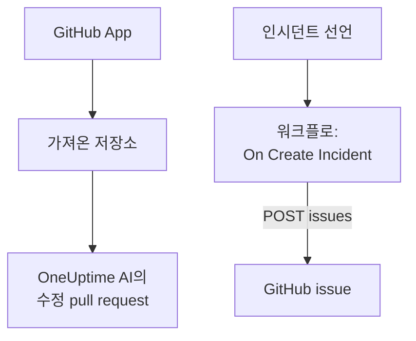

# GitHub

OneUptime은 두 가지 방식으로 [GitHub](https://github.com)와 함께 작동합니다. OneUptime GitHub App으로 저장소를 연결하면, OneUptime AI가 찾은 문제를 고치는 pull request를 열고, issue나 pull request에서 멘션하면 응답합니다. 또는 인시던트마다 GitHub issue를 여는 워크플로를 만들어, 후속 작업을 서비스를 소유한 저장소에서 추적할 수 있습니다.

:::cards
- [연결 방법 선택](#연결-방법-선택): GitHub App 또는 워크플로, 그리고 각각이 하는 일.
- [저장소 연결](#저장소-연결): 수정 pull request를 위한 GitHub App.
- [인시던트마다 issue 열기](#인시던트마다-github-issue-열기): 워크플로 하나, 블록 두 개.
- [문제 해결](#문제-해결): GitHub가 요청을 거부할 때.
:::

## 작동 방식



두 방식은 서로 독립적이며, 하나만 쓰거나 둘 다 쓸 수 있습니다. GitHub App은 설치한 저장소에서 작동합니다. 워크플로에는 토큰만 있으면 되며, 다른 API처럼 GitHub의 [REST API](https://docs.github.com/en/rest/issues/issues#create-an-issue)를 호출합니다.

## 연결 방법 선택

| 방식 | 하는 일 | 필요한 것 |
| --- | --- | --- |
| GitHub App | 저장소를 가져옵니다. OneUptime AI가 그 안에서 예외, 느린 트레이스, 조사로 찾은 원인을 고치는 pull request를 열고, issue와 pull request의 멘션에 응답합니다. | 앱을 설치할 조직 또는 계정. OneUptime Cloud에서는 **Growth** 플랜. |
| 워크플로 | 인시던트마다, 선택한 저장소에 GitHub issue를 엽니다. | issue를 만들 수 있는 GitHub 토큰과, 블록 두 개로 된 워크플로. |

## 저장소 연결

**제품 → 코드**를 열고 **GitHub 연결**을 클릭합니다. GitHub가 앱을 어디에 설치할지, 어떤 저장소를 사용할 수 있는지 묻습니다. 설치에 포함된 모든 저장소를 가져오며, 설치에 저장소를 추가하거나 빼면 그에 맞게 갱신됩니다.

계정에 앱이 이미 설치되어 있다면(다른 프로젝트용으로 설치했거나 GitHub에서 바로 설치한 경우) 다시 설치하는 대신 **GitHub 연결** 아래의 **기존 설치 연결**을 클릭합니다. 이때는 그 설치를 관리하는 GitHub 계정이 필요합니다. 개인 계정이라면 그 소유자, 조직이라면 설치가 접근할 수 있는 모든 저장소에 admin 권한이 있는 사람입니다(조직 소유자는 이 권한이 있습니다).

자체 호스팅 인스턴스에는 먼저 자체 GitHub App이 필요합니다. 만드는 방법은 [GitHub 통합](/docs/self-hosted/github-integration)에서 설명합니다. 그 뒤에는 AI가 [코드](/docs/ai/ai-agent)에서 저장소에 pull request를 열고, issue나 pull request에서 앱을 멘션할 때 앱이 하는 일은 [GitHub App](/docs/ai/github-app) 페이지에서 설명합니다.

## 사전 요건

이 페이지의 나머지 부분에서는 워크플로를 만듭니다. 필요한 것:

- 저장소에서 issue를 만들 수 있는 GitHub 토큰. 그 저장소용 fine-grained personal access token에 **Issues** 권한을 **Read and write**로 설정한 것, 또는 `repo` 범위를 가진 클래식 토큰입니다. GitHub의 [토큰 설정](https://github.com/settings/tokens)에서 만드세요.
- OneUptime에서 워크플로와 전역 변수를 만들 권한. OneUptime Cloud에서는 워크플로에 **Growth** 요금제 이상이 필요합니다.

## 토큰 저장

:::steps
1. **워크플로 → 전역 변수**로 이동해 **워크플로 변수 만들기**를 클릭합니다.
2. 이름을 `GITHUB_TOKEN`으로 지정하고 **다음**을 클릭합니다.
3. 토큰을 **콘텐츠**에 붙여 넣고 **시크릿**을 켠 뒤 **워크플로 변수 만들기**를 클릭합니다.
:::

시크릿 변수는 실행 로그에서 `[REDACTED]`로 바뀌므로 토큰이 실행에 나타나는 일은 없습니다.

## 인시던트마다 GitHub issue 열기

:::steps
### 워크플로 만들기

**워크플로**로 이동해 **워크플로 생성**을 클릭한 다음 **처음부터 시작**을 클릭합니다. 이름을 `Incidents to GitHub`로 지정하고 **워크플로 생성**을 클릭합니다.

### 트리거 추가하기

점선으로 된 **이 워크플로를 시작할 항목 선택** 블록을 클릭하고 **On Create Incident**를 고릅니다. 트리거를 클릭합니다. **Fields to pass on**에는 **제목**이 이미 들어 있으므로, **필드 추가**를 클릭하고 **설명**과 **Incident Number With Prefix**를 고릅니다.

### issue 열기

**구성 요소 추가**를 클릭하고 **API Post (JSON)** 블록을 추가한 뒤, 트리거의 **Success** 점을 그 블록에 연결합니다. 블록의 **URL**을 `https://api.github.com/repos/your-org/your-repo/issues`로 설정하되, 저장소의 소유자와 이름으로 바꿉니다. **추가 필드**에서 **Request Headers**를 다음과 같이 설정합니다:

```json
{
  "Authorization": "Bearer {{global.variables.GITHUB_TOKEN}}",
  "Accept": "application/vnd.github+json",
  "X-GitHub-Api-Version": "2022-11-28"
}
```

**Request Body**는 다음과 같습니다:

```json
{
  "title": "{{local.components.incident-on-create-1.returnValues.model.title}}",
  "body": "{{local.components.incident-on-create-1.returnValues.model.description}}\n\nOpened by OneUptime for incident {{local.components.incident-on-create-1.returnValues.model.incidentNumberWithPrefix}}.",
  "labels": ["incident"]
}
```

### 테스트한 다음 켜기

**워크플로 실행**을 클릭하고 **인시던트**에서 테스트 인시던트를 고른 뒤 실행합니다. **API Post (JSON)** 단계에 새 issue가 담긴 `201` 응답이 그 `number`, `html_url`과 함께 나타납니다. 그런 다음 **빌더** 위쪽에서 **활성화됨**을 켭니다.
:::

후속 작업은 보통 인시던트보다 오래가므로, 인시던트가 해결되어도 issue는 열린 채로 남습니다. 인시던트와 양방향으로 맞춰지는 티켓이 필요하다면 [Jira](/docs/integrations/jira)를 참고하세요.

## 팁

- **GitHub Enterprise Server.** 대신 자체 서버로 요청을 보냅니다: `https://your-github-host/api/v3/repos/your-org/your-repo/issues`. 사설 네트워크 주소의 서버에는 관리자가 이를 허용한 자체 호스팅 OneUptime이 필요합니다. [아웃바운드 네트워크 접근](/docs/workflows/configuration#아웃바운드-네트워크-접근)을 참고하세요.
- **담당자 지정.** 본문에 `"assignees": ["octocat"]`이나 `"milestone": 3`을 추가합니다. 토큰이 저장소에 push할 수 없으면 GitHub는 레이블, 담당자, 마일스톤을 아무 말 없이 버립니다.
- **일부 인시던트만.** 트리거와 API 블록 사이에 **If / Else** 블록을 두고, 그 **Yes** 쪽에서만 issue를 엽니다. 예를 들어 한 심각도에서만 엽니다.

## 문제 해결

GitHub가 요청을 거부하면 **API Post (JSON)** 단계는 **Error**로 진행합니다. 실행의 **Response Status**와 **Response Body**에 이유가 나옵니다.

:::details GitHub가 401로 응답함
토큰이 잘못되었거나, 만료되었거나, 취소되었습니다. 새 토큰을 만들고 `GITHUB_TOKEN`의 내용을 바꾸세요.
:::

:::details GitHub가 403으로 응답함
토큰이 그곳에서 issue를 만들 수 없습니다. 이 저장소에서 **Issues**가 **Read and write**로 설정되지 않은 fine-grained 토큰, 조직이 승인하지 않은 토큰, 또는 조직의 Single Sign-On에 대해 승인되지 않은 클래식 토큰입니다. 본문이 속도 제한을 언급하는 403은 토큰이 너무 많은 요청을 보냈다는 뜻입니다. 기다리거나, issue를 여는 인시던트를 줄이세요.
:::

:::details GitHub가 404로 응답함
**URL**의 소유자나 저장소가 잘못되었거나, 토큰이 저장소를 볼 수 없습니다. 토큰이 볼 수 없는 비공개 저장소에 대해 GitHub는 403이 아니라 404로 응답합니다.
:::

:::details GitHub가 410 또는 422로 응답함
- `410`: 저장소 설정에서 issues가 꺼져 있습니다.
- `422`: GitHub가 본문을 읽을 수 없습니다. 올바른 JSON인지, `title`이 설정되어 있는지, `labels`와 `assignees`가 목록인지 확인하세요.
:::

## 다음 단계

:::cards
- [GitHub App](/docs/ai/github-app): GitHub에서 바로 OneUptime AI에 변경, 수정, 리뷰를 요청합니다.
- [GitLab](/docs/integrations/gitlab): 같은 워크플로를 GitLab issue로.
- [워크플로우 구성 요소](/docs/workflows/components#api): API 블록의 모든 설정.
- [통합 개요](/docs/integrations/index): 모든 통합의 바탕이 되는 패턴.
:::
