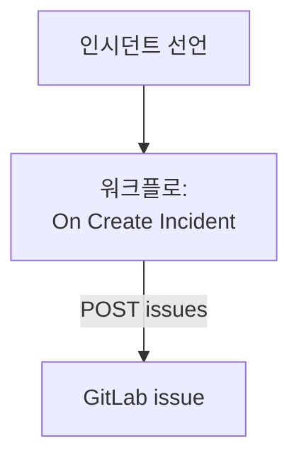

# GitLab

OneUptime 인시던트마다 [GitLab](https://gitlab.com) issue를 열어, 후속 작업을 서비스를 소유한 프로젝트에서 추적할 수 있게 합니다. 워크플로가 GitLab.com 또는 자체 GitLab에서 GitLab의 [Issues API](https://docs.gitlab.com/api/issues/#new-issue)를 호출합니다.

:::cards
- [토큰 저장](#토큰-저장): GitLab 토큰을 워크플로 밖에 둡니다.
- [인시던트마다 issue 열기](#인시던트마다-gitlab-issue-열기): 워크플로 하나, 블록 두 개.
- [팁](#팁): 자체 GitLab, 프로젝트 경로, 담당자.
- [문제 해결](#문제-해결): GitLab이 요청을 거부할 때.
:::

> [!NOTE]
> OneUptime AI는 GitLab 저장소에서도 작업합니다. 접근 토큰으로 코드에 연결하면 수정마다 머지 리퀘스트를 엽니다. [저장소 연결하기](/docs/ai/ai-agent#저장소-연결하기)를 참고하세요.

## 작동 방식



워크플로는 새 인시던트마다 한 번 실행됩니다. 워크플로의 **API Post (JSON)** 블록은 액세스 토큰으로 서명해, 인시던트의 제목과 설명을 프로젝트의 issues로 보냅니다.

## 사전 요건

- GitLab 프로젝트의 ID. 프로젝트 개요 페이지에서 작업 메뉴(세로 줄임표)를 선택한 다음 **Copy project ID**를 선택합니다.
- `api` 범위를 가진 GitLab 액세스 토큰. 프로젝트에서 issue를 만들 수 있는 역할을 가진 사용자나 봇의 것으로, 프로젝트, 그룹, 개인 액세스 토큰 중 하나입니다. 프로젝트, 그룹 또는 사용자 설정의 **Settings → Access tokens**에서 만드세요.
- OneUptime에서 워크플로와 전역 변수를 만들 권한. OneUptime Cloud에서는 워크플로에 **Growth** 요금제 이상이 필요합니다.

## 토큰 저장

:::steps
1. **워크플로 → 전역 변수**로 이동해 **워크플로 변수 만들기**를 클릭합니다.
2. 이름을 `GITLAB_TOKEN`으로 지정하고 **다음**을 클릭합니다.
3. 토큰을 **콘텐츠**에 붙여 넣고 **시크릿**을 켠 뒤 **워크플로 변수 만들기**를 클릭합니다.
:::

시크릿 변수는 실행 로그에서 `[REDACTED]`로 바뀌므로 토큰이 실행에 나타나는 일은 없습니다.

## 인시던트마다 GitLab issue 열기

:::steps
### 워크플로 만들기

**워크플로**로 이동해 **워크플로 생성**을 클릭한 다음 **처음부터 시작**을 클릭합니다. 이름을 `Incidents to GitLab`으로 지정하고 **워크플로 생성**을 클릭합니다.

### 트리거 추가하기

점선으로 된 **이 워크플로를 시작할 항목 선택** 블록을 클릭하고 **On Create Incident**를 고릅니다. 트리거를 클릭합니다. **Fields to pass on**에는 **제목**이 이미 들어 있으므로, **필드 추가**를 클릭하고 **설명**과 **Incident Number With Prefix**를 고릅니다.

### issue 열기

**구성 요소 추가**를 클릭하고 **API Post (JSON)** 블록을 추가한 뒤, 트리거의 **Success** 점을 그 블록에 연결합니다. 블록의 **URL**을 `https://gitlab.com/api/v4/projects/12345678/issues`로 설정하되, `12345678` 대신 프로젝트의 ID를 넣습니다. **추가 필드**에서 **Request Headers**를 다음과 같이 설정합니다:

```json
{
  "PRIVATE-TOKEN": "{{global.variables.GITLAB_TOKEN}}"
}
```

**Request Body**는 다음과 같습니다:

```json
{
  "title": "{{local.components.incident-on-create-1.returnValues.model.title}}",
  "description": "{{local.components.incident-on-create-1.returnValues.model.description}}\n\nOpened by OneUptime for incident {{local.components.incident-on-create-1.returnValues.model.incidentNumberWithPrefix}}.",
  "labels": "incident,oneuptime"
}
```

### 테스트한 다음 켜기

**워크플로 실행**을 클릭하고 **인시던트**에서 테스트 인시던트를 고른 뒤 실행합니다. **API Post (JSON)** 단계에 새 issue가 담긴 `201` 응답이 그 `iid`, `web_url`과 함께 나타납니다. 그런 다음 **빌더** 위쪽에서 **활성화됨**을 켭니다.
:::

블록은 JSON을 보내므로 `Content-Type` 헤더가 필요 없습니다. GitLab은 처음 보는 레이블을 만들어 주므로 `incident`와 `oneuptime`은 미리 준비할 필요가 없습니다. 후속 작업은 보통 인시던트보다 오래가므로, 인시던트가 해결되어도 issue는 열린 채로 남습니다.

## 팁

- **자체 GitLab.** 대신 자체 서버로 요청을 보냅니다: `https://gitlab.example.com/api/v4/projects/12345678/issues`. 사설 네트워크 주소의 서버에는 관리자가 이를 허용한 자체 호스팅 OneUptime이 필요합니다. [아웃바운드 네트워크 접근](/docs/workflows/configuration#아웃바운드-네트워크-접근)을 참고하세요.
- **ID 대신 프로젝트 경로.** 경로의 `/`를 `%2F`로 쓰면 ID 대신 경로를 쓸 수 있습니다: `projects/your-group%2Fyour-project/issues`. URL은 쓴 그대로 보내지므로 직접 인코딩하세요.
- **담당자 지정.** 본문에 `"assignee_ids": [42]`나 `"due_date": "2026-12-31"`을 추가하거나, 프로젝트 구성원에게만 보이게 하려면 `"confidential": true`를 추가합니다.
- **일부 인시던트만.** 트리거와 API 블록 사이에 **If / Else** 블록을 두고, 그 **Yes** 쪽에서만 issue를 엽니다. 예를 들어 한 심각도에서만 엽니다.

## 문제 해결

GitLab이 요청을 거부하면 **API Post (JSON)** 단계는 **Error**로 진행합니다. 실행의 **Response Status**와 **Response Body**에 이유가 나옵니다.

:::details GitLab이 401로 응답함
토큰이 잘못되었거나, 만료되었거나, 취소되었습니다. 새 토큰을 만들고 `GITLAB_TOKEN`의 내용을 바꾸세요.
:::

:::details GitLab이 403으로 응답함
토큰에 `api` 범위가 없거나, 그 사용자의 프로젝트 역할로는 issue를 만들 수 없습니다. 범위가 원인이면 본문에 `insufficient_scope`가 나옵니다.
:::

:::details GitLab이 404로 응답함
**URL**의 프로젝트 ID가 잘못되었거나, 토큰이 프로젝트를 볼 수 없습니다. 토큰이 볼 수 없는 비공개 프로젝트에 대해 GitLab은 403이 아니라 404로 응답합니다.
:::

:::details GitLab이 400으로 응답함
GitLab이 본문을 읽을 수 없습니다. `title`이 없거나, 필드의 형식이 잘못되었습니다. 본문에 그 필드가 나옵니다.
:::

## 다음 단계

:::cards
- [GitHub](/docs/integrations/github): 같은 워크플로의 GitHub 버전과 GitHub App.
- [워크플로우 구성 요소](/docs/workflows/components#api): API 블록의 모든 설정.
- [워크플로우 실행 기록](/docs/workflows/runs-and-logs): 각 요청이 보낸 내용과 받은 내용을 확인합니다.
- [통합 개요](/docs/integrations/index): 모든 통합의 바탕이 되는 패턴.
:::
