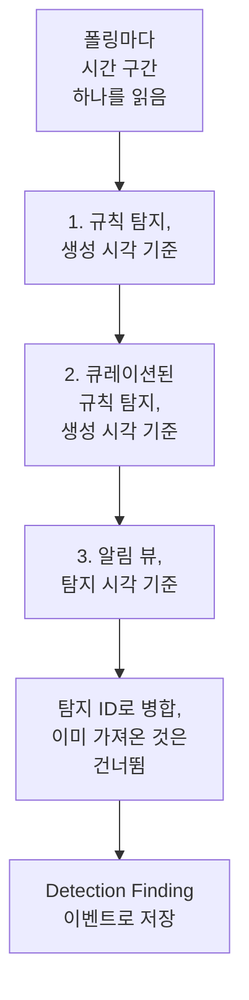

# Google SecOps

[Google SecOps](https://cloud.google.com/security/products/security-operations)(이전 이름 Chronicle)의 알림과 탐지를 OneUptime의 보안 이벤트로 가져옵니다. 그곳에서 로그, 트레이스, 메트릭과 나란히 검색하고, 다른 모든 소스와 상관 분석하고, 중요한 것에 대해 온콜을 호출할 수 있습니다.

:::cards
- [연결 방법 선택](#연결-방법-선택): SOAR 플레이북 웹훅, 관리형 커넥터, 또는 UDM 전달.
- [관리형 커넥터 설정](#관리형-커넥터-설정): 서비스 계정 키와 연결 양식.
- [커넥터의 폴링 방식](#커넥터의-폴링-방식): 모든 구간을 세 가지로 읽는 방법과 각각의 예산.
- [문제 해결](#문제-해결): Last Error가 말하는 내용과 할 일.
- [Google SecOps로 보안 이벤트 보내기](#google-secops로-보안-이벤트-보내기): OneUptime의 탐지를 Google SecOps에서.
:::

## 연결 방법 선택

| 방법 | 도착하는 것 | 사용하는 경우 |
| --- | --- | --- |
| SOAR 플레이북 웹훅 | 플레이북이 게시하는 각 알림이 몇 초 안에 도착 | SOAR 플레이북을 실행하고 있으며, 폴링 없이 그 알림을 OneUptime에서 받고 싶을 때. |
| 관리형 커넥터 | 알림, 그리고 선택하면 규칙 탐지까지 일정 간격으로 폴링 | SecOps에서 아무것도 구성하지 않고 OneUptime이 대신 가져오기를 원할 때. |
| UDM 이벤트 전달 | 전체 검색과 상관 분석을 위한 원시 UDM 이벤트 | 이미 UDM 이벤트를 내보내고 있으며, 그 모두를 받고 싶을 때. |

모든 방법은 도착한 것을 [OCSF](https://schema.ocsf.io/)로 정규화합니다. OCSF는 OneUptime이 모든 보안 이벤트를 저장하는 형식인 Open Cybersecurity Schema Framework이므로, 탐지 규칙과 대시보드는 소스와 관계없이 똑같이 작동합니다.

## 사전 요건

- 관리형 커넥터의 경우, OneUptime에서 Project Owner, Project Admin 또는 Security Admin 역할. Security Member와 Security Viewer는 연결을 읽을 수 있지만 만들 수는 없습니다.
- 웹훅과 UDM 전달의 경우, 수집 키: **프로젝트 설정 → 텔레메트리 및 APM → 수집 키**를 열고 **수집 키 생성**을 클릭합니다.
- 관리형 커넥터의 경우, SecOps 인스턴스가 바인딩된 프로젝트에서 Google Cloud 서비스 계정을 만들 권한.

## SOAR 플레이북에서 알림 보내기

Google SecOps SOAR 플레이북은 어떤 HTTP 엔드포인트로든 알림을 게시할 수 있습니다. 플레이북 하나가 OneUptime의 보안 이벤트 수집 엔드포인트를 가리키게 하세요.

:::steps
### HTTP 요청 작업 추가

SecOps SOAR 플레이북에서 새 알림에 대해 실행되는 **HTTP request** 작업을 추가합니다.

### OneUptime을 가리키도록 설정

**Method**는 `POST`로, **URL**은 `https://oneuptime.com/security-events/v1/ingest`로, 자체 호스팅 설치에서는 `https://<your-host>/security-events/v1/ingest`로 설정합니다. 다음 헤더를 추가합니다:

```text
Content-Type: application/json
x-oneuptime-token: <your telemetry ingestion key>
```

알림의 JSON을 **Body**로 보냅니다. 탐지, 즉 `collectionElements` 아래에 일치한 UDM 이벤트가 담긴 규칙 세부 정보는 자동으로 인식되어 Detection Finding 이벤트로 저장되며, 일치한 이벤트의 사용자, 호스트, IP는 observable로 보관됩니다.

### 알림이 도착하는지 확인

플레이북을 실행합니다. 몇 초 안에 그 알림이 **제품 → Security Events**에 표시됩니다.
:::

## UDM 이벤트 전달

전체 검색과 상관 분석을 원한다면 UDM 이벤트 자체를 전달하세요. 예를 들어 BigQuery 내보내기 파이프라인, Cloud Function, 또는 이미 운영 중인 어떤 전달자에서든 보낼 수 있습니다:

```bash
curl -X POST "https://oneuptime.com/security-events/v1/ingest?format=udm" \
  -H "Content-Type: application/json" \
  -H "x-oneuptime-token: <your telemetry ingestion key>" \
  -d '{
    "events": [
      {
        "metadata": {
          "event_type": "USER_LOGIN",
          "event_timestamp": "2026-08-21T10:00:00Z",
          "vendor_name": "Google",
          "product_name": "Google SecOps"
        },
        "principal": { "user": { "userid": "alice" }, "ip": ["203.0.113.7"] },
        "target": { "hostname": "vpn-gw-01" },
        "security_result": [{ "severity": "HIGH", "action": ["BLOCK"] }]
      }
    ]
  }'
```

- `format`은 `udm`, `ocsf`, `google-secops-alert`, `generic` 중 하나입니다. 생략하면 이벤트마다 형식을 감지합니다.
- 본문은 이벤트 하나, 이벤트 목록, 또는 `{ "events": [...] }`일 수 있습니다.
- `x-oneuptime-service-name`은 이벤트가 속할 텔레메트리 서비스의 이름을 정합니다. 없으면 페이로드의 제품 이름을 딴 서비스에 속합니다.

## 관리형 커넥터 설정

OneUptime은 SOAR 구성 없이 일정 간격으로 테넌트의 탐지와 알림을 폴링합니다. Google SecOps는 Security Event Connections의 공급자 중 하나이므로, 다른 모든 관리형 커넥터와 같은 페이지에서 같은 방식으로 만들고, 테스트하고, 폴링하고, 진단합니다.

:::steps
### 서비스 계정 키 만들기

Google Cloud에서 SecOps 인스턴스가 바인딩된 프로젝트에 서비스 계정을 만들고, **Chronicle API Viewer** 역할(`roles/chronicle.viewer`)을 부여합니다. 이 역할에는 커넥터가 읽을 때 쓰는 `legacySearchDetections`, `legacySearchCuratedDetections`, `countAllCuratedRuleSetDetections`, `legacyFetchAlertsView` 권한이 포함되어 있습니다.

서비스 계정의 **Keys** 탭에서 **JSON** 유형의 키를 추가하고 다운로드합니다. 파일 전체를 연결에 붙여 넣습니다. 키의 `token_uri`는 Google 호스트의 `https` URL이어야 하며, Google Cloud에서 다운로드한 키는 이미 그렇습니다.

### 지역과 인스턴스 리소스 이름 찾기

Google SecOps에서 **SIEM Settings → Profile**을 엽니다. 인스턴스 리소스 이름은 `projects/{project}/locations/{location}/instances/{instance}` 형식이며, 여기서 instance 부분은 SecOps 인스턴스 ID입니다. 연결의 표시 이름이나 서비스 계정 이름으로 대신할 수 없습니다. 지역은 그 위치를 제공하는 지역 엔드포인트이며, 인스턴스 리소스 이름의 locations 세그먼트와 일치해야 합니다. 그렇지 않으면 저장할 때 연결이 거부됩니다.

### 연결 추가

**제품 → Security Events → 연결**(`/dashboard/{projectId}/security-events/connections`)를 열고 **연결 추가**를 선택한 다음, **Google SecOps**를 고르고 아래 표의 설정으로 양식을 채웁니다.

### 저장하기 전에 테스트

저장하기 전에 **저장하기 전에 테스트** 아래의 **이 설정 테스트**를 선택합니다. 테스트는 아무것도 저장하지 않고 양식의 값으로 실행되므로, 형식이 잘못된 키, 빠진 역할, 잘못된 인스턴스를 연결이 생기기 전에 잡아냅니다. 편집 양식에서는 같은 버튼이 화면에 표시된 **지역**, **인스턴스 리소스 이름**, **Data to import**를 저장된 키와 함께 테스트합니다. 자격 증명 필드를 비워 두면 저장된 키가 유지됩니다. 새로 입력한 키를 포함해 테스트한 값이 연결에 저장된 값과 다르면, 연결이 아직 그 설정을 갖고 있지 않으므로 실행 기록 행이 남지 않습니다.
:::

| 설정 | 찾는 위치 | 필수 |
| --- | --- | --- |
| **지역** | 인스턴스 리소스 이름의 위치와 일치하는 Google SecOps 지역 엔드포인트(`us`, `europe`, `asia-southeast1`, ...). 기본값이 없으므로, 미국 밖의 테넌트가 실수로 잘못된 엔드포인트를 저장하는 일은 없습니다. | 예 |
| **인스턴스 리소스 이름** | Google SecOps **SIEM Settings → Profile**: `projects/{project}/locations/{location}/instances/{instance}`. | 예 |
| **케이스가 닫히면 알림도 닫기** | 양식의 마지막 단계에 있으며, 켜기 전까지는 꺼져 있습니다. 켜면 케이스를 닫을 때 그 케이스의 Google SecOps 알림도 닫힙니다. [케이스가 닫히면 알림도 닫기](#케이스가-닫히면-알림도-닫기) 를 참조하세요. | 아니요 |
| **서비스 계정 JSON** | Google Cloud, 서비스 계정의 **Keys** 탭. JSON 키 파일 전체를 붙여 넣습니다. 쓰기 전용: 저장 시 암호화되며, API가 반환하지 않고, 페이지에 다시 표시되지 않습니다. 교체하려면 연결의 **자격 증명 업데이트**를 사용합니다. | 예 |
| **Data to import** | Google의 알림 API는 항상 알림을 반환하므로 **알림**은 항상 가져옵니다. 알림을 만들지 않은 규칙 일치도 가져오려면 **탐지**를 선택합니다. 원시 UDM 이벤트는 전달하지 않습니다. 그것은 위와 같이 직접 전달하세요. | 알림은 항상 |

양식의 폴링 단계에서는 **이름**, 선택 사항인 **설명**, 연결의 **활성화됨** 여부, 그리고 **폴링 간격(분)** 값을 묻습니다. 이 값은 `1`부터 `1440`까지의 정수이며 기본값은 `5`입니다. 그 범위를 벗어난 값은 저장할 때 거부됩니다.

새 탐지는 `Google SecOps` 텔레메트리 서비스에 귀속된 Detection Finding 이벤트로 가져옵니다.

## 연결 상태 읽기

연결 목록에는 **이름**, **공급자**(그 아래에 연결의 Data to import 선택), **상태**(활성화됨 또는 비활성화됨), **상태**, **간격(분)**, **마지막 폴링**, **마지막 성공 폴링**, **마지막으로 가져온 이벤트**가 표시됩니다. 연결에 오류가 있으면 **작업** 열의 **연결 테스트**, **지금 실행**, **진단**, **편집**, **자격 증명 업데이트** 옆에 **오류 보기**가 나타납니다. 활성화됨은 자동 폴링이 구성되어 있다는 뜻입니다. Last Polled는 시도를 기록할 뿐이며, 성공한 빈 구간이 특정 탐지를 가져왔다는 것을 보여 주지는 않습니다.

**상태**는 이벤트를 하나라도 가져온 뒤에야 **Last poll succeeded**로 표시됩니다. 그전까지 성공하고 있는 연결은 **Polling, no events imported yet**으로 표시되며, 이것이 연결 테스트로 조사해야 할 상태입니다. 그 밖의 상태는 **No records returned**, **Partial import**, **Catching up**, **Last poll failed**, **Poll overdue**, **Schedule paused**, **첫 폴링 대기 중**입니다. 상태에 마우스를 올리면 의미가 표시됩니다.

> [!NOTE]
> 커넥터는 Chronicle `v1alpha` 레거시 탐지 및 알림 API를 사용하며, Google은 이를 정식 출시 전(pre-GA) 단계로 제공합니다. 폴링이 실패하면 연결의 **마지막 오류** 필드에 실패한 단계를 나타내는 접두사와 함께, 자격 증명을 가린 전체 오류 메시지가 저장됩니다. Chronicle이 `200`으로 응답하면서 본문 안에 거부를 담는 경우도 마찬가지입니다. 연결의 **작업** 열에서 **오류 보기**를 선택해 메시지를 읽은 다음, 대화 상자의 **오류 복사**로 복사해 지원팀에 보내세요.

## 커넥터의 폴링 방식



1분마다 백그라운드 워커가, 마지막 폴링 이후 간격이 지난 모든 활성화된 연결에 대해 폴링을 대기열에 넣습니다. 각 폴링은 연결 기록의 실행 하나이며, 워커가 실행합니다. 폴링은 시간 구간 하나를 세 가지 방법으로 읽고 결과를 탐지 ID로 병합하므로, 둘 이상의 패스가 반환한 레코드도 한 번만 저장됩니다:

1. **생성 시각 기준 규칙 탐지.** `ruleId=-`(모든 규칙의 모든 리비전)와 `listBasis=CREATED_TIME`으로 `legacy:legacySearchDetections`를 호출하며, 마지막 페이지가 될 때까지 `nextPageToken`을 따라갑니다.
2. **생성 시각 기준 큐레이션된 규칙 탐지.** `legacy:legacySearchCuratedDetections`를 같은 방식으로, 큐레이션된(Google이 작성한) 규칙마다 한 번씩 호출합니다. 이 엔드포인트는 큐레이션된 규칙 ID(`ur_...`) 하나를 받으며 "모든 규칙" 와일드카드가 없으므로, 이 패스는 먼저 구간 이전 일주일부터 구간 끝까지에 대해 `:countAllCuratedRuleSetDetections`를 호출하고, 탐지를 만든 큐레이션된 규칙을 각각 검색합니다. 그 일주일 동안 발동하지 않은 큐레이션된 규칙에는 가져올 것이 없습니다. 큐레이션된 규칙에 접근할 수 없는 테넌트는 이 패스에 `400`, `403` 또는 `404`로 응답하며, 이는 실패가 아니라 실행의 경고로 기록됩니다.
3. **탐지 시각 기준 알림 뷰.** `legacy:legacyFetchAlertsView`로, 규칙 알림뿐 아니라 텔레메트리 알림, SOAR 알림, 머신 인텔리전스 알림도 다룹니다. 이 엔드포인트에는 페이지 나누기가 없으므로, Google이 제한한 응답은 더 작은 구간으로 나누어 다시 읽습니다.

알림 뷰는 탐지 시각으로만 필터링할 수 있으며, Google은 탐지 시각보다 한참 뒤에야 알림을 읽을 수 있게 하는 경우가 많습니다(수집 지연, 예약된 규칙, 늦게 도착한 데이터에 대한 재실행). 그래서 예약된 폴링은 **구간 이전 24시간에 걸쳐 알림 뷰를 한 번 더 훑으며**, 알림만 읽는 이 작업은 **Read late alerts by detection time** 검사로 기록됩니다. 이미 가져온 레코드는 건너뛰므로, 훑기에서 반복된 것은 **Already imported** 아래에 나타납니다. 훑기는 최선의 노력으로 이루어집니다. Google이 제한하거나, 예산이 바닥나거나, 실패하면 실행에 경고가 붙지만, 폴링은 Partial이나 Failed가 되지 않고 커서도 계속 움직입니다. 훑기가 거슬러 올라가는 하루는 이전 폴링이 이미 읽었기 때문입니다.

**생성 시각** 기준 폴링이 설계의 핵심입니다. Google SecOps 규칙은 일정에 따라(10분마다, 매시간, 매일) 실행되며, 규칙이 만드는 탐지는 규칙의 시간 구간 끝 또는 일치한 이벤트의 시각인 `detectionTime`을 가지는 반면, `createdTime`은 탐지 엔진이 실제로 탐지를 만든 시각입니다. 09:00에 끝나는 구간에 대해 10:05에 생성된 탐지의 탐지 시각은, 몇 폴링 전에 이미 09:00을 지나간 커서보다 앞선 시각이므로, 탐지 시각 기준으로 폴링하는 커넥터는 그 탐지를 결코 보지 못합니다. 늦게 도착하는 이벤트도 마찬가지입니다. 생성 시각으로 읽으면 각 폴링은 "마지막으로 본 뒤 Google이 무엇을 만들었는가"라고 묻게 되며, 이것이 답이 있는 질문입니다. 모든 실행은 생성 지연, 즉 가져온 레코드 중 탐지 시각보다 폴링 간격 하나(더하기 1분)보다 더 늦게 생성된 레코드의 수와 가장 큰 차이를 기록하므로, 그 효과를 Diagnostics에서 볼 수 있습니다.

새 연결의 첫 폴링은 생성 시각 기준으로 **24시간** 전까지 거슬러 올라갑니다. 그 후의 모든 폴링은 연결에 저장된 커서에서 **1분**을 겹쳐 다시 시작합니다. 구간 경계에서 생성된 레코드는 두 폴링 모두에서 읽히지만 한 번만 저장되는데, 폴링은 같은 소스 식별자로 이미 저장된 이벤트를 건너뛰기 때문입니다. 예약된 각 폴링은 커서 이후 최대 **24시간**까지 읽으므로, 저장된 커서가 오래된 연결은 그 사이의 탐지를 버리지 않고 연속된 24시간 구간으로 따라잡습니다(Health에 **Catching up** 표시). 첫 24시간 구간보다 이전에 생성된 레코드는 Diagnostics의 **Import this time range**로 가져오세요.

### 한 번의 폴링으로 다 읽을 수 없는 구간

커넥터는 각 폴링에 고정된 예산을 줍니다. 규칙 탐지 패스는 검색 페이지 **20**개, 큐레이션 패스는 최대 **200**개의 요청(개수 조회 하나와, 지난 일주일 동안 발동한 큐레이션된 규칙마다 최소 한 페이지, 가장 바쁜 규칙부터), 알림 뷰와 늦은 알림 훑기는 함께 **16**개의 요청을 쓰며, 전체 읽기는 **4분** 뒤에 멈춥니다. 큐레이션 패스는 그 시간의 60%가 지나면 새로운 큐레이션된 규칙을 더 시작하지 않으므로, 알림 뷰는 여전히 실행됩니다. 폴링이 활성화된 큐레이션된 규칙을 모두 검색할 수 없으면, 커서를 붙잡아 두는 대신 검색하지 못한 규칙 수를 밝힌 경고를 기록합니다. 구간을 줄여도 그 규칙들을 모두 검색해야 하는 것은 마찬가지이기 때문입니다. 예산 때문에 도중에 멈춘 패스는 그 예산을 밝힌 경고 검사로 기록되고(예: `Read rule detections by created time was stopped by the request budget after 20 requests.`), 예산 때문에 시작조차 못 한 패스는 같은 이유가 실행의 경고에 적힌 건너뛴 검사가 되며, 절대 성공으로 기록되지 않습니다. 그보다 많은 탐지가 있는 구간은 한 번의 폴링으로 읽을 수 없으며, 폴링이 같은 구간을 영원히 다시 읽는 일은 없습니다:

1. **좁히기.** Google의 검색 엔드포인트는 가장 새로운 탐지부터 반환하므로, 일찍 멈춘 폴링에는 다시 시작할 지점이 없습니다. 폴링은 **부분**로 기록되고, 커서는 그대로 머물며, 다음 폴링은 같은 시작점에서 절반 길이의 구간을 읽고 `This window holds more records than one poll can read; the next poll reads a {n} minute window from the same starting point.` 경고를 남깁니다. 구간이 한도 안에 들어올 때까지 1분까지 계속 절반으로 줄입니다.
2. **다시 늘리기.** 완전한 폴링마다 다음 구간이 최대 24시간까지 두 배가 되므로, 폭주는 연결을 영구적으로 느리게 만드는 대신 짧은 폴링 몇 번으로 끝납니다.
3. **1분 넘어가기.** 1분 안에조차 한 번의 폴링으로 읽을 수 있는 것보다 많은 탐지가 있으면, 더 새로운 탐지가 계속 도착하도록 폴링이 커서를 그 1분 너머로 옮깁니다. 실행은 **부분**이 되고 **마지막 오류**의 맨 앞에 같은 문장이 옵니다: `More records were created in the one minute from {start} to {end} than one poll can read. Polling moved past this minute so newer records keep arriving; use Import this time range in Diagnostics on this minute to recover what one run can read.` 한 번의 실행으로 읽을 수 있는 만큼 되찾으려면 **진단**을 열고, 그 1분을 포함하는 사용자 지정 범위를 고른 다음(범위 입력은 현지 시각을 쓰고, 메시지는 UTC입니다) **Import this time range**를 실행합니다. 가져오기에는 폴링과 같은 실행당 한도가 있습니다. 이미 가져온 탐지는 건너뜁니다.

Partial 폴링은 경고도 **마지막 오류**에 저장하며, 경고는 완전한 폴링이 지울 때까지 남습니다. 완전히 실패한 폴링(레코드가 너무 많아서가 아니라 오류 때문)은 커서와 구간 길이를 유지하고 다음 주기에 다시 시도됩니다. 단 하나의 예외는 요청 시간이 초과된 경우입니다. 다음 폴링은 같은 시작점에서 절반 길이의 구간을 읽습니다(`The source did not answer in time for this window; the next poll reads a {n} minute window from the same starting point.`). 그렇지 않으면 제시간에 응답할 수 없을 만큼 무거운 구간이 재시도할 때마다 시간 초과될 것이기 때문입니다. 폴링 간격을 줄여도 이 중 어느 것도 바뀌지 않습니다. 구간은 폴링이 얼마나 자주 실행되는지가 아니라, 커서와 마지막 폴링의 결과로 정해집니다.

## 연결 테스트

연결 행이나 **진단**에 있는 **연결 테스트**는 API 프로세스에서 동기적으로 실행됩니다. 백그라운드 워커가 필요 없으며, 바로 그래서 실행 중인 워커가 없을 때 그 사실을 알려 줄 수 있습니다. 체크리스트:

1. **구성**: 모든 필드가 있고 올바른 형식인지. 인스턴스의 위치와 일치하는 지원되는 **지역**, 올바른 형태의 **인스턴스 리소스 이름**, 그리고 `client_email`, 읽을 수 있는 `private_key`, Google `token_uri`를 가진 **서비스 계정 JSON** 키. 이 검사가 실패하면 아무 곳에도 연결하지 않습니다.
2. **Authenticate with Google**: Chronicle에 연결하기 전에 Google의 OAuth 엔드포인트에서 키를 액세스 토큰으로 교환합니다.
3. **Read rule detections**, **Read curated rule detections**, **Read the alerts view**: 지난 24시간에 대해 각 패스로 레코드 하나를 시험 삼아 읽습니다. 큐레이션 검사는 지난 7일 동안의 큐레이션된 규칙 개수를 읽고 탐지가 가장 많은 큐레이션된 규칙을 시험합니다. 그 일주일 동안 발동한 큐레이션된 규칙이 없으면 시험할 것 없이 통과합니다. `400`, `403` 또는 `404`로 응답한 큐레이션 읽기는 경고입니다. 테넌트에 큐레이션된 규칙 접근 권한이 없을 뿐일 수 있기 때문입니다.
4. **Detections available to import**: 지난 24시간과 지난 7일 동안, 저장된 **Data to import** 선택과 다른 선택(알림만, 또는 알림과 **탐지**)으로 Google에 있는 것. 범위마다 알림 뷰의 일치 개수와 생성 시각 검색 한 페이지를 읽어 숫자 또는 `1000+`로 보고합니다. 저장된 선택으로는 아무것도 없는데 다른 선택으로는 있으면 검사가 경고합니다. 규칙이 탐지를 만들지만 그 규칙에 알림이 켜져 있지 않은 것입니다. 연결을 편집해 **Data to import** 아래에서 **탐지**를 선택하거나, Google SecOps에서 규칙의 알림을 켜세요.
5. **Background workers**, **Poll scheduler**, **Security event storage**: 프로세스가 OneUptime의 Worker 큐를 소비하고 있는지, 1분 주기 폴링 작업이 등록되어 있는지, 그리고 보안 이벤트 저장소가 폴링이 삽입 전마다 실행하는 것과 같은 중복 조회에 응답하는지. 그래서 고장 난 분석 데이터베이스는 한 시간 뒤의 폴링 오류가 아니라 여기서 이름과 함께 실패합니다.
6. **Scheduled polling**(저장된 연결만): 폴링이 활성화되어 있는지, 대기열에 들어간 실행이 워커를 기다리며 멈춰 있지 않은지, 연결이 일정대로 폴링되고 있는지.

테스트의 모든 요청에는 20초 기한이 있습니다. 테스트는 폴링 커서와 이벤트 저장소를 건드리지 않습니다. 저장된 설정으로 테스트한 저장된 연결에는 test 유형의 실행 기록 행이 생기며, 그 행의 세부 정보에 같은 체크리스트가 표시됩니다.

## 필요할 때 미리 보기, 실행, 가져오기

연결에서 **진단**을 열면 최근 실행을 보고 커넥터를 조작할 수 있습니다. Project Owner, Project Admin, Security Admin은 작업을 시작할 수 있습니다. Security Member와 Security Viewer는 기록을 읽을 수 있습니다.

- **지금 실행**은 예약된 폴링이 꺼져 있는 동안에도 일반 커서와 수집 경로를 사용해 즉시 폴링을 대기열에 넣습니다. 워커가 요청을 실행하는 동안 대기 중 및 실행 중 상태가 계속 표시됩니다. 실행이 대기열에 계속 남아 있으면 워커가 Worker 큐를 처리하고 있는지 확인하세요. 연결 테스트의 **Background workers** 검사가 처리하는 프로세스가 있는지 알려 줍니다.
- **Preview detections**는 가져오거나 커서를 바꾸지 않고 선택한 시간 범위를 읽습니다. 지난 1시간, 24시간, 7일, 또는 최대 7일의 사용자 지정 범위를 사용합니다. 범위는 탐지 시각으로 읽는 SecOps 알림 뷰와 일치하며, 두 검색 패스는 범위 안에서 생성된 탐지와 탐지 시각이 범위 안에 있는 탐지를 모두 읽으므로, 어제를 미리 보면 더 오래된 이벤트에 대해 어제 생성된 탐지도 보입니다. 미리 보기는 탐지 시각과 생성 시각을 따로 보여 줍니다. 결과는 연결에 저장된 **Data to import** 선택을 반영합니다.
- **Import this time range**는 확인을 거친 뒤 폴링 커서를 옮기지 않고 선택한 범위를 가져옵니다. 위에서 설명한 것처럼 폴링이 넘어간 1분을 되찾는 방법이기도 합니다. 먼저 범위를 미리 보세요. 반복된 폴링과 가져오기는 프로젝트에 같은 소스 식별자로 이미 저장된 이벤트를 건너뜁니다. 가져오기는 예약된 폴링과 똑같이, 구성된 탐지 규칙과 모니터를 작동시킬 수 있습니다.

각 실행의 세부 정보에는 **Requested window (UTC)**, 연결의 **Data to import** 선택, 그리고 다섯 가지 개수가 표시됩니다:

| 개수 | 세는 것 |
| --- | --- |
| **Returned by Google SecOps** | 세 패스에 걸쳐 Google이 돌려준 레코드. ID로 병합한 뒤의 수입니다. |
| **Imported into OneUptime** | 이벤트 저장소에 쓴 행. |
| **Already imported** | 같은 소스 식별자가 이 프로젝트에 이미 저장되어 있어 건너뛴 레코드. 1분 겹침과 재실행 때문에 이 값이 있는 것은 정상입니다. |
| **거부됨** | Google SecOps 탐지가 아닌 반환 객체. 세어지고 경고되지만, 절대 다시 시도되지 않고 커서를 붙잡지도 않습니다. |
| **실패** | 정규화할 수 없었던 레코드. 폴링이 더 짧은 구간에서 다시 시도합니다. |

**Provider details**에는 **Time basis read**, 패스별(규칙 탐지, 큐레이션된 규칙 탐지, 알림 뷰) **Returned by each pass** 레코드, **Creation lag**가 추가됩니다. 그 뒤로 패스마다 하나씩인 검사, 경고, 샘플 탐지가 이어집니다. 예약된 폴링의 세부 정보에는 **Window read by this poll**과 **Next scheduled poll reads**도 표시되며, Partial 폴링은 시작점을 유지하고 다음 구간을 좁혔는지, 아니면 지정한 1분을 넘어갔는지를 알려 줍니다. **성공**, **No records returned**, **부분**, **실패**는 서로 다른 결과입니다.

실행에서 **View events in this time range**를 사용하면 그 실행이 반환한 탐지의 이벤트 시각 범위가 열립니다. 그렇지 않으면 오늘 생성되었지만 탐지 시각이 어제인 탐지가 최근 이벤트 필터에 가려질 수 있습니다. 실행 기록은 이후의 완전한 폴링이 Last Error를 지운 뒤에도 실패를 보존합니다. 지원팀에 연락할 때는 **Copy diagnostics**를 사용하세요. 서비스 계정 자격 증명과 토큰은 절대 포함되지 않습니다.

## 이벤트가 보이지 않는 이유

다음을 순서대로 확인하세요. 각 항목은 **진단**나 **연결 테스트**에서 다음 항목과 구별할 수 있습니다.

1. **Data to import.** 기본적으로 **알림**만 가져오며, 규칙 탐지는 Google SecOps에서 그 규칙에 알림이 켜져 있을 때만 알림이 됩니다. 규칙이 알림 없이 탐지만 만드는 테넌트는 폴링 결과가 정말로 영원히 비어 있습니다. **연결 테스트**를 실행하세요. **Detections available to import** 검사는 **탐지**를 포함할 때와 포함하지 않을 때를 세어, 선택하면 레코드가 늘어나는 경우 그렇다고 알려 줍니다. 연결을 편집해 **Data to import** 아래에서 **탐지**를 선택하거나, 규칙의 알림을 켜세요.
2. **규칙 실행 빈도와 탐지 지연.** 탐지는 규칙이 실행될 때 생성되며, 이는 탐지가 설명하는 이벤트로부터 최대 한 시간 또는 하루 뒤일 수 있습니다. 커넥터는 생성 시각으로 폴링하므로, 탐지는 탐지 시각이 아니라 Google이 탐지를 만든 뒤의 첫 폴링에 도착합니다. 방금 켠 규칙은 아직 아무것도 만들지 않았고, 조용한 테넌트에는 만들 것이 없습니다. 가용성 검사는 지난 24시간과 7일 동안 생성된 탐지 수를 보고합니다. **탐지**를 포함할 때와 포함하지 않을 때 모두 0이면, Google에 아직 OneUptime이 가져올 것이 없다는 뜻입니다.
3. **마지막 실행의 개수 읽기.** Diagnostics에서 **Returned by Google SecOps**가 있는데 **Imported into OneUptime**이 0이고 **Already imported** 개수가 그만큼이라면, 커넥터가 설계대로 작동하는 것입니다. 그 탐지는 이전 폴링이 가져왔습니다. **거부됨** 레코드는 Google이 반환했지만 탐지가 전혀 아닌 객체입니다.
4. **폴링이 일어나고는 있나요?** Last Polled가 `Never`이고 Last Error가 비어 있으면 이 연결에서 끝난 폴링이 없다는 뜻입니다. 연결 테스트는 **Background workers**(Worker 큐를 소비하는 프로세스), **Poll scheduler**(1분 주기 스케줄러 등록), **Scheduled polling**(지연된 폴링이나 대기 중에 멈춘 실행을 포함한 이 연결 자체의 일정)을 보고합니다. 원인이 되는 배포 설정은 아래 문제 해결 항목을 참고하세요.
5. **올바른 곳에서 찾기.** 이벤트는 탐지 시각으로 저장되며, 이는 생성되고 가져온 시각보다 몇 시간이나 며칠 이전일 수 있으므로, 보안 이벤트의 "지난 1시간" 필터는 1분 전에 가져온 어제의 일에 관한 탐지를 가립니다. Diagnostics에 있는 실행에서 **View events in this time range**를 사용하세요. 그 실행이 반환한 탐지의 이벤트 시각 범위가 열립니다.

## 심각도가 정해지는 방식

Google SecOps는 누가 규칙을 작성했느냐에 따라 탐지의 심각도를 서로 다른 곳에 저장하며, OneUptime은 다음 순서로 읽어 처음으로 심각도를 지정하는 것을 사용합니다:

1. **Google 자체 심각도**(`detection[].severity`). Google은 Applied Threat Intelligence와 큐레이션된 규칙 세트 같은 큐레이션된 규칙에 이 값을 설정합니다.
2. **알림의 심각도**(Collection의 `severity`). SOAR 알림과 웹훅 본문에 쓰입니다.
3. **규칙의 `meta` 심각도.** 사용자 지정 YARA-L 규칙의 경우 Google은 `detection[].severity`를 비워 두고 규칙의 `meta` 섹션을 `ruleLabels`로 반환합니다. OneUptime은 `severity` 레이블을 읽으며, 이는 Google SecOps 규칙 대시보드에 표시되는 값입니다. Info, Informational, Low, Medium, High, Critical을 대소문자 구분 없이 인식합니다.
4. **규칙의 `$risk_score` 결과**. 규칙이 심각도를 설정하지 않은 경우 [Google의 권장 범위](https://docs.cloud.google.com/chronicle/docs/yara-l/outcome-syntax)로 등급을 매깁니다: 90–100 Critical, 80–89 High, 50–79 Medium, 20–49 Low, 1–19 Informational. OneUptime은 규칙이 직접 설정한 점수만 사용합니다. Google이 점수가 없는 규칙에 채워 넣는 `riskScore`(알림 규칙은 40, 그 밖에는 15)는 무시하는데, 그 기본값은 탐지가 얼마나 심각한지에 대해 아무것도 알려 주지 않기 때문입니다.

이 중 어느 것으로도 등급이 매겨지지 않은 탐지는 Unknown으로 표시됩니다. 사용자 지정 규칙에 등급을 매기려면 Google SecOps에서 규칙의 `meta` 섹션에 `severity = "High"`처럼 심각도를 추가하거나, `outcome` 섹션에서 `$risk_score`를 설정하세요. 그 뒤로 규칙이 만드는 탐지는 그 심각도로 가져옵니다.

## 케이스가 닫히면 알림도 닫기

**케이스가 닫히면 알림도 닫기** 가 켜져 있으면, [보안 케이스](/docs/telemetry/security-cases#케이스-닫기) 를 닫을 때 그 케이스가 나온 Google SecOps 알림이 닫힙니다. 각 알림은 케이스의 판정과 함께 닫힘으로 표시되며, True Positive는 악성으로, False Positive나 Benign Positive는 악성 아님으로 표시되고, 케이스의 종료 메모와 케이스로 돌아가는 링크가 함께 붙습니다. 닫힌 알림의 수는 케이스의 타임라인에 나옵니다.

- 서비스 계정에는 `chronicle.legacies.legacyUpdateAlert` 가 필요하며, `roles/chronicle.editor` 역할에 이 권한이 있습니다. `roles/chronicle.viewer` 역할은 알림을 읽을 수 있지만 닫을 수는 없으며, 이 경우 케이스에 `403` 이 표시됩니다.
- Google SecOps에 더 이상 없는 알림은 건너뜁니다. Google SecOps에 연결할 수 없으면 OneUptime이 약 한 시간 동안 다시 시도한 뒤, 닫지 못한 것을 케이스에 기록합니다.

## 다른 이벤트에서 그 지표 지켜보기

**소스** 가 **Google SecOps** 인 [위협 인텔리전스 피드](/docs/telemetry/threat-intelligence#google-secops를-읽는-방식) 는 이 연결을 통해 Google SecOps의 위협 인텔리전스가 그 이벤트에서 찾은 지표를 읽고, 프로젝트의 나머지 이벤트에서 그 지표를 지켜봅니다. Google SecOps가 보지 못한 로그인, 네트워크 흐름, 엔드포인트 이벤트입니다.

## Google SecOps로 보안 이벤트 보내기

OneUptime은 찾은 것을 Google SecOps로도 보낼 수 있으므로, 팀이 사용하는 SIEM에서 OneUptime의 탐지를 자체 탐지와 나란히 볼 수 있습니다. 각 보안 이벤트는 UDM 이벤트로 가져옵니다. 로그인은 `USER_LOGIN`, 프로세스 시작은 `PROCESS_LAUNCH`, 네트워크 연결은 `NETWORK_CONNECTION`, 나머지는 `GENERIC_EVENT`가 되며, 심각도, MITRE ATT&CK 태그, 이를 찾은 규칙이 함께 붙습니다.

:::steps
### 이벤트를 가져올 수 있는 키 만들기

Google Cloud에서 SecOps 인스턴스가 연결된 프로젝트에 서비스 계정을 만들고, **Chronicle API Editor**(`roles/chronicle.editor`)처럼 `chronicle.events.import` 권한이 있는 역할을 부여합니다. 해당 계정의 **Keys** 탭에서 **JSON** 유형의 키를 추가하고 다운로드합니다.

### 대상 추가하기

**제품 → Security Events → 연결**를 엽니다. **SIEM으로 보내기**에서 **대상 추가**를 클릭하고, **SIEM** 에서 Google SecOps를 고른 뒤 **다음** 을 클릭합니다. **지역**을 선택하고, 위의 커넥터와 같이 **인스턴스 리소스 이름**을 입력한 다음, 키를 **서비스 계정 JSON**에 붙여 넣습니다.

### 테스트 이벤트 보내기

**테스트 이벤트 보내기**를 클릭합니다. 제품 `OneUptime Security Events`의 `GENERIC_EVENT` 하나가 양식의 설정으로 Google SecOps에 전송되며, 아무것도 저장되지 않습니다. 몇 분 안에 Google SecOps에 표시됩니다.

### 보낼 내용 선택하기

**보낼 내용**에서 **탐지만**(규칙과 위협 인텔리전스가 찾은 것과 연결된 제품이 발생시킨 알림)을 그대로 두거나 **모든 보안 이벤트**를 선택합니다. **전송 시작**을 클릭합니다.
:::

- 대상은 저장된 순간부터 들어오는 이벤트를 보내며 프로젝트의 기록은 보내지 않고, 새 이벤트를 매분 보냅니다.
- OneUptime이 Google SecOps에서 가져온 알림은 Google SecOps로 다시 보내지 않습니다.
- Google SecOps가 응답하지 않거나 배치를 거부하면 대상은 위치를 유지한 채 다음 실행에서 다시 시도합니다. **상태**는 **실패 중**으로 표시되고, **오류 보기**에서 Google SecOps의 응답을 확인할 수 있습니다.

## 문제 해결

:::details 사용자 지정 규칙의 탐지는 심각도가 Unknown이고 큐레이션된 탐지는 등급이 매겨짐
규칙이 심각도를 설정하지 않습니다. 규칙의 `meta` 섹션에 `severity = "Low"`, `"Medium"`, `"High"` 또는 `"Critical"`을 추가하거나, `outcome` 섹션에서 `$risk_score`를 설정하세요([심각도가 정해지는 방식](#심각도가-정해지는-방식) 참고). 이 변경 이전의 릴리스는 사용자 지정 규칙의 `meta` 심각도도 무시했습니다. 업그레이드하면 각 탐지와 함께 저장된 규칙 레이블을 사용해, 그 릴리스들이 가져온 탐지의 등급을 다시 매깁니다.
:::

:::details 알림이 Google SecOps에는 나타나지만 OneUptime에는 전혀 나타나지 않음
큐레이션된 규칙 탐지를 큐레이션된 규칙 하나씩 읽고, 늦은 알림을 찾아 알림 뷰를 훑는 릴리스로 업그레이드하세요. 이전 릴리스는 와일드카드가 없는 `legacySearchCuratedDetections`에 `ruleId=-`를 보냈기 때문에 Google이 모든 큐레이션 검색에 빈 성공으로 응답했고, 알림 뷰도 폴링 자신의 몇 분 동안의 탐지 시각에 대해서만 읽었기 때문에 Google이 나중에 읽을 수 있게 한 알림은 결코 보지 못했습니다. 둘 다 건강하고 조용한 연결처럼 보였습니다. 업그레이드한 뒤 Diagnostics의 **Import this time range**로 지난 7일을 가져오세요.
:::

:::details Google이 레코드를 하나도 반환하지 않음
Diagnostics에서 정확한 시간 구간, 시간 기준, 저장된 **Data to import** 선택을 확인하고, 연결 테스트를 실행해 **탐지**를 포함할 때와 포함하지 않을 때의 가용성 개수를 읽으세요. 알림이 아닌 규칙 일치를 가져오려면 **탐지** 체크박스가 필요합니다. 탐지 시각과 생성 시각을 모두 포함하는 기간을 미리 보세요. 첫 예약 폴링은 생성 시각 기준으로 24시간 전까지 거슬러 올라갑니다. 더 오래된 레코드는 **Import this time range**를 사용하세요.
:::

:::details Health가 Partial import임
**진단**에서 최신 실행을 열어 경고를 읽으세요. 같은 경고가 Last Error에도 있습니다. `This window holds more records than one poll can read; ...`는 폴링이 같은 시작점에서 구간을 좁히는 중이라는 뜻이며, 따로 할 일은 없습니다. 폴링이 완전히 끝나기 시작하면 구간이 다시 늘어납니다. `More records were created in the one minute from ...`는 폴링이 그 1분을 넘어갔다는 뜻입니다. **Import this time range**로 그 1분을 가져와 건너뛴 탐지를 되찾으세요. 요청 예산이나 폴링 시간 예산 때문에 패스가 멈췄거나 실행되지 않았다는 경고는 도중에 끊긴 패스를 알려 줍니다. 폴링 간격을 줄여도 구간은 바뀌지 않습니다. Last Error가 비어 있다는 것만으로는 빠짐없이 가져왔다고 확신할 수 없습니다.
:::

:::details Health가 Poll overdue임
예약된 폴링이 제때 실행되지 않고 있습니다. 워커 큐를 확인하고, 연결 테스트를 실행해 **Background workers**와 **Scheduled polling** 검사를 보세요.
:::

:::details 상태가 비활성화됨
예약된 폴링이 이 연결을 건너뜁니다. 권한이 있는 사용자는 여전히 Diagnostics에서 테스트하고, 미리 보고, **지금 실행**로 폴링을 실행하거나, 가져올 수 있습니다.
:::

:::details Last Polled가 `Never`이고 Last Error가 비어 있음
이 연결에서 끝난 폴링이 없습니다. **진단**을 여세요. 실행 기록에 폴링이 없거나 대기 중에 멈춘 폴링 하나만 있다면, 백그라운드 워커가 폴링 작업을 한 번도 실행하지 않은 것이므로 Chronicle에 닿은 것도 없습니다. 자체 호스팅 배포에서 흔한 원인은 앱 컨테이너에 `DISABLE_QUEUE_WORKERS=true`가 설정되어 있는데 큐를 비워 주는 별도의 워커 배포가 없는 경우입니다. `DISABLE_QUEUE_WORKERS=false`(Docker Compose가 함께 제공하는 `config.example.env`의 기본값)로 설정하거나, 전용 워커 배포를 실행하세요(Helm: `worker.enabled: true`, 기본값은 `false`). 연결 테스트는 이를 실패한 **Background workers**, **Poll scheduler** 또는 **Scheduled polling** 검사로 보고합니다. 실행되었지만 연결에 이르기 전에 멈춘 폴링은 대신 그 기록에 실패한 실행으로 남습니다. `Another poll or import for this source is still running in this project`는 이 프로젝트의 다른 Google SecOps 폴링이나 가져오기가 소스 잠금을 쥐고 있었다는 뜻이며, 연결은 다음 주기에 다시 대기열에 들어갑니다. 폴링을 대기열에 넣지조차 못한 스케줄러는 Last Error에 `Scheduler could not queue a poll:`과 그 이유를 기록합니다.
:::

:::details Last Error가 채워져 있음
폴링을 시도했는데 그 안의 무언가가 실패했거나, 폴링이 구간 전체를 읽지 못했거나, 스케줄러가 폴링을 대기열에 넣지 못한 것입니다. 실패한 폴링의 경우 이 필드에는 자격 증명을 가린 전체 오류 메시지가 저장됩니다. 연결에 오류가 있으면 **작업** 열에서 **오류 보기**를 선택해 전체 메시지를 열고, 대화 상자의 **오류 복사**로 복사해 지원팀에 보내세요. 이 필드는 다음 완전한 폴링에서 지워지고 **오류 보기** 작업도 사라지지만, 실행 기록에는 남습니다. 먼저 접두사를 읽으세요. `More records were created in the one minute from`으로 시작하는 메시지는 실패가 아니라 건너뛴 그 1분입니다. 위의 **Health가 Partial import임** 항목을 참고하세요. HTTP 상태를 담는 접두사는 네 가지뿐이므로, 상태가 없는 메시지가 OneUptime 쪽 결함의 증거는 아닙니다:

- `Google token exchange failed (HTTP ...)`: Chronicle에 연결하기도 전에 Google의 OAuth 엔드포인트에서 서비스 계정 자격 증명이 거부되었습니다. 대개 형식이 잘못되었거나, 폐기되었거나, 다른 프로젝트의 키입니다.
- `Google token exchange returned ...`: 같은 OAuth 엔드포인트가 응답했지만 쓸 수 없는 내용이었습니다. `access_token`이 없거나 본문이 JSON이 아닙니다. 여전히 Chronicle에 연결하기 전이며, 대개 키 자체가 아니라 중간에 있는 프록시나 게이트웨이 때문입니다.
- `Google SecOps detections search failed (HTTP ...)`: Chronicle 자체가 생성 시각 검색(`legacySearchDetections` 또는 `legacySearchCuratedDetections`)을 거부했습니다. `403`은 대개 서비스 계정에 인스턴스가 바인딩된 프로젝트의 **Chronicle API Viewer** 역할이 없다는 뜻입니다. 큐레이션 패스에서는 테넌트에 큐레이션된 규칙 접근 권한이 없을 뿐일 수 있으므로 `400`, `403`, `404`가 경고로 낮춰집니다.
- `Google SecOps detections search returned ...`: Chronicle이 검색에 `200`으로 응답했지만, 본문이 읽을 수 있는 탐지 페이지가 아니었습니다. 비어 있거나, JSON이 아니거나, 파서가 알아보지 못하는 형태입니다. 조용한 구간으로 세지 않고 보고하므로, 커서가 놓친 것을 지나쳐 나아갈 수 없습니다.
- `Google SecOps curated rule detection counts failed (HTTP ...)`: Chronicle이 큐레이션 패스가 검색할 큐레이션된 규칙을 알려 주는 호출인 `countAllCuratedRuleSetDetections`를 거부했습니다. `400`, `403`, `404`는 큐레이션 검색과 같은 이유로 경고로 낮춰지며, 그 밖의 것은 폴링을 실패시킵니다.
- `Google SecOps curated rule detection counts returned ...`: Chronicle이 큐레이션된 규칙 개수 요청에 `200`으로 응답했지만, 본문이 비어 있거나, JSON이 아니거나, 파서가 알아보지 못하는 형태였습니다. "발동한 큐레이션된 규칙 없음"으로 읽지 않고 보고하므로, 큐레이션된 탐지가 소리 없이 건너뛰어지지 않습니다.
- `Google SecOps alerts fetch failed (HTTP ...)`: Chronicle 자체가 알림 뷰 요청을 거부했습니다. `403`은 대개 서비스 계정에 인스턴스가 바인딩된 프로젝트의 **Chronicle API Viewer** 역할이 없다는 뜻이고, `404`는 대개 인스턴스 리소스 이름이 다른 인스턴스를 가리키거나 지역 접두사가 Chronicle이 제공하는 것이 아니라는 뜻입니다.
- `Google SecOps alerts fetch returned ...`: Chronicle이 `200`으로 응답했지만, 본문이 읽을 수 있는 탐지 알림 스트림이 아니었습니다. 비어 있거나, JSON이 아니거나, 파서가 알아보지 못하는 형태입니다. 빈 구간으로 세지 않고 보고하는 것은 의도된 것입니다. 읽을 수 없는 본문을 "알림 없음"으로 취급하면 놓친 것을 지나쳐 커서가 나아갈 것이기 때문입니다.
- `Google SecOps alerts query was rejected by Chronicle on an HTTP 200`: Chronicle이 요청을 받아들여 실행한 뒤, 반환한 본문 안에서 쿼리를 거부했습니다(`validSnapshotQuery` 또는 `validBaselineQuery`가 false이거나 `queryValidationErrors`). 이는 Google의 거부이며, 어디에도 HTTP 상태가 없습니다.
- `timed out after 60 seconds with no response`: 클라이언트가 포기하기 전에 Google의 OAuth 엔드포인트도 Chronicle도 응답하지 않았습니다(연결 테스트는 요청마다 20초 기한을 쓰며, 그 숫자로 같은 문구를 보고합니다). 아무것도 돌아오지 않았으므로 메시지는 어느 쪽 탓으로도 돌리지 않습니다. 테넌트뿐 아니라 OneUptime 워커의 송신(egress)도 확인하세요.
- 위의 어느 것과도 맞지 않는 메시지는 Google에서 온 것이 아닙니다. `Region`, `Instance resource name`, `Service account JSON` 같은 필드 이름으로 시작하는 메시지는 저장된 설정이 검증을 통과하지 못한다는 뜻입니다. 연결을 편집하거나 **자격 증명 업데이트**로 키를 교체하세요. 이전 Google SecOps 커넥터에서 넘어온 연결 중 저장된 설정이 오늘의 규칙을 더 이상 통과하지 못하는 연결은, 편집할 때까지 여기에 해당합니다. 그 밖의 경우 실패는 OneUptime 쪽에서 일어난 것입니다. 대개 탐지는 도착했지만 텔레메트리 저장소에 쓰는 것이 실패한 경우입니다.
:::

:::details Last Error에 `Unknown name "pageSize": Cannot bind query parameter`가 인용됨
메시지는 `Google SecOps alerts fetch failed (HTTP 400)`이며, 알림 뷰에서 지원되지 않는 요청 매개변수를 가리킵니다. 업스트림 **13.0.0**은 이미 그 엔드포인트에서 `pageSize`를 `alertListOptions.maxReturnedAlerts`로 바꿨습니다. 이 오류가 여전히 나타나면 사용자 지정 빌드와 별도로 배포된 워커를 포함해 실제 앱과 워커 이미지를 점검하세요. 서비스 계정 키를 교체해도 지원되지 않는 쿼리 매개변수는 고쳐지지 않습니다. OAuth 토큰 교환에 성공했다면 자격 증명이 받아들여졌다는 것은 확인되지만, 매개변수 거부만으로는 인증이나 권한 부여에 대해 아무것도 확인되지 않습니다.
:::

### 알림 요청이 여전히 `400 INVALID_ARGUMENT`를 반환함

OAuth 토큰 교환에 성공했다면 Google이 서비스 계정 자격 증명을 받아들였다는 것은 확인됩니다. SecOps 인스턴스 리소스 이름이나 그 인스턴스를 읽을 권한은 확인되지 않습니다. 일반적인 `Request contains an invalid argument` 응답은 어떤 인수가 실패했는지 알려 주지 않습니다.

업스트림 **13.0.0** 릴리스는 이미 알림 뷰에서 `alertListOptions.maxReturnedAlerts`를 사용합니다. 그 버전을 보고하는 배포가 여전히 그곳에 `pageSize`를 보낸다면, 별도로 배포된 워커와 사용자 지정 빌드를 포함해 폴링하는 모든 워커가 실제로 쓰는 이미지를 확인하세요.

1. **실행 중인 앱과 워커 이미지 버전**을 확인합니다. 로컬 커넥터 소스 파일을 업데이트하거나 서비스 계정 JSON을 다시 업로드해도 배포된 컨테이너는 업데이트되지 않습니다. 폴링 작업을 실행하는 모든 앱이나 전용 워커에 커넥터 수정이 담긴 이미지를 배포하세요. 직접 이미지를 빌드한다면 수정된 소스로 다시 빌드하고 새로운 불변 태그로 배포하세요. 이전 이미지로 파드를 다시 시작하는 것만으로는 부족합니다.
2. [Google API 레퍼런스](https://docs.cloud.google.com/chronicle/docs/reference/rest/v1alpha/projects.locations.instances.legacy/legacyFetchAlertsView)와 비교해 알림 뷰 요청을 확인합니다. 요청은 `timeRange.startTime`, `timeRange.endTime`, `snapshotQuery=`(빈 값은 모든 알림 상태를 포함), `alertListOptions.maxReturnedAlerts`, 그리고 저장된 **Data to import** 선택에서 명시적으로 설정한 `includeNonAlertingDetections`를 사용합니다. 그 엔드포인트에 `pageSize`나 `pageToken`을 보내면 안 됩니다. 두 생성 시각 패스는 [`legacySearchDetections`](https://docs.cloud.google.com/chronicle/docs/reference/rest/v1alpha/projects.locations.instances.legacy/legacySearchDetections)와 `legacySearchCuratedDetections`를 사용하며, 여기서는 `ruleId`, `listBasis`, `alertState`, `pageSize`, `pageToken`이 문서화된 매개변수이고, 그 실패에는 대신 탐지 검색 접두사가 붙습니다. `legacySearchCuratedDetections`는 항상 큐레이션된 규칙 ID 하나를 받으며, `-`는 절대 받지 않습니다. 닫힌 알림을 제외하는 필터로 대신하지 마세요. 탐지를 잃게 됩니다.
3. 전체 `projects/{project}/locations/{location}/instances/{instance}` 리소스를 Google SecOps 테넌트 설정의 값과 비교합니다. instance 부분은 SecOps 인스턴스 ID여야 합니다. 연결의 표시 이름이나 서비스 계정 이름으로 대신할 수 없습니다. 지역 엔드포인트가 인스턴스 위치와 일치하는지 확인합니다.
4. 롤아웃이 끝난 뒤 구성된 다음 폴링 간격까지 기다립니다. 완전한 폴링이 끝나면 **마지막 폴링**가 앞으로 나아가고 **마지막 오류**가 지워져야 합니다. 구간에 탐지가 있다면 **제품 → Security Events** 아래에 나타나야 합니다. 조용한 구간이라면 가져온 이벤트가 0개인 것이 정상일 수 있습니다.

같은 오류가 계속되면 연결의 **작업** 열에서 **오류 보기**를 열고, 대화 상자의 **오류 복사**를 사용해 그 메시지와 이미지 태그 또는 다이제스트, 지역, 인스턴스 리소스 이름을 지원팀에 제공하세요. 기록된 메시지의 자격 증명은 가려져 있습니다. 서비스 계정 비공개 키, JWT 어설션, 액세스 토큰을 따로 보내지 마세요. 업그레이드 전에 기록된 오류는 이미 잘려 있을 수 있으며, 이후 실패한 폴링이 전체 메시지를 기록합니다. 실패한 폴링은 다시 시도하기 위해 구간을 유지하고, 부분 폴링은 다음 구간을 좁히거나 Last Error에 적힌 1분을 넘어갑니다. 예약된 따라잡기는 실행마다 최대 24시간을 처리합니다.

## 이전 Google SecOps 커넥터에서 업그레이드

Google SecOps에는 예전에 자체 연결 카드, API, 폴러가 있었습니다. 이제는 Security Event Connections의 공급자 중 하나이며, 업그레이드하면 기존 연결이 자동으로 옮겨집니다.

- **연결은 자동으로 옮겨집니다.** 업그레이드한 릴리스가 데이터 마이그레이션을 실행하면, 모든 Google SecOps 연결이 공급자 `google-secops`로 Security Event Connections에 복사됩니다. ID, 이름, **지역**, **인스턴스 리소스 이름**, 서비스 계정 키, **활성화됨** 상태, 폴링 간격, **Data to import** 선택, 폴링 커서, Last Polled, Last Successful Poll, Last Event Imported, Last Error가 유지되므로, 폴링은 멈춘 곳에서 다시 시작합니다. 커넥터는 이전 커넥터가 가져올 때 쓰던 `Google` / `Google SecOps` ID를 유지하므로, 이미 가져온 탐지는 두 번 저장되지 않고 **Already imported**로 세어집니다.
- **최근 실행 기록도 함께 옮겨집니다.** 각 연결의 최근 실행 500개가 **진단**에 있는 그 연결의 실행 기록에 복사됩니다. 아직 대기 중이거나 실행 중이던 실행은 `This operation was still in progress when Google SecOps moved to Security Event Connections, so its outcome was not recorded here. Check the imported security events before running it again.`와 함께 실패로 복사됩니다.
- **이전 행은 삭제되지 않고 비활성화됩니다.** 그래서 롤링 배포 중에 아직 실행 중인 이전 워커가 같은 인스턴스를 두 번 폴링할 수 없습니다. 이전 커넥터가 있는 릴리스로 롤백하려면 그 행들을 다시 활성화해야 합니다.
- **옮길 수 없는 연결은 원래 자리에 남습니다.** 저장된 키가 없거나, 이 서버의 `ENCRYPTION_SECRET`으로 키를 복호화할 수 없는 연결은 건너뛰고 워커 로그에 이름이 남습니다. **제품 → Security Events → 연결**에서 다시 추가하세요. 저장된 설정이 오늘의 검증을 더 이상 통과하지 못하는 연결도 옮겨지지만, 편집할 때까지 그 폴링은 해당 필드를 밝힌 메시지와 함께 실패합니다. 일시적인 데이터베이스 오류로 중단된 연결은 다음 워커 시작 시 마이그레이션이 다시 실행될 때 옮겨지며, 폴링은 복사된 커서에서 다시 시작합니다.
- **API 경로가 바뀌었습니다.** `/google-secops-connection/test`와 `/google-secops-connection/:connectionId/run`을 포함한 `/google-secops-connection`과 `/google-secops-connection-run` 경로는, 공급자 `google-secops`를 쓰는 `/security-event-connection`과 `/security-event-connection-run`으로 대체됩니다. 작업은 `/security-event-connection/test`와 `/security-event-connection/:connectionId/run`입니다. 이전 최상위 필드는 `config`와 `secrets`로 옮겨집니다:

  ```json
  {
    "data": {
      "name": "Google SecOps production",
      "provider": "google-secops",
      "config": {
        "region": "us",
        "instanceResourceName": "projects/{project}/locations/{location}/instances/{instance}"
      },
      "secrets": {
        "serviceAccountJson": "<the service account key file, as a JSON string>"
      },
      "alertingOnly": true,
      "pollIntervalInMinutes": 5,
      "isEnabled": true
    }
  }
  ```

  `alertingOnly`는 이전 `includeNonAlertingDetections`의 반대입니다. **탐지**도 가져오려면 `false`로 설정하세요. `serviceAccountJson`이 그랬듯이 `secrets`는 쓰기 전용입니다.

- **이벤트에 새로운 연결 속성이 붙습니다.** 마이그레이션 전에 가져온 탐지는 `oneuptime.google_secops.connection_id` 속성을 유지합니다. 마이그레이션 후에 가져온 탐지는 다른 모든 관리형 커넥터처럼 `oneuptime.security_connection.id`(`oneuptime.security_connection.provider`는 `google-secops`)를 가집니다. 둘 다 같은 연결 ID를 담고 있으므로, 업그레이드 전후를 함께 검색하려면 둘 다로 필터링하세요. 옮겨 온 실행의 **View events in this time range**는 그 이벤트가 기록될 때의 속성을 사용합니다.

## 얻을 수 있는 것

- **검색.** 보안 이벤트 탐색기에서 심각도, OCSF 클래스, 행위자, 대상 또는 어떤 observable로든 이벤트를 필터링합니다.
- **상관 분석.** 모든 이벤트의 사용자, 호스트, IP, 도메인은 observable로 색인되므로, 한 번의 검색으로 한 호스트를 언급하는 모든 것을 그 호스트의 로그, 메트릭과 함께 찾을 수 있습니다.
- **탐지 규칙.** 보안 이벤트에 대해 일정에 따라 실행되며, 온콜을 호출하는 알림을 열고 Detection Finding 이벤트를 기록하는 Sigma 규칙.
- **모니터.** 보안 이벤트 모니터는 일치하는 이벤트를 세고, 임곗값을 넘으면 인시던트나 알림을 엽니다.
- **대시보드와 AI.** Sankey 흐름 보기를 포함한 대시보드의 보안 이벤트 위젯, 그리고 일상 언어로 질문할 수 있는 AI 도구 `search_security_events`와 `security_event_summary`.

보안 이벤트는 나머지 텔레메트리처럼 수집된 GB 단위로 청구됩니다. [요금](https://oneuptime.com/pricing)을 참고하세요.

## 다음 단계

:::cards
- [보안 이벤트](/docs/telemetry/security-events): 가져온 내용을 검색하고, 상관 분석하고, 알림을 받습니다.
- [Microsoft Sentinel](/docs/integrations/microsoft-sentinel): Sentinel 워크스페이스의 인시던트도 가져옵니다.
- [역할](/docs/permissions/reference#역할): Security 역할이 보고 바꿀 수 있는 것.
- [통합 개요](/docs/integrations/index): 연결할 수 있는 다른 도구.
:::
