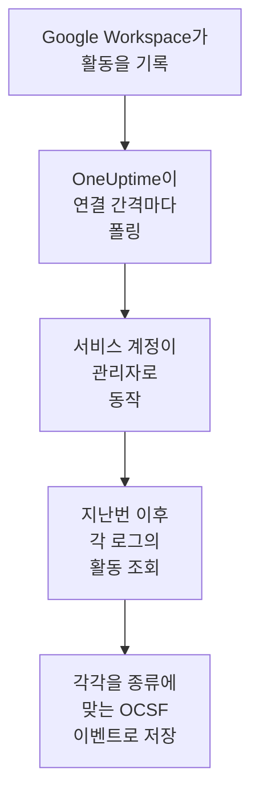

# Google Workspace

[Google Workspace](https://workspace.google.com)의 감사 로그를 OneUptime의 보안 이벤트로 가져옵니다. 로그인과 그에 대해 Google이 표시한 내용, 관리자의 변경, 데이터 액세스 권한을 받은 앱, Single Sign-On, 계정 자체의 보안 설정, 그리고 원하면 조직 외부와 공유되거나 Google 드라이브에서 다운로드된 파일을 가져옵니다. 그곳에서 로그, 트레이스, 메트릭과 나란히 검색하고, 다른 모든 소스와 상관 분석하고, 중요한 것에 대해 온콜을 호출할 수 있습니다. OneUptime은 관리자 한 명으로 동작하는 서비스 계정으로 이를 읽으며, Google Workspace에서 아무것도 바꾸지 않습니다.

:::cards
- [연결 설정](#연결-설정): 서비스 계정, 도메인 전체 위임, 그리고 연결 양식.
- [가져오는 내용](#가져오는-내용): 어떤 활동을 가져오는지, 각 활동이 보안 이벤트가 되는 방식.
- [폴링 작동 방식](#폴링-작동-방식): 각 폴링이 읽는 구간과, 그 구간이 2시간 겹치는 이유.
- [문제 해결](#문제-해결): 각 오류의 의미와 바꿔야 할 점.
:::

## 작동 방식

OneUptime은 1분마다, 폴링 간격이 지난 활성화된 연결을 각각 폴링합니다. 폴링은 지정한 관리자를 대신해 서비스 계정으로 로그인하고, 지난 폴링 이후 각 감사 로그의 활동을 나열합니다([Activities: list](https://developers.google.com/admin-sdk/reports/reference/rest/v1/activities/list)). 대상은 관리, 로그인, OAuth 토큰, SAML, 계정 보안이며, **드라이브 활동** 옵션이 켜져 있으면 드라이브도 포함됩니다. 활동의 각 이벤트는 [OCSF](https://schema.ocsf.io/) 이벤트로 저장됩니다. 로그인은 Authentication 이벤트로, 관리자 역할 할당은 User Access Management 이벤트로, Google이 표시한 로그인은 Detection Finding으로 저장됩니다.

## 사전 요건

- OneUptime에서 Project Owner, Project Admin 또는 Security Admin 역할. Security Member와 Security Viewer는 연결과 그 실행 기록을 볼 수 있지만 변경할 수는 없습니다.
- 도메인 전체 위임을 허용할 Google Workspace 최고 관리자, 그리고 서비스 계정이 대신 동작할, Reports 권한을 가진 관리자. 최고 관리자는 이 권한을 가지고 있습니다.
- 서비스 계정을 만들고 Admin SDK API를 켤 수 있는 Google Cloud 프로젝트.
- 드라이브 활동의 경우 Business Standard, Business Plus, Enterprise, Education처럼 드라이브 감사 로그가 있는 버전.
- OneUptime 앱과 워커에서 `oauth2.googleapis.com`과 `admin.googleapis.com`으로 나가는 HTTPS.

## 연결 설정

연결은 서비스 계정의 키와 [도메인 전체 위임](https://developers.google.com/identity/protocols/oauth2/service-account#delegatingauthority)으로 로그인하며, 읽기 전용 범위 하나만 사용합니다: `https://www.googleapis.com/auth/admin.reports.audit.readonly`.

:::steps
### 서비스 계정과 키 만들기

1. [Google Cloud 콘솔](https://console.cloud.google.com)에서 프로젝트를 고르고 **APIs & Services → Library**를 열어 **Admin SDK API**를 찾은 뒤 **Enable**을 선택합니다.
2. **IAM & Admin → Service accounts → Create service account**를 열고 이름을 `oneuptime-security-events`로 정한 뒤 **Done**을 선택합니다. 프로젝트에서 역할은 필요 없습니다.
3. 서비스 계정을 열고 위임에서 지정하는 클라이언트 ID인 **Unique ID**를 복사합니다. **Keys** 탭에서 **Add key → Create new key → JSON**을 선택하고 파일을 보관하세요. 이것이 키입니다.

### 도메인 전체 위임 허용

1. [Google 관리 콘솔](https://admin.google.com)에서 최고 관리자로 **Security → Access and data control → API controls → Manage domain-wide delegation**을 열고 **Add new**를 선택합니다.
2. 서비스 계정의 **Unique ID**를 **Client ID**로, `https://www.googleapis.com/auth/admin.reports.audit.readonly`를 **OAuth scope**로 입력합니다. **Authorize**를 선택합니다. Google이 적용하는 데 몇 분 걸릴 수 있습니다.
3. 플레이북이 사용자를 정지, 정지 해제, 로그아웃할 수 있게 하려면( [봉쇄](/docs/telemetry/security-cases#봉쇄) 참고), 같은 클라이언트의 범위에 `https://www.googleapis.com/auth/admin.directory.user` 와 `https://www.googleapis.com/auth/admin.directory.user.security` 를 쉼표로 구분해 추가합니다. 그러면 연결이 대신 동작하는 관리자는 그 사용자들을 관리하는 관리자여야 합니다.

### OneUptime에서 연결 추가

**제품 → Security Events → 연결**(`/dashboard/{projectId}/security-events/connections`)를 열고 **연결 추가**를 클릭한 다음, **아이덴티티** 아래의 **Google Workspace**를 고르고 **다음**을 클릭합니다. **Administrator email**을 입력하고 **다음**을 클릭한 뒤, 키 파일의 내용을 **서비스 계정 JSON**에 붙여 넣습니다. **폴링** 단계에서 **드라이브 활동**을 켜면 드라이브도 읽습니다.

### 저장하기 전에 테스트

**저장하기 전에 테스트** 아래의 **이 설정 테스트**를 클릭합니다. 테스트는 양식의 값으로 로그인해 로그인 로그와 관리 로그를 읽지만 아무것도 저장하지 않으므로, 빠진 위임을 연결이 생기기 전에 알 수 있습니다. 그런 다음 **다음**을 클릭하고 연결에 **이름**을 지정해 만듭니다.
:::

| 설정 | 입력할 값 |
| --- | --- |
| **Administrator email** | 서비스 계정이 대신 동작하는 관리자의 주소(예: `admin@example.com`). Reports 권한이 있어야 합니다. |
| **드라이브 활동** | 선택 사항이며 기본값은 꺼짐. 켜면 폴링할 때마다 드라이브의 공유와 다운로드도 읽습니다. |
| **서비스 계정 JSON** | `client_email`과 `private_key`가 들어 있는 키 파일 전체. 암호화되며, API가 반환하지 않고 다시는 표시되지 않습니다. 연결의 **자격 증명 업데이트**로 교체합니다. |

**폴링** 단계에는 선택 사항인 **설명**, `1`부터 `1440`까지의 정수이며 처음 값이 `5`인 **폴링 간격(분)**, 그리고 처음에 켜져 있는 **활성화됨**도 있습니다.

## 가져오는 내용

모든 이벤트의 공급업체는 `Google`, 제품은 `Google Workspace`입니다. 여러 이벤트를 담은 활동은 이벤트마다 보안 이벤트 하나가 되며, 모든 이벤트는 활동의 필드와 자신의 필드를 `event.name`, `event.type`, `parameters.<name>`으로 보관하므로 규칙은 Google의 이름으로 읽을 수 있습니다.

| 로그 | 이벤트 | OCSF 클래스 | 심각도 |
| --- | --- | --- | --- |
| 로그인(`login`) | `login_success`, 이유가 포함된 `login_failure`, `login_challenge`. 로그아웃은 읽지만 가져오지 않습니다. | Authentication (`3002`) | Informational. 실패는 Low. Google이 `is_suspicious`로 표시하면 Medium |
| Google의 탐지(`login`) | `suspicious_login`과 그 변형, `gov_attack_warning`, `account_disabled_hijacked`, 그리고 Google이 사용 중지한 다른 계정 | Detection Finding (`2004`) | Medium. 정부 지원 공격, 탈취된 계정, 유출된 비밀번호는 High |
| 관리(`admin`) | 부여되거나 취소된 관리자 권한과 역할, 도메인 전체 위임, 생성, 삭제 또는 정지된 사용자, 꺼진 이중 인증, 그룹 구성원, 설정 | User Access Management (`3005`), Account Change (`3001`), Group Management (`3006`), Entity Management (`3004`) | 권한 부여는 Medium. 사용자 삭제나 이중 인증 끄기는 Low |
| OAuth 토큰(`token`) | 누군가의 데이터에 대한 액세스를 범위와 함께 받은 앱, 또는 그 액세스를 잃은 앱 | Authorize Session (`3003`) | Informational |
| SAML(`saml`) | 앱으로의 Single Sign-On | Authentication (`3002`) | 실패는 Low |
| 계정 보안(`user_accounts`) | 이중 인증, 비밀번호, 복구 설정 변경 | Account Change (`3001`) | 계정을 약하게 만들면 Low |
| 드라이브(`drive`), 옵션이 켜져 있을 때 | `change_user_access`, `change_document_visibility`, `change_document_access_scope`, `change_acl_editors`, `download` | File Hosting Activity (`6006`) | 소유자 도메인 밖과 공유되었거나 링크로 공개된 파일은 Low |

규칙 라이브러리의 Google Workspace 규칙은 Google이 표시한 로그인, 부여된 관리자 권한, 드라이브에서 공개된 파일에 대한 규칙처럼, 여기서 가져온 그대로 읽습니다.

## 폴링 작동 방식

- **활동은 발생한 시각으로 읽습니다.** Reports API에는 목록에 쓸 다른 시각이 없으며, Google은 로그가 몇 분에서 몇 시간 늦게 도착한다고 안내합니다.
- **첫 폴링은 24시간 전까지 거슬러 올라가므로**, 새 연결에서 최근 활동이 바로 보입니다.
- **이후의 모든 폴링은 저장된 커서보다 120분 앞에서 시작하므로**, Google이 최대 2시간 늦게 읽을 수 있게 한 활동은 다음 폴링에서 읽히고, 중복은 프로젝트 안에서 각 이벤트의 ID로 걸러집니다. 그보다 늦게 도착한 활동은 폴링이 읽지 않으니, **진단**에서 그 시간 범위를 가져오세요.
- **한 번의 폴링은 커서 이후 최대 24시간까지 읽습니다.** 커서가 뒤처진 연결은 24시간 구간을 연달아 읽으며 따라잡습니다.
- **드라이브는 이벤트 하나씩 읽습니다**. 드라이브는 누군가 여는 모든 파일을 기록하기 때문입니다. Google이 드라이브 로그를 거부하면 실행이 경고하고, 나머지 로그는 계속 가져옵니다.
- **실패한 실행은 아무것도 바꾸지 않습니다.** 네트워크 오류나 Google의 오류 상태 뒤에는 커서와 구간 길이가 그대로 유지되고, 다음 폴링이 같은 구간을 다시 읽습니다. 단 하나의 예외는 요청 시간이 초과된 경우입니다. 커서는 그대로지만 다음 구간은 절반 길이가 됩니다. 제시간에 응답하기에는 너무 무거운 구간은 시도할 때마다 시간이 초과되기 때문입니다.

### 한 번의 폴링으로 다 읽을 수 없는 구간

각 로그에는 1,000개 활동짜리 페이지 단위로 자체 예산이 있습니다. 로그인은 10, 관리, OAuth 토큰, SAML은 각각 5, 계정 보안은 3, 드라이브 이벤트마다 4입니다. 폴링은 4분 뒤에 멈춥니다. 예산 때문에 구간이 끝나기 전에 로그 읽기가 멈추면 실행은 **부분**이 되고, 그 경고에 로그와 예산이 표시됩니다. Google은 최신 활동부터 나열하므로, OneUptime은 닿지 못한 활동 너머로 커서를 옮기는 대신 구간을 줄입니다.

1. **좁히기.** 다음 폴링은 같은 시작점에서 절반 길이의 구간을 읽으며, 구간을 끝까지 읽을 수 있게 될 때까지 계속 절반으로 줄이고, 가장 짧게는 1분까지 줄입니다. 실행의 경고에 그렇게 적힙니다: `This window holds more records than one poll can read; the next poll reads a {n} minute window from the same starting point.` 더 긴 구간에서 이미 가져온 활동은 중복으로 건너뜁니다.
2. **다시 늘리기.** 구간을 끝까지 읽으면 커서가 그 끝으로 옮겨지고, 다음 구간은 다시 두 배가 되며, 최대 24시간까지 늘어납니다.
3. **1분 넘어가기.** 1분 안에조차 한 번의 폴링으로 읽을 수 있는 것보다 많으면, 더 새로운 활동이 계속 도착하도록 폴링이 그 1분을 넘어갑니다. 실행은 **부분**으로 남고, **마지막 오류**에는 `More records were created in the one minute from {cursor} to {end} than one poll can read. Polling moved past this minute so newer records keep arriving; use Import this time range in Diagnostics on this minute to recover what one run can read.`가 표시됩니다. 그 1분을 **Import this time range**로 가져오면 한 번의 실행으로 읽을 수 있는 만큼 되찾을 수 있습니다.

**폴링 간격(분)** 값을 바꿔도 이 중 어느 것도 달라지지 않습니다. 이 설정은 폴링이 얼마나 자주 시작하는지를 정할 뿐, 구간이 어디서 시작하는지는 정하지 않습니다.

### 필요할 때 실행, 미리 보기, 가져오기

연결에서 **진단**을 클릭하면 최근 실행을 보고 연결을 직접 다룰 수 있습니다. 연결을 변경할 수 있는 사람은 누구나 이를 시작할 수 있고, 연결을 볼 수 있는 사람은 누구나 기록을 읽을 수 있습니다.

- **지금 실행**은 연결이 **활성화됨** 상태가 아닐 때에도 평소의 커서로 즉시 폴링을 시작합니다.
- **Preview audit events**는 최대 7일의 시간 범위를 읽으며 아무것도 가져오지 않습니다.
- **Import this time range**는 확인을 거친 뒤 최대 7일의 범위를 가져오며, 커서는 옮기지 않습니다. 이미 가져온 활동은 건너뜁니다. Google은 감사 로그를 6개월 동안 보관합니다.
- 실행의 **Copy diagnostics**는 지원팀에 보낼 보고서를 복사합니다. 자격 증명은 절대 포함되지 않습니다.

## 연결 테스트

연결 행의 **연결 테스트**와 양식의 **이 설정 테스트**는 백그라운드 워커가 아니라 API 프로세스에서 실행되므로, 워커가 문제일 때에도 테스트는 응답합니다. 다음 검사를 순서대로 실행합니다:

| 검사 | 확인하는 내용 |
| --- | --- |
| **구성** | 관리자 주소와 키의 형식이 올바른지. 이 검사가 실패하면 아무 곳에도 연결하지 않습니다. |
| **Authenticate with Google** | Google이 서비스 계정이 관리자로 동작하도록 허용하는지. 즉 도메인 전체 위임이 설정되어 있는지. |
| **Read the audit logs** | 지난 24시간의 로그인 로그와 관리 로그를 읽을 수 있는지. |
| **Read Drive activity** | 옵션이 켜져 있을 때만: 드라이브 로그를 읽을 수 있는지. |
| **Activities available to import** | 지난 24시간에 로그인 활동과 관리 활동이 몇 개 있는지. 각각 최대 1,000개까지 세므로 `1000+`는 그보다 많다는 뜻입니다. 하나도 없으면 경고입니다. |
| **Background workers**, **Poll scheduler**, **Security event storage** | OneUptime 쪽: Worker 큐의 작업을 가져가는 프로세스가 있고, 폴링 작업이 매분 실행되고, 보안 이벤트 저장소가 응답하는지. |
| **Scheduled polling** | 저장된 연결의 경우: 폴링이 켜져 있고, 워커를 기다리며 멈춘 실행이 없고, 폴링이 제때 실행되는지. |

테스트의 모든 요청에는 20초 기한이 있습니다. 테스트는 아무것도 가져오지 않고 커서를 옮기지도 않으며, 실패한 각 검사는 무엇을 바꿔야 하는지 알려 줍니다.

## 문제 해결

연결의 **마지막 오류**는 자격 증명을 가린 전체 오류 메시지를 보관합니다. 연결에 오류가 있으면 **작업** 열에서 **오류 보기**를 선택해 읽고, 대화 상자의 **오류 복사**로 복사하세요. 모든 메시지는 `Google Workspace`로 시작하고, 이어서 실패한 요청을 밝히며, Google이 밝힌 이유를 인용합니다.

:::details 마지막 오류에 `token request failed`가 나옴
- `unauthorized_client`: 서비스 계정에 해당 범위에 대한 도메인 전체 위임이 없습니다. **Manage domain-wide delegation**에서 그 **Unique ID**를 `https://www.googleapis.com/auth/admin.reports.audit.readonly`와 함께 추가하세요.
- `Invalid email or User ID`와 함께 `invalid_grant`: **Administrator email**이 이 Google Workspace의 사용자가 아닙니다.
- `Invalid JWT Signature`와 함께 `invalid_grant`: 키가 삭제되었거나 사용 중지되었습니다. 새 키를 만들어 **자격 증명 업데이트**로 저장하세요.
:::

:::details 마지막 오류에 `activities request failed (HTTP 403)`가 나옴
- 이유 `SERVICE_DISABLED` 또는 `accessNotConfigured`: 서비스 계정의 프로젝트에서 Admin SDK API가 꺼져 있습니다. 켜고 몇 분 뒤에 다시 테스트하세요.
- 이유 `forbidden`: 관리자에게 Reports 권한이 없습니다. Google 관리 콘솔의 **Account → Admin roles**에서 할당하거나 최고 관리자를 지정하세요.
:::

:::details 드라이브 활동을 읽지 못함
드라이브 로그에는 그것이 있는 버전과 Reports 권한을 가진 관리자가 필요합니다. 각 실행은 `Drive activity was not read`라고 경고하고, 나머지 로그는 계속 가져옵니다. 사용하는 버전에 드라이브 로그가 없으면 **드라이브 활동**을 끄세요.
:::

:::details 마지막 오류에 `did not complete`가 나옴
요청이 응답을 받지 못했습니다. 시간 초과, 확인되지 않는 이름 또는 거부된 주소입니다. OneUptime 앱과 워커가 사용하는 프록시를 거쳐 `oauth2.googleapis.com`과 `admin.googleapis.com`에 닿을 수 있는지 확인하세요.
:::

:::details 테스트는 통과하지만 Last Polled가 Never임
폴링 작업이 한 번도 실행되지 않았습니다. **Background workers**와 **Poll scheduler** 검사를 읽으세요. 자체 호스팅 설치에서 흔한 원인은 앱에 `DISABLE_QUEUE_WORKERS=true`가 설정되어 있는데 작업을 가져가는 별도의 워커 배포가 없는 경우입니다. 이를 `false`로 설정하거나 워커 배포를 실행하세요(Helm: `worker.enabled: true`, 기본값은 `false`).
:::

## 다음 단계

:::cards
- [보안 이벤트](/docs/telemetry/security-events): 가져온 내용을 검색하고, 상관 분석하고, 알림을 받습니다.
- [Microsoft Entra ID](/docs/integrations/microsoft-entra-id): Microsoft의 로그인과 디렉터리 변경을 가져옵니다.
- [Google SecOps](/docs/integrations/google-secops): Google SecOps의 탐지도 가져옵니다.
- [통합 개요](/docs/integrations/index): 연결할 수 있는 다른 도구.
:::
