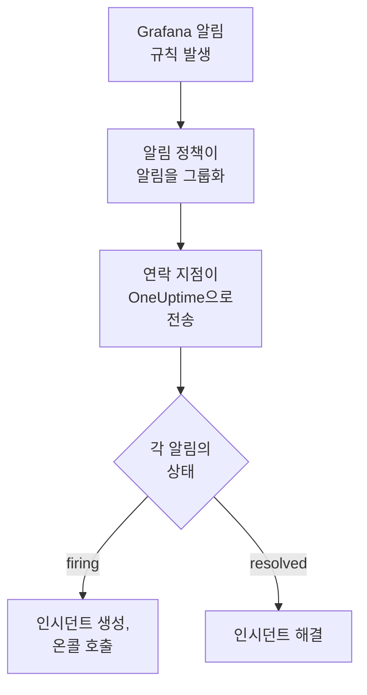

# Grafana

[Grafana](https://grafana.com) 알림을 OneUptime으로 보내면, 발생한 각 알림이 온콜 팀을 호출하는 인시던트가 되고 알림이 복구되면 해결됩니다. Grafana는 웹훅 연락 지점을 통해 알림을 보내므로 어느 쪽에도 설치할 것이 없습니다.

:::cards
- [OneUptime이 알림을 받는 방법 선택](#oneuptime이-알림을-받는-방법-선택): Incoming Request 모니터 또는 직접 만든 워크플로.
- [모니터로 알림 받기](#모니터로-알림-받기): 알림마다 인시던트 하나, 복구 시 해결.
- [Grafana 구성](#grafana-구성): 웹훅 연락 지점과 이를 사용하는 정책.
- [문제 해결](#문제-해결): 알림이 도착하지 않거나 인시던트가 계속 열려 있을 때.
:::

## 작동 방식



Grafana의 알림 정책은 발생한 알림을 그룹화하고, 웹훅 연락 지점은 각 그룹을 하나의 JSON 통지로 보냅니다. 이 통지는 [Prometheus Alertmanager](/docs/integrations/prometheus-alertmanager) 통지와 형태가 같습니다. `status`, 각 알림에 고유한 `status`와 `fingerprint`가 있는 `alerts` 목록, 그리고 알림들이 공유하는 `commonLabels`와 `commonAnnotations`가 있습니다. Grafana는 사람이 읽도록 쓴 `title`과 `message`를 추가합니다.

## 사전 요건

- Grafana 9 이상과, Grafana 9부터 기본값인 Grafana Alerting. HTTPS로 OneUptime에 연결할 수 있어야 합니다.
- OneUptime에서 모니터를 만들 권한. 워크플로를 사용한다면 워크플로를 만들 권한.

## OneUptime이 알림을 받는 방법 선택

먼저 OneUptime을 설정합니다. 그러면 Grafana가 보낼 URL을 얻습니다.

| 방법 | 사용하는 경우 |
| --- | --- |
| Incoming Request 모니터(권장) | 모든 알림이 온콜을 호출하고 알림이 복구되면 해결되는 인시던트가 되기를 원할 때. 따로 만들 것이 없습니다. |
| 웹훅 트리거가 있는 워크플로 | 알림 필터링, 형태 변환, 다른 시스템 먼저 호출 등 자체 로직이 필요할 때. 워크플로는 알림마다가 아니라 통지마다 인시던트 하나를 열고, 복구 시 해결하지 않습니다. |

둘 다 같은 연락 지점에서 같은 JSON을 받으므로, 하나로 시작한 뒤 Grafana의 URL 하나만 바꿔 나중에 전환할 수 있습니다.

## 모니터로 알림 받기

[Incoming Request 모니터](/docs/monitor/incoming-request-monitor)는 URL을 제공하고, 그 기준이 각 통지가 할 일을 결정합니다.

:::steps
### 모니터 만들기

**모니터**로 이동해 **모니터 생성**을 클릭합니다. **모니터 유형**에서 **Incoming Request**를 고르고, 이름을 `Grafana`로 정한 다음 **다음**을 클릭합니다.

### 발생한 알림마다 인시던트 선언

**기준** 단계에서 첫 번째 기준, 즉 모니터를 오프라인으로 표시하는 기준을 엽니다. 필터를 **요청 본문**, **포함**, `"status":"firing"`으로 설정합니다. 이 기준은 필터가 일치하면 이미 인시던트를 선언합니다. 인시던트를 채웁니다:

- **인시던트 제목**: `{{requestBody.commonLabels.alertname}}`.
- **인시던트 설명**(**설명** 아래): `{{requestBody.message}}`. Grafana가 통지에 쓰는 텍스트입니다.
- **심각도**: 이 알림에 붙일 인시던트 심각도.
- **온콜 정책**(**온콜** 아래): 호출할 정책.
- **인시던트 자동 해결**(**추가 필드** 아래): 처음 상태대로 켜 둡니다. 이 설정이 없으면 복구가 무시되어 인시던트가 계속 열려 있습니다.

### 알림마다 인시던트 하나 열기

같은 기준에서 **설정**을 열고 **Group incidents and alerts by a payload field**를 켭니다. 아래와 같이 채우면 알림마다 별도의 인시던트가 생기고, 그 복구가 인시던트를 해결합니다:

| 필드 | 값 |
| --- | --- |
| **Open a separate incident for each…** | `requestBody.alerts[*].fingerprint` |
| **Field that signals recovery** | `requestBody.alerts[*].status` |
| **Value that means recovered** | `resolved` |

### 모니터를 다시 온라인으로

두 번째 기준, 즉 모니터를 온라인으로 표시하는 기준을 열고 필터를 **요청 본문**, **포함**, `"status":"resolved"`로 설정합니다.

### URL 복사

**모니터 생성**을 클릭합니다. 모니터의 **개요** 페이지에 **Heartbeat URL**이 표시됩니다. Grafana에 쓸 수 있도록 복사합니다:

```text
https://oneuptime.com/heartbeat/<secret key>
```

자체 호스팅 설치에서는 `oneuptime.com` 대신 자체 호스트를 사용합니다.
:::

통지의 각 알림은 **Max incidents per request**(바꾸지 않으면 `100`)까지 자체 인시던트를 열고, 각 알림의 `status`가 그 인시던트가 언제 해결될지를 결정합니다. Grafana의 `fingerprint`는 레이블로 알림을 식별하므로 그룹화에 쓸 값이 바로 이것입니다. 각 설정이 하는 일은 [다른 시스템의 알림 수신](/docs/monitor/incoming-request-monitor#다른-시스템의-알림-수신)을 참고하세요.

> [!WARNING]
> 통지의 모든 알림이 공유하는 레이블로 그룹화하지 마세요. Grafana의 기본 알림 정책은 알림을 `grafana_folder`와 `alertname`으로 그룹화하므로, 한 통지의 모든 알림은 같은 `alertname`을 가집니다. `requestBody.alerts[*].labels.alertname`으로 그룹화하면 통지 전체가 인시던트 하나로 합쳐집니다.

`{{requestBody.commonLabels.alertname}}`과 `{{requestBody.message}}`는 통지 전체를 설명하며, 기본 정책에서는 그것이 알림 규칙 하나에 해당합니다. 그룹화 키도 `{{fingerprint}}`라는 변수이지만, 대응자에게 아무것도 알려 주지 않는 해시입니다. 사용할 수 있는 모든 변수는 [인시던트 및 알림 템플릿](/docs/monitor/incident-alert-templating)을 참고하세요.

## Grafana 구성

:::steps
### 웹훅 연락 지점 추가

Grafana에서 **Alerting → Contact points**로 이동해 **+ Add contact point**를 클릭합니다. Grafana 11 이상에서는 **Alerting**이 **Alerts & IRM** 아래에 있고, **Contact points**는 **Notification configuration**의 탭입니다.

연락 지점의 이름을 `OneUptime`으로 정하고, **Integration**에서 **Webhook**을 고른 뒤, 복사한 URL을 **URL**에 붙여 넣습니다. **HTTP Method**는 `POST`로 두고 **Save contact point**를 클릭합니다.

### 알림을 그쪽으로 보내기

**Alerting → Notification policies**로 이동합니다. 기본 정책의 연락 지점을 `OneUptime`으로 설정하거나, OneUptime이 받아야 할 알림과 일치하는 하위 정책을 추가하고 그 연락 지점을 `OneUptime`으로 지정합니다.
:::

Grafana는 `Content-Type: application/json`을 보내며, 모니터는 이를 사용해 통지의 필드를 읽습니다. 연락 지점의 **Max Alerts** 설정은 한 통지에 담기는 알림 수를 제한합니다. `0`(제한 없음)으로 두거나 모니터의 **Max incidents per request** 이하로 설정하세요.

## 테스트하기

1. Grafana에서 `OneUptime` 연락 지점을 열고 **Test**를 클릭합니다. Grafana가 발생 중인 테스트 알림을 보내고, OneUptime에서 인시던트가 열립니다. 테스트 알림은 복구되지 않으므로 그 인시던트는 직접 해결합니다.
2. 예를 들어 임곗값을 잠시 낮춰 실제 알림 규칙을 발생시키고, 인시던트가 열렸다가 임곗값을 되돌리면 해결되는 것을 확인합니다.

## 워크플로로 알림 받기

Grafana와 인시던트 사이에 직접 만든 단계가 필요하면 [워크플로](/docs/workflows/index)를 사용합니다.

:::steps
### 워크플로 만들기

**워크플로**로 이동해 **워크플로 생성**을 클릭한 다음 **처음부터 시작**을 클릭합니다. 이름을 `Grafana alerts`로 정하고 **워크플로 생성**을 클릭합니다.

### 웹훅 트리거 추가

점선으로 된 **이 워크플로를 시작할 항목 선택** 블록을 클릭하고 **Webhook**을 고릅니다. 트리거를 클릭한 다음 **URL 복사**를 클릭하고, 그 URL을 Grafana의 연락 지점에 사용합니다.

### 통지가 발생 중인지 확인

**구성 요소 추가**를 클릭해 **If / Else** 블록을 추가하고, 트리거의 **Out** 점을 여기에 연결합니다. **Value to check**는 `{{local.components.webhook-1.returnValues.request-body.status}}`, **Comparison**은 **is equal to**, **Compare with**는 `firing`으로 설정합니다.

### 인시던트 선언

**Create One Incident** 블록을 추가하고 **If / Else** 블록의 **Yes** 쪽을 여기에 연결합니다. **Incident Template**에서 심각도와 호출할 온콜 정책을 정하는 템플릿을 고릅니다([인시던트 템플릿](/docs/incidents/settings#인시던트-템플릿) 참고). **JSON Object**에서 Grafana에서 오는 값을 설정합니다:

```json
{
  "title": "{{local.components.webhook-1.returnValues.request-body.title}}",
  "description": "{{local.components.webhook-1.returnValues.request-body.message}}"
}
```

템플릿이 없으면 **JSON Object**에 프로젝트의 인시던트 심각도 중 하나의 ID인 `incidentSeverityId`도 있어야 합니다.

### 워크플로 켜기

**빌더** 상단에서 **활성화됨**을 켭니다. 꺼진 워크플로는 Grafana에 `400`으로 응답합니다.
:::

한 번의 실행은 통지 하나를 처리하므로, 통지에 알림이 몇 개 들어 있든 인시던트를 하나만 선언합니다. `resolved` 통지는 **If / Else** 블록의 **No** 쪽으로 가는데, 그쪽에는 아무것도 연결되어 있지 않으므로 실행은 거기서 끝납니다. 알림마다 인시던트를 하나씩 열고 복구 시 해결하려면 모니터를 사용하세요.

## 문제 해결

:::details OneUptime에 아무것도 도착하지 않음
- 연락 지점에서 **Test**를 클릭합니다. Grafana가 URL에 연결할 수 없으면 오류를 표시합니다. 자세한 내용은 Grafana 서버 로그에 있습니다.
- 모니터는 무엇이든 확인하기 전에, 비밀 키가 틀려도 즉시 `200`으로 응답합니다. 통지가 도착하는지는 모니터의 타임라인에서 확인합니다.
- 꺼진 워크플로는 `400`으로 응답합니다. 그 **빌더** 상단에서 **활성화됨**을 켭니다.
:::

:::details 인시던트가 열리지만 해결되지 않음
- 기준의 인시던트에는 **추가 필드** 아래의 **인시던트 자동 해결**이 필요합니다.
- **Field that signals recovery**는 `requestBody.alerts[*].status`여야 하고, **Value that means recovered**는 정확히 `resolved`여야 합니다. 비교는 대소문자를 구분합니다.
- 그룹화 경로는 `requestBody.`로 시작해야 하며, 경로에서 목록을 읽는 것은 첫 번째 `[*]`뿐입니다. 두 규칙 중 하나라도 어기는 경로는 오류 없이 아무것과도 일치하지 않습니다.
:::

:::details 알림이 가득한 통지에 인시던트가 하나만 생김
기본 정책에서의 `alertname`처럼, 통지의 모든 알림에서 같은 레이블로 그룹화했습니다. 대신 `requestBody.alerts[*].fingerprint`로 그룹화하세요.
:::

:::details 인시던트에 값 대신 참조가 표시됨
통지에 없는 필드에 대한 참조는 중괄호까지 포함해 쓴 그대로 남습니다. 필드 이름을 Grafana가 보낸 내용과 비교하세요. 워크플로라면 **로그 → 실행 기록**에서 실행을 열고 트리거가 받은 내용과 비교합니다.
:::

[Prometheus Alertmanager](/docs/integrations/prometheus-alertmanager#문제-해결) 가이드는 더 많은 경우를 다루며, 그 내용은 Grafana의 통지에도 적용됩니다.

## 보안

- **URL을 비밀번호처럼 다루세요.** URL을 가진 사람은 누구나 인시던트를 열 수 있습니다. 유출되었다면 재설정합니다. 모니터의 **설정** 페이지에서 **수신 요청 비밀 키 재설정**을, 또는 워크플로의 **Webhook** 트리거에서 **URL 재설정**을 사용합니다. 그런 다음 Grafana에서 연락 지점의 **URL**을 업데이트합니다.
- **자체 호스팅인가요?** Grafana가 방화벽을 통과해 HTTPS로 OneUptime에 연결할 수 있게 하세요.

## 다음 단계

:::cards
- [수신 요청 모니터](/docs/monitor/incoming-request-monitor): 알림을 받는 모니터의 모든 설정.
- [Prometheus Alertmanager](/docs/integrations/prometheus-alertmanager): 같은 설정에 알림 체계를 감시하는 데드맨 스위치를 더한 것.
- [메트릭 모니터](/docs/monitor/metrics-monitor): 같은 메트릭에 대해 OneUptime 자체에서 알림을 받습니다.
- [통합 개요](/docs/integrations/index): 연결할 수 있는 다른 도구.
:::
