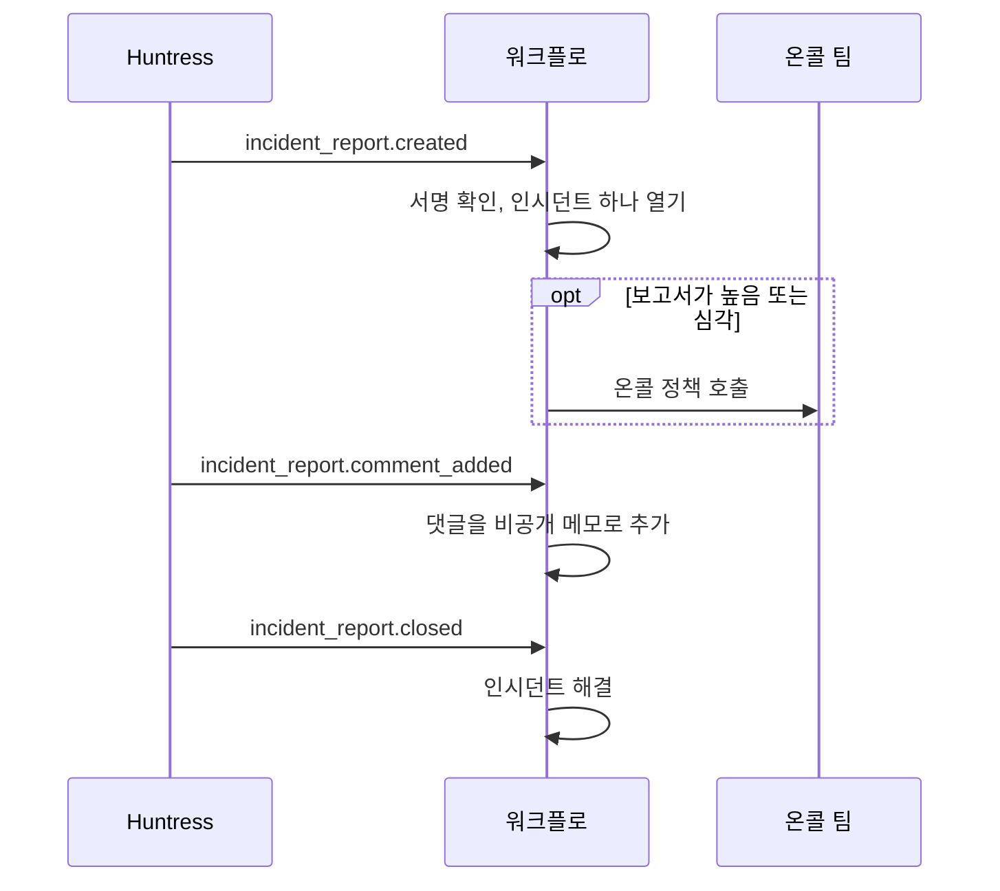

# Huntress 연동

워크플로로 Huntress 인시던트 보고서에 맞춰 온콜 팀을 호출하세요. Huntress SOC가 엔드포인트나 계정에 대한 인시던트 보고서를 보내면, 워크플로는 보고서마다 인시던트를 하나 열고, 선택한 온콜 정책을 호출하고, Huntress에서 단 댓글을 비공개 메모로 추가하며, Huntress에서 보고서가 닫히면 인시던트를 해결합니다.

이 연동은 **인바운드**입니다. Huntress는 인시던트 보고서의 모든 이벤트를 워크플로 전용 URL로 보내며, 엔드포인트의 서명 시크릿으로 서명합니다. OneUptime은 Huntress를 호출하지 않으므로 Huntress API 키가 필요 없습니다.

:::cards
- [작동 방식](#작동-방식): 보고서의 각 이벤트에 워크플로가 하는 일.
- [설정 방법](#연동-설정하기): 워크플로를 만들고, Huntress에 엔드포인트를 추가하고, 서명 시크릿을 저장하고, 테스트를 보냅니다.
- [트리거](#huntress-incident-report-트리거): 보고서가 워크플로에 넘기는 값과 트리거의 설정.
- [문제 해결](#문제-해결): 트리거 오류의 의미와 바꿔야 할 점.
:::

## 작동 방식

Huntress는 보고서가 발송될 때, 누군가 댓글을 달 때, 보고서가 닫힐 때 인시던트 보고서 이벤트를 보냅니다. **Huntress Incident Report** 트리거는 이벤트마다 워크플로를 한 번 시작하며, 트리거의 **Event**가 어떤 이벤트였는지 알려 줍니다: `created`, `comment-added`, `closed`.

1. **확인.** 요청은 도착하기 5분 이내에 엔드포인트의 서명 시크릿으로 서명되어 있어야 합니다. 그 밖의 요청은 거부되며, 트리거의 설정에 이유가 표시됩니다.
2. **워크플로 시작.** 이벤트마다 실행이 하나 시작되고, 보고서의 필드가 트리거의 값이 됩니다. Huntress가 다시 보낸 이벤트는 더 이상 아무것도 시작하지 않습니다.
3. **인시던트 하나 열기.** `created`에서 워크플로는 `Huntress: Incident on DESKTOP-01 (Acme Corp)`처럼 보고서를 딴 제목의 인시던트를 엽니다. 설명에는 보고서 요약, Huntress에서의 심각도, 조직, 영향을 받은 호스트나 계정, Huntress가 찾은 지표, Huntress 보고서 링크가 들어갑니다. 인시던트에는 보고서의 조직 레이블이 붙고, 보고서가 높음 또는 심각이면 선택한 온콜 정책을 호출합니다.
4. **보고서 따라가기.** `comment-added`에서는 댓글이 인시던트의 비공개 메모가 됩니다. `closed`에서는 인시던트가 해결되고, 그 이유가 타임라인에 남습니다.

인시던트는 보고서 번호를 사용자 지정 필드에 `huntressReportId`로 보관합니다. Huntress가 보고서에 댓글을 달거나 보고서를 닫으면 워크플로는 이 번호로 인시던트를 다시 찾습니다. 이렇게 열린 인시던트는 상태 페이지에 표시되지 않으며, 인시던트 규칙(온콜, 소유자, 레이블, 개인정보 규칙)은 다른 인시던트와 똑같이 적용됩니다.

## 시작하기 전에

- OneUptime에서 워크플로를 만들고 편집할 수 있는 역할(예: **프로젝트 소유자**, **프로젝트 관리자**, **워크플로 관리자**).
- Huntress의 **Account Admin** 역할. 웹훅은 계정 관리자만 추가할 수 있습니다.
- 호출할 온콜 정책.
- OneUptime Cloud에서는 워크플로가 포함된 요금제(Growth 이상). Huntress가 보내는 이벤트 하나가 워크플로 실행 한 번입니다.
- 자체 호스팅 설치라면 Huntress가 인터넷에서 HTTPS로 접근할 수 있는 OneUptime. Huntress는 `https://` URL로만 웹훅을 보냅니다.

## 연동 설정하기

:::steps
### 워크플로 만들기

**워크플로**를 열고 **워크플로 생성**을 클릭합니다. **또는 템플릿에서 시작**에서 카테고리 **Huntress**를 고르고, **Open an incident for each Huntress incident report**를 고른 뒤 **이 템플릿 사용**을 클릭합니다.

### 호출할 대상 고르기

이어서 대화 상자가 누구를 호출할지 묻습니다. **Who to page for high and critical reports** 아래에서 호출할 온콜 정책을 고르거나, 아무도 호출하지 않으려면 고르지 말고, **워크플로 생성**을 클릭합니다. 워크플로는 꺼진 상태로 **빌더**에서 열립니다. 나중에 호출 대상을 바꾸려면 **Page an On-Call Policy** 단계를 클릭하고 그 **온콜 정책**을 바꾸세요.

### Huntress에 웹훅 엔드포인트 추가하기

**Huntress Incident Report** 트리거를 클릭하고, **Huntress에 웹훅 엔드포인트 추가** 아래의 **URL 복사**를 클릭합니다. URL은 `https://oneuptime.com/workflow/huntress/<key>` 형태이며, 자체 호스팅 설치에서는 자신의 호스트로 시작합니다.

Huntress에서 오른쪽 위 메뉴를 열고 **Integrations**를 선택합니다. **Add an Integration**을 클릭하고 **Webhooks**를 선택한 다음 **Add Endpoint**를 클릭합니다. URL을 붙여 넣고 **Incident Reports**를 켠 뒤 저장합니다. **Escalations**, **Platform Actions**, **Account Notices**는 꺼 두세요. 트리거는 이 이벤트들을 받기만 하고 아무것도 시작하지 않습니다.

### 엔드포인트의 서명 시크릿 저장하기

Huntress에서 엔드포인트 메뉴(⋯)를 열고 **View Signing Secret**을 선택합니다. 전체를 복사하세요. `whsec_`로 시작합니다. 트리거에서 **서명 시크릿 저장**을 클릭하고, 붙여 넣은 뒤 **서명 시크릿 저장**을 클릭합니다. 시크릿은 암호화되며 다시 표시되지 않습니다.

시크릿을 저장하기 전까지 트리거는 모든 요청을 거부합니다. Huntress는 거부된 이벤트를 나중에 다시 보내므로, 지금 거부된 이벤트도 결국 도착합니다.

### 워크플로를 켜고 테스트 보내기

**빌더** 위쪽에서 **활성화됨**을 켭니다. Huntress에서 엔드포인트 메뉴(⋯)를 열고 **Send Test**를 선택합니다. 몇 초 안에 트리거에 **보고서 수신 중**이 표시됩니다.

> [!NOTE]
> 테스트에 무엇이 담겨 있든, 트리거에는 테스트가 도착했다고 표시됩니다. 인시던트 보고서가 담긴 테스트는 다른 보고서처럼 워크플로를 시작합니다.
:::

## 워크플로가 하는 일

트리거 뒤에서 **Incident From Another Tool**이 보고서 번호로 **Event**마다 요청하는 일을 합니다.

| Event | 워크플로가 하는 일 |
| --- | --- |
| `created` | 트리거의 **Incident Severity ID**로 인시던트를 열고, **Organization Label ID** 레이블을 붙입니다. 높음 또는 심각 보고서라면 **Page an On-Call Policy**가 정책을 호출하고, 낮음 보고서는 아무도 호출하지 않습니다. 이미 인시던트가 있는 보고서는 다른 인시던트를 열지 않습니다. |
| `comment-added` | 보고서의 인시던트를 찾아 댓글을 비공개 메모로 추가합니다. |
| `closed` | 보고서의 인시던트를 찾아, 아직 해결되지 않았다면 해결합니다. 이유는 타임라인에 남습니다: Huntress가 보고서를 닫았습니다. |

다른 워크플로와 같으므로 하는 일을 바꿀 수 있습니다. **Incident From Another Tool** 뒤의 **If / Else**가 비교하는 값을 바꿔 심각 보고서에만 호출하거나, Slack 또는 Microsoft Teams 단계로 보고서마다 채팅 채널에 게시하거나, **Organization**에 대한 **Switch / Case**로 조직마다 자기 온콜 정책으로 보낼 수 있습니다. 모든 실행은 워크플로의 실행 목록에 각 단계가 한 일과 함께 표시됩니다.

### 심각도

Huntress는 각 인시던트 보고서에 세 가지 심각도 중 하나를 붙입니다. 트리거의 **Incident Severity ID**는 보고서가 열리는 인시던트 심각도입니다. 해당 설정에서 고른 심각도이고, 설정이 없으면 **인시던트 → 설정 → 인시던트 심각도**에 나열된 순서로 정해집니다.

| Huntress 심각도 | Huntress에서의 의미 | 설정 | 설정이 비어 있을 때의 인시던트 심각도 |
| --- | --- | --- | --- |
| Critical | 직접 조작 중인 공격자, 위험한 악성코드, 진행 중인 침해로, 즉시 차단해야 합니다. | **심각 보고서의 심각도** | 가장 높은 것 |
| High | 긴급 조치가 필요한 확인된 악성코드, 또는 조치가 필요한 계정 침해. | **높음 보고서의 심각도** | 두 번째 |
| Low | 원치 않는 프로그램일 수 있는 항목, 악성코드 흔적, 계정에 대한 이전 탐지 결과. | **낮음 보고서의 심각도** | 세 번째 |

심각도가 더 적은 프로젝트는 나머지에 가장 낮은 심각도를 씁니다. 심각도가 없는 보고서는 높음으로 처리합니다. 고른 심각도가 삭제되면 다시 순서로 정합니다.

### 조직

트리거의 **Organization Label ID**는 _Acme Corp_처럼 보고서의 Huntress 조직 이름으로 된 레이블이며, 그 조직의 보고서가 처음 도착할 때 만들어집니다. 워크플로 하나가 Huntress 계정의 모든 조직에서 보고서를 받으며, 트리거의 **이 조직만**으로 범위를 좁힐 수 있습니다. 한 줄에 조직 이름이나 ID를 하나씩 쓰며, 이름은 대소문자를 구분하지 않습니다.

> [!TIP]
> 고객마다 자기 팀을 호출하려면 조직마다 인시던트 온콜 규칙을 추가하세요. 예를 들어 "**인시던트 레이블**에 _Acme Corp_ 중 하나가 있으면" 그 고객의 정책을 실행하는 규칙입니다. [인시던트 온콜 규칙](/docs/incidents/settings#인시던트-온콜-규칙)을 참고하세요.

## Huntress Incident Report 트리거

트리거를 열면 Huntress 정보가 표시됩니다. URL, 완료한 설정 단계마다 붙는 체크 표시, Huntress가 마지막으로 보낸 내용입니다. 설정은 모두 선택 사항이며 **추가 필드**에 접혀 있습니다: **이 조직만**, **심각 보고서의 심각도**, **높음 보고서의 심각도**, **낮음 보고서의 심각도**.

| 값 | 담긴 내용 |
| --- | --- |
| **Event** | `created`, `comment-added`, `closed` 중 하나. 이미 닫혔거나 기각된 보고서는 어떤 이벤트로 왔든 `closed`입니다. |
| **Report ID** | Huntress에서의 보고서 번호. |
| **Severity** | `critical`, `high`, `low` 중 하나. |
| **Status** | Huntress에서의 보고서 상태(예: `sent`, `closed`, `dismissed`). |
| **Subject** | Huntress가 쓴 그대로의 보고서 제목. |
| **Summary** | SOC 분석가가 쓴 내용. |
| **Organization**, **Organization ID** | 보고서가 다루는 Huntress 조직. |
| **Affected** | 보고서가 다루는 호스트나 계정. |
| **Platform**, **Indicators** | Huntress가 어디에서 무엇을 찾았는지. |
| **Comment** | `comment-added`에서 누군가 추가한 댓글. |
| **Report URL** | Huntress에서 보고서가 열리는 위치. |
| **Incident Title**, **Incident Description** | 보고서에 대한 인시던트의 제목과 Markdown 설명. |
| **Note** | 이벤트에 대한 메모의 Markdown: 댓글, 또는 Huntress가 보고서를 닫았다는 내용. |
| **Incident Severity ID**, **Organization Label ID** | 위에서 설명한 인시던트 심각도와 레이블. |
| **Received At** | OneUptime이 이벤트를 받은 시각. |

**Summary**와 **Comment**는 Huntress 분석가가 쓴 텍스트입니다. 인시던트나 메모에 넣을 때는 **Incident Description**과 **Note**를 쓰세요. 서식이 유지되고, 이미지를 불러오거나 누군가를 멘션하는 내용은 들어가지 않습니다.

Huntress 없이 워크플로를 시험하려면 **빌더**에서 **워크플로 실행**을 클릭하고 **Event**, **Report ID**와 필요한 필드를 입력하세요. 같은 **Report ID**를 쓰면 보고서 하나를 `created`부터 `closed`까지 따라갈 수 있습니다.

## 이전에 만든 Huntress 연결

Huntress는 예전에 **인시던트 → 연동 → Huntress**에서 설정했습니다. 각 Huntress 연결은 같은 이름의 켜진 워크플로가 되었고, 연결이 하던 일을 그대로 합니다. 같은 보고서에 같은 온콜 정책을 호출하고, 같은 레이블을 붙이고, 같은 방식으로 해결(또는 메모만)합니다. URL은 여전히 연결의 URL(`https://oneuptime.com/api/huntress/webhook/<connection-id>`)이고 서명 시크릿도 같으므로 Huntress에서 바꿀 것은 없습니다. 연결이 연 인시던트는 보고서 번호를 그대로 갖고 있으므로, Huntress가 그 보고서에 댓글을 달거나 보고서를 닫으면 워크플로가 인시던트를 찾습니다.

## 보안

- **서명된 요청만.** 트리거는 Huntress가 보내는 `svix-id`, `svix-timestamp`, `svix-signature` 헤더를 도착한 그대로의 요청 본문과 대조합니다. 저장된 시크릿으로 서명되지 않았거나, 5분 넘게 앞뒤로 어긋나게 서명된 요청은 거부됩니다.
- **시크릿은 비밀로 유지됩니다.** 암호화되어 저장되고, API로 반환되지 않으며, 다시 표시되지 않습니다. 트리거의 **서명 시크릿 교체**로 새 엔드포인트의 시크릿 같은 다른 시크릿을 저장할 수 있습니다.
- **URL은 주소일 뿐 비밀번호가 아닙니다.** URL은 워크플로의 키로 끝나며, 엔드포인트의 시크릿으로 서명된 요청만 워크플로를 시작합니다.
- **워크플로마다 엔드포인트 하나.** 워크플로마다 고유한 URL과 시크릿이 있습니다. 두 번째 Huntress 계정의 보고서를 받으려면 워크플로를 하나 더 만드세요.

## 이메일 사용하기

Huntress는 인시던트 보고서를 이메일로도 보내며, [수신 이메일 모니터](/docs/monitor/incoming-email-monitor)로 그 이메일에서 인시던트를 열 수도 있습니다. 예를 들어 제목에 `Critical Incident Report`가 있을 때입니다. 하지만 이메일은 모니터 하나의 상태로 다뤄집니다. 모니터의 인시던트가 열려 있는 동안에는 다음 보고서가 인시던트를 열지 않고, 인시던트는 Huntress가 보고서를 닫을 때가 아니라 모니터의 조건에 따라 해결됩니다. 워크플로는 보고서마다 인시던트를 하나 열고 각각을 보고서와 함께 해결하므로 이쪽을 권장합니다. 워크플로가 보고서를 받기 시작하면 모니터로 이메일을 보내는 것을 멈추세요. 그렇지 않으면 보고서마다 두 번 호출됩니다.

## 문제 해결

트리거가 요청을 거부하면 트리거 설정의 **마지막 요청이 거부되었습니다** 아래에 이유가 표시됩니다. Huntress에서는 엔드포인트 메뉴(⋯)의 **View Delivery Attempts**에서 각 전달과 OneUptime의 응답을 볼 수 있습니다.

:::details "A request arrived but was refused, because no signing secret is saved for this workflow yet"
엔드포인트의 서명 시크릿을 저장하세요. [연동 설정하기](#연동-설정하기)를 참고하세요. 거부된 요청은 Huntress가 다시 보냅니다.
:::

:::details "The request's signature does not match the signing secret"
저장된 시크릿이 이 엔드포인트의 것이 아닙니다. 엔드포인트마다 시크릿이 따로 있습니다. Huntress에서 엔드포인트 메뉴(⋯)를 열고 **View Signing Secret**을 선택해 전체를 복사한 뒤, **서명 시크릿 교체**로 저장하세요.
:::

:::details "The request was signed more than five minutes from now"
Huntress와 OneUptime 서버의 시계가 5분 넘게 차이 나거나, 이전 요청을 재사용한 요청입니다. 자체 호스팅 설치라면 서버 시계가 정확한지 확인하세요.
:::

:::details "A request arrived while this workflow is off"
**빌더** 위쪽에서 **활성화됨**을 켜세요. 거부된 요청은 Huntress가 다시 보내며, 그때 워크플로가 시작됩니다.
:::

:::details "No Huntress workflow has this address."
워크플로가 삭제 또는 보관되었거나, 트리거가 더 이상 **Huntress Incident Report**가 아니거나, Huntress의 엔드포인트 URL이 이 워크플로의 URL이 아닙니다. 트리거에서 URL을 복사해 Huntress의 엔드포인트에 다시 붙여 넣으세요.
:::

:::details 인시던트가 열리지 않았습니다
워크플로의 실행 목록에서 그 보고서의 실행을 엽니다. **Incident From Another Tool**이 `This project has no incident severities to put the incident at.`로 실패했다면 **인시던트 → 설정 → 인시던트 심각도**에서 추가하세요.
:::

:::details 아무도 호출되지 않았습니다
낮음 보고서는 호출 없이 인시던트를 엽니다. 그 밖의 경우에는 그 보고서의 실행에 **Page an On-Call Policy**가 한 일이 표시되고, 인시던트의 **온콜 실행** 페이지에서 각 정책이 한 일을 볼 수 있습니다.
:::

## 다음 단계

:::cards
- [워크플로우 트리거](/docs/workflows/triggers): 워크플로를 시작하는 다른 방법.
- [인시던트 온콜 규칙](/docs/incidents/settings#인시던트-온콜-규칙): 조직마다 자기 팀을 레이블로 호출합니다.
- [인시던트 상태 및 심각도](/docs/incidents/states-and-severities): Huntress 보고서가 여는 심각도의 순서를 정합니다.
- [통합 개요](/docs/integrations/index): 연결할 수 있는 다른 도구.
:::
