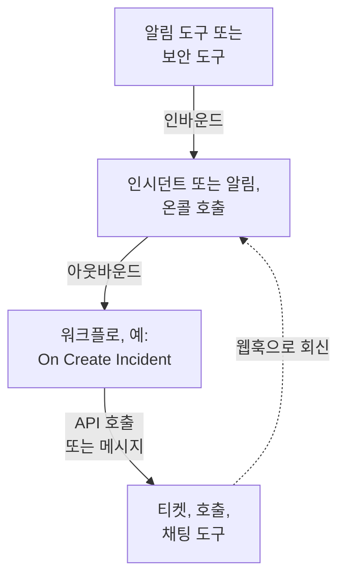

# 통합 개요

OneUptime은 팀이 이미 사용하는 도구와 함께 작동합니다. 알림 도구는 OneUptime에 인시던트를 만들고, OneUptime은 다른 도구에 티켓, 온콜 호출, 채팅 메시지를 만듭니다. 어떤 도구는 양식으로 연결하고, 어떤 도구는 미리 만들어진 워크플로 템플릿으로 연결합니다. 웹훅이나 API가 있는 그 밖의 도구는 직접 만드는 워크플로로 연결합니다.

:::cards
- [연결 방법 선택](#연결-방법-선택): 네 가지 연결 방법과 각각을 사용할 때.
- [카탈로그](#카탈로그): 가이드가 있는 모든 도구를 하는 일에 따라 분류했습니다.
- [직접 통합 만들기](#직접-통합-만들기): 다른 모든 도구에 쓸 수 있는 인바운드 및 아웃바운드 패턴.
- [자격 증명 안전하게 보관하기](#자격-증명-안전하게-보관하기): 시크릿 변수와 각 도구가 요구하는 헤더.
:::

## 통합의 작동 방식

모든 통합은 데이터를 한 방향 또는 양방향으로 옮깁니다. **인바운드**에서는 다른 도구가 OneUptime에 문제가 있다고 알리고, OneUptime이 인시던트나 알림을 만들어 온콜 팀을 호출합니다. **아웃바운드**에서는 OneUptime에서 무언가가 일어나면 워크플로가 다른 도구에 알려 티켓을 만들거나, 누군가를 호출하거나, 메시지를 게시합니다.



Jira나 Dynamics 365 같은 양방향 통합은 두 방향을 모두 사용합니다. 한 워크플로가 인시던트를 밖으로 보내고, 다른 워크플로가 상대 도구의 웹훅으로 시작되어 변경 사항을 다시 가져옵니다.

## 연결 방법 선택

| 방법 | 적합한 경우 | 예 |
| --- | --- | --- |
| 기본 제공 연결 | OneUptime이 직접 연결하는 도구. 양식만 채우면 되고 만들 것은 없습니다. | [Slack](/docs/workspace-connections/slack), [Microsoft Teams](/docs/workspace-connections/microsoft-teams), [보안 이벤트](/docs/telemetry/security-events) 연결 |
| 워크플로 템플릿 | 양방향으로 동기화되는 티켓 도구, 모니터링 문제, 보안 인시던트 보고서, 채팅 메시지. 템플릿을 고르고 설정 몇 가지를 채웁니다. | [Jira](/docs/integrations/jira), [Microsoft Dynamics 365](/docs/integrations/microsoft-dynamics-365), [Huntress](/docs/integrations/huntress), [Zabbix](/docs/integrations/zabbix) |
| Incoming Request 모니터 | 웹훅을 보내는 알림 도구. 워크플로 없이 알림마다 인시던트가 하나씩 만들어지고, 온콜에 전달되며, 알림이 복구되면 해결됩니다. | [Zabbix](/docs/integrations/zabbix), [Prometheus Alertmanager](/docs/integrations/prometheus-alertmanager), [Grafana](/docs/integrations/grafana) |
| 직접 만드는 워크플로 | 웹훅이나 REST API가 있는 모든 도구와 모든 자체 로직. | [PagerDuty](/docs/integrations/pagerduty), [Opsgenie](/docs/integrations/opsgenie), [ServiceNow](/docs/integrations/servicenow) |

표의 위쪽부터 검토하세요. 위에 있는 방법일수록 유지 관리할 것이 적습니다.

## 카탈로그

### 모니터링 및 알림 도구

| 도구 | 방향 | 하는 일 |
| --- | --- | --- |
| [Zabbix](/docs/integrations/zabbix) | 양방향 | Zabbix 문제를 인시던트나 알림으로 만들고, 복구되면 해결하며, OneUptime에서 문제를 확인하거나 닫습니다. |
| [Prometheus Alertmanager](/docs/integrations/prometheus-alertmanager) | 인바운드 | Alertmanager 알림을 인시던트로 만듭니다. |
| [Grafana](/docs/integrations/grafana) | 인바운드 | Grafana 알림을 인시던트로 만듭니다. |
| [Datadog](/docs/integrations/datadog) | 인바운드 | Datadog 모니터 알림을 인시던트로 만듭니다. |

### 보안 도구

| 도구 | 방향 | 하는 일 |
| --- | --- | --- |
| [Huntress](/docs/integrations/huntress) | 인바운드 | Huntress 인시던트 보고서로 온콜을 호출하고, 보고서가 닫히면 인시던트를 해결합니다. |
| [Google SecOps](/docs/integrations/google-secops) | 양방향 | Google SecOps 탐지와 지표를 보안 이벤트로 가져오고, OneUptime이 찾은 것을 Google SecOps로 보냅니다. |
| [Microsoft Sentinel](/docs/integrations/microsoft-sentinel) | 양방향 | Microsoft Sentinel 인시던트를 보안 이벤트로 가져오고, OneUptime이 찾은 것을 Microsoft Sentinel로 보냅니다. |
| [Microsoft Defender XDR](/docs/integrations/microsoft-defender-xdr) | 인바운드 | Microsoft Defender XDR 알림을 보안 이벤트로 가져옵니다. |
| [CrowdStrike Falcon](/docs/integrations/crowdstrike-falcon) | 인바운드 | CrowdStrike Falcon 알림을 보안 이벤트로 가져옵니다. |
| [Splunk Enterprise Security](/docs/integrations/splunk) | 양방향 | Splunk notable event를 보안 이벤트로 가져오고, OneUptime이 찾은 것을 Splunk로 보냅니다. |
| [Elastic Security](/docs/integrations/elastic-security) | 양방향 | Elastic Security 탐지 알림을 보안 이벤트로 가져오고, OneUptime이 찾은 것을 Elastic Security로 보냅니다. |
| [AWS Security Hub](/docs/integrations/aws-security-hub) | 인바운드 | AWS Security Hub 검색 결과를 보안 이벤트로 가져옵니다. |
| [Okta System Log](/docs/integrations/okta) | 인바운드 | Okta 로그인, 계정 변경, 위협 탐지를 보안 이벤트로 가져옵니다. |

### 티켓 및 IT 서비스 관리

| 도구 | 방향 | 하는 일 |
| --- | --- | --- |
| [Jira](/docs/integrations/jira) | 양방향 | 인시던트나 알림마다 Jira 이슈를 만들고, 상태 변경과 댓글을 다시 가져옵니다. |
| [Microsoft Dynamics 365](/docs/integrations/microsoft-dynamics-365) | 양방향 | 인시던트나 알림마다 Dynamics 365 사례를 만들고, 상태 변경과 노트를 다시 가져옵니다. |
| [ServiceNow](/docs/integrations/servicenow) | 아웃바운드 | OneUptime 인시던트마다 ServiceNow 인시던트를 만들고, 인시던트와 함께 해결합니다. |
| [GitHub](/docs/integrations/github) | 아웃바운드 | 인시던트에 대한 GitHub 이슈를 만듭니다. |
| [GitLab](/docs/integrations/gitlab) | 아웃바운드 | 인시던트에 대한 GitLab 이슈를 만듭니다. |

### 호출 도구

| 도구 | 방향 | 하는 일 |
| --- | --- | --- |
| [PagerDuty](/docs/integrations/pagerduty) | 아웃바운드 | OneUptime 인시던트마다 PagerDuty 인시던트를 트리거하고, 인시던트와 함께 해결합니다. |
| [Opsgenie](/docs/integrations/opsgenie) | 아웃바운드 | OneUptime 인시던트마다 Opsgenie 알림을 만들고, 인시던트와 함께 닫습니다. |

### 채팅 도구

| 도구 | 방향 | 하는 일 |
| --- | --- | --- |
| [Slack](/docs/workspace-connections/slack) | 양방향 | 기본 제공 연결: 인시던트 채널, Slack에서의 작업, 온콜. |
| [Microsoft Teams](/docs/workspace-connections/microsoft-teams) | 양방향 | 기본 제공 연결: 인시던트 채널, Teams에서의 작업, 온콜. |
| [Mattermost](/docs/workflows/components#mattermost) | 아웃바운드 | 인시던트 업데이트를 Mattermost 채널에 게시합니다. |
| [Discord](/docs/integrations/discord) | 아웃바운드 | 인시던트 업데이트를 Discord 채널에 게시합니다. |
| [Telegram](/docs/integrations/telegram) | 아웃바운드 | 알림이 발생하면 Telegram 채팅으로 메시지를 보냅니다. |
| [IRC](/docs/integrations/irc) | 아웃바운드 | 인시던트 업데이트를 IRC 채널에 게시합니다. |

> [!TIP]
> Slack과 Microsoft Teams에도 워크플로 단계가 있습니다. 인시던트 채널과 온콜에는 기본 제공 연결을 사용하고, 채널에 메시지만 필요할 때는 워크플로 단계를 사용하세요.

### 호스팅 플랫폼

| 도구 | 방향 | 하는 일 |
| --- | --- | --- |
| [Vercel](/docs/integrations/vercel) | 인바운드 | Vercel Marketplace에서 OneUptime을 추가합니다. Vercel 프로젝트의 트레이스, 로그, 가동 시간 모니터와 상태 페이지를 제공합니다. |

## 다른 도구에서 이전하기

다른 온콜, 가동 시간, 상태 페이지 도구를 떠나려면 두 도구를 연결하는 대신 팀을 옮기세요. **프로젝트 설정 → 고급 → 다른 도구에서 가져오기**는 API 키로 계정을 읽고, 찾은 내용을 보여 주고, 선택한 항목을 만듭니다. 도구마다 가이드가 있습니다:

- 온콜 및 인시던트 도구: [Opsgenie](/docs/moving-to-oneuptime/opsgenie), [PagerDuty](/docs/moving-to-oneuptime/pagerduty), [incident.io](/docs/moving-to-oneuptime/incident-io), [Splunk On-Call](/docs/moving-to-oneuptime/splunk-on-call), [Grafana OnCall](/docs/moving-to-oneuptime/grafana-oncall).
- 가동 시간 및 상태 페이지 도구: [UptimeRobot](/docs/moving-to-oneuptime/uptimerobot), [Atlassian Statuspage](/docs/moving-to-oneuptime/atlassian-statuspage), [Better Stack](/docs/moving-to-oneuptime/better-stack), [Pingdom](/docs/moving-to-oneuptime/pingdom), [StatusCake](/docs/moving-to-oneuptime/statuscake), [Uptime Kuma](/docs/moving-to-oneuptime/uptime-kuma).

## 직접 통합 만들기

가이드가 없는 도구도 두 가지 패턴 중 하나에 들어맞습니다. 웹훅을 보낼 수 있다면 인바운드 패턴을, REST API가 있다면 아웃바운드 패턴을 사용하세요. 둘 다 워크플로입니다. 시작하려면 [워크플로우 개요](/docs/workflows/index)를 참고하세요.

### 인바운드: 다른 도구가 OneUptime으로 데이터를 보냄

알림 도구라면 먼저 [Incoming Request 모니터](/docs/monitor/incoming-request-monitor#다른-시스템의-알림-수신)로 시작하세요. 알림마다 인시던트를 하나씩 만들고 복구되면 해결하므로 만들 것이 없습니다. 자체 로직이 필요할 때 워크플로를 만드세요:

:::steps
1. **워크플로**를 열고 **워크플로 생성**을 클릭한 다음 **처음부터 시작**을 클릭합니다. 워크플로 이름을 정하고 **워크플로 생성**을 클릭합니다.
2. 점선으로 된 **이 워크플로를 시작할 항목 선택** 블록을 클릭하고 **Webhook**을 고릅니다. 트리거를 클릭한 다음 **URL 복사**를 클릭합니다.
3. 상대 도구에서 그 웹훅을 `Content-Type: application/json`이 있는 `POST`로 이 URL에 보냅니다.
4. 이를 처리할 블록을 추가합니다. 블록은 `{{local.components.webhook-1.returnValues.request-body.status}}` 같은 참조로 요청을 읽습니다. 필드를 확인하는 **If / Else** 블록을 둔 다음, 인시던트를 선언하는 **Create One Incident**를 둡니다.
5. **빌더** 상단에서 **활성화됨**을 켜고, 상대 도구에서 테스트를 보낸 다음 **로그 → 실행 기록**을 열어 도착한 내용을 확인합니다.
:::

URL이 유일한 자격 증명이므로 비밀번호처럼 다루세요. [Webhook](/docs/workflows/triggers#webhook)을 참고하세요.

### 아웃바운드: OneUptime이 다른 도구로 데이터를 보냄

:::steps
1. [아래](#자격-증명-안전하게-보관하기)에 나온 대로 도구의 API 키를 시크릿 전역 변수로 저장합니다.
2. 워크플로를 만들고, 점선 블록을 클릭한 다음 **On Create Incident** 같은 이벤트 트리거를 고릅니다. 트리거를 클릭합니다. **Fields to pass on**에는 **제목**이 이미 들어 있으므로, **필드 추가**를 클릭하고 **설명**처럼 보낼 다른 필드를 고릅니다.
3. **구성 요소 추가**를 클릭하고 **API Post (JSON)** 블록을 추가합니다. 트리거의 **Success** 점을 이 블록에 연결합니다.
4. **URL**, `Authorization` 헤더가 있는 **Request Headers**, `{{local.components.incident-on-create-1.returnValues.model.title}}` 같은 인시던트 필드가 있는 **Request Body**를 채웁니다.
5. **워크플로 실행**을 클릭하고, **인시던트**에서 인시던트를 고른 다음 실행합니다. 테스트 실행도 요청을 실제로 보냅니다. 그런 다음 **활성화됨**을 켭니다.
:::

도구가 다른 형태의 데이터를 필요로 하면 두 블록 사이에 [Run Custom JavaScript](/docs/workflows/components#custom-code) 블록을 추가하세요. Zendesk, New Relic, AWS(SNS를 통해), StatusCake를 비롯한 다른 모든 도구도 방법은 같고, 바뀌는 것은 URL과 본문뿐입니다.

## 자격 증명 안전하게 보관하기

API 키나 토큰을 블록에 직접 붙여 넣지 마세요. 시크릿 전역 변수로 한 번만 저장합니다:

:::steps
1. **워크플로 → 전역 변수**로 이동해 **워크플로 변수 만들기**를 클릭합니다.
2. `JIRA_AUTH` 같은 이름을 지정하고 **다음**을 클릭합니다.
3. 키를 **콘텐츠**에 붙여 넣고 **시크릿**을 켠 다음 **워크플로 변수 만들기**를 클릭합니다.
:::

어떤 블록이든 이를 `{{global.variables.JIRA_AUTH}}`로 읽습니다. 변수의 내용은 저장한 뒤 다시 읽을 수 없으며, 시크릿 변수의 내용은 실행 로그에서 `[REDACTED]`로 바뀝니다. Microsoft Entra ID 토큰처럼 만료되는 토큰에는 [OAuth 2.0 변수](/docs/workflows/variables#oauth-20-변수스스로-갱신되는-토큰)가 새 토큰을 알아서 가져옵니다. [워크플로우 변수](/docs/workflows/variables#전역-변수)를 참고하세요.

### 인증 요약표

대부분의 아웃바운드 통합은 키를 요청 헤더에 넣습니다. 흔히 쓰는 형식:

| 방식 | 보낼 내용 | 사용하는 도구 |
| --- | --- | --- |
| Bearer 토큰 | `Authorization: Bearer {{global.variables.TOKEN}}` | GitHub와 대부분의 최신 API |
| Basic 인증 | `Authorization: Basic {{global.variables.BASE64_USER_PASS}}` | Jira Cloud, ServiceNow |
| API 키 헤더 | `Authorization: GenieKey {{global.variables.OPSGENIE_KEY}}` | Opsgenie |
| 비공개 토큰 헤더 | `PRIVATE-TOKEN: {{global.variables.GITLAB_TOKEN}}` | GitLab |
| 본문 안의 키 | JSON 본문의 `routing_key` | PagerDuty Events API |
| OAuth 2.0 클라이언트 자격 증명 | OAuth 2.0 변수에서 가져온 `Authorization: Bearer {{local.variables.dynamicsAccessToken}}` | Microsoft Dynamics 365 |

Basic 인증에서는 `username:password` 또는 `email:api_token`을 한 번 인코딩하고 그 결과를 시크릿으로 저장합니다. macOS나 Linux에서:

```bash
printf '%s' 'you@example.com:your_api_token' | base64 | tr -d '\n'
```

`echo`가 아니라 `printf`를 사용하세요. `echo`는 줄바꿈을 추가하고, 이 줄바꿈이 나머지와 함께 인코딩되어 자격 증명이 깨집니다. `tr`은 긴 결과를 한 줄로 유지합니다.

## 자체 호스팅 설치

자체 호스팅된 OneUptime은 여러분의 네트워크에서 다른 도구를 호출하고, 다른 도구는 자기 네트워크에서 OneUptime을 호출합니다:

- **아웃바운드:** 사설 네트워크 주소로 향하는 워크플로 요청은 관리자가 허용하지 않는 한 거부됩니다. [아웃바운드 네트워크 접근](/docs/workflows/configuration#아웃바운드-네트워크-접근)을 참고하세요.
- **인바운드:** 도구의 웹훅이 HTTPS로 OneUptime에 도달해야 하므로, 클라우드에 있는 도구에는 호출할 공개 주소가 필요합니다.
- **기본 제공 통합**에는 각각 설정 가이드가 있습니다: [Slack](/docs/self-hosted/slack-integration), [Microsoft Teams](/docs/self-hosted/microsoft-teams-integration), [GitHub](/docs/self-hosted/github-integration), [Twilio](/docs/self-hosted/twilio-integration), [SendGrid Inbound Email](/docs/self-hosted/sendgrid-inbound-email), [Push Notifications](/docs/self-hosted/push-notifications).

## 다음 단계

:::cards
- [워크플로우 개요](/docs/workflows/index): 워크플로가 실행되는 방식과 첫 워크플로를 만드는 방법.
- [수신 요청 모니터](/docs/monitor/incoming-request-monitor): 워크플로 없이 모든 도구에서 알림을 받습니다.
- [Jira](/docs/integrations/jira): 템플릿으로 만드는 완전한 양방향 통합.
- [워크플로우 변수](/docs/workflows/variables): 블록 간에 데이터를 전달하고, 시크릿은 블록 밖에 둡니다.
:::
