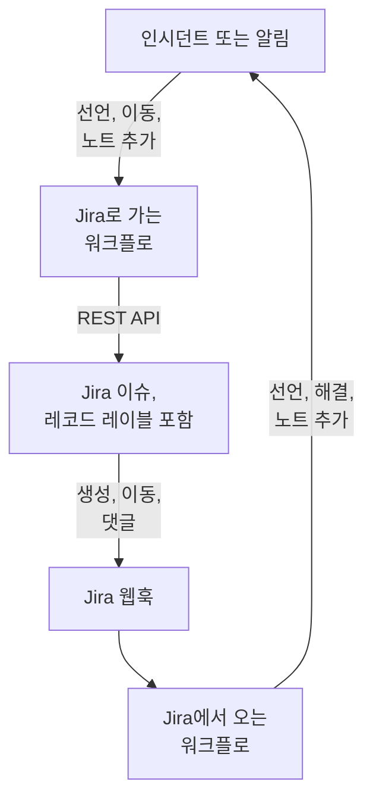

# Jira

[Jira](https://www.atlassian.com/software/jira) 이슈를 OneUptime 인시던트 및 알림과 양방향으로 맞춰 둡니다. 미리 만들어진 워크플로 템플릿이 인시던트나 알림마다 이슈를 열고, 레코드가 진행됨에 따라 이슈를 옮기며, 노트를 댓글로 복사합니다. 다른 템플릿은 새 이슈로 인시던트를 선언하고 상태 변경, 댓글, 편집을 다시 가져옵니다. 플러그인은 없습니다. 워크플로가 Jira의 REST API를 호출하고, Jira가 워크플로의 웹훅 URL을 호출합니다.

:::cards
- [템플릿에서 시작하기](#템플릿에서-시작하기): 17개 템플릿, 각 템플릿이 묻는 내용, 설정 방법.
- [템플릿의 작동 방식](#템플릿의-작동-방식): 이슈와 레코드가 루프 없이 연결된 상태를 유지하는 방식.
- [직접 만들기](#직접-만들기): 템플릿이 맞지 않을 때 각 방향을 직접 만듭니다.
- [문제 해결](#문제-해결): Jira 응답의 의미.
:::

> [!NOTE]
> Atlassian은 Jira Cloud의 이름을 바꾸고 있습니다. UI의 많은 곳에서 **프로젝트**는 이제 **스페이스**이고, **이슈**는 **작업 항목**입니다. 사이트마다 두 용어가 모두 쓰이므로, 용어가 중요한 곳에서는 여기서도 둘 다 표기합니다.

## 작동 방식



각 템플릿은 작은 워크플로이므로, 인시던트, 알림 또는 둘 다에 대해 원하는 방향만 골라 쓰면 됩니다. OneUptime → Jira 템플릿은 OneUptime의 이벤트에서 시작해 Jira의 REST API를 호출합니다. Jira → OneUptime 템플릿은 Jira 웹훅에서 시작합니다. 모든 템플릿은 이슈에 붙은 두 레이블로 서로의 레코드를 찾습니다.

이 페이지의 모든 내용은 **Jira Cloud** 기준입니다. 자체 관리형 Jira에서 달라지는 점은 [Jira Data Center](#jira-data-center)에 정리되어 있습니다.

## 사전 요건

- `https://your-domain.atlassian.net` 같은 Jira Cloud 사이트와, 이슈를 만들 프로젝트.
- 통합용 Jira 사용자와 그 사용자의 API 토큰. 이 사용자에게 프로젝트의 **Browse Projects**, **Create Issues**, **Edit Issues**, **Add Comments**, **Transition Issues** 권한을 줍니다.
- Jira → OneUptime 템플릿에 필요한 웹훅을 등록할 Jira 관리자.
- OneUptime에서 워크플로를 만들 권한. OneUptime Cloud에서는 워크플로에 **Growth** 요금제 이상이 필요합니다.

## 템플릿에서 시작하기

**워크플로 만들기** 대화 상자의 카테고리 목록에서 **Jira** 아래에 Jira 템플릿 17개가 있습니다. 인시던트용 9개, 이어서 알림용 8개이며, 각 묶음은 자체 제목 아래에 있습니다. 모두 Jira 이슈의 레이블이라는 하나의 규칙을 공유하므로 어떤 조합이든 함께 작동합니다.

### 인시던트용 템플릿

| 템플릿 | 하는 일 | 묻는 내용 |
| --- | --- | --- |
| **OneUptime → Jira** | | |
| Create a Jira issue when an incident is declared | 새 인시던트마다 이슈를 열고 인시던트의 ID를 레이블로 붙입니다. Jira에서 선언된 인시던트와 비공개 인시던트는 건너뜁니다. | API URL, API token, project key, issue type, OneUptime URL |
| Move the Jira issue when the incident is acknowledged or resolved | 연결된 이슈를 앞으로 옮깁니다. 인시던트가 확인되면 In Progress 상태로, 해결되면 Done 상태로 옮깁니다. 뒤로 되돌리지 않습니다. | API URL, API token |
| Copy incident private notes to the Jira issue | 새 비공개 노트를 하나씩 연결된 이슈에 댓글로 게시하며, Jira Service Management에서는 내부 댓글이 됩니다. | API URL, API token |
| Copy incident public notes to the Jira issue | 새 공개 노트를 하나씩 연결된 이슈에 댓글로 게시합니다. | API URL, API token |
| Comment on the Jira issue when the incident is edited | 인시던트의 제목, 심각도, 설명, 근본 원인, 해결 노트가 바뀌면 인시던트의 현재 내용을 Jira Service Management의 내부 댓글로 게시합니다. | API URL, API token |
| **Jira → OneUptime** | | |
| Declare an incident when a Jira issue is created | 새 이슈마다 상태 페이지에 표시하지 않는 인시던트를 이슈의 우선순위에 따른 심각도로 선언한 다음, 이슈에 레이블을 붙여 둘을 연결합니다. | Site URL, API URL, API token, 그리고 **Issue created**용 Jira 웹훅 |
| Acknowledge or resolve the incident when its Jira issue moves | 연결된 이슈가 In Progress 상태로 바뀌면 인시던트를 확인하고, Done 상태로 바뀌면 해결합니다. | **Issue updated**용 Jira 웹훅 |
| Add Jira comments to the incident as private notes | 연결된 이슈의 댓글을 하나씩 인시던트에 비공개 노트로 복사합니다. | Site URL, API URL, API token, 그리고 **Comment created**용 Jira 웹훅 |
| Add Jira issue changes to the incident as private notes | 우선순위, 담당자, 요약 같은 연결된 이슈의 편집을 하나씩 인시던트에 비공개 노트로 기록합니다. 상태 변경은 위 템플릿에 맡깁니다. | Site URL과 **Issue updated**용 Jira 웹훅 |

### 알림용 템플릿

알림용 템플릿은 같은 일을 알림에 대해 합니다. 알림에는 공개 노트가 없으므로 하나가 적습니다. 나머지 차이는 [알림의 차이점](#알림의-차이점)에 정리되어 있습니다.

| 템플릿 | 하는 일 | 묻는 내용 |
| --- | --- | --- |
| **OneUptime → Jira** | | |
| Create a Jira issue when an alert is created | 모니터가 발생시키는 알림을 포함해 새 알림마다 이슈를 열고 알림의 ID를 레이블로 붙입니다. Jira에서 만든 알림과 비공개 알림은 건너뜁니다. | API URL, API token, project key, issue type, OneUptime URL |
| Move the Jira issue when the alert is acknowledged or resolved | 연결된 이슈를 앞으로 옮깁니다. 알림이 확인되면 In Progress 상태로, 해결되면 Done 상태로 옮깁니다. 뒤로 되돌리지 않습니다. | API URL, API token |
| Copy alert private notes to the Jira issue | 새 비공개 노트를 하나씩 연결된 이슈에 댓글로 게시하며, Jira Service Management에서는 내부 댓글이 됩니다. | API URL, API token |
| Comment on the Jira issue when the alert is edited | 알림의 제목, 심각도, 설명, 근본 원인, 해결 노트가 바뀌면 알림의 현재 내용을 Jira Service Management의 내부 댓글로 게시합니다. | API URL, API token |
| **Jira → OneUptime** | | |
| Create an alert when a Jira issue is created | 새 이슈마다 이슈의 우선순위에 따른 심각도로 알림을 만든 다음, 이슈에 레이블을 붙여 둘을 연결합니다. | Site URL, API URL, API token, 그리고 **Issue created**용 Jira 웹훅 |
| Acknowledge or resolve the alert when its Jira issue moves | 연결된 이슈가 In Progress 상태로 바뀌면 알림을 확인하고, Done 상태로 바뀌면 해결합니다. | **Issue updated**용 Jira 웹훅 |
| Add Jira comments to the alert as private notes | 연결된 이슈의 댓글을 하나씩 알림에 비공개 노트로 복사합니다. | Site URL, API URL, API token, 그리고 **Comment created**용 Jira 웹훅 |
| Add Jira issue changes to the alert as private notes | 우선순위, 담당자, 요약 같은 연결된 이슈의 편집을 하나씩 알림에 비공개 노트로 기록합니다. 상태 변경은 위 템플릿에 맡깁니다. | Site URL과 **Issue updated**용 Jira 웹훅 |

OneUptime → Jira 템플릿은 [**비공개 인시던트**](/docs/incidents/declaring-incidents#1단계-인시던트-세부-정보)로 표시된 인시던트나 **비공개 경고**로 표시된 알림을 Jira로 보내지 않습니다. 켜지 않는 한 레코드, 그 상태, 노트, 편집 모두 보내지 않습니다. [제한 사항](#제한-사항)을 참고하세요.

### 알림의 차이점

알림용 템플릿은 각각 인시던트용 짝 템플릿과 같은 단계로 만들어져 있습니다. 알림이 인시던트와 다른 부분에서는 템플릿도 다릅니다:

- **공개 노트가 없습니다.** 알림에는 비공개 노트만 있으므로, 알림용 템플릿이 게시하는 댓글은 모두 Jira Service Management의 내부 댓글입니다.
- **상태 페이지가 없습니다.** 알림은 상태 페이지에 올라가지 않으므로, **Create an alert when a Jira issue is created**는 심각도, 제목, 설명, `customFields.jiraIssueKey`만 쓰고 그 밖의 것은 쓰지 않습니다.
- **심각도가 두 가지이므로 Medium은 Low가 됩니다.** 새 프로젝트에는 인시던트 심각도가 세 가지인 반면 알림 심각도는 High와 Low 두 가지입니다. 생성 템플릿은 Jira의 우선순위를 프로젝트에 있는 심각도에 나눠 배정합니다. 기본 두 가지에서는 Highest, High, Critical, Blocker가 High가 되고, Medium과 Major를 포함한 그 밖의 우선순위는 모두 Low가 됩니다. Medium을 High로 보내려면 `prepare-alert-1` 스크립트의 `PRIORITY_RANK`에서 `medium: 1`을 `medium: 0`으로 바꾸세요.
- **알림의 링크와 레이블.** 이슈는 `/dashboard/<project id>/alerts/<alert id>`로 연결되고 `oneuptime-alert-<alert id>` 레이블이 붙습니다.
- **번호가 무엇의 번호인지 알려 줍니다.** 기본 접두사 `#`에서는 알림과 인시던트가 모두 `#12`일 수 있으므로, 템플릿은 `Alert #12` 또는 `Incident #12`로 씁니다. `ALT-12`처럼 자체 접두사가 있는 번호는 그대로 씁니다.
- **비공개 알림.** 직접 또는 알림 개인 정보 규칙에 의해 **비공개 경고**로 표시된 알림은 `SYNC_PRIVATE_ALERTS`를 `true`로 설정하지 않는 한 Jira로 가지 않습니다.

**모니터는 스스로 알림을 발생시키며, 그 수가 많을 수 있습니다.** **Create a Jira issue when an alert is created**는 그 모든 알림에 이슈를 만듭니다. 모든 알림에 티켓이 필요한 것이 아니라면 Jira 단계 앞에 조건을 두세요. High 알림에만 이슈를 만들려면:

1. 워크플로의 **빌더**를 열고 **If / Else** 블록을 추가합니다.
2. **Value to check**를 `{{local.components.alert-on-create-1.returnValues.model.alertSeverity.name}}`로, **Comparison**을 **is equal to**로, **Compare with**를 `High`로 설정합니다.
3. `alert-on-create-1`에서 `prepare-issue-1`로 가는 선의 끝을 점에서 끌어내어 선을 지웁니다([정리하기](/docs/workflows/authoring#정리하기) 참고). 트리거의 **Success**를 **If / Else** 블록에, 그 **Yes**를 `prepare-issue-1`에 연결합니다.

**No** 쪽으로 간 알림은 그 자리에서 실행을 마치며, 이슈가 만들어지지 않습니다.

### 템플릿이 묻는 내용

생성 마법사의 **구성** 단계에서는 최대 다섯 가지 값을 묻습니다. 어떤 템플릿에 무엇이 필요한지는 위 표에 나와 있습니다.

- **Jira Site URL** — Jira를 여는 주소. 예: `https://your-domain.atlassian.net`. Jira Data Center에서는 기본 URL이며, 예는 `https://jira.example.com:8443` 또는 `https://example.com/jira`입니다. Jira를 OneUptime으로 가져오는 템플릿은 자신이 쓰는 설명이나 노트에 이슈 링크를 넣고, 이 링크는 이벤트 내용과 상관없이 항상 이 사이트로 갑니다. 그래서 이 필드는 사이트 주소만 받습니다. 스킴, 호스트, 있다면 포트, 그리고 Data Center에서는 Jira가 실행되는 경로입니다. 사이트 안 페이지의 주소, 쿼리, 사용자 이름은 거부하고 대신 무엇을 입력할지 알려 줍니다. 끝의 슬래시는 괜찮습니다. 나중에 변수를 비우면 이슈는 링크 없이 표시됩니다.
- **Jira API URL** — 워크플로가 Jira 요청을 보내는 곳. `https://your-domain.atlassian.net` 같은 자신의 사이트를 끝 슬래시 없이 입력합니다. 범위가 지정된 API 토큰(모든 서비스 계정 토큰 포함)을 쓴다면 대신 `https://api.atlassian.com/ex/jira/<cloudId>`를 사용하세요. `cloudId`는 `https://your-domain.atlassian.net/_edge/tenant_info`의 JSON에 있습니다. 클래식 토큰에서는 **Jira Site URL**과 같은 주소이므로, 둘 다 묻는 템플릿에서는 직접 입력하기 전까지 마법사가 **Jira Site URL**로 채웁니다.
- **Jira API Token (base64 of email:token)** — 토큰 자체가 아니라 계정의 이메일과 토큰을 함께 인코딩한 값입니다. Jira Cloud가 Basic 인증을 받는 방식입니다. 방법은 [API 토큰 만들기](#api-토큰-만들기)에 있습니다. 토큰은 기본적으로 만든 지 1년 후에 만료되므로 날짜를 적어 두세요.
- **Jira Project Key** — 새 이슈를 만드는 프로젝트(스페이스). `OPS-123`의 `OPS`입니다.
- **Jira Issue Type** — 만들 이슈의 유형. 그 프로젝트에 있는 철자 그대로 씁니다. 예: `Task`, `Bug`, `Incident`.
- **OneUptime URL** — OneUptime을 여는 주소. `https://oneuptime.com` 또는 자체 호스트입니다. 이슈 설명은 이 주소로 인시던트나 알림에 다시 연결합니다.

### API 토큰 만들기

:::steps
1. 사람이 아니라 통합에만 쓰는 일반 Atlassian 계정인 전용 Jira 사용자를 위해 토큰을 만듭니다. 이슈와 댓글은 토큰 소유자의 것으로 기록됩니다. 그 사용자로 로그인하고 [id.atlassian.com/manage-profile/security/api-tokens](https://id.atlassian.com/manage-profile/security/api-tokens)에서 토큰을 만듭니다. 클래식 토큰(**Create API token**)은 사이트 URL에서 작동합니다. 범위가 지정된 토큰(**Create API token with scopes**)은 위의 `api.atlassian.com` 주소에서만 작동합니다. 클래식 범위 `read:jira-work`와 `write:jira-work`로 템플릿이 하는 모든 호출을 다룰 수 있습니다.
2. 그 계정의 이메일과 토큰을 인코딩합니다:

   ```bash
   printf '%s' 'jira-bot@example.com:your_api_token' | base64 | tr -d '\n'
   ```

   `echo`가 아니라 `printf`를 사용하세요. `echo`는 줄바꿈을 추가하고, 이 줄바꿈이 나머지와 함께 인코딩되어 Jira가 자격 증명을 더 이상 받지 않습니다. 사이트 URL에서는 이 문제가 `401`로 나타나는 경우가 드뭅니다([제한 사항](#제한-사항) 참고). `tr`은 출력을 한 줄로 유지합니다. Linux의 GNU `base64`는 76자마다 줄을 바꾸고, 요즘 토큰은 줄이 바뀔 만큼 깁니다.

3. 출력을 **Jira API Token (base64 of email:token)** 필드에 붙여 넣습니다.
:::

Atlassian **서비스 계정**도 쓸 수 있습니다. 조직 관리자가 [admin.atlassian.com](https://admin.atlassian.com)의 **Directory → Service accounts**에서 서비스 계정과 그 토큰을 만듭니다. 이 토큰은 항상 범위가 지정되므로 **Jira API URL**은 `https://api.atlassian.com/ex/jira/<cloudId>` 주소여야 하고(**Jira Site URL**은 자신의 사이트 그대로), 인코딩하는 이메일은 서비스 계정 자체의 이메일입니다. 다른 사용자와 마찬가지로 위에 나온 프로젝트 권한을 서비스 계정에 주세요.

### 워크플로 만들기

:::steps
1. **워크플로 → 워크플로 생성**을 엽니다. **또는 템플릿에서 시작** 아래의 카테고리 목록에서 **Jira**를 고르거나 **템플릿 검색…** 상자에 `Jira`를 입력하고, 원하는 템플릿을 클릭합니다. 템플릿이 열리고 하는 일과 물어볼 설정이 표시됩니다. **이 템플릿 사용**을 클릭합니다.
2. **이름**은 템플릿에서 채워집니다. 원하면 바꾸세요.
3. **구성**에서 위의 값을 묻습니다. 값은 워크플로 자체의 변수로 메뉴의 **워크플로 변수** 아래에 저장됩니다. API 토큰은 시크릿으로 저장됩니다. **로그 → 실행 기록**에서는 가려지고, Jira 호출의 `Authorization` 헤더에만 들어갑니다.
4. **워크플로 생성**을 클릭합니다. 모든 워크플로는 꺼진 상태로 만들어집니다. **빌더** 상단에서 **활성화됨**을 켜세요.
:::

**Create a Jira issue when an incident is declared**(알림이라면 **Create a Jira issue when an alert is created**)로 시작하세요. 같은 종류의 다른 OneUptime → Jira 템플릿은 모두 이 템플릿이 붙이는 레이블로 이슈를 찾습니다. 템플릿을 켜고, 테스트 인시던트를 선언하거나 테스트 알림을 만든 다음, 워크플로의 **로그 → 실행 기록**을 엽니다. 실행은 **실행됨**으로 끝나야 하며, 마지막 단계 `create-issue-1`의 **Response Body**에 새 이슈가 나옵니다.

각 워크플로는 이 값의 사본을 따로 가집니다. 토큰을 교체할 때는 토큰을 물었던 모든 Jira 워크플로의 **워크플로 변수**에서 `jiraBasicAuthToken`을 업데이트하세요. Jira 주소가 바뀌면 `jiraSiteUrl`과 `jiraBaseUrl`도 같은 방식으로 업데이트하세요.

### 웹훅 템플릿 연결하기

Jira → OneUptime 템플릿(인시던트용 4개, 알림용 4개)은 [Webhook 트리거](/docs/workflows/triggers#webhook)에서 시작하므로, Jira에 이벤트를 보낼 곳을 알려 줘야 합니다. 다음 순서로 진행하세요:

1. 워크플로를 만들고 **먼저 켜세요**. 꺼진 워크플로는 Jira에 `400`으로 응답하며, Jira는 `4xx`로 거부된 전송을 다시 시도하지 않습니다. 켜기 전에 보낸 이벤트는 대기열에 들어가지 않고 사라집니다.
2. 워크플로의 **빌더**를 열고 **Webhook** 트리거 블록(`webhook-1`)을 클릭한 다음, 설정 상단의 **URL 복사**를 클릭합니다. URL은 다음과 같습니다:

   ```text
   https://<your OneUptime host>/workflow/trigger/<webhook secret key>
   ```

3. Jira에서 **Settings → System → WebHooks**(**Advanced** 아래)로 이동해 **Create a WebHook**을 클릭합니다. URL을 붙여 넣고, **Issue related events** 아래에서 아래 표의 이벤트를 선택한 다음, 프로젝트의 이슈만 이를 발생시키도록 JQL 필터를 입력합니다. **Exclude body**는 선택하지 마세요. 워크플로는 모든 것을 본문에서 읽습니다.

| 템플릿 | Jira 이벤트 | JQL 필터 |
| --- | --- | --- |
| **인시던트** | | |
| Declare an incident when a Jira issue is created | **Issue created** | `project = OPS AND (labels is EMPTY OR labels != oneuptime)` |
| Acknowledge or resolve the incident when its Jira issue moves | **Issue updated** | `project = OPS` |
| Add Jira comments to the incident as private notes | **Comment created** | `project = OPS` |
| Add Jira issue changes to the incident as private notes | **Issue updated** | `project = OPS` |
| **알림** | | |
| Create an alert when a Jira issue is created | **Issue created** | `project = OPS AND (labels is EMPTY OR labels != oneuptime)` |
| Acknowledge or resolve the alert when its Jira issue moves | **Issue updated** | `project = OPS` |
| Add Jira comments to the alert as private notes | **Comment created** | `project = OPS` |
| Add Jira issue changes to the alert as private notes | **Issue updated** | `project = OPS` |

`OPS`를 자신의 프로젝트 키로 바꾸세요. 레코드를 만드는 두 템플릿의 필터는 OneUptime이 연 이슈가 아예 도달하지 않게 합니다. 도달해도 어차피 건너뛰지만, 도착하지 않는 이벤트는 실행을 쓰지 않습니다. `labels != oneuptime`만으로는 레이블이 없는 이슈까지 모두 빠지므로 `labels is EMPTY`가 들어 있습니다. 다른 템플릿은 연결된 이슈에만 작동하므로, 그 템플릿들에는 `project = OPS AND labels = oneuptime`이 더 좁은 필터입니다.

워크플로마다 URL이 다르므로 워크플로마다 Jira 웹훅이 따로 필요합니다. **Issue updated**를 쓰는 템플릿이 두 개면 웹훅도 두 개이고, 알림용까지 쓰면 네 개입니다.

**레코드를 만드는 두 템플릿을 모두 쓰나요?** **Declare an incident when a Jira issue is created**와 **Create an alert when a Jira issue is created**는 둘 다 **Issue created**를 기다립니다. 둘 다 무엇이든 만들기 전에 Jira에서 이슈의 레이블을 확인하지만, 두 전송이 동시에 도착하므로 새 이슈에 인시던트와 알림이 모두 생길 수 있습니다. 프로젝트나 이슈 유형으로 나눠 두 템플릿을 서로 다른 이슈에 등록하세요:

```text
project = OPS AND issuetype = Incident AND (labels is EMPTY OR labels != oneuptime)
project = OPS AND issuetype = Alert AND (labels is EMPTY OR labels != oneuptime)
```

프로젝트에 있는 이슈 유형을 Jira가 쓰는 철자 그대로 사용하세요.

이것에 의존하기 전에:

- **Jira는 허용된 포트에서 HTTPS로만 호출합니다.** OneUptime Cloud는 문제없습니다. 자체 호스팅 설치는 인터넷에서 Jira 목록에 있는 포트의 HTTPS로 접근할 수 있어야 합니다.
- **URL을 가진 사람은 누구나 워크플로를 시작할 수 있습니다.** Jira 웹훅에는 워크플로가 검증할 수 있는 내용이 없으므로 URL이 유일한 비밀입니다. URL을 가진 사람은 인시던트를 선언하거나 알림을 만들 수 있고(레코드를 만드는 템플릿은 지정된 이슈가 존재하며 아직 연결되지 않았는지 Jira에 묻지만, 제목, 설명, 우선순위는 요청에서 가져옵니다), ID나 Jira 이슈 키를 아는 인시던트와 알림을 옮기거나 노트를 추가할 수 있습니다. 그런 요청의 내용은 텍스트로 기록되며([제한 사항](#제한-사항) 참고), 이슈 링크는 요청 내용과 상관없이 **Jira Site URL**이 가리키는 사이트로 갑니다. URL은 Jira 안에만 두세요. 유출되면 워크플로의 **빌더**에서 **Webhook** 트리거를 클릭하고 **URL 재설정**을 클릭한 다음, 새 URL을 Jira 웹훅에 붙여 넣으세요. 이전 URL은 즉시 작동을 멈춥니다.
- **모든 이벤트가 하나의 실행입니다.** OneUptime Cloud에서는 템플릿이 건너뛰는 것까지 포함해 모든 전송이 요금제의 워크플로 실행 수에 포함됩니다. JQL 필터로 그 수를 줄일 수 있습니다. [요금제 한도](/docs/workflows/configuration#플랜-한도)를 참고하세요.

### 작동하는지 확인하기

각 실행의 **단계**에 템플릿이 한 일이 나오므로, **로그 → 실행 기록**에서 실행을 열고 어떻게 끝났는지 보세요:

- **실행됨**: 할 일을 마쳤고, 마지막 단계에 이슈, 인시던트 또는 알림이 나옵니다.
- **실행됨**이고 **Check With JavaScript** 단계가 **No**로 감: 일부러 이벤트를 건너뛰었고, 그 단계가 이유를 알려 줍니다. 이슈가 이 종류의 레코드에 연결되지 않았거나, 노트가 Jira에서 왔거나, 레코드가 비공개이거나, 새 상태에 매핑된 Jira 상태가 없는 경우입니다.
- **오류**: 단계가 실패했고, **단계**에 있는 그 항목에 이유가 나옵니다. Jira 호출이라면 Jira의 응답도 포함됩니다.
- `link-issue-1`에서 **오류**: Jira 이슈에서 레코드를 만드는 템플릿이 레코드를 만들었지만 Jira가 연결 레이블을 받지 않아 다른 템플릿이 아직 찾을 수 없습니다. 레이블을 직접 추가하세요.

건너뛰기는 정상입니다. 대부분의 Jira 이벤트는 특정 템플릿이 처리할 대상이 아닙니다. [워크플로우 실행 기록](/docs/workflows/runs-and-logs)을 참고하세요.

## 템플릿의 작동 방식

### 양쪽이 연결된 상태를 유지하는 방식

연결은 Jira가 보관합니다. 인시던트나 알림에 속한 이슈에는 레이블이 두 개 붙습니다:

- `oneuptime`: 이슈가 연결되어 있음을 표시합니다.
- 인시던트라면 `oneuptime-incident-<incident id>`, 알림이라면 `oneuptime-alert-<alert id>`: 레코드를 가리킵니다. ID는 대시보드에서 레코드 주소의 마지막 부분입니다: `/dashboard/<project id>/incidents/<incident id>`.

이슈를 만드는 두 템플릿은 이슈를 열 때 두 레이블을 모두 붙이고, Jira 이슈에서 레코드를 만드는 두 템플릿은 레코드가 생기는 즉시 두 레이블을 붙입니다. 다른 모든 템플릿은 이 레이블로 반대편을 찾습니다. OneUptime → Jira 템플릿은 레코드의 레이블로 Jira를 검색하고, Jira → OneUptime 템플릿은 이슈의 레이블에서 레코드의 ID를 읽습니다. 그러니 이름을 바꾸거나 지우지 마세요. 직접 연 이슈를 연결하려면 레코드에 아직 이슈가 없을 때만 두 레이블을 직접 붙이세요.

**이슈는 인시던트나 알림 중 하나에만 연결되며, 둘 다에 연결되지 않습니다.** 레코드를 만드는 템플릿은 `oneuptime`이 있거나 `oneuptime-incident-` 또는 `oneuptime-alert-`로 시작하는 레이블이 있는 이슈를 모두 건너뛰고, 한 종류의 템플릿은 다른 종류에 연결된 이슈를 무시합니다. 이슈를 직접 연결할 때는 각각 하나씩이 아니라 레코드 레이블 하나만 붙이세요.

**레코드에는 이슈가 하나만 있습니다.** 이슈에 게시하거나 이슈를 옮기는 템플릿은 레코드의 레이블이 붙은 이슈가 정확히 하나일 때만 작동합니다. Jira에서 이슈를 복제하면 레이블도 복사되므로, 연결된 이슈의 복제본은 같은 레코드를 가리키게 됩니다. 그때부터 이 템플릿들은 멈추고, 각 실행은 두 이슈를 모두 알려 주는 건너뛰기로 끝납니다:

```text
More than one Jira issue is labelled oneuptime-incident-<id> (OPS-17, OPS-30). A cloned issue copies the label: remove it from every issue except the one filed for the incident.
```

반대 방향에는 이런 확인이 없습니다. 복제본의 상태 변경, 댓글, 편집은 원본에서 한 것처럼 레코드에 도달합니다. 그러니 연결된 이슈를 복제할 때는 복제본에서 두 레이블을 모두 지우세요.

Jira에서 만들어진 인시던트와 알림은 만들 때 기록되는 `customFields.jiraIssueKey`에 이슈 키도 보관합니다. 이슈를 만드는 템플릿은 이것으로 레코드에 이미 이슈가 있음을 압니다.

### 템플릿이 루프를 피하는 방식

한 방향의 모든 쓰기는 다른 방향에서는 이벤트입니다. Jira에 게시한 댓글은 **Comment created** 웹훅으로 돌아오고, OneUptime에서 추가한 노트는 노트 트리거를 발생시킵니다. 세 가지가 이 메아리를 멈춥니다:

- **텍스트 안의 표식.** 템플릿이 Jira에 게시하는 모든 댓글은 `Synced from OneUptime`으로 시작합니다. Jira에서 쓴 모든 노트와 Jira에서 한 모든 상태 변경의 근본 원인은 `Synced from Jira`로 시작합니다. 각 방향은 상대편 표식이 있는 텍스트를 건너뜁니다. 누군가 표식을 인용한 댓글이라도 마찬가지입니다.
- **새 이슈의 레이블.** OneUptime이 연 이슈에는 `oneuptime` 레이블이 있고, 레코드를 만드는 템플릿은 이런 이슈를 건너뜁니다. 무엇이든 만들기 전에 이벤트를 믿지 않고 Jira에 이슈의 레이블을 묻습니다. Jira에서 만든 레코드에는 `customFields.jiraIssueKey`가 있고, 이슈를 만드는 템플릿은 이런 레코드를 건너뜁니다.
- **상태는 양쪽 모두 앞으로만 움직입니다.** 상태 템플릿은 **해결** 버튼처럼 레코드의 상태 타임라인에 새 행을 쓰며, 항상 더 나중 상태로만 갑니다. 전환 템플릿도 이슈를 뒤로 되돌리지 않습니다. 그래서 한쪽이 해결하면 다른 쪽은 이미 끝난 상태이므로 아무것도 바꾸지 않습니다.

템플릿을 편집할 때 표식은 그대로 두세요. 각 스크립트 맨 위의 도우미 블록에 있는 `FROM_ONEUPTIME`과 `FROM_JIRA` 상수입니다. 표식 없이 쓴 댓글이나 노트는 곧바로 반대편으로 다시 복사됩니다.

### 전환 템플릿이 상태를 고르는 방식

Jira에는 "Done으로 이동" 같은 호출이 없습니다. 이슈는 전환으로 움직이고, 어떤 전환이 있는지는 이슈의 워크플로와 상태에 따라 다릅니다. 그래서 **Move the Jira issue when the incident is acknowledged or resolved**와 알림용 짝 템플릿은 이슈에서 열려 있는 전환을 읽고, 전환이 이끄는 상태를 보고 하나를 고릅니다:

- **앞으로만.** Jira는 상태를 To Do, In Progress, Done 세 범주로 나누며, 템플릿은 `STATE_TO_JIRA_STATUS`에 지정한 상태라도 이슈의 범주보다 앞선 범주로 가는 전환은 고르지 않습니다. 이슈가 이미 Done인 인시던트를 확인하면 `Jira issue OPS-17 is already Done, so it was not moved back to an In Progress status.`로 끝납니다.
- **흔한 이름이 먼저.** 해결된 레코드에는 Done, Resolved, Closed, Complete, Completed, Fixed라는 이름의 상태가 우선합니다. 확인된 레코드에는 In Progress 또는 Work in Progress가 우선합니다. 올바른 범주에 있는 다른 이름의 상태는 그것만 맞을 때 사용됩니다.
- **작업을 버리는 추측은 하지 않습니다.** Canceled, Declined, Rejected, Won't Do, Duplicate, Obsolete, Waiting, Pending, Escalated, On Hold, Blocked 같은 이름의 상태는 `STATE_TO_JIRA_STATUS`에 지정하지 않는 한 고르지 않습니다. 그래서 Resolved나 Canceled로 갈 수 있는 Jira Service Management 요청은 Resolved로 갑니다.
- **같은 상태로 가는 두 경로.** 두 전환이 같은 상태로 이어지면 화면이 없는 전환을 고릅니다.

그래도 판단할 수 없으면 아무것도 옮기지 않고 이유를 알려 줍니다. 두 상태가 똑같이 잘 맞거나, 전환 중 어느 것도 스스로 고를 수 있는 것이 아닌 경우입니다.

```text
Jira issue OPS-17 could move to Released or Deployed for a Done status. Name the one to use in STATE_TO_JIRA_STATUS.
Jira issue OPS-17 has no transition from In Review to a Done status that can be chosen without naming it in STATE_TO_JIRA_STATUS.
```

그러면 `plan-transition-1` 스크립트 맨 위의 `STATE_TO_JIRA_STATUS`에 OneUptime 상태 이름으로 상태를 지정하세요. 여기에 나열된 상태는 뒤로 가는 경우만 아니면 범주와 상관없이 이름으로 그 상태로 이슈를 옮깁니다:

```javascript
const STATE_TO_JIRA_STATUS = {
  Resolved: "Resolved",
  Acknowledged: "In Progress",
};
```

### 템플릿이 하는 일 바꾸기

워크플로의 **빌더**를 열고 바꾸려는 블록을 클릭하세요. 가장 바꾸고 싶을 만한 설정은 스크립트 맨 위의 상수로, **Check With JavaScript** 블록의 **JavaScript Code**에서 공유 도우미 블록 바로 아래에 있습니다. 템플릿의 인시던트용과 알림용 버전은 같은 블록에 같은 상수를 둡니다:

| 상수 | 템플릿과 블록 | 제어하는 내용 |
| --- | --- | --- |
| `STATE_TO_JIRA_STATUS` | Move the Jira issue when the incident (or alert) is acknowledged or resolved — `plan-transition-1` | `{ Resolved: 'Resolved', Acknowledged: 'In Progress' }`처럼 OneUptime 상태 이름을 Jira 상태 이름에 매핑합니다. 목록에 없는 상태는 의미로 판단합니다. 확인되면 이슈를 In Progress 상태로, 해결되면 Done 상태로 옮기고, 그 밖의 상태는 건너뜁니다. 실행 로그에서 요청하면 여기에 상태를 지정하세요. [전환 템플릿이 상태를 고르는 방식](#전환-템플릿이-상태를-고르는-방식)을 참고하세요. |
| `PREFERRED_STATUS`, `NEVER_GUESS` | Move the Jira issue when the incident (or alert) is acknowledged or resolved — `plan-transition-1` | 템플릿이 의미로 판단할 때 선호하는 상태 이름과, `STATE_TO_JIRA_STATUS`에 지정하지 않는 한 고르지 않는 상태 이름. 둘 다 대소문자를 구분하지 않고 상태 이름과 비교하는 정규식입니다. |
| `SYNC_PRIVATE_INCIDENTS` | 모든 OneUptime → Jira 인시던트용 템플릿 — `prepare-issue-1`, `plan-transition-1` 또는 `build-comment-1` | `false`는 **비공개 인시던트**로 표시된 인시던트를 Jira에 보내지 않습니다. 이슈를 만들지 않고, 그 이슈를 옮기지 않으며, 노트와 편집도 게시하지 않습니다. 그래도 보내려면 `true`로 설정하세요. 템플릿마다 사본이 따로 있으므로, 보내야 하는 모든 템플릿에서 설정하세요. |
| `SYNC_PRIVATE_ALERTS` | 모든 OneUptime → Jira 알림용 템플릿 — `prepare-issue-1`, `plan-transition-1` 또는 `build-comment-1` | **비공개 경고**로 표시된 알림에 대해 같은 일을 합니다. `false`는 같은 방식으로 Jira에 보내지 않고, `true`는 그래도 보냅니다. 보내야 하는 모든 알림용 템플릿에서 설정하세요. |
| `JIRA_STATUS_TO_STATE` | Acknowledge or resolve the incident (or alert) when its Jira issue moves — `read-event-1` | `{ 'In Review': 'Monitoring' }`처럼 Jira 상태 이름을 OneUptime 상태 이름에 매핑합니다. 목록에 없는 상태는 Jira의 상태 범주로 판단합니다. In Progress는 인시던트나 알림을 확인하고, Done은 해결하며, To Do는 아무것에도 매핑되지 않습니다. |
| `PRIORITY_RANK` | Declare an incident when a Jira issue is created — `prepare-incident-1`; Create an alert when a Jira issue is created — `prepare-alert-1` | 소문자로 쓴 Jira 우선순위를 `0`(가장 높은 심각도), `1` 또는 `2`(가장 낮은 심각도)에 매핑하며, 그 사이의 심각도는 범위에 걸쳐 나눠 배정합니다. 목록에 없는 우선순위는 가운데에 놓입니다. 새 프로젝트에 있는 두 가지 알림 심각도에서는 `0`이 High이고 `1`과 `2`가 모두 Low이므로, `medium: 0`으로 바꾸지 않는 한 Medium은 Low가 됩니다. |
| `EVENTS` | Add Jira comments to the incident (or alert) as private notes — `read-comment-1` | 노트가 되는 댓글 이벤트. 편집도 복사하려면 `'comment_updated'`를 추가하고(각 편집은 새 노트가 됩니다), Jira 웹훅에서 **Comment updated**도 선택하세요. |
| `IGNORED_FIELDS` | Add Jira issue changes to the incident (or alert) as private notes — `read-changes-1` | 변경 내용을 노트로 남길 가치가 없는 Jira 필드(소문자). 필드 ID나 이름 중 하나가 목록에 있으면 그 변경은 제외되며, 그래서 `'rank'`가 `customfield_10019` 같은 ID로 오는 사용자 지정 필드 Rank를 잡아냅니다. 상태는 상태 템플릿이 다루므로 목록에 들어 있습니다. |

키로 쓰는 상태 이름은 대문자까지 포함해 정확히 그 이름대로 써야 합니다. 코드에 `{{`를 넣지 마세요. 스크립트는 실행 전에 다른 설정처럼 값이 채워지므로, 여는 중괄호 두 개가 연달아 있으면 참조로 읽힙니다.

새 이슈에 더 많은 필드를 보내려면 이슈를 만드는 템플릿의 `create-issue-1` 블록에서 **Request Body**를 편집하세요. 여기에는 이슈의 프로젝트, 유형, 요약, 레이블, 설명이 있으며, `fields` 안에 [더 많은 필드 채우기](#더-많은-필드-채우기)에서 설명하는 형태로 우선순위, 구성 요소, 담당자, 사용자 지정 필드를 추가할 수 있습니다. 두 레이블은 그대로 두세요. 요약과 설명의 문구는 `prepare-issue-1` 스크립트에 있습니다. 설명에는 레코드의 심각도, 상태, 설명이 들어가고, 있다면 근본 원인과 해결 노트가 이어집니다. 모니터는 인시던트나 알림을 발생시킬 때 이를 채우며, 대개 그것이 원인을 설명합니다.

비공개 노트와 편집 댓글은 `post-comment-1` 블록의 **Request Body**에 있는 `properties` 항목인 `sd.public.comment`로 내부 댓글로 표시됩니다. 이를 읽는 것은 Jira Service Management뿐입니다. 고객이 그 댓글을 봐야 할 때만 지우세요.

### 제한 사항

- **Jira Cloud 전용.** 템플릿은 Basic 인증으로 Jira Cloud REST API v3를 호출합니다. Data Center에는 v3가 없고 개인용 액세스 토큰을 `Bearer`로 받으므로, 모든 API 블록에 [Jira Data Center](#jira-data-center)의 변경이 필요합니다. `/rest/api/2/...` 경로, Atlassian Document Format 본문 대신 일반 문자열, 그리고 헤더입니다. 가장 많이 바뀌는 것은 `find-issue-1` 블록입니다. Data Center에는 `/search/jql`이 없으므로 대신 `/rest/api/2/search`로 `POST`해야 합니다.
- **Jira에서 선언된 인시던트는 조용합니다.** 이슈의 텍스트는 고객을 위해 쓴 것이 아니므로, 상태 페이지에서 숨긴 채 상태 페이지 구독자에게 알리지 않고 만들어집니다. 표시하려면 인시던트의 **설정** 페이지에서 **상태 페이지에 표시**를 켜거나([인시던트를 상태 페이지에 표시하지 않기](/docs/incidents/states-and-severities#인시던트를-상태-페이지에-내보내지-않기) 참고), 템플릿의 `incident-from-another-tool-1` 블록에서 **추가 필드** 아래의 **Show On Status Pages**를 켜세요.
- **비공개 인시던트와 알림은 OneUptime에 머뭅니다.** OneUptime → Jira 템플릿은 이를 건너뛰고, 건너뛸 때마다 **로그 → 실행 기록**에 그 사실이 남습니다. 그래도 보내려면 `SYNC_PRIVATE_INCIDENTS` 또는 `SYNC_PRIVATE_ALERTS`를 `true`로 설정하세요. 나중에 레코드를 비공개로 바꾸면 그때부터 동기화가 멈추지만, Jira에 이미 있는 것은 되돌리지 않습니다. Jira → OneUptime 템플릿은 이를 확인하지 않으므로, 연결된 이슈의 댓글, 편집, 상태 변경은 비공개 레코드에도 계속 도달합니다.
- **아무것도 뒤로 가지 않습니다.** Jira 이슈를 다시 열어도 OneUptime에서는 아무것도 바뀌지 않으며, To Do 범주의 상태는 어떤 상태에도 매핑되지 않습니다. [순서는 실제 제약입니다](/docs/incidents/states-and-severities#순서는-표시-취향이-아니라-실제-제약입니다)를 참고하세요. 전환 템플릿도 이슈를 앞선 상태 범주로 옮기지 않습니다.
- **모든 알림에 이슈가 생깁니다.** 비공개 알림을 제외하면, 이슈를 만드는 알림용 템플릿은 모니터가 발생시키는 것까지 포함해 모든 알림에 이슈를 만듭니다. 조건을 추가하는 방법은 [알림의 차이점](#알림의-차이점)에 있습니다.
- **처음 몇 초 동안은 이슈를 놓칠 수 있습니다.** Jira 검색은 이슈가 바뀐 뒤 잠시 후에 따라잡으므로, 레코드를 만든 직후 몇 초 안에 있었던 노트, 상태 변경, 편집은 새 이슈를 찾지 못하고 `No Jira issue is labelled …` 건너뛰기로 끝날 수 있습니다. 그 실행은 다시 시도되지 않습니다. Jira에서 레코드가 만들어진 직후에도 레이블이 붙기 전까지는 마찬가지입니다.
- **Jira에서 비공개와 공개는 의미가 다릅니다.** Jira Service Management 프로젝트에서는 근본 원인과 해결 내용을 담은 비공개 노트와 편집 댓글이 내부 댓글이 되고, 인시던트의 공개 노트는 고객이 볼 수 있는 댓글이 됩니다. 그 밖의 프로젝트에서는 모두 이슈를 볼 수 있는 사람이면 누구나 읽을 수 있는 일반 댓글입니다.
- **편집 댓글은 변경이 아니라 저장을 따릅니다.** 인시던트와 알림의 세부 정보 양식은 저장할 때마다 제목과 심각도를 보내므로, 레이블이나 비공개 설정만 바꾸고 저장해도 이전과 같은 값으로 댓글이 게시됩니다. 트리거는 무엇이 바뀌었는지가 아니라 현재 상태의 레코드를 워크플로에 넘깁니다.
- **서식은 넘어가지 않습니다.** 노트는 일반 텍스트로 Jira에 게시되므로 Markdown은 원래 문자 그대로 도착합니다. Jira의 서식 있는 텍스트는 Jira 웹훅이 보내는 `*bold*` 같은 위키 마크업으로 OneUptime에 도착하며, 쓰인 그대로 읽힙니다. 이슈, 댓글, 상태, 이름에 입력한 이미지, 링크, HTML, 다이어그램, `<!channel>` 같은 채팅 멘션은 이를 시작하는 문자 뒤에 보이지 않는 word joiner가 들어가므로 문자로만 표시되고 아무 동작도 하지 않습니다. 텍스트를 복사해도 word joiner는 남습니다. 이슈 링크는 워크플로의 **Jira Site URL**이 가리키는 사이트로 갑니다. 워크플로는 만들 때의 스크립트를 유지하므로, 이전 버전의 템플릿으로 만든 워크플로는 그 버전 방식대로 텍스트를 씁니다. 이 동작을 원하면 템플릿에서 다시 만드세요.
- **Jira Site URL 이전에 만든 워크플로는 이벤트가 가리키는 사이트로 이슈를 연결합니다.** 워크플로는 만들 때의 스크립트와 설정을 유지하므로, 템플릿이 **Jira Site URL**을 묻기 전에 만든 이슈에서 만들기, 댓글, 이슈 변경 워크플로는 여전히 이벤트에 있는 이슈 주소에서 링크의 사이트를 가져옵니다. 자신의 사이트로 연결하려면 **Jira Site URL**을 묻는 템플릿에서 워크플로를 다시 만드세요. 새 워크플로를 켜고, 그 웹훅 URL을 이전 URL 대신 Jira 웹훅에 붙여 넣은 다음(워크플로마다 URL이 다릅니다), 이전 워크플로를 삭제하세요.
- **틀리거나 만료된 토큰은 그렇다고 잘 알려 주지 않습니다.** 사이트 URL에서 Jira는 인증할 수 없는 호출에 `401`이 아니라 익명 방문자에게 하듯 응답합니다. 그래서 틀리거나 만료된 토큰은 생성 템플릿의 `The target project doesn't exist or you don't have permission to create issues in it`(`400`), `Issue does not exist or you do not have permission to see it`(`404`), 또는 건너뛰기 `No Jira issue is labelled oneuptime-incident-<id>, or the Jira credentials cannot see it.`로 나타납니다. 그냥 `401`을 돌려주는 것은 주로 `api.atlassian.com` 주소입니다. 값을 테스트하려면 `/rest/api/3/myself`로 보내세요. 값이 유효하면 계정의 이름과 이메일로, 유효하지 않으면 `401`로 응답합니다.

  ```bash
  curl -H 'Authorization: Basic <the encoded value>' https://your-domain.atlassian.net/rest/api/3/myself
  ```

- **같은 이벤트가 두 번 올 수 있습니다.** Jira는 서버 오류나 시간 초과로 실패한 전송을 다시 시도합니다. OneUptime이 이미 실행을 시작했다면 댓글과 이슈 변경 템플릿은 두 번째 노트를 추가합니다. 레코드를 만드는 템플릿은 두 번째 레코드를 만들지 않습니다. 먼저 Jira에 이슈의 레이블을 묻고, 재시도가 도착할 때쯤이면 첫 실행이 이미 이슈에 레이블을 붙였기 때문입니다. 다만 첫 실행이 레코드를 만들었는데 Jira가 레이블을 거부한 경우에는 도움이 되지 않습니다. 그 실행은 `link-issue-1`에서 실패하므로 레이블을 직접 추가하세요.

## 직접 만들기

템플릿은 흔한 경우를 다룹니다. 한 방향을 직접 만들거나 상수 이상으로 바꾸려면, 이 섹션에서 인시던트용으로 두 방향을 모두 직접 만듭니다. 알림에 적용하는 방법은 [알림에도 똑같이 하기](#알림에도-똑같이-하기)에 있습니다.

### Jira 자격 증명 저장하기

Jira Cloud는 [템플릿이 묻는 내용](#템플릿이-묻는-내용)에서처럼 계정의 이메일과 API 토큰을 함께 인코딩한 Basic 인증을 받습니다.

1. **워크플로 → 전역 변수**로 이동해 **워크플로 변수 만들기**를 클릭합니다. 이름을 `JIRA_AUTH`로 정하고, 인코딩한 값을 **콘텐츠**에 붙여 넣고, **시크릿**을 켠 다음 만듭니다.
2. 끝 슬래시 없는 `https://your-domain.atlassian.net`을 값으로 하는 두 번째 변수 `JIRA_URL`을 만들고, **시크릿**은 꺼 둡니다.

이제 어떤 블록이든 `Authorization` 헤더로 `Basic {{global.variables.JIRA_AUTH}}`를 보낼 수 있으며, 토큰은 워크플로나 실행에 나타나지 않습니다. 범위가 지정된 토큰을 쓴다면 `JIRA_URL`은 대신 `https://api.atlassian.com/ex/jira/<cloudId>`이고, 아래의 모든 경로는 바뀌지 않은 채 그 뒤에 붙습니다.

토큰은 기본적으로 1년 후에 만료되며 갱신되지 않습니다. 직접 교체하지 않으려면, Atlassian의 중앙 사용자 관리를 쓰는 조직은 서비스 계정에 [OAuth 2.0 자격 증명](https://support.atlassian.com/user-management/docs/create-oauth-2-0-credential-for-service-accounts/)을 줄 수 있습니다. 클라이언트 ID와 시크릿으로, 워크플로가 이를 수명이 짧은 토큰으로 교환합니다. [Microsoft Dynamics 365](/docs/integrations/microsoft-dynamics-365) 페이지와 같은 방식입니다.

### 인시던트마다 Jira 이슈 열기

:::steps
1. `Incidents to Jira`라는 워크플로를 처음부터 만듭니다. 점선 블록을 클릭하고 **On Create Incident** 트리거를 추가합니다. 그 **Fields to pass on**에는 **제목**이 이미 들어 있습니다. **필드 추가**를 클릭하고 **설명**과 **인시던트 번호**를 고릅니다. ID는 항상 전달됩니다. **Identifier**는 `incident-on-create-1` 그대로 둡니다.
2. **구성 요소 추가**를 클릭하고 **API Post (JSON)** 블록을 추가한 다음, 트리거의 **Success** 점을 이 블록에 연결합니다. **Identifier**를 `create-issue`로, **URL**을 `{{global.variables.JIRA_URL}}/rest/api/3/issue`로 설정하고, **추가 필드**에서 **Request Headers**를 `{"Authorization": "Basic {{global.variables.JIRA_AUTH}}", "Accept": "application/json"}`로 설정합니다.
3. **Request Body**를 이슈로 설정하고, `OPS`와 `Bug`를 자신의 프로젝트 키와 그 프로젝트의 이슈 유형으로 바꿉니다:

   ```json
   {
     "fields": {
       "project": { "key": "OPS" },
       "issuetype": { "name": "Bug" },
       "summary": "OneUptime #{{local.components.incident-on-create-1.returnValues.model.incidentNumber}}: {{local.components.incident-on-create-1.returnValues.model.title}}",
       "labels": ["oneuptime"],
       "description": {
         "type": "doc",
         "version": 1,
         "content": [
           {
             "type": "paragraph",
             "content": [
               {
                 "type": "text",
                 "text": "{{local.components.incident-on-create-1.returnValues.model.description}}"
               }
             ]
           }
         ]
       }
     }
   }
   ```

4. **활성화됨**을 켜고 테스트 인시던트를 선언한 다음 **로그 → 실행 기록**을 엽니다. `create-issue` 단계에 `201`과 새 이슈의 `id`, `key`, `self`가 담긴 본문이 표시됩니다.
:::

설명이 무거워 보이는 이유는 Jira Cloud의 v3 API가 서식 있는 텍스트를 문자열이 아니라 문서 트리인 **Atlassian Document Format**으로 받기 때문입니다. 위의 본문에는 가장 작은 유효한 문서, 즉 텍스트 노드 하나가 있는 단락 하나가 들어 있습니다. `environment`와 여러 줄 텍스트 사용자 지정 필드도 마찬가지입니다. 뒤의 블록은 새 키를 `{{local.components.create-issue.returnValues.response-body.key}}`로 읽습니다.

### 더 많은 필드 채우기

`fields` 안에 다음을 추가할 수 있습니다:

- **우선순위**: `"priority": { "id": "20000" }`. 사이트의 우선순위 ID를 사용합니다.
- **담당자**: `"assignee": { "id": "<accountId>" }`. Jira Cloud는 사람을 Atlassian 계정 ID로 나타냅니다.
- **레이블**: `"labels": ["oneuptime", "sev1"]`. 공백 없는 문자열 목록입니다.
- **구성 요소**: `"components": [{ "id": "10000" }]`.
- **사용자 지정 필드**: `"customfield_10034": "..."`. 필드 자체의 ID로 지정합니다. 단일 선택은 `{"value": "red"}`를, 여러 줄 텍스트 필드는 설명 같은 문서를 받습니다.

추측하지 말고 프로젝트에 무엇이 필요한지 Jira에 물어보세요. 첫 번째 호출은 프로젝트의 이슈 유형을, 두 번째 호출은 그중 하나의 필드와 필수 여부, `customfield_NNNNN` ID를 나열합니다:

```bash
curl -u 'you@example.com:your_api_token' \
  'https://your-domain.atlassian.net/rest/api/3/issue/createmeta/OPS/issuetypes'

curl -u 'you@example.com:your_api_token' \
  'https://your-domain.atlassian.net/rest/api/3/issue/createmeta/OPS/issuetypes/10001'
```

### 인시던트 ID를 Jira로 전달하기

양방향 동기화의 각 절반에는 한 시스템이 다른 시스템의 ID를 보관해야 합니다. 인시던트의 ID를 이슈에 보관하세요. 그러면 Jira가 이벤트마다 이를 돌려보내고, 들어오는 워크플로가 요청에서 읽습니다. [템플릿](#양쪽이-연결된-상태를-유지하는-방식)이 쓰는 것과 같은 레이블에 넣으면, 자신의 워크플로와 템플릿이 서로의 이슈를 찾을 수 있습니다:

```json
"labels": ["oneuptime", "oneuptime-incident-{{local.components.incident-on-create-1.returnValues.model._id}}"]
```

대신 Jira 관리자가 예를 들어 OneUptime Incident ID라는 이름의 짧은 텍스트 사용자 지정 필드를 추가하고, 이를 `"customfield_10050": "{{local.components.incident-on-create-1.returnValues.model._id}}"`로 설정할 수도 있습니다. 레이블보다 다시 읽기가 쉽습니다.

Jira의 모든 사람에게 돌아갈 길을 주려면, `create-issue` 뒤에 `{{global.variables.JIRA_URL}}/rest/api/3/issue/{{local.components.create-issue.returnValues.response-body.key}}/remotelink`에 원격 링크를 게시하는 **API Post (JSON)** 블록을 추가하세요:

```json
{
  "globalId": "system=https://oneuptime.com&id={{local.components.incident-on-create-1.returnValues.model._id}}",
  "object": {
    "url": "https://oneuptime.com/dashboard/{{local.components.incident-on-create-1.returnValues.model.projectId.value}}/incidents/{{local.components.incident-on-create-1.returnValues.model._id}}",
    "title": "OneUptime incident #{{local.components.incident-on-create-1.returnValues.model.incidentNumber}}"
  }
}
```

이를 위해 트리거의 **Fields to pass on**에서 **필드 추가**를 클릭하고 **프로젝트 ID**를 고른 뒤, `.value`는 그대로 두세요. 다른 레코드의 ID를 담은 열은 `{"_type": "ObjectID", "value": "..."}`로 도착합니다. `globalId` 덕분에 호출을 안전하게 반복할 수 있습니다. Jira는 두 번째 링크를 추가하지 않고 이 값을 가진 링크를 업데이트합니다.

### 인시던트가 진행될 때 댓글을 달고 전환하기

이것은 두 번째 워크플로로 만들어, 여기서의 실패가 이슈 열기를 막지 않게 하세요.

:::steps
1. **On Update Incident** 트리거가 있는 `Incident updates to Jira`라는 워크플로를 만듭니다. **Fields to watch**에서 **필드 추가**를 클릭하고 **Current Incident State**를 고릅니다. **Fields to pass on**에서 **필드 추가**를 클릭하고 **Current Incident State**를 연 다음 **이름**을 고릅니다.
2. **If / Else** 블록을 추가합니다: **Value to check**는 `{{local.components.incident-on-update-1.returnValues.model.currentIncidentState.name}}`, **Comparison**은 **is equal to**, **Compare with**는 `Resolved` 또는 자신의 해결 상태 이름입니다.
3. 그 **Yes** 쪽 뒤에서, **Identifier**가 `find-issue`이고 `{{global.variables.JIRA_URL}}/rest/api/3/search/jql`로 게시하는 **API Post (JSON)** 블록으로 이슈를 찾습니다:

   ```json
   {
     "jql": "project = OPS AND labels = \"oneuptime-incident-{{local.components.incident-on-update-1.returnValues.model._id}}\"",
     "fields": ["key"],
     "maxResults": 1
   }
   ```

4. 이슈의 ID를 `{{local.components.find-issue.returnValues.response-body.issues[0].id}}`로 읽고, 아래 호출에 사용합니다.
:::

JQL은 URL에 넣지 말고 본문으로 게시하세요. URL은 인코딩되지 않고 쓰인 그대로 전송되는데, JQL에는 공백, 따옴표, `=` 기호가 많기 때문입니다. 쿼리에는 범위 제한이 필요하므로 `project =` 절이 들어 있습니다. Cloud의 엔드포인트는 `/rest/api/3/search/jql`이며, 예전의 `/rest/api/3/search`는 없어졌습니다.

- **댓글**: `{{global.variables.JIRA_URL}}/rest/api/3/issue/<id>/comment`로 보내는 **API Post (JSON)** 블록으로, `body`에 문서를 담습니다: `{"body": {"type": "doc", "version": 1, "content": [{"type": "paragraph", "content": [{"type": "text", "text": "Resolved in OneUptime."}]}]}}`.
- **전환**: `{{global.variables.JIRA_URL}}/rest/api/3/issue/<id>/transitions`에 대한 **API Get (JSON)** 블록이 이슈의 상태에서 열려 있는 전환을 나열하며, 각 전환에는 `id`, `name`, 이끄는 상태인 `to`가 있습니다. 같은 URL로 `{"transition": {"id": "31"}}`를 보내는 **API Post (JSON)** 블록이 전환을 실행하고 `204`로 응답합니다.

전환 ID는 이슈의 Jira 워크플로에 속하므로, 그 워크플로를 편집하는 Jira 관리자가 하드코딩된 ID를 깨뜨릴 수 있습니다. 템플릿처럼 실행할 때 목록을 읽으면 이를 피할 수 있습니다.

### Jira에서 변경 사항 받기

먼저 받는 쪽 워크플로를 만듭니다:

1. **Webhook** 트리거가 있는 `Jira to OneUptime`이라는 워크플로를 만듭니다.
2. 워크플로의 **빌더**를 열고 **Webhook** 트리거를 클릭한 다음, 설정 상단의 **URL 복사**를 클릭합니다. URL은 다음과 같습니다:

   ```text
   https://oneuptime.com/workflow/trigger/<webhook secret key>
   ```

   자체 호스팅 설치는 자체 호스트를 사용합니다. URL을 비밀번호처럼 다루세요. URL을 가진 사람은 누구나 워크플로를 시작할 수 있습니다. 유출되면 같은 곳에서 **URL 재설정**을 클릭하세요. 이전 URL은 즉시 작동을 멈춥니다.

3. 트리거에서 **Update One Incident** 블록을 추가합니다. **Query**를 `{"_id": "{{local.components.webhook-1.returnValues.request-body.oneuptimeIncidentId}}"}`로, **Data (JSON Object)** 필드를 새 `currentIncidentStateId` 같은 변경 내용으로 설정합니다. 쿼리 `{"name": "Resolved"}`가 있는 **Find One Incident State** 블록이 그 ID를 `{{local.components.incident-state-find-one-1.returnValues.model._id}}`로 제공합니다.

워크플로를 켠 다음, 자동화 규칙이나 웹훅으로 Jira가 이를 호출하게 하세요:

:::tabs
@tab Automation rule
1. Jira에서 프로젝트의 자동화를 엽니다: **Space settings → Automation**, 이전 사이트에서는 **Project settings → Automation**. 여러 프로젝트에는 **Settings → System → Global automation**을 사용합니다.
2. 상태가 **Done**으로 바뀔 때 실행되도록 설정한 **Work item transitioned** 트리거(이전 사이트에서는 **Issue transitioned**)로 규칙을 만듭니다. **Work item updated** 트리거는 상태 변경을 포함하지 않습니다.
3. **Send web request** 작업을 추가합니다: **Web request URL**에는 워크플로의 URL, **HTTP method**에는 `POST`, `Content-Type: application/json` 헤더, 그리고 **Custom data** 본문을 넣습니다:

   ```json
   {
     "oneuptimeIncidentId": "{{issue.customfield_10050}}",
     "issueKey": "{{issue.key}}",
     "status": "{{issue.status.name}}"
   }
   ```

   사용자 지정 필드 대신 레이블을 쓴다면 `"labels": "{{issue.labels}}"`를 보내고, **Run Custom JavaScript** 블록으로 ID를 꺼내세요.

4. 규칙을 켜고 테스트 이슈를 Done으로 옮깁니다. Jira에서 규칙의 감사 로그를, OneUptime에서 **로그 → 실행 기록**을 확인합니다.

요청이 자신의 규칙에서 왔는지 확인하려면 직접 정한 값으로 두 번째 헤더 `X-OneUptime-Secret`을 추가하고, 그 헤더에 작업의 **Hide** 옵션을 사용하세요. 워크플로에서는 업데이트 앞에 **If / Else** 블록을 둡니다: **Value to check**는 `{{local.components.webhook-1.returnValues.request-headers.x-oneuptime-secret}}`, **Comparison**은 **is equal to**, **Compare with**는 시크릿 전역 변수에 보관한 같은 값입니다.

Send web request는 포트 80, 8080, 443, 6017, 8443, 8444, 7990, 8090, 8085, 8060, 8900, 9900만 호출합니다. Jira Cloud는 규칙 실행을 요금제에 따른 월간 할당량에서 차감하므로, 바쁜 프로젝트의 모든 전환에 거는 규칙은 금방 쌓입니다.
@tab Jira webhook
1. Jira 관리자로 **Settings → System → WebHooks**(**Advanced** 아래)로 이동해 **Create a WebHook**을 클릭합니다.
2. 워크플로의 URL을 붙여 넣고, **Issue updated**를 선택한 다음, `project = OPS AND labels = oneuptime` 같은 JQL 필터를 입력합니다.
3. 워크플로에서 Jira 자체의 페이로드를 읽습니다. `issue`에는 이슈가, `changelog.items`에는 바뀐 각 필드의 변경 전과 후가 들어 있습니다. 상태 변경이라면 `field`가 `status`인 항목을 사용하세요. 읽는 데는 **Run Custom JavaScript** 블록이 가장 쉽습니다.

웹훅에는 시크릿을 둘 수 있으며, 그러면 Jira가 `X-Hub-Signature` 헤더로 본문에 서명합니다. Webhook 트리거는 이미 JSON으로 읽은 본문을 넘기므로 워크플로는 이를 확인할 수 없습니다. Jira는 실패한 전송을 최대 다섯 번까지 다시 시도하므로, 워크플로는 같은 이벤트를 두 번 받아도 문제가 없어야 합니다.
:::

어느 쪽이든 워크플로의 URL은 자격 증명입니다. Jira 안에 두고, 유출되면 재설정하세요.

### 알림에도 똑같이 하기

[템플릿에서 시작하기](#템플릿에서-시작하기)의 알림용 템플릿부터 시작하세요. 알림용 워크플로를 직접 만들려면 각 블록과 필드의 알림 버전으로 위 단계를 따르세요:

| 인시던트 | 알림 |
| --- | --- |
| **On Create Incident** (`incident-on-create-1`) | **On Create Alert** (`alert-on-create-1`) |
| **On Update Incident** (`incident-on-update-1`) | **On Update Alert** (`alert-on-update-1`) |
| **On Create Incident Internal Note** | **On Create Alert Internal Note** |
| **On Create Incident Public Note** | 없음: 알림에는 공개 노트가 없습니다 |
| `incidentNumber`, `currentIncidentState`, `incidentSeverity` | `alertNumber`, `currentAlertState`, `alertSeverity` |
| **Find One Incident State** | **Find One Alert State** |
| **Update One Incident** | **Update One Alert** |
| 레이블 `oneuptime-incident-<incident id>` | 레이블 `oneuptime-alert-<alert id>` |
| `/dashboard/<project id>/incidents/<incident id>` | `/dashboard/<project id>/alerts/<alert id>` |

워크플로에는 트리거가 정확히 하나이므로 인시던트와 알림에는 각각 워크플로가 필요합니다. 둘 다에 같은 Jira 작업을 하려면 **Manual** 트리거가 있는 워크플로에 한 번만 만들고, 둘 다에서 **Execute Workflow** 블록으로 시작하세요.

## Jira Data Center

자체 관리형 Jira도 몇 가지만 바꾸면 같은 방식으로 작동합니다. Jira Server는 2024년 2월에 지원이 끝났으므로, 자체 관리형 대상은 Data Center입니다.

| Cloud | Data Center |
| --- | --- |
| `/rest/api/3/...` | `/rest/api/2/...`: Data Center에는 v3가 없습니다 |
| JQL로 검색하는 `POST /rest/api/3/search/jql` | `POST /rest/api/2/search`: Data Center에는 `/search/jql`이 없습니다. 본문에는 `jql`, `fields`, `maxResults`를 그대로 두고, `expand`는 목록 `["transitions"]`으로 보냅니다 |
| Atlassian Document Format 문서인 `description` | 위키 마크업으로 된 일반 문자열인 `description` |
| `Authorization: Basic base64(email:api_token)` | `Authorization: Bearer <personal access token>` |
| id.atlassian.com의 API 토큰 | 자신의 Jira 계정에 있는 **Profile → Personal access tokens → Create token** |
| 자동화 작업 **Send web request** | 자동화 작업 **Send outgoing web request** |

그래서 이슈를 만드는 블록은 일반 설명이 있는 `/rest/api/2/issue`로의 `POST`가 됩니다:

```json
{
  "fields": {
    "project": { "key": "OPS" },
    "issuetype": { "name": "Bug" },
    "summary": "OneUptime #123: Checkout is down",
    "description": "Plain text goes straight in here."
  }
}
```

그 밖에 고려할 차이점:

- **Jira Site URL은 기본 URL입니다**. **Administration → System → General configuration**에 표시되는 대로, 포트와 Jira가 실행되는 경로를 포함합니다: `https://jira.example.com:8443` 또는 `https://example.com/jira`. 템플릿은 이슈를 `<base URL>/browse/<key>`로 연결합니다. 이 필드는 `/jira` 같은 한 단계 경로를 받고, 더 긴 경로는 Jira의 기본 URL이 아니라 페이지 주소이므로 거부합니다.
- **개인용 액세스 토큰**은 Jira Core와 Jira Software 8.14, Jira Service Management 4.15부터 있습니다. 만료되며, 기본값은 365일입니다. 비밀번호를 쓰는 Basic 인증도 아직 작동하지만, 로그인을 몇 번 실패하면 CAPTCHA가 걸려 누군가 브라우저에서 풀 때까지 계정이 REST API에서 잠깁니다. 토큰을 사용하세요.
- **자동화가 기본 제공됩니다**. Jira Data Center 10.0부터입니다. 그 전에는 따로 설치하는 Automation for Jira 앱이었습니다.
- **웹훅 전송은 비동기입니다**. Data Center 10.0부터이므로 이벤트가 순서 없이 도착할 수 있습니다. 받는 워크플로가 이를 처리할 수 있게 하세요.

## 문제 해결

먼저 **로그 → 실행 기록**에서 실패한 단계를 엽니다. Jira는 거부한 내용을 알려 주는 JSON 본문으로 응답하며, API 블록은 이를 `response-body`에 보관합니다.

:::details 401 Unauthorized
`echo`가 아니라 `printf`로 `email:api_token`을 다시 인코딩하고 토큰을 업데이트하세요. 흔한 원인은 끝의 줄바꿈입니다. 그런 다음 토큰의 계정이 프로젝트에서 이슈를 만들 수 있는지 확인하세요. Data Center에서는 `Basic`이 아니라 `Bearer`를 보내는지 확인하세요. Cloud 사이트 URL에서는 틀린 자격 증명이 다음 항목처럼 보이는 경우가 더 많습니다.
:::

:::details 존재하는 프로젝트나 이슈가 없다고 하거나, 검색 결과가 없음
Cloud 사이트 URL에서는 보통 데이터가 아니라 자격 증명이 원인입니다. Jira는 인증할 수 없는 호출에 익명 방문자에게 하듯 응답합니다. [제한 사항](#제한-사항)에 나온 대로 인코딩한 값을 `/rest/api/3/myself`로 보내세요. `401`로 응답하면 다시 인코딩하거나 토큰을 교체하세요. 올바른 계정으로 응답하면 그 계정에 프로젝트 권한이 부족한 것입니다. 이슈를 보려면 **Browse Projects**가, 이슈를 만들려면 **Create Issues**가 필요합니다.
:::

:::details 필드를 지목하는 400 Bad Request
이슈 유형이 프로젝트에 없거나, 보내지 않은 필수 필드가 프로젝트에 있습니다. [더 많은 필드 채우기](#더-많은-필드-채우기)의 `createmeta` 호출을 그 프로젝트와 이슈 유형으로 실행해 비교하세요. `description`에 대한 `400`은 Cloud의 v3 API가 Atlassian Document Format 문서가 아니라 문자열을 받았다는 뜻입니다.
:::

:::details 404 Not Found
기본 URL과 API 버전을 확인하세요: Cloud에서는 `/rest/api/3/...`, Data Center에서는 `/rest/api/2/...`입니다.
:::

:::details 429 Too Many Requests
Jira가 호출 속도를 제한하고 있습니다. 응답에는 초 단위의 `Retry-After`가 있습니다. 한 이슈에 대한 쓰기는 엄격하게 제한되므로, 댓글과 전환을 연달아 빠르게 하는 워크플로는 한도에 걸릴 수 있습니다. 호출 사이에 **Sleep** 블록을 두거나, 대량 작업을 예약된 워크플로로 옮기세요.
:::

:::details 전환 호출이 400으로 응답함
그 전환 ID는 이슈의 현재 상태에서 열려 있지 않습니다. 그 이슈의 `/transitions`를 가져와 응답에 있는 ID를 사용하세요.
:::

:::details Jira에는 규칙이나 웹훅이 실행되었다고 나오는데 OneUptime에 아무것도 도착하지 않음
먼저 포트를 확인하세요. Jira는 허용된 포트만 호출합니다. 그런 다음 `curl`로 워크플로의 URL에 직접 요청을 보내고 **로그 → 실행 기록**에서 찾아보세요. 자신의 요청은 도착하는데 Jira의 요청이 도착하지 않는다면 문제는 Jira 쪽에 있습니다. 실행은 있지만 거부되었다면 워크플로가 켜져 있는지 확인하세요.
:::

:::details 워크플로는 실행되는데 인시던트가 바뀌지 않음
**Update One Incident** 블록은 쿼리에 일치하는 것이 없으면 `Items Updated: 0`을 보고하며, 이는 오류가 아니라 성공입니다. 요청의 ID가 정말 OneUptime 인시던트의 ID인지, `_id`로 쿼리하는지 확인하세요.
:::

:::details Jira 이슈에 참조가 쓰인 그대로 표시됨
확인되지 않는 참조는 비워지지 않고 중괄호까지 포함해 쓰인 그대로 전송됩니다. 실행의 **단계** 탭에서 그 참조가 있던 설정에 **Did not resolve**가 표시됩니다. 보통 블록 식별자의 오타나 이름이 바뀐 변수가 원인입니다.
:::

## 다음 단계

:::cards
- [Microsoft Dynamics 365](/docs/integrations/microsoft-dynamics-365): Dynamics 365 사례를 위한 같은 양방향 동기화.
- [워크플로우 변수](/docs/workflows/variables): 시크릿, 그리고 한 블록의 값을 다음 블록에서 읽는 방법.
- [워크플로우 설정 및 보안](/docs/workflows/configuration): 웹훅 보안, 아웃바운드 네트워크 접근, 요금제 한도.
- [통합 개요](/docs/integrations/index): 연결할 수 있는 다른 도구.
:::
