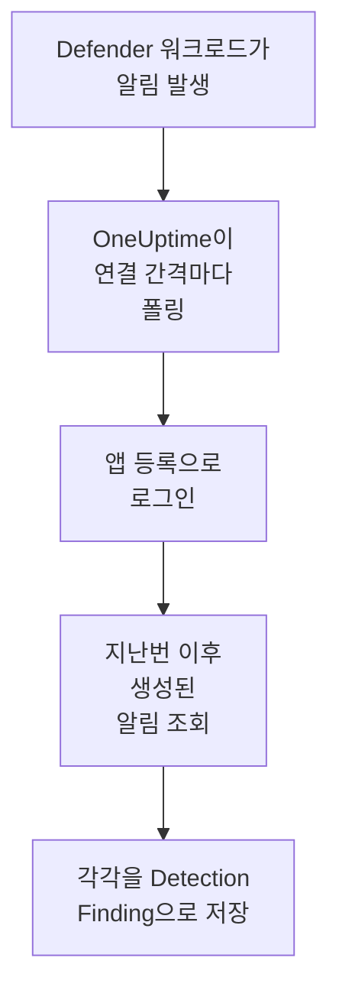

# Microsoft Defender XDR

엔드포인트, ID, 이메일, 클라우드 앱 등 모든 [Microsoft Defender XDR](https://learn.microsoft.com/en-us/defender-xdr/) 워크로드의 알림을 OneUptime의 보안 이벤트로 가져옵니다. 그곳에서 로그, 트레이스, 메트릭과 나란히 검색하고, 다른 모든 소스와 상관 분석하고, 중요한 알림에 대해 온콜을 호출할 수 있습니다. OneUptime은 직접 만든 앱 등록으로 Microsoft Graph 보안 API를 통해 알림을 읽습니다. 에이전트, 플레이북, Sentinel 워크스페이스는 필요 없습니다.

:::cards
- [연결 설정](#연결-설정): 앱 등록, 권한 하나, 그리고 연결 양식.
- [가져오는 내용](#가져오는-내용): 각 Defender 알림이 보안 이벤트가 되는 방식.
- [폴링 작동 방식](#폴링-작동-방식): 각 폴링이 읽는 구간과, 바쁜 테넌트에서 일어나는 일.
- [문제 해결](#문제-해결): 각 오류의 의미와 바꿔야 할 점.
:::

## 작동 방식



OneUptime은 1분마다, 폴링 간격이 지난 활성화된 연결을 각각 폴링합니다. 폴링은 앱 등록으로 Microsoft Entra ID에 로그인하고, 지난 폴링 이후 생성된 알림을 Microsoft Graph에 요청한 다음([List alerts_v2](https://learn.microsoft.com/en-us/graph/api/security-list-alerts_v2)), 각각을 [OCSF](https://schema.ocsf.io/) Detection Finding 이벤트(클래스 `2004`)로 저장합니다. 그러면 탐지 규칙, 모니터, 대시보드는 이를 다른 소스의 보안 이벤트와 똑같이 다룹니다.

## 사전 요건

- OneUptime에서 Project Owner, Project Admin 또는 Security Admin 역할. Security Member와 Security Viewer는 연결과 그 실행 기록을 볼 수 있지만 변경할 수는 없습니다.
- Microsoft Defender XDR 라이선스가 있는 Microsoft Entra 테넌트. Defender for Endpoint, for Identity, for Office 365, for Cloud Apps처럼 Microsoft Defender 포털에 온보딩된 Defender 워크로드라면 무엇이든 됩니다.
- Application Administrator처럼 애플리케이션을 등록할 수 있는 Entra 역할, 그리고 관리자 동의를 부여할 Global Administrator 또는 Privileged Role Administrator.
- OneUptime 앱과 워커에서 `login.microsoftonline.com`과 `graph.microsoft.com`으로, Azure Government라면 `login.microsoftonline.us`와 `graph.microsoft.us`로 나가는 아웃바운드 HTTPS.

## 연결 설정

연결은 [OAuth 2.0 클라이언트 자격 증명 흐름](https://learn.microsoft.com/en-us/entra/identity-platform/v2-oauth2-client-creds-grant-flow)으로 로그인합니다. 사람이 아니라 항상 애플리케이션으로, 애플리케이션 권한 하나만 가지고 로그인합니다.

:::steps
### 애플리케이션 등록

1. [Azure portal](https://portal.azure.com)에 로그인하고 **Microsoft Entra ID**를 엽니다.
2. **App registrations → New registration**으로 이동합니다. 이름을 `OneUptime Security Events`로 정하고, **Supported account types**는 **Accounts in this organizational directory only**로 두고, 리디렉션 URI는 비워 둔 채 **Register**를 선택합니다.
3. 앱의 **Overview** 페이지에서 **애플리케이션(클라이언트) ID**와 **디렉터리(테넌트) ID**를 복사합니다.

### 알림을 읽도록 허용

1. **API permissions → Add a permission → Microsoft Graph → Application permissions**로 이동해 `SecurityAlert.Read.All`을 고르고 **Add permissions**를 선택합니다. [List alerts_v2](https://learn.microsoft.com/en-us/graph/api/security-list-alerts_v2#permissions) 호출이 애플리케이션에 허용하는 가장 낮은 권한입니다. `SecurityAlert.ReadWrite.All`은 추가하지 마세요.
2. 테넌트에 대해 **Grant admin consent for**를 선택하고 확인합니다. 권한의 상태가 **Granted**여야 합니다. 동의가 없으면 모든 읽기가 `403`으로 거부됩니다.

### 클라이언트 시크릿 만들기

**Certificates & secrets → Client secrets → New client secret**으로 이동해 만료 시점을 고르고 **Add**를 선택합니다. 페이지를 떠나기 전에 시크릿의 **Secret ID**가 아니라 **Value**를 복사하세요. 다시는 표시되지 않습니다.

시크릿이 언제 만료되는지 적어 두세요. 그날이 되면 **자격 증명 업데이트**로 교체할 때까지 폴링이 `Microsoft Defender XDR token request failed (HTTP 401)`로 멈춥니다.

### OneUptime에서 연결 추가

**제품 → Security Events → 연결**(`/dashboard/{projectId}/security-events/connections`)를 열고 **연결 추가**를 클릭한 다음, **EDR / XDR** 아래의 **Microsoft Defender XDR**을 고르고 **다음**을 클릭합니다. 아래 표의 설정을 채우고 **다음**을 클릭한 뒤, 시크릿 값을 **클라이언트 시크릿**에 붙여 넣습니다.

### 저장하기 전에 테스트

**저장하기 전에 테스트** 아래의 **이 설정 테스트**를 클릭합니다. 테스트는 양식의 값으로 로그인해 알림을 읽지만 아무것도 저장하지 않으므로, 잘못된 시크릿이나 빠진 동의를 연결이 생기기 전에 알 수 있습니다. 그런 다음 **다음**을 클릭하고 연결에 **이름**을 지정해 만듭니다.
:::

| 설정 | 찾는 위치 |
| --- | --- |
| **디렉터리(테넌트) ID** | 앱의 **Overview** 페이지. 테넌트의 GUID 또는 `contoso.onmicrosoft.com` 같은 확인된 도메인. |
| **애플리케이션(클라이언트) ID** | 앱의 **Overview** 페이지. `SecurityAlert.Read.All`을 가진 앱의 GUID. |
| **클라우드** | Microsoft 365 GCC도 제공하는 **Azure 퍼블릭 클라우드**, 또는 GCC High용 **Azure Government(미국)** (`login.microsoftonline.us`와 `graph.microsoft.us`). Microsoft 365 DoD와 중국의 21Vianet 클라우드는 지원되지 않습니다. |
| **클라이언트 시크릿** | 시크릿의 **Value**. 암호화되며, API가 반환하지 않고 다시는 표시되지 않습니다. 연결의 **자격 증명 업데이트**로 교체합니다. |

**폴링** 단계에는 선택 사항인 **설명**, `1`부터 `1440`까지의 정수이며 처음 값이 `5`인 **폴링 간격(분)**, 그리고 처음에 켜져 있는 **활성화됨**도 있습니다.

## 가져오는 내용

각 Defender XDR [알림](https://learn.microsoft.com/en-us/graph/api/resources/security-alert)은 공급업체 `Microsoft`, 제품 `Microsoft Defender XDR`인 Detection Finding 이벤트 하나(OCSF 클래스 `2004`)가 되며, 텔레메트리 서비스 `Microsoft Defender XDR`에 귀속됩니다:

| OCSF 열 | 알림 필드 |
| --- | --- |
| `eventUid` | `id`. Graph 알림 ID로, 중복을 걸러 내는 기준이기도 합니다 |
| `time` | `firstActivityDateTime`. 없으면 `createdDateTime` |
| `message`, `ruleName` | `title` |
| `ruleId` | `detectorId`. 없으면 `alertPolicyId` |
| `severityName` | `severity`: `informational`, `low`, `medium` 또는 `high`. `unknown`은 Unknown으로 남습니다 |
| `statusName` | `status`: `new`는 New, `inProgress`는 In Progress, `resolved`는 Resolved가 됩니다 |
| `mitreTechniques` | `mitreTechniques` |
| `mitreTactics` | ATT&CK 전술인 경우의 `categories` 또는 `category`. `CredentialAccess`는 `TA0006`이 됩니다. 다른 카테고리는 `attributes`에 남습니다. |
| `principalHost`, `principalUser`, `principalIp`, `principalProcess` | `source`, `attacker`, `compromised` 역할을 가진 `evidence`. 없으면 종류별로 첫 번째 항목 |
| `targetHost`, `targetUser`, `targetIp`, `targetResource` | `destination`이나 `attacked`처럼 대상 역할을 가진 `evidence`. URL, 메일함, 클라우드 리소스는 `targetResource`를 채웁니다. |
| `observables` | `evidence`에 있는 모든 호스트 이름, IP, 사용자, 파일 이름, SHA-1과 SHA-256, URL, 도메인, 메일함, 리소스 ID |
| `attributes` | `evidence.0.hostName`, `serviceSource`, `incidentId` 같은 점 구분 키로 펼친 알림 전체 |

모든 `serviceSource`의 알림을 가져오며, Sentinel이 Defender 포털에 연결되어 있다면 Microsoft Sentinel의 알림도 가져옵니다. 인시던트는 가져오지 않지만, 각 알림은 `attributes`에 `incidentId`와 `incidentWebUrl`을 간직합니다.

## 폴링 작동 방식

각 폴링은 구간 안에서 생성된 알림을 한 페이지에 100개씩 나열하고, 구간 전체를 읽을 때까지 Graph의 `@odata.nextLink`를 따라갑니다:

```text
GET https://graph.microsoft.com/v1.0/security/alerts_v2?$filter=createdDateTime ge {start} and createdDateTime lt {end}&$top=100
```

- **생성 시각이 커서입니다.** Defender는 `firstActivityDateTime`보다 몇 시간 뒤에 알림을 만드는 경우가 많으며, 활동 시각을 기준으로 하는 커서라면 그런 알림을 모두 건너뛸 것입니다.
- **첫 폴링은 24시간 전까지 거슬러 올라가므로**, 새 연결에서 최근 알림이 바로 보입니다.
- **이후의 모든 폴링은 저장된 커서보다 1분 앞에서 시작하므로**, 두 구간의 경계에서 생성된 알림은 두 번 읽히지만 한 번만 가져옵니다.
- **한 번의 폴링은 커서 이후 최대 24시간까지 읽습니다.** 워커가 멈췄거나 테넌트가 요청 제한을 받는 동안 커서가 뒤처진 연결은 24시간 구간을 연달아 읽으며 따라잡습니다.
- **중복은 알림의 `id`로 걸러집니다.** `Microsoft` / `Microsoft Defender XDR`에서 온 프로젝트의 이벤트 안에서 걸러지므로, 겹치는 부분, 다시 시도한 구간, 가져오기 중 어느 것도 알림을 두 번 저장하지 않습니다.
- **실패한 실행은 아무것도 바꾸지 않습니다.** 네트워크 오류나 Graph의 오류 상태 뒤에는 커서와 구간 길이가 그대로 유지되고, 다음 폴링이 같은 구간을 다시 읽습니다. 단 하나의 예외는 요청 시간이 초과된 경우입니다. 커서는 그대로지만 다음 구간은 절반 길이가 됩니다. 제시간에 응답할 수 없을 만큼 무거운 구간은 매번 시간 초과될 것이기 때문입니다.

### 한 번의 폴링으로 다 읽을 수 없는 구간

한 번의 폴링은 알림 100개짜리 페이지를 최대 20개, 즉 알림 2,000개까지 읽습니다. 이 한도 때문에 구간 끝에 이르기 전에 멈추면, 실행은 **부분**이 되고 다음 경고가 붙습니다:

```text
Stopped after 20 alerts requests (the per-run request limit) before reading the whole window. Microsoft Graph lists alerts newest first and documents no way to sort them oldest first, so this run cannot name a point to resume from.
```

[List alerts_v2](https://learn.microsoft.com/en-us/graph/api/security-list-alerts_v2)는 `$filter`, `$top`, `$skip`, `$count`는 문서화하지만 `$orderby`는 문서화하지 않으며, 가장 새로운 알림부터 반환합니다. 멈춘 실행이 읽은 알림 2,000개는 그 구간에서 가장 새로운 것들이므로, 커서를 그 너머로 옮기면 실행이 닿지 못한 더 오래된 알림을 건너뛰게 됩니다. 그래서 OneUptime은 대신 구간을 줄입니다:

1. **좁히기.** 다음 폴링은 같은 시작점에서 절반 길이의 구간을 읽으며, 구간을 끝까지 읽을 수 있게 될 때까지 계속 절반으로 줄이고, 가장 짧게는 1분까지 줄입니다. 실행의 경고에 그렇게 적힙니다: `This window holds more records than one poll can read; the next poll reads a {n} minute window from the same starting point.` 더 긴 구간에서 이미 가져온 알림은 중복으로 건너뜁니다.
2. **다시 늘리기.** 구간을 끝까지 읽으면 커서가 그 끝으로 옮겨지고, 다음 구간은 다시 두 배가 되며, 최대 24시간까지 늘어납니다.
3. **1분 넘어가기.** 1분 안에조차 알림이 2,000개보다 많으면, 더 새로운 알림이 계속 도착하도록 폴링이 그 1분을 넘어갑니다. 실행은 **부분**로 남고, **마지막 오류**에는 `More records were created in the one minute from {cursor} to {end} than one poll can read. Polling moved past this minute so newer records keep arriving; use Import this time range in Diagnostics on this minute to recover what one run can read.`가 표시됩니다. 그 1분을 **Import this time range**로 가져오면 한 번의 실행으로 읽을 수 있는 만큼 되찾을 수 있습니다.

알림 하나를 보안 이벤트로 읽어 들이지 못한 경우처럼 다른 이유로 **부분**이 된 실행도, 같은 시작점에서 같은 방식으로 다시 시도됩니다. **폴링 간격(분)** 값을 바꿔도 이 중 어느 것도 바뀌지 않습니다. 이 값은 폴링이 얼마나 자주 시작되는지를 정할 뿐, 구간이 어디서 시작되는지는 정하지 않습니다.

### 필요할 때 실행, 미리 보기, 가져오기

연결에서 **진단**을 클릭하면 최근 실행을 보고 연결을 직접 다룰 수 있습니다. 연결을 변경할 수 있는 사람은 누구나 이를 시작할 수 있고, 연결을 볼 수 있는 사람은 누구나 기록을 읽을 수 있습니다.

- **지금 실행**은 연결이 **활성화됨** 상태가 아닐 때에도 평소의 커서로 즉시 폴링을 시작합니다.
- **Preview alerts**는 최대 7일의 시간 범위를 읽으며 아무것도 가져오지 않습니다.
- **Import this time range**는 확인을 거친 뒤 최대 7일의 범위를 가져오며, 커서는 옮기지 않습니다. 이미 가져온 알림은 건너뜁니다.
- 실행의 **Copy diagnostics**는 지원팀에 보낼 보고서를 복사합니다. 자격 증명은 절대 포함되지 않습니다.

## 연결 테스트

연결 행의 **연결 테스트**와 양식의 **이 설정 테스트**는 백그라운드 워커가 아니라 API 프로세스에서 실행되므로, 워커가 문제일 때에도 테스트는 응답합니다. 다음 검사를 순서대로 실행합니다:

| 검사 | 확인하는 내용 |
| --- | --- |
| **구성** | 네 가지 설정이 있고 올바른 형식인지. 이 검사가 실패하면 아무 곳에도 연결하지 않습니다. |
| **Authenticate with Microsoft Entra** | 고른 클라우드에서 Microsoft Entra ID가 Microsoft Graph용 토큰을 발급하는지. 시크릿이 틀렸거나 만료된 경우, 테넌트나 클라이언트 ID가 틀린 경우, 클라우드가 잘못된 경우 실패합니다. |
| **Read alerts from Microsoft Graph** | 지난 24시간 동안 생성된 알림 하나를 읽을 수 있는지(`$top=1`). 여기서 `403`이 나오면 `SecurityAlert.Read.All` 권한이 없거나, 관리자 동의가 없거나, 테넌트에 Defender XDR이 없는 것입니다. |
| **Alerts available to import** | 지난 24시간과 지난 7일 동안 생성된 알림 수. 각각 100개짜리 한 페이지로 세므로 `100+`는 그보다 많다는 뜻입니다. 7일 동안 하나도 없으면 실패가 아니라 경고입니다. |
| **Background workers**, **Poll scheduler**, **Security event storage** | OneUptime 쪽: Worker 큐의 작업을 가져가는 프로세스가 있고, 폴링 작업이 매분 실행되고, 보안 이벤트 저장소가 응답하는지. |
| **Scheduled polling** | 저장된 연결의 경우: 폴링이 켜져 있고, 워커를 기다리며 멈춘 실행이 없고, 폴링이 제때 실행되는지. |

테스트의 모든 요청에는 20초 기한이 있습니다. 테스트는 아무것도 가져오지 않고 커서를 옮기지도 않으며, 실패한 각 검사는 무엇을 바꿔야 하는지 알려 줍니다.

## 문제 해결

연결의 **마지막 오류**는 실패한 단계를 나타내는 접두사 뒤에, 자격 증명을 가린 전체 오류 메시지를 보관합니다. 연결에 오류가 있으면 **작업** 열에서 **오류 보기**를 선택해 읽고, 대화 상자의 **오류 복사**로 복사합니다. 먼저 접두사를 읽으세요.

:::details Last Error가 `Microsoft Defender XDR token request`로 시작함
- `Microsoft Defender XDR token request failed (HTTP ...)`: Microsoft Entra ID가 토큰 발급을 거부했으므로 Graph에는 연결하지 않았습니다. 메시지는 Entra의 `error` 코드에 따른 힌트로 끝납니다:
  - `invalid_client` (`AADSTS7000215`): 시크릿이 틀렸거나 만료되었거나 다른 앱의 것입니다. **Certificates & secrets** 아래에서 새로 만들고 **자격 증명 업데이트**로 저장합니다.
  - `unauthorized_client` (`AADSTS700016`): **애플리케이션(클라이언트) ID**가 그 **디렉터리(테넌트) ID**에 없거나, **클라우드**가 잘못되었습니다.
  - `AADSTS90002`: 그런 테넌트가 없습니다.
  - `invalid_scope`: 고른 클라우드에 Graph 범위가 없습니다. **클라우드**를 확인합니다.
- `Microsoft Defender XDR token request returned ...`: Microsoft Entra ID가 JSON이 아니거나 `access_token`이 없는 본문처럼 쓸 수 없는 응답을 보냈습니다. 대개 자격 증명이 아니라 중간에 있는 프록시나 게이트웨이 때문입니다.
- `Microsoft Defender XDR token request did not complete: ...`: 토큰 엔드포인트에 연결할 수 없었거나 제시간에 응답하지 않았습니다. OneUptime 앱과 워커에서 `login.microsoftonline.com` 또는 `login.microsoftonline.us`로의 아웃바운드 HTTPS를 확인합니다.
:::

:::details Last Error가 `Microsoft Defender XDR alerts request`로 시작함
- `Microsoft Defender XDR alerts request failed (HTTP ...)`: Graph가 알림 나열을 거부했습니다. 메시지에는 Graph의 오류 코드와 힌트가 담겨 있습니다:
  - `403` (`Authorization_RequestDenied`): `SecurityAlert.Read.All`이나 그 관리자 동의가 없거나, 테넌트에 Defender XDR 라이선스가 없습니다. 동의가 적용되기까지 몇 분 걸립니다.
  - 토큰이 발급된 뒤의 `401` (`InvalidAuthenticationToken`): 대개 **클라우드**가 테넌트와 맞지 않습니다.
  - `429` (`TooManyRequests`): Graph가 앱의 요청을 제한하고 있으며, 다음 폴링이 같은 구간을 다시 읽습니다. OneUptime의 HTTP 클라이언트는 오류 시 응답 헤더를 보관하지 않으므로, 메시지에 Graph의 `Retry-After`를 인용할 수 없습니다. 계속 발생하면 **폴링 간격(분)** 값을 늘리세요.
  - `5xx`: Graph 쪽 문제입니다. 다음 폴링이 다시 시도합니다.
  - `400`: Graph가 쿼리를 실행하지 않았습니다. 그 쿼리는 설정이 아니라 OneUptime이 만듭니다. 메시지를 복사해 OneUptime 지원팀에 보내세요.
- `Microsoft Defender XDR alerts request returned ...`: Graph가 `200`으로 응답했지만 커넥터가 쓸 수 없는 내용이었습니다. JSON이 아닌 본문, `value` 목록이 없는 응답, 또는 클라우드의 Graph 호스트를 가리키는 `https://` 링크가 아닌 `@odata.nextLink`입니다. 그런 링크는 거부되므로 토큰이 다른 곳으로 보내지는 일은 없습니다. 이는 빈 구간으로 간주되지 않고 보고되므로, 커서가 아무도 읽지 않은 알림을 건너뛰는 일은 없습니다.
- `Microsoft Defender XDR alerts request did not complete: ...`: Graph에 연결할 수 없었거나 제시간에 응답하지 않았습니다. 기한은 폴링이 60초, 테스트가 20초입니다. `graph.microsoft.com` 또는 `graph.microsoft.us`로의 아웃바운드 HTTPS를 확인합니다.
:::

:::details 테스트는 통과하지만 Last Polled가 Never임
폴링 작업이 한 번도 실행되지 않았습니다. **Background workers**와 **Poll scheduler** 검사를 읽으세요. 자체 호스팅 설치에서 흔한 원인은 앱에 `DISABLE_QUEUE_WORKERS=true`가 설정되어 있는데 작업을 가져가는 별도의 워커 배포가 없는 경우입니다. 이를 `false`로 설정하거나 워커 배포를 실행하세요(Helm: `worker.enabled: true`, 기본값은 `false`).
:::

:::details 폴링은 성공하지만 알고 있는 알림이 없음
Defender 포털에서 알림의 `createdDateTime`을 **진단**에 있는 실행의 구간과 비교하세요. 구간은 활동 시각이 아니라 생성 시각 기준입니다.

- 연결이 생기기 전에 생성된 알림은 첫 24시간 되돌아보기보다 오래되었습니다. **Import this time range**로 가져오세요.
- **부분** 실행은 알림 2,000개 한도에서 멈춘 것입니다. 다음 폴링은 같은 시작점에서 더 짧은 구간을 읽으므로, 그 알림을 담은 구간을 끝까지 읽으면 알림을 가져옵니다.
- **마지막 오류**에 폴링이 넘어간 1분이 적혀 있으면, 그 1분을 **Import this time range**로 가져오세요.
:::

:::details 같은 알림이 두 번 나타남
1분 겹침 때문은 아닙니다. 두 번째 읽기는 중복으로 세어지고 저장되지 않습니다. 같은 `eventUid`를 가진 두 이벤트가 서로 다른 제품으로 가져와진 것으로, 예를 들어 같은 알림이 Microsoft Sentinel 연결로도 도착한 경우입니다. 중복은 공급업체와 제품별로 걸러집니다.
:::

## 얻을 수 있는 것

- **검색.** 보안 이벤트 탐색기에서 그 호스트의 로그와 메트릭과 나란히, 심각도, 상태, MITRE 기법, 호스트, 사용자, IP 또는 어떤 observable로든 Defender 알림을 필터링합니다.
- **상관 분석.** 모든 알림의 증거, 즉 장치, 사용자, IP, 파일, URL은 observable로 색인되므로, 한 번의 검색으로 모든 소스에서 한 호스트를 언급하는 모든 것을 찾을 수 있습니다.
- **탐지 규칙.** 보안 이벤트에 대해 일정에 따라 실행되며, 온콜을 호출하는 알림을 여는 Sigma 규칙.
- **모니터.** 보안 이벤트 모니터는 일치하는 이벤트를 세고, 임곗값을 넘으면 인시던트나 알림을 엽니다.

보안 이벤트는 나머지 텔레메트리처럼 수집된 GB 단위로 청구됩니다. [요금](https://oneuptime.com/pricing)을 참고하세요.

## 다음 단계

:::cards
- [보안 이벤트](/docs/telemetry/security-events): 가져온 내용을 검색하고, 상관 분석하고, 알림을 받습니다.
- [Microsoft Sentinel](/docs/integrations/microsoft-sentinel): Sentinel 워크스페이스의 인시던트도 가져옵니다.
- [역할](/docs/permissions/reference#역할): Security 역할이 보고 바꿀 수 있는 것.
- [통합 개요](/docs/integrations/index): 연결할 수 있는 다른 도구.
:::
