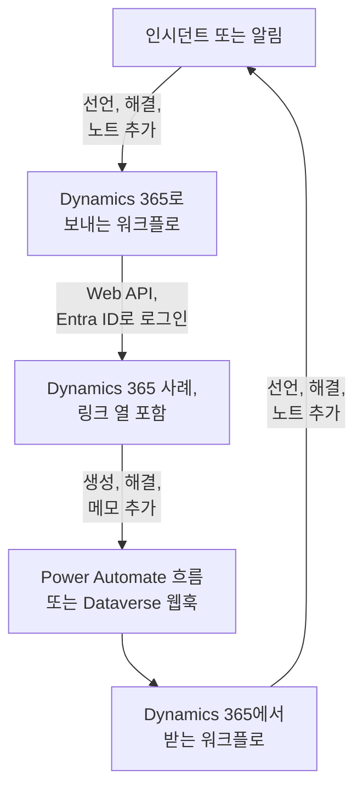

# Microsoft Dynamics 365

[Microsoft Dynamics 365](https://www.microsoft.com/dynamics-365) 사례를 OneUptime 인시던트 및 알림과 양방향으로 맞춰 둡니다. 미리 만들어진 워크플로 템플릿이 인시던트나 알림마다 사례를 열고, 레코드가 해결되면 사례를 종결하며, 노트를 사례에 복사합니다. 다른 템플릿은 새 사례에서 인시던트를 선언하고 해결 내용과 메모를 다시 가져옵니다. 플러그인은 없습니다. 워크플로가 Dataverse Web API를 호출하고, Dynamics 365가 워크플로의 웹훅 URL을 호출합니다.

:::cards
- [Dynamics 365 준비하기](#dynamics-365-준비하기): 앱 등록, 애플리케이션 사용자, 링크 열.
- [템플릿에서 시작하기](#템플릿에서-시작하기): 13개 템플릿, 각 템플릿이 묻는 내용, 설정 방법.
- [템플릿의 작동 방식](#템플릿의-작동-방식): 사례와 레코드가 루프 없이 연결된 상태를 유지하는 방식.
- [직접 만들기](#직접-만들기): 템플릿이 맞지 않을 때 각 방향을 직접 만듭니다.
:::

## 작동 방식



각 템플릿은 작은 워크플로이므로, 인시던트, 알림 또는 둘 다에 대해 원하는 방향만 골라 쓰면 됩니다. OneUptime → Dynamics 365 템플릿은 Microsoft Entra ID를 통해 애플리케이션으로 로그인해 Dataverse Web API를 호출합니다. Dynamics 365 → OneUptime 템플릿은 Power Automate 흐름이나 Dataverse 웹훅이 호출하면 시작됩니다. Case 테이블에 추가하는 텍스트 열이 각 사례를 해당 레코드에 연결합니다.

## 사전 요건

- **Case** 테이블이 있는 Dynamics 365 환경. 사례는 Dynamics 365 Customer Service에서 제공되며, 이것이 없는 Dataverse 환경에는 쓸 `incident` 테이블이 없습니다.
- **Microsoft Entra ID**에 애플리케이션을 등록할 권한과 환경에 애플리케이션 사용자를 만들 권한. 이 둘은 서로 다른 관리자인 경우가 많습니다.
- OneUptime에서 워크플로를 만들 권한. OneUptime Cloud에서는 워크플로에 **Growth** 요금제 이상이 필요합니다.

> [!NOTE]
> 이 페이지는 Dynamics 양식의 레이블이 아니라 Dataverse의 이름을 사용합니다. 사례는 `incident` 테이블이고, URL에서의 컬렉션은 `incidents`, 키는 `incidentid`, 제목 열은 `title`입니다. 화면에 보이는 사례 번호는 `ticketnumber`입니다.

## Dynamics 365 준비하기

템플릿과 직접 만드는 워크플로 모두 이것이 필요합니다. OneUptime은 OAuth 2.0 클라이언트 자격 증명 흐름으로, 사람이 아니라 애플리케이션으로 로그인합니다.

:::steps
### Microsoft Entra ID에 애플리케이션 등록하기

1. Dynamics 환경이 속한 테넌트의 관리자로 [Azure portal](https://portal.azure.com)에 로그인하고 **Microsoft Entra ID**를 엽니다.
2. **App registrations → New registration**으로 이동합니다. 이름을 `OneUptime Integration`으로 정하고, **Supported account types**는 **Accounts in this organizational directory only**로 둔 다음 **Register**를 선택합니다.
3. 앱의 **Overview** 페이지에서 **Application (client) ID**와 **Directory (tenant) ID**를 복사합니다.
4. **Certificates & secrets → Client secrets → New client secret**으로 이동해, 페이지를 떠나기 전에 시크릿의 ID가 아니라 **Value**를 복사하세요. 다시는 표시되지 않습니다. 클라이언트 시크릿의 수명은 최대 24개월이므로 만료일을 적어 두세요.

API 권한은 추가하지 말고 관리자 동의도 부여하지 마세요. 로그인한 사용자가 없으므로 아무 효과가 없습니다. 애플리케이션이 할 수 있는 일은 Dynamics 365가 애플리케이션 사용자를 통해 결정합니다.

### 애플리케이션 사용자 만들기

1. [Power Platform 관리 센터](https://admin.powerplatform.microsoft.com/)에서 **Manage → Environments**를 선택한 다음 환경을 선택합니다.
2. **Settings → Users + permissions → Application users**를 선택한 다음 **+ New app user**와 **+ Add an app**을 차례로 선택합니다. 앱 등록을 고르고 **Add**를 선택합니다.
3. **Business unit**을 고른 다음, **Security roles** 옆의 편집 아이콘으로 사용자 지정 보안 역할을 부여합니다. Organization 수준에서 역할에는 다음 권한이 필요합니다:
   - **Case**: Create, Read, Write, Append, Append To.
   - **Note**: Create, Read, Append. 메모 템플릿에 필요합니다.
   - **Activity**: Create, Read, Append. 사례를 종결하면 활동의 일종인 Case Resolution이 기록되기 때문입니다.
   - **Account**, 그리고 사례를 연락처에 대해 등록한다면 **Contact**: Read와 Append To.
4. **Save**를 선택한 다음 **Create**를 선택합니다.

애플리케이션 사용자에게는 사용자 지정 역할만 줄 수 있습니다. 기존 역할을 복사해 줄여서 쓰세요. 이 사용자가 없어도 Microsoft Entra ID는 토큰을 발급하지만, Dynamics 365에 대한 모든 호출이 `403`과 `0x80072560`, 즉 "The user isn't a member of the organization."으로 실패합니다.

### Case 테이블에 링크 열 추가하기

Dataverse에는 Jira의 레이블 같은 것이 없으므로, 사례와 OneUptime 레코드는 직접 추가한 열을 통해 서로를 찾습니다.

1. [make.powerapps.com](https://make.powerapps.com)에서 환경을 고르고, **Tables → Case → Columns**를 연 다음 **New column**을 선택합니다.
2. 이름을 `OneUptime Link`로 정하고, **Data type**은 **Single line of text**로 둔 채 저장합니다. 기본 최대 길이 100이면 충분합니다. 템플릿은 최대 55자를 씁니다.
3. 새 열을 열고 `new_oneuptimelink` 같은 **Logical name**을 복사합니다. 접두사는 솔루션 게시자에서 오므로 `cr4f2_oneuptimelink`처럼 다를 수 있습니다.

상담원이 링크를 봐야 한다면 Case 양식에 열을 추가하세요.
:::

## 템플릿에서 시작하기

**워크플로 만들기** 대화 상자에는 카테고리 목록의 **Dynamics 365** 아래에 Dynamics 365 템플릿 13개가 있습니다. 인시던트용 7개, 이어서 알림용 6개가 각자의 제목 아래에 있습니다. 모두 링크 열을 공유하므로 어떤 조합이든 함께 작동합니다.

### 인시던트용 템플릿

| 템플릿 | 하는 일 | 묻는 내용 |
| --- | --- | --- |
| **OneUptime → Dynamics 365** | | |
| Create a Dynamics 365 case when an incident is declared | 새 인시던트마다 사례를 열며, 심각도에 따라 고른 우선순위와 링크 열의 인시던트 ID를 함께 기록합니다. Dynamics 365에서 선언된 인시던트와 비공개 인시던트는 건너뜁니다. | Dynamics 365 설정 다섯 가지, 새 사례의 고객, OneUptime URL |
| Resolve the Dynamics 365 case when the incident is resolved | 인시던트가 해결되면 연결된 사례를 **Problem Solved**로 종결하며, 직접 해결할 때처럼 Case Resolution을 기록합니다. 사례를 다시 열지는 않습니다. | Dynamics 365 설정 다섯 가지 |
| Copy incident private notes to the Dynamics 365 case | 새 비공개 노트를 각각 연결된 사례에 메모로 추가합니다. | Dynamics 365 설정 다섯 가지 |
| Copy incident public notes to the Dynamics 365 case | 새 공개 노트를 각각 연결된 사례에 메모로 추가하므로, 상담원이 상태 페이지의 내용을 고객에게 알려 줄 수 있습니다. | Dynamics 365 설정 다섯 가지 |
| **Dynamics 365 → OneUptime** | | |
| Declare an incident when a Dynamics 365 case is created | 새 사례마다 상태 페이지에 표시하지 않는 인시던트를 사례의 우선순위에 따라 고른 심각도로 선언한 다음, 사례의 링크 열에 인시던트 ID를 씁니다. | Dynamics 365 설정 다섯 가지, 그리고 새 사례용 흐름 또는 웹훅 |
| Resolve the incident when its Dynamics 365 case is resolved | 연결된 사례가 해결되면 인시던트를 해결합니다. | Dynamics 365 설정 다섯 가지, 그리고 사례 상태 변경용 흐름 또는 웹훅 |
| Add Dynamics 365 case notes to the incident as private notes | 상담원이 연결된 사례에 추가하는 각 메모를 인시던트에 비공개 노트로 복사합니다. | Dynamics 365 설정 다섯 가지, 그리고 새 메모용 흐름 또는 웹훅 |

### 알림용 템플릿

알림용 템플릿은 알림에 대해 같은 일을 합니다. 알림에는 공개 노트가 없으므로 하나가 적고, 알림은 상태 페이지에 나타나지 않으므로 **Create an alert when a Dynamics 365 case is created**는 상태 페이지 설정을 쓰지 않습니다.

| 템플릿 | 하는 일 | 묻는 내용 |
| --- | --- | --- |
| **OneUptime → Dynamics 365** | | |
| Create a Dynamics 365 case when an alert is created | 모니터가 발생시키는 모든 알림을 포함해 새 알림마다 사례를 엽니다. Dynamics 365에서 만들어진 알림과 비공개 알림은 건너뜁니다. | Dynamics 365 설정 다섯 가지, 새 사례의 고객, OneUptime URL |
| Resolve the Dynamics 365 case when the alert is resolved | 알림이 해결되면 연결된 사례를 **Problem Solved**로 종결합니다. | Dynamics 365 설정 다섯 가지 |
| Copy alert private notes to the Dynamics 365 case | 새 비공개 노트를 각각 연결된 사례에 메모로 추가합니다. | Dynamics 365 설정 다섯 가지 |
| **Dynamics 365 → OneUptime** | | |
| Create an alert when a Dynamics 365 case is created | 새 사례마다 사례의 우선순위에 따라 고른 심각도로 알림을 만든 다음, 사례의 링크 열에 알림 ID를 씁니다. | Dynamics 365 설정 다섯 가지, 그리고 새 사례용 흐름 또는 웹훅 |
| Resolve the alert when its Dynamics 365 case is resolved | 연결된 사례가 해결되면 알림을 해결합니다. | Dynamics 365 설정 다섯 가지, 그리고 사례 상태 변경용 흐름 또는 웹훅 |
| Add Dynamics 365 case notes to the alert as private notes | 상담원이 연결된 사례에 추가하는 각 메모를 알림에 비공개 노트로 복사합니다. | Dynamics 365 설정 다섯 가지, 그리고 새 메모용 흐름 또는 웹훅 |

OneUptime → Dynamics 365 템플릿은 직접 켜지 않는 한 **비공개 인시던트**로 표시된 인시던트나 **비공개 경고**로 표시된 알림을 Dynamics 365에 보내지 않습니다. 레코드도, 그 상태도, 노트도 보내지 않습니다. [템플릿이 하는 일 바꾸기](#템플릿이-하는-일-바꾸기)를 참고하세요.

**모니터는 스스로 알림을 발생시키며, 아주 많이 발생시킬 수도 있습니다.** **Create a Dynamics 365 case when an alert is created**는 그 하나하나에 사례를 엽니다. 모든 알림에 사례가 필요한 것이 아니라면, 트리거와 워크플로의 나머지 사이에 예를 들어 `{{local.components.alert-on-create-1.returnValues.model.alertSeverity.name}}`을 확인하는 **If / Else** 블록을 두고, 그 **Yes** 쪽만 다음 블록에 연결하세요.

### 템플릿이 묻는 내용

만들기 마법사의 **구성** 단계는 최대 일곱 개의 값을 묻습니다. 모든 템플릿이 처음 다섯 개인 Dynamics 365 설정을 묻고, 사례를 만드는 두 템플릿은 마지막 두 개도 묻습니다. 무엇이든 만들기 전에 각 Dynamics 365 설정의 형태를 확인하고 대신 무엇을 입력해야 하는지 알려 줍니다. 형태가 틀린 값은 실행되기 전까지 어디에서도 오류가 되지 않기 때문입니다.

- **Dynamics 365 Environment URL** — `https://yourorg.crm.dynamics.com` 같은 환경의 주소로, [Power Platform 관리 센터](https://admin.powerplatform.microsoft.com/)의 **Environments**에서 환경을 고르면 **Environment URL**에 나옵니다. 주소만 넣으세요. `/api/data/v9.2`로 끝나는 Web API 엔드포인트가 아니며, 끝에 슬래시도 붙이지 않습니다.
- **Directory (Tenant) ID** — 앱 등록의 **Overview** 페이지에서 가져옵니다.
- **Application (Client) ID** — 같은 페이지에서 가져옵니다.
- **Client Secret Value** — **Certificates & secrets**에 있는 클라이언트 시크릿의 **Value**입니다. GUID인 **Secret ID**가 아닙니다. 마법사는 여기에 넣은 GUID를 거부합니다.
- **Case Link Column** — `new_oneuptimelink` 같은 링크 열의 논리적 이름.
- **Customer for New Cases** — 사례를 만드는 두 템플릿만 묻습니다. 모든 사례에는 고객이 필요한데 OneUptime 인시던트에는 고객이 없으므로, 새 사례는 모두 한 고객에 대해 등록됩니다. 거래처의 ID를 붙여 넣거나, 연락처라면 `contacts(<id>)`를 붙여 넣으세요. Dynamics 365에서 레코드를 열면 주소에서 `id=` 뒤의 부분이 ID입니다.
- **OneUptime URL** — 사례를 만드는 두 템플릿만 묻습니다. `https://oneuptime.com`처럼 OneUptime을 여는 주소입니다. 사례의 설명은 이 주소로 인시던트나 알림에 다시 연결됩니다.

**템플릿이 로그인하는 방식.** 마법사는 테넌트, 클라이언트 ID, 시크릿을 워크플로의 **워크플로 변수** 아래에 있는 [OAuth 2.0 변수](/docs/workflows/variables#oauth-20-변수스스로-갱신되는-토큰) 하나, `dynamicsAccessToken`에 저장합니다. 그 내용은 Client Credentials, 토큰 URL `https://login.microsoftonline.com/<tenant>/oauth2/v2.0/token`, 범위 `<environment URL>/.default`, 그리고 요청 본문으로 전송되고 암호화되어 저장되는 클라이언트 시크릿입니다. Dynamics 365에 대한 모든 호출은 `Authorization: Bearer {{local.variables.dynamicsAccessToken}}`을 보냅니다. OneUptime은 단계가 처음 토큰을 필요로 할 때 토큰을 가져오고, 만료되기 전에 새 토큰을 가져오며, 실행 로그와 단계 추적에서는 토큰을 `[REDACTED]`로 바꿉니다.

무엇이든 실행하기 전에 로그인을 확인하려면 **워크플로 변수**를 열고 `dynamicsAccessToken`에서 **보기**를 클릭한 다음 **지금 새로고침**을 클릭하세요. **Access Token Fetched**가 표시되면 앱 등록이 올바른 것입니다. 그렇지 않으면 `AADSTS7000215: Invalid client secret provided`처럼 Microsoft Entra ID의 오류가 무엇이 잘못되었는지 알려 줍니다.

각 워크플로는 이 값의 사본을 따로 가집니다. 클라이언트 시크릿을 교체할 때는 모든 Dynamics 365 워크플로에서 `dynamicsAccessToken`을 열고 **자격 증명 업데이트**를 사용하세요.

### 워크플로 만들기

:::steps
1. **워크플로 → 워크플로 생성**을 엽니다. **또는 템플릿에서 시작** 아래의 카테고리 목록에서 **Dynamics 365**를 고르거나 **템플릿 검색…** 상자에 `Dynamics`를 입력하고, 원하는 템플릿을 클릭합니다. 템플릿이 열리고 하는 일과 물어볼 설정이 표시됩니다. **이 템플릿 사용**을 클릭합니다.
2. **이름**은 템플릿에서 채워집니다. 원하면 바꾸세요.
3. **구성**에서 위의 값을 묻습니다.
4. **워크플로 생성**을 클릭합니다. 모든 워크플로는 꺼진 상태로 만들어집니다. **빌더** 상단에서 **활성화됨**을 켜세요.
:::

**Create a Dynamics 365 case when an incident is declared**(알림이라면 **Create a Dynamics 365 case when an alert is created**)로 시작하세요. 같은 종류의 다른 OneUptime → Dynamics 365 템플릿은 모두 이 템플릿이 쓰는 링크로 사례를 찾습니다. 템플릿을 켜고, 테스트 인시던트를 선언하거나 테스트 알림을 만든 다음, 워크플로의 **로그 → 실행 기록**을 엽니다. 실행은 **실행됨**으로 끝나야 하며, 마지막 단계 `create-case-1`의 **Response Body**에 `CAS-01001-X1Y2Z3` 같은 새 사례의 `ticketnumber`가 들어 있습니다.

### Dynamics 365 → OneUptime 템플릿 연결하기

Dynamics 365 → OneUptime 템플릿(인시던트용 3개, 알림용 3개)은 [Webhook 트리거](/docs/workflows/triggers#webhook)에서 시작하므로, Dynamics 365에 이벤트를 보낼 곳을 알려 줘야 합니다. 다음 순서로 진행하세요:

1. 워크플로를 만들고 **먼저 켜세요**. 꺼진 워크플로는 전송을 거부하며, 전송은 대기열에 들어가지 않습니다.
2. 워크플로의 **빌더**를 열고 **Webhook** 트리거 블록(`webhook-1`)을 클릭한 다음, 설정 상단의 **URL 복사**를 클릭합니다. URL은 다음과 같습니다:

   ```text
   https://<your OneUptime host>/workflow/trigger/<webhook secret key>
   ```

3. Power Automate 흐름이나 Dataverse 웹훅에서 Dynamics 365가 이 URL로 게시하게 합니다.

각 템플릿은 어떤 행이 바뀌었는지만 전달받으면 됩니다. 무엇이든 하기 전에 그 행을 Dynamics 365에서 다시 읽으므로, 사례의 제목, 상태, 링크를 요청에서 가져오지 않으며, 둘 중 어느 쪽이 보내든 상관없습니다.

:::tabs
@tab Power Automate flow
[Power Automate](https://make.powerautomate.com)에서 **Microsoft Dataverse** 트리거 **When a row is added, modified or deleted**를 쓰는 **Automated cloud flow**를 만들어 아래와 같이 설정하고, **Scope**는 **Organization**으로 설정합니다. 기본 제공 **HTTP** 작업을 추가합니다: **Method**에는 `POST`, **URI**에는 워크플로의 URL, `Content-Type: application/json` 헤더, 그리고 아래의 본문을 넣고, 행의 ID는 트리거의 동적 콘텐츠에서 고릅니다.

| 템플릿 | Change type | Table name | Select columns | Body |
| --- | --- | --- | --- | --- |
| 사례가 만들어지면 인시던트 선언 / 알림 만들기 | Added | Cases | | `{"PrimaryEntityId": "<Case>"}` |
| 사례가 해결되면 인시던트 / 알림 해결 | Modified | Cases | `statecode,statuscode` | `{"PrimaryEntityId": "<Case>"}` |
| 사례 메모를 인시던트 / 알림에 비공개 노트로 추가 | Added | Notes | | `{"PrimaryEntityId": "<Note>"}` |

일부 사례만 보내려면 트리거의 **Filter rows**를 사용하세요. 예를 들어 High 우선순위 사례라면 `prioritycode eq 1`입니다. 본문은 Dataverse 웹후크처럼 행을 `PrimaryEntityId`로 지정합니다. 템플릿은 행 자체를 Dynamics 365에서 다시 읽습니다.
@tab Dataverse webhook
[Plug-in Registration Tool](https://learn.microsoft.com/en-us/power-apps/developer/data-platform/register-web-hook)로 URL을 등록합니다. **HttpHeader** 인증과 직접 정한 헤더로 **Register New WebHook**을 하며, URL 자체가 시크릿입니다. 그런 다음 아래의 각 이벤트에 대해 **Event Pipeline Stage of Execution**을 **PostOperation**으로, **Execution Mode**를 **Asynchronous**로 설정한 단계를 그 웹훅에 등록합니다.

| 템플릿 | Message | Primary Entity | Filtering Attributes |
| --- | --- | --- | --- |
| 사례가 만들어지면 인시던트 선언 / 알림 만들기 | `Create` | `incident` | |
| 사례가 해결되면 인시던트 / 알림 해결 | `Close`, 그리고 다른 사람의 상태 변경용 `Update` | `incident` | `statecode, statuscode` (Update) |
| 사례 메모를 인시던트 / 알림에 비공개 노트로 추가 | `Create` | `annotation` | |

사례를 해결하면 **Update**가 아니라 **Close** 메시지가 발생하므로 그 템플릿에는 둘 다 필요합니다. 웹훅은 플러그인 실행 컨텍스트를 게시하는데, 행은 그 `PrimaryEntityId`에, **Close**라면 그 `IncidentResolution`에 나오며 템플릿은 거기에서 행을 읽습니다. Dataverse 웹훅은 포트 80과 443만 호출하며 자체 행 필터가 없습니다. `ONLY_PRIORITIES`로 좁히지 않는 한 모든 새 사례가 만들기 템플릿에 도달합니다.
:::

어느 쪽이든 의존하기 전에:

- **URL을 가진 사람은 누구나 워크플로를 시작할 수 있습니다.** 템플릿은 모든 행을 Dynamics 365에서 다시 읽으므로, 요청으로 할 수 있는 일은 템플릿이 실제 사례나 메모를 보게 하는 것뿐입니다. 그래도 아직 연결되지 않은 사례에 대해 만들기 템플릿을 작동시킬 수는 있습니다. URL은 흐름이나 웹훅 안에만 두세요. 유출되면 워크플로의 **빌더**에서 **Webhook** 트리거를 클릭하고 **URL 재설정**을 클릭한 다음, 새 URL을 흐름이나 웹훅에 붙여 넣으세요. 이전 URL은 즉시 작동을 멈춥니다.
- **모든 이벤트가 하나의 실행입니다**. 템플릿이 건너뛰는 이벤트도 포함됩니다. OneUptime Cloud에서는 각 실행이 요금제의 워크플로 실행 수에 포함되며, 흐름에서 필터링하면 그 수를 줄일 수 있습니다. [요금제 한도](/docs/workflows/configuration#플랜-한도)를 참고하세요.
- **사례에서 레코드를 만드는 두 템플릿을 모두 쓰나요?** **Declare an incident when a Dynamics 365 case is created**와 **Create an alert when a Dynamics 365 case is created**는 둘 다 전달받은 모든 사례에 작동합니다. 둘 다 먼저 링크 열을 확인하지만, 새 사례 하나에 대한 두 전송이 동시에 도착하므로 사례에 인시던트와 알림이 모두 생길 수 있습니다. 예를 들어 사례 유형으로 나눠 두 템플릿에 서로 다른 사례를 보내세요.

### 작동하는지 확인하기

각 실행의 **단계**에 템플릿이 한 일이 나오므로, **로그 → 실행 기록**에서 실행을 열고 어떻게 끝났는지 보세요:

- **실행됨**: 할 일을 마쳤고, 마지막 단계에 사례, 인시던트 또는 알림이 나옵니다.
- **실행됨**이고 **Check With JavaScript** 단계가 **No**로 감: 일부러 이벤트를 건너뛰었고, 그 단계가 이유를 알려 줍니다. 사례가 이 종류의 레코드에 연결되지 않았거나, 메모가 반대편에서 왔거나, 레코드가 비공개이거나, 새 상태가 사례를 종결하지 않는 경우입니다.
- **오류**: 단계가 실패했고, **단계**에 있는 그 항목에 이유가 나옵니다. Dynamics 365 호출이라면 Dynamics 365의 응답도 포함됩니다.
- `link-case-1`에서 **오류**: 사례에서 레코드를 만드는 템플릿이 레코드를 만들었지만 Dynamics 365가 링크를 받지 않아 다른 템플릿이 아직 찾을 수 없습니다. 사례의 열에 링크를 직접 입력하세요.

실행이 첫 번째 Dynamics 365 단계에서 `Could not get an OAuth 2.0 access token for {{local.variables.dynamicsAccessToken}}`로 멈춘다면 로그인 설정이 잘못된 것이며, 메시지에 Microsoft Entra ID의 응답이 인용됩니다. [템플릿이 묻는 내용](#템플릿이-묻는-내용)을 참고하세요.

## 템플릿의 작동 방식

### 양쪽이 연결된 상태를 유지하는 방식

연결은 사례가 보관합니다. 인시던트에 속한 사례의 링크 열에는 `oneuptime-incident-<incident id>`가, 알림에 속한 사례에는 `oneuptime-alert-<alert id>`가 들어 있습니다. ID는 대시보드에서 레코드 주소의 마지막 부분입니다.

사례를 만드는 템플릿은 사례를 열 때 이 값을 쓰고, 사례에서 레코드를 만드는 템플릿은 레코드가 생기는 즉시 씁니다. 다른 모든 템플릿은 이 값으로 반대편을 찾습니다. OneUptime → Dynamics 365 템플릿은 링크로 사례를 찾고, Dynamics 365 → OneUptime 템플릿은 사례에서 레코드의 ID를 읽습니다. 직접 연 사례를 연결하려면 레코드에 아직 사례가 없을 때만 그 링크 열에 값을 직접 입력하세요.

**사례는 인시던트나 알림 중 하나에만 연결되며, 둘 다에 연결되지 않습니다.** 열 하나가 두 종류를 모두 담습니다. 인시던트용 템플릿은 알림에 연결된 사례를 무시하고 그 반대도 마찬가지이며, 사례에서 레코드를 만드는 템플릿은 링크 열에 무엇이든 들어 있는 사례는 건드리지 않습니다.

**레코드에는 사례가 하나만 있습니다.** 사례에 쓰는 템플릿은 레코드의 링크를 가진 사례가 정확히 하나일 때만 작동합니다. 링크가 두 번째 사례에 복사되면 템플릿은 멈추고, 각 실행은 두 사례를 모두 알려 주는 건너뛰기로 끝납니다:

```text
More than one Dynamics 365 case holds the link oneuptime-incident-<id> (CAS-01001-X1Y2Z3, CAS-01002-K4L5M6). Clear it on every case except the one opened for the incident.
```

사례에서 만들어진 인시던트와 알림은 만들 때 기록되는 `customFields.dynamicsCaseId`와 `customFields.dynamicsCaseNumber`에 사례의 ID와 번호도 보관합니다. 사례를 만드는 템플릿은 이것으로 레코드에 이미 사례가 있음을 압니다.

### 템플릿이 루프를 피하는 방식

한 방향의 모든 쓰기는 다른 방향에서는 이벤트입니다. 사례에 추가한 메모는 새 메모로 돌아오고, OneUptime에서 추가한 비공개 노트는 노트 트리거를 발생시킵니다. 네 가지가 이 메아리를 멈춥니다:

- **텍스트 안의 표식.** 템플릿이 사례에 추가하는 모든 메모의 제목은 `Synced from OneUptime: …`이며, 템플릿이 기록하는 모든 Case Resolution의 제목도 마찬가지입니다. Dynamics 365에서 쓴 모든 노트와 Dynamics 365에서 한 모든 상태 변경의 근본 원인은 `Synced from Dynamics 365`로 시작합니다. 각 방향은 상대편 표식이 있는 텍스트를 건너뜁니다. 누군가 표식을 인용한 메모라도 마찬가지입니다.
- **첫 저장부터 있는 링크.** OneUptime이 연 사례는 생기는 순간부터 링크를 가지므로, 그 **Create**가 돌아와도 사례에서 레코드를 만드는 템플릿은 사례가 이미 연결된 것을 보고 아무것도 하지 않습니다.
- **`customFields.dynamicsCaseId`.** 사례에서 만들어진 레코드에는 이 값이 있으며, 사례를 만드는 템플릿은 이런 레코드를 건너뜁니다.
- **상태는 양쪽 모두 앞으로만 움직입니다.** 레코드를 해결하면 사례가 종결되고, 이어지는 사례의 **Close**는 레코드가 이미 해결된 것을 봅니다. 사례가 먼저 해결되면 레코드가 해결되고, 레코드의 업데이트는 사례가 이미 종결된 것을 봅니다. 이미 해결되었거나 취소된 사례는 다시 열리지 않습니다.

템플릿을 편집할 때 표식은 그대로 두세요. 각 스크립트 맨 위의 도우미 블록에 있는 `FROM_ONEUPTIME`과 `FROM_DYNAMICS` 상수입니다.

### 템플릿이 하는 일 바꾸기

워크플로의 **빌더**를 열고 바꾸려는 블록을 클릭하세요. 가장 바꾸고 싶을 만한 설정은 스크립트 맨 위 근처의 상수로, **Check With JavaScript** 블록의 **JavaScript Code**에서 공유 도우미 블록 바로 아래에 있습니다. 템플릿의 인시던트용과 알림용 버전은 같은 블록에 같은 상수를 둡니다.

| 상수 | 템플릿과 블록 | 제어하는 내용 |
| --- | --- | --- |
| `SYNC_PRIVATE_INCIDENTS`, `SYNC_PRIVATE_ALERTS` | 모든 OneUptime → Dynamics 365 템플릿 — `prepare-case-1`, `plan-case-1`, `build-note-1` | `false`는 비공개 레코드를 Dynamics 365에 보내지 않습니다. 비공개 레코드에는 사례를 열지 않고, 그 사례를 바꾸지 않으며, 노트도 추가하지 않습니다. 보내야 하는 각 템플릿에서 `true`로 설정하세요. |
| `SEVERITY_TO_PRIORITY`, `DEFAULT_PRIORITY` | Create a Dynamics 365 case — `prepare-case-1` | 프로젝트의 심각도를 순서에 따라 사례 우선순위에 나눠 배정합니다. 가장 높은 심각도는 High 사례(`1`)를, 가장 낮은 심각도는 Low 사례(`3`)를, 그 사이의 심각도는 Normal 사례(`2`)를 엽니다. 우선순위를 직접 고르려면 `{ 'major incident': 1 }`처럼 심각도를 소문자 이름으로 나열하세요. `DEFAULT_PRIORITY`(`2`)는 프로젝트 목록에 없는 심각도나 심각도가 하나뿐인 프로젝트에 쓰입니다. |
| `CASE_ORIGIN`, `CASE_TYPE` | Create a Dynamics 365 case — `prepare-case-1` | 새 사례의 `caseorigincode`(`3`, Web)와 `casetypecode`(`2`, Problem). 다른 열을 설정하려면 같은 스크립트의 `CASE`에 논리적 이름으로 추가하세요. |
| `MAX_TITLE_LENGTH`, `MAX_DESCRIPTION_LENGTH` | Create a Dynamics 365 case — `prepare-case-1` | Case 테이블 자체의 한도인 200자와 2000자. 아무리 많이 잘려도 설명에는 OneUptime으로 돌아가는 링크가 남습니다. Case 테이블이 더 많이 허용한다면 값을 올리세요. |
| `RESOLVED_CASE_STATUS` | Resolve the Dynamics 365 case — `plan-case-1` | 해결된 레코드가 사례를 종결할 때 쓰는 상태: `5`는 Problem Solved, `1000`은 Information Provided입니다. |
| `STATE_TO_CASE_STATUS` | Resolve the Dynamics 365 case — `plan-case-1` | 직접 만든 해결 상태에서, 상태 이름으로, 다른 해결 상태로 사례를 종결합니다. `{ Closed: 1000 }`은 Information Provided로 종결합니다. 레코드가 해결될 때만 사례가 바뀌며, Researching 같은 활성 상태는 설정되지 않습니다. |
| `PRIORITY_RANK` | Create from a Dynamics 365 case — `prepare-incident-1`, `prepare-alert-1` | 사례 우선순위(`1` High, `2` Normal, `3` Low)를 `0`(가장 높은 심각도), `1` 또는 `2`(가장 낮은 심각도)에 매핑합니다. 목록에 없는 우선순위는 가운데에 놓입니다. 새 프로젝트에 있는 두 가지 알림 심각도에서는 `2: 1`을 `2: 0`으로 바꾸지 않는 한 Normal이 Low가 됩니다. |
| `ONLY_PRIORITIES` | Create from a Dynamics 365 case — `prepare-incident-1`, `prepare-alert-1` | 비어 있으면 흐름이나 웹훅이 보내는 모든 사례를 받습니다. `[1]`은 High 우선순위 사례에만 레코드를 만듭니다. |
| `CASE_STATUS_TO_STATE`, `CASE_STATE_TO_STATE_FLAG` | Resolve when the Dynamics 365 case is resolved — `decide-state-1` | `{ Researching: 'Acknowledged' }`처럼 사례의 상태 설명을 이름으로 OneUptime 상태에 매핑합니다. 목록에 없으면 사례의 상태가 결정합니다. Resolved는 레코드를 해결합니다. 사례가 취소될 때도 해결하려면 `2: 'isResolvedState'`를 추가하세요. |
| `MESSAGES` | 모든 Dynamics 365 → OneUptime 템플릿 — `read-event-1`, 또는 `prepare-incident-1`과 `prepare-alert-1` | 템플릿이 반응하는 이벤트. 편집된 메모도 복사하려면 메모 템플릿의 목록에 `'Update'`를 추가하세요. 각 편집은 새 노트가 됩니다. |
| `MAX_NOTE_LENGTH` | 노트 템플릿 — `build-note-1`, `read-note-1` | 각 템플릿이 쓰는 가장 긴 노트: Dynamics 365에는 메모 자체의 한도인 100,000자, OneUptime에는 30,000자. |

키로 쓰는 상태 이름과 상태 설명 이름은 대문자까지 포함해 정확히 그 이름대로 써야 합니다. 코드에 `{{`를 넣지 마세요. 스크립트는 실행 전에 다른 설정처럼 값이 채워지므로, 여는 중괄호 두 개가 연달아 있으면 참조로 읽힙니다.

### 제한 사항

- **Microsoft 상용 클라우드 전용.** 토큰 URL은 `login.microsoftonline.com`입니다. 미국 정부(GCC High, DoD)나 중국 클라우드라면 `dynamicsAccessToken`을 열고 **설정 편집**을 사용해 토큰 URL을 `login.microsoftonline.us` 같은 해당 클라우드의 로그인 호스트로 바꾸세요.
- **Dynamics 365가 사례 해결을 거부할 수 있습니다.** Customer Service 설정에 따라 열려 있는 활동이나 열려 있는 하위 사례가 있는 동안에는 사례를 해결하지 못할 수 있고, 비즈니스 규칙이나 플러그인도 해결을 거부할 수 있습니다. 실행은 Dynamics 365의 이유와 함께 `close-case-1`에서 실패하고, 사례는 그대로 남습니다.
- **레코드와 사례는 뒤로 가지 않습니다.** 사례를 다시 열어도 OneUptime에서는 아무것도 바뀌지 않으며, 해결된 레코드는 다시 열리지 않습니다. 이미 해결되었거나 취소된 사례를 다시 종결하려고 다시 여는 일도 없습니다.
- **메모와 설명은 일반 텍스트입니다.** Dynamics 365의 서식 있는 텍스트 편집기에서 쓴 메모는 화면에 보이는 텍스트로 OneUptime에 도착하며, 편집기에서 쓰거나 이메일에서 가져온 사례 설명도 마찬가지입니다. 단락과 줄바꿈은 남고, 서식, 이미지, 이메일 자체의 스타일은 사라집니다. OneUptime 노트는 Markdown까지 원래 문자 그대로 Dynamics 365에 도착합니다. Dynamics 365에서 온 텍스트(사례의 제목과 설명, 메모, 상태, 우선순위, 고객, 사람의 이름)는 쓰인 그대로 읽힙니다. 그 안에 입력한 이미지, 링크, HTML, 다이어그램, `<!channel>` 같은 채팅 멘션은 이를 시작하는 문자 뒤에 보이지 않는 word joiner가 들어가므로 문자로만 표시되고 아무 동작도 하지 않습니다. 텍스트를 복사해도 word joiner는 남습니다. 워크플로는 만들 때의 스크립트를 유지하므로, 이전 버전의 템플릿으로 만든 워크플로는 그 버전 방식대로 텍스트를 씁니다. 이 동작을 원하면 템플릿에서 다시 만드세요. 첨부 파일은 Dynamics 365에 남고, OneUptime의 노트에는 파일 이름이 표시됩니다.
- **편집된 메모는 복사되지 않습니다**. `'Update'`를 `MESSAGES`에 추가하지 않는 한 새 메모만 복사됩니다.
- **비공개 인시던트와 알림은 OneUptime에 머뭅니다**. 하지만 Dynamics 365 → OneUptime 템플릿은 이를 확인하지 않으므로, 연결된 사례의 메모와 상태 변경은 비공개 레코드에도 계속 도달합니다.
- **모든 사례에 레코드가 생깁니다.** 흐름을 필터링하거나 `ONLY_PRIORITIES`를 설정하지 않으면, 사례에서 레코드를 만드는 템플릿은 전달받은 모든 새 사례에 인시던트나 알림을 만듭니다. 바쁜 고객 서비스 환경에서는 아주 많은 양입니다.
- **같은 이벤트가 두 번 올 수 있습니다.** Dataverse 웹훅은 OneUptime이 `502`, `503` 또는 `504`로 응답하면 한 번 다시 시도합니다. 첫 실행이 사례를 연결한 뒤에 도착한 재시도 **Create**는 무시됩니다. 첫 실행이 아직 진행 중일 때 도착한 재시도는 두 번째 레코드를 만들 수 있습니다.

## 직접 만들기

템플릿은 흔한 경우를 다룹니다. 한 방향을 직접 만들려면, 이 섹션에서 [Dynamics 365 준비하기](#dynamics-365-준비하기)를 마친 뒤 인시던트용으로 두 방향을 모두 직접 만듭니다. 알림에 적용하는 방법은 [알림에도 똑같이 하기](#알림에도-똑같이-하기)에 있습니다.

### OAuth 2.0 변수로 로그인하기

모든 워크플로에서 쓸 토큰을 [OAuth 2.0 변수](/docs/workflows/variables#oauth-20-변수스스로-갱신되는-토큰)로 한 번만 만듭니다:

1. **워크플로 → 전역 변수**로 이동해 **워크플로 변수 만들기** 옆의 **더보기** 메뉴(**⋯**)를 열고 **Create OAuth 2.0 Variable**을 고릅니다. 이름을 `DYNAMICS_TOKEN`으로 정합니다.
2. **공급자**에서 **Microsoft Entra ID**를 고르고, **토큰 URL**의 `{tenant-id}`를 Directory (tenant) ID로 바꾼 다음 **Client Credentials**를 고릅니다.
3. **자격 증명**에서 **클라이언트 ID**와 **클라이언트 시크릿**을 입력합니다. **고급**에서 범위를 `https://yourorg.crm.dynamics.com/.default`로 설정한 다음 변수를 만듭니다.

이제 어떤 블록이든 `Bearer {{global.variables.DYNAMICS_TOKEN}}`을 `Authorization` 헤더에 담아 보낼 수 있습니다. OneUptime은 토큰을 가져오고, 만료되기 전에 새 토큰을 가져오며, 토큰을 실행 로그에 남기지 않습니다.

범위는 환경 URL 뒤에 `/.default`를 붙인 값이어야 합니다. 환경 URL이 틀리면 대개 `AADSTS70011: The provided value for the input parameter 'scope' is not valid`가 발생합니다.

### 인시던트마다 사례 열기

:::steps
1. `Incidents to Dynamics 365`라는 워크플로를 처음부터 만듭니다. 점선 블록을 클릭하고 **On Create Incident** 트리거를 추가합니다. 그 **Fields to pass on**에는 **제목**이 이미 들어 있습니다. **필드 추가**를 클릭하고 **설명**과 **인시던트 번호**를 고릅니다. ID는 항상 전달됩니다.
2. **구성 요소 추가**를 클릭하고 **API Post (JSON)** 블록을 추가한 다음, 트리거의 **Success** 점을 이 블록에 연결합니다. **Identifier**를 `create-case`로, **URL**을 `https://yourorg.crm.dynamics.com/api/data/v9.2/incidents?$select=incidentid,ticketnumber`로 설정합니다.
3. **추가 필드**에서 **Request Headers**를 다음으로 설정합니다:

   ```json
   {
     "Authorization": "Bearer {{global.variables.DYNAMICS_TOKEN}}",
     "OData-MaxVersion": "4.0",
     "OData-Version": "4.0",
     "Accept": "application/json",
     "If-None-Match": "null",
     "Prefer": "return=representation"
   }
   ```

4. **Request Body**를 사례로 설정하고, 사례가 속할 거래처의 GUID를 넣습니다:

   ```json
   {
     "title": "OneUptime #{{local.components.incident-on-create-1.returnValues.model.incidentNumber}}: {{local.components.incident-on-create-1.returnValues.model.title}}",
     "description": "{{local.components.incident-on-create-1.returnValues.model.description}}",
     "caseorigincode": 3,
     "prioritycode": 1,
     "new_oneuptimelink": "oneuptime-incident-{{local.components.incident-on-create-1.returnValues.model._id}}",
     "customerid_account@odata.bind": "/accounts(00000000-0000-0000-0000-000000000000)"
   }
   ```

5. **활성화됨**을 켜고 테스트 인시던트를 선언한 다음 **로그 → 실행 기록**을 엽니다. `create-case` 단계에 `201`과 새 `incidentid`, `ticketnumber`가 담긴 본문이 표시됩니다.
:::

모든 사례에는 고객이 필요하므로 `customerid`는 필수입니다. 거래처나 연락처를 가리킬 수 있으므로 `customerid_account@odata.bind` 또는 `customerid_contact@odata.bind`를 철자 그대로 씁니다. `Prefer: return=representation`을 넣으면 응답이 사례 자체를 담은 `201`이 되므로, 다음 블록이 `{{local.components.create-case.returnValues.response-body.incidentid}}`를 읽을 수 있습니다. 이 헤더가 없으면 Dynamics 365는 본문 없이 `204`로 응답합니다.

`new_oneuptimelink`는 [Dynamics 365 준비하기](#dynamics-365-준비하기)에서 만든 링크 열로, 템플릿이 쓰는 것과 같은 값을 담으므로 직접 만든 워크플로와 템플릿이 서로의 사례를 찾을 수 있습니다. 자신의 열의 논리적 이름을 사용하세요.

### 우선순위와 상태 매핑하기

Dynamics 365의 `severitycode`에는 옵션이 하나뿐이므로 대신 `prioritycode`를 설정하고, 심각도마다 우선순위를 주려면 **If / Else** 블록으로 인시던트의 심각도에 따라 분기하세요. 이 열들은 숫자로 보냅니다:

| 열 | 값 |
| --- | --- |
| `prioritycode` | `1` High, `2` Normal, `3` Low |
| `caseorigincode` | `1` Phone, `2` Email, `3` Web, `2483` Facebook, `3986` Twitter, `700610000` IoT |
| `casetypecode` | `1` Question, `2` Problem, `3` Request |
| `statecode` | `0` Active, `1` Resolved, `2` Cancelled |
| `statuscode` | `1` In Progress, `2` On Hold, `3` Waiting for Details, `4` Researching, `5` Problem Solved, `6` Cancelled, `1000` Information Provided, `2000` Merged |

`statuscode`는 사용자 지정할 수 있으므로 환경에 고유한 값이 있을 수 있습니다.

### 인시던트가 해결되면 사례 해결하기

이것은 두 번째 워크플로로 만들어, 여기서의 실패가 사례 열기를 막지 않게 하세요.

:::steps
1. **On Update Incident** 트리거가 있는 `Close Dynamics 365 cases`라는 워크플로를 만듭니다. **Fields to watch**에서 **필드 추가**를 클릭하고 **Current Incident State**를 고릅니다. **Fields to pass on**에서 **필드 추가**를 클릭하고 **Current Incident State**를 연 다음 **Is Resolved State**를 고릅니다.
2. **If / Else** 블록을 추가합니다: **Value to check**는 `{{local.components.incident-on-update-1.returnValues.model.currentIncidentState.isResolvedState}}`, **Comparison**은 **is true**입니다.
3. 그 **Yes** 쪽 뒤에 **Identifier**가 `find-case`이고, `Prefer`를 뺀 같은 헤더와 다음 **URL**을 가진 **API Get (JSON)** 블록을 추가합니다:

   ```text
   https://yourorg.crm.dynamics.com/api/data/v9.2/incidents?$select=incidentid&$filter=new_oneuptimelink%20eq%20'oneuptime-incident-{{local.components.incident-on-update-1.returnValues.model._id}}'
   ```

4. 그 뒤에 같은 헤더와 다음 본문으로 `https://yourorg.crm.dynamics.com/api/data/v9.2/CloseIncident`에 보내는 **API Post (JSON)** 블록을 추가합니다:

   ```json
   {
     "IncidentResolution": {
       "@odata.type": "Microsoft.Dynamics.CRM.incidentresolution",
       "subject": "Resolved in OneUptime",
       "incidentid@odata.bind": "/incidents({{local.components.find-case.returnValues.response-body.value[0].incidentid}})"
     },
     "Status": 5
   }
   ```
:::

URL은 쓰인 그대로 전송되므로 `$filter`의 공백은 `%20`으로 씁니다. 쿼리는 `value` 목록으로 응답하며, `value[0]`이 첫 번째 사례입니다. `Status`는 Resolved 상태의 `statuscode`이며, `5`는 Problem Solved입니다.

해결에는 `CloseIncident`를 사용하고, `PATCH`로 `statecode`를 바꾸지 마세요. 이 작업은 해결된 사례에 있어야 하는 Case Resolution을 기록하며, 관리자가 상태 전환을 구성한 곳에서는 `PATCH`가 거부됩니다. 우선순위나 제목처럼 그 밖의 것은 `https://yourorg.crm.dynamics.com/api/data/v9.2/incidents(<the case id>)`에 **API Patch (JSON)** 블록으로 보내되, 새 사례를 만들지 않게 하는 `If-Match: *` 헤더와 바꾸는 열만 담으세요.

### Dynamics 365에서 변경 사항 받기

먼저 받는 쪽 워크플로를 만듭니다:

1. **Webhook** 트리거가 있는 `Dynamics 365 to OneUptime`이라는 워크플로를 만듭니다.
2. 워크플로의 **빌더**를 열고 **Webhook** 트리거를 클릭한 다음, 설정 상단의 **URL 복사**를 클릭합니다. URL은 다음과 같습니다:

   ```text
   https://oneuptime.com/workflow/trigger/<webhook secret key>
   ```

   자체 호스팅 설치에서는 URL에 자체 호스트가 들어갑니다. URL을 비밀번호처럼 다루세요. URL을 가진 사람은 누구나 워크플로를 시작할 수 있습니다. 유출되면 같은 곳에서 **URL 재설정**을 클릭하세요. 이전 URL은 즉시 작동을 멈춥니다.

3. 무엇보다 먼저 공유 시크릿을 확인하는 **If / Else** 블록을 추가합니다: **Value to check**는 `{{local.components.webhook-1.returnValues.request-headers.x-oneuptime-secret}}`, **Comparison**은 **is equal to**, **Compare with**는 직접 정해 시크릿 전역 변수에 보관한 값입니다.
4. 그 **Yes** 쪽 뒤에 **Update One Incident** 블록을 추가합니다. **Query**를 `{"_id": "{{local.components.webhook-1.returnValues.request-body.oneuptimeIncidentId}}"}`로, **Data (JSON Object)** 필드를 새 `currentIncidentStateId` 같은 변경 내용으로 설정합니다. 쿼리 `{"name": "Resolved"}`가 있는 **Find One Incident State** 블록이 그 ID를 `{{local.components.incident-state-find-one-1.returnValues.model._id}}`로 제공합니다.

워크플로를 켠 다음 Dynamics 365가 이를 호출하게 하세요:

:::tabs
@tab Power Automate flow
1. [Power Automate](https://make.powerautomate.com)에서 **Microsoft Dataverse** 트리거 **When a row is added, modified or deleted**를 쓰는 **Automated cloud flow**를 만듭니다: **Change type**은 `Modified`, **Table name**은 `Cases`, **Scope**는 `Organization`, **Select columns**는 `statecode,statuscode`로 설정해 상태가 바뀔 때만 실행되게 합니다.
2. 트리거의 행 ID로 `Cases`에 대한 **Get a row by ID**를 추가합니다. 업데이트에는 바뀐 열만 들어 있기 때문입니다.
3. 기본 제공 **HTTP** 작업을 추가합니다: **Method**에는 `POST`, **URI**에는 워크플로의 URL, 헤더 `Content-Type: application/json`과 `X-OneUptime-Secret: <your secret>`, 그리고 행으로 만든 본문을 넣습니다. 본문에서 `oneuptimeIncidentId`는 `replace(<link column>, 'oneuptime-incident-', '')`처럼 링크 열에서 `oneuptime-incident-`를 뺀 값이며, `ticketnumber`, `statecode`와 함께 보냅니다.
4. 흐름을 저장하고 켭니다.

Microsoft Dataverse 커넥터는 프리미엄 커넥터입니다. 흐름의 소유자에게 라이선스가 필요하며, 라이선스가 만료되면 흐름이 멈춥니다. 전송에는 보통 몇 초가 걸립니다.
@tab Dataverse webhook
1. [Plug-in Registration Tool](https://learn.microsoft.com/en-us/power-apps/developer/data-platform/register-web-hook)로 워크플로의 URL을 등록합니다. **HttpHeader** 인증과 헤더 `X-OneUptime-Secret`으로 **Register New WebHook**을 합니다.
2. `incident`의 **Update** 메시지에 대한 단계를 등록합니다. **Filtering Attributes**는 필요한 열로 제한하고, **PostOperation**과 **Asynchronous**를 사용합니다.
3. 워크플로에서 페이로드를 읽습니다. 페이로드는 플러그인 실행 컨텍스트이며, 그 안의 `InputParameters`는 `{key, value}` 쌍의 목록이고 바뀐 행은 `Target` 아래에 있습니다. 읽는 데는 **Run Custom JavaScript** 블록이 가장 쉽습니다.

Dataverse는 포트 80과 443만 호출하고, 응답을 60초 동안 기다리며, `502`, `503`, `504`일 때만 한 번 다시 시도합니다. 업데이트에는 바뀐 열만 들어 있으므로, 나머지 열이 필요하면 사후 이미지(post image)를 등록하세요.
:::

### 알림에도 똑같이 하기

알림도 같은 방식으로 작동합니다. 레코드 유형만 바꾸면 나머지는 그대로입니다:

| 인시던트 | 알림 |
| --- | --- |
| **On Create Incident** (`incident-on-create-1`) | **On Create Alert** (`alert-on-create-1`) |
| **On Update Incident** (`incident-on-update-1`) | **On Update Alert** (`alert-on-update-1`) |
| `incidentNumber`, `currentIncidentState`, `incidentSeverity` | `alertNumber`, `currentAlertState`, `alertSeverity` |
| **Find One Incident State** | **Find One Alert State** |
| **Update One Incident** | **Update One Alert** |

워크플로에는 트리거가 정확히 하나이므로 인시던트와 알림에는 각각 워크플로가 필요합니다. 둘 다에 같은 Dynamics 365 작업을 하려면 **Manual** 트리거가 있는 워크플로에 한 번만 만들고, 둘 다에서 **Execute Workflow** 블록으로 시작하세요.

## 문제 해결

먼저 **로그 → 실행 기록**에서 실패한 단계를 엽니다. 두 Microsoft 엔드포인트 모두 문제를 설명하는 JSON 본문으로 응답하며, API 블록은 이를 `response-body`에 보관합니다.

:::details AADSTS70011이 있는 400, 범위가 유효하지 않음
범위가 환경 URL 뒤에 `/.default`를 붙인 값이 아닙니다. Power Platform 관리 센터에서 URL을 복사하고, 끝 슬래시와 `/api/data/...` 경로를 모두 빼세요.
:::

:::details Dynamics 365의 401 Unauthorized
`Authorization` 헤더가 없거나 형식이 잘못되었습니다. `Bearer`, 공백 하나, 토큰 순서여야 합니다.
:::

:::details 0x80072560이 있는 403 Forbidden
"The user isn't a member of the organization": 애플리케이션 사용자가 없거나 다른 앱 등록에 속해 있습니다. 토큰은 문제없습니다. [Dynamics 365 준비하기](#dynamics-365-준비하기)에서처럼 사용자를 만드세요.
:::

:::details 권한 오류가 있는 403 Forbidden
애플리케이션 사용자는 있지만, 보안 역할에 **Case**에 대한 Create, Read, Write처럼 호출에 필요한 권한이 없습니다.
:::

:::details 고객에 관한 400 Bad Request
`customerid`는 필수입니다. `customerid_account@odata.bind` 또는 `customerid_contact@odata.bind`를 철자 그대로, `/accounts(<guid>)` 같은 주소와 함께 보내세요.
:::

:::details CloseIncident의 404 Not Found
`CloseIncident`는 Dataverse만으로는 없고 Dynamics 365 Customer Service와 함께 제공됩니다. 환경의 `$metadata`에서 찾아보세요.
:::

:::details DuplicateRecord가 있는 412 Precondition Failed
중복 감지 규칙이 일치했습니다. 규칙을 좁히거나, 규칙이 비교하는 필드를 보내지 마세요.
:::

:::details 429 Too Many Requests
Dataverse의 서비스 보호 한도는 임의의 5분 동안 사용자당 약 6,000개의 요청과 20분의 실행 시간을 허용합니다. 응답에는 초 단위의 `Retry-After`가 있습니다. 요청이 몰리는 워크플로에는 **Sleep** 블록을 두거나, 작업을 예약된 워크플로로 옮기세요.
:::

:::details OneUptime에 아무것도 도착하지 않음
`curl`로 웹훅 URL에 직접 요청을 보내고 **로그 → 실행 기록**에서 찾아보세요. 자신의 요청은 도착하는데 Dynamics 365의 요청이 도착하지 않는다면 앞단을 확인하세요. 흐름 자체의 실행 기록이나 Dataverse 웹훅의 실패한 System Jobs입니다.
:::

:::details 워크플로는 실행되는데 인시던트가 바뀌지 않음
**Update One Incident** 블록은 쿼리에 일치하는 것이 없으면 `Items Updated: 0`을 보고하며, 이는 오류가 아니라 성공입니다. 요청의 ID가 정말 OneUptime 인시던트의 ID인지, `_id`로 쿼리하는지 확인하세요.
:::

## 다음 단계

:::cards
- [Jira](/docs/integrations/jira): Jira 이슈를 위한 같은 양방향 동기화.
- [워크플로우 변수](/docs/workflows/variables#oauth-20-변수스스로-갱신되는-토큰): OAuth 2.0 변수와 이 변수가 갱신하는 토큰.
- [워크플로우 설정 및 보안](/docs/workflows/configuration): 웹훅 보안, 아웃바운드 네트워크 접근, 요금제 한도.
- [IP 주소](/docs/configuration/ip-addresses): Dynamics 365가 허용 목록 뒤에 있다면 OneUptime의 아웃바운드 주소.
:::
