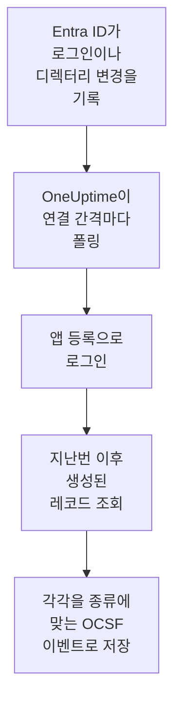

# Microsoft Entra ID

[Microsoft Entra ID](https://learn.microsoft.com/en-us/entra/identity/)의 로그인과 디렉터리 변경을 OneUptime의 보안 이벤트로 가져오고, 원하면 [Microsoft 365 감사 로그](https://learn.microsoft.com/en-us/purview/audit-log-activities)의 Exchange, SharePoint, OneDrive, Teams 활동도 가져옵니다. 그곳에서 로그, 트레이스, 메트릭과 나란히 검색하고, 다른 모든 소스와 상관 분석하고, 중요한 것에 대해 온콜을 호출할 수 있습니다. OneUptime은 직접 만든 앱 등록으로 이를 읽으며, 테넌트에서 아무것도 바꾸지 않습니다.

:::cards
- [연결 설정](#연결-설정): 앱 등록, 그 권한, 그리고 연결 양식.
- [가져오는 내용](#가져오는-내용): 어떤 레코드를 가져오는지, 각 레코드가 보안 이벤트가 되는 방식.
- [폴링 작동 방식](#폴링-작동-방식): 각 폴링이 읽는 구간과, 그 구간이 이전 구간과 30분 겹치는 이유.
- [문제 해결](#문제-해결): 각 오류의 의미와 바꿔야 할 점.
:::

## 작동 방식

OneUptime은 1분마다, 폴링 간격이 지난 활성화된 연결을 각각 폴링합니다. 폴링은 앱 등록으로 Microsoft Entra ID에 로그인하고, 지난 폴링 이후 기록된 디렉터리 변경([List directoryAudits](https://learn.microsoft.com/en-us/graph/api/directoryaudit-list))과 로그인([List signIns](https://learn.microsoft.com/en-us/graph/api/signin-list))을 이 순서로 읽은 다음, **Microsoft 365 감사 로그** 옵션이 켜져 있으면 감사 로그의 새 콘텐츠([Office 365 Management Activity API](https://learn.microsoft.com/en-us/office/office-365-management-api/office-365-management-activity-api-reference))를 읽습니다. 각 레코드는 [OCSF](https://schema.ocsf.io/) 이벤트로 저장됩니다. 로그인은 Authentication 이벤트로, 역할 할당은 User Access Management 이벤트로, 피싱 판정은 Detection Finding으로 저장됩니다.

## 사전 요건

- OneUptime에서 Project Owner, Project Admin 또는 Security Admin 역할. Security Member와 Security Viewer는 연결과 그 실행 기록을 볼 수 있지만 변경할 수는 없습니다.
- 로그인의 경우 Microsoft 365 E3, E5, Business Premium에 포함된 Microsoft Entra ID P1 또는 P2. Microsoft Graph는 이런 테넌트에만 로그인을 제공합니다. 디렉터리 변경은 어떤 테넌트에서든 읽습니다.
- Application Administrator처럼 애플리케이션을 등록할 수 있는 Entra 역할, 그리고 관리자 동의를 부여할 Global Administrator 또는 Privileged Role Administrator.
- Microsoft 365 감사 로그의 경우 테넌트에서 감사가 켜져 있어야 하며, 기본값이 켜짐입니다. [Microsoft Purview 포털](https://purview.microsoft.com)의 **Audit**에 **Start recording user and admin activity**가 표시되면 안 됩니다.
- OneUptime 앱과 워커에서 `login.microsoftonline.com`, `graph.microsoft.com`, `manage.office.com`으로, Azure Government의 경우 `login.microsoftonline.us`, `graph.microsoft.us`, `manage.office365.us`로 나가는 HTTPS.

## 연결 설정

연결은 [OAuth 2.0 클라이언트 자격 증명 흐름](https://learn.microsoft.com/en-us/entra/identity-platform/v2-oauth2-client-creds-grant-flow)으로 로그인합니다. 사람이 아니라 항상 애플리케이션으로, 읽기 전용 권한으로 로그인합니다.

:::steps
### 애플리케이션 등록

1. [Microsoft Entra 관리 센터](https://entra.microsoft.com)에 로그인하고 **App registrations**를 엽니다.
2. **New registration**을 선택합니다. 이름을 `OneUptime Security Events`로 정하고, **Supported account types**는 **Accounts in this organizational directory only**로 두고, 리디렉션 URI는 비워 둔 채 **Register**를 선택합니다.
3. 앱의 **Overview** 페이지에서 **애플리케이션(클라이언트) ID**와 **디렉터리(테넌트) ID**를 복사합니다.

### 로그를 읽도록 허용

1. **API permissions → Add a permission → Microsoft Graph → Application permissions**로 이동해 `AuditLog.Read.All`을 고르고 **Add permissions**를 선택합니다. Microsoft는 로그인 목록에 `Directory.Read.All`도 필요할 수 있다고 안내합니다. 동의를 부여한 뒤에도 로그인이 `403`으로 거부되면 추가하세요.
2. Microsoft 365 감사 로그를 위해 두 번째 권한을 추가합니다. **Add a permission → Office 365 Management APIs → Application permissions**를 선택한 다음 `ActivityFeed.Read`를 고릅니다.
3. 테넌트에 대해 **Grant admin consent for**를 선택하고 확인합니다. 각 권한의 상태가 **Granted**여야 합니다. 동의가 없으면 모든 읽기가 `403`으로 거부됩니다.

### 클라이언트 시크릿 만들기

**Certificates & secrets → Client secrets → New client secret**으로 이동해 만료 시점을 고르고 **Add**를 선택합니다. 페이지를 떠나기 전에 시크릿의 **Secret ID**가 아니라 **Value**를 복사하세요. 다시는 표시되지 않습니다. 만료되는 날이 되면 **자격 증명 업데이트**로 교체할 때까지 폴링이 `Microsoft Entra ID token request failed (HTTP 401)`로 멈춥니다.

### OneUptime에서 연결 추가

**제품 → Security Events → 연결**(`/dashboard/{projectId}/security-events/connections`)를 열고 **연결 추가**를 클릭한 다음, **아이덴티티** 아래의 **Microsoft Entra ID**를 고르고 **다음**을 클릭합니다. 아래 표의 설정을 채우고 **다음**을 클릭한 뒤, 시크릿 값을 **클라이언트 시크릿**에 붙여 넣습니다. **폴링** 단계에서 **Microsoft 365 감사 로그**를 켜면 그것도 읽습니다.

### 저장하기 전에 테스트

**저장하기 전에 테스트** 아래의 **이 설정 테스트**를 클릭합니다. 테스트는 양식의 값으로 로그인해 각 로그를 읽지만 아무것도 저장하지 않으므로, 잘못된 시크릿이나 빠진 동의를 연결이 생기기 전에 알 수 있습니다. 그런 다음 **다음**을 클릭하고 연결에 **이름**을 지정해 만듭니다.
:::

| 설정 | 찾는 위치 |
| --- | --- |
| **디렉터리(테넌트) ID** | 앱의 **Overview** 페이지. 테넌트의 GUID 또는 `contoso.onmicrosoft.com` 같은 확인된 도메인. **Microsoft 365 감사 로그**가 켜져 있으면 GUID여야 합니다. Management API는 테넌트를 GUID로만 식별합니다. |
| **애플리케이션(클라이언트) ID** | 앱의 **Overview** 페이지. `AuditLog.Read.All`을 가진 앱의 GUID. |
| **클라우드** | **Azure 퍼블릭 클라우드**, 또는 GCC High용 **Azure Government(미국)** (`login.microsoftonline.us`, `graph.microsoft.us`, `manage.office365.us`). |
| **Microsoft 365 감사 로그** | 선택 사항이며 기본값은 꺼짐. 켜면 폴링할 때마다 Microsoft 365 감사 로그도 읽습니다. 앱에 `ActivityFeed.Read`가 필요합니다. |
| **클라이언트 시크릿** | 시크릿의 **Value**. 암호화되며, API가 반환하지 않고 다시는 표시되지 않습니다. 연결의 **자격 증명 업데이트**로 교체합니다. |

**폴링** 단계에는 선택 사항인 **설명**, `1`부터 `1440`까지의 정수이며 처음 값이 `5`인 **폴링 간격(분)**, 그리고 처음에 켜져 있는 **활성화됨**도 있습니다.

## 가져오는 내용

모든 이벤트의 공급업체는 `Microsoft`, 제품은 `Microsoft Entra ID`입니다. 속성 `entra.log`는 로그인이나 변경이 어느 로그에서 왔는지 알려 주고, Microsoft 365 레코드의 `microsoft365.contentType`은 그 콘텐츠 유형을 알려 줍니다.

| 레코드 | OCSF 클래스 | 심각도 |
| --- | --- | --- |
| 성공한 로그인 | Authentication (`3002`), 상태 `Success` | Informational |
| MFA(`50074`, `50076`)나 비밀번호 변경 요청처럼 두 번째 단계를 기다리는 로그인 | Authentication (`3002`), 상태 `Interrupted` | Informational: 실패가 아니라 한 단계 |
| 실패한 로그인(Entra의 이유와 오류 코드 포함) | Authentication (`3002`), 상태 `Failure` | Low |
| Identity Protection이 중간 또는 높은 위험으로 평가한 로그인 | Authentication (`3002`) | Medium 또는 High |
| 변경된 사용자, 그룹 또는 역할(범주별) | Account Change (`3001`), Group Management (`3006`), User Access Management (`3005`), 나머지는 Entity Management (`3004`) | Global Administrator 같은 권한 있는 역할은 Medium, 실패한 변경은 Low |

**Microsoft 365 감사 로그**가 켜져 있으면 보안 팀이 대응하는 레코드를 그곳에서 가져오고, 열린 파일이나 읽은 메일 같은 나머지는 개수만 셉니다.

| Microsoft 365 레코드 | OCSF 클래스 | 심각도 |
| --- | --- | --- |
| `New-InboxRule`이나 `Set-Mailbox` 같은 Exchange cmdlet, Outlook에서 만든 받은 편지함 규칙, 다른 사람 이름으로 보낸 메일 | API Activity (`6003`) | 메일을 전달하면 Medium이며 `microsoft365.forwardsMail`이 `true`로 설정됩니다 |
| `Add-MailboxPermission` 같은 사서함 권한 부여 | User Access Management (`3005`) | Low |
| SharePoint 또는 OneDrive에서 공유한 파일 | File Hosting Activity (`6006`) | 게스트나 누구나 열 수 있는 링크와 공유하면 Low이며 `microsoft365.sharedOutside`가 `true`로 설정됩니다 |
| 추가되거나 제거된 사이트 모음 관리자 | User Access Management (`3005`) | Low |
| Microsoft Defender for Office 365가 찾은 맬웨어 또는 피싱 메일 | Detection Finding (`2004`) | 맬웨어는 High, 피싱은 Medium |
| Microsoft 365가 발생시킨 알림 | Detection Finding (`2004`) | 알림 자체의 심각도 |
| 팀에 추가된 앱, 봇 또는 커넥터 | Application Lifecycle (`6002`) | Low |

시스템 계정으로 실행되는 Exchange 자체의 내부 작업은 메일을 전달하지 않는 한 제외됩니다. 모든 이벤트는 `status.errorCode`나 `Parameters.ForwardTo` 같은 점 구분 키로 평탄화한 레코드 전체를 보관하므로, 규칙은 Microsoft가 붙인 이름으로 어떤 필드든 읽을 수 있습니다. 규칙 라이브러리의 Entra ID 규칙은 여기서 가져온 그대로 읽습니다.

같은 로그인과 디렉터리 변경은 Azure 진단 설정으로 내보내 [내 로그](/docs/telemetry/security-events#로그에서-보안-이벤트-찾기)가 읽는 로그로 OneUptime에 들어올 수도 있습니다. 어느 경로든 각 레코드는 같은 이벤트 ID를 받지만, 두 경로로 모두 읽은 레코드는 두 번 저장됩니다. Entra ID는 한 경로로만 읽으세요.

## 폴링 작동 방식

- **레코드는 Entra ID가 기록한 시각으로 읽습니다**. 변경은 `activityDateTime`, 로그인은 `createdDateTime`입니다.
- **첫 폴링은 24시간 전까지 거슬러 올라가므로**, 새 연결에서 최근 레코드가 바로 보입니다.
- **이후의 모든 폴링은 저장된 커서보다 30분 앞에서 시작합니다.** Microsoft는 두 로그 모두 몇 분 늦게 도착한다고 안내하므로, 겹치는 부분 덕분에 늦은 레코드는 다음 폴링에서 읽히고, 중복은 프로젝트 안에서 레코드 ID로 걸러집니다.
- **한 번의 폴링은 커서 이후 최대 24시간까지 읽습니다.** 커서가 뒤처진 연결은 24시간 구간을 연달아 읽으며 따라잡습니다.
- **Microsoft Entra ID P1도 P2도 없는 테넌트**는 디렉터리 변경을 가져오며, 각 실행의 **Read sign-ins** 검사가 로그인을 읽지 못했다고 경고합니다.
- **실패한 실행은 아무것도 바꾸지 않습니다.** 네트워크 오류나 Graph의 오류 상태 뒤에는 커서와 구간 길이가 그대로 유지되고, 다음 폴링이 같은 구간을 다시 읽습니다. 단 하나의 예외는 요청 시간이 초과된 경우입니다. 커서는 그대로지만 다음 구간은 절반 길이가 됩니다. 제시간에 응답할 수 없을 만큼 무거운 구간은 매번 시간 초과될 것이기 때문입니다.

Microsoft 365 감사 로그는 Microsoft가 각 콘텐츠 Blob을 사용할 수 있게 한 시각으로, 하루씩, Microsoft가 보관하는 7일보다 이전으로는 거슬러 가지 않고 읽습니다. 첫 폴링에서 앱을 `Audit.Exchange`, `Audit.SharePoint`, `Audit.General`에 구독시키며, Microsoft는 새 구독의 첫 레코드를 12시간 안에 사용할 수 있게 합니다. 감사 로그가 Entra ID 로그를 멈추는 일은 없습니다. 권한이 없으면 경고가 되고 구간은 다음으로 넘어가지만, `HTTP 503` 같은 Microsoft 쪽 장애는 실행을 **부분**으로 만들어 구간을 다시 읽게 합니다.

### 한 번의 폴링으로 다 읽을 수 없는 구간

각 로그에는 자체 예산이 있습니다. 디렉터리 변경은 500개짜리 페이지 10개, 로그인은 500개짜리 페이지 20개, Microsoft 365 감사 로그는 요청 120개와 레코드 10,000개입니다. 폴링은 4분 뒤에 멈춥니다. 예산 때문에 구간이 끝나기 전에 로그 읽기가 멈추면 실행은 **부분**이 되고, 그 경고에 로그와 예산이 표시됩니다. Microsoft Graph는 최신 레코드부터 나열하므로, OneUptime은 닿지 못한 레코드 너머로 커서를 옮기는 대신 구간을 줄입니다.

1. **좁히기.** 다음 폴링은 같은 시작점에서 절반 길이의 구간을 읽으며, 구간을 끝까지 읽을 수 있게 될 때까지 계속 절반으로 줄이고, 가장 짧게는 1분까지 줄입니다. 실행의 경고에 그렇게 적힙니다: `This window holds more records than one poll can read; the next poll reads a {n} minute window from the same starting point.` 더 긴 구간에서 이미 가져온 레코드는 중복으로 건너뜁니다.
2. **다시 늘리기.** 구간을 끝까지 읽으면 커서가 그 끝으로 옮겨지고, 다음 구간은 다시 두 배가 되며, 최대 24시간까지 늘어납니다.
3. **1분 넘어가기.** 1분 안에조차 한 번의 폴링으로 읽을 수 있는 것보다 많으면, 더 새로운 레코드가 계속 도착하도록 폴링이 그 1분을 넘어갑니다. 실행은 **부분**으로 남고, **마지막 오류**에는 `More records were created in the one minute from {cursor} to {end} than one poll can read. Polling moved past this minute so newer records keep arriving; use Import this time range in Diagnostics on this minute to recover what one run can read.`가 표시됩니다. 그 1분을 **Import this time range**로 가져오면 한 번의 실행으로 읽을 수 있는 만큼 되찾을 수 있습니다.

**폴링 간격(분)** 값을 바꿔도 이 중 어느 것도 달라지지 않습니다. 이 설정은 폴링이 얼마나 자주 시작하는지를 정할 뿐, 구간이 어디서 시작하는지는 정하지 않습니다.

### 필요할 때 실행, 미리 보기, 가져오기

연결에서 **진단**을 클릭하면 최근 실행을 보고 연결을 직접 다룰 수 있습니다. 연결을 변경할 수 있는 사람은 누구나 이를 시작할 수 있고, 연결을 볼 수 있는 사람은 누구나 기록을 읽을 수 있습니다.

- **지금 실행**은 연결이 **활성화됨** 상태가 아닐 때에도 평소의 커서로 즉시 폴링을 시작합니다.
- **Preview records**는 최대 7일의 시간 범위를 읽으며 아무것도 가져오지 않습니다.
- **Import this time range**는 확인을 거친 뒤 최대 7일의 범위를 가져오며, 커서는 옮기지 않습니다. 이미 가져온 레코드는 건너뜁니다. Microsoft Entra ID는 P1 또는 P2가 있으면 로그인과 디렉터리 변경을 30일, 없으면 7일 동안 보관합니다.
- 실행의 **Copy diagnostics**는 지원팀에 보낼 보고서를 복사합니다. 자격 증명은 절대 포함되지 않습니다.

## 연결 테스트

연결 행의 **연결 테스트**와 양식의 **이 설정 테스트**는 백그라운드 워커가 아니라 API 프로세스에서 실행되므로, 워커가 문제일 때에도 테스트는 응답합니다. 다음 검사를 순서대로 실행합니다:

| 검사 | 확인하는 내용 |
| --- | --- |
| **구성** | 모든 설정이 있고 올바른 형식인지. 이 검사가 실패하면 아무 곳에도 연결하지 않습니다. |
| **Authenticate with Microsoft Entra** | 선택한 클라우드에서 Entra ID가 앱에 Microsoft Graph용 토큰을 발급하는지. |
| **Read sign-ins** | 지난 24시간의 로그인을 읽을 수 있는지. P1도 P2도 없는 테넌트에서는 실패가 아니라 경고입니다. |
| **Read directory changes** | 지난 24시간의 디렉터리 변경을 읽을 수 있는지. |
| **Read the Microsoft 365 audit log** | 옵션이 켜져 있을 때만: Management API가 응답하는지, 그리고 앱이 어떤 콘텐츠 유형을 구독하는지. |
| **Records available to import** | 지난 24시간에 로그인과 디렉터리 변경이 몇 개 있는지. 각각 최대 500개까지 세므로 `500+`는 그보다 많다는 뜻입니다. 하나도 없으면 경고입니다. |
| **Background workers**, **Poll scheduler**, **Security event storage** | OneUptime 쪽: Worker 큐의 작업을 가져가는 프로세스가 있고, 폴링 작업이 매분 실행되고, 보안 이벤트 저장소가 응답하는지. |
| **Scheduled polling** | 저장된 연결의 경우: 폴링이 켜져 있고, 워커를 기다리며 멈춘 실행이 없고, 폴링이 제때 실행되는지. |

테스트의 모든 요청에는 20초 기한이 있습니다. 테스트는 아무것도 가져오지 않고 커서를 옮기지도 않으며, 실패한 각 검사는 무엇을 바꿔야 하는지 알려 줍니다.

## 문제 해결

연결의 **마지막 오류**는 자격 증명을 가린 전체 오류 메시지를 보관합니다. 연결에 오류가 있으면 **작업** 열에서 **오류 보기**를 선택해 읽고, 대화 상자의 **오류 복사**로 복사하세요. 모든 메시지는 `Microsoft Entra ID`로 시작하고, 이어서 실패한 요청을 밝히며, Microsoft의 오류 코드가 있으면 인용합니다.

:::details 마지막 오류에 `token request failed`가 나옴
- `HTTP 401`과 `invalid_client`: 클라이언트 시크릿이 잘못되었거나 만료되었습니다. 새 시크릿을 만들어 **자격 증명 업데이트**로 저장하세요.
- 애플리케이션(클라이언트) ID나 테넌트를 언급하는 `HTTP 400`: 앱의 **Overview** 페이지에서 둘 다 확인하고, **클라우드**가 테넌트의 클라우드인지도 확인하세요.
:::

:::details 마지막 오류에 `sign-ins request failed (HTTP 403)` 또는 `audit logs request failed (HTTP 403)`가 나옴
- 오류 코드 `Authorization_RequestDenied`: 앱에 `AuditLog.Read.All`이 없거나 동의가 부여되지 않았습니다. 관리자 동의를 부여하고 몇 분 기다린 뒤 다시 테스트하세요. 로그인을 위해서는 `Directory.Read.All`도 부여하세요.
- 오류 코드 `Authentication_RequestFromNonPremiumTenantOrB2CTenant`: 테넌트에 Microsoft Entra ID P1도 P2도 없습니다. 디렉터리 변경은 계속 가져옵니다.
:::

:::details Microsoft 365 감사 로그를 읽지 못함
- `AF10001`과 함께 `subscriptions request failed (HTTP 401)` 또는 `(HTTP 403)`: 앱에 Office 365 Management APIs의 `ActivityFeed.Read`가 없거나 동의가 부여되지 않았습니다.
- `AF20010`부터 `AF20013`까지: Management API가 **디렉터리(테넌트) ID**를 알지 못합니다. 테넌트의 GUID를 사용하세요.
- `AF20023`과 함께 `subscription start failed`: 관리자가 구독을 껐습니다. 구독할 수 없는 콘텐츠 유형은 실행의 경고에 표시되고, 나머지는 계속 읽습니다.
- 첫 폴링 뒤 몇 시간 동안 레코드가 없음: Microsoft는 새 구독의 첫 콘텐츠를 12시간 안에 사용할 수 있게 합니다.
:::

:::details 마지막 오류에 `did not complete`가 나옴
요청이 응답을 받지 못했습니다. 시간 초과, 확인되지 않는 이름 또는 거부된 주소입니다. OneUptime 앱과 워커가 사용하는 프록시를 거쳐 [사전 요건](#사전-요건)의 호스트에 닿을 수 있는지 확인하세요.
:::

:::details 테스트는 통과하지만 Last Polled가 Never임
폴링 작업이 한 번도 실행되지 않았습니다. **Background workers**와 **Poll scheduler** 검사를 읽으세요. 자체 호스팅 설치에서 흔한 원인은 앱에 `DISABLE_QUEUE_WORKERS=true`가 설정되어 있는데 작업을 가져가는 별도의 워커 배포가 없는 경우입니다. 이를 `false`로 설정하거나 워커 배포를 실행하세요(Helm: `worker.enabled: true`, 기본값은 `false`).
:::

## 다음 단계

:::cards
- [보안 이벤트](/docs/telemetry/security-events): 가져온 내용을 검색하고, 상관 분석하고, 알림을 받습니다.
- [Okta 시스템 로그](/docs/integrations/okta): 다른 ID 공급자의 로그인을 가져옵니다.
- [Google Workspace](/docs/integrations/google-workspace): Google의 로그인과 관리자 변경을 가져옵니다.
- [통합 개요](/docs/integrations/index): 연결할 수 있는 다른 도구.
:::
