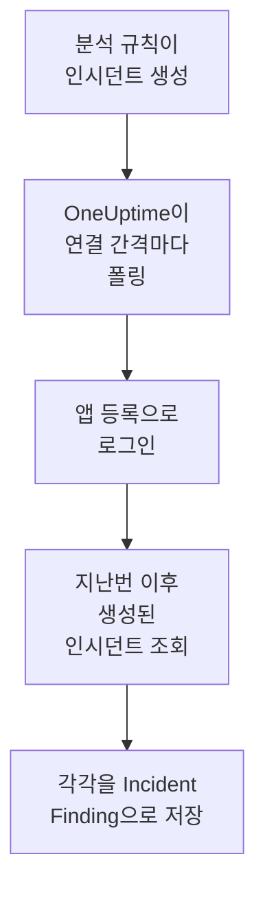

# Microsoft Sentinel

[Microsoft Sentinel](https://learn.microsoft.com/en-us/azure/sentinel/overview) 분석 규칙이 여는 인시던트를 OneUptime의 보안 이벤트로 가져옵니다. 그곳에서 로그, 트레이스, 메트릭과 나란히 검색하고, 다른 모든 소스와 상관 분석하고, 중요한 인시던트에 대해 온콜을 호출할 수 있습니다. OneUptime은 직접 만든 앱 등록으로 인시던트를 읽으며, Azure에서는 아무것도 바꾸지 않습니다.

:::cards
- [연결 설정](#연결-설정): 앱 등록, 역할, 그리고 연결 양식.
- [가져오는 내용](#가져오는-내용): 각 Sentinel 인시던트가 보안 이벤트가 되는 방식.
- [폴링 작동 방식](#폴링-작동-방식): 각 폴링이 읽는 구간과, 바쁜 워크스페이스에서 일어나는 일.
- [문제 해결](#문제-해결): 각 오류의 의미와 바꿔야 할 점.
:::

## 작동 방식



OneUptime은 1분마다, 폴링 간격이 지난 활성화된 연결을 각각 폴링합니다. 폴링은 앱 등록으로 Microsoft Entra ID에 로그인하고, 지난 폴링 이후 생성된 인시던트를 Azure Resource Manager에 요청한 다음, 각각을 [OCSF](https://schema.ocsf.io/) Incident Finding 이벤트(클래스 `2005`)로 저장합니다. 그러면 탐지 규칙, 모니터, 대시보드는 이를 다른 소스의 보안 이벤트와 똑같이 다룹니다.

## 사전 요건

- OneUptime에서 Project Owner, Project Admin 또는 Security Admin 역할. Security Member와 Security Viewer는 연결과 그 실행 기록을 볼 수 있지만 변경할 수는 없습니다.
- Microsoft Sentinel이 활성화된 Log Analytics 워크스페이스. Azure 퍼블릭 클라우드 또는 Azure Government (US)에 있어야 합니다.
- Microsoft Entra ID에서 앱 등록과 클라이언트 시크릿을 만들 권한.
- 워크스페이스가 있는 리소스 그룹에서 Owner나 User Access Administrator처럼 역할을 할당할 수 있는 권한.

## 연결 설정

연결은 OAuth 2.0 클라이언트 자격 증명 흐름으로 로그인합니다. 사람이 아니라 항상 애플리케이션으로 로그인합니다. 접근 권한은 Azure 역할에서 오므로, 앱 등록에는 API 권한이 필요 없습니다.

:::steps
### 애플리케이션 등록

1. [Azure portal](https://portal.azure.com)에 로그인하고 **Microsoft Entra ID**를 엽니다.
2. **App registrations → New registration**으로 이동합니다. 이름을 `OneUptime Sentinel connector`로 정하고, **Supported account types**는 **Accounts in this organizational directory only**로 두고, 리디렉션 URI는 비워 둔 채 **Register**를 선택합니다.
3. 앱의 **Overview** 페이지에서 **애플리케이션(클라이언트) ID**와 **디렉터리(테넌트) ID**를 복사합니다.
4. **Certificates & secrets → Client secrets → New client secret**으로 이동해 만료 시점을 고르고 **Add**를 선택합니다. 페이지를 떠나기 전에 시크릿의 **Secret ID**가 아니라 **Value**를 복사하세요. 다시는 표시되지 않습니다.

### 인시던트를 읽도록 허용

1. Azure portal에서 Log Analytics 워크스페이스가 있는 리소스 그룹을 엽니다.
2. **Access control (IAM) → Add → Add role assignment**를 선택합니다.
3. **Role** 탭에서 **Microsoft Sentinel Reader**를 고릅니다.
4. **Members** 탭에서 **User, group, or service principal**을 고르고, **Select members**를 클릭한 다음 이름으로 앱 등록을 고릅니다.
5. **Review + assign**을 선택합니다.

이 역할로 앱은 인시던트를 읽을 수 있지만(`Microsoft.SecurityInsights/incidents/read`), 아무것도 쓸 수 없습니다. Microsoft는 인시던트를 제공하는 `SecurityInsights` 솔루션도 포함되도록, 워크스페이스가 아니라 리소스 그룹에 할당할 것을 권장합니다. 새 할당이 적용되기까지 몇 분 걸릴 수 있습니다.

### 워크스페이스 세부 정보 찾기

Azure portal에서 Log Analytics 워크스페이스를 엽니다. 그 **Overview** 페이지에 **구독 ID**, **Resource group**, 워크스페이스 이름이 표시됩니다. 워크스페이스의 리소스 ID에도 같은 세 가지가 들어 있습니다:

```text
/subscriptions/{Subscription ID}/resourceGroups/{Resource group}/providers/Microsoft.OperationalInsights/workspaces/{Workspace name}
```

### OneUptime에서 연결 추가

**제품 → Security Events → 연결**(`/dashboard/{projectId}/security-events/connections`)를 열고 **연결 추가**를 클릭한 다음, **Microsoft Sentinel**을 고르고 **다음**을 클릭합니다. 아래 표의 설정을 채우고 **다음**을 클릭한 뒤, 시크릿 값을 **클라이언트 시크릿**에 붙여 넣습니다.

### 저장하기 전에 테스트

**저장하기 전에 테스트** 아래의 **이 설정 테스트**를 클릭합니다. 테스트는 양식의 값으로 로그인해 인시던트를 읽지만 아무것도 저장하지 않으므로, 잘못된 시크릿이나 빠진 역할을 연결이 생기기 전에 알 수 있습니다. 그런 다음 **다음**을 클릭하고 연결에 **이름**을 지정해 만듭니다.
:::

| 설정 | 찾는 위치 |
| --- | --- |
| **디렉터리(테넌트) ID** | 앱의 **Overview** 페이지. 테넌트의 GUID 또는 `contoso.onmicrosoft.com` 같은 확인된 도메인. |
| **애플리케이션(클라이언트) ID** | 앱의 **Overview** 페이지. GUID. |
| **구독 ID** | 워크스페이스의 **Overview** 페이지. GUID. |
| **Resource group** | 워크스페이스의 **Overview** 페이지. 영문자, 숫자, 밑줄, 하이픈, 마침표, 괄호로 된 1~90자이며, 마침표로 끝나지 않습니다. |
| **Workspace name** | 워크스페이스의 **Overview** 페이지. 영문자, 숫자, 하이픈으로 된 3~90자이며, 영문자나 숫자로 시작하고 끝납니다. |
| **클라우드** | **Azure 퍼블릭 클라우드** (`login.microsoftonline.com`, `management.azure.com`) 또는 **Azure Government(미국)** (`login.microsoftonline.us`, `management.usgovcloudapi.net`). |
| **클라이언트 시크릿** | 시크릿의 **Value**. 암호화되며, API가 반환하지 않고 다시는 표시되지 않습니다. 연결의 **자격 증명 업데이트**로 교체합니다. |

**폴링** 단계에는 선택 사항인 **설명**, `1`부터 `1440`까지의 정수이며 처음 값이 `5`인 **폴링 간격(분)**, 그리고 처음에 켜져 있는 **활성화됨**도 있습니다.

## 가져오는 내용

각 Sentinel 인시던트는 Incident Finding 이벤트 하나(OCSF 클래스 `2005`, 활동 `Create`)가 되며, 텔레메트리 서비스 `Microsoft Sentinel`에 귀속됩니다:

| OCSF 열 | Sentinel 인시던트 필드 |
| --- | --- |
| `time` | `properties.createdTimeUtc`. Sentinel이 인시던트를 만든 시각 |
| `eventUid` | `name`. 인시던트의 GUID로, 중복을 걸러 내는 기준이기도 합니다 |
| `message`, `ruleName` | `properties.title` |
| `ruleId` | 첫 번째 `properties.relatedAnalyticRuleIds` 항목 끝에 있는 규칙 GUID |
| `severityName` | `properties.severity`: `High`, `Medium`, `Low` 또는 `Informational` |
| `statusName` | `properties.status`: `New`, `Active` 또는 `Closed` |
| `mitreTactics` | ATT&CK ID로 바꾼 `properties.additionalData.tactics`. `Persistence`는 `TA0003`이 됩니다 |
| `principalUser` | `properties.owner.userPrincipalName` 또는 `properties.owner.email` |
| `targetResource` | `properties.incidentUrl`. Azure portal에서 인시던트로 가는 링크 |
| `observables` | 소유자의 UPN, 이메일, 개체 ID, 그리고 모든 레이블의 이름 |
| `attributes` | `properties.classification`, `properties.firstActivityTimeUtc` 같은 점 구분 키로 펼친 인시던트 전체 |

폴링 구간 안에 생성된 닫힌 인시던트도 가져옵니다. 열려 있는 인시던트만 보려면 보안 이벤트 탐색기에서 `statusName`으로 필터링하세요.

## 폴링 작동 방식

각 폴링은 구간 안에서 생성된 인시던트를 오래된 것부터 한 페이지에 50개씩 나열하고, 구간 전체를 읽을 때까지 API의 `nextLink`를 따라갑니다:

```text
GET https://management.azure.com/subscriptions/{sub}/resourceGroups/{rg}/providers/Microsoft.OperationalInsights/workspaces/{ws}/providers/Microsoft.SecurityInsights/incidents
    ?api-version=2024-03-01
    &$filter=(properties/createdTimeUtc ge {windowStart}) and (properties/createdTimeUtc lt {windowEnd})
    &$orderby=properties/createdTimeUtc asc
    &$top=50
```

- **생성 시각이 커서입니다.** 매시간 실행되는 예약된 분석 규칙은 일치한 활동보다 한참 뒤에 인시던트를 열며, 인시던트의 `firstActivityTimeUtc`는 몇 시간이나 며칠 더 이전일 수 있습니다. 활동 시각을 기준으로 하는 커서라면 그런 인시던트를 모두 건너뛸 것입니다. 활동 시각은 `attributes`에 남아 있고, Diagnostics의 샘플은 두 시각을 모두 보여 줍니다.
- **첫 폴링은 24시간 전까지 거슬러 올라가므로**, 새 연결에서 최근 인시던트가 바로 보입니다.
- **이후의 모든 폴링은 저장된 커서보다 1분 앞에서 시작하므로**, 두 구간의 경계에서 생성된 인시던트도 건너뛰지 않습니다.
- **한 번의 폴링은 커서 이후 최대 24시간까지 읽습니다.** 커서가 뒤처진 연결은 24시간 구간을 연달아 읽으며 따라잡고, 그동안 **상태**는 **Catching up**으로 표시됩니다.
- **중복은 인시던트의 GUID로 걸러집니다**(`name`). 프로젝트 안에서 걸러지므로, 겹치는 부분, 다시 시도한 구간, 가져오기 중 어느 것도 인시던트를 두 번 저장하지 않습니다.

### 한 번의 폴링으로 다 읽을 수 없는 구간

한 번의 폴링은 인시던트 50개짜리 페이지를 최대 20개, 즉 인시던트 1,000개까지 읽습니다. 이 한도 때문에 구간 끝에 이르기 전에 멈추면, 실행은 **부분**이 되고 다음과 같은 경고가 붙습니다:

```text
Stopped after 20 incidents requests (the per-run request limit) before reading the whole window. Incidents are read oldest first; every incident created before 2026-09-14T08:12:44.000Z was read.
```

인시던트는 오래된 것부터 읽히므로, OneUptime은 커서를 마지막으로 읽은 인시던트의 생성 시각으로 옮기고, 다음 폴링은 같은 구간 길이로 거기서 시작합니다. 바쁜 워크스페이스는 같은 인시던트를 다시 읽는 대신 폴링마다 약 1,000개씩 따라잡습니다. 바로 그 시각에 생성된 인시던트는 두 번 읽히지만, 중복 검사가 두 번째 사본을 걸러 냅니다.

실행이 저장된 커서를 전혀 넘어서지 못하면, OneUptime은 대신 구간을 줄입니다:

1. **좁히기.** 다음 폴링은 같은 시작점에서 절반 길이의 구간을 읽으며, 구간을 끝까지 읽을 수 있게 될 때까지 계속 절반으로 줄이고, 가장 짧게는 1분까지 줄입니다. 실행의 경고에 그렇게 적힙니다: `This window holds more records than one poll can read; the next poll reads a {n} minute window from the same starting point.`
2. **다시 늘리기.** 구간을 끝까지 읽은 뒤에는 다음 구간이 다시 두 배가 되며, 최대 24시간까지 늘어납니다.
3. **1분 넘어가기.** 1분 안에조차 한 번의 폴링으로 읽을 수 있는 것보다 많은 레코드가 있으면, 더 새로운 인시던트가 계속 도착하도록 폴링이 그 1분을 넘어갑니다. 실행은 **부분**로 남고, **마지막 오류**에는 `More records were created in the one minute from {cursor} to {end} than one poll can read. Polling moved past this minute so newer records keep arriving; use Import this time range in Diagnostics on this minute to recover what one run can read.`가 표시됩니다. 그 1분을 **Import this time range**로 가져오면 한 번의 실행으로 읽을 수 있는 만큼 되찾을 수 있습니다.

Microsoft Entra ID나 Azure Resource Manager의 오류로 실행이 완전히 실패하면, 커서와 구간 길이는 그대로 유지되고 다음 폴링이 같은 구간을 다시 읽습니다. 단 하나의 예외는 요청 시간이 초과된 경우입니다. 커서는 그대로지만 다음 구간은 절반 길이가 됩니다. 제시간에 응답할 수 없을 만큼 무거운 구간은 매번 시간 초과될 것이기 때문입니다. **폴링 간격(분)** 값을 바꿔도 이 중 어느 것도 바뀌지 않습니다. 이 값은 폴링이 얼마나 자주 시작되는지를 정할 뿐, 구간이 어디서 시작되는지는 정하지 않습니다.

### 필요할 때 실행, 미리 보기, 가져오기

연결에서 **진단**을 클릭하면 최근 실행을 보고 연결을 직접 다룰 수 있습니다. 연결을 변경할 수 있는 사람은 누구나 이를 시작할 수 있고, 연결을 볼 수 있는 사람은 누구나 기록을 읽을 수 있습니다.

- **지금 실행**은 연결이 **활성화됨** 상태가 아닐 때에도 평소의 커서로 즉시 폴링을 시작합니다.
- **Preview incidents**는 최대 7일의 시간 범위를 읽으며 아무것도 가져오지 않습니다.
- **Import this time range**는 확인을 거친 뒤 최대 7일의 범위를 가져오며, 커서는 옮기지 않습니다. 이미 가져온 인시던트는 건너뜁니다.
- 실행의 **Copy diagnostics**는 지원팀에 보낼 보고서를 복사합니다. 자격 증명은 절대 포함되지 않습니다.

## 연결 테스트

연결 행의 **연결 테스트**와 양식의 **이 설정 테스트**는 백그라운드 워커가 아니라 API 프로세스에서 실행되므로, 워커가 문제일 때에도 테스트는 응답합니다. 다음 검사를 순서대로 실행합니다:

| 검사 | 확인하는 내용 |
| --- | --- |
| **구성** | 모든 설정이 있고 올바른 형식인지. 이 검사가 실패하면 아무 곳에도 연결하지 않습니다. |
| **Authenticate with Microsoft Entra** | Microsoft Entra ID가 앱 등록에 Azure Resource Manager용 토큰을 발급하는지. |
| **Read incidents** | 지난 24시간 동안 생성된 인시던트 하나를 읽을 수 있는지(`$top=1`). 이로써 역할과 워크스페이스 세부 정보가 확인됩니다. |
| **Incidents available to import** | 지난 24시간과 지난 7일 동안 생성된 인시던트 수. 각각 50개짜리 한 페이지로 세므로 `50+`는 그보다 많다는 뜻입니다. 7일 동안 하나도 없으면 실패가 아니라 경고입니다. |
| **Background workers**, **Poll scheduler**, **Security event storage** | OneUptime 쪽: Worker 큐의 작업을 가져가는 프로세스가 있고, 폴링 작업이 매분 실행되고, 보안 이벤트 저장소가 응답하는지. |
| **Scheduled polling** | 저장된 연결의 경우: 폴링이 켜져 있고, 워커를 기다리며 멈춘 실행이 없고, 폴링이 제때 실행되는지. |

테스트의 모든 요청에는 20초 기한이 있습니다. 테스트는 아무것도 가져오지 않고 커서를 옮기지도 않으며, 실패한 각 검사는 무엇을 바꿔야 하는지 알려 줍니다.

## Microsoft Sentinel로 보안 이벤트 보내기

OneUptime은 찾은 것을 Azure Monitor의 Logs Ingestion API를 통해 Microsoft Sentinel로도 보낼 수 있으며, Sentinel이 실행되는 작업 영역의 사용자 지정 테이블에 씁니다. 그러면 분석 규칙, 헌팅 쿼리, 통합 문서가 다른 테이블과 나란히 `OneUptimeSecurityEvents_CL` 을 쿼리합니다.

:::steps
### 테이블과 데이터 수집 규칙 만들기

Azure Portal에서 작업 영역의 **Tables → Create → New custom log (DCR-based)** 를 엽니다. 테이블 이름을 `OneUptimeSecurityEvents` 로 하고, 새 데이터 수집 규칙을 만들며, 양식이 요구하면 데이터 수집 엔드포인트도 만듭니다. 아래 샘플을 샘플 파일로 업로드하고, 변환은 그대로 둔 채 테이블을 만듭니다.

### 애플리케이션이 보낼 수 있게 하기

[애플리케이션 등록](#애플리케이션-등록) 에서처럼 애플리케이션을 등록하고 클라이언트 비밀을 줍니다. 그런 다음 데이터 수집 규칙을 열고 **Access control (IAM) → Add → Add role assignment** 에서 **Monitoring Metrics Publisher** 를 고른 뒤 애플리케이션을 선택합니다.

### 대상 추가하기

**제품 → Security Events → 연결**를 엽니다. **SIEM으로 보내기**에서 **대상 추가**를 클릭하고, **SIEM** 에서 Microsoft Sentinel을 고른 뒤 **다음** 을 클릭합니다. **디렉터리(테넌트) ID**, **애플리케이션(클라이언트) ID**, **클라이언트 시크릿**, 데이터 수집 엔드포인트(또는 규칙)의 **Overview** 에 있는 **로그 수집 엔드포인트**, 규칙의 **JSON View** 에 있는 **데이터 수집 규칙 변경 불가 ID** 를 입력합니다. **스트림** 은 선택 사항이며, 비워 두면 `Custom-OneUptimeSecurityEvents_CL` 입니다.

### 테스트 이벤트를 보내고 전송 시작하기

**테스트 이벤트 보내기** 를 클릭하면 몇 분 안에 테이블에 행 하나가 도착합니다. 그런 다음 **보낼 내용** 에서 **탐지만** 을 그대로 두거나 **모든 보안 이벤트** 를 고르고, **전송 시작** 을 클릭합니다.
:::

테이블의 모든 열이 들어 있는 행 하나짜리 샘플 파일:

```json title="oneuptime-security-events-sample.json"
[
  {
    "TimeGenerated": "2026-10-21T10:00:00.000Z",
    "EventId": "0193c0de-cccc-4aaa-8bbb-000000000001",
    "EventUid": "okta-1",
    "ClassName": "Authentication",
    "CategoryName": "Identity & Access Management",
    "ActivityName": "Logon",
    "Severity": "Medium",
    "SeverityId": 3,
    "Status": "Failure",
    "Message": "Failed sign-in for alice",
    "VendorName": "Okta",
    "ProductName": "Okta System Log",
    "RuleId": "",
    "RuleName": "",
    "MitreTactics": [],
    "MitreTechniques": [],
    "PrincipalUser": "alice@example.com",
    "PrincipalHost": "laptop-7",
    "PrincipalIp": "203.0.113.7",
    "TargetUser": "",
    "TargetHost": "app.example.com",
    "TargetIp": "198.51.100.20",
    "TargetPort": 443,
    "TargetResource": "",
    "ProcessName": "",
    "ProcessCommandLine": "",
    "ParentProcessName": "",
    "Observables": [
      "alice@example.com",
      "203.0.113.7"
    ],
    "Attributes": {
      "okta.outcome.reason": "INVALID_CREDENTIALS"
    }
  }
]
```

- Logs Ingestion API는 호출당 최대 1 MB를 받으므로, 행은 최대 500개씩 배치로 갑니다. Azure가 거부한 배치는 받지 않는 행을 찾을 때까지 나뉘고 그 행은 빠지며, 스로틀링(`429`)은 다시 시도합니다.
- `403` 은 애플리케이션에 규칙의 **Monitoring Metrics Publisher** 가 없다는 뜻이고, `404` 는 변경 불가 ID나 스트림이 잘못되었다는 뜻입니다.
- OneUptime이 Microsoft Sentinel에서 가져온 인시던트는 절대 Microsoft Sentinel로 다시 보내지 않습니다.

## 문제 해결

연결의 **마지막 오류**는 실패한 단계를 나타내는 접두사 뒤에, 자격 증명을 가린 전체 오류 메시지를 보관합니다. 연결에 오류가 있으면 **작업** 열에서 **오류 보기**를 선택해 읽고, 대화 상자의 **오류 복사**로 복사합니다. 먼저 접두사를 읽으세요.

:::details Last Error가 `Microsoft Sentinel token request`로 시작함
- `Microsoft Sentinel token request failed (HTTP ...)`: Microsoft Entra ID가 토큰 발급을 거부했으므로 Azure에는 연결하지 않았습니다. 메시지에 Entra의 코드가 인용됩니다:
  - `AADSTS7000215` 또는 `invalid_client`: **클라이언트 시크릿**이 틀렸거나 만료되었거나, 시크릿의 값이 아니라 ID입니다. 새 시크릿을 만들고 **자격 증명 업데이트**로 저장합니다.
  - `AADSTS700016` 또는 `unauthorized_client`: **애플리케이션(클라이언트) ID**가 지정한 **디렉터리(테넌트) ID**에 없습니다. 둘 다 앱의 **Overview** 페이지와 비교합니다.
  - `AADSTS90002` 또는 `HTTP 404`: 그런 테넌트가 없습니다. **디렉터리(테넌트) ID**가 틀렸거나 다른 클라우드에 있습니다. **클라우드**를 확인합니다.
  - `HTTP 429` 또는 `HTTP 5xx`: Microsoft Entra ID가 요청을 제한하고 있거나 사용할 수 없습니다. 다음 폴링이 다시 시도합니다.
- `Microsoft Sentinel token request returned ...`: Microsoft Entra ID가 JSON이 아니거나 `access_token`이 없는 본문처럼 쓸 수 없는 응답을 보냈습니다. 대개 중간에 있는 프록시나 게이트웨이 때문입니다.
- 상태 없이 `Microsoft Sentinel token request failed:`, 또는 `Microsoft Sentinel token request timed out after ... seconds with no response`: 요청에 응답이 없었습니다. OneUptime 앱과 워커에서 `login.microsoftonline.com`으로의 DNS, TLS, 아웃바운드 HTTPS를 확인합니다.
:::

:::details Last Error가 `Microsoft Sentinel incidents list`로 시작함
- `Microsoft Sentinel incidents list failed (HTTP ...)`: Azure Resource Manager가 요청을 거부했습니다.
  - `HTTP 401`: 토큰을 받아들이지 않았습니다. 거의 항상 **클라우드**가 테넌트와 맞지 않거나 앱 등록이 삭제된 경우입니다. 두 페이지 사이에 만료된 토큰은 자동으로 갱신되어 한 번 다시 시도됩니다.
  - `HTTP 403` 또는 `AuthorizationFailed`: 앱이 아직 리소스 그룹에 대한 **Microsoft Sentinel Reader**를 갖고 있지 않습니다. 역할을 할당하고 몇 분 기다립니다.
  - `HTTP 404`: 그 **구독 ID**, **Resource group**, **Workspace name**을 가진 워크스페이스가 없거나, 거기에 Microsoft Sentinel이 활성화되어 있지 않습니다. 워크스페이스의 **Overview** 페이지에서 복사합니다.
  - `HTTP 429` 또는 `HTTP 5xx`: Azure Resource Manager가 요청을 제한하고 있거나 사용할 수 없습니다. 다음 폴링이 다시 시도합니다.
  - `HTTP 400`: Azure Resource Manager가 쿼리를 거부했습니다. 그 쿼리는 설정이 아니라 OneUptime이 만듭니다. 메시지를 OneUptime 지원팀에 보내세요.
- `Microsoft Sentinel incidents list returned ...`: Azure가 `200`으로 응답했지만 읽을 수 있는 인시던트 페이지가 없거나, 다른 호스트로 가는 `nextLink`가 있었습니다. 커넥터는 토큰이 Azure Resource Manager를 벗어나지 않도록 그런 링크를 거부합니다. 이는 빈 구간으로 간주되지 않고 보고되므로, 커서가 아무도 읽지 않은 인시던트를 건너뛰는 일은 없습니다.
- 상태 없이 `Microsoft Sentinel incidents list failed:`, 또는 `Microsoft Sentinel incidents list timed out after ... seconds with no response`: 요청에 응답이 없었습니다. OneUptime 워커에서 `management.azure.com` 또는 `management.usgovcloudapi.net`으로의 아웃바운드 HTTPS를 확인합니다.
:::

:::details Last Polled가 Never이고 Last Error가 비어 있음
이 연결에서 끝난 폴링이 없습니다. **연결 테스트**를 실행하세요. 그 **Background workers**와 **Poll scheduler** 검사가 원인을 알려 줍니다. 자체 호스팅 설치에서 흔한 원인은 앱에 `DISABLE_QUEUE_WORKERS=true`가 설정되어 있는데 작업을 가져가는 별도의 워커 배포가 없는 경우입니다. 이를 `false`로 설정하거나 워커 배포를 실행하세요(Helm: `worker.enabled: true`).
:::

:::details 실행이 Partial임
- `Stopped after 20 incidents requests (the per-run request limit) before reading the whole window`: 구간에 한 번의 실행이 읽는 인시던트 1,000개보다 많은 인시던트가 있었습니다. 잃는 것은 없습니다. 다음 폴링은 마지막으로 읽은 인시던트 다음부터 시작합니다. 폴링할 때마다 계속 **부분**인 연결은 밀린 인시던트를 따라잡는 중이며, 그 **마지막 폴링**과 **마지막으로 가져온 이벤트**는 계속 움직입니다.
- `Microsoft Sentinel returned incidents out of creation-time order, so this run cannot name a point to resume from.`: API가 오래된 것부터라는 순서를 무시했으므로 실행이 커서를 마지막 인시던트로 옮길 수 없고, 다음 폴링은 대신 더 짧은 구간을 읽습니다. 계속 발생하면 실행 보고서를 OneUptime 지원팀에 보내세요.
- `More records were created in the one minute from ... than one poll can read`: 폴링이 그 1분을 넘어갔습니다. **진단**에서 **Import this time range**로 그 1분을 가져오세요. 가져오기는 한 번의 폴링만큼 읽습니다.
:::

:::details 테스트는 통과하지만 아무것도 가져오지 않음
테스트 보고서에서 **Incidents available to import**를 읽으세요. 지난 7일 동안 `0`이면 워크스페이스의 분석 규칙이 인시던트를 하나도 열지 않았다는 뜻이며, 연결의 잘못이 아닙니다. Microsoft Sentinel에서 규칙이 활성화되어 있고 인시던트를 만들도록 설정되어 있는지 확인하세요.
:::

## Azure Government

**클라우드**를 **Azure Government(미국)** 로 설정합니다. 그러면 연결은 `login.microsoftonline.us`에서 `https://management.usgovcloudapi.net/.default` 범위로 로그인하고, `management.usgovcloudapi.net`에서 인시던트를 읽습니다. 역할 할당을 포함한 나머지는 모두 같습니다.

## 얻을 수 있는 것

- **검색.** 보안 이벤트 탐색기에서 다른 모든 소스와 나란히, 심각도, 상태, 소유자, 레이블, 전술로 인시던트를 필터링합니다.
- **상관 분석.** 모든 인시던트의 소유자와 레이블은 observable로 색인되므로, 한 번의 검색으로 그것을 언급하는 모든 것을 찾을 수 있습니다.
- **탐지 규칙.** 보안 이벤트에 대해 일정에 따라 실행되며, 온콜을 호출하는 알림을 여는 Sigma 규칙.
- **모니터.** 보안 이벤트 모니터는 새로운 High 인시던트처럼 일치하는 이벤트를 세고, 임곗값을 넘으면 인시던트나 알림을 엽니다.

보안 이벤트는 나머지 텔레메트리처럼 수집된 GB 단위로 청구됩니다. [요금](https://oneuptime.com/pricing)을 참고하세요.

## 다음 단계

:::cards
- [보안 이벤트](/docs/telemetry/security-events): 가져온 내용을 검색하고, 상관 분석하고, 알림을 받습니다.
- [Microsoft Defender XDR](/docs/integrations/microsoft-defender-xdr): 모든 Defender 워크로드의 알림도 가져옵니다.
- [역할](/docs/permissions/reference#역할): Security 역할이 보고 바꿀 수 있는 것.
- [통합 개요](/docs/integrations/index): 연결할 수 있는 다른 도구.
:::
