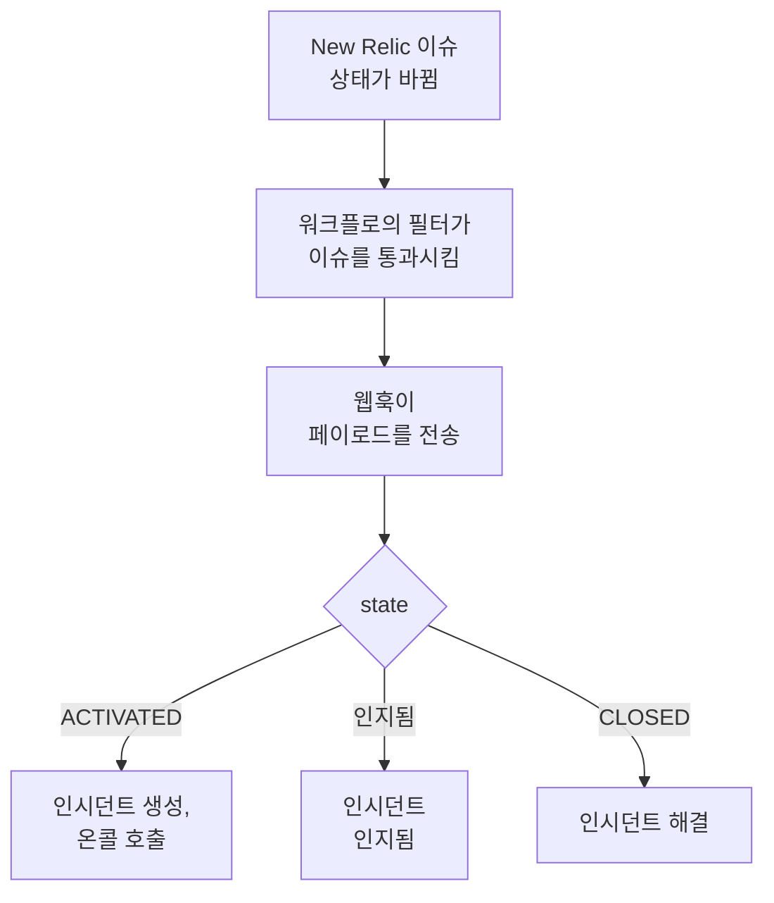

# New Relic

[New Relic](https://newrelic.com) 이슈를 OneUptime으로 보내면, 각 이슈가 온콜 팀을 호출하는 인시던트나 알림이 되고, 누군가 이슈를 인지하면 인지되고, 이슈가 닫히면 해결됩니다. New Relic은 [웹훅 대상](https://docs.newrelic.com/docs/alerts/get-notified/notification-integrations/)을 통해 이슈를 보내므로 어느 쪽에도 설치할 것이 없습니다.

:::cards
- [템플릿으로 시작하기](#템플릿으로-시작하기): 호출할 사람을 고르고, URL을 복사하고, 각 이슈가 하는 일을 확인합니다.
- [New Relic 구성](#new-relic-구성): 웹훅 대상과 이를 통지하는 워크플로.
- [테스트하기](#테스트하기): 직접 이슈를 보낸 다음 New Relic에서 보냅니다.
- [문제 해결](#문제-해결): 이슈가 도착하지 않거나 인시던트가 계속 열려 있을 때.
:::

## 작동 방식



New Relic 워크플로는 필터로 보낼 이슈를 고르고, 이슈가 활성화되거나 인지되거나 닫히면 New Relic이 채우는 JSON 페이로드와 함께 웹훅 대상에 통지합니다. OneUptime은 이슈의 ID로 자신이 연 인시던트를 찾습니다.

## 사전 요건

- 대상과 워크플로를 만들 수 있는 New Relic 계정.
- OneUptime에서 워크플로를 만들 권한. OneUptime Cloud에서는 워크플로에 **Growth** 플랜 이상이 필요합니다.

## 템플릿으로 시작하기

먼저 OneUptime을 설정하세요. 그러면 New Relic이 보낼 URL을 얻습니다. **워크플로 만들기** 대화 상자의 카테고리 목록에서 **New Relic** 아래에 New Relic 템플릿 2개가 있습니다. **Declare an incident for each New Relic issue**는 인시던트용이고, **Create an alert for each New Relic issue**는 알림용입니다. 둘은 같은 일을 하며, 각각 자기 종류의 기록을 만듭니다.

:::steps
1. **워크플로**로 이동해 **워크플로 생성**을 클릭합니다. **또는 템플릿에서 시작**에서 카테고리 목록의 **New Relic**을 고르고, **Declare an incident for each New Relic issue**를 클릭하거나, **Create an alert for each New Relic issue**를 클릭한 다음 **이 템플릿 사용**을 클릭합니다.
2. **Who to page for new New Relic issues** 아래에서 호출할 온콜 정책을 고르거나, 아무도 호출하지 않으려면 고르지 말고, **워크플로 생성**을 클릭합니다. 워크플로가 꺼진 상태로 **빌더**에서 열립니다.
3. **Webhook** 트리거를 클릭한 다음 **URL 복사**를 클릭하고, URL을 New Relic용으로 보관합니다.
4. **빌더** 상단에서 **활성화됨**을 켭니다. 꺼져 있는 워크플로는 New Relic에 `400`으로 응답합니다.
:::

그런 다음 [New Relic을 구성](#new-relic-구성)해 그 URL로 이슈를 보내게 합니다. 워크플로의 `read-event-1` 단계는 같은 설정으로 열리므로, **빌더**에서 다시 돌아왔을 때 참고할 수 있습니다.

### 워크플로가 하는 일

**Webhook** 트리거 다음에는 **Check With JavaScript** 단계 `read-event-1`이 New Relic이 보내는 `state`를 읽고, **Incident From Another Tool**(알림 템플릿에서는 **Alert From Another Tool**)이 이슈의 ID로 그 뜻대로 처리합니다. 인시던트는 ID를 사용자 지정 필드 `newRelicIssueId`에 보관합니다.

| New Relic이 보내는 것 | 워크플로가 하는 일 |
| --- | --- |
| `state`가 `ACTIVATED` 또는 `CREATED` | `New Relic: <issue>`라는 제목의 인시던트를 이슈의 우선순위에 대응하는 심각도로 선언하며, 상태 페이지에는 표시하지 않습니다. 설명에는 New Relic의 이슈 링크와 우선순위, 엔터티, 정책, 조건이 들어갑니다. 선택한 온콜 정책을 호출합니다. 같은 이슈가 다시 오는 경우, 예를 들어 New Relic이 CRITICAL로 올리면 두 번째 인시던트를 열지 않고, 아무도 다시 호출하지 않습니다. |
| `state`가 `ACTIVATED`이고 `isAcknowledged`가 `true` | 이슈의 인시던트를 인지해, 온콜 에스컬레이션이 멈춥니다. 이유는 타임라인에 남습니다. |
| `state`가 `CLOSED` | 이슈의 인시던트를 해결합니다. 이미 해결되었으면 그대로 둡니다. 이유는 타임라인에 남습니다. |

인시던트가 없는 이슈의 인지나 닫힘은 아무것도 바꾸지 않습니다. 그 밖의 것, 예를 들어 다른 도구에서 온 요청은 그대로 둡니다. `read-event-1`이 **No**로 가고, 실행의 **단계**에 이유가 나옵니다. New Relic으로는 아무것도 돌아가지 않습니다. New Relic은 신호가 복구되면 자체 이슈를 닫고, 그것이 인시던트를 해결합니다.

### 우선순위와 호출

새 이슈는 우선순위와 상관없이 모두 선택한 온콜 정책을 호출합니다. New Relic은 같은 이슈 안에서 HIGH를 CRITICAL로 올리므로, CRITICAL을 기다리면 HIGH로 열렸다가 악화된 이슈는 절대 호출하지 못합니다. 호출을 줄이려면 New Relic에서 워크플로의 필터를 좁히세요. 필터를 통과한 것만 OneUptime에 도달합니다. 새 프로젝트에서 우선순위는 다음 인시던트 및 알림 심각도에 매핑됩니다:

| New Relic 우선순위 | 인시던트 | 알림 | 온콜 |
| --- | --- | --- | --- |
| CRITICAL | Critical Incident | High | 호출함 |
| HIGH | Major Incident | Low | 호출함 |
| MEDIUM | Minor Incident | Low | 호출함 |
| LOW | Minor Incident | Low | 호출함 |

직접 만든 심각도가 있으면 CRITICAL은 가장 심각한 것으로, HIGH는 중간 것으로, MEDIUM과 LOW는 가장 덜 심각한 것으로 갑니다. New Relic이 이슈를 올려도 인시던트는 열릴 때의 심각도를 유지합니다.

우선순위를 이름으로 직접 만든 심각도에 매핑하려면 `read-event-1` 단계의 `SEVERITY_BY_NAME`을 편집하세요. 예를 들어 `{ HIGH: 'Critical Incident' }`입니다.

## New Relic 구성

:::steps
### 웹훅 대상 추가

New Relic에서 **Alerts → Destinations**로 이동해 **Webhook** 대상을 추가합니다. **Webhook name**을 `OneUptime`으로, **Endpoint URL**을 OneUptime에서 복사한 URL로 설정하고 저장합니다. **Use authorization**은 끈 채로 둡니다. URL이 유일한 자격 증명입니다.

### 워크플로 추가

**Alerts → Workflows**로 이동해 **Add a workflow**를 클릭합니다. 이름을 `OneUptime`으로 정합니다. 필터가 OneUptime에 도달할 이슈를 정하며, 예를 들어 CRITICAL만, 또는 한 팀의 이슈만 보낼 수 있습니다.

### 대상에 통지

만든 **Webhook** 대상을 워크플로에 추가합니다. New Relic이 채우는 페이로드는 그대로 두고, 인시던트가 이슈와 함께 인지되도록 `state` 뒤에 `isAcknowledged` 줄을 추가합니다:

```json
{
  "id": {{ json issueId }},
  "issueUrl": {{ json issuePageUrl }},
  "title": {{ json annotations.title.[0] }},
  "priority": {{ json priority }},
  "impactedEntities": {{ json entitiesData.names }},
  "totalIncidents": {{ json totalIncidents }},
  "state": {{ json state }},
  "isAcknowledged": {{ json isAcknowledged }},
  "trigger": {{ json triggerEvent }},
  "isCorrelated": {{ json isCorrelated }},
  "createdAt": {{ createdAt }},
  "updatedAt": {{ updatedAt }},
  "sources": {{ json accumulations.source }},
  "alertPolicyNames": {{ json accumulations.policyName }},
  "alertConditionNames": {{ json accumulations.conditionName }},
  "workflowName": {{ json workflowName }}
}
```

추가할 줄은 `"isAcknowledged": {{ json isAcknowledged }},`입니다. 그런 다음 **Update message**를 클릭합니다.

### 활성화, 인지, 닫힘 때 통지

대상의 점 세 개를 클릭하고 **Notify when**을 선택합니다. **Activated**, **Acknowledged**, **Closed**를 켜 둡니다.

### 워크플로 활성화

**Activate workflow**를 클릭합니다.
:::

OneUptime 워크플로는 페이로드의 다음 필드를 읽고 나머지는 그대로 둡니다:

| 필드 | New Relic이 넣는 값 |
| --- | --- |
| `id` | 이슈의 ID. |
| `issueUrl` | New Relic의 이슈 링크. |
| `title` | 이슈의 제목. |
| `priority` | 이슈의 긴급도. `CRITICAL`, `HIGH`, `MEDIUM`, `LOW` 중 하나. |
| `state` | 이슈의 상태. `CREATED`, `ACTIVATED`, `CLOSED` 중 하나. |
| `isAcknowledged` | New Relic에서 누군가 이슈를 인지하면 `true`. |
| `impactedEntities` | 이슈와 관련된 엔터티의 이름. |
| `alertPolicyNames` | 이슈의 원인이 된 정책의 이름. |
| `alertConditionNames` | 이슈의 원인이 된 조건의 이름. |

## 테스트하기

복사한 URL로 New Relic처럼 이슈를 보냅니다:

```bash
curl -X POST "<url>" \
  -H "Content-Type: application/json" \
  -d '{
    "id": "7d4a2e1c-3b5f-4c8e-9a1d-2f6b8c0e4a71",
    "issueUrl": "https://radar-api.service.newrelic.com/accounts/1234567/issues/7d4a2e1c-3b5f-4c8e-9a1d-2f6b8c0e4a71?notifier=WEBHOOK",
    "title": "High CPU on checkout-service",
    "priority": "CRITICAL",
    "impactedEntities": ["checkout-service"],
    "state": "ACTIVATED",
    "isAcknowledged": false,
    "alertPolicyNames": ["Production"],
    "alertConditionNames": ["CPU above 90%"]
  }'
```

`New Relic: High CPU on checkout-service`라는 제목의 인시던트가 열리고, 선택한 온콜 정책이 호출됩니다. `isAcknowledged`를 `true`로 설정해 같은 요청을 보내면 인시던트가 인지됩니다. `state`를 `CLOSED`로 설정해 보내면 인시던트가 해결됩니다.

그런 다음 New Relic에서 테스트합니다. 워크플로의 웹훅 메시지를 열고 **Send test notification**을 클릭합니다. 도착했는지 확인하려면 OneUptime 워크플로의 **로그 → 실행 기록**을 엽니다.

## 문제 해결

:::details OneUptime에 아무것도 도착하지 않음
- New Relic의 워크플로가 활성 상태이고 필터가 이슈를 통과시키는지 확인합니다.
- 대상의 **Endpoint URL**이 **Webhook** 트리거의 URL인지 확인합니다.
- 꺼진 워크플로는 `400`으로 응답합니다. 그 **빌더** 상단에서 **활성화됨**을 켭니다.
:::

:::details 워크플로는 실행되지만 아무것도 열지 않음
**로그 → 실행 기록**에서 실행을 엽니다. **단계**의 `read-event-1` 항목에 **No**로 간 이유가 나옵니다.

- `New Relic named no issue ID`: 페이로드에 `"id": {{ json issueId }},` 줄을 유지합니다.
- `is in no state`: 페이로드에 `"state": {{ json state }},` 줄을 유지합니다.
:::

:::details 인시던트가 인지되지 않음
- 페이로드에 `"isAcknowledged": {{ json isAcknowledged }},` 줄이 필요합니다. 없으면 인시던트는 열리고 이슈와 함께 해결되지만 인지되지는 않습니다.
- New Relic의 워크플로에서 **Notify when** 아래의 **Acknowledged**를 켜 두어야 합니다.
:::

:::details 인시던트가 열리지만 해결되지 않음
- New Relic의 워크플로에서 **Notify when** 아래의 **Closed**를 켜 두어야 합니다.
- **로그 → 실행 기록**에서 닫힘의 실행을 엽니다. 마지막 단계에 이유가 나옵니다. 닫힘의 `id`는 이슈의 것과 같아야 하므로, 페이로드의 `"id": {{ json issueId }},`는 그대로 두세요.
:::

:::details 너무 많은 이슈에 온콜이 호출됨
OneUptime에 도달하는 새 이슈는 모두 호출합니다. 호출해야 하는 이슈만 도달하도록 New Relic에서 워크플로의 필터를 좁히세요. [우선순위와 호출](#우선순위와-호출)을 참고하세요.
:::

:::details 온콜이 호출되지 않음
- 인시던트가 이미 있는 이슈의 통지는 아무도 다시 호출하지 않으므로, CRITICAL로 올라도 아무도 호출하지 않습니다.
- **워크플로 만들기** 대화 상자에서 아무도 고르지 않았다면, 워크플로에 호출하는 단계가 없습니다.
:::

## 보안

- **URL을 비밀번호처럼 다루세요.** URL을 가진 사람은 누구나 인시던트를 열 수 있습니다. 유출되면 워크플로의 **Webhook** 트리거에서 **URL 재설정**을 클릭하세요. 그런 다음 New Relic에서 대상의 **Endpoint URL**을 업데이트합니다.
- **링크는 New Relic으로 갑니다.** 템플릿은 요청 내용과 상관없이 New Relic 사이트의 이슈만 링크하고, New Relic이 보낸 내용은 텍스트로 씁니다.
- **자체 호스팅인가요?** New Relic은 인터넷에서 웹훅을 보내므로, OneUptime이 인터넷에서 HTTPS로 연결될 수 있어야 합니다.

## 다음 단계

:::cards
- [워크플로 템플릿](/docs/workflows/authoring): 템플릿으로 워크플로를 만들고 빌더에서 변경합니다.
- [Datadog](/docs/integrations/datadog): Datadog 모니터를 위한 같은 템플릿.
- [에스컬레이션 규칙](/docs/on-call/escalation-rules): 온콜 정책이 누구를 언제 호출할지 정합니다.
- [통합 개요](/docs/integrations/index): 연결할 수 있는 다른 도구.
:::
