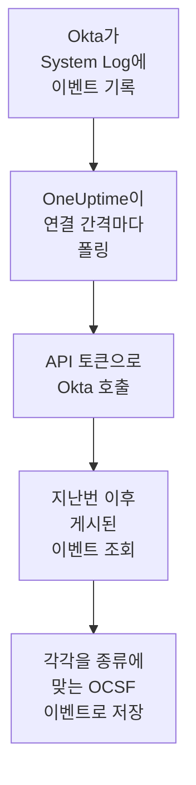

# Okta 시스템 로그

[Okta System Log](https://developer.okta.com/docs/reference/system-log-query/)를 OneUptime의 보안 이벤트로 가져옵니다. 로그인, MFA 챌린지, 계정과 그룹 변경, Okta 자체의 위협 탐지가 대상입니다. 그곳에서 로그, 트레이스, 메트릭과 나란히 검색하고, 다른 모든 소스와 상관 분석하고, 중요한 것에 대해 온콜을 호출할 수 있습니다. OneUptime은 직접 만든 API 토큰으로 이를 읽으며, Okta에서는 아무것도 바꾸지 않습니다.

:::cards
- [연결 설정](#연결-설정): API 토큰과 연결 양식.
- [가져오는 내용](#가져오는-내용): 어떤 이벤트를 가져오는지, 각 이벤트가 보안 이벤트가 되는 방식.
- [폴링 작동 방식](#폴링-작동-방식): 각 폴링이 읽는 구간과, 그 구간이 이전 구간과 15분 겹치는 이유.
- [문제 해결](#문제-해결): 각 오류의 의미와 바꿔야 할 점.
:::

## 작동 방식



OneUptime은 1분마다, 폴링 간격이 지난 활성화된 연결을 각각 폴링합니다. 폴링은 지난 폴링 이후 게시된 System Log 이벤트를 Okta에 요청하고, 각각을 [OCSF](https://schema.ocsf.io/) 이벤트로 저장합니다. 로그인은 Authentication 이벤트로, 계정 편집은 Account Change로, Okta 탐지는 Detection Finding으로 저장됩니다. 그 뒤 탐지 규칙, 모니터, 대시보드는 이를 다른 소스의 보안 이벤트와 똑같이 다룹니다. `okta.com`, `oktapreview.com`, `okta-emea.com`의 모든 Okta 셀과 사용자 지정 도메인의 조직에서 작동합니다.

## 사전 요건

- OneUptime에서 Project Owner, Project Admin 또는 Security Admin 역할. Security Member와 Security Viewer는 연결과 그 실행 기록을 볼 수 있지만 변경할 수는 없습니다.
- 토큰을 만들 수 있도록 System Log를 볼 수 있는 Okta 관리자. 토큰은 그 관리자가 할 수 있는 일을 모두 할 수 있으므로 Read-only Administrator를 사용하세요. System Log를 읽기만 하고 아무것도 바꾸지 않습니다. 읽기 전용 관리자도 사용자, 그룹, 앱, 설정을 볼 수 있으므로 토큰은 비밀번호처럼 안전하게 보관하세요.
- 가능하면 그 관리자용 서비스 계정. Okta는 관리자가 비활성화되거나 토큰이 30일 동안 쓰이지 않으면 토큰을 비활성화합니다. 폴링은 몇 분마다 토큰을 쓰므로, 연결이 활성화되어 있는 동안 토큰은 계속 사용됩니다.
- 조직이 네트워크 영역에서 오는 API 호출만 받는다면, OneUptime이 호출하는 주소를 포함한 영역. OneUptime Cloud에서는 그 아웃바운드 주소이고, 자체 호스팅 설치에서는 앱과 워커 호스트의 공개 주소입니다.

## 연결 설정

:::steps
### API 토큰 만들기

1. 읽기 전용 관리자로 Okta **Admin Console**에 로그인합니다.
2. **Security → API**를 연 다음 **Tokens** 탭에서 **Create token**을 선택합니다.
3. 이름을 지정합니다(예: `OneUptime security events`). 조직에 영역이 필요하지 않다면 호출 출처는 **Any IP**로 둡니다.
4. **Create token**을 선택하고 **Token Value**를 복사합니다. Okta는 이 값을 한 번만 보여 줍니다.

각 토큰은 조직의 API 속도 제한 중 일부를 쓸 수 있으며, 그 몫은 **Tokens** 탭의 토큰 행에 나옵니다. 한 번의 폴링은 최대 20개의 요청을 하므로, 다른 도구가 같은 토큰을 쓰지 않는 한 기본 몫으로 충분합니다.

### OneUptime에서 연결 추가

**제품 → Security Events → 연결**(`/dashboard/{projectId}/security-events/connections`)를 열고 **연결 추가**를 클릭한 뒤 **Okta System Log**를 고르고 **다음**을 클릭합니다. 아래 표의 설정을 채우고 **다음**을 클릭한 뒤, 토큰을 **API token**에 붙여 넣습니다.

### 저장하기 전에 테스트

**저장하기 전에 테스트** 아래의 **이 설정 테스트**를 클릭합니다. 테스트는 양식의 값으로 로그인하고 이벤트를 읽으며 아무것도 저장하지 않으므로, 잘못된 URL이나 잘못된 필터가 연결을 만들기 전에 드러납니다. 그런 다음 **다음**을 클릭하고 연결에 **이름**을 지정해 만듭니다.
:::

| 설정 | 입력할 값 |
| --- | --- |
| **Okta organization URL** | 사용자가 로그인하는 주소. 예: `https://acme.okta.com`, `https://acme.oktapreview.com`, `https://login.example.com`. `https`를 사용해야 하며 경로는 붙이지 않습니다. API를 제공하지 않는 Admin Console의 `-admin` 주소는 안 됩니다. |
| **Event filter** | 선택 사항. 가져올 이벤트를 고르는 [System Log 필터](https://developer.okta.com/docs/reference/core-okta-api/#filter). 예: `eventType sw "user.session" or eventType sw "security"`. 비워 두면 아래의 계열을 가져옵니다. 최대 2,000자, 한 줄로 쓰며, `published`를 조건으로 쓸 수 없습니다. 시간 범위는 OneUptime이 직접 정합니다. |
| **API token** | 토큰 값 그대로. `SSWS` 스킴은 OneUptime이 직접 붙입니다. 암호화되며, API가 반환하지 않고 다시 표시되지도 않습니다. 교체하려면 연결의 **자격 증명 업데이트**를 사용합니다. |

**폴링** 단계에는 선택 사항인 **설명**, `1`부터 `1440`까지의 정수이며 처음 값이 `5`인 **폴링 간격(분)**, 그리고 처음에 켜져 있는 **활성화됨**도 있습니다.

## 가져오는 내용

**Event filter**가 없으면 OneUptime은 보안 팀이 지켜보는 이벤트 계열을 `eventType` 접두사로 가져옵니다. 직접 만든 필터는 이 목록에 더해지는 것이 아니라 이 목록을 대체합니다:

| 접두사 | 이벤트 |
| --- | --- |
| `user.session` | 로그인과 로그아웃, Admin Console 접근, 사용자 가장 |
| `user.authentication` | Single Sign-On을 포함한 인증 결과 |
| `user.mfa` | 요소 등록, 챌린지, 재설정 |
| `user.account` | 비밀번호 변경과 재설정, 잠금, 프로필과 권한 변경 |
| `user.lifecycle` | 사용자 생성, 활성화, 일시 중지, 비활성화, 삭제 |
| `security.` | ThreatInsight, 의심스러운 활동 신고, Okta의 그 밖의 탐지 |
| `policy.` | 로그온 정책 평가와 정책 변경 |
| `system.api_token` | 생성되고 취소된 API 토큰 |
| `application.user_membership` | 앱 할당 |
| `group.user_membership` | 그룹 구성원 변경 |

각 이벤트는 공급업체 `Okta`, 제품 `Okta System Log`의 OCSF 이벤트 하나가 되며, 그 클래스는 `eventType`에 따라 정해집니다:

| `eventType` | OCSF 클래스 | 활동 |
| --- | --- | --- |
| `user.session.start` | Authentication (`3002`) | `Logon` |
| `user.session.end` | Authentication (`3002`) | `Logoff` |
| `user.authentication.*` | Authentication (`3002`) | `Logon` |
| `user.mfa.*` | Authentication (`3002`) | `Authentication Ticket` |
| 그 밖의 `user.session.*` 이벤트 | Authentication (`3002`) | `Other` |
| `user.account.*`, `user.lifecycle.*` | Account Change (`3001`) | 이벤트 유형의 마지막 부분(예: `Update Password`) |
| `group.*` | Group Management (`3006`) | 이벤트 유형의 마지막 부분(예: `Add`) |
| `security.*`, 그리고 접근을 거부한 `policy.evaluate_sign_on` | Detection Finding (`2004`) | `Create`. 이벤트 유형이 규칙 이름이 됩니다 |
| 그 밖의 모든 것 | `0`. 이벤트 유형에서 딴 이름 | 이벤트 유형의 마지막 부분 |

이 클래스 중 어디에도 속하지 않는 이벤트도 모든 필드를 그대로 유지하며, 어느 필드로든 검색할 수 있습니다. 모든 이벤트는 다음 열을 채웁니다:

| Okta 필드 | OneUptime 열 |
| --- | --- |
| `uuid` | 이벤트 UID. 중복을 걸러 내는 기준이기도 합니다 |
| `published`(이벤트가 일어난 시각) | 이벤트 시각 |
| `displayMessage`, 없으면 이벤트 유형과 `outcome.reason` | 메시지 |
| `severity`: `DEBUG`와 `INFO`는 Informational, `WARN`은 Medium, `ERROR`는 High | 심각도 |
| `outcome.result`(`SUCCESS`, `FAILURE`, `ALLOW`, `DENY` 등) | 상태 |
| `actor.alternateId`, 없으면 `actor.displayName`; `client.ipAddress` | 주체 사용자와 IP |
| `target` 안의 `User`의 `alternateId` | 대상 사용자 |
| `target` 안의 `AppInstance`의 `alternateId` | 대상 리소스 |
| 행위자, 모든 대상, 클라이언트의 IP | Observable |
| 이벤트 전체. `client.userAgent.browser`, `debugContext.debugData.requestUri` 같은 점 구분 키로 펼침 | `attributes` |

`INFO`인 실패하거나 거부된 로그인은 성공한 로그인과 구별되도록 Low로 올라갑니다. System Log에는 MITRE ATT&CK 참조가 없으므로 해당 열은 비어 있습니다.

## 폴링 작동 방식

각 폴링은 자신의 구간에 게시된 이벤트를 오래된 것부터 한 페이지에 1,000개씩 나열하고, Okta가 보내는 `next` 링크를 마지막 페이지까지 따라갑니다:

```text
GET {Okta organization URL}/api/v1/logs?since={window start}&until={window end}&sortOrder=ASCENDING&limit=1000&filter={Event filter}
```

- **게시 시각이 커서입니다.** System Log 이벤트는 활동 그 자체이므로, `published`는 활동이 일어난 시각이자 폴링이 읽는 값입니다.
- **첫 폴링은 24시간 전까지 거슬러 올라가므로**, 새 연결에서 최근 이벤트가 바로 보입니다.
- **이후의 모든 폴링은 저장된 커서보다 15분 앞에서 시작합니다.** Okta는 종료 시각이 있는 요청이 지연된 이벤트를 빠뜨릴 수 있으며, 이는 드문 일이라고 안내합니다. 겹치는 부분 덕분에 그런 이벤트는 다음 폴링에서 읽힙니다. 15분 넘게 지연된 이벤트는 커서 뒤로 떨어질 수 있으니, 그 시간 범위를 가져와 되찾으세요.
- **한 번의 폴링은 커서 이후 최대 24시간까지 읽습니다.** 커서가 뒤처진 연결은 24시간 구간을 연달아 읽으며 따라잡고, 그동안 **상태**는 **Catching up**으로 표시됩니다.
- **중복은 `uuid`로 걸러집니다.** 프로젝트 안에서 걸러지므로, 겹치는 부분, 다시 시도한 구간, 가져오기가 이벤트를 두 번 저장하는 일은 없습니다.

토큰이 모든 요청에 함께 가므로, **Okta organization URL**이 아닌 곳을 가리키는 `next` 링크는 절대 따라가지 않습니다.

### 한 번의 폴링으로 다 읽을 수 없는 구간

한 번의 폴링은 최대 20개의 요청으로 최대 10,000개의 이벤트를 읽습니다. 구간에 그보다 많은 이벤트가 있으면 실행은 **부분**이 되며, 다음과 같은 경고가 나옵니다:

```text
Stopped after collecting 10000 events; the window holds more. The last event read was published at 2026-09-14T08:12:44.000Z.
```

이벤트는 오래된 것부터 읽히므로, OneUptime은 커서를 마지막으로 읽은 이벤트의 게시 시각으로 옮기고, 다음 폴링은 15분 겹침 없이 같은 구간 길이로 거기서 시작합니다. 바쁜 조직은 같은 것을 다시 읽는 대신 폴링마다 10,000개씩 따라잡습니다. 커서가 그 지점에서 15분을 지나면 겹침이 돌아옵니다.

예를 들어 15분의 겹치는 부분만으로도 10,000개가 넘는 이벤트가 있어서 실행이 저장된 커서를 전혀 넘어서지 못하면, OneUptime은 대신 구간을 줄입니다:

1. **좁히기.** 다음 폴링은 같은 시작점에서 절반 길이의 구간을 읽으며, 구간을 끝까지 읽을 수 있게 될 때까지 계속 절반으로 줄이고, 가장 짧게는 1분까지 줄입니다. 실행의 경고에 그렇게 적힙니다: `This window holds more records than one poll can read; the next poll reads a {n} minute window from the same starting point.`
2. **다시 늘리기.** 구간을 끝까지 읽은 뒤에는 다음 구간이 다시 두 배가 되며, 최대 24시간까지 늘어납니다.
3. **1분 넘어가기.** 1분 안에조차 한 번의 폴링으로 읽을 수 있는 것보다 많은 레코드가 있으면, 더 새로운 이벤트가 계속 도착하도록 폴링이 그 1분을 넘어가며, 이후 폴링의 겹치는 부분도 더 이상 그 1분까지 거슬러 가지 않습니다. 실행은 **부분**으로 남고, **마지막 오류**에는 `More records were created in the one minute from {cursor} to {end} than one poll can read. Polling moved past this minute so newer records keep arriving; use Import this time range in Diagnostics on this minute to recover what one run can read.`라고 나옵니다. 한 번의 실행이 읽을 수 있는 만큼 되찾으려면 **Import this time range**로 그 1분을 가져오거나, **Event filter**를 좁히세요.

Okta의 오류로 실행이 완전히 실패하면, 커서와 구간 길이는 그대로 유지되고 다음 폴링이 같은 구간을 다시 읽습니다. 단 하나의 예외는 요청 시간이 초과된 경우입니다. 커서는 그대로지만 다음 구간은 절반 길이가 됩니다. 제시간에 응답하기에는 너무 무거운 구간은 시도할 때마다 시간이 초과되기 때문입니다. **폴링 간격(분)** 값을 바꿔도 이 중 어느 것도 달라지지 않습니다. 이 설정은 폴링이 얼마나 자주 시작하는지를 정할 뿐, 구간이 어디서 시작하는지는 정하지 않습니다.

### 필요할 때 실행, 미리 보기, 가져오기

연결에서 **진단**을 클릭하면 최근 실행을 보고 연결을 직접 다룰 수 있습니다. 연결을 변경할 수 있는 사람은 누구나 이를 시작할 수 있고, 연결을 볼 수 있는 사람은 누구나 기록을 읽을 수 있습니다.

- **지금 실행**은 연결이 **활성화됨** 상태가 아닐 때에도 평소의 커서로 즉시 폴링을 시작합니다.
- **Preview log events**는 최대 7일의 시간 범위를 읽으며 아무것도 가져오지 않습니다.
- **Import this time range**는 확인을 거친 뒤 최대 7일의 범위를 가져오며, 커서는 옮기지 않습니다. 이미 가져온 이벤트는 건너뜁니다. Okta는 System Log를 90일 동안 보관합니다.
- 실행의 **Copy diagnostics**는 지원팀에 보낼 보고서를 복사합니다. 자격 증명은 절대 포함되지 않습니다.

## 연결 테스트

연결 행의 **연결 테스트**와 양식의 **이 설정 테스트**는 백그라운드 워커가 아니라 API 프로세스에서 실행되므로, 워커가 문제일 때에도 테스트는 응답합니다. 다음 검사를 순서대로 실행합니다:

| 검사 | 확인하는 내용 |
| --- | --- |
| **구성** | 모든 설정이 있고 올바른 형식인지. 이 검사가 실패하면 아무 곳에도 연결하지 않습니다. |
| **Authenticate with Okta** | 필터 없이 이벤트 하나를 읽어, Okta가 System Log용 토큰을 받아들입니다. |
| **Read System Log events** | 폴링이 쓰는 필터(직접 만든 것이든 기본값이든)를 통해 지난 24시간의 이벤트 하나를 읽을 수 있습니다. 그래서 잘못된 **Event filter**는 첫 폴링이 아니라 여기서 실패합니다. |
| **Events available to import** | 지난 24시간과 지난 7일 동안 게시된 이벤트의 수. 각각 1,000개짜리 한 페이지만 세므로 `1000+`는 그보다 많다는 뜻입니다. 7일 동안 하나도 없으면 실패가 아니라 경고입니다. |
| **Background workers**, **Poll scheduler**, **Security event storage** | OneUptime 쪽: Worker 큐의 작업을 가져가는 프로세스가 있고, 폴링 작업이 매분 실행되고, 보안 이벤트 저장소가 응답하는지. |
| **Scheduled polling** | 저장된 연결의 경우: 폴링이 켜져 있고, 워커를 기다리며 멈춘 실행이 없고, 폴링이 제때 실행되는지. |

테스트의 모든 요청에는 20초 기한이 있습니다. 테스트는 아무것도 가져오지 않고 커서를 옮기지도 않으며, 실패한 각 검사는 무엇을 바꿔야 하는지 알려 줍니다.

## 문제 해결

연결의 **마지막 오류**는 실패한 단계를 나타내는 접두사 뒤에, 자격 증명을 가린 전체 오류 메시지를 보관합니다. 연결에 오류가 있으면 **작업** 열에서 **오류 보기**를 선택해 읽고, 대화 상자의 **오류 복사**로 복사하세요. 모든 메시지는 `Okta System Log events request`로 시작하고 상태 뒤에 Okta 자체의 오류 코드를 인용하니, 그 뒤에 오는 내용을 읽으세요.

:::details Last Error에 `failed (HTTP 400)`이 나옴
Okta가 요청의 매개변수를 거부했습니다(`E0000053`). 토큰이 작동했다면 원인은 거의 항상 **Event filter**입니다. 연산자(`eq`, `ne`, `co`, `sw`, `ew`, `pr`, `gt`, `ge`, `lt`, `le`), `and`와 `or`, 값을 감싸는 큰따옴표를 확인하거나, 필터를 비워 기본 계열을 사용하세요. 가져오기라면 범위가 180일보다 더 이전에 시작한다는 뜻일 수도 있습니다.
:::

:::details Last Error에 `failed (HTTP 401)` 또는 `failed (HTTP 403)`이 나옴
- `HTTP 401`: Okta가 토큰을 받아들이지 않았습니다(`E0000011`). 취소되었거나, 30일 동안 쓰이지 않았거나, 관리자와 함께 비활성화되었거나, `SSWS`나 불필요한 문자와 함께 붙여 넣어졌습니다. 읽기 전용 관리자로 새 토큰을 만들어 **자격 증명 업데이트**로 저장하세요.
- `HTTP 403`: 토큰으로 로그인은 되지만 그 관리자가 System Log를 읽을 수 없습니다(`E0000006`). Read-only Administrator나 Super Administrator로 토큰을 만들고, 그 네트워크 영역이 OneUptime이 호출하는 주소를 허용하는지 확인하세요.
:::

:::details Last Error에 다른 상태와 함께 `failed (HTTP ...)`가 나옴
- `HTTP 404`: 그 URL은 Okta의 API를 제공하지 않습니다. 경로 없이, `-admin` 주소가 아닌 조직 자체의 주소(예: `https://acme.okta.com`)를 사용하세요.
- `HTTP 3xx`: Okta가 요청을 리디렉션했지만, 토큰이 모든 요청에 함께 가므로 리디렉션은 거부됩니다. 조직 자체의 주소를 사용하세요.
- `HTTP 429`: Okta가 토큰을 제한하고 있습니다(`E0000047`). 다음 폴링에서 다시 시도합니다. 계속 일어난다면 **Tokens** 탭에서 토큰의 속도 제한 몫을 늘리거나, OneUptime 전용 토큰을 주거나, 폴링 빈도를 낮추세요.
- `HTTP 5xx`: Okta가 실패했거나, 쿼리가 Okta의 30초 한도를 넘었습니다(`E0000009`). 다음 폴링에서 다시 시도합니다. 계속 일어난다면 [status.okta.com](https://status.okta.com)을 확인하세요.
:::

:::details Last Error에 `returned` 또는 `did not complete`가 나옴
- `returned a non-JSON body.` 또는 `returned an unrecognized response shape`: 로그인 페이지나 프록시처럼 Okta의 API가 아닌 다른 것이 응답했거나, Okta가 오류로 응답했습니다. 빈 구간으로 간주하지 않고 보고하므로, 아무도 읽지 않은 이벤트를 커서가 지나치는 일은 없습니다.
- `returned a next link outside the Okta organization URL`: `next` 링크가 다른 곳을 가리켜서 따라가지 않았습니다. Okta 자체는 절대 이렇게 하지 않습니다. 헤더를 다시 쓰는 프록시를 찾아보세요.
- `did not complete`: 요청이 응답을 받지 못했습니다. 시간 초과, 확인할 수 없는 이름, OneUptime이 신뢰하지 않는 인증서, 또는 거부된 주소입니다. OneUptime 앱과 워커가 사용 중인 프록시를 거쳐 HTTPS로 조직에 접근할 수 있는지 확인하세요.
:::

:::details Last Polled가 Never이고 Last Error가 비어 있음
이 연결에서 끝난 폴링이 없습니다. **연결 테스트**를 실행하세요. 그 **Background workers**와 **Poll scheduler** 검사가 원인을 알려 줍니다. 자체 호스팅 설치에서 흔한 원인은 앱에 `DISABLE_QUEUE_WORKERS=true`가 설정되어 있는데 작업을 가져가는 별도의 워커 배포가 없는 경우입니다. 이를 `false`로 설정하거나 워커 배포를 실행하세요(Helm: `worker.enabled: true`).
:::

:::details 실행이 Partial임
- `Stopped after collecting 10000 events`: 구간에 한 번의 실행이 읽는 10,000개보다 많은 이벤트가 있었습니다. 잃는 것은 없습니다. 다음 폴링은 마지막으로 읽은 이벤트 다음부터 시작합니다. 폴링할 때마다 **부분**으로 남는 연결은 밀린 분량을 따라잡는 중이며, **마지막 폴링**과 **마지막으로 가져온 이벤트**는 계속 앞으로 나아갑니다. 끝내 따라잡지 못한다면 조직이 폴링 간격에 담을 수 있는 것보다 많은 일치 이벤트를 게시하고 있는 것입니다. **Event filter**를 좁히거나 **폴링 간격(분)** 값을 줄이세요.
- `More records were created in the one minute from ... than one poll can read`: 폴링이 그 1분을 넘어갔습니다. **진단**에서 **Import this time range**로 그 1분을 가져오세요. 가져오기는 한 번의 폴링만큼 읽습니다.
:::

:::details 테스트는 통과하지만 아무것도 가져오지 않음
테스트 보고서에서 **Events available to import**를 읽으세요. 기본 필터라면 사용자가 있는 조직은 항상 로그인을 게시하므로, 지난 7일 동안 `0`이면 그 URL은 샌드박스이거나 쓰이지 않는 조직입니다. 직접 만든 **Event filter**라면 필터가 아무것도 찾지 못했다는 뜻입니다. Admin Console의 System Log에 있는 이벤트 유형과 비교하세요.
:::

## 얻을 수 있는 것

- **검색.** 보안 이벤트 탐색기에서 다른 모든 소스와 나란히, 심각도, 상태, 사용자, IP 또는 어떤 observable로든 로그인, MFA 결과, 계정 변경, Okta 탐지를 필터링합니다.
- **상관 분석.** 모든 이벤트의 사용자, 앱, IP는 observable로 색인되므로, 한 번의 검색으로 한 사용자가 한 모든 일을 그 앱 자체의 로그와 나란히 찾을 수 있습니다.
- **탐지 규칙.** IP별 로그인 실패나 사용자별 MFA 거부처럼 보안 이벤트에 대해 일정에 따라 실행되며, 온콜을 호출하는 알림을 여는 Sigma 규칙.
- **모니터.** 보안 이벤트 모니터는 일치하는 이벤트를 세고, 임곗값을 넘으면 인시던트나 알림을 엽니다.

보안 이벤트는 나머지 텔레메트리처럼 수집된 GB 단위로 청구됩니다. [요금](https://oneuptime.com/pricing)을 참고하세요.

## 다음 단계

:::cards
- [보안 이벤트](/docs/telemetry/security-events): 가져온 내용을 검색하고, 상관 분석하고, 알림을 받습니다.
- [AWS Security Hub](/docs/integrations/aws-security-hub): 클라우드의 검색 결과도 가져옵니다.
- [역할](/docs/permissions/reference#역할): Security 역할이 보고 바꿀 수 있는 것.
- [통합 개요](/docs/integrations/index): 연결할 수 있는 다른 도구.
:::
