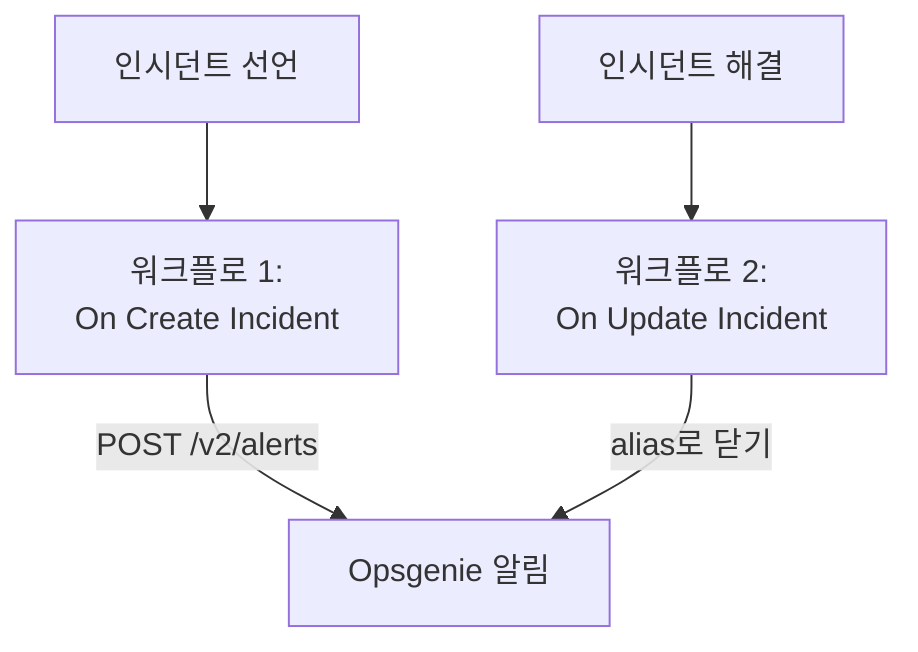

# Opsgenie

OneUptime 인시던트를 [Opsgenie](https://www.atlassian.com/software/opsgenie)로 보냅니다. 첫 번째 워크플로는 OneUptime 인시던트가 선언되면 Opsgenie 알림을 만들고, 두 번째 워크플로는 OneUptime 인시던트가 해결되면 이를 닫습니다. Opsgenie가 아직 팀을 호출하고 OneUptime이 시스템을 모니터링하는 동안 사용하세요.

:::cards
- [API 키 저장하기](#api-키-저장하기): Opsgenie의 키를 워크플로 밖에 둡니다.
- [Opsgenie 알림 만들기](#인시던트마다-opsgenie-알림-만들기): 워크플로 하나, 블록 두 개.
- [닫기](#opsgenie-알림-닫기): 인시던트 상태를 따라가는 두 번째 워크플로.
- [문제 해결](#문제-해결): Opsgenie가 요청을 거부할 때.
:::

> [!IMPORTANT]
> Atlassian은 2025년 6월에 Opsgenie 판매를 중단했고, 2027년 4월에 지원을 종료합니다. OneUptime도 온콜 정책, 일정, 에스컬레이션 규칙으로 사람을 호출합니다. 팀을 옮기려면 [Opsgenie에서 이전](/docs/moving-to-oneuptime/opsgenie)을 참고하세요. 가져오기로 사용자, 팀, 일정, 에스컬레이션을 옮길 수 있습니다.

## 작동 방식



두 워크플로 모두 [Opsgenie Alert API](https://docs.opsgenie.com/docs/alert-api)를 호출합니다. 첫 번째 워크플로는 OneUptime 인시던트의 ID로 만든 `alias`를 알림에 지정하고, 두 번째 워크플로는 그 alias로 알림을 닫습니다.

## 사전 요건

- **API** 유형의 Opsgenie 통합과 그 **API Key**. Opsgenie의 **Settings → Integrations**에서 추가하거나, 특정 팀으로 알림을 보내려면 그 팀의 **Integrations**에서 추가합니다.
- Opsgenie 리전. `app.eu.opsgenie.com`으로 로그인하는 유럽 계정은 `api.eu.opsgenie.com`을 사용합니다. 그 밖의 계정은 모두 `api.opsgenie.com`을 사용합니다.
- OneUptime에서 워크플로와 전역 변수를 만들 권한. OneUptime Cloud에서는 워크플로에 **Growth** 요금제 이상이 필요합니다.

## API 키 저장하기

:::steps
1. **워크플로 → 전역 변수**로 이동해 **워크플로 변수 만들기**를 클릭합니다.
2. 이름을 `OPSGENIE_KEY`로 정하고 **다음**을 클릭합니다.
3. API 키를 **콘텐츠**에 붙여 넣고 **시크릿**을 켠 다음 **워크플로 변수 만들기**를 클릭합니다.
:::

시크릿 변수는 실행 로그에서 `[REDACTED]`로 바뀌므로 키가 실행에 표시되지 않습니다.

## 인시던트마다 Opsgenie 알림 만들기

:::steps
### 워크플로 만들기

**워크플로**로 이동해 **워크플로 생성**을 클릭한 다음 **처음부터 시작**을 클릭합니다. 이름을 `Incidents to Opsgenie`로 정하고 **워크플로 생성**을 클릭합니다.

### 트리거 추가하기

점선으로 된 **이 워크플로를 시작할 항목 선택** 블록을 클릭하고 **On Create Incident**를 고릅니다. 트리거를 클릭합니다. **Fields to pass on**에는 **제목**이 이미 들어 있으므로, **필드 추가**를 클릭하고 **설명**을 고릅니다.

### 알림 만들기

**구성 요소 추가**를 클릭하고 **API Post (JSON)** 블록을 추가한 다음, 트리거의 **Success** 점을 이 블록에 연결합니다. **URL**을 `https://api.opsgenie.com/v2/alerts`(유럽에서는 `https://api.eu.opsgenie.com/v2/alerts`)로 설정합니다. **추가 필드**에서 **Request Headers**를 다음으로 설정합니다:

```json
{ "Authorization": "GenieKey {{global.variables.OPSGENIE_KEY}}" }
```

**Request Body**는 다음과 같습니다:

```json
{
  "message": "{{local.components.incident-on-create-1.returnValues.model.title}}",
  "alias": "oneuptime-{{local.components.incident-on-create-1.returnValues.model._id}}",
  "description": "{{local.components.incident-on-create-1.returnValues.model.description}}",
  "priority": "P1",
  "source": "OneUptime"
}
```

### 테스트한 다음 켜기

**워크플로 실행**을 클릭하고 **인시던트**에서 테스트 인시던트를 고른 다음 실행합니다. **API Post (JSON)** 단계에 `202` 응답이 표시되고, 잠시 후 Opsgenie에 알림이 나타납니다. 그런 다음 **빌더** 상단에서 **활성화됨**을 켭니다.
:::

Opsgenie의 방식은 `GenieKey`라는 단어, 공백, 키의 순서입니다. Opsgenie는 `message`를 130자로 제한하며, 우선순위는 `P1`부터 `P5`까지입니다. 인시던트마다 그 우선순위를 보내려면 [우선순위 매핑](#우선순위-매핑)을 참고하세요.

## Opsgenie 알림 닫기

워크플로에는 트리거가 하나뿐이므로, 닫으려면 인시던트 상태가 바뀔 때 시작되는 두 번째 워크플로가 필요합니다.

:::steps
### On Update Incident 트리거 추가하기

`Close Opsgenie alerts`라는 워크플로를 만들고 트리거로 **On Update Incident**를 고릅니다. **Fields to watch**에서 **필드 추가**를 클릭하고 **Current Incident State**를 골라 상태가 바뀔 때만 실행되게 합니다. **Fields to pass on**에서 새 상태가 해결된 상태인지 요청합니다. **필드 추가**를 클릭하고 **Current Incident State**를 연 다음 **Is Resolved State**를 고릅니다. 또는 **JSON으로 편집**을 클릭하고 JSON을 다음으로 바꿉니다:

```json
{ "_id": true, "currentIncidentState": { "isResolvedState": true } }
```

### 인시던트가 해결되었는지 확인하기

트리거 뒤에 **If / Else** 블록을 추가합니다. **Value to check**를 `{{local.components.incident-on-update-1.returnValues.model.currentIncidentState.isResolvedState}}`로, **Comparison**을 **is true**로 설정합니다.

### 알림 닫기

**Yes** 쪽 뒤에 같은 **Request Headers**와 다음 **URL**을 가진 **API Post (JSON)** 블록을 추가합니다:

```text
https://api.opsgenie.com/v2/alerts/oneuptime-{{local.components.incident-on-update-1.returnValues.model._id}}/close?identifierType=alias
```

**Request Body**를 `{ "source": "OneUptime", "note": "Resolved in OneUptime" }`로 설정합니다.

### 켜기

**활성화됨**을 켠 다음 OneUptime에서 테스트 인시던트를 해결합니다. Opsgenie가 자기 알림을 닫습니다.
:::

`identifierType=alias`는 주소가 알림 자체의 ID가 아니라 alias로 알림을 가리킨다고 Opsgenie에 알려 줍니다.

## 우선순위 매핑

인시던트마다 그 심각도를 Opsgenie 우선순위로 보내려면 트리거와 **API Post (JSON)** 블록 사이에 **Run Custom JavaScript** 블록을 추가합니다.

1. 트리거의 **Fields to pass on**에서 **필드 추가**를 클릭하고 **인시던트 심각도**를 연 다음 **이름**을 고릅니다.
2. 블록의 **Arguments**를 `{ "severity": "{{local.components.incident-on-create-1.returnValues.model.incidentSeverity.name}}" }`로, **JavaScript Code**를 다음으로 설정합니다:

   ```javascript
   // Your incident severities, by name, to Opsgenie's priorities.
   const PRIORITY = {
     "Critical Incident": "P1",
     "Major Incident": "P2",
     "Minor Incident": "P3",
   };

   return { priority: PRIORITY[args.severity] || "P3" };
   ```

3. 요청 본문에서 `"priority"`를 `"{{local.components.javascript-1.returnValues.returnValue.priority}}"`로 설정합니다.

위의 이름은 새 프로젝트가 처음 갖는 세 가지 심각도입니다. 이름을 바꿨다면 자신의 이름을 사용하세요.

## 문제 해결

:::details Opsgenie가 401 또는 403으로 응답함
키가 틀렸거나 다른 리전의 키입니다. 헤더가 `GenieKey`, 공백, 키의 순서인지, 키가 **API** 통합의 키인지, 호스트가 리전(`api.opsgenie.com` 또는 `api.eu.opsgenie.com`)과 맞는지 확인하세요.
:::

:::details 닫기가 404로 응답함
그 alias를 가진 알림이 없습니다. 두 워크플로는 alias를 `oneuptime-` 뒤에 인시던트의 `_id`를 붙이는 같은 방식으로 만들어야 하며, URL은 `?identifierType=alias`로 끝나야 합니다.
:::

:::details 단계에 202가 표시되는데 알림이 나타나지 않음
Opsgenie는 요청을 처리하기 전에 `202`로 응답하므로, 나중에 거부된 요청도 `202`로 표시됩니다. Opsgenie 로그에서 요청을 찾아 거부된 이유(예: 꺼져 있는 통합)를 확인하세요.
:::

:::details 워크플로가 실행되지 않음
켜져 있는지 확인하세요. **빌더** 상단의 **활성화됨**입니다. 그런 다음 **로그 → 실행 기록**을 여세요. **If / Else** 블록의 **No** 쪽으로 간 실행은 해결이 아닌 업데이트입니다.
:::

## 다음 단계

:::cards
- [Opsgenie에서 이전](/docs/moving-to-oneuptime/opsgenie): Opsgenie가 종료되기 전에 팀, 일정, 에스컬레이션을 옮깁니다.
- [에스컬레이션 규칙](/docs/on-call/escalation-rules): OneUptime 자체에서 사람을 호출합니다.
- [PagerDuty](/docs/integrations/pagerduty): PagerDuty용 같은 두 워크플로.
- [통합 개요](/docs/integrations/index): 모든 통합의 바탕이 되는 패턴.
:::
