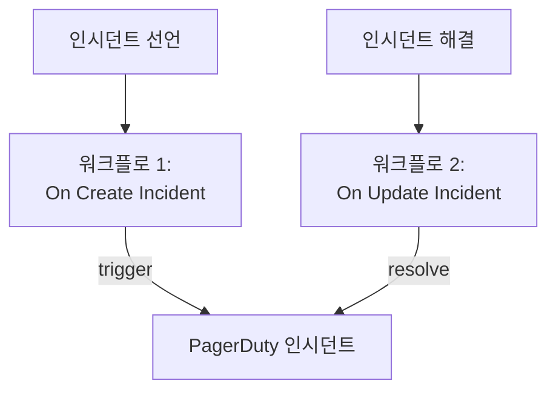

# PagerDuty

OneUptime 인시던트를 [PagerDuty](https://www.pagerduty.com)로 보냅니다. 첫 번째 워크플로는 OneUptime 인시던트가 선언되면 PagerDuty 인시던트를 트리거하고, 두 번째 워크플로는 OneUptime 인시던트가 해결되면 이를 해결합니다. PagerDuty가 팀을 호출하고 OneUptime이 시스템을 모니터링할 때 사용하세요.

:::cards
- [라우팅 키 저장하기](#라우팅-키-저장하기): PagerDuty의 키를 워크플로 밖에 둡니다.
- [PagerDuty 인시던트 트리거하기](#인시던트마다-pagerduty-인시던트-트리거하기): 워크플로 하나, 블록 두 개.
- [해결하기](#pagerduty-인시던트-해결하기): 인시던트 상태를 따라가는 두 번째 워크플로.
- [문제 해결](#문제-해결): PagerDuty가 이벤트를 거부할 때.
:::

> [!TIP]
> OneUptime도 온콜 정책, 일정, 에스컬레이션 규칙으로 사람을 호출합니다. 팀을 PagerDuty에서 옮기려면 [PagerDuty에서 이전](/docs/moving-to-oneuptime/pagerduty)을 참고하세요. 가져오기로 사용자, 일정, 에스컬레이션 정책을 옮길 수 있습니다.

## 작동 방식



두 워크플로 모두 OneUptime 인시던트의 ID로 만든 같은 `dedup_key`로 PagerDuty의 [Events API v2](https://developer.pagerduty.com/docs/events-api-v2/overview/)를 호출합니다. PagerDuty는 이 키로 resolve 이벤트가 trigger 이벤트로 열린 인시던트를 닫는다는 것을 압니다.

## 사전 요건

- Events API v2 통합이 있는 PagerDuty 서비스. PagerDuty에서 서비스를 연 다음 **Integrations**를 열고, **Add an integration**을 클릭해 **Events API V2**를 고릅니다. 그 **Integration Key**를 복사합니다. Events API에서는 이를 라우팅 키라고 부릅니다.
- OneUptime에서 워크플로와 전역 변수를 만들 권한. OneUptime Cloud에서는 워크플로에 **Growth** 요금제 이상이 필요합니다.

## 라우팅 키 저장하기

:::steps
1. **워크플로 → 전역 변수**로 이동해 **워크플로 변수 만들기**를 클릭합니다.
2. 이름을 `PAGERDUTY_ROUTING_KEY`로 정하고 **다음**을 클릭합니다.
3. 통합 키를 **콘텐츠**에 붙여 넣고 **시크릿**을 켠 다음 **워크플로 변수 만들기**를 클릭합니다.
:::

시크릿 변수는 실행 로그에서 `[REDACTED]`로 바뀌므로 키가 실행에 표시되지 않습니다.

## 인시던트마다 PagerDuty 인시던트 트리거하기

:::steps
### 워크플로 만들기

**워크플로**로 이동해 **워크플로 생성**을 클릭한 다음 **처음부터 시작**을 클릭합니다. 이름을 `Incidents to PagerDuty`로 정하고 **워크플로 생성**을 클릭합니다.

### 트리거 추가하기

점선으로 된 **이 워크플로를 시작할 항목 선택** 블록을 클릭하고 **On Create Incident**를 고릅니다. 트리거를 클릭합니다. **Fields to pass on**에는 **제목**이 이미 들어 있으므로, **필드 추가**를 클릭하고 **설명**을 고릅니다.

### trigger 이벤트 보내기

**구성 요소 추가**를 클릭하고 **API Post (JSON)** 블록을 추가한 다음, 트리거의 **Success** 점을 이 블록에 연결합니다. **URL**을 `https://events.pagerduty.com/v2/enqueue`로, **Request Body**를 다음으로 설정합니다:

```json
{
  "routing_key": "{{global.variables.PAGERDUTY_ROUTING_KEY}}",
  "event_action": "trigger",
  "dedup_key": "oneuptime-{{local.components.incident-on-create-1.returnValues.model._id}}",
  "payload": {
    "summary": "{{local.components.incident-on-create-1.returnValues.model.title}}",
    "source": "OneUptime",
    "severity": "critical",
    "custom_details": {
      "description": "{{local.components.incident-on-create-1.returnValues.model.description}}"
    }
  }
}
```

### 테스트한 다음 켜기

**워크플로 실행**을 클릭하고 **인시던트**에서 테스트 인시던트를 고른 다음 실행합니다. **API Post (JSON)** 단계에 `"status": "success"`가 담긴 `202` 응답이 표시되고, PagerDuty가 인시던트를 엽니다. 그런 다음 **빌더** 상단에서 **활성화됨**을 켭니다.
:::

블록은 JSON을 보내므로 `Content-Type` 헤더가 필요 없습니다. PagerDuty의 `severity`는 `critical`, `error`, `warning`, `info` 중 하나입니다. 인시던트마다 그 심각도를 보내려면 [심각도 매핑](#심각도-매핑)을 참고하세요.

## PagerDuty 인시던트 해결하기

워크플로에는 트리거가 하나뿐이므로, 해결에는 인시던트 상태가 바뀔 때 시작되는 두 번째 워크플로가 필요합니다.

:::steps
### On Update Incident 트리거 추가하기

`Resolve PagerDuty incidents`라는 워크플로를 만들고 트리거로 **On Update Incident**를 고릅니다. **Fields to watch**에서 **필드 추가**를 클릭하고 **Current Incident State**를 골라 상태가 바뀔 때만 실행되게 합니다. **Fields to pass on**에서 새 상태가 해결된 상태인지 요청합니다. **필드 추가**를 클릭하고 **Current Incident State**를 연 다음 **Is Resolved State**를 고릅니다. 또는 **JSON으로 편집**을 클릭하고 JSON을 다음으로 바꿉니다:

```json
{ "_id": true, "currentIncidentState": { "isResolvedState": true } }
```

### 인시던트가 해결되었는지 확인하기

트리거 뒤에 **If / Else** 블록을 추가합니다. **Value to check**를 `{{local.components.incident-on-update-1.returnValues.model.currentIncidentState.isResolvedState}}`로, **Comparison**을 **is true**로 설정합니다.

### resolve 이벤트 보내기

**Yes** 쪽 뒤에 같은 **URL**과 다음 **Request Body**를 가진 **API Post (JSON)** 블록을 추가합니다:

```json
{
  "routing_key": "{{global.variables.PAGERDUTY_ROUTING_KEY}}",
  "event_action": "resolve",
  "dedup_key": "oneuptime-{{local.components.incident-on-update-1.returnValues.model._id}}"
}
```

### 켜기

**활성화됨**을 켠 다음 OneUptime에서 테스트 인시던트를 해결합니다. PagerDuty가 자기 인시던트를 해결합니다.
:::

상태 이름 대신 `isResolvedState`를 확인하면 상태 이름을 바꿔도 계속 작동합니다. [인시던트 상태 및 심각도](/docs/incidents/states-and-severities)를 참고하세요.

## 심각도 매핑

인시던트마다 그 심각도를 보내려면 트리거와 **API Post (JSON)** 블록 사이에 **Run Custom JavaScript** 블록을 추가하고, 그 응답을 본문에서 읽습니다.

1. 트리거의 **Fields to pass on**에서 **필드 추가**를 클릭하고 **인시던트 심각도**를 연 다음 **이름**을 고릅니다.
2. 블록의 **Arguments**를 `{ "severity": "{{local.components.incident-on-create-1.returnValues.model.incidentSeverity.name}}" }`로, **JavaScript Code**를 다음으로 설정합니다:

   ```javascript
   // Your incident severities, by name, to PagerDuty's.
   const SEVERITY = {
     "Critical Incident": "critical",
     "Major Incident": "error",
     "Minor Incident": "warning",
   };

   return { severity: SEVERITY[args.severity] || "info" };
   ```

3. 요청 본문에서 `"severity"`를 `"{{local.components.javascript-1.returnValues.returnValue.severity}}"`로 설정합니다.

위의 이름은 새 프로젝트가 처음 갖는 세 가지 심각도입니다. 이름을 바꿨다면 자신의 이름을 사용하세요.

## 문제 해결

:::details PagerDuty가 400으로 응답함
응답 본문에 PagerDuty가 거부한 내용이 있으며, 실행의 **API Post (JSON)** 단계에 표시됩니다. 대개 라우팅 키가 Events API v2 통합 키가 아닌 경우입니다. 서비스의 **Integrations**에서 다시 복사하세요. `summary`, `source`, `severity`가 없는 이벤트도 거부됩니다.
:::

:::details resolve 이벤트가 아무것도 닫지 않음
두 이벤트는 정확히 같은 `dedup_key`를 가져야 합니다. 두 본문이 모두 `oneuptime-` 뒤에 인시던트의 `_id`를 붙여 만드는지, 해결 워크플로가 켜져 있는지 확인하세요.
:::

:::details 워크플로가 실행되지 않음
켜져 있는지 확인하세요. **빌더** 상단의 **활성화됨**입니다. 그런 다음 **로그 → 실행 기록**을 여세요. **If / Else** 블록의 **No** 쪽으로 간 실행은 해결이 아닌 업데이트입니다.
:::

:::details PagerDuty에 값 대신 참조가 표시됨
확인되지 않는 참조는 중괄호까지 포함해 쓰인 그대로 전송됩니다. 블록의 식별자, 필드 이름, 대소문자를 구분하는 변수 이름을 확인하세요. 실행의 **단계** 탭에서 이런 참조가 있는 설정에는 **Did not resolve**가 표시됩니다.
:::

## 다음 단계

:::cards
- [PagerDuty에서 이전](/docs/moving-to-oneuptime/pagerduty): 팀, 일정, 에스컬레이션 정책을 옮깁니다.
- [에스컬레이션 규칙](/docs/on-call/escalation-rules): OneUptime 자체에서 사람을 호출합니다.
- [Opsgenie](/docs/integrations/opsgenie): Opsgenie용 같은 두 워크플로.
- [통합 개요](/docs/integrations/index): 모든 통합의 바탕이 되는 패턴.
:::
