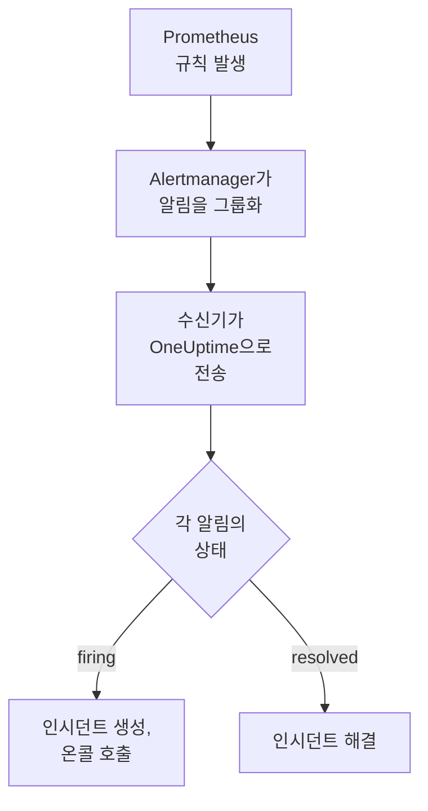

# Prometheus Alertmanager

[Prometheus Alertmanager](https://prometheus.io/docs/alerting/latest/alertmanager/) 알림을 OneUptime으로 보내면, 발생한 각 알림이 온콜 팀을 호출하는 인시던트가 되고 알림이 복구되면 해결됩니다. Alertmanager는 통지를 웹훅 수신기로 보내므로 어느 쪽에도 설치할 것이 없습니다.

:::cards
- [OneUptime이 알림을 받는 방법 선택](#oneuptime이-알림을-받는-방법-선택): Incoming Request 모니터 또는 직접 만든 워크플로.
- [모니터로 알림 받기](#모니터로-알림-받기): 알림마다 인시던트 하나, 복구 시 해결.
- [Alertmanager 구성](#alertmanager-구성): 웹훅 수신기와 이를 사용하는 라우트.
- [문제 해결](#문제-해결): 알림이 도착하지 않거나 인시던트가 계속 열려 있을 때.
:::

## 작동 방식



Prometheus는 알림 규칙을 평가하고 발생한 알림을 Alertmanager로 보냅니다. Alertmanager는 라우트의 `group_by`에 있는 레이블로 알림을 그룹화하고, 각 그룹을 하나의 JSON 통지로 웹훅 수신기에 보냅니다. 통지의 `alerts` 목록에는 그룹의 모든 알림이 들어 있으며, 각 알림에는 고유한 `status`(`firing` 또는 `resolved`), 레이블과 주석, 그리고 알림을 식별하는 `fingerprint`가 있습니다.

## 사전 요건

- `alertmanager.yml`을 편집할 수 있고 HTTPS로 OneUptime에 연결할 수 있는 Alertmanager.
- OneUptime에서 모니터를 만들 권한. 워크플로를 사용한다면 워크플로를 만들 권한.

## OneUptime이 알림을 받는 방법 선택

먼저 OneUptime을 설정합니다. 그러면 Alertmanager가 보낼 URL을 얻습니다.

| 방법 | 사용하는 경우 |
| --- | --- |
| Incoming Request 모니터(권장) | 모든 알림이 온콜을 호출하고 알림이 복구되면 해결되는 인시던트가 되기를 원할 때. 따로 만들 것이 없습니다. |
| 웹훅 트리거가 있는 워크플로 | 알림 필터링, 형태 변환, 다른 시스템 먼저 호출 등 자체 로직이 필요할 때. 워크플로는 알림마다가 아니라 통지마다 인시던트 하나를 열고, 복구 시 해결하지 않습니다. |

둘 다 같은 수신기에서 같은 JSON을 받으므로, 하나로 시작한 뒤 `alertmanager.yml`의 URL 하나만 바꿔 나중에 전환할 수 있습니다.

## 모니터로 알림 받기

[Incoming Request 모니터](/docs/monitor/incoming-request-monitor)는 URL을 제공하고, 그 기준이 각 통지가 할 일을 결정합니다.

:::steps
### 모니터 만들기

**모니터**로 이동해 **모니터 생성**을 클릭합니다. **모니터 유형**에서 **Incoming Request**를 고르고, 이름을 `Alertmanager`로 정한 다음 **다음**을 클릭합니다.

### 발생한 알림마다 인시던트 선언

**기준** 단계에서 첫 번째 기준, 즉 모니터를 오프라인으로 표시하는 기준을 엽니다. 필터를 **요청 본문**, **포함**, `"status":"firing"`으로 설정합니다. 이 기준은 필터가 일치하면 이미 인시던트를 선언합니다. 인시던트를 채웁니다:

- **인시던트 제목**: `{{requestBody.commonLabels.alertname}} on {{requestBody.commonLabels.instance}}`.
- **심각도**: 이 알림에 붙일 인시던트 심각도.
- **온콜 정책**(**온콜** 아래): 호출할 정책.
- **인시던트 자동 해결**(**추가 필드** 아래): 처음 상태대로 켜 둡니다. 이 설정이 없으면 복구가 무시되어 인시던트가 계속 열려 있습니다.

### 알림마다 인시던트 하나 열기

같은 기준에서 **설정**을 열고 **Group incidents and alerts by a payload field**를 켭니다. 아래와 같이 채우면 알림마다 별도의 인시던트가 생기고, 그 복구가 인시던트를 해결합니다:

| 필드 | 값 |
| --- | --- |
| **Open a separate incident for each…** | `requestBody.alerts[*].fingerprint` |
| **Field that signals recovery** | `requestBody.alerts[*].status` |
| **Value that means recovered** | `resolved` |

### 모니터를 다시 온라인으로

두 번째 기준, 즉 모니터를 온라인으로 표시하는 기준을 열고 필터를 **요청 본문**, **포함**, `"status":"resolved"`로 설정합니다.

### URL 복사

**모니터 생성**을 클릭합니다. 모니터의 **개요** 페이지에 **Heartbeat URL**이 표시됩니다. Alertmanager에 쓸 수 있도록 복사합니다:

```text
https://oneuptime.com/heartbeat/<secret key>
```

자체 호스팅 설치에서는 `oneuptime.com` 대신 자체 호스트를 사용합니다.
:::

`[*]`는 통지의 모든 알림을 읽으므로, 알림 세 개가 담긴 통지는 **Max incidents per request**(바꾸지 않으면 `100`)까지 인시던트 세 개를 열 수 있습니다. 각 알림의 `status`가 그 인시던트에 일어날 일을 결정합니다. 통지의 알림 하나가 해결되고 두 개가 여전히 발생 중이면, 해결된 알림의 인시던트만 닫힙니다. 각 설정이 하는 일은 [다른 시스템의 알림 수신](/docs/monitor/incoming-request-monitor#다른-시스템의-알림-수신)을 참고하세요.

> [!WARNING]
> 한 통지 안에서 알림마다 다른 값으로 그룹화하세요. Alertmanager의 `fingerprint`는 알림의 전체 레이블 집합의 해시이므로 항상 다릅니다. 라우트의 `group_by`에 있는 레이블은 절대 다르지 않습니다. 그것이 바로 알림을 한 통지로 묶는 기준이기 때문입니다. 아래 라우트에서 `requestBody.alerts[*].labels.alertname`으로 그룹화하면 통지의 모든 알림이 인시던트 하나로 합쳐지고, 그 인시던트는 첫 번째 알림의 상태를 따릅니다.

## 인시던트 이름 짓기

위 제목은 통지의 모든 알림이 공유하는 레이블을 읽습니다. `commonLabels`에는 그 레이블이, `commonAnnotations`에는 공유하는 주석이 들어 있습니다. `alertname`과 `instance`로 그룹화하는 아래 라우트에서는 둘 다 들어 있습니다. **설명** 아래에서 인시던트에 다음과 같은 **인시던트 설명**을 지정합니다:

```text
{{requestBody.commonAnnotations.summary}}

{{requestBody.commonAnnotations.description}}
Severity: {{requestBody.commonLabels.severity}}
Alertmanager: {{requestBody.externalURL}}
```

- 그룹화 키도 변수이며, 경로의 마지막 세그먼트를 따라 `{{fingerprint}}`라는 이름이 붙습니다. 해시이므로 대응자에게는 아무것도 알려 주지 않습니다.
- `{{requestBody.alerts[0].annotations.summary}}`는 통지의 첫 번째 알림을 읽는데, 그것이 항상 인시던트가 열린 대상 알림은 아닙니다.
- 통지에 없는 필드에 대한 참조는 비워지지 않고 중괄호까지 포함해 쓴 그대로 남습니다.

사용할 수 있는 모든 변수는 [인시던트 및 알림 템플릿](/docs/monitor/incident-alert-templating)을 참고하세요.

## Alertmanager 구성

:::steps
### 웹훅 수신기 추가

`alertmanager.yml`에 복사한 URL로 보내는 수신기를 추가하고, 이를 라우트의 수신기로 지정합니다:

```yaml title="alertmanager.yml"
route:
  receiver: oneuptime
  group_by: ["alertname", "instance"]

receivers:
  - name: oneuptime
    webhook_configs:
      - url: "https://oneuptime.com/heartbeat/<secret key>"
        send_resolved: true
```

`send_resolved: true`는 Alertmanager의 기본값이지만, 계속 켜져 있도록 명시해 둡니다. 이 값이 없으면 OneUptime은 알림이 복구되었다는 사실을 알 수 없습니다. Alertmanager는 `Content-Type: application/json`을 보내며, 모니터는 이를 사용해 통지의 필드를 읽습니다.

### Alertmanager 다시 로드

구성을 다시 로드하거나 Alertmanager를 다시 시작합니다:

```bash
curl -X POST http://localhost:9093/-/reload
```
:::

이 라우트는 Alertmanager의 기본 타이밍을 유지합니다. 새 그룹을 보내기 전에 `30s`(`group_wait`), 새 알림이 담긴 그룹을 다시 보내기 전에 `5m`(`group_interval`), 바뀌지 않은 통지를 반복하기 전에 `4h`(`repeat_interval`)를 기다립니다.

## 테스트하기

Alertmanager처럼, 발생 중인 알림 두 개가 담긴 통지를 OneUptime으로 보냅니다:

```bash
curl -X POST "https://oneuptime.com/heartbeat/<secret key>" \
  -H "Content-Type: application/json" \
  -d '{
    "version": "4",
    "status": "firing",
    "receiver": "oneuptime",
    "groupLabels": { "alertname": "DiskFull", "instance": "web-1" },
    "commonLabels": { "alertname": "DiskFull", "instance": "web-1", "severity": "critical" },
    "commonAnnotations": { "summary": "Disk almost full on web-1" },
    "externalURL": "http://alertmanager:9093",
    "alerts": [
      {
        "status": "firing",
        "labels": { "alertname": "DiskFull", "instance": "web-1", "severity": "critical", "device": "/dev/sda1" },
        "fingerprint": "a1b2c3d4e5f60001"
      },
      {
        "status": "firing",
        "labels": { "alertname": "DiskFull", "instance": "web-1", "severity": "critical", "device": "/dev/sdb1" },
        "fingerprint": "a1b2c3d4e5f60002"
      }
    ]
  }'
```

`fingerprint`마다 하나씩 인시던트 두 개가 열리며, 각각의 제목은 `DiskFull on web-1`입니다. 각 `status`를 `resolved`로 바꿔 같은 요청을 보내면 둘 다 해결됩니다.

Alertmanager부터 전체 경로를 테스트하려면 `amtool`로 알림을 발생시킵니다. Alertmanager는 `group_wait` 후에 알림을 보내고, 몇 분 뒤 알림이 만료되면 복구를 보냅니다:

```bash
amtool alert add test_alert severity=warning \
  --annotation=summary="Test from Alertmanager" \
  --alertmanager.url=http://localhost:9093
```

## 워크플로로 알림 받기

Alertmanager와 인시던트 사이에 직접 만든 단계가 필요하면 [워크플로](/docs/workflows/index)를 사용합니다.

:::steps
### 워크플로 만들기

**워크플로**로 이동해 **워크플로 생성**을 클릭한 다음 **처음부터 시작**을 클릭합니다. 이름을 `Alertmanager alerts`로 정하고 **워크플로 생성**을 클릭합니다.

### 웹훅 트리거 추가

점선으로 된 **이 워크플로를 시작할 항목 선택** 블록을 클릭하고 **Webhook**을 고릅니다. 트리거를 클릭한 다음 **URL 복사**를 클릭하고, 그 URL을 `alertmanager.yml`의 수신기에 사용합니다.

### 통지가 발생 중인지 확인

**구성 요소 추가**를 클릭해 **If / Else** 블록을 추가하고, 트리거의 **Out** 점을 여기에 연결합니다. **Value to check**는 `{{local.components.webhook-1.returnValues.request-body.status}}`, **Comparison**은 **is equal to**, **Compare with**는 `firing`으로 설정합니다.

### 인시던트 선언

**Create One Incident** 블록을 추가하고 **If / Else** 블록의 **Yes** 쪽을 여기에 연결합니다. **Incident Template**에서 심각도와 호출할 온콜 정책을 정하는 템플릿을 고릅니다([인시던트 템플릿](/docs/incidents/settings#인시던트-템플릿) 참고). **JSON Object**에서 Alertmanager에서 오는 값을 설정합니다:

```json
{
  "title": "{{local.components.webhook-1.returnValues.request-body.commonLabels.alertname}}",
  "description": "{{local.components.webhook-1.returnValues.request-body.commonAnnotations.summary}}\nAlertmanager: {{local.components.webhook-1.returnValues.request-body.externalURL}}"
}
```

템플릿이 없으면 **JSON Object**에 프로젝트의 인시던트 심각도 중 하나의 ID인 `incidentSeverityId`도 있어야 합니다.

### 워크플로 켜기

**빌더** 상단에서 **활성화됨**을 켭니다. 꺼진 워크플로는 Alertmanager에 `400`으로 응답합니다.
:::

한 번의 실행은 통지 하나를 처리하므로, 통지에 알림이 몇 개 들어 있든 인시던트를 하나만 선언합니다. `resolved` 통지는 **If / Else** 블록의 **No** 쪽으로 가는데, 그쪽에는 아무것도 연결되어 있지 않으므로 실행은 거기서 끝납니다. 알림마다 인시던트를 하나씩 열고 복구 시 해결하려면 모니터를 사용하세요.

## Alertmanager 자체 감시

두 방법 모두 Prometheus나 Alertmanager가 작동을 멈춘 것을 알아채지 못합니다. 알림을 받지 못하는 상태는 모든 것이 정상인 상태와 똑같아 보이기 때문입니다. 그래서 항상 발생하는 알림을 두 번째 모니터로 보내, 그 알림이 더 이상 도착하지 않으면 인시던트를 선언하게 합니다. [kube-prometheus-stack](https://github.com/prometheus-community/helm-charts/tree/main/charts/kube-prometheus-stack)에는 `Watchdog`이라는 이런 알림이 포함되어 있습니다. 일반 Prometheus에서는 `vector(1)`처럼 식이 항상 참인 `Watchdog`이라는 알림 규칙을 추가합니다.

:::steps
### 워치독 모니터 만들기

`Alertmanager watchdog`이라는 이름으로 두 번째 Incoming Request 모니터를 만듭니다. 모니터를 오프라인으로 표시하는 첫 번째 기준의 필터는 **Incoming Request**, **Not Recieved In Minutes**, `10`으로, 두 번째 기준의 필터는 **Incoming Request**, **Recieved In Minutes**, `10`으로 설정합니다. 대시보드에서는 둘 다 이 철자로 표시됩니다. 새 모니터의 **Heartbeat URL**을 복사합니다.

### 워치독 알림을 그쪽으로 보내기

워치독 모니터의 URL을 위한 수신기와, `Watchdog`을 5분마다 그쪽으로 보내는 라우트를 추가합니다. 하위 라우트는 상위 라우트의 수신기보다 먼저 확인되므로 `Watchdog`은 워치독 모니터로 가고, 다른 모든 알림은 계속 첫 번째 모니터로 갑니다:

```yaml title="alertmanager.yml"
route:
  receiver: oneuptime
  group_by: ["alertname", "instance"]
  routes:
    - receiver: oneuptime-watchdog
      matchers:
        - alertname = "Watchdog"
      group_wait: 0s
      group_interval: 5m
      repeat_interval: 5m

receivers:
  - name: oneuptime
    webhook_configs:
      - url: "https://oneuptime.com/heartbeat/<secret key>"
        send_resolved: true
  - name: oneuptime-watchdog
    webhook_configs:
      - url: "https://oneuptime.com/heartbeat/<watchdog secret key>"
```
:::

워치독 알림이 10분 동안 도착하지 않으면 워치독 모니터가 오프라인이 되고 인시던트를 선언합니다. 다음 워치독 통지가 모니터를 다시 온라인으로 만들고 인시던트를 해결합니다.

## 문제 해결

:::details OneUptime에 아무것도 도착하지 않음
- Alertmanager 로그에서 수신기로 전달할 때의 오류를 확인합니다.
- 모니터는 무엇이든 확인하기 전에, 비밀 키가 틀려도 즉시 `200`으로 응답합니다. 통지가 도착하는지는 모니터의 타임라인에서 확인합니다.
- 꺼진 워크플로는 `400`으로 응답합니다. 그 **빌더** 상단에서 **활성화됨**을 켭니다.
:::

:::details 인시던트가 열리지만 해결되지 않음
- `send_resolved: false`를 설정한 수신기가 없는지 확인합니다. 그런 경우 Alertmanager는 복구를 전혀 보내지 않습니다.
- 기준의 인시던트에는 **추가 필드** 아래의 **인시던트 자동 해결**이 필요합니다.
- **Field that signals recovery**는 `requestBody.alerts[*].status`여야 하고, **Value that means recovered**는 정확히 `resolved`여야 합니다. 비교는 대소문자를 구분합니다.
- 통지에서 **Max incidents per request**를 넘는 알림은 아예 읽히지 않으므로, 그 복구도 사라집니다.
- 버스트 중에 건너뛴 복구(아래 참고)는 해당 인시던트를 영영 열린 채로 둡니다. Alertmanager는 발생 중인 알림은 반복해서 보내지만 복구는 반복하지 않습니다. 그런 인시던트는 직접 해결합니다.
:::

:::details 인시던트가 열리지 않음
그룹화 경로는 `requestBody.`로 시작해야 하며, 경로에서 목록을 읽는 것은 첫 번째 `[*]`뿐입니다. 두 규칙 중 하나라도 어기는 경로는 오류 없이 아무것과도 일치하지 않습니다.
:::

:::details 알림이 가득한 통지에 인시던트가 하나만 생김
통지의 모든 알림에서 같은 레이블, 대개 라우트의 `group_by`에 있는 레이블로 그룹화했습니다. 대신 `requestBody.alerts[*].fingerprint`로 그룹화하세요.
:::

:::details 인시던트에 값 대신 참조가 표시됨
통지에 없는 필드에 대한 참조는 중괄호까지 포함해 쓴 그대로 남습니다. 규칙마다 설정하는 주석이 다르므로, `commonAnnotations`나 각 알림의 `annotations`처럼 규칙이 실제로 설정하는 필드를 사용하세요.
:::

:::details 인시던트가 너무 많음
라우트를 더 적은 레이블로 그룹화하거나 `group_interval`을 늘려, Alertmanager가 관련 알림을 함께 보내도록 합니다. **Max incidents per request**를 낮추면 한 통지에서 생기는 인시던트가 제한되지만, 한도를 넘는 알림은 읽히지 않으므로 그 복구도 사라집니다.
:::

:::details 버스트 중에 통지가 건너뛰어짐
이전 요청이 평가되기 전에 더 새로운 요청이 모니터에 도착하면, OneUptime은 가장 새로운 요청만 평가합니다. 하나의 발신자가 모니터를 압도하지 못하게 하기 위해서입니다. 버스트의 마지막 통지는 항상 평가되지만, Alertmanager가 모든 그룹을 같은 URL로 보내기 때문에 다른 알림에 관한 이전 통지는 건너뛰어질 수 있습니다. `group_wait`와 `group_interval`을 늘려 통지 간격을 벌리세요. 자체 호스팅 설치에서는 모든 요청을 평가하도록 OneUptime 앱의 환경에 `INCOMING_REQUEST_INGEST_COALESCE_ENABLED=false`를 설정합니다.
:::

## 보안

- **URL을 비밀번호처럼 다루세요.** URL을 가진 사람은 누구나 인시던트를 열 수 있습니다. 유출되었다면 재설정합니다. 모니터의 **설정** 페이지에서 **수신 요청 비밀 키 재설정**을, 또는 워크플로의 **Webhook** 트리거에서 **URL 재설정**을 사용합니다. 그런 다음 `alertmanager.yml`에서 수신기의 `url`을 업데이트합니다.
- **자체 호스팅인가요?** Alertmanager가 방화벽을 통과해 HTTPS로 OneUptime에 연결할 수 있게 하세요.

## 다음 단계

:::cards
- [수신 요청 모니터](/docs/monitor/incoming-request-monitor): 알림을 받는 모니터의 모든 설정.
- [Grafana](/docs/integrations/grafana): Grafana 알림을 위한 같은 설정.
- [에스컬레이션 규칙](/docs/on-call/escalation-rules): 온콜 정책이 누구를 언제 호출할지 정합니다.
- [통합 개요](/docs/integrations/index): 연결할 수 있는 다른 도구.
:::
