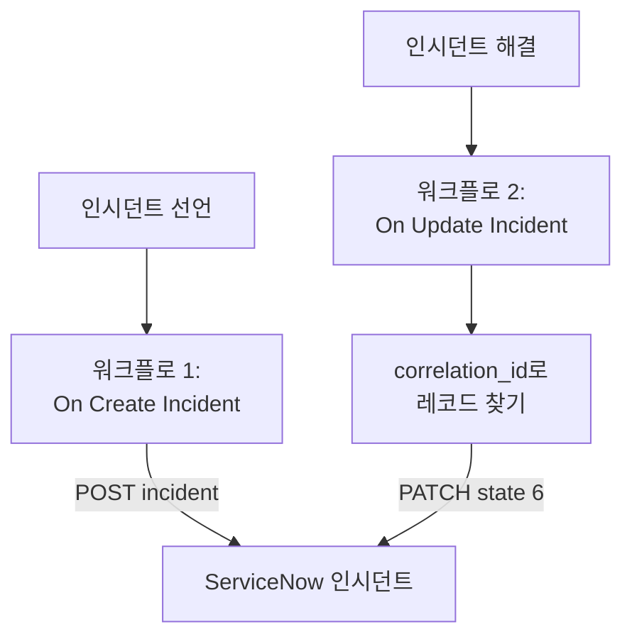

# ServiceNow

OneUptime 인시던트마다 [ServiceNow](https://www.servicenow.com) 인시던트를 열고, OneUptime 인시던트가 해결되면 이를 해결하여 서비스 데스크가 모니터링 상황을 따라가게 합니다. 두 워크플로가 ServiceNow의 [Table API](https://developer.servicenow.com/dev.do#!/reference/api/latest/rest/c_TableAPI)를 호출합니다.

:::cards
- [자격 증명 저장하기](#자격-증명-저장하기): ServiceNow 비밀번호를 워크플로 밖에 둡니다.
- [ServiceNow 인시던트 열기](#인시던트마다-servicenow-인시던트-열기): 워크플로 하나, 블록 두 개.
- [해결하기](#servicenow-인시던트-해결하기): 레코드를 찾은 다음 닫습니다.
- [문제 해결](#문제-해결): ServiceNow가 요청을 거부할 때.
:::

## 작동 방식



첫 번째 워크플로는 OneUptime 인시던트의 ID를 레코드의 `correlation_id`에 씁니다. 두 번째 워크플로는 그 ID로 레코드를 찾아 해결합니다.

## 사전 요건

- `https://your-instance.service-now.com` 같은 ServiceNow 인스턴스.
- `incident` 테이블에서 레코드를 만들고 업데이트할 수 있는 통합용 ServiceNow 사용자(보통 `itil` 역할). 그 이름과 비밀번호로 요청에 서명합니다.
- OneUptime에서 워크플로와 전역 변수를 만들 권한. OneUptime Cloud에서는 워크플로에 **Growth** 요금제 이상이 필요합니다.

## 자격 증명 저장하기

Table API는 Basic 인증, 즉 사용자의 이름과 비밀번호를 함께 인코딩한 값을 받습니다.

:::steps
1. macOS나 Linux에서 한 번만 인코딩합니다:

   ```bash
   printf '%s' 'integration.user:password' | base64 | tr -d '\n'
   ```

   `echo`가 아니라 `printf`를 사용하세요. `echo`는 줄바꿈을 추가하고, 이 줄바꿈이 나머지와 함께 인코딩되어 자격 증명이 깨집니다.

2. OneUptime에서 **워크플로 → 전역 변수**로 이동해 **워크플로 변수 만들기**를 클릭합니다. 이름을 `SERVICENOW_AUTH`로 정하고 **다음**을 클릭합니다.
3. 인코딩한 값을 **콘텐츠**에 붙여 넣고 **시크릿**을 켠 다음 **워크플로 변수 만들기**를 클릭합니다.
:::

## 인시던트마다 ServiceNow 인시던트 열기

:::steps
### 워크플로 만들기

**워크플로**로 이동해 **워크플로 생성**을 클릭한 다음 **처음부터 시작**을 클릭합니다. 이름을 `Incidents to ServiceNow`로 정하고 **워크플로 생성**을 클릭합니다.

### 트리거 추가하기

점선으로 된 **이 워크플로를 시작할 항목 선택** 블록을 클릭하고 **On Create Incident**를 고릅니다. 트리거를 클릭합니다. **Fields to pass on**에는 **제목**이 이미 들어 있으므로, **필드 추가**를 클릭하고 **설명**을 고릅니다.

### 레코드 만들기

**구성 요소 추가**를 클릭하고 **API Post (JSON)** 블록을 추가한 다음, 트리거의 **Success** 점을 이 블록에 연결합니다. **URL**을 `https://your-instance.service-now.com/api/now/table/incident`로 설정합니다. **추가 필드**에서 **Request Headers**를 다음으로 설정합니다:

```json
{
  "Authorization": "Basic {{global.variables.SERVICENOW_AUTH}}",
  "Accept": "application/json"
}
```

**Request Body**는 다음과 같습니다:

```json
{
  "short_description": "OneUptime: {{local.components.incident-on-create-1.returnValues.model.title}}",
  "description": "{{local.components.incident-on-create-1.returnValues.model.description}}",
  "urgency": "1",
  "impact": "1",
  "correlation_id": "oneuptime-{{local.components.incident-on-create-1.returnValues.model._id}}"
}
```

### 테스트한 다음 켜기

**워크플로 실행**을 클릭하고 **인시던트**에서 테스트 인시던트를 고른 다음 실행합니다. **API Post (JSON)** 단계에 새 레코드와 그 `sys_id`, `INC0012345` 같은 `number`가 담긴 `201` 응답이 표시됩니다. 그런 다음 **빌더** 상단에서 **활성화됨**을 켭니다.
:::

`urgency`와 `impact`는 높음에 `1`, 중간에 `2`, 낮음에 `3`을 받으며, ServiceNow는 이 둘로 우선순위를 계산합니다. `incident` 테이블의 다른 열도 열 이름으로 본문에 넣을 수 있습니다.

## ServiceNow 인시던트 해결하기

워크플로에는 트리거가 하나뿐이므로, 해결에는 인시던트 상태가 바뀔 때 시작되는 두 번째 워크플로가 필요합니다.

:::steps
### On Update Incident 트리거 추가하기

`Resolve ServiceNow incidents`라는 워크플로를 만들고 트리거로 **On Update Incident**를 고릅니다. **Fields to watch**에서 **필드 추가**를 클릭하고 **Current Incident State**를 골라 상태가 바뀔 때만 실행되게 합니다. **Fields to pass on**에서 새 상태가 해결된 상태인지 요청합니다. **필드 추가**를 클릭하고 **Current Incident State**를 연 다음 **Is Resolved State**를 고릅니다. 또는 **JSON으로 편집**을 클릭하고 JSON을 다음으로 바꿉니다:

```json
{ "_id": true, "currentIncidentState": { "isResolvedState": true } }
```

### 인시던트가 해결되었는지 확인하기

트리거 뒤에 **If / Else** 블록을 추가합니다. **Value to check**를 `{{local.components.incident-on-update-1.returnValues.model.currentIncidentState.isResolvedState}}`로, **Comparison**을 **is true**로 설정합니다.

### 레코드 찾기

**Yes** 쪽 뒤에 같은 **Request Headers**와 다음 **URL**을 가진 **API Get (JSON)** 블록을 추가합니다:

```text
https://your-instance.service-now.com/api/now/table/incident?sysparm_query=correlation_id=oneuptime-{{local.components.incident-on-update-1.returnValues.model._id}}&sysparm_fields=sys_id&sysparm_limit=1
```

### 레코드 해결하기

찾기 블록의 **Success** 뒤에 같은 **Request Headers**와 다음 **URL**을 가진 **API Patch (JSON)** 블록을 추가합니다:

```text
https://your-instance.service-now.com/api/now/table/incident/{{local.components.api-get-1.returnValues.response-body.result[0].sys_id}}
```

**Request Body**를 다음으로 설정합니다:

```json
{
  "state": "6",
  "close_code": "Solution provided",
  "close_notes": "Resolved in OneUptime"
}
```

### 켜기

**활성화됨**을 켠 다음 OneUptime에서 테스트 인시던트를 해결합니다. 해당 ServiceNow 인시던트가 Resolved로 바뀝니다.
:::

ServiceNow의 기본 인시던트 상태에서 `state` `6`은 Resolved입니다. `close_code`는 인스턴스의 해결 코드 중 하나여야 합니다. 많은 인스턴스가 해결 코드와 노트 없이는 인시던트를 해결하지 않으므로 둘 다 보내세요.

## 문제 해결

:::details ServiceNow가 401로 응답함
자격 증명이 틀렸습니다. `echo`가 아니라 `printf`로 `username:password`를 다시 인코딩하고 `SERVICENOW_AUTH`의 내용을 바꾸세요.
:::

:::details ServiceNow가 403으로 응답함
사용자가 `incident` 테이블에 쓸 수 없습니다. `itil` 역할 또는 같은 권한을 가진 역할을 주고, 액세스 제어 규칙이 그 사용자의 Table API를 막고 있지 않은지 확인하세요.
:::

:::details ServiceNow가 400으로 응답하거나 해결해도 아무것도 바뀌지 않음
열 이름이나 값이 인스턴스에 맞지 않습니다. 사용자 지정된 `state` 목록이나 인스턴스에 없는 `close_code` 같은 경우입니다. ServiceNow의 **System Definition → Tables**에 있는 `incident` 테이블과 레코드 자체의 양식과 비교하세요.
:::

:::details 해결이 404로 응답함
찾기 단계에서 레코드를 찾지 못해 URL에 참조가 쓰인 그대로 남았습니다. 첫 번째 워크플로가 `correlation_id`를 썼는지, 두 워크플로가 같은 방식(`oneuptime-` 뒤에 인시던트의 `_id`)으로 만드는지 확인하세요.
:::

## 다음 단계

:::cards
- [Jira](/docs/integrations/jira): 미리 만들어진 템플릿으로 동기화를 유지하는 양방향 통합.
- [워크플로우 구성 요소](/docs/workflows/components#api): API 블록의 모든 설정.
- [워크플로우 실행 기록](/docs/workflows/runs-and-logs): 각 요청이 보낸 내용과 받은 내용을 확인합니다.
- [통합 개요](/docs/integrations/index): 모든 통합의 바탕이 되는 패턴.
:::
