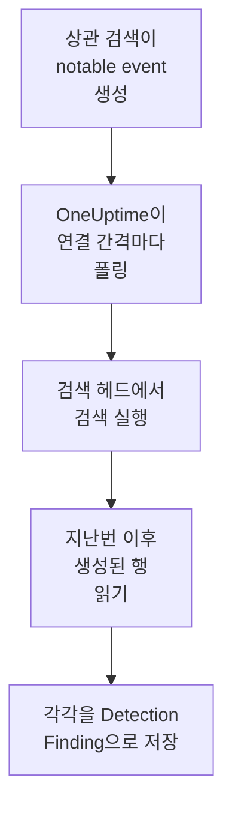

# Splunk Enterprise Security

[Splunk Enterprise Security](https://www.splunk.com/en_us/products/enterprise-security.html)의 상관 검색이 만드는 notable event를 OneUptime의 보안 이벤트로 가져옵니다. 그곳에서 로그, 트레이스, 메트릭과 나란히 검색하고, 다른 모든 소스와 상관 분석하고, 중요한 것에 대해 온콜을 호출할 수 있습니다. OneUptime은 직접 만든 Splunk 사용자로 검색 헤드에서 검색을 실행해 이를 읽으며, Splunk에서는 아무것도 바꾸지 않습니다. 단순한 검색이므로 notable event뿐 아니라 어떤 인덱스든, 어떤 저장된 검색의 출력이든 가져올 수 있습니다.

:::cards
- [연결 설정](#연결-설정): 토큰, 역할, 연결 양식.
- [가져오는 내용](#가져오는-내용): 검색의 각 행이 보안 이벤트가 되는 방식.
- [폴링 작동 방식](#폴링-작동-방식): 각 폴링이 읽는 구간과, 바쁜 검색 헤드에서 일어나는 일.
- [문제 해결](#문제-해결): 각 오류의 의미와 바꿔야 할 점.
:::

## 작동 방식



OneUptime은 1분마다, 폴링 간격이 지난 활성화된 연결을 각각 폴링합니다. 폴링은 검색 헤드의 REST API를 통해 지난 폴링 이후 생성된 행을 대상으로 검색을 실행하고, 각 행을 [OCSF](https://schema.ocsf.io/) Detection Finding 이벤트(클래스 `2004`)로 저장합니다. 그 뒤 탐지 규칙, 모니터, 대시보드는 이를 다른 소스의 보안 이벤트와 똑같이 다룹니다.

## 사전 요건

- OneUptime에서 Project Owner, Project Admin 또는 Security Admin 역할. Security Member와 Security Viewer는 연결과 그 실행 기록을 볼 수 있지만 변경할 수는 없습니다.
- Splunk Enterprise 9.0.1 이상을 실행하는 검색 헤드 또는 Splunk Cloud Platform. OneUptime은 관리 포트(보통 `8089`)에서 REST API와 통신합니다. 포트 `8000`의 Splunk Web은 REST API를 제공하지 않습니다.
- OneUptime용 Splunk 사용자. 그 역할에 `search` 기능이 있고, 검색이 읽는 인덱스(notable event의 경우 `notable`)를 읽을 수 있어야 합니다. Enterprise Security의 `ess_analyst`와 `ess_user` 역할은 둘 다 부여합니다. 연결은 읽기만 하므로 역할에 그 밖의 것은 필요 없습니다.
- OneUptime이 HTTPS로 접근할 수 있는 검색 헤드. OneUptime Cloud는 인터넷에서 연결하므로 검색 헤드에 공개 주소가 필요하며, 사설 주소는 거부됩니다. 자체 호스팅 OneUptime은 앱과 워커 컨테이너에서 연결하며, `DATA_SOURCE_BLOCK_PRIVATE_ADDRESSES`가 `true`가 아닌 한 사설 네트워크의 검색 헤드에도 접근할 수 있습니다.

## 연결 설정

연결은 Splunk 인증 토큰이나 사용자 이름과 비밀번호로 인증합니다.

:::steps
### 인증 토큰 만들기

1. Splunk Web에서 **Settings → Tokens**를 엽니다. 토큰 인증이 꺼져 있다고 나오면 먼저 **Enable Token Authentication**을 선택합니다.
2. **New Token**을 선택합니다. **User**에는 OneUptime용으로 만든 Splunk 사용자를 입력하고, **Audience**에는 토큰의 용도(예: `OneUptime security events`)를 입력합니다.
3. **Expiration**을 고르거나 만료 없음으로 둡니다. 만료되는 토큰은 교체할 때까지 연결을 멈춥니다.
4. **Create**를 선택하고 토큰을 복사합니다. Splunk는 토큰을 한 번만 보여 줍니다.

대신 비밀번호로 인증하려면 이 단계를 건너뛰고 사용자의 이름과 비밀번호를 준비해 둡니다.

### OneUptime에서 연결 추가

**제품 → Security Events → 연결**(`/dashboard/{projectId}/security-events/connections`)를 열고 **연결 추가**를 클릭한 뒤 **Splunk Enterprise Security**를 고르고 **다음**을 클릭합니다. 아래 표의 설정을 채우고 **다음**을 클릭한 뒤, 토큰을 **Authentication token**에, 또는 비밀번호를 **비밀번호**에 붙여 넣습니다.

### 저장하기 전에 테스트

**저장하기 전에 테스트** 아래의 **이 설정 테스트**를 클릭합니다. 테스트는 양식의 값으로 인증하고 검색을 실행하며 아무것도 저장하지 않으므로, 잘못된 포트나 빠진 역할이 연결을 만들기 전에 드러납니다. 그런 다음 **다음**을 클릭하고 연결에 **이름**을 지정해 만듭니다.
:::

| 설정 | 입력할 값 |
| --- | --- |
| **Splunk management URL** | 검색 헤드의 REST API. 예: `https://splunk.example.com:8089`. `https`를 사용해야 하며 쿼리 문자열은 붙이지 않습니다. 경로 아래에서 API를 제공하는 리버스 프록시를 위해 경로는 유지됩니다. |
| **검색** | 무엇을 가져올지 고르는 검색으로, 바꾸지 않는 한 `index=notable`입니다. 예를 들어 `index=notable urgency IN (high, critical)`처럼 좁힙니다. 시간 범위는 OneUptime이 직접 추가하므로 검색에서 `earliest`나 `latest`를 지정하거나 파이프로 시작할 수 없습니다. 앞쪽의 `search`는 제거됩니다. |
| **사용자 이름** | Splunk 사용자의 이름. 비밀번호로 인증하는 경우에만 필요합니다. |
| **Authentication token** | 첫 단계의 토큰. 토큰이 저장되어 있으면 사용자 이름과 비밀번호 대신 토큰이 사용됩니다. |
| **비밀번호** | Splunk 사용자의 비밀번호. 토큰을 쓰지 않을 때만 필요합니다. |

**Authentication token**과 **비밀번호**는 암호화되며, API가 반환하지 않고 다시 표시되지도 않습니다. 교체하려면 연결의 **자격 증명 업데이트**를 사용합니다. 인증 방식을 바꾸려면 그곳에 새 값을 입력하고 **Remove the stored Authentication token** 또는 **Remove the stored Password**를 켭니다.

**폴링** 단계에는 선택 사항인 **설명**, `1`부터 `1440`까지의 정수이며 처음 값이 `5`인 **폴링 간격(분)**, 그리고 처음에 켜져 있는 **활성화됨**도 있습니다.

## 가져오는 내용

검색이 반환하는 각 행은 공급업체 `Splunk`, 제품 `Splunk Enterprise Security`의 Detection Finding 이벤트(OCSF 클래스 `2004`)가 됩니다. notable event의 경우:

| Splunk 필드 | OneUptime 열 |
| --- | --- |
| `event_id`, 없으면 `_bkt`와 `_cd`, 없으면 행의 해시 | 이벤트 UID. 중복을 걸러 내는 기준이기도 합니다 |
| `_time`(상관 검색이 notable event를 만든 시각) | 이벤트 시각 |
| `rule_name`, 없으면 `search_name`, 없으면 `source` | 규칙 이름 |
| `search_name`, 없으면 `source`, 없으면 `rule_name` | 규칙 ID |
| `rule_title`, 없으면 `rule_description`, 없으면 규칙 이름 | 메시지 |
| `urgency`, 없으면 `severity` | 심각도 |
| `status_label`, 없으면 `status_description`, 없으면 `status`가 담은 검토 상태의 이름 | 상태 |
| `annotations.mitre_attack`, 그리고 `mitre_technique_id`, `mitre_tactic` 같은 필드 | MITRE ATT&CK 전술과 기법 |
| `user` 또는 `src_user`; `src`, `src_ip` 또는 `src_host`; `process`, `process_name` 또는 `parent_process` | 주체 사용자, IP, 호스트, 프로세스 |
| `process_name` 또는 `process_exec`, `process_path` 및 `process`; `parent_process_name` 또는 `parent_process_exec`, `parent_process_path` 및 `parent_process` | 프로세스 이름, 경로, 명령줄; 부모 프로세스 이름, 경로, 명령줄 |
| `dest_user`; `dest`, `dest_ip` 또는 `dest_host`; `dest_port` | 대상 사용자, IP, 호스트, 포트 |
| `file_path`, `url` 또는 `risk_object` | 대상 리소스 |
| 모든 사용자, 호스트, IP와 함께 `dvc`, `host`, `file_hash`, `file_name`, `url`, `domain`, `query`, `risk_object` | Observable |
| 행의 모든 필드(예: `security_domain`, `owner`, `orig_sid`, `_raw`) | `attributes`. 필드 자체의 이름으로 |

다른 인덱스의 행도 같은 방식으로 가져옵니다. 그 필드로 채워지지 않는 열은 비어 있으며, 각 필드는 계속 `attributes`에서 검색할 수 있습니다.

## 폴링 작동 방식

각 폴링은 자신의 구간을 대상으로, 오래된 것부터 내보내기 검색을 실행합니다:

```text
POST {Splunk management URL}/services/search/v2/jobs/export
    search=search index=notable | fields * | sort 0 _time | head 10001
    earliest_time={window start}
    latest_time={window end}
    output_mode=json
```

- **생성 시각이 커서입니다.** 구간은 `_time` 기준이며, notable event의 경우 이는 찾은 활동이 일어난 시각이 아니라 상관 검색이 notable event를 만든 시각입니다. 매시간 실행되는 검색은 notable event에 자신의 실행 시각을 붙이므로, 커서 뒤로 떨어지는 것은 없습니다.
- **첫 폴링은 24시간 전까지 거슬러 올라가므로**, 새 연결에서 최근 notable event가 바로 보입니다.
- **이후의 모든 폴링은 저장된 커서보다 1분 앞에서 시작하므로**, 두 구간의 경계에서 생성된 행도 놓치지 않습니다.
- **한 번의 폴링은 커서 이후 최대 24시간까지 읽습니다.** 커서가 뒤처진 연결은 24시간 구간을 연달아 읽으며 따라잡고, 그동안 **상태**는 **Catching up**으로 표시됩니다.
- **중복은 `event_id`, 또는 Splunk 고유의 `_bkt`와 `_cd`로 걸러집니다.** 프로젝트 안에서 걸러지므로, 겹치는 부분, 다시 시도한 구간, 가져오기가 행을 두 번 저장하는 일은 없습니다.

9.0.1보다 오래된 검색 헤드는 `search/v2/jobs/export` 요청에 `404`로 응답합니다. 그러면 OneUptime은 지원 중단된 `search/jobs/export`로 요청을 보내고, 실행은 경고로 이를 알립니다. 검색 헤드를 업그레이드하세요. 현재 버전에서는 이 엔드포인트가 꺼져 있습니다.

### 한 번의 폴링으로 다 읽을 수 없는 구간

한 번의 폴링은 최대 10,000개의 행을 읽습니다. 구간에 그보다 많은 행이 있으면 실행은 **부분**이 되며, 다음과 같은 경고가 나옵니다:

```text
Stopped after collecting 10000 records; the window holds more. Records are read oldest first, and the last one read was created at 2026-09-14T08:12:44.000Z, where the next poll can resume.
```

검색은 구간을 `_time` 기준으로 오래된 것부터 정렬하므로, OneUptime은 커서를 마지막으로 읽은 행의 생성 시각으로 옮기고, 다음 폴링은 같은 구간 길이로 거기서 시작합니다. 바쁜 검색 헤드는 같은 행을 다시 읽는 대신 폴링마다 10,000개씩 따라잡습니다. 같은 순간에 만들어진 행은 두 번 읽히며, 중복 검사가 두 번째 사본을 걸러 냅니다. Splunk는 행을 반환하기 전에 구간 전체를 정렬하므로, 필요한 것보다 훨씬 많이 찾는 **검색**의 검색은 모든 폴링을 느리게 만듭니다. 검색은 좁게 유지하세요.

실행이 저장된 커서를 전혀 넘어서지 못하면, OneUptime은 대신 구간을 줄입니다:

1. **좁히기.** 다음 폴링은 같은 시작점에서 절반 길이의 구간을 읽으며, 구간을 끝까지 읽을 수 있게 될 때까지 계속 절반으로 줄이고, 가장 짧게는 1분까지 줄입니다. 실행의 경고에 그렇게 적힙니다: `This window holds more records than one poll can read; the next poll reads a {n} minute window from the same starting point.`
2. **다시 늘리기.** 구간을 끝까지 읽은 뒤에는 다음 구간이 다시 두 배가 되며, 최대 24시간까지 늘어납니다.
3. **1분 넘어가기.** 1분 안에조차 한 번의 폴링으로 읽을 수 있는 것보다 많은 레코드가 있으면, 더 새로운 notable event가 계속 도착하도록 폴링이 그 1분을 넘어갑니다. 실행은 **부분**로 남고, **마지막 오류**에는 `More records were created in the one minute from {cursor} to {end} than one poll can read. Polling moved past this minute so newer records keep arriving; use Import this time range in Diagnostics on this minute to recover what one run can read.`라고 나옵니다. 한 번의 실행이 읽을 수 있는 만큼 되찾으려면 **Import this time range**로 그 1분을 가져오세요.

Splunk의 오류로 실행이 완전히 실패하면, 커서와 구간 길이는 그대로 유지되고 다음 폴링이 같은 구간을 다시 읽습니다. 단 하나의 예외는 요청 시간이 초과된 경우입니다. 커서는 그대로지만 다음 구간은 절반 길이가 됩니다. 제시간에 응답하기에는 너무 무거운 구간은 시도할 때마다 시간이 초과되기 때문입니다. **폴링 간격(분)** 값을 바꿔도 이 중 어느 것도 달라지지 않습니다. 이 설정은 폴링이 얼마나 자주 시작하는지를 정할 뿐, 구간이 어디서 시작하는지는 정하지 않습니다.

### 필요할 때 실행, 미리 보기, 가져오기

연결에서 **진단**을 클릭하면 최근 실행을 보고 연결을 직접 다룰 수 있습니다. 연결을 변경할 수 있는 사람은 누구나 이를 시작할 수 있고, 연결을 볼 수 있는 사람은 누구나 기록을 읽을 수 있습니다.

- **지금 실행**은 연결이 **활성화됨** 상태가 아닐 때에도 평소의 커서로 즉시 폴링을 시작합니다.
- **Preview notable events**는 최대 7일의 시간 범위를 읽으며 아무것도 가져오지 않습니다.
- **Import this time range**는 확인을 거친 뒤 최대 7일의 범위를 가져오며, 커서는 옮기지 않습니다. 이미 가져온 행은 건너뜁니다.
- 실행의 **Copy diagnostics**는 지원팀에 보낼 보고서를 복사합니다. 자격 증명은 절대 포함되지 않습니다.

## 연결 테스트

연결 행의 **연결 테스트**와 양식의 **이 설정 테스트**는 백그라운드 워커가 아니라 API 프로세스에서 실행되므로, 워커가 문제일 때에도 테스트는 응답합니다. 다음 검사를 순서대로 실행합니다:

| 검사 | 확인하는 내용 |
| --- | --- |
| **구성** | 모든 설정이 있고 올바른 형식인지. 이 검사가 실패하면 아무 곳에도 연결하지 않습니다. |
| **Authenticate with Splunk** | Splunk가 토큰, 또는 사용자 이름과 비밀번호를 받아들이고, 사용자와 그 역할을 알려 줍니다. 부여하려던 역할과 비교할 수 있습니다. |
| **Run the search on Splunk** | **검색**의 검색이 지난 24시간을 대상으로 한 행만큼 실행되고, 어느 내보내기 엔드포인트가 응답했는지 알려 줍니다. |
| **Notable events available to import** | **검색**의 검색이 지난 24시간과 지난 7일 동안 찾은 행의 수. 7일 동안 하나도 없으면 실패가 아니라 경고입니다. |
| **Background workers**, **Poll scheduler**, **Security event storage** | OneUptime 쪽: Worker 큐의 작업을 가져가는 프로세스가 있고, 폴링 작업이 매분 실행되고, 보안 이벤트 저장소가 응답하는지. |
| **Scheduled polling** | 저장된 연결의 경우: 폴링이 켜져 있고, 워커를 기다리며 멈춘 실행이 없고, 폴링이 제때 실행되는지. |

테스트의 모든 요청에는 20초 기한이 있습니다. 테스트는 아무것도 가져오지 않고 커서를 옮기지도 않으며, 실패한 각 검사는 무엇을 바꿔야 하는지 알려 줍니다.

## Splunk로 보안 이벤트 보내기

OneUptime은 찾은 것을 Splunk의 HTTP Event Collector(HEC)를 통해 Splunk로 보낼 수도 있어, 검색과 대시보드에서 OneUptime의 탐지를 여러분의 탐지와 나란히 볼 수 있습니다. 각 보안 이벤트는 sourcetype이 `oneuptime:security` 인 HEC 이벤트 하나이며, 필드 이름은 Splunk의 Common Information Model이 부르는 이름을 따릅니다: `src`, `src_ip`, `src_user`, `dest`, `dest_ip`, `dest_port`, `user`, `signature`, `severity`.

:::steps
### HEC 토큰 만들기

Splunk Web에서 **Settings → Data inputs → HTTP Event Collector** 를 열고 **New Token** 을 클릭합니다. 이름을 정하고, 쓸 수 있는 인덱스와 기본 인덱스를 고른 뒤, 토큰 값을 복사합니다. Splunk Cloud에서는 HEC가 `https://http-inputs-<stack>.splunkcloud.com` 에서 수신하고, Splunk Enterprise에서는 **Global Settings** 에서 토큰을 켜면 포트 `8088` 에서 수신합니다.

### 대상 추가하기

**제품 → Security Events → 연결**를 엽니다. **SIEM으로 보내기**에서 **대상 추가**를 클릭하고, **SIEM** 에서 Splunk를 고른 뒤 **다음** 을 클릭합니다. **HEC URL** 을 입력하고 토큰을 **HEC 토큰** 에 붙여 넣습니다. **인덱스** 와 **소스 유형** 은 선택 사항입니다. 비워 두면 이벤트는 토큰의 기본 인덱스로 sourcetype `oneuptime:security` 와 함께 갑니다.

### 테스트 이벤트를 보내고 전송 시작하기

**테스트 이벤트 보내기** 를 클릭합니다. 양식의 설정으로 정보 수준 이벤트 하나가 Splunk로 가며, 아무것도 저장되지 않습니다. `sourcetype="oneuptime:security"` 로 검색하세요. 그런 다음 **보낼 내용** 에서 **탐지만** 을 그대로 두거나 **모든 보안 이벤트** 를 고르고, **전송 시작** 을 클릭합니다.
:::

- **HEC URL** 은 `https` 를 써야 하며, OneUptime이 신뢰하는 인증서가 있어야 합니다. 인증서 검사는 절대 건너뛰지 않습니다.
- 이벤트는 최대 500개씩 배치로 갑니다. Splunk가 거부한 이벤트는 빠지고 **오류 보기** 에 이름이 나오며, 바쁜 수집기(`503`)는 다시 시도하고, 토큰이나 인덱스가 거부되면 고칠 때까지 전송이 멈춥니다.
- OneUptime이 Splunk에서 가져온 notable event는 절대 Splunk로 다시 보내지 않습니다.

## 문제 해결

연결의 **마지막 오류**는 실패한 단계를 나타내는 접두사 뒤에, 자격 증명을 가린 전체 오류 메시지를 보관합니다. 연결에 오류가 있으면 **작업** 열에서 **오류 보기**를 선택해 읽고, 대화 상자의 **오류 복사**로 복사합니다. 먼저 접두사를 읽으세요.

:::details Last Error가 `Splunk Enterprise Security authentication request`로 시작함
- `Splunk Enterprise Security authentication request failed (HTTP ...)`: Splunk가 호출자가 누구인지 알려 주기를 거부했습니다.
  - `HTTP 401`: Splunk가 자격 증명을 받아들이지 않았습니다. 토큰이 잘못되었거나, 만료되었거나, 삭제되었거나, 검색 헤드에서 토큰 인증이 꺼져 있거나, 사용자 이름이나 비밀번호가 잘못되었습니다. 새 토큰을 만들어 **자격 증명 업데이트**로 저장하세요.
  - `HTTP 404`: **Splunk management URL**이 REST API가 아닙니다. 포트 `8000`의 Splunk Web을 가리키거나, 검색 헤드가 제공하지 않는 경로가 붙어 있습니다.
- `Splunk Enterprise Security authentication request returned ...`: 포트 `8000`의 Splunk Web HTML이나 프록시 페이지처럼, 검색 헤드의 REST API가 아닌 다른 것이 응답했습니다. URL이 관리 포트를 가리키게 하세요.
:::

:::details Last Error가 `Splunk Enterprise Security search export` 또는 `Splunk Enterprise Security count search`로 시작함
- `Splunk Enterprise Security search export failed (HTTP ...)`: Splunk가 검색 실행을 거부했습니다.
  - `HTTP 400`: Splunk가 검색을 해석할 수 없습니다. 오류를 확인하려면 **검색**의 검색을 Splunk Web에서 실행하세요.
  - `HTTP 403`: 사용자의 역할에 `search` 기능이 없거나 인덱스를 읽을 수 없습니다. 역할이 검색할 수 있는 인덱스에 `notable` 또는 사용하는 인덱스를 추가하세요.
  - `HTTP 404`: 그 URL에는 두 내보내기 엔드포인트 모두 없으므로, 검색 헤드의 관리 포트가 아닙니다.
  - `HTTP 429` 또는 `HTTP 5xx`: Splunk가 사용자를 제한하고 있거나, 과부하 상태이거나, 검색이 한도 중 하나에 도달했습니다. 다음 폴링에서 다시 시도합니다.
- `Splunk Enterprise Security search export was rejected by Splunk on an HTTP 200`: Splunk가 응답했지만 오류로 검색을 멈췄습니다. 메시지에 그 오류가 인용됩니다.
- `Splunk Enterprise Security search export returned a body that is not newline-delimited JSON.`: Splunk Web이나 프록시의 로그인 페이지처럼 REST API가 아닌 다른 것이 응답했습니다. 빈 구간으로 간주하지 않고 보고하므로, 아무도 읽지 않은 행을 커서가 지나치는 일은 없습니다.
- `Splunk Enterprise Security count search ...`: **Notable events available to import**의 개수 집계에서 생긴 같은 실패입니다. 이 집계는 테스트만 실행합니다.
:::

:::details Last Error가 `did not complete`로 끝남
`Splunk Enterprise Security search export did not complete`(다른 단계도 마찬가지)는 요청이 응답을 받지 못했다는 뜻입니다. 시간 초과, 확인할 수 없는 이름, OneUptime이 신뢰하지 않는 인증서, 또는 거부된 사설 주소입니다. OneUptime 앱과 워커가 관리 포트로 HTTPS 연결을 열 수 있는지 확인하세요. 다른 요청에는 응답하면서 검색에서만 시간이 초과되는 검색 헤드는 정렬하는 양이 너무 많습니다. 다음 폴링은 절반 길이의 구간을 읽으며, **검색**의 검색을 더 좁히면 근본적으로 해결됩니다.
:::

:::details Last Polled가 Never이고 Last Error가 비어 있음
이 연결에서 끝난 폴링이 없습니다. **연결 테스트**를 실행하세요. 그 **Background workers**와 **Poll scheduler** 검사가 원인을 알려 줍니다. 자체 호스팅 설치에서 흔한 원인은 앱에 `DISABLE_QUEUE_WORKERS=true`가 설정되어 있는데 작업을 가져가는 별도의 워커 배포가 없는 경우입니다. 이를 `false`로 설정하거나 워커 배포를 실행하세요(Helm: `worker.enabled: true`).
:::

:::details 실행이 Partial임
- `Stopped after collecting 10000 records; the window holds more`: 구간에 한 번의 실행이 읽는 10,000개보다 많은 행이 있었습니다. 잃는 것은 없습니다. 다음 폴링은 마지막으로 읽은 행 다음부터 시작합니다. 폴링할 때마다 **부분**로 남는 연결은 밀린 분량을 따라잡는 중이며, **마지막 폴링**과 **마지막으로 가져온 이벤트**는 계속 앞으로 나아갑니다. 끝내 따라잡지 못한다면 **검색**의 검색이 폴링 간격마다 10,000개가 넘는 행을 찾고 있는 것입니다. 검색을 좁히거나 **폴링 간격(분)** 값을 줄이세요.
- `More records were created in the one minute from ... than one poll can read`: 폴링이 그 1분을 넘어갔습니다. **진단**에서 **Import this time range**로 그 1분을 가져오세요. 가져오기는 한 번의 폴링만큼 읽습니다.
:::

:::details 테스트는 통과하지만 아무것도 가져오지 않음
테스트 보고서에서 **Notable events available to import**를 읽으세요. 지난 7일 동안 `0`이면 **검색**의 검색이 Splunk에서 아무것도 찾지 못한 것입니다. Incident Review에서 상관 검색이 활성화되어 notable event를 만들고 있는지, 그리고 **검색**의 검색이 의도보다 좁지 않은지 확인하세요.
:::

## 얻을 수 있는 것

- **검색.** 보안 이벤트 탐색기에서 다른 모든 소스와 나란히, 긴급도, 상태, 규칙, 사용자, 호스트 또는 어떤 observable로든 notable event를 필터링합니다.
- **상관 분석.** 모든 행의 사용자, 호스트, IP, 도메인은 observable로 색인되므로, 한 번의 검색으로 그것들을 언급하는 모든 것을 찾을 수 있습니다.
- **탐지 규칙.** 보안 이벤트에 대해 일정에 따라 실행되며, 온콜을 호출하는 알림을 여는 Sigma 규칙.
- **모니터.** 보안 이벤트 모니터는 새로운 심각한 notable event 같은 일치하는 이벤트를 세고, 임곗값을 넘으면 인시던트나 알림을 엽니다.

보안 이벤트는 나머지 텔레메트리처럼 수집된 GB 단위로 청구됩니다. [요금](https://oneuptime.com/pricing)을 참고하세요.

## 다음 단계

:::cards
- [보안 이벤트](/docs/telemetry/security-events): 가져온 내용을 검색하고, 상관 분석하고, 알림을 받습니다.
- [Elastic Security](/docs/integrations/elastic-security): Elastic 스택의 탐지 알림도 가져옵니다.
- [역할](/docs/permissions/reference#역할): Security 역할이 보고 바꿀 수 있는 것.
- [통합 개요](/docs/integrations/index): 연결할 수 있는 다른 도구.
:::
