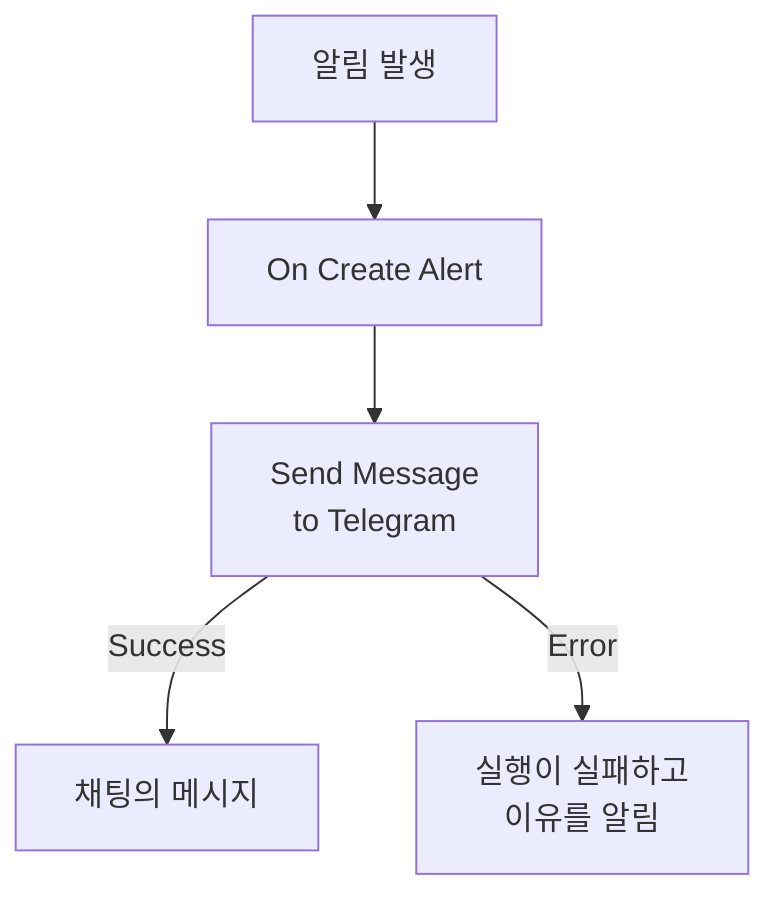

# Telegram

알림이 발생하거나 인시던트가 열리면 [Telegram](https://telegram.org) 채팅, 그룹 또는 채널에 메시지를 보냅니다. OneUptime의 워크플로 단계 **Send Message to Telegram**은 직접 만든 봇으로 메시지를 보내며, 미리 만들어진 템플릿이 알림용 워크플로를 만들어 줍니다. 이 통합은 **아웃바운드**입니다. 봇은 메시지를 보내기만 하고, 채팅에서 오가는 말은 읽지 않습니다.

:::cards
- [작동 방식](#작동-방식): 알림이 발생할 때 워크플로가 하는 일.
- [설정](#통합-설정): 봇, 그 채팅, 그리고 워크플로. 템플릿으로 또는 처음부터.
- [팁](#팁): 일반 텍스트, 긴 메시지, 인시던트.
- [문제 해결](#문제-해결): Telegram 오류가 뜻하는 것과 고칠 곳.
:::

## 작동 방식



단계는 Telegram의 Bot API를 통해 봇으로서 **Message Text**를 채팅에 보냅니다. Telegram이 메시지를 받으면 **Success** 출력으로, Telegram이 거부하면 Telegram의 이유와 함께 **Error** 출력으로 진행합니다. 템플릿처럼 **Error**에 아무것도 연결되어 있지 않으면, 보내지 못한 실행은 실패하고 그 **단계**에 이유가 나옵니다.

## 사전 요건

- 봇을 만들고 채팅에 추가할 Telegram 계정.
- OneUptime에서 워크플로와 변수를 만들 수 있는 권한. OneUptime Cloud에서는 워크플로에 **Growth** 이상의 플랜이 필요합니다.

## 통합 설정

:::steps
### 봇 만들기

Telegram에서 [@BotFather](https://t.me/BotFather)에게 `/newbot`을 보내고 질문에 답합니다. 그러면 봇의 토큰(예: `123456789:ABCdefGhIJKlmnoPQRstuVWxyz`)을 받습니다. 토큰을 가진 사람은 누구나 봇으로 메시지를 보낼 수 있으므로, 비밀번호처럼 안전하게 보관하세요.

### 채팅 ID 찾기

1. 봇을 그룹에 추가하거나 채널의 관리자로 만듭니다. 개인에게 메시지를 보내려면 그 사람이 먼저 봇과 채팅을 시작해야 합니다.
2. 봇이 볼 수 있도록 그룹에서 봇을 멘션하는 메시지(예: `/start@your_bot`)를 보냅니다.
3. 브라우저에서 `https://api.telegram.org/bot<token>/getUpdates`를 엽니다. `<token>` 자리에는 봇의 토큰을 넣습니다.
4. 응답에서 `"chat":{"id":`를 찾습니다. 그 뒤의 숫자가 채팅 ID입니다. 그룹의 ID는 `-`로, 큰 그룹의 ID는 `-100`으로 시작합니다.

공개 채널은 ID 대신 `@username`으로 지정할 수 있습니다.

### 워크플로 만들기

알림용 워크플로 전체를 만들어 주는 템플릿으로 시작하거나, 처음부터 시작합니다.

:::tabs
@tab 템플릿으로
1. **워크플로**를 열고 **워크플로 생성**을 클릭합니다.
2. **템플릿 검색…** 상자에 `Telegram`을 입력하고 **Tell Telegram when an alert fires**를 클릭한 다음 **이 템플릿 사용**을 클릭합니다.
3. 이름은 **Notify Telegram on new alert** 그대로 두거나 바꾸고, **다음**을 클릭합니다.
4. 토큰을 **Telegram Bot Token**에, ID를 **Telegram Chat ID**에 붙여 넣고 **워크플로 생성**을 클릭합니다.

워크플로는 두 단계로 **빌더**에서 열립니다. **On Create Alert**와, 알림의 번호, 제목, 심각도, 상태를 보내는 **Send Message to Telegram**입니다. 토큰은 워크플로의 시크릿 변수 `telegramBotToken`으로, ID는 `telegramChatId`로 저장됩니다.
@tab 처음부터
1. 토큰을 시크릿 전역 변수로 저장합니다. **워크플로 → 전역 변수**로 이동해 **워크플로 변수 만들기**를 클릭하고, 이름을 `TELEGRAM_BOT_TOKEN`으로 지정한 뒤 **다음**을 클릭합니다. 토큰을 **콘텐츠**에 붙여 넣고 **시크릿**을 켠 뒤 **워크플로 변수 만들기**를 클릭합니다.
2. **워크플로**로 이동해 **워크플로 생성**을 클릭하고 **처음부터 시작**을 고른 뒤, 워크플로 이름을 지정하고 **워크플로 생성**을 클릭합니다.
3. **빌더**에서 **이 워크플로를 시작할 항목 선택**을 클릭하고 **인기** 아래의 **On Create Alert**를 고릅니다. 트리거를 클릭합니다. **Fields to pass on**에는 **제목**이 이미 들어 있으므로, **필드 추가**를 클릭하고 메시지에 표시할 다른 필드(예: **Alert Number With Prefix**)를 고릅니다.
4. **구성 요소 추가**를 클릭하고 `telegram`을 검색한 뒤 **Send Message to Telegram**을 클릭합니다. 트리거의 **Success** 출력을 이 단계에 연결합니다.
5. 새 단계를 클릭합니다. **Telegram Bot Token**에서 **{ }** 버튼을 클릭하고 **Global variables** 아래의 `TELEGRAM_BOT_TOKEN`을 고릅니다. 채팅 ID를 **Chat ID**에 입력하고, **Message Text**에 메시지를 쓴 뒤, **{ }** 버튼으로 알림의 필드를 넣습니다.
:::

처음부터 만든 메시지는 다음과 같은 참조로 알림의 필드를 읽습니다:

```text
🚨 Alert {{local.components.alert-on-create-1.returnValues.model.alertNumberWithPrefix}} fired
Title: {{local.components.alert-on-create-1.returnValues.model.title}}
```

### 켜고 테스트하기

**빌더** 위쪽에서 **활성화됨**을 켭니다. 이제부터 새 알림은 모두 채팅으로 보내집니다.

알림을 발생시키지 않고 테스트하려면 **워크플로 실행**을 클릭하고, **경고**에서 이미 있는 알림을 고릅니다. 최근 알림이 목록에 나오며, 번호나 제목의 일부를 입력하면 다른 알림을 찾을 수 있습니다. **워크플로 수동 실행**을 클릭하고 **실행**으로 확인합니다. **워크플로 실행** 패널이 실행을 따라가며, 메시지가 채팅에 나타납니다. 단계가 대신 **Error**로 진행하면 실행이 실패하고, **단계**에 있는 그 단계의 항목에 이유가 나옵니다. [문제 해결](#문제-해결)을 참고하세요.
:::

## 팁

- **일반 텍스트.** 단계는 Telegram 서식 없이 입력한 그대로 텍스트를 보내므로, `*`와 `_`는 그대로 표시됩니다.
- **4,096자 한도에 유의하기.** Telegram은 최대 4,096자의 메시지를 받습니다. 더 긴 메시지는 거부되지 않고 잘리며, 끝에 "… (truncated — see OneUptime for the full text)"가 붙습니다.
- **인시던트에도.** 같은 워크플로를 **On Create Incident**로, 또는 상태 변경에는 **On Update Incident**로 만드세요. 일부 알림만 보내려면 단계 앞에 **If / Else** 블록을 두세요.
- **토큰 형식을 검사합니다.** `123456789:ABCdef…` 형식이 아닌 토큰은 아무것도 보내기 전에 실행을 멈추며, 토큰은 절대 로그에 기록되지 않습니다.

## 문제 해결

단계가 **Error**로 진행하면 실행이 실패하고, 실행의 **단계**에 있는 그 단계의 항목에 Telegram의 이유가 나옵니다. 봇이 채팅에 있어야 하므로 먼저 그것부터 확인하세요.

:::details Telegram이 "Bad Request: chat not found"로 응답함
**Chat ID**가 잘못되었거나 봇이 채팅을 볼 수 없습니다. 봇을 그룹에 추가하거나, 채널의 관리자로 만들거나, 상대에게 봇과 채팅을 시작해 달라고 하세요. 그룹의 ID는 `-`로 시작합니다.
:::

:::details Telegram이 "Forbidden: bot was blocked by the user" 또는 "bot is not a member"로 응답함
상대가 봇을 차단했거나, 봇이 그룹이나 채널에서 제거되었습니다. 봇을 다시 추가하거나 다른 채팅으로 보내세요.
:::

:::details Telegram이 "Unauthorized"로 응답함
Telegram이 토큰을 받아들이지 않았습니다. @BotFather에서 취소되었거나 잘못 복사되었습니다. @BotFather에서 봇의 현재 토큰을 복사해 변수 값을 바꾸세요.
:::

:::details Telegram이 "Too Many Requests: retry after"로 응답함
Telegram은 봇 하나가 보내는 속도를, 특히 그룹으로 보낼 때 제한합니다. 알림이 몰리면 이 한도에 걸릴 수 있습니다. 일부 심각도에만 보내는 식으로 메시지를 줄이세요.
:::

## 다음 단계

:::cards
- [워크플로우 구성 요소](/docs/workflows/components#telegram): 단계의 모든 설정과 출력의 의미.
- [Discord](/docs/integrations/discord): 같은 아이디어를 Discord 채널에서.
- [워크플로우 실행 기록](/docs/workflows/runs-and-logs): 워크플로의 각 실행이 무엇을 했는지 확인합니다.
- [통합 개요](/docs/integrations/index): 아웃바운드 패턴과 연결할 수 있는 다른 도구.
:::
