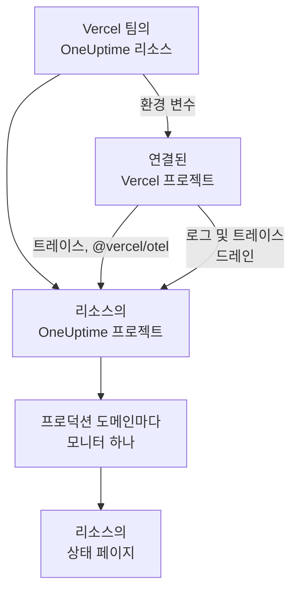

# Vercel

[Vercel Marketplace](https://vercel.com/marketplace)에서 Vercel 팀에 OneUptime을 추가합니다. Vercel 계정으로 로그인하고 Vercel 청구서로 결제하며, Vercel 프로젝트는 직접 설정할 것 없이 OneUptime에서 트레이스, 로그, 가동 시간 모니터링, 상태 페이지를 갖게 됩니다.

:::cards
- [Vercel 팀에 OneUptime 추가하기](#vercel-팀에-oneuptime-추가하기): Vercel 대시보드에서 리소스, 요금제, 프로젝트를 고릅니다.
- [@vercel/otel로 트레이스 보내기](#vercelotel로-트레이스-보내기): 환경 변수는 이미 설정되어 있습니다.
- [드레인으로 로그와 트레이스 보내기](#드레인으로-로그와-트레이스-보내기): Pro와 Enterprise에서 Vercel 자체의 로그와 스팬을 보냅니다.
- [요금제와 결제](#요금제와-결제): OneUptime 요금제를 Vercel 청구서로 결제합니다.
:::

## 작동 방식

Vercel에서 추가하는 OneUptime 리소스는 각각 별개의 OneUptime 프로젝트입니다. 리소스에 연결하는 모든 Vercel 프로젝트에 Vercel이 리소스의 환경 변수를 넣어 주며, 이 변수로 프로젝트의 트레이스가 OneUptime에 전송됩니다. 드레인은 Vercel의 로그와 스팬을 보내고, 연결된 각 프로젝트의 프로덕션 도메인에는 리소스의 상태 페이지에 표시되는 가동 시간 모니터가 생깁니다.



이 통합은 OneUptime Cloud(`oneuptime.com`)용입니다. 자체 호스팅 OneUptime은 Vercel Marketplace에서 추가할 수 없습니다. [자체 호스팅 OneUptime](#자체-호스팅-oneuptime)을 참고하세요.

## 시작하기 전에

- **Vercel 팀**. 요금제는 상관없습니다. 로그 드레인과 트레이스 드레인에는 Vercel의 Pro 또는 Enterprise 요금제가 필요하며, `@vercel/otel`에서 보내는 트레이스는 모든 요금제에서 작동합니다.
- **Vercel 계정의 인증된 이메일 주소**. OneUptime은 이 주소를 사용해 로그인을 처리하고, OneUptime 계정이 없으면 이 주소로 계정을 만듭니다.
- **Vercel의 결제 수단**. 모든 요금제에 필요합니다. 모니터와 텔레메트리는 Free 요금제를 포함해 사용한 만큼 청구됩니다. [요금제와 결제](#요금제와-결제)를 참고하세요.

## Vercel 팀에 OneUptime 추가하기

:::steps
### Vercel Marketplace에서 OneUptime 열기

Vercel 대시보드에서 **Integrations**를 연 다음 **Browse Marketplace**를 열고, **Observability** 아래에서 OneUptime을 찾습니다. **설치**를 클릭하고 OneUptime의 약관에 동의합니다.

### 요금제 고르기

**무료**, **Growth**, **Scale** 중에서 고릅니다. 요금제는 OneUptime 자체의 요금제이며, 가격은 [oneuptime.com/pricing](https://oneuptime.com/pricing)에 나온 그대로입니다.

### 리소스 이름을 정하고 설정 고르기

`storefront`처럼 리소스가 지켜보는 대상을 따서 리소스 이름을 정합니다. 리소스의 OneUptime 프로젝트와 상태 페이지도 이 이름을 따릅니다. 다음 두 설정은 처음에 켜져 있습니다.

- **Monitor production domains**: 연결하는 각 Vercel 프로젝트의 프로덕션 도메인에 웹사이트 모니터를 만듭니다.
- **Create a status page**: 리소스의 공개 상태 페이지를 만들어 그 모니터들을 보여 줍니다.

### 프로젝트 연결하기

이 리소스로 데이터를 보낼 Vercel 프로젝트와, 리소스의 환경 변수를 받을 환경을 고릅니다. 연결에 사용자 지정 접두사를 붙이지 마세요. `@vercel/otel`은 변수를 원래 이름으로 읽습니다.
:::

리소스는 몇 초 안에 준비됩니다. **Open in OneUptime**을 클릭하면 리소스의 프로젝트를 볼 수 있습니다.

## 각 리소스가 제공하는 것

| 항목 | 찾는 곳 |
| --- | --- |
| 리소스 이름을 딴 OneUptime 프로젝트 | 여러분이 소유자입니다. 팀원은 Vercel에서 프로젝트를 열 때 참여합니다. |
| 이름이 `Vercel`인 수집 키 | **프로젝트 설정 → 텔레메트리 및 APM → 수집 키** |
| 연결된 각 Vercel 프로젝트의 환경 변수 | Vercel에서 그 프로젝트의 **Settings → Environment Variables** |
| 연결된 각 프로젝트의 웹사이트 모니터 | **모니터**. 이름은 Vercel 프로젝트를 따릅니다 |
| 공개 상태 페이지 | **상태 페이지**. 이름은 리소스를 따릅니다 |

환경 변수는 연결된 모든 프로젝트에서 같습니다.

| 변수 | 값 |
| --- | --- |
| `OTEL_EXPORTER_OTLP_ENDPOINT` | `https://oneuptime.com/otlp` |
| `OTEL_EXPORTER_OTLP_HEADERS` | `x-oneuptime-token=` 뒤에 리소스의 수집 키 |
| `OTEL_EXPORTER_OTLP_PROTOCOL` | `http/protobuf` |
| `ONEUPTIME_TELEMETRY_INGESTION_KEY` | 수집 키 자체. 드레인이 이 값을 보냅니다 |

배포는 빌드될 때 변수를 받습니다. 프로젝트를 연결한 뒤에는 다시 배포하세요.

## @vercel/otel로 트레이스 보내기

`@vercel/otel`은 Next.js를 비롯해 Vercel에서 실행되는 프레임워크를 위한 Vercel의 OpenTelemetry 패키지입니다. `OTEL_EXPORTER_OTLP_*` 변수를 읽으므로, 리소스에 연결된 프로젝트에는 이 패키지만 있으면 됩니다.

:::steps
### 패키지 설치하기

```bash
npm install @vercel/otel @opentelemetry/api @opentelemetry/api-logs
```

### 등록하기

프로젝트 루트에, 또는 프로젝트에 `src`가 있다면 그 안에 `instrumentation.ts`를 만들고 서비스 이름을 정합니다.

```ts title="instrumentation.ts"
import { registerOTel } from "@vercel/otel";

export function register(): void {
  registerOTel({ serviceName: "storefront" });
}
```

### 배포하기

프로젝트를 배포합니다. 프로젝트의 트레이스가 서비스 이름 아래 **트레이스**에 나타납니다.
:::

Vercel의 Pro 및 Enterprise 요금제에서는 트레이스 드레인도 추가하세요. 그러면 Vercel이 각 요청에 대한 자체 스팬을 애플리케이션의 스팬과 함께 OneUptime에 보내고, `@vercel/otel`은 그 스팬을 드레인에 맡기므로 같은 데이터가 두 번 들어오지 않습니다.

## 드레인으로 로그와 트레이스 보내기

드레인은 Vercel이 프로젝트에 대해 기록하는 내용을 OneUptime에 보냅니다. 로그 드레인은 빌드, 함수, 엣지, 요청 로그를, 트레이스 드레인은 스팬을 보냅니다. 드레인에는 Vercel의 Pro 또는 Enterprise 요금제가 필요하며, 드레인이 보내는 데이터의 비용은 Vercel이 Vercel 청구서에 청구합니다.

:::steps
### 드레인 추가하기

Vercel에서 **Team Settings → Drains**를 열고 **Add Drain**을 클릭합니다. **Logs** 또는 **Traces**를 고른 다음, **Native Integrations** 아래에서 OneUptime을 고릅니다.

### 프로젝트 고르기

프로젝트를 고르고, 로그라면 소스와 환경도 고릅니다. 드레인은 리소스의 수집 키로 보내므로 입력할 것이 없습니다.
:::

각 Vercel 프로젝트는 OneUptime에서 프로젝트 이름을 딴 서비스가 됩니다. 로그는 시간, 레벨, 메시지를 그대로 유지하며, 요청 정보는 OpenTelemetry의 이름으로 담깁니다.

| Vercel 필드 | OneUptime에서 |
| --- | --- |
| `projectName` | 서비스, `service.name` |
| `timestamp`, `level`, `message` | 로그의 시간, 심각도, 본문 |
| `deploymentId`, `environment` | `vercel.deployment.id`, `deployment.environment.name` |
| `proxy.method`, `proxy.path`, `proxy.statusCode` | `http.request.method`, `url.path`, `vercel.proxy.status_code` |
| `traceId`, `spanId` | 로그의 트레이스. **트레이스**의 해당 트레이스에 연결됩니다 |
| 그 밖의 모든 필드 | `vercel.` 아래의 속성. 예: `vercel.source` |

## 가동 시간 모니터와 상태 페이지

Vercel 프로젝트를 연결하면 OneUptime은 그 프로젝트의 프로덕션 도메인에 대한 웹사이트 모니터를 만들어 OneUptime의 프로브에서 확인하고, 리소스의 상태 페이지에 추가합니다. 첫 프로덕션 배포 전에 연결한 프로젝트에는 아직 도메인이 없으므로, 모니터는 그 배포 때 만들어집니다. 프로젝트 연결을 해제하면 그 모니터가 삭제됩니다.

각 모니터는 활성 모니터로, 다른 모니터와 똑같이 청구되며 직접 만든 모니터처럼 작동합니다. [웹사이트 모니터](/docs/monitor/website-monitor)를 참고하세요. 모니터를 만들지 않으려면 Vercel의 리소스 설정에서 **Monitor production domains**를 끕니다. 다시 켜면 아직 없는 모니터가 만들어집니다.

## Vercel에서 OneUptime 열기

리소스의 **Open in OneUptime**이나 Vercel에 있는 리소스의 아무 링크나 클릭하면, Vercel 계정의 이메일 주소로 OneUptime에 로그인됩니다. 처음 열 때 리소스의 프로젝트에 참여합니다. Vercel 팀의 소유자나 멤버라면 관리자로, 팀의 읽기 전용 역할 중 하나를 가지고 있다면 멤버로 참여합니다.

그 이메일 주소로 된 OneUptime 계정이 이미 있다면, 그 계정으로 로그인됩니다. 2단계 인증을 켠 계정이나 OneUptime 관리자의 계정은 대신 비밀번호로 로그인합니다. 어느 경우든 프로젝트에는 참여하게 됩니다.

## 요금제와 결제

| | 작동 방식 |
| --- | --- |
| 요금제 | **무료**, **Growth**, **Scale**. 가격은 oneuptime.com에 나온 그대로이며, 요금제의 사용자당 가격, 모니터당 월 $1인 활성 모니터, GB당 텔레메트리로 이루어집니다. |
| 결제하는 곳 | 리소스마다 한 달에 한 번, Vercel 청구서로 결제합니다. Vercel은 이번 달 지금까지의 사용량을 리소스에 표시하며, 매시간 갱신합니다. |
| 평가판 | 요금제의 평가판 기간 동안에는 사용자, 모니터, 텔레메트리 모두 요금이 청구되지 않습니다. |
| 요금제 변경 | Vercel의 리소스에서, 또는 OneUptime의 **프로젝트 설정 → 결제 및 청구서 → 결제**에서 변경합니다. 어느 쪽에서 바꾸든 양쪽 모두 바뀝니다. |
| 미결제 청구서 | Vercel은 15일 동안 결제를 다시 시도합니다. 그 뒤에는 청구서가 결제될 때까지 프로젝트 제공이 중단됩니다. 데이터는 보관되며 아무것도 삭제되지 않습니다. |

청구서에는 리소스마다 사용자, 활성 모니터, 텔레메트리, 그리고 잔액 충전(있는 경우)에 대한 줄이 각각 있으며, 단위당 $0.01인 사용량 단위로 표시됩니다.

## OneUptime 제거하기

| 하는 일 | 결과 |
| --- | --- |
| Vercel에서 리소스 삭제 | 그때까지의 사용량이 청구된 뒤 리소스의 프로젝트가 삭제됩니다. 연결된 Vercel 프로젝트는 다음 배포 때 리소스의 환경 변수를 잃습니다. |
| 팀에서 OneUptime 설치 제거 | 모든 리소스의 프로젝트가 삭제되고, 마지막 청구서가 발송됩니다. |
| OneUptime에서 프로젝트 삭제 | Vercel의 리소스도 삭제됩니다. |

> [!CAUTION]
> 프로젝트를 삭제하면 그 모니터, 상태 페이지, 인시던트, 텔레메트리가 영구히 삭제됩니다. 보관하려는 것은 먼저 내보내세요.

## 자체 호스팅 OneUptime

Vercel Marketplace는 OneUptime Cloud만 프로비저닝하므로, 자체 호스팅 OneUptime은 Vercel Marketplace에서 추가할 수 없습니다. 그래도 Vercel 프로젝트에서 자체 호스팅 OneUptime으로 데이터를 보낼 수 있습니다.

- **트레이스**: Vercel 프로젝트의 **Settings → Environment Variables**에서 [각 리소스가 제공하는 것](#각-리소스가-제공하는-것)의 변수를 설정하되, 엔드포인트는 `https://YOUR-ONEUPTIME-HOST/otlp`로, 수집 키는 프로젝트의 키로 설정합니다.
- **로그**: **Team Settings → Drains**에서 사용자 지정 로그 드레인을 추가하고, 대상을 `https://YOUR-ONEUPTIME-HOST/telemetry/vercel/v1/logs`로, 형식을 JSON 또는 NDJSON으로 지정합니다. 수집 키를 값으로 하는 `x-oneuptime-token` 헤더를 추가하고, 드레인의 서명 시크릿에도 같은 키를 설정합니다. OneUptime은 Vercel이 이 키로 서명한 전송만 받아들입니다.

같은 사용자 지정 드레인은 호스트를 `oneuptime.com`으로 하면 OneUptime Cloud에서도 작동합니다.

## 문제 해결

:::details 트레이스가 들어오지 않음
- 프로젝트를 다시 배포하세요. 프로젝트를 연결하기 전에 빌드된 배포에는 `OTEL_EXPORTER_OTLP_*` 변수가 없습니다.
- 프로젝트의 **Settings → Environment Variables**에서 변수 이름을 확인하세요. 사용자 지정 접두사를 붙여 연결하면 변수 이름이 바뀌어 `@vercel/otel`이 더 이상 읽지 못합니다. 접두사 없이 프로젝트를 다시 연결하세요.
- `instrumentation.ts`가 `registerOTel`을 호출하는지, 그리고 Next.js 14 이하에서는 `next.config.js`에서 `experimental.instrumentationHook`이 켜져 있는지 확인하세요.
:::

:::details Vercel에 드레인이 오류로 표시됨
Vercel은 드레인의 전송에 대한 OneUptime의 응답을 보여 줍니다.

- 메시지에 `x-vercel-signature`가 있는 `403`: Vercel이 자신이 보내는 키로 전송에 서명하지 않았습니다. 사용자 지정 드레인이라면 `x-oneuptime-token` 헤더를 확인하고, 서명 시크릿을 같은 키로 설정하세요.
- `401`: 드레인이 보내는 키를 가진 프로젝트를 OneUptime이 알지 못합니다. 키가 삭제되었거나 두 곳 모두에서 잘못 입력되었습니다. **프로젝트 설정 → 텔레메트리 및 APM → 수집 키**의 키를 사용하세요.
- `422`: 키가 꺼져 있습니다. 같은 페이지에서 다시 켜거나 다른 키를 사용하세요.
:::

:::details 연결된 프로젝트에 모니터가 없음
- Vercel의 리소스 설정에서 **Monitor production domains**가 꺼져 있습니다.
- 프로젝트에 아직 프로덕션 도메인이 없습니다. 모니터는 첫 프로덕션 배포 때 만들어집니다.
- 프로젝트의 활성 모니터가 요금제에서 허용하는 수에 도달했습니다. 요금제를 업그레이드한 다음 **Monitor production domains**를 껐다가 다시 켜세요.
:::

:::details Vercel이 이메일 주소를 인증하라고 함
OneUptime에는 Vercel이 인증한 이메일 주소가 필요하며, 그 주소로 된 기존 OneUptime 계정이 있다면 그 계정에서도 주소가 인증되어 있어야 합니다. 주소를 인증한 다음 리소스를 다시 추가하거나 OneUptime을 다시 여세요.
:::

## 다음 단계

:::cards
- [트레이스 탐색기](/docs/telemetry/traces-explorer): 느린 요청과 그 스팬을 찾습니다.
- [로그 탐색기](/docs/telemetry/logs-explorer): Vercel 로그를 검색합니다.
- [상태 페이지](/docs/status-pages/index): 리소스의 상태 페이지를 브랜드에 맞게 꾸미고 구독자를 추가합니다.
- [수집 키](/docs/telemetry/ingestion-keys): 리소스의 키를 교체하거나 끕니다.
:::
