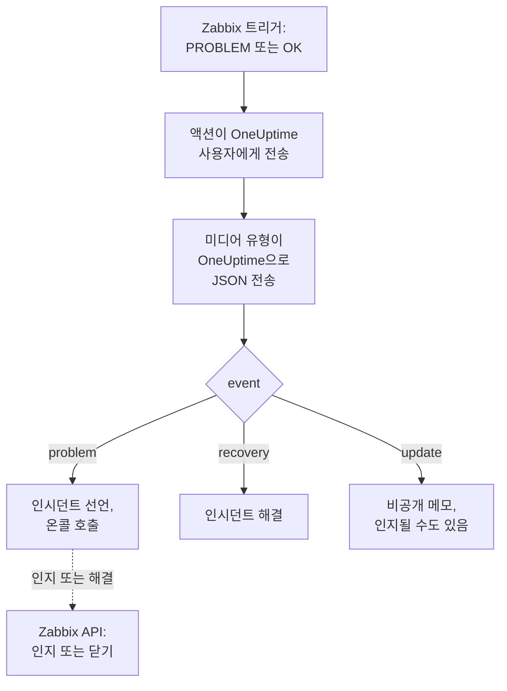

# Zabbix

[Zabbix](https://www.zabbix.com) 문제를 OneUptime으로 보내면 각 문제가 온콜 팀을 호출하는 인시던트가 되고, Zabbix가 복구되면 해결됩니다. 바로 쓸 수 있는 워크플로 템플릿이 양쪽을 맞춰 줍니다. 사람들이 Zabbix에서 한 일은 인시던트에 기록되고, 인시던트를 인지하거나 해결하면 Zabbix의 문제가 인지되거나 닫힙니다. Zabbix는 각 문제를 웹훅 미디어 유형으로 보내므로 어느 쪽에도 설치할 것이 없습니다.

:::cards
- [OneUptime이 문제를 받는 방법 선택](#oneuptime이-문제를-받는-방법-선택): 워크플로 템플릿 또는 Incoming Request 모니터.
- [템플릿으로 시작하기](#템플릿으로-시작하기): 템플릿 6개, 각 템플릿이 하는 일과 필요한 입력.
- [Zabbix 구성](#zabbix-구성): 미디어 유형, 사용자, 액션.
- [문제 해결](#문제-해결): 문제가 도착하지 않거나 인시던트가 계속 열려 있을 때.
:::

## 작동 방식



Zabbix는 사용자의 미디어를 통해 그 사용자에게 문제를 보냅니다. 여기서 미디어는 **OneUptime**이라는 웹훅 미디어 유형입니다. 이 미디어 유형의 스크립트는 문제마다, 그 복구마다, 그리고 누군가 Zabbix에서 문제를 업데이트할 때마다 문제의 이벤트 ID, 이름, 호스트, 심각도가 담긴 작은 JSON 문서를 OneUptime으로 보냅니다. OneUptime은 이벤트 ID로 문제가 연 인시던트를 찾습니다.

## 사전 요건

- 직접 관리하는 Zabbix 서버. 이 가이드는 Zabbix 6.0 LTS와 7.0 LTS를 기준으로 작성되었습니다. 웹훅 미디어 유형은 Zabbix 5.0부터 같은 방식으로 작동합니다. Zabbix API를 호출하는 템플릿에는 Zabbix 6.4 이상, 또는 [Zabbix 6.0에서 한 가지 변경](#zabbix-60에서)이 필요합니다.
- HTTPS로 OneUptime에 연결할 수 있는 Zabbix 서버. Zabbix를 호출하는 템플릿에는 Zabbix에 연결할 수 있는 OneUptime도 필요합니다.
- OneUptime에서 워크플로를 만들 권한, 또는 그 방법을 택한다면 모니터를 만들 권한. OneUptime Cloud에서는 워크플로에 **Growth** 플랜 이상이 필요합니다.

## OneUptime이 문제를 받는 방법 선택

먼저 OneUptime을 설정하세요. Zabbix가 보낼 URL을 얻을 수 있습니다.

| 방법 | 사용하는 경우 |
| --- | --- |
| 워크플로 템플릿(권장) | 각 문제를 Zabbix 심각도에 맞는 인시던트나 알림으로 만들고, High와 Disaster에는 온콜을 호출하고, 복구 시 해결하고, 사람들이 Zabbix에서 한 일을 기록하고, OneUptime에서 Zabbix를 인지하거나 닫고 싶을 때. |
| Incoming Request 모니터 | 워크플로 없이, 어떤 플랜에서든 인시던트를 만들고, 상태가 Zabbix를 따르는 모니터를 원할 때. Zabbix로는 아무것도 돌아가지 않습니다. |

두 방법 모두 같은 미디어 유형에서 같은 JSON을 받으므로, 하나로 시작했다가 나중에 Zabbix의 URL 하나만 바꿔 전환할 수 있습니다.

## 템플릿으로 시작하기

**워크플로 만들기** 대화 상자의 카테고리 목록에서 **Zabbix** 아래에 Zabbix 템플릿 6개가 있습니다. 인시던트용 3개, 그다음 같은 3개의 알림용입니다.

| 템플릿 | 하는 일 | 필요한 입력 |
| --- | --- | --- |
| **인시던트** | | |
| Declare an incident for each Zabbix problem | Zabbix가 모든 이벤트를 보내는 워크플로입니다. 문제마다 인시던트를 선언하고, High와 Disaster에는 온콜을 호출하고, Zabbix에서 한 업데이트를 기록하고, 복구 시 인시던트를 해결합니다. | Zabbix URL |
| Acknowledge or close the Zabbix problem with the incident | 인시던트가 인지되면 그 문제를 인지합니다. 해결되면 문제를 닫거나, Zabbix가 수동으로 닫는 것을 허용하지 않으면 인지합니다. | Zabbix URL, Zabbix API Token |
| Copy incident private notes to the Zabbix problem | 인시던트의 각 비공개 메모를 그 문제에 메시지로 추가합니다. | Zabbix URL, Zabbix API Token |
| **알림** | | |
| Create an alert for each Zabbix problem | 인시던트와 같지만, 문제마다 알림을 만듭니다. | Zabbix URL |
| Acknowledge or close the Zabbix problem with the alert | 인시던트와 같지만, 알림의 상태를 따릅니다. | Zabbix URL, Zabbix API Token |
| Copy alert private notes to the Zabbix problem | 알림의 각 비공개 메모를 그 문제에 메시지로 추가합니다. | Zabbix URL, Zabbix API Token |

**Declare an incident for each Zabbix problem**으로 시작하고, 알림이라면 **Create an alert for each Zabbix problem**으로 시작하세요. 이 템플릿이 연 인시던트나 알림은 문제의 이벤트 ID를 사용자 지정 필드 `zabbixEventId`에 보관하고, 나머지 두 템플릿은 이것으로 문제를 찾습니다.

### 템플릿에 필요한 입력

- **Zabbix URL**: Zabbix를 여는 주소. 예를 들어 `https://zabbix.example.com`, 또는 Zabbix가 경로 아래에서 실행될 때는 `https://example.com/zabbix`입니다. 문제 링크는 그곳으로 가고, Zabbix를 호출하는 템플릿은 그 `api_jsonrpc.php`로 요청을 보냅니다. 이 필드는 Zabbix 안의 페이지 주소를 받지 않습니다.
- **Zabbix API Token**: 워크플로가 대신해 동작하는 Zabbix 사용자의 API 토큰. 만드는 방법은 [API 토큰 만들기](#api-토큰-만들기)를 참고하세요. 비밀 변수로 저장되며 Zabbix에만 전송됩니다. `Authorization` 헤더로 보내고, Zabbix 6.0에서는 요청 본문으로 보냅니다.

### 템플릿으로 문제 받기

:::steps
1. **워크플로**로 이동해 **워크플로 생성**을 클릭합니다. **또는 템플릿에서 시작**에서 카테고리 목록의 **Zabbix**를 고르고, **Declare an incident for each Zabbix problem**을 클릭한 다음 **이 템플릿 사용**을 클릭합니다.
2. **Zabbix URL**을 채웁니다. **Who to page for High and Disaster problems** 아래에서 호출할 온콜 정책을 고르거나, 아무도 호출하지 않으려면 고르지 말고, **워크플로 생성**을 클릭합니다. 워크플로가 꺼진 상태로 **빌더**에서 열립니다.
3. **Webhook** 트리거를 클릭한 다음 **URL 복사**를 클릭하고, URL을 Zabbix용으로 보관합니다.
4. **빌더** 상단에서 **활성화됨**을 켭니다. 꺼져 있는 워크플로는 Zabbix에 `400`으로 응답합니다.
:::

그런 다음 [Zabbix를 구성](#zabbix-구성)해 그 URL로 문제를 보내게 합니다.

### 워크플로가 하는 일

**Webhook** 트리거 다음에는 **Check With JavaScript** 단계 `read-event-1`이 미디어 유형이 보내는 `event`를 읽고, **Incident From Another Tool**(경고 템플릿에서는 **Alert From Another Tool**)이 문제의 이벤트 ID로 그 뜻대로 처리합니다:

| 이벤트 | 워크플로가 하는 일 |
| --- | --- |
| `problem` | `Zabbix: <problem> on <host>`라는 제목의 인시던트를 Zabbix 심각도에 대응하는 심각도로 선언하며, 상태 페이지에는 표시하지 않습니다. 설명에는 Zabbix의 문제 링크와 호스트, 심각도, 시작 시각, 운영 데이터, 태그가 들어갑니다. High 또는 Disaster 문제에는 선택한 온콜 정책을 호출합니다. Zabbix가 같은 이벤트 ID로 다시 보낸 문제는 새 인시던트를 열지 않습니다. |
| `recovery` | 문제의 인시던트를 해결합니다. 이미 해결되었으면 그대로 둡니다. 이유는 타임라인에 남습니다. |
| `update` | Zabbix에서 한 일을 비공개 메모로 인시던트에 추가합니다. 누가, 무엇을 했고, 무엇을 썼는지가 담깁니다. 업데이트가 문제를 인지했다면 인시던트도 인지해, 온콜 에스컬레이션이 멈춥니다. |

그 밖의 것, 예를 들어 다른 도구에서 온 요청은 그대로 둡니다. `read-event-1`이 **No**로 가고, 실행의 **단계**에 이유가 나옵니다. 실패한 단계는 실행을 실패시키며, **단계**에 있는 그 항목에 이유가 나옵니다.

### 심각도

새 프로젝트에서 템플릿은 Zabbix의 심각도 6개를 다음 인시던트 및 알림 심각도에 매핑합니다:

| Zabbix 심각도 | 인시던트 | 알림 | 온콜 |
| --- | --- | --- | --- |
| Disaster | Critical Incident | High | 호출함 |
| High | Critical Incident | High | 호출함 |
| Average | Major Incident | Low | 호출 안 함 |
| Warning | Major Incident | Low | 호출 안 함 |
| Information | Minor Incident | Low | 호출 안 함 |
| Not classified | Minor Incident | Low | 호출 안 함 |

직접 만든 심각도가 있으면 Disaster와 High는 가장 심각한 것으로, Average와 Warning은 중간 것으로, Information과 Not classified는 가장 덜 심각한 것으로 갑니다. Zabbix는 심각도에 0(Not classified)부터 5(Disaster)까지 번호를 매기고 템플릿은 번호를 읽으므로, Zabbix에서 심각도 이름을 바꿔도 아무것도 바뀌지 않습니다.

- 이름으로 심각도를 직접 만든 심각도에 매핑하려면 `read-event-1` 단계의 `SEVERITY_BY_NAME`을 편집하세요. 예를 들어 Warning이라면 `{ 2: 'Minor Incident' }`입니다.
- Average 문제에도 호출하려면 `if-page-1` **If / Else** 단계의 **Compare with**를 `3`으로 설정하세요.

### 인지와 메모를 Zabbix로 돌려보내기

:::steps
1. [API 토큰을 만듭니다](#api-토큰-만들기).
2. **Acknowledge or close the Zabbix problem with the incident**로 워크플로를 만듭니다. **Zabbix URL**과 **Zabbix API Token**을 채우고 **워크플로 생성**을 클릭한 다음 **활성화됨**을 켭니다.
3. 메모도 Zabbix에 남기고 싶다면 **Copy incident private notes to the Zabbix problem**으로 같은 작업을 합니다.
:::

상태 템플릿은 먼저 Zabbix에 문제를 조회하므로, Zabbix가 이미 인지했거나 해결한 문제는 그대로 둡니다. 문제를 닫으려면 그 트리거에 Zabbix의 **Allow manual close**가 필요합니다. 이것이 없으면 대신 문제를 인지하고 인시던트가 해결되었다는 메시지를 남기며, Zabbix가 복구될 때 문제를 닫습니다. Zabbix 문제가 열지 않은 인시던트와 **비공개 인시던트**로 표시된 인시던트는 Zabbix로 보내지 않습니다.

### API 토큰 만들기

:::steps
1. [문제를 받는](#문제를-받을-사용자-만들기) `OneUptime` 사용자를 사용합니다. Zabbix는 사용자 자신의 업데이트를 그 사용자에게 보내지 않으므로, 이 사용자의 토큰을 쓰면 OneUptime의 인지와 메시지가 업데이트로 OneUptime에 돌아오지 않습니다.
2. **Users → User roles**에서 사용자의 역할을 확인합니다. **Access to API**가 켜져 있고 **Acknowledge problems**, **Add problem comments**, **Close problems**가 허용되어 있어야 합니다. 누군가 바꾸지 않았다면 **User role**은 이를 허용합니다.
3. **Users → User groups**에서 사용자의 그룹을 확인합니다. 문제를 인지하고 메시지를 추가하려면 호스트 그룹에 대한 **Read** 권한으로 충분합니다. 문제를 닫으려면 **Read-write**가 필요합니다.
4. **Users → API tokens**로 이동해 **Create API token**을 클릭합니다. `OneUptime` 사용자를 고르고, **Set expiration date and time**의 체크를 해제하거나 날짜를 적어 둔 다음 **Add**를 클릭합니다.
5. **Auth token**을 복사합니다. Zabbix는 이를 한 번만 보여 줍니다. **Zabbix API Token**에 붙여 넣습니다.
:::

### Zabbix 6.0에서

Zabbix 6.0은 API 토큰을 `Authorization` 헤더가 아니라 요청 본문에서 읽습니다. Zabbix를 호출하는 각 템플릿의 **Update Zabbix Problem** 단계에서 **추가 필드** 아래의 **Zabbix 6.0**을 켜세요. Zabbix 7.2 이상은 본문의 토큰을 거부하므로 업그레이드할 때 다시 끄세요.

## 모니터로 문제 받기

[Incoming Request 모니터](/docs/monitor/incoming-request-monitor)는 URL을 제공하고, 그 기준이 각 요청의 처리 방식을 결정합니다.

:::steps
### 모니터 만들기

**모니터**로 이동해 **모니터 생성**을 클릭합니다. **모니터 유형**에서 **Incoming Request**를 고르고, 이름을 `Zabbix`로 정한 다음 **다음**을 클릭합니다.

### 문제마다 인시던트 선언하기

**기준** 단계에서 첫 번째 기준, 즉 모니터를 오프라인으로 표시하는 기준을 엽니다. 필터를 **요청 본문**, **포함**, `"status":"1"`로 설정합니다. 이 기준은 필터가 일치하면 이미 인시던트를 선언합니다. 인시던트를 채웁니다:

- **인시던트 제목**: `Zabbix: {{requestBody.name}} on {{requestBody.host}}`.
- **심각도**: Zabbix 문제에 붙일 인시던트 심각도.
- **온콜 정책**(**온콜** 아래): 호출할 정책.
- **인시던트 자동 해결**(**추가 필드** 아래): 처음 상태대로 켜 둡니다. 이 설정이 없으면 복구가 무시되어 인시던트가 계속 열려 있습니다.

### 문제마다 인시던트 하나 열기

같은 기준에서 **설정**을 열고 **Group incidents and alerts by a payload field**를 켭니다. 아래와 같이 채우면 문제마다 별도의 인시던트가 생기고, 그 복구가 인시던트를 해결합니다:

| 필드 | 값 |
| --- | --- |
| **Open a separate incident for each…** | `requestBody.event_id` |
| **Field that signals recovery** | `requestBody.status` |
| **Value that means recovered** | `0` |

### 모니터를 다시 온라인으로

두 번째 기준, 즉 모니터를 온라인으로 표시하는 기준을 열고 필터를 **요청 본문**, **포함**, `"status":"0"`으로 설정합니다.

### URL 복사하기

**모니터 생성**을 클릭합니다. 모니터의 **개요** 페이지에 **Heartbeat URL**이 표시됩니다. Zabbix에 쓸 수 있도록 복사합니다:

```text
https://oneuptime.com/heartbeat/<secret key>
```

자체 호스팅 설치에서는 `oneuptime.com` 대신 자체 호스트가 들어갑니다.
:::

모니터는 요청의 JSON을 쓰인 그대로 읽습니다. `"status":"1"`처럼 공백이 없어야 합니다. 각 설정이 하는 일은 [다른 시스템에서 알림 받기](/docs/monitor/incoming-request-monitor#다른-시스템의-알림-수신)를 참고하세요. Zabbix에서 한 업데이트도 `"status":"1"`로 전송되며, 모니터는 이를 다시 문제로 읽고 새 인시던트를 열지 않습니다.

## Zabbix 구성

Zabbix에는 세 가지가 필요합니다. OneUptime으로 보내는 미디어 유형, 보낼 대상 사용자, 그리고 그 사용자에게 문제를 보내는 액션입니다.

:::steps
### OneUptime 미디어 유형 만들기

1. **Alerts → Media types**(Zabbix 6.0에서는 **Administration → Media types**)로 이동해 **Create media type**을 클릭합니다.
2. **Name**을 `OneUptime`으로, **Type**을 **Webhook**으로 설정합니다.
3. 다음 **Parameters**를 추가합니다. 각각은 Zabbix [매크로](https://www.zabbix.com/documentation/current/en/manual/appendix/macros/supported_by_location)를 요청에 넣습니다:

   | 이름 | 값 |
   | --- | --- |
   | `url` | `{ALERT.SENDTO}` |
   | `event_id` | `{EVENT.ID}` |
   | `event_name` | `{EVENT.NAME}` |
   | `event_value` | `{EVENT.VALUE}` |
   | `event_severity` | `{EVENT.SEVERITY}` |
   | `event_nseverity` | `{EVENT.NSEVERITY}` |
   | `host` | `{HOST.NAME}` |
   | `event_date` | `{EVENT.DATE}` |
   | `event_time` | `{EVENT.TIME}` |
   | `event_opdata` | `{EVENT.OPDATA}` |
   | `event_tags` | `{EVENT.TAGSJSON}` |
   | `trigger_id` | `{TRIGGER.ID}` |
   | `event_update_status` | `{EVENT.UPDATE.STATUS}` |
   | `event_update_action` | `{EVENT.UPDATE.ACTION}` |
   | `event_update_message` | `{EVENT.UPDATE.MESSAGE}` |
   | `event_update_user` | `{USER.FULLNAME}` |

4. 다음을 **Script**에 붙여 넣습니다:

   ```javascript
   var params = JSON.parse(value);

   // Zabbix leaves a macro it has no value for as it is written, such as
   // {EVENT.UPDATE.MESSAGE} on a problem: it is sent as nothing.
   function given(text) {
     var written = String(text === undefined || text === null ? "" : text);
     return /^\{[A-Z0-9_.]+\}$/.test(written) || written === "*UNKNOWN*"
       ? ""
       : written;
   }

   var isUpdate = given(params.event_update_status) === "1";
   var payload = {
     source: "zabbix",
     // "problem", "recovery" or "update".
     event: isUpdate
       ? "update"
       : params.event_value === "0"
         ? "recovery"
         : "problem",
     event_id: params.event_id,
     name: params.event_name,
     host: params.host,
     severity: params.event_severity,
     // 0 Not classified, 1 Information, 2 Warning, 3 Average, 4 High, 5 Disaster.
     severity_number: params.event_nseverity,
     // "1" for a problem, "0" for its recovery.
     status: params.event_value,
     date: params.event_date,
     time: params.event_time,
     opdata: given(params.event_opdata),
     tags: [],
     trigger_id: params.trigger_id,
   };

   try {
     var tags = JSON.parse(given(params.event_tags) || "[]");
     payload.tags = Array.isArray(tags) ? tags : [];
   } catch (error) {
     payload.tags = [];
   }

   if (isUpdate) {
     payload.update = {
       action: given(params.event_update_action),
       message: given(params.event_update_message),
       user: given(params.event_update_user),
     };
   }

   var request = new HttpRequest();
   request.addHeader("Content-Type: application/json");

   var response = request.post(params.url, JSON.stringify(payload));

   if (request.getStatus() < 200 || request.getStatus() >= 300) {
     throw (
       "OneUptime responded with HTTP " + request.getStatus() + ": " + response
     );
   }

   return "OK";
   ```

5. **Message templates** 탭에서 **Problem**용, **Problem recovery**용, **Problem update**용 템플릿을 하나씩 추가합니다. 내용은 비워 두세요. 요청은 스크립트가 만듭니다. Zabbix는 템플릿이 있는 이벤트 종류에만 미디어 유형을 사용합니다.
6. **Add**를 클릭합니다.

### 문제를 받을 사용자 만들기

1. **Users → Users**(Zabbix 6.0에서는 **Administration → Users**)로 이동해 **Create user**를 클릭합니다. 이름을 `OneUptime`으로 정하고, 알림을 받을 수 있는 사용자 그룹과 역할(예: **User role**)을 지정합니다.
2. **Media** 탭에서 **Add**를 클릭합니다. **Type**을 `OneUptime`으로, **Send to**를 OneUptime에서 복사한 URL로 설정합니다. **When active**와 심각도는 그대로 두거나, OneUptime이 받지 않을 심각도의 선택을 해제합니다.
3. **Add**를 클릭한 다음 다시 **Add**를 클릭해 사용자를 저장합니다.

### 액션으로 문제를 OneUptime에 보내기

1. **Alerts → Actions → Trigger actions**(Zabbix 6.0에서는 **Configuration → Actions**)로 이동해 **Create action**을 클릭합니다. 이름을 `Notify OneUptime`으로 정합니다.
2. 원한다면 **Conditions**에서 범위를 좁힙니다. 예: **Trigger severity is greater than or equals Warning**. 조건이 없으면 모든 문제가 전송됩니다.
3. **Operations** 탭에서 `OneUptime` 미디어 유형을 통해 `OneUptime` 사용자에게 보내는 작업을 추가합니다.
4. 복구도 전송되도록 **Recovery operations**에, Zabbix에서 한 인지와 코멘트도 전송되도록 **Update operations**에 같은 작업을 추가합니다.
5. **Add**를 클릭하고 액션이 활성화되어 있는지 확인합니다.
:::

일부 문제는 인시던트 템플릿으로, 나머지는 알림 템플릿으로 보내려면 `OneUptime` 사용자에게 `OneUptime` 유형의 미디어를 두 개 주세요. 각각 한 워크플로의 URL로 보내며, 받아야 할 심각도를 지정합니다.

## 테스트하기

1. Zabbix에서 **Alerts → Media types**를 열고 `OneUptime` 옆의 **Test**를 클릭합니다. 복사한 URL과 `event_id` `12345`, `event_name` `Test problem`, `host` `web-1`, `event_nseverity` `4`, `event_value` `1` 같은 샘플 값을 입력합니다. **Test**를 클릭하면 Zabbix가 스크립트의 응답 `OK` 또는 스크립트가 던진 오류를 보여 줍니다.
2. OneUptime에서 워크플로의 **로그 → 실행 기록**을 열어 실행을 확인하거나, 모니터를 열어 인시던트가 열렸는지 확인합니다.
3. `event_value` `0`과 같은 `event_id`로 다시 테스트합니다. 인시던트가 해결됩니다.

그런 다음 임계값을 잠시 낮추는 식으로 실제 트리거를 발생시켜 문제가 도착하는지 지켜봅니다. 업데이트를 시험하려면 Zabbix에서 메시지와 함께 문제를 인지하세요. 인시던트에 비공개 메모가 생기고 인시던트가 인지됩니다.

## Zabbix 심각도 매핑

Zabbix는 심각도를 텍스트로 보냅니다: `Not classified`, `Information`, `Warning`, `Average`, `High`, `Disaster`.

- **템플릿을 사용하는 경우** 심각도가 자동으로 매핑됩니다. [심각도](#심각도)를 참고하세요.
- **모니터를 사용하는 경우** 심각도 그룹마다 **기준 추가**를 클릭하고, 새 기준을 첫 번째 기준 위로 끌어 옮깁니다. 기준은 위에서부터 확인되며, 처음 일치하는 기준이 결정합니다. 각 기준에 `"status":"1"`과 `"severity":"Disaster"` 같은 심각도의 두 필터를 주고, **일치 조건**을 **전체**로 둡니다. 각 기준에 자체 **심각도**와 **인시던트 자동 해결**, 같은 그룹화 설정이 있는 인시던트를 지정합니다.

## 문제 해결

:::details OneUptime에 아무것도 도착하지 않음
- Zabbix에서 **Reports → Action log**를 열어 액션이 문제를 보냈는지, 무엇이 돌아왔는지 확인합니다.
- Zabbix 서버에서 직접 요청을 보냅니다: `curl -i -X POST <url> -H 'Content-Type: application/json' -d '{"source":"zabbix","event":"problem","event_id":"1","name":"Test","host":"test","severity_number":"4","status":"1"}'`.
- 모니터는 아무것도 확인하기 전에, 비밀 키가 틀려도 즉시 `200`으로 응답합니다. 요청이 도착하는지는 모니터의 타임라인에서 확인하세요.
- 꺼져 있는 워크플로는 `400`으로 응답합니다. 그 **빌더** 상단에서 **활성화됨**을 켜세요.
:::

:::details Zabbix가 스크립트 오류를 보고함
미디어 유형을 열고 **Test**를 사용하세요. Zabbix가 스크립트의 결과나 스크립트가 던진 오류를 보여 줍니다. OneUptime의 `2xx`가 아닌 응답은 스크립트가 상태와 함께 던지므로, 먼저 URL을 확인하세요.
:::

:::details 인시던트가 열리지만 해결되지 않음
- 액션에 **Recovery operations**가 필요합니다. 없으면 Zabbix가 복구를 보내지 않습니다.
- 템플릿을 사용하는 경우 워크플로의 **로그 → 실행 기록**에서 복구의 실행을 엽니다. 마지막 단계에 이유가 나옵니다. 인시던트를 열지 않은 문제의 복구는 아무것도 바꾸지 않습니다.
- 모니터를 사용하는 경우 기준의 인시던트에 **추가 필드** 아래의 **인시던트 자동 해결**이 필요합니다. **Field that signals recovery**는 `requestBody.status`여야 하고, **Value that means recovered**는 정확히 `0`이어야 합니다.
:::

:::details Zabbix 문제가 인지되거나 닫히지 않음
**로그 → 실행 기록**에서 상태 템플릿의 실행을 엽니다. 마지막 단계에 Zabbix가 답한 내용이 나옵니다.

- `Not authorized`: API 토큰이 틀렸거나, 만료되었거나, 비활성화되었거나, Zabbix가 6.4보다 오래된 버전입니다([Zabbix 6.0에서](#zabbix-60에서) 참고).
- `Cannot close problem: trigger does not allow manual closing`: 트리거에서 **Allow manual close**를 켜세요. 템플릿은 이미 이런 문제를 닫는 대신 인지합니다.
- `No permissions to referred object or it does not exist!`: 사용자가 문제를 볼 수는 있지만, 닫으려면 **Read-write** 권한이 필요합니다.
- `Zabbix has no problem with event ID`: 사용자가 문제의 호스트를 볼 수 없습니다. 그 사용자 그룹에 호스트 그룹에 대한 **Read** 권한을 주세요.
:::

:::details 인시던트에 값 대신 참조가 표시됨
요청에 없는 필드를 가리키는 참조는 비워지지 않고, 중괄호까지 포함해 쓰인 그대로 남습니다. Zabbix가 `Content-Type: application/json`을 보내는지, 사용하는 필드 이름(`name`, `host`, `severity`, `status`, `event_id`)이 스크립트의 페이로드와 일치하는지 확인하세요. 워크플로라면 **로그 → 실행 기록**에서 실행을 열어 트리거가 받은 내용과 비교하세요. [주의할 점](/docs/workflows/variables#주의-사항)을 참고하세요.
:::

:::details 모든 문제가 두 번씩 도착함
액션에 같은 사용자에게 보내는 작업이 두 개 있을 가능성이 높습니다. 예를 들어 첫 단계와 에스컬레이션 단계입니다. 템플릿은 무엇이 오든 이벤트 ID마다 인시던트를 하나만 열지만, 전달마다 실행이 하나씩 생깁니다. 액션의 **Operations**를 확인하세요.
:::

## 보안

- **URL을 비밀번호처럼 다루세요.** URL을 가진 사람은 누구나 인시던트를 열 수 있습니다. 유출되면 재설정하세요. 워크플로의 **Webhook** 트리거에서 **URL 재설정**을, 또는 모니터의 **설정** 페이지에서 **수신 요청 비밀 키 재설정**을 사용합니다. 그런 다음 Zabbix 사용자 미디어의 **Send to**를 업데이트합니다.
- **링크는 여러분의 Zabbix로 갑니다.** 템플릿은 요청 내용과 상관없이 **Zabbix URL**이 가리키는 사이트의 문제로 링크하고, Zabbix가 보낸 내용은 텍스트로 씁니다.
- **API 토큰은 워크플로가 하는 일로만 제한하세요.** 비밀 변수이므로 실행 로그에서 가려지고 Zabbix에만 전송됩니다. **Zabbix 6.0**이 켜져 있지 않으면 `Authorization` 헤더로 보냅니다. 그 사용자에게는 위의 작업 외에는 아무것도 허용하지 않는 역할을 주고, 유출되면 **Users → API tokens**에서 토큰을 삭제하세요.
- **인시던트가 필요한 것만 보내세요.** 액션의 조건이나 사용자 미디어의 심각도를 사용해 심각도가 낮은 문제는 Zabbix에 남겨 두세요.
- **자체 호스팅인가요?** Zabbix 서버가 방화벽을 통해 HTTPS로 OneUptime에 연결할 수 있게 하세요. 사설 네트워크의 Zabbix를 호출하려면 워크플로에 [아웃바운드 네트워크 액세스](/docs/workflows/configuration#아웃바운드-네트워크-접근)가 필요합니다.

## 다음 단계

:::cards
- [워크플로 템플릿](/docs/workflows/authoring): 템플릿으로 워크플로를 만들고 빌더에서 변경합니다.
- [수신 요청 모니터](/docs/monitor/incoming-request-monitor): Zabbix 문제를 받는 모니터의 모든 설정.
- [에스컬레이션 규칙](/docs/on-call/escalation-rules): 온콜 정책이 누구를 언제 호출할지 정합니다.
- [통합 개요](/docs/integrations/index): 연결할 수 있는 다른 도구.
:::
