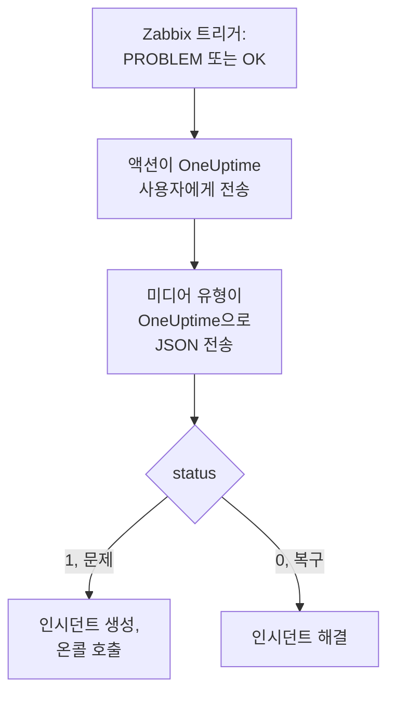

# Zabbix

[Zabbix](https://www.zabbix.com) 문제를 OneUptime으로 보내면 각 문제가 온콜 팀을 호출하는 인시던트가 되고, Zabbix가 복구되면 해결됩니다. Zabbix는 각 문제를 웹훅 미디어 유형으로 보내므로 어느 쪽에도 설치할 것이 없습니다.

:::cards
- [OneUptime이 문제를 받는 방법 선택](#oneuptime이-문제를-받는-방법-선택): Incoming Request 모니터 또는 직접 만든 워크플로.
- [모니터로 문제 받기](#모니터로-문제-받기): 문제마다 인시던트 하나, 복구되면 해결.
- [Zabbix 구성](#zabbix-구성): 미디어 유형, 사용자, 액션.
- [문제 해결](#문제-해결): 문제가 도착하지 않거나 인시던트가 계속 열려 있을 때.
:::

## 작동 방식



Zabbix는 사용자의 미디어를 통해 그 사용자에게 문제를 보냅니다. 여기서 미디어는 **OneUptime**이라는 웹훅 미디어 유형입니다. 이 미디어 유형의 스크립트는 문제의 이벤트 ID, 이름, 호스트, 심각도, 상태가 담긴 작은 JSON 문서를 OneUptime으로 보냅니다. 상태는 문제일 때 `1`, 복구일 때 `0`입니다.

## 사전 요건

- 직접 관리하는 Zabbix 서버. 이 가이드는 Zabbix 6.0 LTS와 7.0 LTS를 기준으로 작성되었습니다. 웹훅 미디어 유형은 Zabbix 5.0부터 같은 방식으로 작동합니다.
- HTTPS로 OneUptime에 연결할 수 있는 Zabbix 서버.
- OneUptime에서 모니터를 만들 권한, 또는 그 방법을 택한다면 워크플로를 만들 권한.

## OneUptime이 문제를 받는 방법 선택

먼저 OneUptime을 설정하세요. Zabbix가 보낼 URL을 얻을 수 있습니다.

| 방법 | 사용하는 경우 |
| --- | --- |
| Incoming Request 모니터(권장) | 모든 Zabbix 문제를 온콜을 호출하고 Zabbix가 복구되면 해결되는 인시던트로 만들고 싶을 때. 만들 것이 없습니다. |
| Webhook 트리거가 있는 워크플로 | 문제를 거르거나, 형태를 바꾸거나, 다른 시스템을 먼저 호출하는 등 자체 로직이 필요할 때. 워크플로는 복구 시 인시던트를 스스로 해결하지 않습니다. |

두 방법 모두 같은 미디어 유형에서 같은 JSON을 받으므로, 하나로 시작했다가 나중에 Zabbix의 URL 하나만 바꿔 전환할 수 있습니다.

## 모니터로 문제 받기

[Incoming Request 모니터](/docs/monitor/incoming-request-monitor)는 URL을 제공하고, 그 기준이 각 요청의 처리 방식을 결정합니다.

:::steps
### 모니터 만들기

**모니터**로 이동해 **모니터 생성**을 클릭합니다. **모니터 유형**에서 **Incoming Request**를 고르고, 이름을 `Zabbix`로 정한 다음 **다음**을 클릭합니다.

### 문제마다 인시던트 선언하기

**기준** 단계에서 첫 번째 기준, 즉 모니터를 오프라인으로 표시하는 기준을 엽니다. 필터를 **요청 본문**, **포함**, `"status":"1"`로 설정합니다. 이 기준은 필터가 일치하면 이미 인시던트를 선언합니다. 인시던트를 채웁니다:

- **인시던트 제목**: `Zabbix: {{requestBody.name}} on {{requestBody.host}}`.
- **심각도**: Zabbix 문제에 붙일 인시던트 심각도.
- **온콜 정책**(**온콜** 아래): 호출할 정책.
- **인시던트 자동 해결**(**추가 필드** 아래): 처음 상태대로 켜 둡니다. 이 설정이 없으면 복구가 무시되어 인시던트가 계속 열려 있습니다.

### 문제마다 인시던트 하나 열기

같은 기준에서 **설정**을 열고 **Group incidents and alerts by a payload field**를 켭니다. 아래와 같이 채우면 문제마다 별도의 인시던트가 생기고, 그 복구가 인시던트를 해결합니다:

| 필드 | 값 |
| --- | --- |
| **Open a separate incident for each…** | `requestBody.event_id` |
| **Field that signals recovery** | `requestBody.status` |
| **Value that means recovered** | `0` |

### 모니터를 다시 온라인으로

두 번째 기준, 즉 모니터를 온라인으로 표시하는 기준을 열고 필터를 **요청 본문**, **포함**, `"status":"0"`으로 설정합니다.

### URL 복사하기

**모니터 생성**을 클릭합니다. 모니터의 **개요** 페이지에 **Heartbeat URL**이 표시됩니다. Zabbix에 쓸 수 있도록 복사합니다:

```text
https://oneuptime.com/heartbeat/<secret key>
```

자체 호스팅 설치에서는 `oneuptime.com` 대신 자체 호스트가 들어갑니다.
:::

모니터는 요청의 JSON을 쓰인 그대로 읽습니다. `"status":"1"`처럼 공백이 없어야 합니다. 각 설정이 하는 일은 [다른 시스템에서 알림 받기](/docs/monitor/incoming-request-monitor#다른-시스템의-알림-수신)를 참고하세요.

## 워크플로로 문제 받기

Zabbix와 인시던트 사이에 자체 단계가 필요하면 [워크플로](/docs/workflows/index)를 사용하세요.

:::steps
### 워크플로 만들기

**워크플로**로 이동해 **워크플로 생성**을 클릭한 다음 **처음부터 시작**을 클릭합니다. 이름을 `Zabbix problems`로 정하고 **워크플로 생성**을 클릭합니다.

### Webhook 트리거 추가하기

점선으로 된 **Choose what starts this workflow** 블록을 클릭하고 **Webhook**을 고릅니다. 트리거를 클릭한 다음 **URL 복사**를 클릭하고, URL을 Zabbix용으로 보관합니다.

### 문제인지 확인하기

**구성 요소 추가**를 클릭하고 **If / Else** 블록을 추가한 다음, 트리거의 **Out** 점을 이 블록에 연결합니다. **Value to check**를 `{{local.components.webhook-1.returnValues.request-body.status}}`로, **Comparison**을 **is equal to**로, **Compare with**를 `1`로 설정합니다.

### 인시던트 선언하기

**Create One Incident** 블록을 추가하고 **If / Else** 블록의 **Yes** 쪽을 이 블록에 연결합니다. **Incident Template**에서 심각도와 호출할 온콜 정책을 설정하는 템플릿을 고릅니다([인시던트 템플릿](/docs/incidents/settings#인시던트-템플릿) 참고). **JSON Object**에는 Zabbix에서 오는 내용을 설정합니다:

```json
{
  "title": "Zabbix: {{local.components.webhook-1.returnValues.request-body.name}}",
  "description": "Host: {{local.components.webhook-1.returnValues.request-body.host}}\nSeverity: {{local.components.webhook-1.returnValues.request-body.severity}}\nZabbix event: {{local.components.webhook-1.returnValues.request-body.event_id}}"
}
```

템플릿이 없으면 **JSON Object**에 프로젝트의 인시던트 심각도 중 하나의 ID인 `incidentSeverityId`도 필요합니다.

### 켜기

**빌더** 상단에서 **활성화됨**을 켭니다. 꺼져 있는 워크플로는 Zabbix에 `400`으로 응답합니다.
:::

복구는 **If / Else** 블록의 **No** 쪽으로 가는데, 그쪽에는 아무것도 연결되어 있지 않으므로 실행이 거기서 끝납니다. 복구 시 인시던트를 해결하려면 모니터를 사용하세요.

## Zabbix 구성

Zabbix에는 세 가지가 필요합니다. OneUptime으로 보내는 미디어 유형, 보낼 대상 사용자, 그리고 그 사용자에게 문제를 보내는 액션입니다.

:::steps
### OneUptime 미디어 유형 만들기

1. **Alerts → Media types**(Zabbix 6.0에서는 **Administration → Media types**)로 이동해 **Create media type**을 클릭합니다.
2. **Name**을 `OneUptime`으로, **Type**을 **Webhook**으로 설정합니다.
3. 다음 **Parameters**를 추가합니다. 각각은 Zabbix [매크로](https://www.zabbix.com/documentation/current/en/manual/appendix/macros/supported_by_location)를 요청에 넣습니다:

   | 이름 | 값 |
   | --- | --- |
   | `url` | `{ALERT.SENDTO}` |
   | `event_id` | `{EVENT.ID}` |
   | `event_name` | `{EVENT.NAME}` |
   | `event_value` | `{EVENT.VALUE}` |
   | `event_severity` | `{EVENT.SEVERITY}` |
   | `host` | `{HOST.NAME}` |
   | `event_date` | `{EVENT.DATE}` |
   | `event_time` | `{EVENT.TIME}` |

4. 다음을 **Script**에 붙여 넣습니다:

   ```javascript
   var params = JSON.parse(value);
   var request = new HttpRequest();
   request.addHeader("Content-Type: application/json");

   var payload = {
     source: "zabbix",
     event_id: params.event_id,
     name: params.event_name,
     host: params.host,
     severity: params.event_severity,
     // "1" for a problem, "0" for its recovery.
     status: params.event_value,
     date: params.event_date,
     time: params.event_time,
   };

   var response = request.post(params.url, JSON.stringify(payload));

   if (request.getStatus() < 200 || request.getStatus() >= 300) {
     throw (
       "OneUptime responded with HTTP " + request.getStatus() + ": " + response
     );
   }

   return "OK";
   ```

5. **Message templates** 탭에서 **Problem**용 템플릿과 **Problem recovery**용 템플릿을 하나씩 추가합니다. 내용은 비워 두세요. 요청은 스크립트가 만듭니다. Zabbix는 템플릿이 있는 이벤트 종류에만 미디어 유형을 사용합니다.
6. **Add**를 클릭합니다.

### 문제를 받을 사용자 만들기

1. **Users → Users**(Zabbix 6.0에서는 **Administration → Users**)로 이동해 **Create user**를 클릭합니다. 이름을 `OneUptime`으로 정하고, 알림을 받을 수 있는 사용자 그룹과 역할(예: **User role**)을 지정합니다.
2. **Media** 탭에서 **Add**를 클릭합니다. **Type**을 `OneUptime`으로, **Send to**를 OneUptime에서 복사한 URL로 설정합니다. **When active**와 심각도는 그대로 두거나, OneUptime이 받지 않을 심각도의 선택을 해제합니다.
3. **Add**를 클릭한 다음 다시 **Add**를 클릭해 사용자를 저장합니다.

### 액션으로 문제를 OneUptime에 보내기

1. **Alerts → Actions → Trigger actions**(Zabbix 6.0에서는 **Configuration → Actions**)로 이동해 **Create action**을 클릭합니다. 이름을 `Notify OneUptime`으로 정합니다.
2. 원한다면 **Conditions**에서 범위를 좁힙니다. 예: **Trigger severity is greater than or equals Warning**. 조건이 없으면 모든 문제가 전송됩니다.
3. **Operations** 탭에서 `OneUptime` 미디어 유형을 통해 `OneUptime` 사용자에게 보내는 작업을 추가합니다.
4. 복구도 전송되도록 **Recovery operations**에 같은 작업을 추가합니다.
5. **Add**를 클릭하고 액션이 활성화되어 있는지 확인합니다.
:::

## 테스트하기

1. Zabbix에서 **Alerts → Media types**를 열고 `OneUptime` 옆의 **Test**를 클릭합니다. 복사한 URL과 `event_id` `12345`, `event_name` `Test problem`, `host` `web-1`, `event_value` `1` 같은 샘플 값을 입력합니다. **Test**를 클릭하면 Zabbix가 스크립트의 응답 `OK` 또는 스크립트가 던진 오류를 보여 줍니다.
2. OneUptime에서 모니터를 열어 인시던트가 열렸는지 확인하거나, 워크플로의 **로그 → 실행 기록**을 열어 실행을 확인합니다.
3. `event_value` `0`과 같은 `event_id`로 다시 테스트합니다. 모니터를 사용하면 인시던트가 해결됩니다.

그런 다음 임계값을 잠시 낮추는 식으로 실제 트리거를 발생시켜 문제가 도착하는지 지켜봅니다.

## Zabbix 심각도 매핑

Zabbix는 심각도를 텍스트로 보냅니다: `Not classified`, `Information`, `Warning`, `Average`, `High`, `Disaster`.

- **모니터를 사용하는 경우** 심각도 그룹마다 **기준 추가**를 클릭하고, 새 기준을 첫 번째 기준 위로 끌어 옮깁니다. 기준은 위에서부터 확인되며, 처음 일치하는 기준이 결정합니다. 각 기준에 `"status":"1"`과 `"severity":"Disaster"` 같은 심각도의 두 필터를 주고, **일치 조건**을 **전체**로 둡니다. 각 기준에 자체 **심각도**와 **인시던트 자동 해결**, 같은 그룹화 설정이 있는 인시던트를 지정합니다.
- **워크플로를 사용하는 경우** `{{local.components.webhook-1.returnValues.request-body.severity}}`에 대한 [Switch / Case](/docs/workflows/components#switch-case) 블록을 심각도마다 케이스를 두어 추가하고, 각 케이스 뒤에 자체 템플릿이 있는 **Create One Incident** 블록을 둡니다.

## 문제 해결

:::details OneUptime에 아무것도 도착하지 않음
- Zabbix에서 **Reports → Action log**를 열어 액션이 문제를 보냈는지, 무엇이 돌아왔는지 확인합니다.
- Zabbix 서버에서 직접 요청을 보냅니다: `curl -i -X POST <url> -H 'Content-Type: application/json' -d '{"status":"1","event_id":"1","name":"Test","host":"test"}'`.
- 모니터는 아무것도 확인하기 전에, 비밀 키가 틀려도 즉시 `200`으로 응답합니다. 요청이 도착하는지는 모니터의 타임라인에서 확인하세요.
- 꺼져 있는 워크플로는 `400`으로 응답합니다. 그 **빌더** 상단에서 **활성화됨**을 켜세요.
:::

:::details Zabbix가 스크립트 오류를 보고함
미디어 유형을 열고 **Test**를 사용하세요. Zabbix가 스크립트의 결과나 스크립트가 던진 오류를 보여 줍니다. OneUptime의 `2xx`가 아닌 응답은 스크립트가 상태와 함께 던지므로, 먼저 URL을 확인하세요.
:::

:::details 인시던트가 열리지만 해결되지 않음
- 액션에 **Recovery operations**가 필요합니다. 없으면 Zabbix가 복구를 보내지 않습니다.
- 기준의 인시던트에 **추가 필드** 아래의 **인시던트 자동 해결**이 필요합니다.
- **Field that signals recovery**는 `requestBody.status`여야 하고, **Value that means recovered**는 정확히 `0`이어야 합니다.
- 워크플로는 복구 시 인시던트를 해결하지 않습니다. 모니터를 사용하세요.
:::

:::details 인시던트에 값 대신 참조가 표시됨
요청에 없는 필드를 가리키는 참조는 비워지지 않고, 중괄호까지 포함해 쓰인 그대로 남습니다. Zabbix가 `Content-Type: application/json`을 보내는지, 사용하는 필드 이름(`name`, `host`, `severity`, `status`, `event_id`)이 스크립트의 페이로드와 일치하는지 확인하세요. 워크플로라면 **로그 → 실행 기록**에서 실행을 열어 트리거가 받은 내용과 비교하세요. [주의할 점](/docs/workflows/variables#주의-사항)을 참고하세요.
:::

:::details 모든 문제가 두 번씩 도착함
액션에 같은 사용자에게 보내는 작업이 두 개 있을 가능성이 높습니다. 예를 들어 첫 단계와 에스컬레이션 단계입니다. 액션의 **Operations**를 확인하세요.
:::

## 보안

- **URL을 비밀번호처럼 다루세요.** URL을 가진 사람은 누구나 인시던트를 열 수 있습니다. 유출되면 재설정하세요. 모니터의 **설정** 페이지에서 **수신 요청 비밀 키 재설정**을, 또는 워크플로의 **Webhook** 트리거에서 **URL 재설정**을 사용합니다. 그런 다음 Zabbix 사용자 미디어의 **Send to**를 업데이트합니다.
- **인시던트가 필요한 것만 보내세요.** 액션의 조건이나 사용자 미디어의 심각도를 사용해 심각도가 낮은 문제는 Zabbix에 남겨 두세요.
- **자체 호스팅인가요?** Zabbix 서버가 방화벽을 통해 HTTPS로 OneUptime에 연결할 수 있게 하세요.

## 다음 단계

:::cards
- [수신 요청 모니터](/docs/monitor/incoming-request-monitor): Zabbix 문제를 받는 모니터의 모든 설정.
- [에스컬레이션 규칙](/docs/on-call/escalation-rules): 온콜 정책이 누구를 언제 호출할지 정합니다.
- [워크플로우 트리거](/docs/workflows/triggers#webhook): 워크플로의 웹훅 URL이 작동하는 방식.
- [통합 개요](/docs/integrations/index): 연결할 수 있는 다른 도구.
:::
