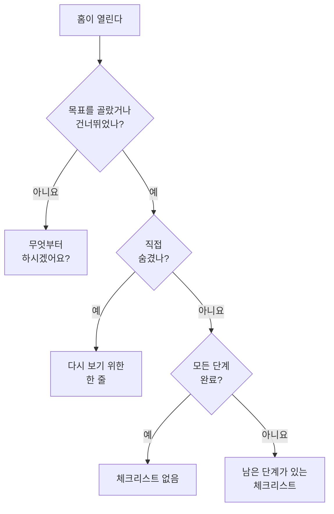

# 홈 화면과 단축키

홈은 프로젝트에서 가장 먼저 보는 페이지입니다. 지금 여러분이 처리해야 할 일이 있는지 한눈에 알려 주고, 새 프로젝트의 첫 설정을 안내합니다. 이 페이지에서는 홈에 무엇이 표시되는지, 대시보드에서 제품, 페이지, 작업을 찾는 방법, 그리고 메뉴를 오가는 수고를 덜어 주는 키보드 단축키를 설명합니다.

:::cards
- [홈에 표시되는 것](#홈에-표시되는-것): 문제가 있는지, 처리해야 할 일, 프로젝트에 무엇이 있는지, 그리고 모든 제품.
- [둘러보기](#둘러보기): 제품 메뉴와 모든 페이지 위쪽의 바.
- [검색](#페이지-설정-또는-작업-검색): 이름을 입력해 원하는 페이지, 설정, 작업을 찾습니다.
- [키보드 단축키](#키보드-단축키): 키 두 개로 홈, 모니터, 인시던트로 이동합니다.
:::

## 홈에 표시되는 것

위쪽 바에서 **홈**을 열거나, 어디서든 `g`를 누른 다음 `h`를 누릅니다. 홈은 프로젝트의 개요를 보여 주는 하나의 페이지이며, 사이드 메뉴가 없습니다. 위에서 아래로 다음이 표시됩니다.

1. 검색 상자와 그 옆의 **인시던트 선언**, **만들기**.
2. 문제가 있는지 알려 주는 한 줄과, 그 아래에서 주의가 필요한 것을 세는 다섯 개의 숫자.
3. **OneUptime에 오신 것을 환영합니다 👋**: 새 프로젝트를 위한 체크리스트로, 완료될 때까지 표시됩니다.
4. **확인 필요**: 지금 해결되지 않은 모든 문제를 이름과 함께 보여 줍니다.
5. **내 프로젝트**: 프로젝트를 이루는 것들. 예정된 유지 관리가 있으면 **다가오는 유지 관리**도 표시됩니다.
6. **OneUptime 살펴보기**: 모든 제품을 한 번에 한 카테고리씩 보여 줍니다.

### 검색과 생성

검색 상자는 `Mod` + `K`와 마찬가지로 검색을 엽니다. 페이지, 모니터, 인시던트, 알림, 상태 페이지, 온콜 정책 중 무엇이든 이름을 입력하세요. [검색](#페이지-설정-또는-작업-검색)을 참고하세요. **인시던트 선언**은 인시던트를 선언하는 양식을 엽니다. **만들기**는 **모니터 생성**, **유지 관리 예약**, **공지사항 만들기**를 제공합니다. 각 항목은 사용할 권한이 있는 사람에게만 표시됩니다.

### 헤드라인

맨 위의 한 줄은 해결되지 않은 것 중 가장 긴급한 것을 그에 맞는 색으로 알려 줍니다.

| 상황 | 홈에 표시되는 내용 |
| --- | --- |
| 미해결 인시던트가 있음 | 활성 인시던트 수, 빨간색 |
| 미해결 인시던트는 없지만 미해결 알림, 작동 중지된 모니터 또는 위험한 SLO가 있음 | 확인이 필요한 문제 수, 주황색 |
| 문제가 없고 유지 관리가 진행 중임 | 진행 중인 유지 관리 이벤트 수 |
| 모니터가 실행 중이고 미해결 항목이 없음 | **모든 시스템 정상 작동** |
| 프로젝트에 아직 모니터가 없음 | **아직 모니터링 중인 항목이 없습니다** |

그 옆에는 홈이 마지막으로 프로젝트를 읽어 온 시각이 표시되며, **새로고침**을 누르면 다시 읽어 옵니다. 1분 이상 지난 뒤 홈 탭으로 돌아오면 저절로 새로고침됩니다.

아직 모니터링 중인 항목이 없는 동안에는 이 줄 끝에 **첫 번째 모니터 만들기**가 표시되며, 안내형 설정 **웹사이트나 API가 다운되면 알기**를 엽니다. 모니터를 만들 수 있는 사람에게만 표시됩니다.

### 다섯 개의 숫자

각 숫자는 무언가를 세고, 그것이 주의가 필요한지 알려 주며, 그 뒤의 목록을 그 목록이 속한 제품에서 엽니다.

| 숫자 | 세는 것 | 수가 0일 때 | 여는 곳 |
| --- | --- | --- | --- |
| **활성 인시던트** | 해결되지 않은 인시던트 | **모두 정상** | **인시던트 → 활성 인시던트** |
| **활성 알림** | 해결되지 않은 알림 | **모두 정상** | **알림 → 활성 알림** |
| **작동 중지된 모니터** | 상태가 정상 작동 상태가 아닌 모니터. 보관된 모니터와 모니터링이 꺼진 모니터는 제외됩니다. | **모두 정상 작동** | **모니터 → 작동하지 않음** |
| **진행 중인 유지 관리** | 진행 중인 유지 관리 이벤트 | **진행 중인 항목 없음** | **예정된 유지 관리 → 진행 중인 유지 관리 이벤트** |
| **위험한 SLO** | 켜져 있는 SLO 중 위험하거나 오류 예산을 다 쓴 것 | **예산 정상** | **SLOs** |

수가 0보다 크면 **확인 필요**로 표시되며, 유지 관리와 SLO에서는 각각 **진행 중**과 **예산 소진 중**으로 표시됩니다. 위험한 SLO가 있는 동안에는 **위험한 SLO**가 **SLOs** 목록을 그 SLO만 보이도록 필터링해서 엽니다. 아직 모니터가 없는 프로젝트는 **아직 모니터가 없습니다**를, SLO가 없는 프로젝트는 **아직 SLO가 없습니다**를 봅니다. 빈 프로젝트는 건강한 프로젝트와 같지 않기 때문입니다. 이때 두 숫자는 **모니터** 목록과 **SLOs** 목록을 열며, 거기서 첫 항목을 만들 수 있습니다.

### 환영 체크리스트

프로젝트 소유자나 관리자가 새 프로젝트의 홈을 처음 열면 카드가 **무엇부터 하시겠어요?** 하고 묻습니다. **웹사이트나 API가 다운되면 알기** 나 **그냥 둘러보는 중입니다** 처럼 목표를 하나 이상 고르고 **계속** 을 클릭하면, 그 목표에 필요한 단계가 체크리스트에 들어갑니다. **건너뛰기** 를 누르면 모든 프로젝트가 받는 네 단계가 됩니다. 나중에 다시 답하려면 체크리스트에서 **변경** 을 클릭하세요. 모니터, 텔레메트리 또는 온콜을 이미 쓰고 있는 프로젝트에는 묻지 않습니다.

각 단계는 레코드가 생겼을 때가 아니라 실제로 작동할 때 스스로 체크되며, 프로젝트를 설정하는 모든 사람이 어느 기기에서나 같은 목록을 봅니다.

| 단계 | 완료 조건 | 여는 곳 |
| --- | --- | --- |
| **지금 쓰는 도구에서 가져오기** | 다른 도구에서 가져오기가 끝난다. | **다른 도구에서 가져오기** |
| **첫 번째 모니터 만들기** | 첫 번째 확인 결과가 들어온다. | 안내형 설정 **웹사이트나 API가 다운되면 알기**. 모니터를 만들 수 없는 사람에게는 **모니터** 목록. |
| **서버 또는 클러스터 연결하기** | 첫 번째 메트릭이 들어온다. | **호스트** |
| **첫 로그, 메트릭 또는 트레이스 보내기** | 프로젝트의 첫 로그, 메트릭, 트레이스, 예외 또는 프로파일이 들어온다. | 안내형 설정 **로그, 메트릭, 트레이스를 보내고 경고 받기** |
| **온콜 정책 설정하기** | 테스트 호출이 확인되거나, 호출이 누군가에게 전달되거나, 온콜 규칙이 누군가에게 닿을 수 있는 정책을 실행한다. | 안내형 설정 **문제가 생기면 적절한 담당자 호출하기** |
| **상태 페이지 게시하기** | 상태 페이지가 모니터를 보여 준다. | 안내형 설정 **상태 페이지 게시하기**. 상태 페이지를 만들 수 없는 사람에게는 **상태 페이지** 목록. |
| **팀 초대하기** | 누군가 초대를 수락한다. | **사용자** |

먼저 할 단계에는 **다음 단계** 표시가 붙습니다. 한 명만 쓸 수 있는 OneUptime Cloud의 Free 요금제에서는 **팀 초대하기** 가 Growth 요금제가 필요하다고 알려 주고 **결제** 를 엽니다. 아직 이메일을 보낼 수 없는 자체 호스팅 서버에서는 서버 관리자가 **이 서버는 아직 이메일을 보낼 수 없습니다** 를 먼저 보며, 이 단계는 관리자 대시보드를 엽니다.

안내형 설정은 한 페이지에서 한 단계씩 전체 작업을 진행하고, 마지막에 설정한 내용과 다음에 할 일을 알려 줍니다. 나중에 다시 열려면 이름으로 검색하세요.

단계 아래의 **OneUptime 작동 방식**은 문제가 거쳐 가는 순서대로 네 가지 핵심 제품을 보여 줍니다. **모니터**, **인시던트 및 경고**, **온콜**, **상태 페이지**입니다. 하나를 클릭하면 열립니다. 그 아래에는 이 흐름을 채우는 것(텔레메트리와 인프라)이 나오고, [핵심 개념](/docs/introduction/core-concepts)과 [용어집](/docs/introduction/glossary)으로 가는 링크가 있습니다.

모든 단계가 끝나면 체크리스트는 모두에게서 사라집니다. 그 전에 숨기려면 **숨기기** 를 클릭하세요. 나에게만, 모든 기기에서 숨겨지고 **보기** 와 **OneUptime 작동 방식** 이 있는 한 줄이 남습니다. 멤버로 프로젝트에 초대된 사람에게는 체크리스트가 보이지 않습니다. **OneUptime 작동 방식**은 어느 프로젝트에서든 한 번의 클릭으로 열 수 있습니다. **도움말**에서 열거나 **OneUptime 살펴보기** 옆의 버튼으로 여세요.

### 확인 필요

**확인 필요**는 숫자가 세는 것을 이름과 함께 나열합니다. 미해결 인시던트, 미해결 알림, 작동 중지된 모니터, 위험한 SLO, 진행 중인 유지 관리가 가장 긴급한 것부터 나옵니다. 각 행은 심각도나 상태를 보여 주고, 인시던트나 알림이 언제 시작되었는지와 유지 관리가 언제 끝나는지 알려 주며, 클릭하면 해당 레코드가 열립니다. 종류마다 최대 다섯 개까지 표시되고, 나머지는 해당 숫자와 같은 목록을 여는 **모두 표시**로 볼 수 있습니다. 해결되지 않은 것이 없으면 **확인이 필요한 항목이 없습니다**라고 표시됩니다.

### 설정 상태

프로젝트 설정 중 무언가가 사람들에게 알림이 가지 못하게 막는다면, **확인 필요**의 마지막에 **설정**이 나타나 살펴볼 항목이 몇 개인지 알려 줍니다. 이를 클릭하면 **설정 상태**가 열리고, 잘못 설정된 것이 가장 심각한 것부터 **호출이 도착하지 않습니다**, **고칠 만한 항목**, **제안** 아래에 나열됩니다. 예를 들어 아무도 호출하지 않는 모니터, 어디에서도 실행되지 않는 온콜 정책, 호출할 수 없는 대응자, 꺼진 SMS, 아무도 당번이 아닌 온콜 일정, 모니터를 하나도 보여 주지 않는 상태 페이지입니다. 각 발견 사항은 무엇이 잘못되었는지 한 문장으로 알려 주고, 수정할 곳을 여는 버튼이 함께 있습니다. 모니터의 발견 사항은 그 모니터의 **다운되면** 카드가 짚는 끊어진 곳과 같습니다. 팀이 일부러 그대로 두는 발견 사항은 이유와 함께 모두에게 숨길 수 있고, **무시됨**에서 다시 복원할 수 있습니다. 검색에서는 이 페이지를 **설정 상태**로 찾을 수 있고, AI에게 질문은 이 페이지를 바탕으로 "내 설정은 괜찮나요?"에 답합니다.

### 내 프로젝트

**내 프로젝트**는 프로젝트의 **모니터**, **상태 페이지**, **온콜 정책**, **SLOs**, **서비스**, **대시보드**, **워크플로** 수를 보여 주며, 보관된 항목은 세지 않습니다. 각 행은 해당 목록을 엽니다. 프로젝트에 하나도 없는 종류에는 숫자 대신 **설정**이 표시됩니다.

**다가오는 유지 관리**는 예정된 다음 유지 관리 기간 세 개를 가까운 순서대로 나열합니다. 예정된 것이 없으면 표시되지 않습니다.

### OneUptime 살펴보기

**OneUptime 살펴보기**는 **제품** 메뉴의 제품을 필수부터 시작해 한 번에 한 카테고리씩 보여 줍니다. 각 제품은 무엇을 위한 것인지 알려 주며, 클릭하면 열립니다. 프로젝트에서 숨긴 제품은 빠집니다.

## 둘러보기

OneUptime의 모든 것은 위쪽 바의 **제품** 아래에 있습니다. 메뉴는 그룹을 하나의 목록의 행으로 보여 주며, 항상 첫 번째 그룹인 필수를 펼친 상태로 열립니다. 필수에는 모니터, 인시던트, 경고, 온콜, 상태 페이지, 예정된 유지 관리, SLOs가 있습니다. 다른 모든 그룹(관측 가능성, 보안, AI, 코드, 리소스, 인프라, 클라우드, 대시보드 및 자동화, 설정)은 같은 목록의 한 행으로 접혀 있습니다. 각 행은 그룹에 있는 제품의 이름과 개수를 보여 줍니다. 행을 클릭하면 펼치거나 접을 수 있고, 화살표 키로 행으로 이동해 **Enter**를 눌러도 됩니다.

- **검색으로 모든 것을 찾습니다.** 메뉴의 검색 상자에 입력하면 이름, 하는 일, 또는 `k8s`나 `RUM` 같은 익숙한 단어로 어떤 제품이든 찾을 수 있습니다. 검색은 접힌 그룹 안까지 찾습니다.
- **지금 있는 곳에서 시작합니다.** 보고 있는 페이지의 그룹은 저절로 펼쳐지고, 최근에 연 제품은 맨 위에 나열됩니다.
- **선택이 유지됩니다.** 메뉴는 다른 그룹 중 무엇을 펼치고 접었는지 브라우저에 기억합니다. 필수 그룹은 접었더라도 메뉴를 열 때마다 다시 펼쳐집니다.
- **휴대폰에서는** 메뉴 버튼이 제품을 같은 방식으로 나열합니다. 필수 그룹은 맨 위에 펼쳐져 있고, 다른 그룹은 각각 탭하면 펼쳐지는 한 행입니다.
- **프로젝트에서 쓰지 않는 제품.** 프로젝트 소유자나 관리자는 **프로젝트 설정 → 기본 → 제품**에서 이를 숨길 수 있습니다. 숨긴 제품은 메뉴의 마지막 행인 **더 많은 제품**으로 옮겨집니다. 검색에서 계속 찾을 수 있고, 페이지가 계속 작동하며, 데이터도 계속 들어옵니다. 그중 하나에 데이터가 들어오기 시작하면 홈이 다시 표시할 수 있는 사람에게 알려 줍니다.
- **고정.** **홈**과 **제품** 옆의 상단 바에 제품을 두세요. 메뉴의 제품 카드에서 핀을 누르거나, 제품 페이지 제목 옆의 **고정**을 누릅니다. 다섯 개까지 고정할 수 있으며, 어느 브라우저에서나 그대로 따라옵니다. 휴대폰에서는 고정한 제품이 메뉴 맨 위에 나옵니다.
- **사용 중인 제품.** 필수와 설정을 뺀 각 그룹에서는 프로젝트가 쓰는 제품이 먼저 나오고, 아직 설정하지 않은 제품에는 **설정되지 않음**이라고 표시됩니다. OneUptime Cloud에서는 요금제에 포함되지 않은 제품에 그 제품을 포함하는 요금제의 이름이 표시됩니다.

### 위쪽의 바

모든 페이지 위쪽에는 두 개의 바가 있습니다.

| 위치 | 있는 것 |
| --- | --- |
| 왼쪽 위 | 프로젝트 선택기: 다른 프로젝트로 전환하거나 새 프로젝트를 만듭니다. |
| 오른쪽 위 | **검색**과 **AI에게 질문**, 지금 처리할 일(활성 인시던트와 알림, 여러분이 당번인 온콜 정책, 대기 중인 초대)을 보여 주는 알림 벨, **도움말**, 그리고 [계정](/docs/introduction/your-account) 메뉴를 여는 여러분의 사진. |
| 그 아래 | 왼쪽에 **홈**과 **제품**, 오른쪽에 **사용자 설정**: 이 프로젝트에서 OneUptime이 여러분에게 연락하는 방법. |

**도움말**은 배우는 데 도움이 되는 항목으로 시작합니다. **빠른 시작**, **OneUptime 작동 방식**, **용어집**, 이 문서(**문서**)입니다. 그 아래에 **키보드 단축키** 목록과 이메일 및 Slack 지원이 있습니다. 태블릿이나 좁은 창에서는 공간을 아끼기 위해 **AI에게 질문**이 빠지며, **검색**의 작업에서 찾을 수 있습니다. 휴대폰에서는 **검색**과 **도움말**이 메뉴 버튼 목록의 맨 위와 맨 아래로 옮겨지고, 알림 벨과 사진은 남습니다.

**프로브**처럼 아래에 점선이 있는 단어는 포인터를 올리거나, Tab으로 이동하거나, 탭하면 뜻을 보여 줍니다. **더 읽기**를 누르면 그 단어가 [용어집](/docs/introduction/glossary)에서 열립니다.

### 페이지와 목록

모든 페이지 제목 위에는 *프로젝트 › Docker › 설정 › 소유자 규칙* 같은 경로가 있어 페이지의 위치를 알려 줍니다. 마지막 단계 앞의 각 단계를 누르면 그 페이지가 열립니다.

- **목록은 스스로 최신 상태를 유지합니다.** 어디서든 인시던트나 알림이 생성, 확인 또는 해결되면 인시던트, 알림, 에피소드 목록에 몇 초 안에 나타나며, 새로 고칠 필요가 없습니다. 행을 선택했거나 대화 상자를 연 것처럼 목록에서 작업하는 중이라면 목록은 기다렸다가 작업이 끝나면 따라잡습니다.
- **휴대폰에서는 필터 칩이 접혀** **필터** 뒤로 들어가므로 목록이 더 위에서 시작됩니다. 설정한 칩은 **모두 지우기**와 함께 계속 보입니다. **필터**를 누르면 모든 칩이 보이고, 다시 누르면 접힙니다.
- 목록의 **⋯** 메뉴에 있는 **열**에서 목록에 보일 열과 순서를 고르며, 고른 열은 이 브라우저에 저장됩니다. 프로젝트 소유자나 프로젝트 관리자는 그곳에서 **이 프로젝트의 모든 사용자에게 이 열 표시**에 체크할 수도 있습니다. 그 목록의 열을 직접 고르지 않은 사람은 모두 이 열을 보게 되고, **프로젝트 기본값으로 재설정**을 누르면 내 열이 이 열로 돌아옵니다.
- 같은 메뉴의 **촘촘한 행**은 모든 목록의 행 높이를 줄여, 긴 목록에서 행이 약 5분의 1 더 보이게 합니다. 이 설정은 이 브라우저에 저장됩니다.
- **휴대폰에서, 또는 행이 들어가지 않을 만큼 좁은 카드에서는 목록이 행마다 하나씩 카드로 표시됩니다.** 카드 위의 띠에는 **이름 기준 정렬**처럼 정렬 순서가 표시됩니다. 누르면 정렬할 열과 **오름차순** 또는 **내림차순**을 고를 수 있습니다.
- **인시던트 페이지는 번호로 시작합니다.** 제목, 경로의 해당 단계, 브라우저 탭에는 `INC-42 Checkout is down`처럼 표시되고, 그 인시던트를 가리키는 대화 상자도 마찬가지이므로 제목이 같은 인시던트도 구별할 수 있습니다. 알림, 유지 관리 이벤트, 에피소드도 같습니다.

## 페이지, 설정 또는 작업 검색

**Cmd+K**(Mac) 또는 **Ctrl+K**(Windows 및 Linux)를 누르거나, 위쪽 바의 검색 아이콘을 클릭하고 입력을 시작합니다. 검색으로 찾을 수 있는 것은 다음과 같습니다.

- **메뉴의 모든 페이지**: 메뉴에 표시된 이름으로 찾습니다. API 키, 위험 영역, 온콜 스케줄, 인시던트 심각도, 자신의 알림 방법 등입니다. 각 결과에는 *프로젝트 설정 › 고급*처럼 위치가 표시되므로, 이름이 같은 페이지(인시던트, 알림, 모니터의 사용자 정의 필드)도 쉽게 구분할 수 있습니다.
- **페이지의 설정**: 카드나 스위치에 표시된 이름으로 찾습니다. *로그인에 SSO 필수*를 입력하면 SSO 페이지가, *사용자 지정 SMTP 구성*을 입력하면 알림 채널 페이지가 나옵니다. 이름은 영어로도, 사용하는 언어로도 입력할 수 있습니다.
- **작업**: 하려는 일로 찾습니다. 인시던트 선언, 모니터 생성, 또는 위험 영역을 여는 Delete Project 등입니다. 무언가를 바꾸는 작업은 그 일을 할 수 있는 사람에게만 표시됩니다.
- **모니터, 인시던트, 알림, 상태 페이지, 온콜 정책**: 이름으로 찾습니다. 인시던트와 알림은 `INC-42` 같은 번호로도 찾을 수 있고, 결과가 번호로 시작하므로 제목이 같은 것도 구별할 수 있습니다.
- **문서**: 다른 모든 결과 아래의 *문서* 그룹에, 입력한 단어와 맞는 페이지와 섹션이 사용자의 언어로 표시됩니다. 오타가 있어도 찾아 줍니다. 각각 새 탭에서 열리므로 보던 위치를 잃지 않습니다.

검색은 입력한 내용을 여러분의 뜻대로 읽습니다.

- 대소문자, 악센트, 공백, 하이픈은 상관없습니다. *on-call*, *on call*, *oncall*은 같은 페이지를 찾고, 단어 순서도 자유입니다.
- 많은 페이지에 대해 다른 단어(영어)도 압니다. 온콜 정책에는 *pager*나 *escalation*, 온콜 스케줄에는 *rota*, 2단계 인증에는 *2fa*, 위험 영역에는 *delete project*입니다.
- 제품 이름을 더하면 검색 범위를 좁힐 수 있습니다. *incident custom fields*는 인시던트의 사용자 정의 필드 페이지를 찾습니다.
- *incidnet* 같은 작은 오타도, 입력한 그대로 일치하는 것이 없으면 의도한 것을 찾아 줍니다.

검색 상자가 비어 있으면 최근에 연 페이지, 작업, 제품을 보여 줍니다.

## 키보드 단축키

대시보드 어디에서든 `?`를 누르면 모든 단축키를 볼 수 있습니다. **도움말**을 열고 **키보드 단축키**를 골라도 됩니다. Mac에서 `Mod`는 Command 키이고, Windows와 Linux에서는 Ctrl 키입니다.

| 키 | 하는 일 |
| --- | --- |
| `Mod` + `K` | 명령 팔레트를 열어 원하는 페이지, 설정, 작업을 검색합니다. |
| `Mod` + `I` | 지금 보고 있는 것에 대해 AI에게 묻습니다. |
| `/` | 이 페이지의 목록을 검색합니다. |
| `?` | 키보드 단축키를 보여 줍니다. |
| `Esc` | 대화 상자나 패널을 닫습니다. |

### 제품으로 이동

`g`를 누른 다음 문자 키를 누르면 바로 그 제품으로 이동합니다. 문자 키는 `g`를 누르고 1.5초 안에 눌러야 합니다.

| 키 | 이동하는 곳 |
| --- | --- |
| `g` 다음 `h` | 홈 |
| `g` 다음 `m` | 모니터 |
| `g` 다음 `i` | 인시던트 |
| `g` 다음 `a` | 경고 |
| `g` 다음 `o` | 온콜 |
| `g` 다음 `s` | 상태 페이지 |
| `g` 다음 `e` | 예정된 유지 관리 |
| `g` 다음 `d` | 대시보드 |
| `g` 다음 `l` | 로그 |
| `g` 다음 `t` | 트레이스 |

단축키는 방해가 되지 않습니다. 필드에 입력하는 동안에는 `?`, `/`, `g`가 아무 일도 하지 않으며, 대화 상자가 열려 있는 동안에는 어떤 키도 페이지를 벗어나지 않으므로, 실수로 누른 키 때문에 작성 중인 양식을 잃지 않습니다. 다른 제품도 `Mod` + `K`로 검색하면 바로 열 수 있습니다.

## 다음 단계

:::cards
- [빠른 시작](/docs/introduction/quickstart): 환영 체크리스트를 단계별로 진행합니다.
- [내 계정](/docs/introduction/your-account): 프로필, 로그인 보안, 언어, 테마.
- [AI에게 질문](/docs/ai/ask-ai): Ask AI가 답하고 대신 할 수 있는 일.
- [핵심 개념](/docs/introduction/core-concepts): 모니터, 인시던트, 알림, 온콜이란 무엇인지.
:::
