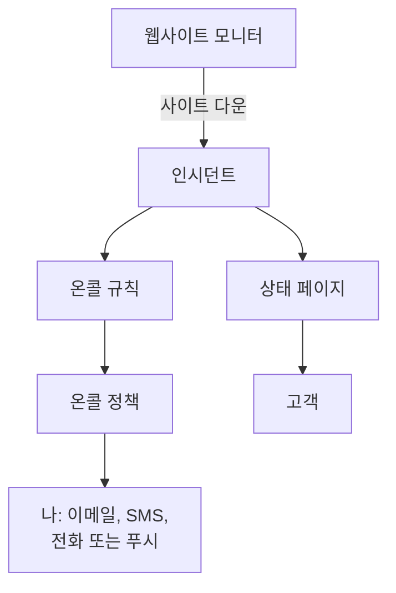

# 빠른 시작

이 가이드는 새 계정에서 시작해 약 15분 만에 작동하는 구성을 완성하도록 안내합니다. 5분마다 웹사이트를 확인하는 모니터, 사이트가 다운되면 여러분을 호출하는 온콜 정책, 그리고 고객에게 알리는 상태 페이지입니다. 프로젝트 홈 페이지의 **OneUptime에 오신 것을 환영합니다 👋** 체크리스트와, 그 단계들이 여는 안내형 설정을 따라 진행합니다.

다른 도구에서 옮겨 오시나요? [먼저 가져오세요](/docs/introduction/getting-started#다른-도구에서-옮겨-오기). 모니터, 온콜 스케줄, 상태 페이지가 그대로 함께 옮겨집니다.

## 시작하기 전에

- **계정.** OneUptime Cloud에서는 [oneuptime.com](https://oneuptime.com/accounts/register)에서 가입하고, 받은 이메일의 링크를 엽니다. 자체 설치에서는 브라우저에서 설치 주소를 열고 가입합니다. 첫 번째 계정이 마스터 관리자가 됩니다. 설치 방법은 [Docker Compose](/docs/installation/docker-compose)를 참고하세요.
- **모니터링할 웹사이트.** HTTP 또는 HTTPS로 응답하는 주소면 무엇이든 됩니다. 예를 들면 회사 홈페이지입니다.

## 프로젝트 만들기

OneUptime의 모든 것은 프로젝트 안에 있습니다. 모니터, 인시던트, 온콜 정책, 상태 페이지, 그리고 이를 다루는 사람들입니다.

:::steps
### 새 프로젝트 시작

처음 로그인하면 OneUptime에 **프로젝트가 없습니다**라는 메시지가 표시됩니다. **새 프로젝트 만들기**를 클릭합니다. 누군가 이미 여러분을 프로젝트에 초대했다면, 대신 같은 페이지에서 초대를 수락합니다.

### 이름 지정

**프로젝트 이름**에 회사 이름 등을 입력합니다. OneUptime Cloud에서는 그 아래에서 요금제도 고릅니다. Free가 미리 선택되어 있고, 유료 요금제는 무료 체험으로 시작합니다.

### 만들기

**프로젝트 생성**을 클릭합니다. 프로젝트의 홈 페이지가 열리고, 맨 위에 **OneUptime에 오신 것을 환영합니다 👋** 체크리스트가 표시됩니다. 먼저 **무엇부터 하시겠어요?** 하고 묻습니다. **웹사이트나 API가 다운되면 알기**, **문제가 생기면 적절한 담당자 호출하기**, **상태 페이지로 고객에게 알리기** 를 고르고 **계속** 을 클릭하세요.
:::

## 웹사이트 모니터링

:::steps
### 웹사이트 설정 열기

체크리스트에서 **첫 번째 모니터 만들기**를 클릭합니다. 안내형 설정 **웹사이트나 API가 다운되면 알기**가 열리며, 한 페이지에서 사이트를 확인하고, 누구에게 알릴지 고르고, 테스트를 보냅니다. 모니터를 만들 수 없는 사람에게는 대신 **모니터** 목록이 열립니다.

### 주소 입력

**무엇을 확인할까요?** 에서 **웹사이트 또는 API 주소**에 사이트의 전체 주소(예: `https://example.com`)를 입력하고 **확인 시작**을 클릭합니다. 프로브가 바로 확인한 뒤 5분마다 확인합니다. 사이트가 응답하지 않거나 오류로 응답하면 모니터가 **오프라인**으로 바뀌고 인시던트를 선언합니다. **계속**을 클릭합니다.

OneUptime Cloud의 Free 요금제에서는 모니터가 사용량에 따라 과금되므로, 사이트를 확인하기 전에 프로젝트에 결제 수단이 있어야 합니다. 결제 수단이 없으면 이 단계에서 [결제 수단을 추가](/docs/configuration/billing#결제-방법)하라고 안내합니다.

### 알릴 사람 선택

**누구에게 알릴까요?** 에서는 여러분이 이미 **호출 대상**에 들어 있습니다. **저장하고 계속**을 클릭하면 `Default on-call policy`가 만들어지며, 이 정책은 프로젝트의 새 인시던트와 경고마다 우선 이메일로 여러분을 호출합니다. 프로젝트에 이미 있는 팀 멤버도 호출하려면 먼저 **팀 멤버 추가**를 클릭합니다.

### 나에게 테스트 보내기

**테스트 보내기**에서 **나에게 테스트 호출 보내기**를 클릭하고, **심각도**를 고른 뒤 **테스트 호출 보내기**를 클릭합니다. TEST라고 적힌 이메일의 링크를 열고 그곳에서 호출을 확인합니다. 그런 다음 대화 상자에서 **완료**를 클릭하고 **계속**을 클릭합니다. 설정은 설정한 내용을 정리한 요약으로 끝납니다.
:::

모든 옵션을 직접 정하거나 웹사이트가 아닌 다른 것을 확인하려면, **제품** 메뉴에서 **모니터**를 열고 **모니터 생성**을 클릭합니다. [모니터 만들기](/docs/monitor/create-monitor)에서 양식과 모든 모니터 유형을 설명합니다.

API도 확인하고, 첫 확인 결과가 돌아오지 않을 때 무엇을 할지 알아보려면 다음 가이드를 따르세요: [웹사이트나 API가 다운되면 알기](/docs/guides/website-down).

## 다운되면 호출 받기

웹사이트 설정이 이미 `Default on-call policy`를 만들었고, 이 정책은 새 인시던트와 경고마다 이메일로 여러분을 호출하므로, 체크리스트는 **온콜 정책 설정하기**를 완료로 표시합니다. 그래도 그 안내형 설정에서 전화, 함께 호출할 사람, 아무도 응답하지 않을 때의 동작을 추가할 수 있습니다.

:::steps
### 온콜 설정 열기

`Ctrl+K`(Mac에서는 `Cmd+K`)를 누르고 `get paged`를 입력한 뒤 **문제가 생기면 적절한 담당자 호출하기**를 고릅니다. 체크리스트가 **온콜 정책 설정하기**를 완료로 표시하기 전에는 그 단계도 같은 안내형 설정을 엽니다.

### 연락 방법 선택

**어떻게 연락할까요?** 에는 로그인 이메일이 이미 나와 있습니다. 푸시 알림을 받으려면 App Store나 Google Play에서 OneUptime On-Call 앱을 설치하고 로그인한 뒤 **다시 확인**을 클릭합니다. 문자와 전화로도 연락을 받으려면 **SMS 및 전화 켜기**를 클릭하고, **내 전화번호**에 번호를 입력한 뒤 **SMS로 코드 받기**를 클릭합니다. OneUptime Cloud에서는 문자와 전화 요금이 프로젝트 잔액에서 결제되므로, 이 단계에서 먼저 잔액을 추가하라고 안내합니다. **계속**을 클릭합니다.

### 함께 호출할 사람 선택

**다른 온콜 담당자는 누구인가요?** 에서 **온콜 정책**은 `Default on-call policy` 그대로 둡니다. 팀 멤버를 여러분과 함께 호출하려면 **첫 번째 에스컬레이션 규칙에 추가**에서 추가합니다. **저장하고 계속**을 클릭합니다.

### 아무도 응답하지 않을 때의 동작 정하기

**아무도 응답하지 않으면?** 에서는 프로젝트에 여러분만 있는 동안 **같은 사람을 다시 호출**을 고릅니다. 팀 멤버가 들어오면 **다른 사람 호출**로 **다음에 호출**에서 고른 사람을 호출할 수 있습니다. OneUptime Cloud에서는 유료 요금제에서만 이 선택지를 쓸 수 있습니다. **저장하고 계속**을 클릭합니다.

### 테스트 호출 보내기

**테스트 호출 보내기**에서 **이 정책 테스트**를 클릭하고, **심각도**를 고른 뒤 **테스트 호출 보내기**를 클릭합니다. 이메일, 문자 또는 전화에서 호출을 확인한 다음, 대화 상자에서 **완료**를 클릭하고 **계속**을 클릭합니다. 설정은 **호출이 설정되었습니다** 화면으로 끝납니다.
:::

> [!NOTE]
> 새 프로젝트에서는 SMS와 전화 통화가 꺼져 있습니다. 프로젝트 소유자, Billing Admin 또는 Manage Billing 권한이 있는 사람이 **프로젝트 설정 → 알림 → 알림 채널**의 **알림 채널** 카드에서 켭니다.

정책은 두 온콜 규칙으로 실행됩니다. 하나는 새 인시던트마다, 다른 하나는 새 경고마다 실행됩니다. 첫 번째 규칙을 보려면 **제품** 메뉴에서 **인시던트**를 열고, 사이드 메뉴의 **규칙**을 펼친 뒤 **온콜 규칙**을 고릅니다. 이 규칙은 **모든 인시던트**와 일치합니다. 중요한 인시던트처럼 일부 인시던트에만 정책을 호출하려면 그곳에서 규칙을 편집하거나, **Incident On-Call Rule 만들기**를 클릭해 직접 규칙을 추가합니다.

대신 필드를 하나씩 채워 정책을 만들려면 **제품** 메뉴에서 **온콜**을 열고 **온콜 정책 만들기**를 클릭합니다. 단계 추가, 로테이션, 각 단계의 대기 시간은 [에스컬레이션 규칙](/docs/on-call/escalation-rules)과 [온콜 스케줄](/docs/on-call/schedules)을 참고하세요.

설정의 모든 화면과 호출이 도착하지 않을 때 할 일은 다음 가이드를 따르세요: [전화, SMS, 푸시로 호출 받기](/docs/guides/paging).

## 상태 페이지 게시

:::steps
### 상태 페이지 설정 열기

체크리스트에서 **상태 페이지 게시하기**를 클릭합니다. 안내형 설정 **상태 페이지 게시하기**가 열리며, 페이지에 이름을 붙이고, 모니터를 올리고, 고객에게 보이는 모습을 보여 줍니다. 상태 페이지를 만들 수 없는 사람에게는 대신 **상태 페이지** 목록이 열립니다. 웹사이트 설정의 요약도 **상태 페이지에 표시**로 같은 설정을 엽니다.

### 이름을 짓고 모니터 고르기

**이름을 짓고 표시할 항목을 선택하세요**에서 제안된 **상태 페이지 이름**을 그대로 두거나 직접 입력합니다. **표시할 항목**에서 웹사이트 모니터를 체크하고 **상태 페이지 만들기**를 클릭합니다. 이 순간부터 페이지는 링크로 공개되며, 주소를 아는 사람은 누구나 열 수 있습니다.

### 페이지 열기

**고객에게 보이는 모습입니다**에서 **공개 링크**의 주소를 엽니다. 웹사이트가 정상 작동 중으로 표시됩니다. 설정으로 돌아와 **좋습니다**를 클릭합니다. 설정은 다음에 할 일을 정리한 요약으로 끝납니다.
:::

대신 페이지를 직접 만들려면 **제품** 메뉴에서 **상태 페이지**를 열고 **상태 페이지 생성**을 클릭한 뒤, 그 페이지의 **개요**에서 **모니터 추가**로 모니터를 추가합니다. 페이지에 자체 로고와 색상을 적용하려면 [상태 페이지 브랜딩 및 도메인](/docs/status-pages/branding-and-domains)을 참고하세요.

상태 페이지를 HTTPS로 자체 도메인에 올리려면 다음 가이드를 따르세요: [상태 페이지 게시하기](/docs/guides/status-page).

## 팀 초대

체크리스트에서 **팀 초대하기**를 클릭하거나, **제품** 메뉴의 **설정** 아래에서 **사용자**를 엽니다. **사용자 초대**를 클릭하고 상대의 **이메일**을 입력한 뒤 **팀**을 고릅니다. 처음에는 멤버 팀이 선택되어 있습니다. **초대**를 클릭합니다. OneUptime이 초대 이메일을 보내며, 그 사람이 할 수 있는 일은 팀이 결정합니다. [사용자, 팀 및 권한](/docs/permissions/index)을 참고하세요.

## 시험해 보기

테스트 인시던트를 선언해 전체 흐름이 동작하는지 확인합니다.

:::steps
### 테스트 인시던트 선언

**인시던트**를 열고 **인시던트 선언**을 클릭합니다. **제목**에 `Test incident` 같은 제목을 입력하고, **인시던트 심각도**를 고른 다음 **다음**을 클릭합니다. **모니터**에서 웹사이트 모니터를 고르면 인시던트가 상태 페이지에 표시됩니다. 요약에 도달할 때까지 **다음**을 클릭한 뒤 **인시던트 선언**을 클릭합니다.

### 결과 확인

1~2분 안에 온콜 정책이 여러분을 호출하고, 인시던트가 상태 페이지에 표시됩니다.

### 해결

인시던트 페이지에서 **해결**을 클릭합니다. 호출이 멈추고, 인시던트가 상태 페이지에서 사라집니다.
:::

> [!WARNING]
> 상태 페이지를 여는 사람은 여러분이 해결할 때까지 테스트 인시던트를 보게 됩니다. 페이지 주소를 공유하기 전에 테스트하세요.

## 문제 해결

:::details 호출을 받지 못했습니다
인시던트를 열고 사이드 메뉴에서 **온콜 실행**을 고릅니다. 정책이 실행되었는지, 누구를 호출했는지 보여 줍니다. 실행되지 않았다면 온콜 규칙이 활성화되어 있고 그 정책을 지정하는지 확인합니다. 실행되었다면 **사용자 설정 → 알림 방법**의 방법이 인증되었는지 확인합니다.
:::

:::details 인시던트가 상태 페이지에 없습니다
상태 페이지는 인시던트의 모니터 중 하나가 그 페이지에 있을 때 인시던트를 표시합니다. 인시던트의 영향받는 리소스에 여러분의 모니터가 포함되어 있는지, 그리고 그 모니터가 상태 페이지에 있는지 확인하세요.
:::

:::details 모니터는 오프라인이라고 하지만 사이트는 정상입니다
모니터를 열고 프로브가 무엇을 받았는지 확인합니다. [웹사이트 모니터](/docs/monitor/website-monitor)의 문제 해결 섹션을 참고하세요.
:::

## 다음 단계

:::cards
- [핵심 개념](/docs/introduction/core-concepts): 방금 설정한 것의 바탕이 되는 개념.
- [용어집](/docs/introduction/glossary): 지금까지 만난 모든 단어를 한두 문장으로.
- [온콜 스케줄](/docs/on-call/schedules): 팀과 온콜을 나눠 맡습니다.
- [상태 페이지 브랜딩 및 도메인](/docs/status-pages/branding-and-domains): 상태 페이지를 우리 회사에 맞게 꾸밉니다.
- [OpenTelemetry](/docs/telemetry/open-telemetry): 앱에서 로그, 메트릭, 트레이스를 보냅니다.
:::
