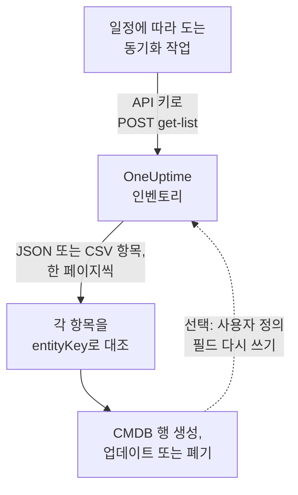

# CMDB로 내보내기

이미 CMDB나 자산 대장을 운영하고 있다면, OneUptime은 그것을 대체하려 하지 않습니다. OneUptime에는 있고 CMDB에는 보통 없는 것은, 실제로 실행 중인 것의 모습을 누구도 관리하지 않아도 최신으로 유지하는 능력입니다. 이 모습은 텔레메트리에서, 그리고 이미 네트워크와 클라우드 계정을 지켜보는 폴러에서 검색됩니다. 이 페이지는 그 모습을 자체 기록 시스템으로 가져오는 방법을 설명합니다.

:::cards
- [동기화의 작동 방식](#동기화의-작동-방식): 목록을 읽고 안정적인 키로 대조하는 예약 작업.
- [카탈로그 가져오기](#카탈로그-가져오기): 페이지 단위로 JSON 또는 CSV를 받는 요청.
- [자산 세부 정보](#자산-세부-정보): 호스트와 네트워크 장치에 공통인 정보와 키.
- [다시 쓰기](#다시-쓰기): 자산 태그를 OneUptime으로 보내고, OneUptime이 볼 수 없는 것을 추가합니다.
:::

## 동기화의 작동 방식

동기화는 일정에 따라 실행하는 작업입니다. API 키로 REST API를 통해 인벤토리 목록을 읽고, 각 항목을 식별 키로 CMDB의 행과 대조하고, 행을 만들거나 업데이트하거나 폐기해서 맞춥니다. 항목의 사용자 정의 필드에 값을 다시 쓸 수도 있습니다.



## 가져올 수 있는 것

REST 리소스는 세 가지이며, 각각 [OneUptime API](/docs/api-reference/api-reference)의 표준 엔드포인트를 가집니다.

| 리소스 | 엔드포인트 | 담고 있는 것 |
| --- | --- | --- |
| 인벤토리 항목 | `/api/inventory-item` | 환경 안의 대상마다 행 하나 |
| 사용자 정의 필드 정의 | `/api/inventory-item-custom-field` | 프로젝트 고유의 필드 어휘 |
| 관계 | `/api/inventory-item-relationship` | 항목 사이의 방향이 있는 연결 |

인벤토리 항목의 유용한 열은 다음과 같습니다.

| 열 | 의미 |
| --- | --- |
| `_id` | OneUptime의 ID. 외부 참조로 사용하세요 |
| `entityType` | `host`, `k8s.pod`, `network.device`, `appliance`, … |
| `entityKey` | 안정적인 식별 해시. 이름이 바뀌어도 그대로이므로 대조하기에 더 좋은 키입니다 |
| `displayName` | 사람이 읽는 이름 |
| `source` | `discovered`, `inventory`, `manual` 중 하나 |
| `description` | 자유 형식 텍스트 |
| `identifyingAttributes` | 항목을 그 항목이게 하는 속성으로, 결코 바뀌지 않습니다 |
| `descriptiveAttributes` | 그 밖에 항목에서 관찰된 모든 것. 아래의 [자산 세부 정보](#자산-세부-정보), [호스트 자산 속성](#호스트-자산-속성), [네트워크 장치 자산 속성](#네트워크-장치-자산-속성) 참조 |
| `customFields` | 사용자의 필드. 필드 이름이 키입니다 |
| `resourceType` / `resourceId` | 더 자세한 OneUptime 레코드가 있을 때 그 레코드를 가리키는 포인터 |
| `firstSeenAt` / `lastSeenAt` | 처음과 마지막으로 관찰된 시각 |
| `isArchived` | 활성 목록에서 빠졌는지 여부 |

## 시작하기 전에

동기화에는 인벤토리를 읽을 수 있는 API 키가 필요합니다. OneUptime Cloud에서 API 키에는 **Growth** 이상의 플랜이 필요합니다.

:::steps
### API 키 만들기

**프로젝트 설정 → 고급 → API 키**를 열고 **API 키 만들기**를 클릭합니다. **이름**을 정하고, **접근**에서 프로젝트의 모든 것을 읽으려면 **뷰어**를, 동기화에 필요한 것만 주려면 **나중에 권한 선택**을 고릅니다.

### 필요한 것만 주기

읽기 전용 내보내기에는 **Read Telemetry Service** 권한 하나가 필요합니다. 인벤토리는 자체 권한 없이 텔레메트리 권한을 함께 씁니다. 키의 페이지에서 **권한 추가**를 클릭하고 이 권한을 고릅니다. 값을 다시 쓰려면 **Edit Telemetry Service**도 추가합니다.

### 키 복사

키의 페이지에서 **API 키**를 복사하고 작업에서 쓸 수 있게 합니다.

```bash
export ONEUPTIME_API_KEY="your-api-key"
```
:::

키는 각 요청의 `ApiKey` 헤더로 보내며, 키가 속한 프로젝트의 인벤토리를 읽습니다. 따라서 요청에서 프로젝트를 지정하지 않습니다.

## 카탈로그 가져오기

원하는 열을 지정해 목록 엔드포인트로 `POST`합니다. `select`는 필수입니다. API는 요청한 것만 돌려줍니다.

```bash
curl -X POST 'https://oneuptime.com/api/inventory-item/get-list' \
  -H "ApiKey: $ONEUPTIME_API_KEY" \
  -H 'Content-Type: application/json' \
  -d '{
    "query": { "isArchived": false },
    "select": {
      "_id": true,
      "entityType": true,
      "entityKey": true,
      "displayName": true,
      "source": true,
      "customFields": true,
      "descriptiveAttributes": true,
      "lastSeenAt": true
    },
    "sort": { "displayName": "ASC" },
    "limit": 100,
    "skip": 0
  }'
```

자체 호스팅 설치에서는 `https://oneuptime.com` 대신 자신의 OneUptime 주소를 사용합니다. 응답은 `{ "data": [...], "count": ... }`이며, `count`는 일치하는 항목의 전체 수입니다. 모두 받을 때까지 `skip`을 `limit`만큼 늘려 가며 페이지를 넘깁니다. `limit`은 최대 10,000입니다. 날짜와 `_id`가 아닌 ID는 `{ "_type": "DateTime", "value": "..." }`, `{ "_type": "ObjectID", "value": "..." }`처럼 감싸진 채 돌아오므로 `value`에서 읽으세요.

### 네트워크 장치만

`entityType`으로 목록을 좁힙니다.

```bash
curl -X POST 'https://oneuptime.com/api/inventory-item/get-list' \
  -H "ApiKey: $ONEUPTIME_API_KEY" \
  -H 'Content-Type: application/json' \
  -d '{
    "query": { "entityType": "network.device", "isArchived": false },
    "select": { "_id": true, "entityKey": true, "displayName": true, "customFields": true },
    "limit": 100,
    "skip": 0
  }'
```

각 네트워크 장치의 `descriptiveAttributes`에는 호스트 이름, IP 주소, 일련 번호, MAC 주소, 제조사, 모델, 펌웨어, 운영 체제, 역할, 사이트, 위치가 들어 있습니다. 아래의 [네트워크 장치 자산 속성](#네트워크-장치-자산-속성)을 참조하세요. 인터페이스와 이웃처럼 폴러가 아는 그 밖의 정보는 Network Device 레코드 자체에 있습니다. `resourceId`를 따라 `/api/network-device/:id/get-item`을 호출하거나, `/api/network-device/get-list`를 직접 가져오세요.

### CSV로

모든 목록 엔드포인트는 `?output-type=csv`를 붙이면 JSON 대신 CSV로 응답합니다.

```bash
curl -X POST 'https://oneuptime.com/api/inventory-item/get-list?output-type=csv' \
  -H "ApiKey: $ONEUPTIME_API_KEY" \
  -H 'Content-Type: application/json' \
  -d '{ "query": {}, "select": { "displayName": true, "entityType": true, "customFields": true }, "limit": 500, "skip": 0 }' \
  -o inventory.csv
```

대시보드의 **All Items** 목록도 켜 둔 사용자 정의 필드 열을 포함해 같은 방식으로 내보냅니다. 각 [자산 세부 정보](#자산-세부-정보)도 그곳의 열입니다. **호스트 이름**, **IP 주소**, **일련 번호**, **모델** 등은 처음에 숨겨져 있으므로 열 선택기에서 켜세요. 그러면 행이 호스트이든 네트워크 장치이든 내보내기에 정보마다 열이 하나씩 들어갑니다.

## 자산 세부 정보

호스트와 네트워크 장치는 같은 정보로 설명되고 같은 키로 저장됩니다. 행이 서버이든 스위치이든 CMDB의 한 열에 일련 번호가 들어가고, 대시보드에서 항목의 **자산 세부 정보** 카드는 둘 모두에 대해 모든 정보를 같은 순서로 보여 줍니다. 아무것도 보고되지 않은 정보는 빠지지 않고 **알 수 없음**으로 표시되므로 빈틈이 보입니다.

| 정보 | 키 | 호스트의 경우 | 네트워크 장치의 경우 |
| --- | --- | --- | --- |
| 호스트 이름 | `host.name` | 호스트의 이름. 호스트의 식별 정보이므로 `identifyingAttributes`에 있습니다 | 장치 자체의 이름. SNMP `sysName`, 없으면 검색 중에 찾은 NetBIOS 또는 DNS 이름. IP 주소가 되는 일은 없습니다 |
| IP 주소 | `host.ip` | 수집기가 보고하는 모든 주소 | OneUptime이 폴링하는 주소(IP 주소인 경우). 그렇지 않으면 프로브가 그 DNS 이름을 확인한 주소 |
| MAC 주소 | `host.mac` | 감지됨 | 장치에 입력한 값, 또는 순회한 라우터의 ARP 테이블에서 알아낸 값 |
| 일련 번호 | `host.serial_number` | 지정함 | ENTITY-MIB |
| 제조업체 | `device.manufacturer` | 지정함 | ENTITY-MIB, 없으면 `sysDescr` 또는 `sysObjectID`가 가리키는 것 |
| 모델 | `device.model.name` | 지정함 | ENTITY-MIB, 없으면 `sysDescr`가 가리키는 것 |
| 펌웨어 버전 | `device.firmware.version` | 지정함 | ENTITY-MIB, 없으면 `sysDescr`가 가리키는 것 |
| 운영 체제 | `os.name` | `os.description`(또는 `os.type`) | `sysDescr`가 가리키는 것: Cisco IOS, Junos OS, Arista EOS, Linux |
| OS 버전 | `os.version` | 감지됨 | ENTITY-MIB, 없으면 `sysDescr`가 가리키는 것 |
| Device Type | `device.type` | 지정함. 없으면 카드가 OS와 이름으로 분류합니다(서버, 방화벽, ...) | 장치의 역할. 지정한 역할, 없으면 토폴로지 맵이 그리는 역할 |
| 위치 | `device.location` | 지정함. 없으면 카드가 클라우드 영역을 보여 줍니다 | `sysLocation`. 카드는 사이트를 먼저 보여 줍니다 |

각 값의 출처는 아래의 [호스트 표](#호스트-자산-속성)와 [네트워크 장치 표](#네트워크-장치-자산-속성)에 자세히 나와 있습니다.

## 호스트 자산 속성

호스트의 `descriptiveAttributes`에는 CMDB 행에 보통 필요한 자산 정보가 OpenTelemetry 속성 이름을 키로 해서 들어 있습니다.

| 필드 | 키 | 기본으로 수집되나요? |
| --- | --- | --- |
| IP 주소 | `host.ip` | 예. 머신에 여러 개가 있으면 쉼표로 구분 |
| MAC 주소 | `host.mac` | 예. 켜져 있는 인터페이스마다 하나씩, 쉼표로 구분, `AC-DE-48-23-45-67` 형식 |
| 아키텍처 | `host.arch` | 예 |
| 머신 ID | `host.id` | 예. Windows에서는 머신 GUID, Linux에서는 `/etc/machine-id` |
| 운영 체제 | `os.type`, `os.description`, `os.version` | 예 |
| 클라우드 배치 | `cloud.provider`, `cloud.region`, `cloud.availability_zone` | 클라우드 감지기가 있을 때만 |
| 일련 번호 | `host.serial_number` | 구성 단계 하나가 필요 |
| 제조사 | `device.manufacturer` | 구성 단계 하나가 필요 |
| 모델 | `device.model.name` | 구성 단계 하나가 필요 |
| 펌웨어(BIOS 또는 UEFI) 버전 | `device.firmware.version` | 구성 단계 하나가 필요 |
| 운영 체제 이름 | `os.name` | 이를 보고하는 SDK에서만. 그 밖에는 `os.description`이 OS를 나타냅니다 |
| 장치 유형 | `device.type` | 선택 사항. 같은 방식으로 지정합니다(`Hypervisor`, `Workstation`) |
| 위치 | `device.location` | 선택 사항. 같은 방식으로 지정합니다(`Frankfurt DC, Rack B4`) |

"예"로 표시된 것은 모두 수집기의 `resourcedetection` 프로세서에서 오며, OneUptime이 생성하는 구성에 이미 들어 있습니다.

`cloud.*` 키에는 그 프로세서에 클라우드 감지기가 필요합니다. `detectors: [system, env, ec2]`를 쓰고, 다른 클라우드에는 `gcp` 또는 `azure`를 씁니다. 기본 제공 구성은 `[system, env]`만 실행하므로, 감지기를 추가할 때까지 이 세 키는 비어 있습니다.

일련 번호, 제조사, 모델, 펌웨어에는 리소스 감지기가 없습니다. 이 정보는 머신의 펌웨어에 있고 Windows에서는 WMI, Linux에서는 DMI로 읽으므로, 머신을 프로비저닝할 때 리소스에 한 번 지정합니다. 행에 넣고 싶은 장치 유형이나 위치도 같은 방식으로 지정합니다. 운영 체제별 정확한 스니펫은 [인벤토리 속성](/docs/telemetry/host-otel-collector#인벤토리-속성-ip-mac-일련번호-제조사-모델-펌웨어)에 있습니다. `host.manufacturer`, `host.model.name`, `host.firmware.version`, `host.bios.version`도 다른 표기로 받아들여 `device.*` 키(그리고 `device.serial_number`는 `host.serial_number`)로 저장하므로, 동기화는 정보마다 늘 키 하나만 읽습니다.

CMDB가 이미 하드웨어 식별자를 키로 쓴다면 `host.id`를 대조 키로 검토해 볼 만합니다. `entityKey`와 달리 머신 자체의 ID이므로, 엔드포인트 관리 도구가 같은 머신에 대해 보고하는 값과 일치합니다.

속성은 추가될 뿐 비워지지 않습니다. 더 이상 보고되지 않는 속성도 행에 남으므로, 동기화가 이미 읽은 값이 모르는 사이에 사라지는 일은 없습니다.

## 네트워크 장치 자산 속성

네트워크 장치(`entityType: network.device`)는 Network Device 레코드에서 미러링되며, 그 `descriptiveAttributes`는 같은 정보에 대해 호스트와 같은 키를 씁니다. 그래서 행이 서버이든 스위치이든 CMDB의 한 열에 일련 번호가 들어갑니다.

| 필드 | 키 | 출처 |
| --- | --- | --- |
| 호스트 이름 | `host.name` | 장치 자체의 이름. SNMP `sysName`, 없으면 검색 중에 찾은 NetBIOS 또는 역방향 DNS 이름. IP 주소로만 이름이 붙는 경우에는 빠집니다 |
| IP 주소 | `host.ip` | OneUptime이 폴링하는 주소(IP 주소인 경우). DNS 이름으로 폴링하는 장치는 프로브가 그 이름을 마지막으로 확인한 주소 |
| DNS 이름 | `net.device.dns_name` | 검색 중에 찾은 역방향 DNS 이름, 또는 OneUptime이 폴링하는 DNS 이름 |
| MAC 주소 | `host.mac` | 장치에 입력한 값, 또는 순회한 라우터의 ARP 테이블에서 알아낸 값 |
| 제조사 | `device.manufacturer` | ENTITY-MIB `entPhysicalMfgName`, 없으면 `sysDescr`가 가리키는 제조사, 없으면 `sysObjectID`의 벤더 |
| 모델 | `device.model.name` | ENTITY-MIB `entPhysicalModelName`, 없으면 `sysDescr`가 가리키는 모델 |
| 일련 번호 | `host.serial_number` | ENTITY-MIB `entPhysicalSerialNum` |
| 펌웨어 버전 | `device.firmware.version` | ENTITY-MIB `entPhysicalFirmwareRev`, 없으면 Ubiquiti, HPE, Aruba 장치에서 `sysDescr`가 가리키는 펌웨어 |
| 운영 체제 | `os.name` | `sysDescr`가 가리키는 운영 체제 |
| 소프트웨어 또는 OS 버전 | `os.version` | ENTITY-MIB `entPhysicalSoftwareRev`, 없으면 `sysDescr`가 가리키는 릴리스 |
| 시스템 설명 | `os.description` | `sysDescr` |
| 장치 유형 | `device.type` | 장치에 지정한 역할, 없으면 토폴로지 맵이 분류한 역할. 프로젝트에서 부르는 이름으로 들어갑니다 |
| 위치 | `device.location` | `sysLocation`. 단, Net-SNMP의 "Sitting on the Dock of the Bay" 같은 에이전트 기본값은 제외합니다 |
| 사이트 | `oneuptime.site.name` | 장치가 지정된 Network Site |
| 폴링 주소 | `net.device.hostname` | OneUptime이 폴링하는 주소. IP 주소 또는 DNS 이름입니다. `host.name`과 `host.ip`가 생기기 전에 작성된 동기화를 위해 남겨 두었습니다 |

ENTITY-MIB 행은 장치의 첫 SNMP 워크 뒤에 채워집니다. ping으로만 모니터링하거나 아직 폴링하지 않아 워크되지 않는 장치도 이름, 제조사, 운영 체제, 위치는 그 주소의 마지막 검색 스캔이 SNMP로 읽은 내용에서, MAC 주소는 순회한 라우터의 ARP 테이블에서 얻습니다. ENTITY-MIB를 구현하지 않은 장치에는 보고할 일련 번호나 펌웨어가 없습니다. 그래도 많은 플랫폼에서 `sysDescr`가 모델과 운영 체제를 알려 줍니다. Cisco Meraki MX는 `Meraki MX85`를 보고하고, 이것으로 제조사와 모델이 채워집니다. `sysDescr`가 알려진 형식이 아닌 플랫폼은 추측하지 않고 아무것도 추가하지 않습니다.

장치에 저장된 값(직접 입력했거나 API로 설정한 값)은 검색이 읽은 내용으로 바뀌지 않습니다. 장치 자체의 워크가 읽은 값과 스캔이 읽은 값 중에서는 더 새로운 값이 쓰입니다. 스캔이 읽은 내용은 스캔이 그 주소에서 같은 기계를 찾았을 때만 쓰입니다. 읽은 시스템 이름, `sysObjectID` 또는 NetBIOS 이름이 장치의 것과 어긋나면 그곳에서 읽은 내용은 하나도 쓰이지 않습니다. 항목의 **자산 세부 정보** 카드는 각 값의 출처와 시각을 보여 줍니다.

호스트 이름은 결코 IP 주소가 아닙니다. 주소로만 이름이 붙는 장치에는 `host.ip`가 있고 `host.name`은 없습니다. SNMP 워크가 시스템 이름을 보고하면 다음 처리 때 `host.name`이 생깁니다.

이 값들은 15분마다 Network Device 레코드에서 복사되며, 이전 값에 더해지는 대신 이전 값을 **대체합니다**. 그래서 장치에서 지운 값(예를 들어 제거한 MAC 주소)은 인벤토리 항목에서도 사라집니다.

*사용 가능한 업그레이드* 버전은 없습니다. SNMP에는 이를 위한 표준 오브젝트가 없으므로, OneUptime은 장치가 실행 중인 버전을 기록합니다.

## 항목과 CMDB 행 대조

`displayName`이 아니라 `entityKey`로 대조하세요. 항목을 식별하는 속성의 해시이므로 이름 변경과 새 태그에 영향을 받지 않습니다. 레이블이 바뀐 호스트는 표시 이름이 바뀌어도 같은 키를 유지합니다. `_id`도 똑같이 안정적이며, 한 프로젝트와만 주고받는다면 가장 간단한 외래 키입니다.

`customFields`의 날짜는 UTC ISO-8601 문자열이며, CSV 내보내기도 대시보드가 보여 주는 읽기 쉬운 형식이 아니라 이 형식으로 쓰므로 파싱에서 예상하지 못한 문제 없이 가져올 수 있습니다.

## 최신 상태 유지

변경 피드는 없습니다. 원하는 간격으로 목록 엔드포인트를 폴링하고 `entityKey`로 비교하세요. `lastSeenAt`은 항목이 마지막으로 관찰된 시각을 알려 주며, 지난 실행 이후 조용해진 것을 찾는 가장 손쉬운 방법인 경우가 많습니다.

실행 사이에 사라진 항목은 만료되었거나(기간을 넘겨 조용했던 검색된 항목), 원본 레코드가 삭제된 것입니다. 사용자 정의 필드 값이 있는 미러링된 항목은 원본 레코드가 사라질 때 삭제되지 않고 보관되므로, `"isArchived": true`로 조회하면 연결된 자산 데이터를 잃지 않고 폐기된 것을 볼 수 있습니다.

## 다시 쓰기

같은 엔드포인트는 쓰기도 받으므로, 동기화가 `customFields`에 값을 보낼 수 있습니다. 예를 들어 CMDB가 이미 관리하는 자산 태그를 대응하는 OneUptime 항목에 지정할 수 있습니다. 이를 위해 키에 **Edit Telemetry Service**가 필요합니다.

OneUptime이 볼 수 없는 것에 대한 항목도 `POST /api/inventory-item`으로 추가할 수 있습니다. `entityType`에 `external.service`, `external.database`, `appliance` 중 하나를, 그리고 `displayName`을 지정합니다. 식별 키는 OneUptime이 계산하며, 이런 항목은 만료되지 않습니다. 이 작업에는 키에 **Create Telemetry Service**가 필요합니다.

## 문제 해결

:::details 모든 요청이 402 Payment Required로 거부됨
OneUptime Cloud에서 API 키는 프로젝트가 **Growth** 이상의 플랜에 있는 동안에만 작동합니다. 아무것도 삭제되지 않습니다. 프로젝트가 플랜으로 돌아오면 키는 그대로 다시 작동합니다. [플랜 미만의 API 키와 SCIM](/docs/api-reference/api-reference#플랜-미만의-api-키와-scim)을 참조하세요.
:::

:::details 모든 요청이 422 You do not have permissions로 응답함
키에 인벤토리를 읽는 권한이 없습니다. **나중에 권한 선택**으로 만든 키는 권한을 받기 전까지 아무것도 할 수 없습니다. [시작하기 전에](#시작하기-전에)처럼 키의 페이지에서 **Read Telemetry Service**를 추가하세요.
:::

:::details 필요한 열 없이 목록이 돌아옴
목록은 `select`가 지정한 열과 `_id`만 돌려줍니다. 읽는 모든 열을 `select`에 추가하세요. `descriptiveAttributes`와 `customFields`도 마찬가지입니다.
:::

:::details 있어야 할 항목이 없음
`"isArchived": false`를 보내면 보관된 항목은 빠집니다. 검색된 항목은 기간을 넘겨 조용하면 제거되고, 미러링된 항목은 원본 레코드와 함께 사라집니다. 보관된 항목을 보려면 `"isArchived": true`를 요청하세요.
:::

## 다음 단계

:::cards
- [인벤토리 개요](/docs/inventory/overview): 항목이 어디서 오는지, 각 항목이 얼마나 오래 남는지.
- [인벤토리 사용자 정의 필드](/docs/inventory/custom-fields): 동기화가 읽고 쓰는 필드를 정의합니다.
- [OneUptime API 참조](/docs/api-reference/api-reference): 요청, 상태 코드, 모든 쓰기가 따르는 규칙.
:::
