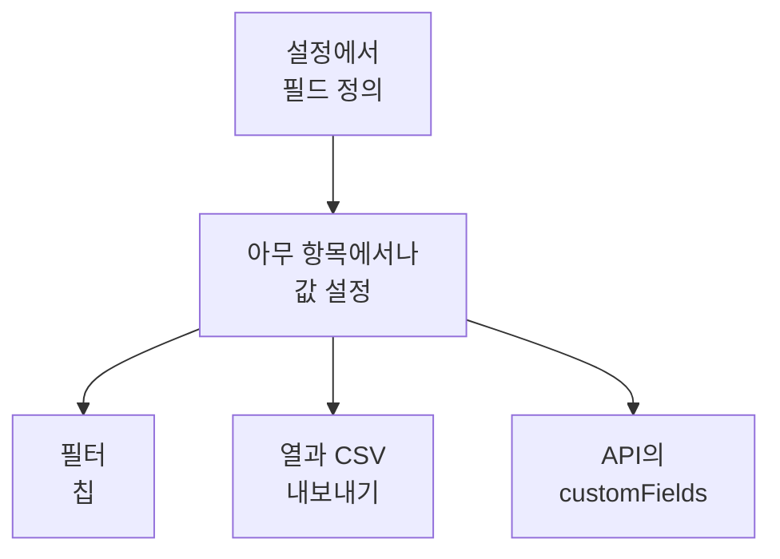

# 인벤토리 사용자 정의 필드

OneUptime은 내 환경에 무엇이 있는지 검색합니다. 사용자 정의 필드는 아무리 지켜봐도 알 수 없는 정보를 기록합니다. 스티커에 적힌 일련 번호, 보증이 끝나는 날짜, 어느 팀이 소유하는지, 운영 중인지 아니면 예비 부품 서랍에 있는지 같은 정보입니다. 프로젝트에 필드를 한 번 정의한 다음 각 항목에서 값을 채웁니다.

:::cards
- [사용자 정의 필드의 작동 방식](#사용자-정의-필드의-작동-방식): 소스와 관계없이 모든 항목에 쓰는 하나의 어휘.
- [필드 정의](#필드-정의): 필드를 만들고, 유형을 고르고, 드롭다운의 옵션을 나열합니다.
- [목록 필터링](#목록-필터링): 다음 분기에 만료되는 것을 두 번의 클릭으로 찾습니다.
- [참고 사항과 제한](#참고-사항과-제한): 이름 변경, 중복, 날짜, 삭제된 필드.
:::

## 사용자 정의 필드의 작동 방식

필드는 프로젝트에 한 번 정의되고, 모든 항목이 그 필드의 값을 가질 수 있습니다. OneUptime이 검색한 항목, 미러링하는 항목, 직접 추가한 항목 모두 해당합니다. 필드는 목록 위의 필터 칩, 선택 가능한 열, CSV 내보내기의 열이 됩니다. API는 각 항목의 `customFields`에서 같은 값을 읽고 씁니다.

> [!NOTE]
> OneUptime Cloud에서 사용자 정의 필드는 **Growth** 이상의 플랜에 포함됩니다. 그보다 낮은 플랜에서는 필드를 정의하거나 나열하거나 변경할 수 없습니다. API는 `402 Payment Required`로 응답하고, 목록에는 사용자 정의 필드의 칩이나 열이 표시되지 않습니다.

## 필드 정의

:::steps
### 사용자 정의 필드 페이지 열기

**제품 → 리소스 → 인벤토리**로 이동하고, 사이드 메뉴에서 **설정**을 연 다음 **사용자 정의 필드**를 엽니다.

### 필드 만들기

**Inventory Item Custom Field 만들기**를 클릭합니다. **필드 이름**, 선택 사항인 **필드 설명**, 그리고 아래 표에서 고른 **필드 유형**을 지정합니다.

### 드롭다운의 옵션 나열

드롭다운 유형이면 **드롭다운 옵션**에서 옵션을 추가합니다. 각 옵션에는 색을 지정할 수 있으며, 표의 셀과 필터 칩에서 같은 방식으로 쓰입니다. 이름이 있는 색 중 하나, **색상 없음**, 또는 정확한 색상 코드를 쓰는 **사용자 지정 색상**을 고릅니다. 옵션의 핸들을 끌어서 목록에서의 위치를 바꿀 수 있습니다.
:::

| 유형 | 용도 |
| --- | --- |
| **텍스트** | 일련 번호, 자산 태그, 랙 위치, 구매 주문 번호 |
| **숫자** | 비용, 랙 유닛, 포트 수 |
| **불리언** | 지원 대상 여부, PCI 범위 포함 여부 |
| **드롭다운(단일 선택)** | 수명 주기 상태, 환경, 중요도: 고정된 목록에서 고르는 답 하나 |
| **드롭다운(다중 선택)** | 컴플라이언스 범위, 태그: 고정된 목록에서 고르는 여러 답 |
| **날짜** | 구매일, 보증 만료일, 지원 종료일 |
| **날짜 및 시간** | 마지막 감사 일시, 폐기 일시 |
| **긴 텍스트** | 접근 안내, 노트: 여러 줄의 일반 텍스트 |
| **서식 있는 텍스트(Markdown)** | 서식과 링크가 있는 노트. Markdown 편집기로 작성합니다 |
| **파일** | 보증서, 서명된 구매 주문서, 랙 라벨 사진: 파일 하나 |
| **여러 파일** | 설명서, 청구서, 사진: 파일 최대 10개 |

## 자산 어휘 예시

일반적인 하드웨어 자산 대장은 이 필드들에 그대로 대응됩니다.

| 필드 이름 | 유형 | 예시 |
| --- | --- | --- |
| `Serial Number` | 텍스트 | `FDO24160ABC` |
| `Asset Tag` | 텍스트 | `IT-004821` |
| `Purchase Date` | 날짜 | 2024-03-11 |
| `Warranty Expiry` | 날짜 | 2027-03-10 |
| `Lifecycle Status` | 드롭다운 | 운영 중, 예비, 수리 중, 폐기됨 |
| `Assigned Site` | 드롭다운 | 런던 DC, 프랑크푸르트 DC, 본사 |
| `Owner Team` | 드롭다운 | 네트워크, 플랫폼, 보안 |
| `Cost Centre` | 텍스트 | `CC-4410` |

값은 항목의 **사용자 정의 필드** 페이지에서 설정합니다. 소스와 관계없이 모든 항목이 값을 가질 수 있으므로, OneUptime이 검색한 스위치와 미러링하는 네트워크 장치도 직접 추가한 어플라이언스와 같은 자산 어휘를 가집니다.

## 목록 필터링

모든 사용자 정의 필드는 **All Items** 목록 위의 필터 칩이 되며, 칩은 유형에 맞는 비교를 제공합니다.

| 필드 유형 | 비교 |
| --- | --- |
| **텍스트**, **긴 텍스트**, **서식 있는 텍스트(Markdown)** | 같음, 아님, 포함, 포함하지 않음, 시작하는 값, 끝나는 값, 비어 있음, 비어 있지 않음 |
| **숫자** | 같음, 아님, 초과, 이상, 미만, 이하, 비어 있음, 비어 있지 않음 |
| **불리언**, **드롭다운(단일 선택)**, **드롭다운(다중 선택)** | 같음, 아님, 비어 있음, 비어 있지 않음 |
| **날짜**, **날짜 및 시간** | 같음, 이전, 이후, 사이, 비어 있음, 비어 있지 않음 |
| **파일**, **여러 파일** | 같음 |

**파일** 또는 **여러 파일** 칩은 한 가지만 묻습니다. 필드가 **파일 있음**인지 **파일 없음**인지입니다.

칩은 AND로 결합되므로, "Warranty Expiry가 2026-10-01 이전 AND Lifecycle Status가 운영 중"은 목록의 한 가지 보기입니다. 이것이 자산 대장이 답해야 하는 질문이며, 텍스트 필드에 날짜를 넣지 않고 날짜 유형을 쓰는 이유입니다. 텍스트 필드는 `2026-10-01`을 문제없이 저장하지만, 다음 분기에 무엇이 만료되는지는 알려 주지 못합니다.

사용자 정의 필드의 열은 처음에 숨겨져 있습니다. 열 선택기에서 켜세요. 값은 하나의 JSON 열에 함께 저장되어 있고 목록은 그 열로 정렬할 수 없으므로, 이 열들은 정렬할 수 없습니다.

## 참고 사항과 제한

- 값은 각 항목에 필드 이름으로 저장됩니다. 필드 이름을 바꿔도 이전 이름으로 이미 저장된 값은 옮겨지지 않습니다. 예외는 인시던트 사용자 정의 필드로, 이름을 바꾸면 값도 옮겨집니다([필드 이름 바꾸기](/docs/incidents/settings#필드-이름-바꾸기) 참조).
- 드롭다운의 옵션은 항목에 값이 생긴 뒤에도 추가하고, 이름을 바꾸고, 끌어서 순서를 바꾸고, 뺄 수 있습니다. 이름을 바꾼 옵션은 그 옵션을 가진 모든 항목에서 바뀝니다. 뺀 옵션은 다른 옵션을 골라 주지 않는 한 그 옵션을 가진 항목에 남고, 더 이상 옵션이 아닌 것으로 표시됩니다([드롭다운 옵션 바꾸기](/docs/incidents/settings#드롭다운-옵션-바꾸기) 참조).
- 값을 고유하게 만드는 장치는 없습니다. 두 항목이 같은 일련 번호를 가질 수 있으며, 아무것도 막지 않습니다.
- 날짜는 ISO-8601 UTC 타임스탬프로 저장되고 사용자의 시간대로 표시됩니다.
- 필드를 삭제하면 목록과 필터 막대에서 사라집니다. 이미 기록된 값은 항목에 남습니다.
- **파일** 또는 **여러 파일** 필드는 파일당 최대 10 MB까지, [파일 필드](/docs/incidents/settings#파일-필드)에 나열된 종류의 파일을 받으며, 프로젝트에서 업로드된 파일만 받습니다. 항목을 볼 수 있는 사람만 파일을 다운로드할 수 있으며, 파일은 더 이상 아무것도 붙잡고 있지 않으면 삭제됩니다.

## 다음 단계

:::cards
- [인벤토리 개요](/docs/inventory/overview): 항목이 어디서 오는지, 각 페이지에 무엇이 표시되는지.
- [CMDB로 내보내기](/docs/inventory/cmdb-sync): 항목과 사용자 정의 필드를 다른 시스템으로 가져옵니다.
- [인시던트 사용자 정의 필드](/docs/incidents/settings#사용자-정의-필드): 같은 필드 유형을 인시던트에서도 쓸 수 있으며, 몇 가지가 더 있습니다.
:::
