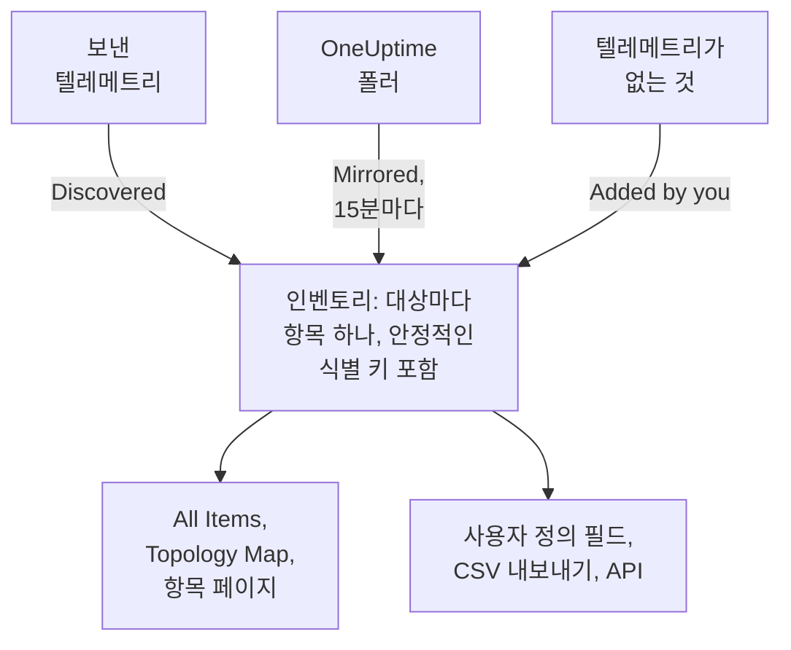

# 인벤토리 개요

인벤토리는 OneUptime이 내 환경에 대해 알고 있는 모든 것을 담은 하나의 목록입니다. 서비스, 호스트, Kubernetes 오브젝트, 가상 머신, 네트워크 장치, 클라우드 리소스, IoT 장치, 서버리스 함수, 그리고 텔레메트리를 전혀 보내지 않는 것까지 포함합니다. 대부분은 OneUptime이 이미 지켜보고 있는 것에서 저절로 채워집니다. 사용자가 추가하는 것은 지켜보는 것만으로는 알 수 없는 정보, 즉 무엇을 위한 것인지, 누가 소유하는지, 보증이 언제 끝나는지입니다.

:::cards
- [항목이 인벤토리에 들어오는 방식](#항목이-인벤토리에-들어오는-방식): 검색됨, 미러링됨, 또는 직접 추가함.
- [페이지 둘러보기](#페이지-둘러보기): 인벤토리 페이지와 각 항목의 페이지.
- [직접 추가하기](#직접-추가하기): 서드파티 API, 외부 데이터베이스, 어플라이언스.
- [삭제 대신 보관하기](#삭제-대신-보관하기): 목록을 정리하고 그 상태를 유지하는 방법.
:::

## 항목이 인벤토리에 들어오는 방식

OneUptime은 모니터링을 위해 이미 내 환경을 지켜보고 있으므로, 카탈로그는 누군가 잊지 않고 입력한 내용이 아니라 관찰한 내용으로 만들어집니다. 모든 항목에는 소스가 있고, 소스가 항목의 주인을 정합니다. 즉, 항목을 편집할 수 있는지, 그리고 저절로 사라질 수 있는지를 정합니다.

| 소스 | API 값 | 출처 | 남아 있는 기간 |
| --- | --- | --- | --- |
| **Discovered** | `discovered` | 텔레메트리가 도착할 때 읽는 OpenTelemetry 리소스 속성입니다. 텔레메트리를 보내는 서비스, 호스트, Kubernetes 오브젝트, 가상 머신이 해당합니다. | 배치마다 다시 등록됩니다. 종류별 기간보다 오래 조용하면 제거됩니다(아래 참조). |
| **Mirrored** | `inventory` | OneUptime 폴러가 관리하는 레코드입니다. 네트워크 장치, 클라우드 리소스, IoT 장치, 서버리스 함수, RUM 애플리케이션, Docker 호스트, Podman 호스트가 해당합니다. 15분마다 복사됩니다. | 원본 레코드가 있는 동안 남습니다. 레코드를 삭제하면 항목도 함께 사라집니다. |
| **Added by you** | `manual` | OneUptime이 볼 수 없는 것을 위해 사용자가 추가한 것입니다. 서드파티 API, 벤더가 관리하는 데이터베이스, 랙의 어플라이언스 등이 해당합니다. | 삭제할 때까지 남습니다. 저절로 만료되지 않습니다. |

검색되거나 미러링된 항목은 이름을 바꾸거나 다른 유형으로 바꿀 수 없습니다. 다음 처리 때 소스가 변경을 덮어쓰기 때문입니다. 대신 항목의 **설정** 페이지에서 변경을 오래 유지하려면 어디서 해야 하는지 알려 줍니다. 소스와 관계없이 어떤 항목에든 언제나 추가할 수 있는 것은 사용자 정의 필드 값입니다. [인벤토리 사용자 정의 필드](/docs/inventory/custom-fields)를 참조하세요.

### 조용한 항목이 남아 있는 기간

검색된 항목에는 하트비트가 있습니다. 텔레메트리가 도착할 때마다 마지막으로 확인된 시각이 앞으로 이동하고, 목록의 **상태** 열이 그것이 얼마나 최근인지 보여 줍니다. 미러링된 항목과 직접 추가한 항목에는 하트비트가 없으므로, 상태는 경고 대신 빈칸으로 남습니다.

| 상태 | 의미 |
| --- | --- |
| **Live** | 최근 30분 안에 확인되었습니다. |
| **Recent** | 최근 하루 안에 확인되었습니다. |
| **Stale** | 하루가 넘도록 확인되지 않았습니다. **Gone Quiet** 페이지에 표시됩니다. |

OneUptime은 3시간마다, 종류별 기간보다 오래 조용한 검색된 항목을 보관된 것까지 포함해 제거하며, 그 사용자 정의 필드 값도 함께 사라집니다. 미러링된 항목과 직접 추가한 항목은 이 방식으로 제거되지 않습니다.

| 항목 종류 | 텔레메트리 없이 이 기간이 지나면 제거 |
| --- | --- |
| 파드, 디플로이먼트, Proxmox 게스트, VMware 가상 머신 | 1일 |
| Kubernetes 노드와 네임스페이스, Proxmox 노드, VMware 호스트, 클러스터, 데이터스토어, 그리고 트레이스가 호출하는 데이터베이스와 원격 서비스 | 7일 |
| 서비스, 호스트, Kubernetes·Proxmox·Ceph 클러스터, 스토리지 어레이, vCenter, Docker Swarm 클러스터 | 30일 |

OneUptime이 검색한 관계는 30일 동안 다시 확인되지 않으면 제거됩니다.

## 페이지 둘러보기

**제품 → 리소스 → 인벤토리**를 엽니다. 사이드 메뉴에는 다음 페이지가 있습니다. **By Source**, **설정**, **도움말**, **고급** 섹션은 처음에 접혀 있으며, 섹션 제목을 클릭하면 열립니다.

| 페이지 | 내용 |
| --- | --- |
| **개요** | 항목 수, 항목의 종류, 조용해진 항목 수, 가장 최근에 추가된 항목. |
| **All Items** | 모든 항목. 이름, 설명, 식별 키로 검색하고, 유형, 소스, 상태, 사용자 정의 필드로 목록을 좁히고, 항목을 직접 추가할 수 있습니다. |
| **Topology Map** | 항목들이 연결된 방식. 서비스, 서비스가 호출하는 대상, 그리고 서비스가 실행되는 호스트, 파드, 장치입니다. |
| **Gone Quiet** | 하루가 넘도록 텔레메트리를 보내지 않은 검색된 항목. |
| **By Source** | 한 소스의 항목: **Discovered**, **Mirrored**, **Added by You**. |
| **설정 → 사용자 정의 필드** | 프로젝트가 모든 항목에 두는 필드. |
| **도움말 → 문서** | 인벤토리에 대한 짧은 안내와, 인벤토리가 인식하는 항목 종류. |
| **고급 → 보관됨** | 보관한 항목. 여기에서 보관을 해제할 수 있습니다. |

항목을 열면, 항목 자체의 사이드 메뉴에 **개요**(유형, 소스, 상태, 그리고 항목에서 관찰된 모든 속성), **Connections**, **사용자 정의 필드**, **로그**, **트레이스**, **메트릭**, **성능 프로파일**, **예외**, 그리고 **인시던트**, **알림**, **예정된 유지 관리**가 있습니다. **고급** 아래에는 **설정**, **감사 로그**, **Delete Item**이 있습니다. 텔레메트리 페이지는 항목 자체가 보낸 것을 보여 줍니다. 인시던트, 알림, 유지 관리 이벤트는 항목이 나타내는 서비스, 호스트, Kubernetes 클러스터의 것입니다. 그 밖의 항목에서는 대신 어떤 리소스를 봐야 하는지 해당 페이지가 알려 줍니다.

### 자산 세부 정보

호스트와 네트워크 장치에는 둘을 같은 방식으로 설명하는 **자산 세부 정보** 카드가 있습니다. 호스트 이름, IP 주소, MAC 주소, 일련 번호, 제조사, 모델, 펌웨어 버전, 운영 체제, OS 버전, 장치 유형, 위치입니다. 아무것도 보고되지 않은 정보는 **알 수 없음**으로 표시되며, 카드는 알 수 없는 정보를 채우는 방법을 알려 줍니다.

- 호스트의 정보는 텔레메트리의 리소스 속성에서 옵니다. IP 주소와 MAC 주소, 아키텍처, 운영 체제는 처음부터, 일련 번호, 제조사, 모델, 펌웨어는 직접 지정한 뒤부터 채워집니다.
- 네트워크 장치의 정보는 SNMP 폴링, 역할, 사이트에서 옵니다. 폴링이 읽지 못한 정보는 검색에서 옵니다. 주소의 마지막 스캔, 라우터의 ARP 테이블, 프로브의 DNS 조회입니다. Meraki MX처럼 ENTITY-MIB가 없는 장치도 시스템 설명에서 제조사와 모델을 얻습니다. 장치의 IP 주소가 호스트 이름으로 표시되는 일은 없습니다.

카드는 각 정보의 출처와 시각을 보여 줍니다. 호스트의 수집기, 네트워크 장치 자체의 SNMP 폴링, 장치를 읽은 검색 스캔처럼 대부분의 정보가 공유하는 출처는 정보 아래에 한 번만 표시됩니다. 라우터의 ARP 테이블이나 장치에 저장된 값 같은 다른 출처는 해당 정보 아래에 표시됩니다. 네트워크 장치에 저장된 값은 검색이 읽은 내용으로 바뀌지 않으며, 둘이 다르면 카드가 둘 다 보여 줍니다.

같은 정보는 **All Items** 목록의 열이기도 하며, 켜기 전까지는 숨겨져 있고, 목록의 CSV 내보내기에도 들어갑니다. 해당 키는 [CMDB로 내보내기](/docs/inventory/cmdb-sync#자산-세부-정보)에 나와 있습니다.

### 연결

항목의 **Connections** 페이지는 양방향의 이웃을 **호출**, **Called by**, **Runs on**, **Related**로 묶어서 보여 줍니다. 각 그룹은 합계를 표시하고(연결이 100,000개를 넘는 그룹은 "100,000+"로 표시), **더 보기**로 나머지를 넘겨 볼 수 있으므로, 붐비는 클러스터, 네임스페이스, 노드도 처음 몇 개가 아니라 모든 연결을 보여 줍니다. 이 페이지는 시간 범위로 제한되지 않습니다. API로 직접 추가한 관계와 보관된 이웃도 포함합니다. 더 이상 인벤토리에 없는 이웃은 키로 표시됩니다.

## 직접 추가하기

OneUptime이 스스로는 결코 볼 수 없는 것을 항목으로 추가하면, 의존 관계가 실제로 존재하는 대상에서 끝나고 그 대상에 사용자 정의 필드를 둘 수 있습니다.

:::steps
### All Items 열기

**제품 → 리소스 → 인벤토리**로 이동한 다음 **All Items**를 엽니다.

### 항목 추가

**Item 추가**를 클릭합니다. **유형**을 고르고, **이름**과 필요하면 **설명**을 입력합니다. 이름과 유형을 합친 것이 항목의 식별 정보이므로, 같은 유형의 두 항목에 같은 이름을 쓸 수 없습니다.

### 사용자 정의 필드 입력

새 항목을 엽니다. 소스는 **Added by you**로 표시되고, **사용자 정의 필드** 페이지에서 프로젝트가 관리하는 값을 입력할 수 있습니다.
:::

직접 추가할 수 있는 유형은 세 가지입니다.

- `external.service`(**External Service**): 서드파티 API 또는 SaaS 의존성.
- `external.database`(**External Database**): OneUptime이 모델링할 수 있는 서버가 아닌 데이터베이스. 데이터베이스 서버는 자체 호스팅이든 관리형이든, PostgreSQL부터 Snowflake까지, 대신 **Databases → 데이터베이스 만들기**에서 추가합니다([데이터베이스](/docs/telemetry/databases)). 그 레코드는 같은 주소를 가리키는 트레이스, 컨테이너, 엔진 메트릭과 연결되지만 인벤토리 항목은 그렇지 않으며, 같은 서버를 두 방식으로 모두 추가하면 서로 연결되지 않은 레코드 두 개가 남습니다.
- `appliance`(**Appliance**): 에이전트가 없는 하드웨어나 소프트웨어.

이 제한은 중복을 막습니다. 호스트처럼 OneUptime이 관찰할 수 있는 유형의 항목을 직접 만들면 입력한 이름으로 키가 정해지지만, 같은 머신의 검색된 항목은 머신이 보고하는 속성으로 키가 정해집니다. 둘은 결코 합쳐지지 않으므로 같은 호스트가 목록에 영원히 두 번 남게 됩니다.

## 삭제 대신 보관하기

보관하면 항목의 식별 정보, 기록, 사용자 정의 필드 값은 그대로 두고 목록에서 뺄 수 있습니다. 보관은 "이것을 확인했고, 내 목록에는 필요 없다"는 뜻입니다. 보관된 항목도 텔레메트리를 계속 수집합니다.

| 소스 | 보관 | 삭제 |
| --- | --- | --- |
| **Discovered** | 보관된 상태로 남습니다. | 다음 텔레메트리 배치와 함께 돌아옵니다. |
| **Mirrored** | 보관된 상태로 남습니다. | 다음 복사 때 돌아옵니다. 대신 원본 레코드를 삭제하세요. |
| **Added by you** | 보관된 상태로 남습니다. | 완전히 사라집니다. |

항목을 보관하려면 **All Items**에서 선택해 한 번에 보관하거나, 항목을 열고 **설정** 페이지의 **보관** 카드를 사용합니다. 보관된 항목은 **인벤토리 → 고급 → 보관됨**에 있으며, 거기에서 선택해 보관을 해제할 수 있습니다.

> [!NOTE]
> 미러링된 장치가 원본 레코드에서 제거되면 OneUptime은 그 항목도 제거합니다. 단, 사용자가 입력한 사용자 정의 필드 값이 항목에 있으면 예외입니다. 그 값은 유일한 사본이고 되돌릴 방법이 없으므로, 항목은 삭제되지 않고 보관됩니다. 입력한 내용이 모두 그대로인 채로 **고급 → 보관됨**에서 찾을 수 있습니다.

## 관계와 토폴로지

OneUptime은 항목을 관찰하면서 방향이 있는 관계로 연결합니다. **인벤토리 → Topology Map**이 관계를 그리고, 항목의 **Connections** 페이지는 그 항목의 관계를 나열합니다. [토폴로지](/docs/telemetry/topology) 를 참조하세요.

| 관계 | 예시 |
| --- | --- |
| `runs-on` | 파드는 노드에서 실행됩니다. 가상 머신은 자신의 호스트에서 실행됩니다. |
| `member-of` | 파드, 노드, 네임스페이스는 클러스터의 구성원입니다. |
| `hosted-on` | 서비스는 호스트에서 호스팅됩니다. |
| `part-of` | 파드는 자신의 디플로이먼트의 일부입니다. |
| `depends-on` | 서비스가 다른 서비스를 호출합니다. 둘 사이를 오가는 스팬으로 판단합니다. |

## 다음 단계

:::cards
- [인벤토리 사용자 정의 필드](/docs/inventory/custom-fields): 일련 번호, 보증 날짜, 소유자, 수명 주기 상태를 관리합니다.
- [CMDB로 내보내기](/docs/inventory/cmdb-sync): 카탈로그를 자체 기록 시스템으로 가져옵니다.
- [데이터베이스](/docs/telemetry/databases): 서비스가 사용하는 데이터베이스 서버를 모니터링합니다.
:::
