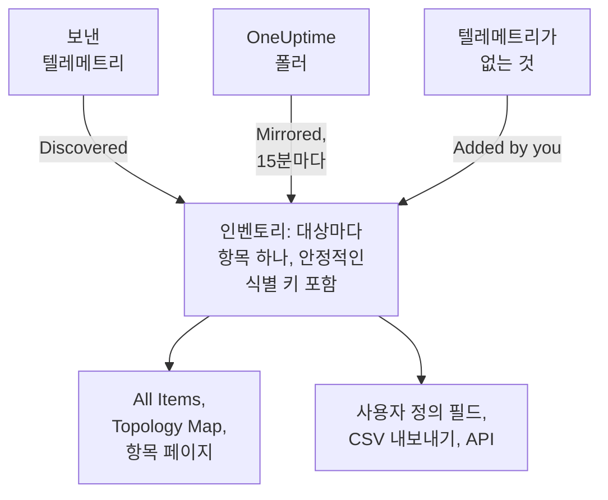

# 인벤토리 개요

인벤토리는 OneUptime이 내 환경에 대해 알고 있는 모든 것을 담은 하나의 목록입니다. 서비스, 호스트, Kubernetes 오브젝트, 가상 머신, 네트워크 장치, 클라우드 리소스, IoT 장치, 서버리스 함수, 그리고 텔레메트리를 전혀 보내지 않는 것까지 포함합니다. 대부분은 OneUptime이 이미 지켜보고 있는 것에서 저절로 채워집니다. 사용자가 추가하는 것은 지켜보는 것만으로는 알 수 없는 정보, 즉 무엇을 위한 것인지, 누가 소유하는지, 보증이 언제 끝나는지입니다. [용어집](/docs/introduction/glossary#지켜보는-대상)은 인벤토리에 담긴 각 종류의 레코드가 무엇인지 설명합니다.

:::cards
- [항목이 인벤토리에 들어오는 방식](#항목이-인벤토리에-들어오는-방식): 검색됨, 미러링됨, 또는 직접 추가함.
- [페이지 둘러보기](#페이지-둘러보기): 인벤토리 페이지와 각 항목의 페이지.
- [Esper에서 기기 가져오기](#esper에서-기기-가져오기): Esper 테넌트에 등록된 모든 Android 기기와 Apple 기기를 늘 최신 상태로.
- [Microsoft Intune에서 기기 가져오기](#microsoft-intune에서-기기-가져오기): Intune이 관리하는 모든 Windows PC, Mac, iPhone, iPad, Android 기기를 늘 최신 상태로.
- [Workspace ONE UEM에서 기기 가져오기](#workspace-one-uem에서-기기-가져오기): Workspace ONE이 관리하는 모든 휴대폰, 태블릿, 컴퓨터를 늘 최신 상태로.
- [SOTI MobiControl에서 기기 가져오기](#soti-mobicontrol에서-기기-가져오기): MobiControl이 관리하는 모든 러기드 기기, 휴대폰, 태블릿, 컴퓨터를 늘 최신 상태로.
- [직접 추가하기](#직접-추가하기): 서드파티 API, 외부 데이터베이스, 어플라이언스.
- [삭제 대신 보관하기](#삭제-대신-보관하기): 목록을 정리하고 그 상태를 유지하는 방법.
:::

## 항목이 인벤토리에 들어오는 방식

OneUptime은 모니터링을 위해 이미 내 환경을 지켜보고 있으므로, 카탈로그는 누군가 잊지 않고 입력한 내용이 아니라 관찰한 내용으로 만들어집니다. 모든 항목에는 소스가 있고, 소스가 항목의 주인을 정합니다. 즉, 항목을 편집할 수 있는지, 그리고 저절로 사라질 수 있는지를 정합니다.

| 소스 | API 값 | 출처 | 남아 있는 기간 |
| --- | --- | --- | --- |
| **발견됨** | `discovered` | 텔레메트리가 도착할 때 읽는 OpenTelemetry 리소스 속성입니다. 텔레메트리를 보내는 서비스, 호스트, Kubernetes 오브젝트, 가상 머신이 해당합니다. | 배치마다 다시 등록됩니다. 종류별 기간보다 오래 조용하면 제거됩니다(아래 참조). |
| **미러링됨** | `inventory` | OneUptime 폴러가 관리하는 레코드입니다. 네트워크 장치, 클라우드 리소스, IoT 장치, 서버리스 함수, RUM 애플리케이션, Docker 호스트, Podman 호스트, 그리고 디바이스 관리 서비스 연결이 가져오는 기기가 해당합니다. 15분마다 복사되며, 관리형 디바이스는 연결을 읽을 때마다 복사됩니다. | 원본 레코드가 있는 동안 남습니다. 레코드를 삭제하면 항목도 함께 사라집니다. |
| **직접 추가함** | `manual` | OneUptime이 볼 수 없는 것을 위해 사용자가 추가한 것입니다. 서드파티 API, 벤더가 관리하는 데이터베이스, 랙의 어플라이언스 등이 해당합니다. | 삭제할 때까지 남습니다. 저절로 만료되지 않습니다. |

검색되거나 미러링된 항목은 이름을 바꾸거나 다른 유형으로 바꿀 수 없습니다. 다음 처리 때 소스가 변경을 덮어쓰기 때문입니다. 대신 항목의 **설정** 페이지에서 변경을 오래 유지하려면 어디서 해야 하는지 알려 줍니다. 소스와 관계없이 어떤 항목에든 언제나 추가할 수 있는 것은 사용자 정의 필드 값입니다. [인벤토리 사용자 정의 필드](/docs/inventory/custom-fields)를 참조하세요.

### 조용한 항목이 남아 있는 기간

검색된 항목에는 하트비트가 있습니다. 텔레메트리가 도착할 때마다 마지막으로 확인된 시각이 앞으로 이동하고, 목록의 **상태** 열이 그것이 얼마나 최근인지 보여 줍니다. 관리형 디바이스도 마찬가지로, 디바이스 관리 서비스에 체크인할 때마다 이 시각이 이동합니다. 그 밖의 미러링된 항목과 직접 추가한 항목에는 하트비트가 없으므로, 상태는 경고 대신 빈칸으로 남습니다.

| 상태 | 의미 |
| --- | --- |
| **실시간** | 최근 30분 안에 확인되었습니다. |
| **최근** | 최근 하루 안에 확인되었습니다. |
| **오래됨** | 하루가 넘도록 확인되지 않았습니다. **보고 중단** 페이지에 표시됩니다. |

OneUptime은 3시간마다, 종류별 기간보다 오래 조용한 검색된 항목을 보관된 것까지 포함해 제거하며, 그 사용자 정의 필드 값도 함께 사라집니다. 미러링된 항목과 직접 추가한 항목은 이 방식으로 제거되지 않습니다.

| 항목 종류 | 텔레메트리 없이 이 기간이 지나면 제거 |
| --- | --- |
| 파드, 디플로이먼트, Proxmox 게스트, OpenStack 인스턴스, VMware 가상 머신 | 1일 |
| Kubernetes 노드와 네임스페이스, Proxmox 노드, OpenStack 하이퍼바이저, VMware 호스트, 클러스터, 데이터스토어, 그리고 트레이스가 호출하는 데이터베이스와 원격 서비스 | 7일 |
| 서비스, 호스트, Kubernetes·Proxmox·Ceph 클러스터, OpenStack 클라우드, 스토리지 어레이, vCenter, Docker Swarm 클러스터 | 30일 |

OneUptime이 검색한 관계는 30일 동안 다시 확인되지 않으면 제거됩니다.

## 페이지 둘러보기

**제품 → 리소스 → 인벤토리**를 엽니다. 사이드 메뉴에는 다음 페이지가 있습니다. **소스별**, **설정**, **도움말**, **고급** 섹션은 처음에 접혀 있으며, 섹션 제목을 클릭하면 열립니다.

| 페이지 | 내용 |
| --- | --- |
| **개요** | 항목 수, 항목의 종류, 조용해진 항목 수, 가장 최근에 추가된 항목. |
| **모든 항목** | 모든 항목. 이름, 설명, 식별 키로 검색하고, 유형, 소스, 상태, 사용자 정의 필드로 목록을 좁히고, 항목을 직접 추가할 수 있습니다. |
| **관리형 디바이스** | 내 디바이스 관리 서비스 연결(Esper, Microsoft Intune, Workspace ONE UEM, SOTI MobiControl), 그리고 연결이 가져오는 모든 기기. 각 기기의 상태, 그룹, 모델, 운영 체제를 보여 줍니다. |
| **토폴로지 지도** | 항목들이 연결된 방식. 서비스, 서비스가 호출하는 대상, 그리고 서비스가 실행되는 호스트, 파드, 장치입니다. |
| **보고 중단** | 하루가 넘도록 소식이 없는 항목. 텔레메트리를 보내지 않은 검색된 항목과 디바이스 관리 서비스에 체크인을 멈춘 기기입니다. |
| **소스별** | 한 소스의 항목: **발견됨**, **미러링됨**, **직접 추가함**. |
| **설정 → 사용자 정의 필드** | 프로젝트가 모든 항목에 두는 필드. |
| **도움말 → 문서** | 인벤토리에 대한 짧은 안내와, 인벤토리가 인식하는 항목 종류. |
| **고급 → 보관됨** | 보관한 항목. 여기에서 보관을 해제할 수 있습니다. |

항목을 열면, 항목 자체의 사이드 메뉴에 **개요**(유형, 소스, 상태, 그리고 항목에서 관찰된 모든 속성), **연결**, **사용자 정의 필드**, **로그**, **트레이스**, **메트릭**, **프로파일**, **예외**, 그리고 **인시던트**, **경고**, **예정된 유지 관리**가 있습니다. **고급** 아래에는 **설정**, **감사 로그**, **항목 삭제**가 있습니다. 텔레메트리 페이지는 항목 자체가 보낸 것을 보여 줍니다. 인시던트, 경고, 유지 관리 이벤트는 항목이 나타내는 서비스, 호스트, Kubernetes 클러스터의 것입니다. 그 밖의 항목에서는 대신 어떤 리소스를 봐야 하는지 해당 페이지가 알려 줍니다.

### 자산 세부 정보

호스트와 네트워크 장치에는 둘을 같은 방식으로 설명하는 **자산 세부 정보** 카드가 있습니다. 호스트 이름, IP 주소, MAC 주소, 일련 번호, 제조사, 모델, 펌웨어 버전, 운영 체제, OS 버전, 장치 유형, 위치입니다. Android 기기의 카드에는 Android 에이전트나 해당 디바이스 관리 서비스에서 가져온 보안 패치 수준도 있습니다. 패치가 **업데이트 필요**인지도 **보안 패치 수준** 열처럼 알려 주며, 며칠 지났는지도 보여 줍니다. 아무것도 보고되지 않은 정보는 **알 수 없음**으로 표시되며, 카드는 그 이유와 알 수 없는 정보를 채우는 방법을 알려 줍니다. SNMP로 보고하지 않는 장치, 아직 읽지 않은 장치, 대시보드에 정보가 있는 Meraki 장치 중 하나입니다.

- 호스트의 정보는 텔레메트리의 리소스 속성에서 옵니다. IP 주소와 MAC 주소, 아키텍처, 운영 체제는 처음부터, 일련 번호, 제조사, 모델, 펌웨어는 직접 지정한 뒤부터 채워집니다.
- 네트워크 장치의 정보는 SNMP 폴링, 역할, 사이트에서 옵니다. 폴링이 읽지 못한 정보는 검색에서 옵니다. 주소의 마지막 스캔, 라우터의 ARP 테이블, 프로브의 DNS 조회입니다. Meraki MX처럼 ENTITY-MIB가 없는 장치도 시스템 설명에서 제조사, 모델, 운영 체제를 얻고, 자체 포트에서 MAC 주소를 얻습니다. 장치의 IP 주소가 호스트 이름으로 표시되는 일은 없습니다.
- [Meraki 연결](/docs/monitor/network-traffic#netflow-없는-cisco-meraki)이 조직을 읽으면, Meraki 장치는 폴링이 비워 둔 정보도 Meraki 대시보드에서 가져옵니다. 일련 번호, 모델, 펌웨어 등입니다.

**모든 항목**에서 조치가 필요한 Android 기기를 찾을 수 있습니다. **보안 패치 수준** 필터의 **업데이트 필요**는 보안 패치 수준이 90일보다 오래된 기기를 나열하며, 이는 [호스트 모니터](/docs/monitor/host-monitor)의 Security Patch Out of Date 경고가 읽는 것과 같은 규칙입니다. **에이전트 권한** 필터는 [Android 에이전트](/docs/telemetry/android-agent)에 아직 READ_LOGS, READ_DROPBOX_DATA 또는 사용 정보 접근 권한이 없는 기기를 나열합니다. 두 필터 모두 같은 이름의 열이 있으며, 켜기 전까지는 숨겨져 있고 CSV 내보내기에도 들어갑니다. 그 옆의 **디바이스 관리 서비스 ID** 열에는 디바이스 관리 서비스가 기기를 식별하는 ID가 들어 있습니다. 예를 들어 `espercli secureadb connect --device`가 받는 Esper ID입니다.

카드는 각 정보의 출처와 시각을 보여 줍니다. 호스트의 수집기, 네트워크 장치 자체의 SNMP 폴링, 장치를 읽은 검색 스캔처럼 대부분의 정보가 공유하는 출처는 정보 아래에 한 번만 표시됩니다. 라우터의 ARP 테이블이나 장치에 저장된 값 같은 다른 출처는 해당 정보 아래에 표시됩니다. 네트워크 장치에 저장된 값은 검색이 읽은 내용으로 바뀌지 않으며, 둘이 다르면 카드가 둘 다 보여 줍니다.

네트워크 장치의 카드에는 네트워크 장치를 편집할 수 있는 사용자를 위한 **새로고침** 버튼이 있습니다. 이 버튼은 장치를 지금 다시 읽습니다. 프로브가 1분 안에 장치를 폴링하고, Meraki 연결이 조직을 다시 읽습니다. 카드는 새 읽기 결과가 도착한 때나 프로브가 장치에 연결하지 못했다는 사실을 알려 주며, 읽기 결과가 도착하는 즉시 항목이 장치에서 복사됩니다.

같은 정보는 **모든 항목** 목록의 열이기도 하며, 켜기 전까지는 숨겨져 있고, 목록의 CSV 내보내기에도 들어갑니다. 해당 키는 [CMDB로 내보내기](/docs/inventory/cmdb-sync#자산-세부-정보)에 나와 있습니다.

### 연결

항목의 **연결** 페이지는 양방향의 이웃을 **호출**, **호출하는 곳**, **실행 위치**, **관련 항목**으로 묶어서 보여 줍니다. 각 그룹은 합계를 표시하고(연결이 100,000개를 넘는 그룹은 "100,000+"로 표시), **더 보기**로 나머지를 넘겨 볼 수 있으므로, 붐비는 클러스터, 네임스페이스, 노드도 처음 몇 개가 아니라 모든 연결을 보여 줍니다. 이 페이지는 시간 범위로 제한되지 않습니다. API로 직접 추가한 관계와 보관된 이웃도 포함합니다. 더 이상 인벤토리에 없는 이웃은 키로 표시됩니다.

## Esper에서 기기 가져오기

Esper 테넌트를 연결하면 테넌트에 등록된 모든 기기가 인벤토리에 들어옵니다. 앱이 한 번도 시작되지 않은 기기를 포함한 Android 기기와, iPhone, iPad, Apple TV입니다. 각 기기는 하나의 호스트이며, Esper만 아는 정보를 함께 담습니다. 그룹, 운영 체제와 빌드, 일련 번호와 IMEI, 배터리와 스토리지, 그리고 Android 기기의 보안 패치 수준과 설치된 앱입니다. Esper는 스스로 아무것도 보내지 않으므로 OneUptime이 일정에 따라 읽습니다. 기기는 15분마다, 각 Android 기기의 앱은 6시간마다 읽습니다.

:::steps
### Esper에서 API 키 만들기

Esper 콘솔의 API Key Management에서 키를 만듭니다. OneUptime은 읽기만 하므로, Esper 역할로 기기, 그룹, 앱을 읽을 수 있는 사용자의 키면 충분합니다. 키는 교체되거나 키의 사용자가 삭제되면 더 이상 작동하지 않습니다.

### 테넌트 연결

**제품 → 리소스 → 인벤토리**로 이동한 다음 **관리형 디바이스**를 열고 **디바이스 관리 서비스 연결**을 클릭한 다음 **Esper**를 선택합니다. **테넌트**(Esper 콘솔 주소에서 `.esper.cloud` 앞에 있는 이름, `acme.esper.cloud`라면 `acme`)와 **API 키**를 입력합니다. **추가 필드**에는 연결의 이름과 읽는 주기가 있습니다.

### 첫 번째 읽기 확인

**연결**은 저장하기 전에 키를 테스트합니다. 읽기로 가져올 기기 수를 알려 주거나, 무엇이 잘못되었고 어떻게 고치는지 알려 줍니다. 첫 번째 읽기는 1분 안에 시작되며, 연결의 행에서 결과를 확인할 수 있습니다.
:::

| Esper가 보고하는 정보 | 표시되는 곳 |
| --- | --- |
| 모델, 제조사, 일련 번호, 운영 체제와 그 버전, 빌드, IP 주소와 MAC 주소 | 기기의 **자산 세부 정보** 카드, **모든 항목**의 열 |
| 상태, 마지막 체크인, 그룹, 보안 패치 수준, IMEI, 배터리, 스토리지, Esper 에이전트 | 기기의 **Esper** 카드, **관리형 디바이스**의 **디바이스** 목록 |
| 앱과 앱 버전 | 기기의 **설치된 앱** 목록 |
| 기기의 Esper 기기 ID | **모든 항목**의 **디바이스 관리 서비스 ID** 열 |

### 같은 기기는 한 항목으로

앱이나 Android Agent가 기기에서 텔레메트리를 보낼 때 Esper와 같은 방식으로 기기 이름을 지정하면, Esper가 가져오는 기기와 하나의 항목으로 합쳐집니다. Esper가 각 기기에서 채우는 관리형 구성에서 다음 리소스 속성을 설정하세요.

| 리소스 속성 | 관리형 구성 값 | 설명 |
| --- | --- | --- |
| `host.name` | `${esper.deviceName}` | Esper에서의 기기 이름(예: `ESP-ID-AAAAW`). 필수입니다. |
| `host.serial_number` | `${esper.serialNumber}` | 기기의 일련 번호. 선택 사항입니다. |

OneUptime은 Esper에서의 이름, 그다음 일련 번호 순으로 기기의 항목을 찾고, 일치하는 항목이 없을 때만 새로 만듭니다. Android Agent는 `device_name`과 `device_serial` 설정으로 두 값을 모두 설정하며, 앱의 관리형 구성은 [Android 설정](/docs/rum/android-setup#esper에서-기기-플릿-가져오기)에 나와 있습니다.

### 기기가 조용해지거나 Esper에서 빠질 때

30분 동안 체크인하지 않은 Android 기기는 **오프라인**이 되며, 마지막 체크인이 얼마나 전이었는지 보여 줍니다. iPhone, iPad, Apple TV는 Apple 푸시 서비스가 깨울 때 체크인하므로 몇 시간씩 간격이 벌어질 수 있어, 하루가 지나야 **오프라인**이 됩니다. 기기 항목의 **상태**는 마지막 체크인을 따르거나, 텔레메트리가 더 새로우면 텔레메트리를 따르므로, 하루 동안 조용한 기기는 **보고 중단** 페이지에 나타납니다.

Esper에서 제거된 기기는 **제거됨**으로 표시되고 항목은 보관됩니다. 항목은 목록에서 빠져 **고급 → 보관됨**에서 기다립니다. Esper로 돌아온 기기는 목록으로도 돌아옵니다. 기기가 빠진 지 30일이 지나면 기기가 삭제되고 항목도 함께 삭제됩니다. 단, 텔레메트리나 사용자가 항목에 무언가를 추가한 경우는 예외입니다.

### 기기가 체크인을 멈추면 경고 받기

**관리형 디바이스**에서 연결 행의 **경고 설정**을 클릭하고 **Esper Android Device Stopped Checking In**과 **Esper Apple Device Stopped Checking In**을 생성합니다. 첫 번째는 1시간 넘게 Esper에 체크인하지 않은 Android 기기마다, 두 번째는 하루 넘게 체크인하지 않은 Apple 기기마다 기기 이름을 붙인 경고를 하나씩 열고, 기기가 다시 체크인하면 해결합니다.

연결을 읽을 때마다 각 기기가 몇 분 전에 마지막으로 체크인했는지를 메트릭 `oneuptime.managed_device.check_in.age`로 기록하며, 모니터는 5분마다 각 기기의 최신 값을 확인합니다. Android Agent도 실행하는 기기는 **Host Stopped Reporting**에 맡기므로 경고가 두 번 울리지 않으며, Esper에서 제거된 기기의 경고는 해결됩니다. 읽기에 실패하면 기기에 대해 아무것도 기록되지 않으므로, 읽기가 다시 성공할 때까지 기기의 경고가 열리거나 해결되지 않습니다. 밤에 꺼 두는 기기군이라면 모니터의 임계값을 높이세요.

**Esper Security Patch Out of Date**도 생성하면, Esper가 보고하는 보안 패치 수준이 90일보다 오래된 Android 기기마다 경고가 하나씩 열리고, 기기가 업데이트되면 해결됩니다. 읽을 때마다 각 Android 기기의 패치 수준이 며칠 지났는지를 메트릭 `oneuptime.managed_device.security_patch.age`로 기록합니다. Android Agent를 실행하는 기기는 해당 호스트의 **Security Patch Out of Date**에 맡기므로 경고가 두 번 울리지 않습니다.

**Esper Low Battery**와 **Esper Storage Nearly Full**도 생성하면, Esper가 마지막으로 읽은 배터리가 20% 미만인 기기마다 경고가 하나씩 열리고, 스토리지가 90% 넘게 찬 기기마다도 마찬가지로 열리며, 각각 기기가 충전되거나 공간이 다시 생기면 해결됩니다. 읽을 때마다 둘 다 메트릭 `oneuptime.managed_device.battery.level`과 `oneuptime.managed_device.storage.used`로 기록합니다. Android Agent를 실행하는 기기는 같은 수준에서 경고하는 해당 호스트의 **Low Battery**와 **Storage Nearly Full**에 맡기므로 경고가 두 번 울리지 않습니다.

기기의 경고는 해당 항목에도 표시됩니다. 기기의 **Esper** 카드에는 그 기기에 대해 열려 있는 인시던트와 경고가 각 페이지 링크와 함께 나열되며, Android Agent가 보고하지 않는 기기의 **경고** 페이지와 **인시던트** 페이지에는 연결의 모니터가 그 기기에 대해 발생시킨 경고와 인시던트가 모두 나열됩니다.

### 연결이 더 이상 읽히지 않으면 경고 받기

**Esper Connection Stopped Reading**을 생성하면, 연결의 행이 **상태**를 **오래됨**으로 바꾸기 전까지 기다리는 시간, 즉 읽기 간격 세 번에 10분을 더한 시간(단, 최소 30분) 동안 읽기가 한 번도 성공하지 않을 때 연결 자체에 대한 경고가 열립니다. 기본 15분 간격에서는 55분입니다. 첫 번째 디버깅 단계는 연결의 최근 값을 각 읽기가 실패한 오류와 함께 나열하며, 처음으로 성공한 읽기가 경고를 해결합니다. 읽을 때마다, 그리고 연결의 읽기 차례가 될 때마다 마지막 성공 이후 몇 분이 지났는지를 메트릭 `oneuptime.managed_device.connection.read.age`로 기록합니다. 모니터는 생성할 때의 연결 읽기 간격만큼 기다립니다. 연결을 끄면 꺼 둔 연결에는 밀린 읽기가 없으므로 열려 있던 경고가 해결되며, 그 기기들의 경고는 연결이 다시 읽을 때까지 그대로 남습니다. 연결을 삭제하면 그 연결만 읽는 모니터가 열어 둔 것이 해결되고, 그 모니터링은 꺼집니다.

## Microsoft Intune에서 기기 가져오기

Microsoft Intune 테넌트를 연결하면 Intune이 관리하는 모든 기기가 인벤토리에 들어옵니다. Windows PC, Mac, iPhone, iPad, Android 기기, Linux 머신입니다. 각 기기는 하나의 호스트이며, Intune이 아는 정보를 함께 담습니다. 범주, 운영 체제와 그 버전, 일련 번호와 IMEI, 규정 준수, 소유 형태와 등록, 스토리지, 그리고 Intune이 기기에서 발견한 앱입니다. Intune은 스스로 아무것도 보내지 않으므로 OneUptime이 일정에 따라 읽습니다. 기기는 15분마다, 각 기기의 앱은 6시간마다 읽습니다.

:::steps
### Microsoft Entra에서 앱 등록하기

Microsoft Entra 관리 센터에서 `App registrations`를 열고 `New registration`을 클릭합니다. 이름을 정하고 `Accounts in this organizational directory only`를 그대로 둔 채 등록합니다. 앱의 `Overview`에 OneUptime이 묻는 두 ID, `Application (client) ID`와 `Directory (tenant) ID`가 표시됩니다.

### Intune 기기를 읽을 수 있게 하기

`API permissions`에서 `Add a permission`, `Microsoft Graph`, `Application permissions`를 차례로 클릭하고 `DeviceManagementManagedDevices.Read.All`을 추가합니다. 그런 다음 `Grant admin consent`를 클릭합니다. 이 작업은 테넌트 관리자만 할 수 있습니다. OneUptime에 필요한 것은 이 권한 하나뿐입니다. 기기와 Intune이 기기에서 발견한 앱을 나열할 수 있고, 아무것도 바꿀 수 없습니다.

### 클라이언트 비밀 만들기

`Certificates & secrets`에서 `New client secret`을 클릭하고 `Secret ID`가 아닌 `Value`를 복사합니다. Microsoft는 값을 한 번만 보여 줍니다. 비밀은 만료되면 작동하지 않으므로, 그 전에 새 비밀을 만들어 연결을 편집할 때 입력하세요.

### Intune 테넌트 연결하기

**제품 → 리소스 → 인벤토리**로 이동한 다음 **관리형 디바이스**를 열고 **디바이스 관리 서비스 연결**을 클릭한 다음 **Microsoft Intune**을 선택합니다. **테넌트 ID**, **애플리케이션(클라이언트) ID**, **클라이언트 시크릿**을 입력합니다. 테넌트가 미국 정부 클라우드에 있다면 **추가 필드**의 **클라우드**에서 선택합니다. **연결**은 무엇이든 저장하기 전에 앱 등록을 테스트하고, 읽기로 가져올 기기 수를 알려 주거나 무엇이 잘못되었고 어떻게 고치는지 알려 줍니다.
:::

기기는 약 8시간마다 Intune에 체크인하며, 마지막 체크인은 기기가 마지막으로 체크인한 시각입니다. 하루 동안 체크인하지 않은 기기는 **오프라인**입니다. 앱은 Intune이 기기에서 발견한 것으로, Microsoft Graph는 이를 베타 버전에서만 나열합니다. 개인 기기에서는 Intune이 관리하는 앱입니다. Intune의 그룹은 Microsoft Entra 그룹이며 이 권한으로는 읽지 않으므로, 기기의 그룹은 기기 범주입니다. 기기 사용자에 대해서는 아무것도 읽지 않습니다.

Intune은 소유자가 붙인 이름으로 기기를 부르므로, 두 기기가 같은 이름일 수 있습니다. 아무도 이름을 바꾸지 않은 iPhone은 모두 `iPhone`입니다. 한 연결의 두 기기가 함께 쓰는 이름은 인벤토리에서 어느 쪽의 것도 아닙니다. 각 기기는 대신 일련 번호로 이름이 붙고, 그 이름을 가진 다른 기기가 없어지면 이름을 되찾습니다.

기기의 체크인이 멈췄을 때 경고를 받으려면 연결 행의 **경고 설정**을 클릭하고 **Intune Device Stopped Checking In**을 생성합니다. 하루 넘게 Intune에 체크인하지 않은 기기마다 기기 이름을 붙인 경고를 하나씩 엽니다. 주말 동안 꺼 둔 노트북도 똑같이 보이므로, 하루가 너무 짧다면 모니터의 임계값을 높이세요. **Intune Security Patch Out of Date**는 Esper의 템플릿처럼 보안 패치 수준이 90일보다 오래된 Android 기기마다 경고합니다. **Intune Low Battery**, **Intune Storage Nearly Full**, **Intune Connection Stopped Reading**은 Esper의 템플릿처럼 경고합니다. Intune은 iPhone이나 iPad의 배터리만, 그것도 마지막 체크인 때의 값으로 알고 있으므로 **Intune Low Battery**는 그 기기들에 대해 경고합니다.

## Workspace ONE UEM에서 기기 가져오기

Workspace ONE UEM 서버를 연결하면 서버가 관리하는 모든 기기가 인벤토리에 들어옵니다. iPhone, iPad, Mac, Windows PC, Android 기기, Linux 머신입니다. 각 기기는 하나의 호스트이며, Workspace ONE이 아는 정보를 함께 담습니다. 조직 그룹, 운영 체제와 그 버전, 모델, 일련 번호와 IMEI, 규정 준수, 등록과 소유 형태, 배터리, 스토리지, 메모리, 그리고 앱입니다. Workspace ONE은 스스로 아무것도 보내지 않으므로 OneUptime이 일정에 따라 읽습니다. 기기는 15분마다, 각 기기의 앱은 6시간마다 읽습니다.

:::steps
### 읽기 전용 역할 만들기

Workspace ONE UEM 콘솔에서 `Accounts`, `Administrators`, `Roles`로 차례로 이동한 다음 `Add Role`을 클릭합니다. `API`, `REST` 아래에서 `Devices`와 `Apps`에 `Read`를 선택하고, 다른 것은 선택하지 않습니다. OneUptime에 필요한 것은 이 역할뿐입니다. 기기와 기기의 앱을 나열할 수 있고, 아무것도 바꿀 수 없습니다.

### OAuth 클라이언트 만들기

`Groups & Settings`, `Configurations`, `OAuth Client Management`로 차례로 이동한 다음 `Add`를 클릭합니다. OneUptime이 기기를 읽을 조직 그룹을 고르고, 만든 역할을 클라이언트에 부여합니다. `Client ID`와 `Client Secret`을 복사합니다. Workspace ONE은 시크릿을 한 번만 보여 줍니다.

### 서버 연결하기

**제품 → 리소스 → 인벤토리**로 이동한 다음 **관리형 디바이스**를 열고 **디바이스 관리 서비스 연결**을 클릭한 다음 **Workspace ONE UEM**을 선택합니다. **REST API URL**을 입력합니다. `Groups & Settings`, `All Settings`, `System`, `Advanced`, `API`, `REST API`에 `https://as1234.awmdm.com` 같은 형식으로 표시됩니다. **로그인 방법**에서 **OAuth 클라이언트**를 그대로 두고 **클라이언트 ID**와 **클라이언트 시크릿**을 입력한 다음, 데이터센터 토큰 서비스의 **지역**을 선택합니다. **연결**은 무엇이든 저장하기 전에 클라이언트를 테스트하고, 읽기로 가져올 기기 수를 알려 주거나 무엇이 잘못되었고 어떻게 고치는지 알려 줍니다.
:::

온프레미스 Workspace ONE 서버에는 토큰 서비스가 없습니다. **로그인 방법**에서 **관리자 계정**을 선택하고, 읽기 전용 역할을 가진 관리자의 **사용자 이름**과 **비밀번호**, 그리고 같은 REST API 설정에 있는 **REST API 키**를 입력합니다. 이 REST API 설정에서 기본 인증이 허용되어 있어야 합니다. OneUptime Cloud는 공용 인터넷에 있는 서버만 읽으므로, 사설 네트워크에 있는 서버는 자체 호스팅 OneUptime이 읽습니다.

기기는 자체 일정에 따라 Workspace ONE에 보고하며 iPhone은 몇 시간씩 간격이 벌어지므로, 하루 동안 보고하지 않은 기기는 **오프라인**입니다. 더 이상 등록되지 않은 기기는 제외됩니다. 기기 이름은 Workspace ONE이 사용자 이름으로 만드는 표시 이름이 아니라 기기가 보고하는 이름이며, 기기 사용자에 대해서는 아무것도 읽지 않습니다. 모든 요청은 테넌트의 일일 API 할당량에 포함되므로, 한 번의 읽기에서는 최대 25대 기기의 앱을 읽고 다음 읽기에서 그다음 기기들을 읽습니다.

기기에서 텔레메트리를 보내는 앱이나 Android Agent는 기기의 일련 번호로 그 기기와 하나의 항목으로 합쳐집니다. Android Agent의 관리형 구성에서 `device_serial` 설정에 `{DeviceSerialNumber}` 조회 값을 넣으세요.

기기의 체크인이 멈췄을 때 경고를 받으려면 연결 행의 **경고 설정**을 클릭하고 **Workspace ONE Device Stopped Checking In**을 생성합니다. 하루 넘게 Workspace ONE에 보고하지 않은 기기마다 기기 이름을 붙인 경고를 하나씩 엽니다. **Workspace ONE Security Patch Out of Date**는 Esper의 템플릿처럼 보안 패치 수준이 90일보다 오래된 Android 기기마다 경고합니다. **Workspace ONE Low Battery**, **Workspace ONE Storage Nearly Full**, **Workspace ONE Connection Stopped Reading**은 Esper의 템플릿처럼 경고합니다. Workspace ONE이 전원에 연결되어 있다고, 즉 충전기나 도크에 있다고 알리는 기기는 **Workspace ONE Low Battery**에서 제외되며, 열려 있던 경고는 해결됩니다.

## SOTI MobiControl에서 기기 가져오기

SOTI 클라우드에 있든 온프레미스에 있든 SOTI MobiControl 서버를 연결하면 서버가 관리하는 모든 기기가 인벤토리에 들어옵니다. 러기드 Android 기기, 휴대폰, 태블릿, 스캐너, iPhone, iPad, Mac, 그리고 Windows와 Linux 컴퓨터입니다. 각 기기는 하나의 호스트이며, MobiControl이 아는 정보를 함께 담습니다. 기기 그룹, 운영 체제와 그 버전, 모델, 일련 번호와 IMEI, 규정 준수, 에이전트, 배터리, 스토리지, 메모리, 그리고 설치된 애플리케이션입니다. MobiControl은 스스로 아무것도 보내지 않으므로 OneUptime이 일정에 따라 읽습니다. 기기는 15분마다, 각 기기의 앱은 6시간마다 읽습니다.

:::steps
### 읽기 전용 MobiControl 사용자 만들기

MobiControl 웹 콘솔에서 SOTI Identity 사용자가 아닌 MobiControl 자체 사용자를 추가합니다. 일반 권한에서는 `Web Console Access`와 `View Installed Applications`만 허용하고, OneUptime이 읽는 기기 그룹에 `View Groups`를 부여합니다. OneUptime에 필요한 것은 이 사용자뿐입니다. 기기와 기기의 앱을 볼 수 있고, 아무것도 바꿀 수 없습니다.

### API 클라이언트 만들기

웹 콘솔에서 `Global Settings`, `Services`, `API Client`로 차례로 이동한 다음 API 클라이언트를 하나 추가합니다. `Client ID`와 `Client Secret`을 복사합니다. MobiControl은 시크릿을 한 번만 보여 줍니다. MobiControl 2024.0보다 오래된 서버에서는 서버에서 `MCAdmin.exe APIClientAdd -n:OneUptime`으로 만듭니다.

### MobiControl 서버 연결하기

**제품 → 리소스 → 인벤토리**로 이동한 다음 **관리형 디바이스**를 열고 **디바이스 관리 서비스 연결**을 클릭한 다음 **SOTI MobiControl**을 선택합니다. **서버**에는 `/MobiControl`을 뺀 웹 콘솔 주소(예: `https://acme.mobicontrolcloud.com`)를 입력하고, API 클라이언트의 **클라이언트 ID**와 **클라이언트 시크릿**, 이어서 사용자의 **사용자 이름**과 **비밀번호**를 입력합니다. **연결**은 무엇이든 저장하기 전에 로그인을 테스트하고, 읽기로 가져올 기기 수를 알려 주거나 무엇이 잘못되었고 어떻게 고치는지 알려 줍니다.
:::

MobiControl 에이전트는 서버와 실시간 연결을 유지하므로, 에이전트가 연결된 기기는 온라인이고 에이전트가 30분 동안 연결되지 않은 기기는 **오프라인**입니다. iPhone, iPad, Mac은 Apple 푸시 서비스를 통해 몇 시간 간격으로 체크인하며, 하루가 지나면 **오프라인**이 됩니다. 관리자가 비활성화한 기기는 **비활성화** 상태이고, 등록 해제 중인 기기는 제외됩니다. OneUptime Cloud는 공용 인터넷에 있는 서버만 읽으므로, 사설 네트워크에 있는 서버는 자체 호스팅 OneUptime이 읽습니다. 기기 사용자에 대해서는 아무것도 읽지 않습니다.

기기에서 텔레메트리를 보내는 앱이나 Android Agent는 기기의 일련 번호로 그 기기와 하나의 항목으로 합쳐집니다. Android Agent의 관리형 구성에서 `device_serial` 설정에 `%SERIALNUM%` 매크로를 넣으세요.

기기의 체크인이 멈췄을 때 경고를 받으려면 연결 행의 **경고 설정**을 클릭하고 **SOTI Device Stopped Checking In**과 **SOTI Apple Device Stopped Checking In**을 생성합니다. 첫 번째는 에이전트가 1시간 넘게 연결되지 않은 Android, Windows, Linux 기기마다, 두 번째는 하루 넘게 체크인하지 않은 Apple 기기마다 기기 이름을 붙인 경고를 하나씩 엽니다. **SOTI Security Patch Out of Date**는 Esper의 템플릿처럼 보안 패치 수준이 90일보다 오래된 Android 기기마다 경고합니다. **SOTI Low Battery**, **SOTI Storage Nearly Full**, **SOTI Connection Stopped Reading**은 Esper의 템플릿처럼 경고합니다. MobiControl이 충전 중이라고 알리는 Android 기기는 **SOTI Low Battery**에서 제외되며, 열려 있던 경고는 해결됩니다.

## 직접 추가하기

OneUptime이 스스로는 결코 볼 수 없는 것을 항목으로 추가하면, 의존 관계가 실제로 존재하는 대상에서 끝나고 그 대상에 사용자 정의 필드를 둘 수 있습니다.

:::steps
### 모든 항목 열기

**제품 → 리소스 → 인벤토리**로 이동한 다음 **모든 항목**을 엽니다.

### 항목 추가

**항목 추가**를 클릭합니다. **유형**을 고르고, **이름**과 필요하면 **설명**을 입력합니다. 이름과 유형을 합친 것이 항목의 식별 정보이므로, 같은 유형의 두 항목에 같은 이름을 쓸 수 없습니다.

### 사용자 정의 필드 입력

새 항목을 엽니다. 소스는 **직접 추가함**으로 표시되고, **사용자 정의 필드** 페이지에서 프로젝트가 관리하는 값을 입력할 수 있습니다.
:::

직접 추가할 수 있는 유형은 세 가지입니다.

- `external.service`(**외부 서비스**): 서드파티 API 또는 SaaS 의존성.
- `external.database`(**외부 데이터베이스**): OneUptime이 모델링할 수 있는 서버가 아닌 데이터베이스. 데이터베이스 서버는 자체 호스팅이든 관리형이든, PostgreSQL부터 Snowflake까지, 대신 **데이터베이스 → 데이터베이스 만들기**에서 추가합니다([데이터베이스](/docs/telemetry/databases)). 그 레코드는 같은 주소를 가리키는 트레이스, 컨테이너, 엔진 메트릭과 연결되지만 인벤토리 항목은 그렇지 않으며, 같은 서버를 두 방식으로 모두 추가하면 서로 연결되지 않은 레코드 두 개가 남습니다.
- `appliance`(**어플라이언스**): 에이전트가 없는 하드웨어나 소프트웨어.

이 제한은 중복을 막습니다. 호스트처럼 OneUptime이 관찰할 수 있는 유형의 항목을 직접 만들면 입력한 이름으로 키가 정해지지만, 같은 머신의 검색된 항목은 머신이 보고하는 속성으로 키가 정해집니다. 둘은 결코 합쳐지지 않으므로 같은 호스트가 목록에 영원히 두 번 남게 됩니다.

## 삭제 대신 보관하기

보관하면 항목의 식별 정보, 기록, 사용자 정의 필드 값은 그대로 두고 목록에서 뺄 수 있습니다. 보관은 "이것을 확인했고, 내 목록에는 필요 없다"는 뜻입니다. 보관된 항목도 텔레메트리를 계속 수집합니다.

| 소스 | 보관 | 삭제 |
| --- | --- | --- |
| **발견됨** | 보관된 상태로 남습니다. | 다음 텔레메트리 배치와 함께 돌아옵니다. |
| **미러링됨** | 보관된 상태로 남습니다. | 다음 복사 때 돌아옵니다. 대신 원본 레코드를 삭제하세요. |
| **직접 추가함** | 보관된 상태로 남습니다. | 완전히 사라집니다. |

항목을 보관하려면 **모든 항목**에서 선택해 한 번에 보관하거나, 항목을 열고 **설정** 페이지의 **보관** 카드를 사용합니다. 보관된 항목은 **인벤토리 → 고급 → 보관됨**에 있으며, 거기에서 선택해 보관을 해제할 수 있습니다.

> [!NOTE]
> 미러링된 장치가 원본 레코드에서 제거되면 OneUptime은 그 항목도 제거합니다. 단, 사용자가 입력한 사용자 정의 필드 값이 항목에 있으면 예외입니다. 그 값은 유일한 사본이고 되돌릴 방법이 없으므로, 항목은 삭제되지 않고 보관됩니다. 입력한 내용이 모두 그대로인 채로 **고급 → 보관됨**에서 찾을 수 있습니다.

## 관계와 토폴로지

OneUptime은 항목을 관찰하면서 방향이 있는 관계로 연결합니다. **인벤토리 → 토폴로지 지도**가 관계를 그리고, 항목의 **연결** 페이지는 그 항목의 관계를 나열합니다. [토폴로지](/docs/telemetry/topology) 를 참조하세요.

| 관계 | 예시 |
| --- | --- |
| `runs-on` | 파드는 노드에서 실행됩니다. 가상 머신은 자신의 호스트에서 실행됩니다. |
| `member-of` | 파드, 노드, 네임스페이스는 클러스터의 구성원입니다. |
| `hosted-on` | 서비스는 호스트에서 호스팅됩니다. |
| `part-of` | 파드는 자신의 디플로이먼트의 일부입니다. |
| `depends-on` | 서비스가 다른 서비스를 호출합니다. 둘 사이를 오가는 스팬으로 판단합니다. |

## 다음 단계

:::cards
- [인벤토리 사용자 정의 필드](/docs/inventory/custom-fields): 일련 번호, 보증 날짜, 소유자, 수명 주기 상태를 관리합니다.
- [CMDB로 내보내기](/docs/inventory/cmdb-sync): 카탈로그를 자체 기록 시스템으로 가져옵니다.
- [데이터베이스](/docs/telemetry/databases): 서비스가 사용하는 데이터베이스 서버를 모니터링합니다.
:::
