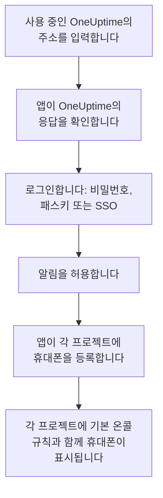
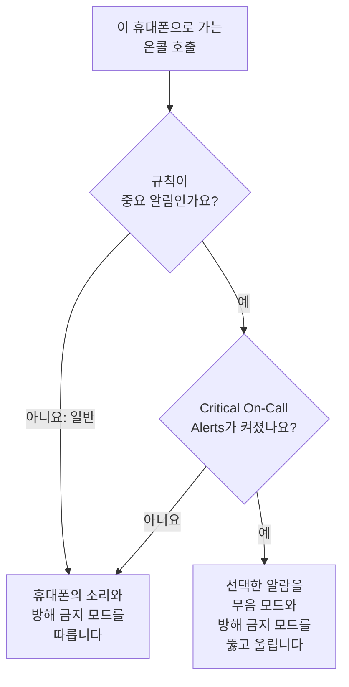

# Android 설치

Android 휴대폰이나 태블릿에 **OneUptime On-Call**을 설치하고, 사용 중인 OneUptime에 연결해 로그인합니다. 그런 다음 나에게 테스트 알림을 보내고, 긴급한 온콜 호출이 무음 모드와 방해 금지 모드에서도 울리게 합니다.

:::cards
- [앱 설치하기](#앱-설치하기): Google Play에서, 또는 Google Play가 없는 휴대폰에서는 APK로.
- [로그인하기](#로그인하기): 사용 중인 OneUptime의 주소, 그다음 계정.
- [호출이 휴대폰에 도착하는지 확인하기](#호출이-휴대폰에-도착하는지-확인하기): 대시보드에서 휴대폰을 찾아 테스트합니다.
- [무음 모드에서도 울리게 하기](#무음-모드에서도-울리게-하기): 중요 알림과 알람 소리.
- [문제 해결](#문제-해결): 로그인, 알림, 설치 문제.
:::

## 시작하기 전에

- Android 7.0 이상의 휴대폰 또는 태블릿.
- OneUptime 프로젝트의 계정. 호출을 받으려면 온콜 상태이기도 해야 합니다. [에스컬레이션 규칙](/docs/on-call/escalation-rules)을 참고하세요.
- 사용 중인 OneUptime의 주소. OneUptime Cloud에서는 `https://oneuptime.com`, 자체 주소라면 `https://oneuptime.example.com` 같은 주소입니다. 앱은 HTTPS로만 연결합니다.

## 앱 설치하기

:::tabs
@tab Google Play
1. 휴대폰에서 [Google Play의 OneUptime On-Call](https://play.google.com/store/apps/details?id=com.oneuptime.oncall)을 열거나, Google Play에서 OneUptime On-Call을 검색합니다.
2. **설치**를 탭한 다음 **열기**를 탭합니다.

Google Play가 앱을 최신 상태로 유지합니다.
@tab APK
Google Play가 없는 휴대폰용입니다. APK는 OneUptime 릴리스마다 같은 코드로 빌드되어 GitHub의 릴리스에 첨부됩니다.

1. 휴대폰에서 [최신 APK](https://github.com/OneUptime/oneuptime/releases/latest/download/oneuptime-on-call-android-app.apk)를 엽니다.
2. 다운로드한 파일을 엽니다. Android가 물으면 브라우저가 출처를 알 수 없는 앱을 설치하도록 허용한 다음 **설치**를 탭합니다.
3. 앱 목록에서 OneUptime On-Call을 엽니다.

APK는 스스로 업데이트되지 않습니다. 가끔 최신 APK를 그 위에 덮어 설치하세요. 로그인과 설정은 그대로 유지됩니다.
:::

## 로그인하기

:::steps
### 사용 중인 OneUptime의 주소 입력하기
앱을 엽니다. **Connect your workspace**에서 OneUptime Cloud라면 `https://oneuptime.com`을 그대로 두고, 아니면 사용 중인 OneUptime의 주소를 입력한 다음 **Connect**를 탭합니다. `https://<your-oneuptime>/api/status`가 응답하면 앱이 다음으로 넘어갑니다.

### 계정에 로그인하기
계정의 로그인 방식에 맞는 방법을 사용하세요.

- 이메일과 비밀번호를 입력한 다음 **Sign In**. **Forgot password?** 버튼은 새 비밀번호를 설정할 링크를 이메일로 보냅니다.
- 조직에서 싱글 사인온을 사용한다면 **Sign in with SSO**. 공급자를 선택하거나 회사 이메일을 입력하고 **Continue**를 탭합니다. 보안 브라우저가 열리고, 로그인하면 앱으로 돌아옵니다.
- 대시보드에서 패스키를 추가했다면 **Sign in with a passkey**. [패스키 추가](/docs/introduction/your-account#패스키-추가)를 참고하세요. 브라우저가 열려 패스키를 확인한 다음 앱으로 돌아옵니다.

2단계 인증이 켜져 있으면 인증 앱의 6자리 코드나 백업 코드 중 하나를 입력합니다. 보안 키는 앱에서 사용할 수 없습니다. 관리자가 2단계 인증을 요구하는데 아직 설정하지 않았다면, 앱이 먼저 인증 앱 설정을 함께 진행합니다.

### 알림 허용하기
OneUptime On-Call이 알림을 보내도 되는지 Android가 물으면 **허용**을 탭합니다. Android 13 이상은 이렇게 묻고, 이전 버전은 사용자가 끄지 않는 한 알림을 허용합니다.

그러면 앱이 각 프로젝트에 휴대폰을 등록합니다. 모든 프로젝트의 푸시 디바이스 목록에 기본 온콜 규칙과 함께 표시되므로, 이제부터 호출이 휴대폰에 도착합니다.
:::

앱은 한 번에 하나의 프로젝트를 보여 줍니다. 전환하려면 화면 위쪽의 프로젝트 이름을 탭하세요. 싱글 사인온이 필요한 프로젝트는 **Settings → Manage Projects**에서 **Authenticate with SSO**를 탭할 때까지 **SSO Required**로 표시됩니다.

## 호출이 휴대폰에 도착하는지 확인하기

:::steps
### 대시보드에서 휴대폰 찾기
대시보드에서 **사용자 설정 → 알림 방법**을 열고 **Push Notifications** 탭을 엽니다. 휴대폰은 **푸시 알림 디바이스** 아래에 모델 이름으로 표시됩니다. 목록은 프로젝트마다 따로 있습니다.

### 테스트 보내기
휴대폰 행에서 **테스트 알림**을 클릭합니다. 휴대폰에 알림이 도착하면 탭해서 앱을 엽니다.
:::

어떤 호출을 얼마나 빨리 휴대폰으로 보낼지는 온콜 규칙이 정합니다. **사용자 설정 → 온콜 규칙**을 참고하세요. 새 휴대폰에는 추가하는 다른 방법과 같은 기본 규칙이 적용됩니다.

## 무음 모드에서도 울리게 하기

기본적으로 온콜 호출은 휴대폰의 소리 설정을 따릅니다. 무음인 휴대폰은 조용하고, 방해 금지 모드는 호출을 보류합니다. 중요 알림을 사용하면 온콜 호출이 둘 다를 뚫고 울립니다. 중요 알림은 휴대폰마다 직접 켜기 전까지 꺼져 있습니다.

:::steps
### Critical On-Call Alerts 켜기
앱에서 **Settings**를 열고 **Notifications** 아래의 **Critical On-Call Alerts**를 켭니다.

### 방해 금지 모드 액세스 허용하기
Android가 **방해 금지 모드 액세스** 목록을 엽니다. OneUptime On-Call의 액세스를 켠 다음 앱으로 돌아가세요. 앱이 액세스를 확인하고, 호출이 뚫고 울릴지 스위치 아래에 알려 줍니다.

### 알람 소리 선택하기
스위치 아래의 **Alarm sound**를 탭합니다. 휴대폰 자체 소리 외에 Klaxon, Siren, Digital alarm, Smoke alarm, 그리고 작게 시작해 점점 커지는 Rising alarm을 제공합니다. 소리 옆의 재생 버튼을 누르면 들어 볼 수 있습니다. 중요 호출은 휴대폰의 알람 음량으로 울리므로 음량을 높여 두세요.
:::

뚫고 울리는 것은 온콜 호출뿐이며, 그것도 기본값인 **중요 알림**으로 설정된 온콜 규칙에서 온 호출뿐입니다. **일반**으로 설정된 규칙은 스위치와 관계없이 휴대폰의 설정을 따르므로, 중요한 인시던트에는 잠에서 깨고 사소한 인시던트는 조용히 호출받을 수 있습니다. 휴대폰을 무음으로 해 두고 **테스트 알림**을 보내면 호출이 어떻게 울릴지 들어 볼 수 있습니다.

## 호출이 늦게 도착하지 않게 하기

OneUptime은 온콜 호출을 높은 우선순위로 보내며, Android는 몇 시간 동안 사용하지 않은 휴대폰에도 이를 전달합니다. 하지만 앱의 배터리 사용을 제한하는 휴대폰은 여전히 호출을 보류할 수 있습니다.

- **설정 → 앱 → OneUptime On-Call → 배터리**를 열고 **제한 없음**을 선택합니다. 일부 휴대폰에서는 **앱 배터리 사용량**이라고 합니다.
- **설정 → 앱 → OneUptime On-Call → 알림**에서 앱의 알림이 켜져 있는지 확인합니다.
- 휴대폰이 관리하는 배터리 절약 목록이나 절전 앱 목록에 OneUptime On-Call을 넣지 마세요.

## 앱 잠그기

앱의 **Settings**에서 **Biometrics Login**을 켜면, 앱이 시작될 때마다 지문, 얼굴 또는 휴대폰의 화면 잠금을 요구합니다. 이 스위치는 휴대폰에 지문이나 얼굴 잠금 해제가 설정되어 있을 때 나타납니다. 같은 화면의 **Appearance**에서는 밝은 모양이나 어두운 모양을 고르거나 휴대폰 설정을 따르게 합니다.

## 업데이트, 로그아웃, 제거

- **업데이트.** Google Play가 앱을 업데이트합니다. APK라면 최신 APK를 그 위에 덮어 설치합니다. 앱의 버전은 **Settings** 화면 맨 아래에 있습니다.
- **로그아웃.** **Settings → Log Out**은 로그아웃하면서 모든 프로젝트의 푸시 디바이스에서 휴대폰을 온콜 규칙과 함께 제거합니다. 다시 로그인하면 기본 규칙으로 다시 추가됩니다.
- **제거.** 다른 앱처럼 제거합니다. 로그인한 상태였다면 휴대폰으로의 푸시가 실패할 때까지 목록에 남아 있고, 그때 OneUptime이 **알림을 받지 못하고 있습니다**로 표시합니다. 그 항목은 **삭제**로 지우세요. 앱을 다시 설치하고 로그인하면 휴대폰이 기본 규칙과 함께 새 항목으로 추가됩니다.

## 문제 해결

:::details “Could not connect to the server”
앱이 `https://<your-oneuptime>/api/status`에 연결하지 못했습니다. `https://`를 포함해 주소를 확인하세요. 사용 중인 OneUptime이 사설 네트워크에 있다면 먼저 VPN 등으로 휴대폰을 그 네트워크에 연결하세요. 그 주소를 휴대폰 브라우저에서 열어 보세요. 휴대폰이 OneUptime에 연결할 수 있으면 `{"status":"ok"}`가 표시됩니다.
:::

:::details 알림이 도착하지 않음
- Android 설정에서 앱의 알림이 켜져 있는지, 방해 금지 모드가 꺼져 있거나 중요 알림이 켜져 있는지 확인합니다.
- **사용자 설정 → 알림 방법**의 **Push Notifications**에 휴대폰이 있는지 확인하고, **테스트 알림**을 보냅니다.
- 휴대폰이 **알림을 받지 못하고 있습니다**로 표시되면 로그인한 상태로 앱을 엽니다. 앱이 휴대폰을 다시 등록합니다. [휴대폰을 다시 등록해야 할 때](/docs/mobile-desktop-apps/faq-troubleshooting#휴대폰을-다시-등록해야-할-때)를 참고하세요.
- **사용자 설정 → 온콜 규칙**에서 온콜 규칙을 확인합니다.
- 자체 호스팅 OneUptime이라면 서버가 푸시 릴레이에 연결할 수 있는지 확인합니다. [푸시 알림](/docs/self-hosted/push-notifications#네트워크-접근)을 참고하세요.
:::

:::details 방해 금지 모드에서 중요 알림이 울리지 않음
앱의 **Settings**를 엽니다. **Critical On-Call Alerts** 아래의 줄이 무엇이 빠졌는지 알려 줍니다. 대개 방해 금지 모드 액세스가 허용되지 않은 경우입니다. **설정 → 알림 → 방해 금지 모드 액세스**에서 허용한 다음 앱으로 돌아가세요. 알람 소리를 선택했다면 그 소리의 알림 채널도 방해 금지 모드를 무시하도록 허용되어야 합니다.
:::

:::details APK를 설치할 때 “앱이 설치되지 않았습니다”
OneUptime On-Call이 Google Play 같은 다른 출처에서 이미 휴대폰에 설치되어 있고, Android는 하나를 다른 하나 위에 설치하지 않습니다. 제거한 다음 APK를 설치하고 다시 로그인하세요.
:::

:::details Biometrics Login 스위치가 없음
이 스위치는 Android 설정에서 지문이나 얼굴 잠금 해제를 설정하면 나타납니다.
:::

## 다음 단계

:::cards
- [FAQ 및 문제 해결](/docs/mobile-desktop-apps/faq-troubleshooting): 휴대폰이 호출을 받지 못할 때 할 일.
- [iOS 설치](/docs/mobile-desktop-apps/ios-installation): iPhone이나 iPad에서 같은 앱을 사용합니다.
- [에스컬레이션 규칙](/docs/on-call/escalation-rules): 누구를 언제 호출할지 정합니다.
- [푸시 알림](/docs/self-hosted/push-notifications): 자체 호스팅 OneUptime이 휴대폰에 호출을 보내는 방식.
:::
