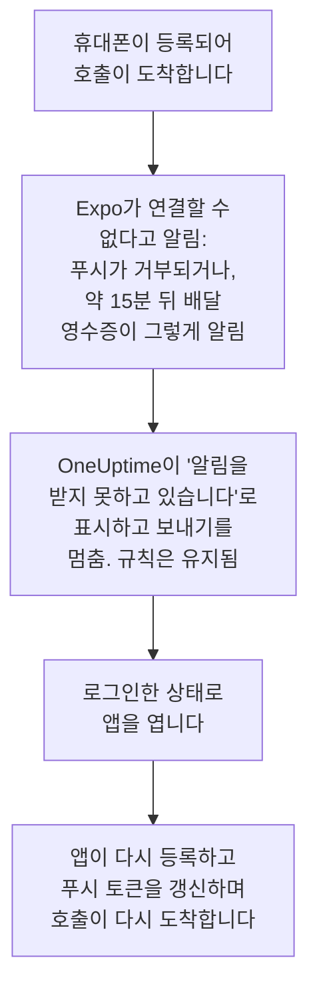

# FAQ 및 문제 해결

OneUptime 모바일 앱과 데스크톱 앱에 대해 자주 묻는 질문의 답과, 가장 자주 생기는 문제의 해결 방법입니다. 로그인, 도착하지 않는 알림, 다시 등록해야 하는 휴대폰을 다룹니다.

:::cards
- [모바일 앱 질문](#모바일-앱-질문): 기기, 프로젝트, 자체 호스팅, 보안.
- [데스크톱 앱 질문](#데스크톱-앱-질문): 데스크톱 앱이 무엇이고 무엇을 할 수 없는지.
- [휴대폰을 다시 등록해야 할 때](#휴대폰을-다시-등록해야-할-때): 휴대폰이 호출을 받지 못하게 되는 이유와 다시 받게 하는 방법.
- [문제 해결](#문제-해결): 로그인, 알림, 설치 문제.
:::

## 모바일 앱 질문

:::details 앱은 무료인가요?
네. OneUptime On-Call은 App Store, Google Play, 그리고 GitHub의 APK로 무료로 제공됩니다. OneUptime 계정으로 로그인합니다.
:::

:::details 어떤 휴대폰과 태블릿에서 실행되나요?
iOS 또는 iPadOS 16.4 이상의 iPhone과 iPad, 그리고 Android 7.0 이상의 Android 휴대폰과 태블릿입니다.
:::

:::details 자체 호스팅 OneUptime에서도 작동하나요?
네. 앱이 시작될 때 사용 중인 OneUptime의 `https://` 주소를 입력하거나, 로그인 화면에서 **Change Server**를 탭합니다. 기본적으로 서버는 OneUptime 푸시 릴레이를 통해 휴대폰으로 호출을 보내므로 Apple, Google, Expo 계정이 필요 없습니다. [푸시 알림](/docs/self-hosted/push-notifications)을 참고하세요.
:::

:::details 여러 프로젝트에서 사용할 수 있나요?
네. 앱은 내가 속한 모든 프로젝트에 휴대폰을 등록하므로 어느 프로젝트든 나를 호출할 수 있습니다. 한 번에 하나의 프로젝트를 보여 주며, 전환하려면 화면 위쪽의 프로젝트 이름을 탭합니다.
:::

:::details 휴대폰 여러 대에서 로그인할 수 있나요?
네. 각 휴대폰이나 태블릿은 독립된 푸시 디바이스이며, 자체 온콜 규칙과 자체 중요 알림 설정을 가집니다.
:::

:::details 앱에서 무엇을 할 수 있나요?
- **Home**: 프로젝트에서 주의가 필요한 것. 진행 중인 인시던트와 알림, 역할상 볼 수 있다면 열린 보안 케이스, 문제가 있는 모니터, 그룹화된 이벤트.
- **Monitors**: 모든 모니터. 상태로 필터링할 수 있고 세부 정보도 볼 수 있습니다.
- **Inbox**: 인시던트와 알림, 그리고 이들을 묶는 에피소드. 하나를 열어 **Acknowledge**, **Resolve** 또는 **Add Note**를 사용합니다. 역할상 프로젝트의 보안 케이스를 볼 수 있다면 **Security**에 열린 케이스가 나열됩니다. 하나를 열어 승인을 기다리는 플레이북 단계에 **Approve** 또는 **Reject**를 사용하거나, **Assign to me**로 케이스를 맡거나, **Close case**를 사용합니다.
- **On-Call**: 내가 온콜 중인지와 언제까지인지, 그 밖에 누가 온콜인지, 나에게 보낸 호출, 그리고 잠시 동안 내 호출을 팀원에게 넘기는 **Cover for me**.
- **Settings**: 프로젝트와 싱글 사인온, 모양, 중요 알림과 알람 소리, **Biometrics Login**, 온콜 캘린더 피드, **Log Out**.

그 밖의 모든 것은 대시보드에 있습니다.
:::

:::details 알림에서 바로 호출을 확인할 수 있나요?
아니요. 알림을 탭하면 앱이 해당 인시던트, 알림, 에피소드 또는 보안 케이스를 올바른 프로젝트에서 열고, 그곳에서 확인합니다. 앱이 잠겨 있거나 로그아웃된 상태라면 들어오는 즉시 그 호출을 엽니다.
:::

:::details 휴대폰의 로그인은 안전한가요?
앱은 사용 중인 OneUptime과 HTTPS로만 통신합니다. 로그인 정보는 휴대폰에 있는 앱 자체 저장소에 보관되며, **Log Out**은 이를 삭제하고 서버의 세션도 로그아웃합니다. **Biometrics Login**을 켜면 앱이 시작될 때마다 얼굴, 지문 또는 암호를 요구합니다.
:::

:::details 앱이 오프라인에서도 작동하나요?
아니요. 연결이 없는 동안 화면 위쪽에 **No internet connection**이 표시되고, 연결이 돌아오면 다시 이어집니다.
:::

## 데스크톱 앱 질문

:::details 데스크톱 앱이란 무엇인가요?
브라우저에서 앱으로 설치한 OneUptime 대시보드입니다. 별도의 창, 시작 메뉴나 Dock이나 런처의 아이콘, 그리고 알림을 갖춥니다. 대시보드 그 자체이므로 대시보드가 하는 모든 일을 합니다.
:::

:::details 왜 앱 스토어에 없나요?
그럴 필요가 없기 때문입니다. 앱은 열 때마다 사용 중인 OneUptime에서 대시보드를 불러오므로, Windows, macOS, Linux 어디서나 항상 사용 중인 OneUptime이 실행하는 버전이고 업데이트할 것이 없습니다.
:::

:::details 휴대폰처럼 나를 깨울 수 있나요?
아니요. 브라우저는 방해 금지 모드나 집중 모드를 무시할 수 없으므로, 데스크톱 알림은 컴퓨터가 허용하는 만큼만 크게 울립니다. 반드시 깨워야 하는 호출에는 중요 알림을 켠 모바일 앱을 사용하세요.
:::

:::details 오프라인에서도 작동하나요?
아니요. 브라우저 탭에서 여는 대시보드처럼 사용 중인 OneUptime에 연결되어 있어야 합니다.
:::

## 휴대폰을 다시 등록해야 할 때

OneUptime은 휴대폰으로 가는 호출을 Expo를 통해 보내고, Expo가 이를 Apple 또는 Google에 넘깁니다. 휴대폰에 더 이상 연결할 수 없다고 Expo가 알리면, 앱이 휴대폰을 다시 등록할 때까지 OneUptime은 그 휴대폰으로 보내기를 멈춥니다.

Expo는 휴대폰에서 앱이 제거되었거나 푸시 토큰이 더 이상 유효하지 않을 때 연결할 수 없다고 알립니다. 휴대폰은 삭제되지 않습니다. **사용자 설정 → 알림 방법**의 **Push Notifications** 탭에 **알림을 받지 못하고 있습니다**로 표시되고, 도착하지 못한 호출의 온콜 타임라인에 그 이유가 나옵니다. 나의 다른 휴대폰과 알림 방법은 평소처럼 호출을 받습니다.

앱은 시작할 때마다, 로그인할 때, 앱으로 돌아올 때 휴대폰을 등록하며, 최대 5분에 한 번입니다. 등록할 때 Expo에 푸시 토큰을 다시 요청해 토큰이 갱신되고, 휴대폰은 이전 규칙 그대로 다시 호출을 받습니다.

| 일어난 일 | 할 일 | OneUptime이 하는 일 |
| --- | --- | --- |
| 앱이 아직 설치되어 있음 | 로그인한 상태로 앱 열기 | 휴대폰이 규칙과 함께 다시 알림을 받음 |
| iPhone이나 iPad에서 앱을 다시 설치함 | 설치하고 로그인 | 대개 같은 항목이 규칙과 함께 돌아옴 |
| Android에서 앱을 다시 설치함 | 설치하고 로그인한 뒤 이전 항목 삭제 | 기본 규칙으로 새 항목이 생김. 이전 항목은 표시된 채로 남음 |
| 이전 휴대폰의 백업으로 설정한 새 휴대폰 | 새 휴대폰에서 앱 열기 | 이전 휴대폰의 항목이 표시되어 있으면 새 휴대폰이 규칙과 함께 넘겨받음. 아니면 새 휴대폰에 자체 항목이 생김 |
| 처음부터 설정한 새 휴대폰 | 로그인하고 이전 항목 삭제 | 기본 규칙으로 새 항목이 생김 |
| 앱에서 로그아웃함 | 다시 로그인 | 로그아웃이 휴대폰과 그 규칙을 삭제했음. 기본 규칙으로 돌아옴 |

브라우저도 푸시 구독이 만료되면 알림을 받지 못할 수 있습니다. 대시보드는 가능할 때 구독을 갱신합니다. 브라우저가 계속 표시되어 있으면 그 브라우저에서 **디바이스 등록**으로 다시 등록하세요.

## 문제 해결

### 로그인

:::details “Could not connect to the server”
앱이 `https://<your-oneuptime>/api/status`에 연결하지 못했습니다. `https://`를 포함해 주소를 확인하세요. 앱은 일반 HTTP로 연결하지 않습니다. 사용 중인 OneUptime이 사설 네트워크에 있다면 먼저 VPN 등으로 휴대폰을 그 네트워크에 연결하세요. 휴대폰이 OneUptime에 연결할 수 있으면, 그 주소를 휴대폰 브라우저에서 열었을 때 `{"status":"ok"}`가 표시됩니다.
:::

:::details “No SSO configuration found for the email”
그 이메일이 속한 어느 프로젝트에도 싱글 사인온이 설정되어 있지 않거나, 그 이메일의 계정이 이 OneUptime에 없습니다. 이메일을 확인하거나 비밀번호로 로그인하세요. 관리자가 설치 전체에 설정한 공급자는 이메일 입력란 앞에 표시됩니다.
:::

:::details 보안 키가 유일한 2단계 인증 수단임
앱은 보안 키를 사용할 수 없습니다. 백업 코드 중 하나로 로그인하거나, 대시보드에서 계정에 인증 앱을 추가하세요. [2단계 인증 켜기](/docs/introduction/your-account#2단계-인증-켜기)를 참고하세요.
:::

:::details 패스키 로그인이 실패함
패스키를 사용하려면 사용 중인 OneUptime의 주소가 `https://`로 시작해야 하고, 이 OneUptime용으로 추가한 패스키가 있어야 합니다. [패스키 추가](/docs/introduction/your-account#패스키-추가)를 참고하세요. 다른 서버를 사용하려면 로그인 화면에서 **Change Server**를 탭하세요.
:::

### 알림

:::details 휴대폰에 알림이 오지 않음
- 휴대폰이 OneUptime On-Call의 알림을 허용하는지, 방해 금지 모드나 집중 모드가 알림을 보류하고 있지 않은지 확인합니다.
- **사용자 설정 → 알림 방법**의 **Push Notifications** 탭에서 휴대폰이 목록에 있는지 확인하고 **테스트 알림**을 보냅니다.
- **알림을 받지 못하고 있습니다**로 표시되어 있으면 로그인한 상태로 앱을 엽니다. [휴대폰을 다시 등록해야 할 때](#휴대폰을-다시-등록해야-할-때)를 참고하세요.
- **사용자 설정 → 온콜 규칙**에서 온콜 규칙을 확인합니다. 어떤 호출이 어떤 방법에 도착할지는 규칙이 정합니다.
- 자체 호스팅 OneUptime이라면 서버가 푸시 릴레이에 연결할 수 있는지 확인합니다. [푸시 알림](/docs/self-hosted/push-notifications#네트워크-접근)을 참고하세요.
:::

:::details Android에서 호출이 늦게 도착함
Android 설정의 OneUptime On-Call에서 배터리 사용을 **제한 없음**으로 설정하고, 배터리 절약 목록에 앱을 넣지 마세요. [호출이 늦게 도착하지 않게 하기](/docs/mobile-desktop-apps/android-installation#호출이-늦게-도착하지-않게-하기)를 참고하세요.
:::

:::details 중요 알림이 무음 모드를 뚫고 울리지 않음
앱의 **Settings**를 엽니다. **Critical On-Call Alerts** 아래의 줄이 그 휴대폰에 무엇이 빠졌는지 알려 줍니다. 그런 다음 **사용자 설정 → 온콜 규칙**에서 호출을 보낸 온콜 규칙이 **일반**이 아닌 **중요 알림**으로 설정되어 있는지 확인하세요. 스위치는 휴대폰마다 따로 있습니다.
:::

### 데스크톱 앱

:::details 주소 표시줄에 설치 아이콘이 없음
로그인한 뒤 대시보드 페이지에서, `https://`를 통해, Edge나 Chrome 또는 macOS Sonoma 14 이상의 Safari에서 설치하세요. 아이콘이 보이지 않으면 브라우저 메뉴로도 설치할 수 있습니다. [Windows 설치](/docs/mobile-desktop-apps/windows-installation#앱-설치하기)를 참고하세요.
:::

:::details 데스크톱 알림이 오지 않음
**사용자 설정 → 알림 방법**의 **Push Notifications** 탭에서 **디바이스 등록**으로 브라우저를 등록하고, 물으면 알림을 허용한 다음 컴퓨터 자체의 알림 설정을 확인하세요. 자체 호스팅 OneUptime에는 브라우저 알림을 위한 VAPID 키가 필요합니다.
:::

## 도움 받기

여기 내용이 화면과 다르다면, 앱 버전(**Settings** 화면 맨 아래)과 사용 중인 플랫폼을 적어 [GitHub에 이슈를 등록](https://github.com/OneUptime/oneuptime/issues)하세요.

## 다음 단계

:::cards
- [앱 개요](/docs/mobile-desktop-apps/index): 어떤 앱을 사용할지, 그리고 앱이 OneUptime에 연결되는 방식.
- [Android 설치](/docs/mobile-desktop-apps/android-installation): Android에서 앱을 설치하고 설정합니다.
- [iOS 설치](/docs/mobile-desktop-apps/ios-installation): iPhone이나 iPad에서 앱을 설치하고 설정합니다.
- [푸시 알림](/docs/self-hosted/push-notifications): 자체 호스팅 OneUptime이 호출을 보내는 방식과 Expo의 오류.
:::
