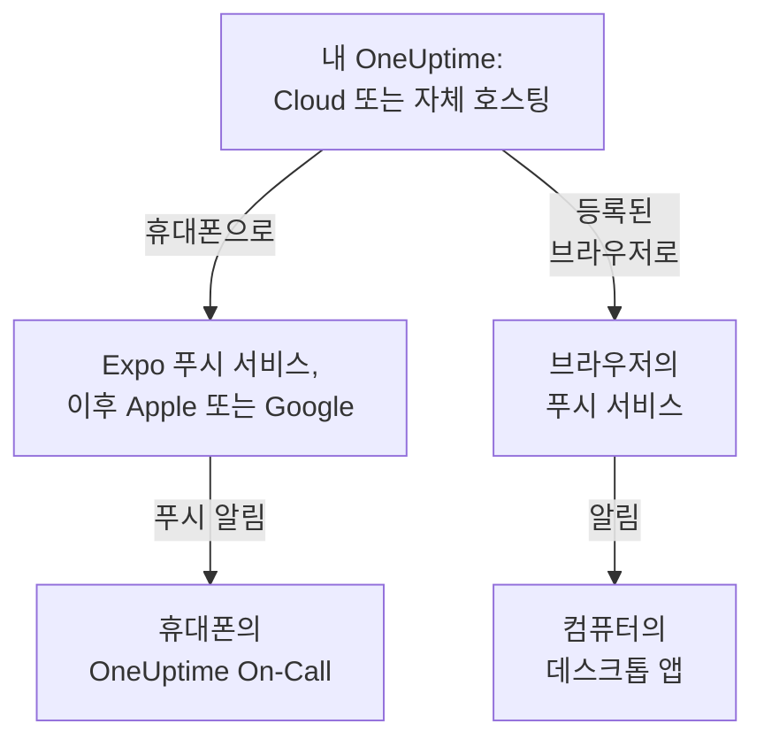

# 앱 개요

OneUptime에는 휴대폰용 앱과 컴퓨터용 앱이 있습니다. iPhone, iPad, Android용 **OneUptime On-Call**은 온콜 중일 때 호출을 받게 해 주고, 어디에 있든 인시던트를 확인하고 해결할 수 있게 합니다. Windows, macOS, Linux에서는 OneUptime 대시보드를 브라우저에서 데스크톱 앱으로 설치해 별도의 창으로 열 수 있습니다. 두 앱 모두 OneUptime Cloud와 자체 호스팅 OneUptime에서 작동합니다.

:::cards
- [앱 선택하기](#앱-선택하기): 각 앱이 하는 일을 나란히 비교합니다.
- [앱이 OneUptime에 연결되는 방식](#앱이-oneuptime에-연결되는-방식): 로그인과 온콜 호출이 거치는 경로.
- [모바일 앱 받기](#모바일-앱-받기): App Store, Google Play 또는 GitHub에서.
- [데스크톱 앱 받기](#데스크톱-앱-받기): Edge, Chrome 또는 Safari에서 대시보드를 설치합니다.
:::

## 앱 선택하기

|  | 모바일 앱 | 데스크톱 앱 |
| --- | --- | --- |
| 무엇인가 | OneUptime On-Call, iPhone, iPad, Android용 네이티브 앱 | 브라우저에서 설치한 OneUptime 대시보드 |
| 받는 곳 | App Store, Google Play 또는 GitHub의 APK | 사용 중인 OneUptime. 다운로드할 것이 없음 |
| 온콜 호출 | 무음 모드와 방해 금지 모드에서도 울릴 수 있는 푸시 알림 | 브라우저를 등록한 후의 브라우저 알림 |
| 할 수 있는 일 | 인시던트, 알림, 보안 케이스, 모니터, 현재 온콜 담당자 보기. 확인, 해결, 플레이북 단계 승인, 메모 추가 | 대시보드가 하는 모든 일 |
| 업데이트 | 스토어에서, 또는 더 새로운 APK를 설치해서 | 열 때마다 사용 중인 OneUptime에서 대시보드를 불러옴 |
| 지원 환경 | iOS 16.4 이상, Android 7.0 이상 | Windows, macOS, Linux의 Edge 또는 Chrome, 또는 macOS Sonoma 14 이상의 Safari |

둘 다 사용할 수 있습니다. 업무 중에는 데스크톱 앱을 열어 두고, 밤에는 휴대폰이 깨우게 하세요.

## 앱이 OneUptime에 연결되는 방식

모바일 앱은 사용 중인 OneUptime에 로그인하고, 내가 속한 모든 프로젝트에 휴대폰을 등록합니다. 그 후 OneUptime은 온콜 호출을 포함한 휴대폰의 푸시 알림을 Expo 푸시 서비스로 보내고, Expo가 이를 Apple 또는 Google에 넘겨 전달합니다. 자체 호스팅 OneUptime은 기본적으로 OneUptime 푸시 릴레이를 통해 보내므로 자체 Apple, Google, Expo 계정이 필요 없습니다. [푸시 알림](/docs/self-hosted/push-notifications)을 참고하세요.

데스크톱 앱은 별도의 창에서 열리는 대시보드 그 자체입니다. 그 브라우저를 푸시 알림용으로 등록하면 알림을 표시합니다. 등록 방법은 Windows, macOS, Linux 페이지에서 설명합니다.

## 시작하기 전에

- OneUptime 프로젝트의 계정. 호출을 받으려면 온콜 상태이기도 해야 합니다. [에스컬레이션 규칙](/docs/on-call/escalation-rules)을 참고하세요.
- 사용 중인 OneUptime의 주소. OneUptime Cloud에서는 `https://oneuptime.com`이고, 자체 호스팅 OneUptime에는 `https://oneuptime.example.com` 같은 자체 주소가 있습니다.
- HTTPS로 제공되는 OneUptime. 모바일 앱은 일반 HTTP로는 연결하지 않으며, 브라우저가 알림을 표시하고 Edge와 Chrome이 앱을 설치하는 것도 HTTPS 사이트에서만 가능합니다.

## 모바일 앱 받기

:::steps
### OneUptime On-Call 설치하기
iPhone이나 iPad에서는 [App Store](https://apps.apple.com/us/app/oneuptime-on-call/id6759615391)에서, Android에서는 [Google Play](https://play.google.com/store/apps/details?id=com.oneuptime.oncall)에서 받으세요. Google Play가 없는 Android 휴대폰에는 대신 [APK](https://github.com/OneUptime/oneuptime/releases/latest/download/oneuptime-on-call-android-app.apk)를 설치합니다. 같은 링크는 대시보드의 **프로젝트 설정 → 알림 → 모바일 앱**에도 있습니다.

### 사용 중인 OneUptime에 연결하기
앱을 열고, OneUptime Cloud라면 `https://oneuptime.com`을 그대로 두고 아니면 사용 중인 OneUptime의 주소를 입력한 다음, 비밀번호, 패스키 또는 싱글 사인온으로 로그인합니다.

### 알림 허용하기
휴대폰이 물으면 허용하세요. 앱이 각 프로젝트에 휴대폰을 등록하고, 온콜 호출이 도착하기 시작합니다.
:::

각 단계의 자세한 설명과 이후 확인할 사항은 [Android 설치](/docs/mobile-desktop-apps/android-installation)와 [iOS 설치](/docs/mobile-desktop-apps/ios-installation)를 참고하세요.

## 데스크톱 앱 받기

:::steps
### 대시보드 열기
Microsoft Edge 또는 Google Chrome, Mac에서는 Safari로도 사용 중인 OneUptime에 로그인합니다.

### 설치하기
Edge나 Chrome에서는 주소 표시줄 오른쪽에 있는 설치 아이콘을 클릭합니다. Safari에서는 **파일 → Dock에 추가**를 선택합니다.

### 다른 앱처럼 열기
시작 메뉴, Dock 또는 앱 런처에서 별도의 창으로 열립니다.
:::

브라우저별 단계는 [Windows 설치](/docs/mobile-desktop-apps/windows-installation), [macOS 설치](/docs/mobile-desktop-apps/macos-installation), [Linux 설치](/docs/mobile-desktop-apps/linux-installation)를 참고하세요.

## 다음 단계

:::cards
- [Android 설치](/docs/mobile-desktop-apps/android-installation): Android에 앱을 설치하고 로그인한 뒤 호출이 도착하는지 확인합니다.
- [iOS 설치](/docs/mobile-desktop-apps/ios-installation): iPhone이나 iPad에 앱을 설치하고 중요 알림을 켭니다.
- [Windows 설치](/docs/mobile-desktop-apps/windows-installation): Edge 또는 Chrome에서 대시보드를 설치합니다.
- [macOS 설치](/docs/mobile-desktop-apps/macos-installation): Safari, Chrome 또는 Edge에서 대시보드를 Dock에 추가합니다.
- [Linux 설치](/docs/mobile-desktop-apps/linux-installation): Chrome, Chromium 또는 Edge에서 대시보드를 설치합니다.
- [FAQ 및 문제 해결](/docs/mobile-desktop-apps/faq-troubleshooting): 자주 묻는 질문의 답, 해결 방법, 그리고 휴대폰이 호출을 받지 못할 때 할 일.
:::
