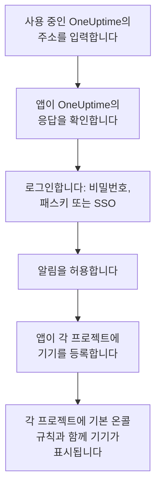
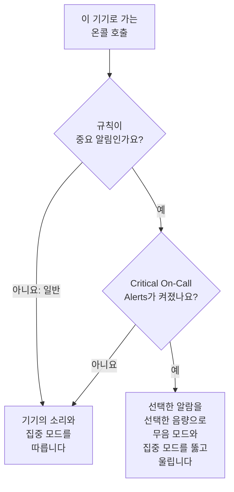

# iOS 설치

App Store에서 iPhone이나 iPad에 **OneUptime On-Call**을 설치하고, 사용 중인 OneUptime에 연결해 로그인합니다. 그런 다음 나에게 테스트 알림을 보내고, 긴급한 온콜 호출이 무음 모드와 집중 모드에서도 울리게 합니다.

:::cards
- [앱 설치하기](#앱-설치하기): App Store에서.
- [로그인하기](#로그인하기): 사용 중인 OneUptime의 주소, 그다음 계정.
- [호출이 기기에 도착하는지 확인하기](#호출이-기기에-도착하는지-확인하기): 대시보드에서 기기를 찾아 테스트합니다.
- [무음 모드에서도 울리게 하기](#무음-모드에서도-울리게-하기): 중요 알림, 알람 소리와 음량.
- [문제 해결](#문제-해결): 로그인, 알림, 중요 알림 문제.
:::

## 시작하기 전에

- iOS 16.4 이상의 iPhone 또는 iPadOS 16.4 이상의 iPad.
- OneUptime 프로젝트의 계정. 호출을 받으려면 온콜 상태이기도 해야 합니다. [에스컬레이션 규칙](/docs/on-call/escalation-rules)을 참고하세요.
- 사용 중인 OneUptime의 주소. OneUptime Cloud에서는 `https://oneuptime.com`, 자체 주소라면 `https://oneuptime.example.com` 같은 주소입니다. 앱은 HTTPS로만 연결합니다.

## 앱 설치하기

1. iPhone이나 iPad에서 [App Store의 OneUptime On-Call](https://apps.apple.com/us/app/oneuptime-on-call/id6759615391)을 열거나, App Store에서 OneUptime On-Call을 검색합니다.
2. **받기**를 탭하고 Face ID, Touch ID 또는 Apple 계정 암호로 확인합니다.
3. **열기**를 탭하거나 홈 화면에서 OneUptime On-Call을 엽니다.

**설정 → App Store**에서 **앱 업데이트**가 켜져 있으면 App Store가 앱을 최신 상태로 유지합니다.

## 로그인하기

:::steps
### 사용 중인 OneUptime의 주소 입력하기
앱을 엽니다. **Connect your workspace**에서 OneUptime Cloud라면 `https://oneuptime.com`을 그대로 두고, 아니면 사용 중인 OneUptime의 주소를 입력한 다음 **Connect**를 탭합니다. `https://<your-oneuptime>/api/status`가 응답하면 앱이 다음으로 넘어갑니다.

### 계정에 로그인하기
계정의 로그인 방식에 맞는 방법을 사용하세요.

- 이메일과 비밀번호를 입력한 다음 **Sign In**. **Forgot password?** 버튼은 새 비밀번호를 설정할 링크를 이메일로 보냅니다.
- 대시보드에서 패스키를 추가했다면 **Sign in with a passkey**. [패스키 추가](/docs/introduction/your-account#패스키-추가)를 참고하세요. 브라우저 시트가 열려 패스키를 확인한 다음 앱으로 돌아옵니다.
- 조직에서 싱글 사인온을 사용한다면 **Sign in with SSO**. 공급자를 선택하거나 회사 이메일을 입력하고 **Continue**를 탭합니다. 보안 브라우저가 열리고, 로그인하면 앱으로 돌아옵니다.

2단계 인증이 켜져 있으면 인증 앱의 6자리 코드나 백업 코드 중 하나를 입력합니다. 보안 키는 앱에서 사용할 수 없습니다. 관리자가 2단계 인증을 요구하는데 아직 설정하지 않았다면, 앱이 먼저 인증 앱 설정을 함께 진행합니다.

### 알림 허용하기
OneUptime On-Call이 알림을 보내도 되는지 iOS가 물으면 **허용**을 탭합니다.

그러면 앱이 각 프로젝트에 iPhone이나 iPad를 등록합니다. 모든 프로젝트의 푸시 디바이스 목록에 기본 온콜 규칙과 함께 표시되므로, 이제부터 호출이 기기에 도착합니다.
:::

앱은 한 번에 하나의 프로젝트를 보여 줍니다. 전환하려면 화면 위쪽의 프로젝트 이름을 탭하세요. 싱글 사인온이 필요한 프로젝트는 **Settings → Manage Projects**에서 **Authenticate with SSO**를 탭할 때까지 **SSO Required**로 표시됩니다.

## 호출이 기기에 도착하는지 확인하기

:::steps
### 대시보드에서 기기 찾기
대시보드에서 **사용자 설정 → 알림 방법**을 열고 **Push Notifications** 탭을 엽니다. iPhone이나 iPad는 **푸시 알림 디바이스** 아래에 모델 이름으로 표시됩니다. 목록은 프로젝트마다 따로 있습니다.

### 테스트 보내기
기기 행에서 **테스트 알림**을 클릭합니다. 기기에 알림이 도착하면 탭해서 앱을 엽니다.
:::

어떤 호출을 얼마나 빨리 기기로 보낼지는 온콜 규칙이 정합니다. **사용자 설정 → 온콜 규칙**을 참고하세요. 새 기기에는 추가하는 다른 방법과 같은 기본 규칙이 적용됩니다.

## 무음 모드에서도 울리게 하기

기본적으로 온콜 호출은 기기의 소리 설정을 따릅니다. 무음 모드에서는 조용하고, 방해 금지 모드 같은 집중 모드는 호출을 보류합니다. 중요 알림을 사용하면 온콜 호출이 둘 다를 뚫고 울립니다. 중요 알림은 기기마다 직접 켜기 전까지 꺼져 있습니다.

:::steps
### Critical On-Call Alerts 켜기
앱에서 **Settings**를 열고 **Notifications** 아래의 **Critical On-Call Alerts**를 켭니다.

### 중요 알림 허용하기
OneUptime On-Call이 중요 알림을 보내도 되는지 iOS가 물으면 **허용**을 탭합니다. 그러면 iOS가 **설정 → 알림 → OneUptime On-Call**에 앱의 **중요 알림** 스위치를 추가하며, 나중에 그곳에서 바꿀 수 있습니다. 앱 스위치 아래의 줄이 호출이 뚫고 울릴지 알려 줍니다.

### 알람 소리와 음량 선택하기
스위치 아래의 **Alarm sound**를 탭합니다. 기기 자체의 중요 알림 소리 외에 Klaxon, Siren, Digital alarm, Smoke alarm, 그리고 작게 시작해 점점 커지는 Rising alarm을 제공합니다. 소리 옆의 재생 버튼을 누르면 들어 볼 수 있습니다. 그런 다음 호출이 울릴 음량을 25%, 50%, 75%, 100%(기본값) 중에서 고릅니다.
:::

뚫고 울리는 것은 온콜 호출뿐이며, 그것도 기본값인 **중요 알림**으로 설정된 온콜 규칙에서 온 호출뿐입니다. **일반**으로 설정된 규칙은 스위치와 관계없이 기기의 설정을 따르므로, 중요한 인시던트에는 잠에서 깨고 사소한 인시던트는 조용히 호출받을 수 있습니다. 기기를 무음 모드로 해 두고 **테스트 알림**을 보내면 호출이 어떻게 울릴지 들어 볼 수 있습니다. **Alarm sound** 화면의 미리 듣기는 벨소리 음량으로 재생되며, 무음 모드에서는 전혀 재생되지 않습니다. 실제 호출은 선택한 음량으로 무음 모드를 뚫고 울립니다.

> [!NOTE]
> 중요 알림에는 App Store의 OneUptime On-Call 1.5.0 이상이 필요합니다. 이전 버전은 Apple의 중요 알림 권한 없이 빌드되어, iOS가 해당 스위치를 제공한 적이 없습니다.

## 호출이 보류되지 않게 하기

중요 알림이 없으면 집중 모드나 요약이 호출을 보류할 수 있습니다.

- **집중 모드.** **설정 → 집중 모드**에서 각 집중 모드가 허용하는 앱에 OneUptime On-Call을 추가합니다.
- **예약 요약.** **설정 → 알림 → 예약 요약**에서 OneUptime On-Call을 빼 두세요. 요약에 들어간 알림은 요약의 다음 시간까지 기다립니다.
- **알림.** **설정 → 알림 → OneUptime On-Call**에서 **알림 허용**을 켜 둡니다.

## 앱 잠그기

앱의 **Settings**에서 **Biometrics Login**을 켜면, 앱이 시작될 때마다 Face ID, Touch ID 또는 암호를 요구합니다. 이 스위치는 기기에 Face ID나 Touch ID가 설정되어 있을 때 나타납니다. 같은 화면의 **Appearance**에서는 밝은 모양이나 어두운 모양을 고르거나 기기 설정을 따르게 합니다.

## 업데이트, 로그아웃, 앱 삭제

- **업데이트.** App Store가 앱을 업데이트합니다. App Store의 계정 화면에서 직접 업데이트할 수도 있습니다. 앱의 버전은 **Settings** 화면 맨 아래에 있습니다.
- **로그아웃.** **Settings → Log Out**은 로그아웃하면서 모든 프로젝트의 푸시 디바이스에서 기기를 온콜 규칙과 함께 제거합니다. 다시 로그인하면 기본 규칙으로 다시 추가됩니다.
- **삭제.** 앱 아이콘을 길게 누른 다음 **앱 제거**와 **앱 삭제**를 탭합니다. 로그인한 상태였다면 기기로의 푸시가 실패할 때까지 목록에 남아 있고, 그때 OneUptime이 **알림을 받지 못하고 있습니다**로 표시합니다. 앱을 다시 설치하고 로그인하면 대개 그 항목이 규칙과 함께 돌아옵니다. 그 기기를 더 이상 쓰지 않는다면 **삭제**로 항목을 지우세요.

## 문제 해결

:::details “Could not connect to the server”
앱이 `https://<your-oneuptime>/api/status`에 연결하지 못했습니다. `https://`를 포함해 주소를 확인하세요. 사용 중인 OneUptime이 사설 네트워크에 있다면 먼저 VPN 등으로 기기를 그 네트워크에 연결하세요. 그 주소를 기기의 Safari에서 열어 보세요. 기기가 OneUptime에 연결할 수 있으면 `{"status":"ok"}`가 표시됩니다.
:::

:::details 알림이 도착하지 않음
- **설정 → 알림 → OneUptime On-Call**에서 **알림 허용**이 켜져 있는지, 집중 모드가 호출을 보류하고 있지 않은지 확인합니다.
- **사용자 설정 → 알림 방법**의 **Push Notifications**에 기기가 있는지 확인하고, **테스트 알림**을 보냅니다.
- 기기가 **알림을 받지 못하고 있습니다**로 표시되면 로그인한 상태로 앱을 엽니다. 앱이 기기를 다시 등록합니다. [휴대폰을 다시 등록해야 할 때](/docs/mobile-desktop-apps/faq-troubleshooting#휴대폰을-다시-등록해야-할-때)를 참고하세요.
- **사용자 설정 → 온콜 규칙**에서 온콜 규칙을 확인합니다.
- 자체 호스팅 OneUptime이라면 서버가 푸시 릴레이에 연결할 수 있는지 확인합니다. [푸시 알림](/docs/self-hosted/push-notifications#네트워크-접근)을 참고하세요.
:::

:::details iOS 설정에 중요 알림 스위치가 없음
먼저 앱에서 **Critical On-Call Alerts**를 켜세요. iOS는 앱이 중요 알림을 요청한 뒤에만 스위치를 추가합니다. 이 버전에서는 중요 알림을 받을 수 없다고 앱이 알려 주면 App Store에서 OneUptime On-Call을 업데이트하세요.
:::

:::details 중요 알림이 울리지 않음
앱의 **Settings**를 엽니다. **Critical On-Call Alerts** 아래의 줄이 무엇이 빠졌는지 알려 줍니다. **설정 → 알림 → OneUptime On-Call**에서 **중요 알림**이 켜져 있는지, 앱의 **Alarm sound** 화면에서 음량이 낮게 설정되어 있지 않은지 확인하세요.
:::

:::details Biometrics Login 스위치가 없음
이 스위치는 **설정 → Face ID 및 암호** 또는 **설정 → Touch ID 및 암호**에서 Face ID나 Touch ID를 설정하면 나타납니다.
:::

## 다음 단계

:::cards
- [FAQ 및 문제 해결](/docs/mobile-desktop-apps/faq-troubleshooting): 휴대폰이 호출을 받지 못할 때 할 일.
- [Android 설치](/docs/mobile-desktop-apps/android-installation): Android에서 같은 앱을 사용합니다.
- [에스컬레이션 규칙](/docs/on-call/escalation-rules): 누구를 언제 호출할지 정합니다.
- [푸시 알림](/docs/self-hosted/push-notifications): 자체 호스팅 OneUptime이 휴대폰에 호출을 보내는 방식.
:::
