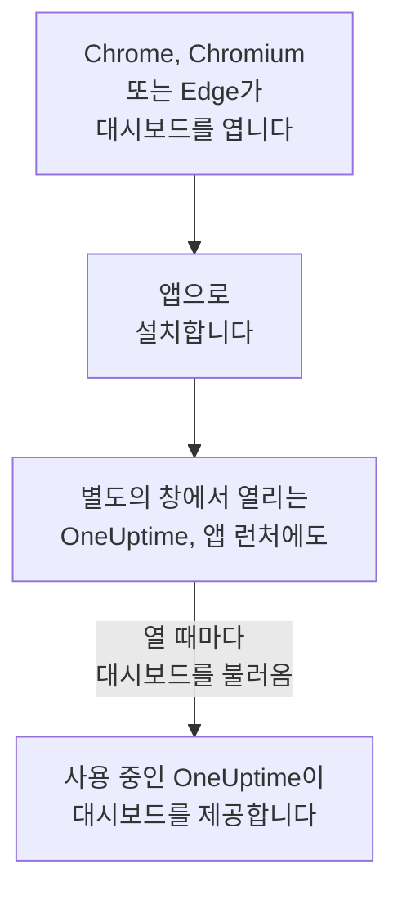

# Linux 설치

OneUptime 대시보드는 Google Chrome, Chromium 또는 Microsoft Edge에서 Linux에 앱으로 설치됩니다. 별도의 창에서 열리고, 데스크톱의 앱 런처에 자체 항목이 생기며, 알림을 표시할 수 있습니다. 다운로드할 것은 없습니다. 앱은 사용 중인 OneUptime의 대시보드 그 자체이며, 사용 중인 OneUptime이 최신이면 앱도 항상 최신입니다.

:::cards
- [앱 설치하기](#앱-설치하기): Chrome, Chromium 또는 Edge에서.
- [런처에서 열기](#런처에서-열기): 다른 데스크톱 앱처럼.
- [이 컴퓨터에서 알림 받기](#이-컴퓨터에서-알림-받기): 브라우저를 푸시 알림용으로 등록합니다.
- [문제 해결](#문제-해결): 설치 아이콘이 없음, 알림이 없음, 런처에 항목이 없음.
:::

## 데스크톱 앱의 작동 방식

설치된 앱은 브라우저의 로그인, 설정, 알림 권한을 함께 사용합니다. 브라우저를 닫아도 앱은 자체 창에서 계속 실행됩니다.

## 시작하기 전에

- 최신 Google Chrome, Chromium 또는 Microsoft Edge가 있는 Linux 데스크톱.
- HTTPS로 제공되는 사용 중인 OneUptime의 주소. OneUptime Cloud에서는 `https://oneuptime.com`, 자체 주소라면 `https://oneuptime.example.com` 같은 주소입니다.
- 대시보드에 로그인할 수 있는 계정.

## 앱 설치하기

:::tabs
@tab Chrome
1. Chrome이나 Chromium에서 사용 중인 OneUptime을 열고 로그인합니다.
2. 대시보드의 아무 페이지에서나 주소 표시줄 오른쪽의 설치 아이콘을 클릭한 다음 **설치**를 클릭합니다. 또는 **⋮ → 전송, 저장 및 공유 → 페이지를 앱으로 설치**를 엽니다.
3. Chrome이 별도의 창에서 OneUptime을 열고 앱 런처에 추가합니다.
@tab Edge
1. Edge에서 사용 중인 OneUptime을 열고 로그인합니다.
2. 대시보드의 아무 페이지에서나 주소 표시줄 오른쪽의 설치 아이콘을 클릭한 다음 **설치**를 클릭합니다. 또는 **설정 및 기타 (…) → 기타 도구 → 앱 → 이 사이트를 앱으로 설치**를 엽니다.
3. Edge가 별도의 창에서 OneUptime을 열고 앱 런처에 추가합니다.
:::

로그인한 뒤 대시보드 페이지에서 설치하세요. 로그인 페이지는 앱이 아닙니다.

## 런처에서 열기

브라우저가 앱의 데스크톱 항목(`~/.local/share/applications`의 `.desktop` 파일)을 추가하므로, OneUptime이 GNOME, KDE Plasma 및 기타 런처에 나타납니다. 다른 앱처럼 그곳에서 독이나 패널에 고정하세요.

## 이 컴퓨터에서 알림 받기

앱은 브라우저를 통해 알림을 표시합니다. 알림을 받으려는 각 프로젝트에서 브라우저를 푸시 알림용으로 등록하세요.

:::steps
### 푸시 디바이스 열기
앱에서 **사용자 설정 → 알림 방법**을 열고 **Push Notifications** 탭을 엽니다.

### 이 브라우저 등록하기
**디바이스 등록**을 클릭하고, **디바이스 이름**은 `Chrome on Linux` 같은 제안된 이름을 그대로 두거나 바꾼 다음, **디바이스 등록**을 다시 클릭합니다. OneUptime이 알림을 표시해도 되는지 브라우저가 물으면 **허용**을 선택합니다.

### 테스트 보내기
**Browser Registered** 대화 상자에서 **Send Test Notification**을 클릭합니다. 데스크톱이 알림 서비스를 통해 알림을 보여 줍니다. 아무것도 나타나지 않으면 [문제 해결](#문제-해결)을 참고하세요.
:::

브라우저는 데스크톱의 방해 금지 모드를 뚫고 울릴 수 없습니다. 반드시 깨워야 하는 호출에는 중요 알림을 켠 모바일 앱을 사용하세요. [Android 설치](/docs/mobile-desktop-apps/android-installation#무음-모드에서도-울리게-하기)를 참고하세요.

자체 호스팅 OneUptime에서는 브라우저 알림에 서버의 VAPID 키가 필요합니다. [푸시 알림](/docs/self-hosted/push-notifications#자체-호스팅-설정)을 참고하세요.

## 업데이트

업데이트할 것이 없습니다. 앱은 열 때마다 사용 중인 OneUptime에서 대시보드를 불러오므로, 사용 중인 OneUptime이 업그레이드되면 함께 바뀝니다. 업그레이드 이전부터 열려 있던 창은 Ctrl+R로 새로 고치세요.

## 제거

:::tabs
@tab Chrome
앱 창에서 **⋮** 메뉴를 열고 앱을 제거하는 항목을 선택한 다음 **삭제**를 선택합니다.
@tab Edge
Edge에서 `edge://apps`를 열고 OneUptime의 **세부 정보**를 선택한 다음 **제거**를 선택합니다.
:::

앱을 제거해도 브라우저의 등록은 해제되지 않습니다. 브라우저는 계속 알림을 받습니다. 알림을 멈추려면 **사용자 설정 → 알림 방법**의 **Push Notifications** 탭에서 **삭제**로 브라우저를 삭제하세요.

## 문제 해결

:::details 주소 표시줄에 설치 아이콘이 없음
로그인 페이지가 아니라 로그인한 뒤의 대시보드 페이지를 열고, 주소가 `https://`로 시작하는지 확인하세요. 브라우저는 안전한 사이트에서만 앱을 설치합니다. 그래도 아이콘이 보이지 않으면 위에서 설명한 대로 브라우저 메뉴를 사용하세요. 다른 브라우저는 사이트를 앱으로 설치하지 못할 수 있으니 Chrome, Chromium 또는 Edge를 사용하세요.
:::

:::details 알림이 나타나지 않음
- **사용자 설정 → 알림 방법**의 **Push Notifications** 탭에서 이 브라우저가 목록에 있는지 확인하고 **테스트 알림**을 보냅니다.
- 데스크톱의 방해 금지 모드가 꺼져 있고, 알림 설정이 브라우저를 허용하는지 확인합니다.
- 브라우저가 OneUptime의 알림을 차단하고 있다면 주소 표시줄 왼쪽의 아이콘을 클릭해 사이트의 알림을 허용하고 브라우저를 다시 등록합니다.
- 자체 호스팅 OneUptime에서는 서버에 VAPID 키가 없으면 **디바이스 등록** 대화 상자에 그렇게 표시됩니다.
:::

:::details 런처에 앱이 없음
대신 브라우저에서 여세요. Chrome이나 Chromium에서는 `chrome://apps`, Edge에서는 `edge://apps`입니다. 로그인할 때만 데스크톱 항목을 읽는 런처는 로그아웃했다가 다시 로그인하면 앱을 보여 줍니다.
:::

## 다음 단계

:::cards
- [Android 설치](/docs/mobile-desktop-apps/android-installation): 중요 알림과 함께 휴대폰으로 호출을 받습니다.
- [Windows 설치](/docs/mobile-desktop-apps/windows-installation): Windows에서 같은 앱을 사용합니다.
- [FAQ 및 문제 해결](/docs/mobile-desktop-apps/faq-troubleshooting): 두 앱에 대한 답변.
- [내 계정](/docs/introduction/your-account): OneUptime이 각 프로젝트에서 나에게 연락하는 방법.
:::
