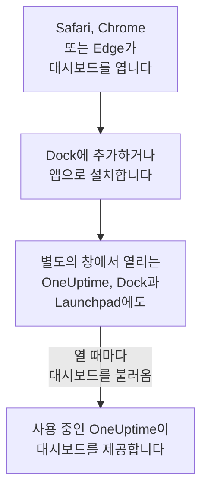

# macOS 설치

OneUptime 대시보드는 Mac에 앱으로 설치됩니다. Safari에서 Dock에 추가하거나, Google Chrome 또는 Microsoft Edge에서 설치하세요. 별도의 창에서 열리고, Dock과 Launchpad에 자체 아이콘이 생기며, 알림을 표시할 수 있습니다. 다운로드할 것은 없습니다. 앱은 사용 중인 OneUptime의 대시보드 그 자체이며, 사용 중인 OneUptime이 최신이면 앱도 항상 최신입니다.

:::cards
- [앱 설치하기](#앱-설치하기): Safari, Chrome 또는 Edge에서.
- [Dock에 유지하기](#dock에-유지하기): 클릭 한 번으로, 또는 로그인할 때 엽니다.
- [이 Mac에서 알림 받기](#이-mac에서-알림-받기): 앱을 푸시 알림용으로 등록합니다.
- [문제 해결](#문제-해결): Dock에 추가가 없음, 알림이 없음, 다시 로그인해야 함.
:::

## 데스크톱 앱의 작동 방식

Safari 웹 앱은 Safari와 별도로 자체 로그인, 쿠키, 설정을 가집니다. Chrome이나 Edge에서 설치한 앱은 이를 해당 브라우저와 함께 사용합니다.

## 시작하기 전에

- Safari의 경우 macOS Sonoma 14 이상. Chrome과 Edge는 실행되는 모든 macOS에서 앱을 설치합니다.
- HTTPS로 제공되는 사용 중인 OneUptime의 주소. OneUptime Cloud에서는 `https://oneuptime.com`, 자체 주소라면 `https://oneuptime.example.com` 같은 주소입니다.
- 대시보드에 로그인할 수 있는 계정.

## 앱 설치하기

:::tabs
@tab Safari
1. Safari에서 사용 중인 OneUptime을 열고 로그인합니다.
2. 대시보드의 아무 페이지에서나 **파일 → Dock에 추가**를 선택하거나, 도구 막대의 공유 버튼을 클릭한 다음 **Dock에 추가**를 클릭합니다.
3. 이름을 그대로 두거나 바꾸고 **추가**를 클릭합니다.
4. Dock에서 OneUptime을 열고 한 번 더 로그인합니다. 웹 앱은 Safari의 로그인을 함께 사용하지 않습니다.
@tab Chrome
1. Chrome에서 사용 중인 OneUptime을 열고 로그인합니다.
2. 대시보드의 아무 페이지에서나 주소 표시줄 오른쪽의 설치 아이콘을 클릭한 다음 **설치**를 클릭합니다. 또는 **⋮ → 전송, 저장 및 공유 → 페이지를 앱으로 설치**를 엽니다.
3. Chrome이 별도의 창에서 OneUptime을 열고 Launchpad에 추가합니다.
@tab Edge
1. Edge에서 사용 중인 OneUptime을 열고 로그인합니다.
2. 대시보드의 아무 페이지에서나 주소 표시줄 오른쪽의 설치 아이콘을 클릭한 다음 **설치**를 클릭합니다. 또는 **설정 및 기타 (…) → 기타 도구 → 앱 → 이 사이트를 앱으로 설치**를 엽니다.
3. Edge가 별도의 창에서 OneUptime을 열고 Launchpad에 추가합니다.
:::

로그인한 뒤 대시보드 페이지에서 설치하세요. 로그인 페이지는 앱이 아닙니다. Safari는 웹 앱을 홈 폴더의 응용 프로그램 폴더에 저장합니다.

## Dock에 유지하기

- **Dock.** 앱이 열려 있을 때 Dock 아이콘을 Control-클릭하고 **옵션 → Dock에 유지**를 선택합니다. Safari 웹 앱은 이미 Dock에 있습니다.
- **로그인 시 열기.** Dock 아이콘을 Control-클릭하고 **옵션 → 로그인 시 열기**를 선택합니다.
- **Spotlight.** Command-스페이스 바를 누르고 OneUptime을 입력합니다.

## 이 Mac에서 알림 받기

알림을 받으려는 각 프로젝트에서 앱을 푸시 알림용으로 등록하면 앱이 알림을 표시합니다. Safari 웹 앱은 웹 앱 안에서 등록하세요. 웹 앱은 그 자체로 별도의 브라우저입니다. Chrome이나 Edge에서 설치한 앱은 해당 브라우저로 등록됩니다.

:::steps
### 푸시 디바이스 열기
앱에서 **사용자 설정 → 알림 방법**을 열고 **Push Notifications** 탭을 엽니다.

### 이 앱 등록하기
**디바이스 등록**을 클릭하고, **디바이스 이름**은 `Safari on macOS` 같은 제안된 이름을 그대로 두거나 바꾼 다음, **디바이스 등록**을 다시 클릭합니다. OneUptime이 알림을 보내도 되는지 macOS나 브라우저가 물으면 **허용**을 선택합니다.

### 테스트 보내기
**Browser Registered** 대화 상자에서 **Send Test Notification**을 클릭합니다. 아무것도 나타나지 않으면 Mac의 알림 설정을 확인하세요. [문제 해결](#문제-해결)을 참고하세요.
:::

브라우저는 방해 금지 모드 같은 집중 모드를 뚫고 울릴 수 없습니다. 반드시 깨워야 하는 호출에는 중요 알림을 켠 모바일 앱을 사용하세요. [iOS 설치](/docs/mobile-desktop-apps/ios-installation#무음-모드에서도-울리게-하기)를 참고하세요.

자체 호스팅 OneUptime에서는 브라우저 알림에 서버의 VAPID 키가 필요합니다. [푸시 알림](/docs/self-hosted/push-notifications#자체-호스팅-설정)을 참고하세요.

## 업데이트

업데이트할 것이 없습니다. 앱은 열 때마다 사용 중인 OneUptime에서 대시보드를 불러오므로, 사용 중인 OneUptime이 업그레이드되면 함께 바뀝니다. 업그레이드 이전부터 열려 있던 창은 Command-R로 새로 고치세요.

## 제거

:::tabs
@tab Safari
Finder에서 홈 폴더를 열고, 그 안의 응용 프로그램 폴더에서 OneUptime을 휴지통으로 드래그합니다.
@tab Chrome
앱 창에서 **⋮** 메뉴를 열고 앱을 제거하는 항목을 선택한 다음 **삭제**를 선택합니다.
@tab Edge
Edge에서 `edge://apps`를 열고 OneUptime의 **세부 정보**를 선택한 다음 **제거**를 선택합니다.
:::

앱을 제거해도 등록은 해제되지 않습니다. 브라우저는 계속 알림을 받습니다. 알림을 멈추려면 **사용자 설정 → 알림 방법**의 **Push Notifications** 탭에서 **삭제**로 삭제하세요.

## 문제 해결

:::details Safari에 Dock에 추가가 없음
Safari는 macOS Sonoma 14부터 웹 앱을 Dock에 추가합니다. macOS를 업데이트하거나, 대신 Chrome이나 Edge에서 앱을 설치하세요.
:::

:::details 알림이 나타나지 않음
- **사용자 설정 → 알림 방법**의 **Push Notifications** 탭에서 앱이나 그 브라우저가 목록에 있는지 확인하고 **테스트 알림**을 보냅니다.
- Mac에서 **시스템 설정 → 알림**을 열고 OneUptime이나 설치한 브라우저가 알림을 보낼 수 있는지, 집중 모드가 알림을 보류하고 있지 않은지 확인합니다.
- 브라우저가 OneUptime의 알림을 차단하고 있다면 브라우저의 사이트 설정에서 알림을 허용하고 다시 등록합니다.
- 자체 호스팅 OneUptime에서는 서버에 VAPID 키가 없으면 **디바이스 등록** 대화 상자에 그렇게 표시됩니다.
:::

:::details 앱이 다시 로그인하라고 함
Safari 웹 앱은 자체 로그인을 가지므로 앱 안에서 로그인하세요. Chrome이나 Edge에서 설치한 앱은 브라우저의 로그인을 함께 사용하므로, 브라우저에서 로그아웃하거나 쿠키를 지우면 앱에서도 로그아웃됩니다.
:::

## 다음 단계

:::cards
- [iOS 설치](/docs/mobile-desktop-apps/ios-installation): 중요 알림과 함께 iPhone으로 호출을 받습니다.
- [Windows 설치](/docs/mobile-desktop-apps/windows-installation): Windows에서 같은 앱을 사용합니다.
- [FAQ 및 문제 해결](/docs/mobile-desktop-apps/faq-troubleshooting): 두 앱에 대한 답변.
- [내 계정](/docs/introduction/your-account): OneUptime이 각 프로젝트에서 나에게 연락하는 방법.
:::
