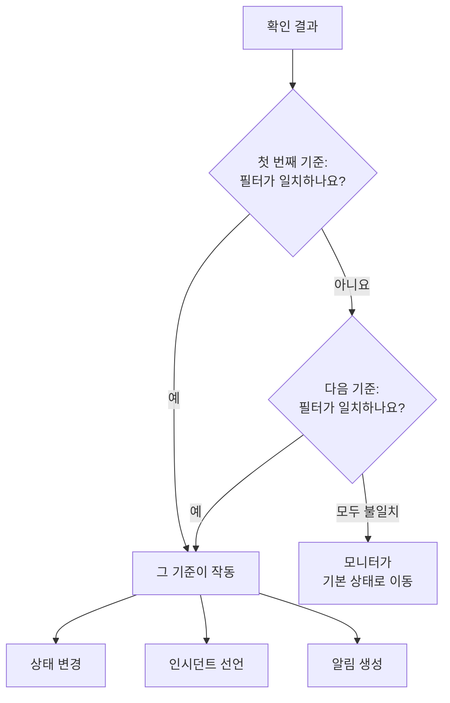
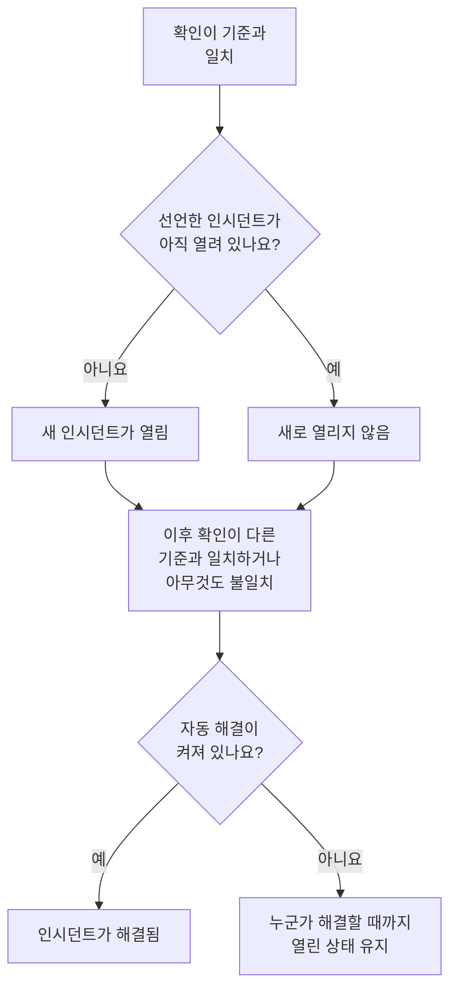

# 모니터 기준 및 상태

모니터의 기준은 각 확인이 무엇을 뜻하는지 정합니다. 모니터가 정상인지 다운인지, 그리고 OneUptime이 인시던트를 선언할지 알림을 만들지입니다. 상태는 모니터가 될 수 있는 상태를 담은 프로젝트의 목록으로, **정상 작동**부터 **오프라인**까지 있습니다. 이 페이지는 모든 모니터 유형에 대해 두 가지를 모두 설명하며, 각 유형의 페이지에는 그 유형이 제공하는 필터가 나와 있습니다.

:::cards
- [기준이 결정하는 방식](#기준이-결정하는-방식): 위에서 아래로, 처음 일치한 것이 이깁니다.
- [기준의 구성](#기준의-구성): 필터, 일치 조건, 작업, 설정.
- [모니터의 기준 변경](#모니터의-기준-변경): 기준 편집, 추가, 순서 변경, 테스트.
- [모니터 상태](#모니터-상태): 기본 제공 상태와 직접 만든 상태.
:::

## 기준이 결정하는 방식

모니터를 확인할 때마다 그 기준이 목록 위에서부터 아래로 결과를 판단합니다. 필터가 일치하는 첫 번째 기준이 무슨 일이 일어날지 정하며, 그 확인에서는 아래에 있는 기준을 보지 않습니다. 아무 기준도 일치하지 않으면 모니터는 **기본 모니터 상태**로 갑니다.

순서도 규칙의 일부입니다. 새 모니터는 기준을 가장 나쁜 것부터 나열합니다. 오프라인, 그다음 유형에 경고가 있으면 경고(곧 만료되는 인증서나 도메인), 그리고 온라인입니다. **Is Online**이 **참**인 것처럼 넓은 정상 기준은 거의 모든 확인과 일치하므로 마지막에 둡니다. 다른 기준보다 위에 있으면 매번 먼저 일치해서 다른 기준이 작동할 일이 없습니다.

일치하지만 상태를 바꾸지 않는 기준도 그 확인의 결과를 정합니다. 모니터는 지금 상태를 유지하고, 그 아래 기준은 다음 확인을 기다립니다. **기본 모니터 상태**는 아무 기준도 일치하지 않을 때만 적용됩니다. 새 모니터의 기본값은 **정상 작동**이며, 기준 아래의 **추가 필드**에서 바꿀 수 있습니다.

> [!NOTE]
> 호스트, 컨테이너, 디스크, 인터페이스마다 인시던트나 알림을 따로 여는 모니터는 각 확인에서 모든 기준을 판단하므로, 두 호스트가 동시에 서로 다른 두 기준과 일치할 수 있습니다. 쿼리에 **그룹화 기준**이 있는 모니터(예: 메트릭 모니터나 로그 모니터)나, 모든 디스크나 인터페이스에 `*`를 지정한 기준이 여기에 해당합니다. 페이로드 필드로 인시던트를 그룹화하는 수신 요청 모니터는 여전히 첫 번째 일치에서 멈춥니다.

## 기준의 구성

기준을 열면 이름과 세 섹션이 있고, 각 섹션은 한 줄 요약으로 접힙니다.

| 부분 | 담고 있는 것 |
| --- | --- |
| **기준 이름** | 기준 목록에 표시되는 이름이며, 그 기준이 여는 모든 인시던트와 알림의 근본 원인에도 쓰입니다. **기준 추가**는 새 기준에 필터에 따른 이름을 붙이고, 직접 이름을 입력할 때까지 이름이 필터를 따라 바뀝니다. |
| **필터** | 확인이 보여 줘야 하는 것으로, 하나 이상의 필터로 표현합니다. Kubernetes 모니터와 메트릭 모니터에서는 **Alert Rules**라고 부릅니다. |
| **작업** | 필터가 일치하면 일어나는 일입니다. 상태 변경, 알림 생성, 인시던트 선언 또는 이들의 조합입니다. |
| **설정** | **이 기준 활성화**, 선택 사항인 **설명**, 그리고 수신 요청 모니터에서는 **Group incidents and alerts by a payload field**. |

### 필터

필터는 확인에서 값 하나를 읽어 비교합니다. **필터 유형**(무엇을 읽을지, 예: **응답 상태 코드**), **필터 조건**(어떻게 비교할지, 예: **보다 큼**), **값**으로 이루어집니다. Kubernetes 모니터나 메트릭 모니터처럼 메트릭을 비교하는 모니터는 대신 **조건**과 **임계값**을 묻습니다. 모니터 유형마다 고유한 필터 유형이 있으며, [모니터링 기준](/docs/monitor/website-monitor#모니터링-기준)처럼 각 유형의 페이지에 나와 있습니다.

필터가 두 개 이상이면 그 아래에 **일치 조건**이 나타납니다. **전체**는 모든 필터가 일치해야 한다는 뜻이고, **하나 이상**은 하나만 일치해도 된다는 뜻입니다. 새 기준은 **전체**로 시작합니다.

**Is Online**, **응답 상태 코드**, **응답 시간(ms)** 같이 모든 확인을 측정하는 필터에는 **일정 기간에 걸쳐 이 기준을 평가**가 있습니다. 최신 확인 하나가 아니라 최근 확인들의 기간을 판단하며, 처음에는 최근 5분과 **All Values**로 설정되어 기간 안의 모든 확인이 일치했을 때만 일치합니다. [일정 기간에 걸친 평가](/docs/monitor/website-monitor#일정-기간에-걸친-평가)를 참고하세요.

### 작업

각 작업은 **작업** 아래의 스위치입니다.

| 스위치 | 하는 일 |
| --- | --- |
| **필터가 일치하면 모니터 상태를 변경합니다.** | **모니터 상태를 다음으로 변경**에서 고른 상태로 모니터를 옮깁니다. |
| **필터가 일치하면 경고를 생성합니다.** | **알림 생성**에서 설정한 알림을 만듭니다. 알림은 팀에 알리며 상태 페이지에는 절대 표시되지 않습니다. |
| **필터가 일치하면 인시던트를 선언합니다.** | **인시던트 생성**에서 설정한 인시던트를 선언합니다. 상태 페이지에 표시될 수 있습니다. |

인시던트나 알림은 제목, **심각도**, 그리고 접힌 부분에서 설명, 소유자, 레이블, 온콜 정책을 묻습니다. 제목과 설명에는 `{{monitorName}}`처럼 확인의 값을 넣을 수 있습니다. [인시던트 및 알림 템플릿](/docs/monitor/incident-alert-templating)을 참고하세요. 기준이 일치할 때 누군가를 호출하려면 **온콜**에서 정책을 고르세요. [온콜 정책](/docs/on-call/policies)을 참고하세요.

### 설정

**이 기준 활성화**는 모든 새 기준에서 켜져 있습니다. 끄면 기준을 사용하지 않고 남겨 둘 수 있습니다. 그 기준은 모든 확인에서 건너뛰어지고, 상태를 바꾸지 않고, 아무것도 열지 않으며, 헤더에 **비활성화**가 표시됩니다.

**Group incidents and alerts by a payload field**는 수신 요청에서 찾은 값마다 인시던트를 하나씩 열어, 웹훅 주소 하나로 여러 인시던트를 열어 둘 수 있게 합니다. [인시던트 그룹화 켜기](/docs/monitor/incoming-request-monitor#인시던트-그룹화-켜기)를 참고하세요.

## 인시던트와 알림이 열리고 닫히는 때

인시던트를 선언하는 기준은 일치하면 인시던트를 엽니다. 모니터가 회복되면, 기준에서 그렇게 설정한 경우 인시던트가 저절로 닫힙니다.

- **한 번에 하나.** 기준이 선언한 인시던트가 아직 열려 있는 동안에는 같은 기준이 다시 일치해도 다른 인시던트를 선언하지 않습니다. 알림도 마찬가지입니다. 호스트나 페이로드 필드로 그룹화하는 모니터는 호스트나 값마다 하나씩 열어 두며, **이메일마다 새 인시던트 열기**가 켜진 수신 이메일 기준은 이메일마다 하나씩 엽니다.
- **닫힘.** 다른 기준이 일치하거나 아무 기준도 일치하지 않는 이후 확인에서, 기준의 **인시던트 자동 해결**이 켜진 인시던트가 해결되며, **경고 자동 해결**이 켜진 알림도 마찬가지입니다. 둘 다 인시던트나 알림의 **추가 필드**에 있으며, 새 모니터가 처음 갖는 기준에서는 켜져 있습니다.
- **여러 프로브.** 둘 이상의 프로브가 확인하는 모니터는 프로브들의 결과가 일치할 때만 바뀝니다. [기준 평가 방식](/docs/monitor/create-monitor#기준-평가-방식)을 참고하세요.
- **다운된 상위 모니터.** 모니터의 **구성 → 종속성** 페이지에서 **Depends On Monitors**는 그 모니터가 의존하는 모니터를 지정합니다. 그중 하나가 **Suppress When Parent Status Is**에 나열된 상태(비워 두면 모든 오프라인 상태)에 있는 동안 모니터는 인시던트도 알림도 열지 않습니다. 상태는 여전히 바뀌고, 열려 있는 것은 여전히 해결됩니다.
- **예정된 유지 관리.** 진행 중인 유지 관리 이벤트에 포함된 모니터는 확인되지 않으므로 기준도 실행되지 않습니다. [예정된 유지 관리 개요](/docs/scheduled-maintenance/index)를 참고하세요.

확인이 어떻게 판단되었는지 보려면 모니터의 **개요**를 엽니다. **모니터 요약** 카드에 어떤 기준이 일치했고 각각 무엇을 했는지가 표시되며, 이미 하나가 열려 있어서 건너뛴 인시던트도 포함됩니다.

## 모니터의 기준 변경

:::steps
### 기준 페이지 열기

**모니터**로 이동해 모니터를 엽니다. 사이드 메뉴에서 **구성**을 펼치고 **기준**을 클릭합니다. **모니터링 기준** 카드에 각 기준과 그것이 확인하는 것, 하는 일이 표시됩니다.

### Edit Monitoring Criteria 클릭

편집기에는 모든 기준이 펼쳐진 상태로 표시됩니다. 기준의 헤더를 클릭하면 이름, 필터 수, 하는 일을 보여 주는 한 줄로 접힙니다.

### 기준 추가, 변경 또는 순서 변경

**기준 추가**는 펼쳐진 상태로, 필터에 따라 이름이 붙은 기준을 맨 아래에 추가합니다. 기준을 옮기려면 왼쪽의 핸들을 끌어 놓습니다. 처음 일치한 것이 이기므로 가장 나쁜 경우를 맨 위에 둡니다. **기준 삭제**는 기준을 하나 삭제하며, 모니터에는 적어도 하나의 기준이 남습니다.

### 기준 저장

**변경 사항 저장**을 클릭합니다. 다음 확인부터 새 기준으로 판단합니다.

### 모니터 테스트

프로브가 확인하는 모니터에서는 카드의 **모니터 테스트**를 클릭하고, **프로브 선택**에서 프로브를 고른 다음 **테스트 실행**을 클릭합니다. **모니터 테스트 결과**에 확인 결과가 표시됩니다.
:::

수동 모니터에는 기준이 없습니다. 상태는 직접 설정합니다. [상태 업데이트](/docs/monitor/manual-monitor#상태-업데이트)를 참고하세요.

## 모니터 상태

모니터는 항상 프로젝트의 상태 중 하나에 있습니다. 새 프로젝트에는 가장 건강한 것부터 가장 나쁜 것까지 세 가지가 있습니다.

| 상태 | 위치 | 색상 | OneUptime이 하는 일 |
| --- | --- | --- | --- |
| **정상 작동** | 1 | 녹색 | 새 모니터는 이 상태에서 시작하며, 새 모니터의 **기본 모니터 상태**이기도 합니다. 기본 제공. |
| **저하됨** | 2 | 노란색 | 그 자체로는 아무것도 하지 않습니다. 직접 만든 기준이 모니터를 이 상태로 옮깁니다. |
| **오프라인** | 3 | 빨간색 | 새 모니터의 오프라인 기준이 모니터를 이 상태로 옮기며, OneUptime은 이 상태의 모니터를 다운으로 간주합니다. 기본 제공. |

목록은 순서이기도 합니다. 모니터를 함께 보여 주는 곳에서는 목록에서 가장 아래에 있는 상태가 이깁니다. 모니터 그룹, 상태 페이지 그룹, 상태 페이지의 전체 상태는 각각 그 모니터들 중 가장 나쁜 상태를 보여 줍니다.

### 상태가 반영되는 곳

| 위치 | 상태가 정하는 것 |
| --- | --- |
| **모니터** 목록 | 각 모니터의 현재 상태. **작동하지 않음**은 정상 작동이 아닌 상태에 있는 모니터를 나열하며, 옆에 빨간색 개수가 표시됩니다. |
| 상태 페이지 | 각 행의 색상과 가동 시간. 페이지의 **다운타임으로 계산**에 있는 상태만 가동 시간에서 빠집니다. 새 상태 페이지는 정상 작동을 뺀 모든 상태로 시작합니다. [페이지에 무엇을 표시할지 고르기](/docs/status-pages/index#페이지에-무엇을-표시할지-고르기)를 참고하세요. |
| 모니터 그룹 | 그룹의 상태. 그 모니터들 중 가장 나쁜 상태입니다. [모니터 그룹](/docs/monitor/monitor-groups)을 참고하세요. |
| SLO | SLO가 세는 다운타임. SLO 자체의 상태 목록을 따릅니다. [다운타임으로 세는 상태](/docs/slo/introduction#다운타임으로-세는-상태)를 참고하세요. |
| 종속성 | 상위 모니터가 하위 모니터의 인시던트와 알림을 막는지 여부. 기본적으로 상위 모니터가 오프라인 상태에 있는 동안입니다. |

나중에 추가한 상태는 기존 상태 페이지의 **다운타임으로 계산** 목록에 추가되지 않습니다. 직접 추가하세요.

### 직접 상태 추가

:::steps
### 모니터 상태 열기

**모니터 → 설정 → 모니터 상태**로 이동합니다. 사이드 메뉴의 **설정**은 접혀 있으므로 먼저 펼칩니다. **모니터 상태** 카드에 가장 건강한 것부터 가장 나쁜 것까지 상태가 나열됩니다.

### 상태 만들기

**모니터 상태 만들기**를 클릭하고 **이름**, **설명**, **색상**을 입력합니다. 새 상태는 오프라인 상태 바로 위에 들어가므로, 장애는 여전히 가장 나쁜 상태로 보입니다.

### 위치 정하기

핸들로 상태를 끌어 놓습니다. 목록에서 아래에 있는 상태일수록 그 위의 모든 상태보다 나쁜 것으로 간주됩니다.

### 기준에서 사용

상태는 기준이 모니터를 그 상태로 옮기기 전까지 아무것도 하지 않습니다. 그 상태를 설정해야 하는 기준의 **모니터 상태를 다음으로 변경**에서 고르세요.
:::

정상 작동 상태와 오프라인 상태에는 **기본 제공** 표시가 있습니다. 이름과 색상은 바꿀 수 있지만 삭제할 수는 없습니다. OneUptime Cloud에서는 상태를 만들거나 바꾸려면 Growth 요금제가 필요합니다. 상태를 관리하려면 Project Owner, Project Admin 또는 Monitor Admin 역할이나, 해당 모니터 상태 권한이 있는 사용자 지정 역할이 필요합니다.

### 상태 타임라인

모든 상태 변경은 모니터의 **상태 타임라인**에 남습니다. 언제 시작했는지, 얼마나 지속되었는지, 그리고 그 상태를 설정한 기준을 보여 주는 **원인 보기**입니다. **모니터 상태 이벤트 만들기**는 상태를 직접 추가합니다. 프로브가 확인하는 모니터에서는 상태가 있는 기준과 일치하는 다음 확인이 그 상태를 다시 설정합니다.

모니터의 상태 변경은 소유자가 알림 설정에서 **모니터 상태 변경됨**을 켠 경우에만 소유자에게 알려지며, 처음에는 꺼져 있습니다. 아무 기준도 일치하지 않아 **기본 모니터 상태**로 돌아간 모니터는 아무에게도 알리지 않습니다. [새 멤버에게 켜져 있는 것](/docs/notifications/notification-settings#새-멤버에게-켜져-있는-것)을 참고하세요.

## 모니터 상태 보관

팀에서 더 이상 사용하지 않을 상태는 삭제하는 대신 보관하세요. 보관해도 모니터는 바뀌지 않습니다. 이 상태의 모니터는 상태가 바뀔 때까지 그대로 유지되며, 상태 타임라인에도 계속 표시됩니다.

- **보관**는 행의 **⋯** 메뉴에 있습니다. 먼저 확인을 요청하고, 이 상태를 사용하도록 설정된 모니터 조건, 템플릿, 상태 페이지를 보여 줍니다. 이들은 변경하기 전까지 계속 이 상태를 사용합니다.
- **아무도 다시 선택할 수 없습니다.** 조건, 모니터의 상태 메뉴, 인시던트나 유지 관리 이벤트의 모니터 상태, 상태 페이지의 다운타임 상태에서 제외됩니다. API, Terraform, MCP는 거부합니다.
- **보관된 상태는 따로 표시됩니다.** 표 아래의 접힌 섹션 **보관된 모니터 상태**에 표시됩니다. **보관 취소**로 원래대로 되돌릴 수 있습니다.
- **기본 제공 상태는 보관할 수 없습니다.** 새 모니터는 정상 상태에서 시작하고, OneUptime은 오프라인 상태의 모니터를 다운으로 간주합니다. 이들의 **보관**는 이유와 함께 잠겨 있습니다.

## 문제 해결

:::details 사이트가 다운됐는데 모니터가 정상 작동에 머물러 있음
목록에서 더 위에 있는 기준이 먼저 일치했습니다. **구성 → 기준**을 열어 순서를 확인하세요. 정상 기준은 맨 마지막에 둡니다. 또한 오프라인 기준의 **이 기준 활성화**가 켜져 있는지, 그 작업인 **필터가 일치하면 모니터 상태를 변경합니다.** 스위치가 켜져 있고 상태가 선택되어 있는지 확인하세요.
:::

:::details 모니터가 다운됐는데 인시던트가 열리지 않음
일치한 기준을 확인하세요. **필터가 일치하면 인시던트를 선언합니다.** 스위치가 켜져 있어야 합니다. 같은 기준의 인시던트가 아직 열려 있는 동안, **Depends On Monitors**의 상위 모니터가 다운된 동안, 또는 모니터가 예정된 유지 관리 중인 동안에는 인시던트가 선언되지 않습니다. 모니터 **개요**의 **모니터 요약** 카드에서 어느 경우인지 알 수 있습니다.
:::

:::details 모니터가 회복된 뒤에도 인시던트가 열려 있음
인시던트의 기준을 열고 그 인시던트의 **추가 필드**를 펼치세요. **인시던트 자동 해결**이 켜져 있어야 합니다. 이후 삭제한 기준의 인시던트는 모니터가 해결하지 않으므로 직접 해결하세요.
:::

:::details 오프라인의 삭제 버튼이 잠겨 있음
**정상 작동**과 **오프라인**은 기본 제공 상태입니다. OneUptime이 모니터를 이 상태로 옮기므로 이름은 바꿀 수 있지만 삭제할 수는 없습니다. 대신 직접 만든 상태를 삭제하거나 기본 제공 상태의 이름을 바꾸세요.
:::

## 다음 단계

:::cards
- [모니터 만들기](/docs/monitor/create-monitor): 새 모니터의 세 단계.
- [인시던트 및 알림 템플릿](/docs/monitor/incident-alert-templating): 확인의 값을 제목과 설명에 넣습니다.
- [모니터 그룹](/docs/monitor/monitor-groups): 여러 모니터를 하나의 상태로 묶습니다.
- [인시던트 개요](/docs/incidents/index): 기준이 인시던트를 선언한 뒤에 일어나는 일.
:::
