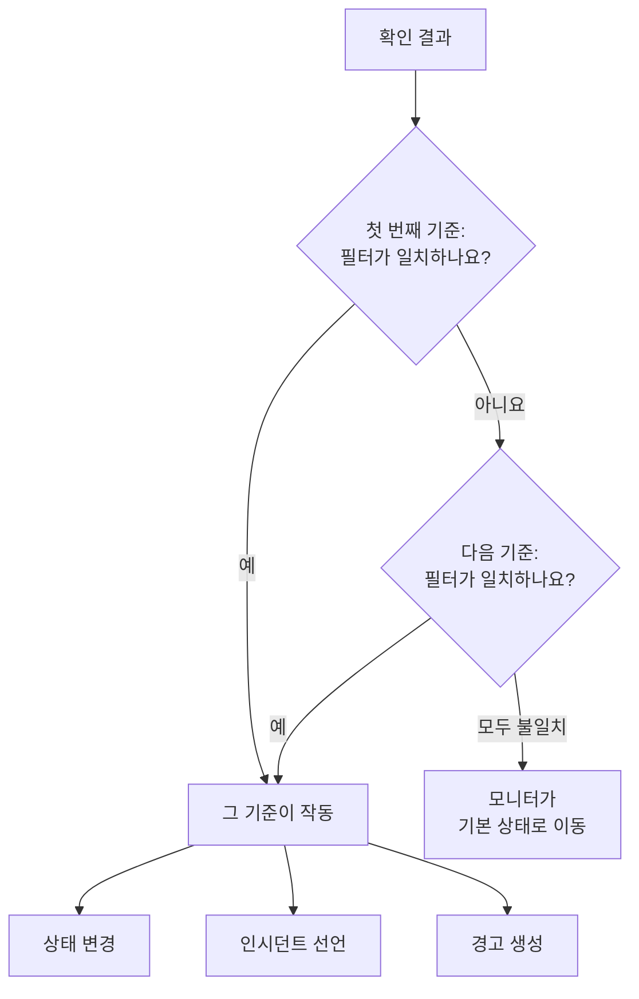
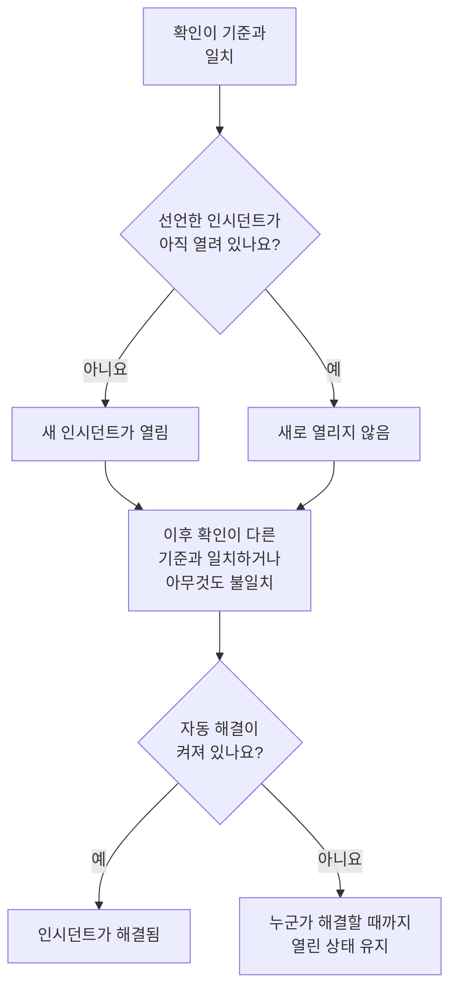

# 기준 및 상태

모니터의 기준은 각 확인이 무엇을 뜻하는지 정합니다. 모니터가 정상인지 다운인지, 그리고 OneUptime이 인시던트를 선언할지 경고를 만들지입니다. 상태는 모니터가 될 수 있는 상태를 담은 프로젝트의 목록으로, **정상 작동**부터 **오프라인**까지 있습니다. 이 페이지는 모든 모니터 유형에 대해 두 가지를 모두 설명하며, 각 유형의 페이지에는 그 유형이 제공하는 필터가 나와 있습니다.

:::cards
- [기준이 결정하는 방식](#기준이-결정하는-방식): 위에서 아래로, 처음 일치한 것이 이깁니다.
- [기준의 구성](#기준의-구성): 필터, 일치 조건, 작업, 설정.
- [확인 기간 판단하기](#확인-기간-판단하기): 실패한 확인을 세고, 불안정을 잡아내고, 백분위수를 읽습니다.
- [모니터의 기준 변경](#모니터의-기준-변경): 기준 편집, 추가, 순서 변경, 테스트.
- [모니터 상태](#모니터-상태): 기본 제공 상태와 직접 만든 상태.
:::

## 기준이 결정하는 방식

모니터를 확인할 때마다 그 기준이 목록 위에서부터 아래로 결과를 판단합니다. 필터가 일치하는 첫 번째 기준이 무슨 일이 일어날지 정하며, 그 확인에서는 아래에 있는 기준을 보지 않습니다. 아무 기준도 일치하지 않으면 모니터는 **기본 모니터 상태**로 갑니다. 다만 모니터를 되돌리는 기준이 아직 일치하지 않았다면 대신 현재 상태를 유지합니다. [기준이 복구되는 시점](#기준이-복구되는-시점)을(를) 참조하세요.

순서도 규칙의 일부입니다. 새 모니터는 기준을 가장 나쁜 것부터 나열합니다. 오프라인, 그다음 유형에 경고가 있으면 경고(곧 만료되는 인증서나 도메인), 그리고 온라인입니다. **온라인 여부**가 **참**인 것처럼 넓은 정상 기준은 거의 모든 확인과 일치하므로 마지막에 둡니다. 다른 기준보다 위에 있으면 매번 먼저 일치해서 다른 기준이 작동할 일이 없습니다.

일치하지만 상태를 바꾸지 않는 기준도 그 확인의 결과를 정합니다. 모니터는 지금 상태를 유지하고, 그 아래 기준은 다음 확인을 기다립니다. **기본 모니터 상태**는 아무 기준도 일치하지 않을 때만 적용됩니다. 새 모니터의 기본값은 **정상 작동**이며, 기준 아래의 **추가 필드**에서 바꿀 수 있습니다.

> [!NOTE]
> 호스트, 컨테이너, 디스크, 인터페이스마다 인시던트나 경고를 따로 여는 모니터는 각 확인에서 모든 기준을 판단하므로, 두 호스트가 동시에 서로 다른 두 기준과 일치할 수 있습니다. 쿼리에 **그룹화 기준**이 있는 모니터(예: 메트릭 모니터나 로그 모니터)나, 모든 디스크나 인터페이스에 `*`를 지정한 기준이 여기에 해당합니다. PromQL 식을 지켜보는 메트릭 모니터도 여기에 해당하며, 식이 반환하는 각 시리즈는 따로 판정됩니다. 페이로드 필드로 인시던트를 그룹화하는 수신 요청 모니터는 여전히 첫 번째 일치에서 멈춥니다.
>
> 이런 모니터도 상태는 하나이며, 처음 일치한 기준이 정합니다. 모니터를 **기본 모니터 상태**로 되돌리기만 하고 인시던트나 경고를 열지 않는 기준은, 다른 상태를 설정하는 기준을 충족한 호스트들을 기다리며, 다른 호스트와 관계없이 그 호스트들이 각각 충족하면 일치합니다. 그때까지는 어떤 기준도 일치하지 않아도 모니터가 상태를 유지하며, 각 호스트의 인시던트와 경고는 계속 개별적으로 해결됩니다.

## 기준의 구성

기준을 열면 이름과 세 섹션이 있고, 각 섹션은 한 줄 요약으로 접힙니다.

| 부분 | 담고 있는 것 |
| --- | --- |
| **기준 이름** | 기준 목록에 표시되는 이름이며, 그 기준이 여는 모든 인시던트와 경고의 근본 원인에도 쓰입니다. **기준 추가**는 새 기준에 필터에 따른 이름을 붙이고, 직접 이름을 입력할 때까지 이름이 필터를 따라 바뀝니다. |
| **필터** | 확인이 보여 줘야 하는 것으로, 하나 이상의 필터로 표현합니다. Kubernetes 모니터와 메트릭 모니터에서는 **경고 규칙**라고 부릅니다. |
| **작업** | 필터가 일치하면 일어나는 일입니다. 상태 변경, 경고 생성, 인시던트 선언 또는 이들의 조합입니다. |
| **설정** | **이 기준 활성화**, 선택 사항인 **설명**, 복구 시점과 평가 시점, 그리고 Incoming Request 모니터에서는 **Group incidents and alerts by a payload field**. |

### 필터

필터는 확인에서 값 하나를 읽어 비교합니다. **필터 유형**(무엇을 읽을지, 예: **응답 상태 코드**), **필터 조건**(어떻게 비교할지, 예: **보다 큼**), **값**으로 이루어집니다. Kubernetes 모니터나 메트릭 모니터처럼 메트릭을 비교하는 모니터는 대신 **조건**과 **임계값**을 묻습니다. 모니터 유형마다 고유한 필터 유형이 있으며, [모니터링 기준](/docs/monitor/website-monitor#모니터링-기준)처럼 각 유형의 페이지에 나와 있습니다.

필터가 두 개 이상이면 그 아래에 **일치 조건**이 나타납니다. **전체**는 모든 필터가 일치해야 한다는 뜻이고, **하나 이상**은 하나만 일치해도 된다는 뜻입니다. 새 기준은 **전체**로 시작합니다.

**온라인 여부**, **응답 상태 코드**, **응답 시간(ms)** 같이 모든 확인을 측정하는 필터에는 **일정 기간에 걸쳐 이 기준을 평가**가 있습니다. 최신 확인 하나가 아니라 최근 확인들의 기간을 판단하며, 처음에는 최근 5분과 **모든 값**으로 설정되어 기간 안의 모든 확인이 일치했을 때만 일치합니다. 기간은 최대 24시간까지 설정할 수 있고 확인을 셀 수도 있으며, 자세한 내용은 [확인 기간 판단하기](#확인-기간-판단하기)에서 설명합니다. [일정 기간에 걸친 평가](/docs/monitor/website-monitor#일정-기간에-걸친-평가)를 참고하세요.

### 작업

각 작업은 **작업** 아래의 스위치입니다.

| 스위치 | 하는 일 |
| --- | --- |
| **필터가 일치하면 모니터 상태를 변경합니다.** | **모니터 상태를 다음으로 변경**에서 고른 상태로 모니터를 옮깁니다. |
| **필터가 일치하면 경고를 생성합니다.** | **경고 생성**에서 설정한 경고를 만듭니다. 경고는 팀에 알리며 상태 페이지에는 절대 표시되지 않습니다. |
| **필터가 일치하면 인시던트를 선언합니다.** | **인시던트 생성**에서 설정한 인시던트를 선언합니다. 상태 페이지에 표시될 수 있습니다. |

인시던트나 경고는 제목, **심각도**, 그리고 접힌 부분에서 설명, 소유자, 레이블, 온콜 정책을 묻습니다. 제목과 설명에는 `{{monitorName}}`처럼 확인의 값을 넣을 수 있습니다. [인시던트 및 경고 템플릿](/docs/monitor/incident-alert-templating)을 참고하세요. 기준이 일치할 때 누군가를 호출하려면 **온콜**에서 정책을 고르세요. [온콜 정책](/docs/on-call/policies)을 참고하세요.

### 설정

**이 기준 활성화**는 모든 새 기준에서 켜져 있습니다. 끄면 기준을 사용하지 않고 남겨 둘 수 있습니다. 그 기준은 모든 확인에서 건너뛰어지고, 상태를 바꾸지 않고, 아무것도 열지 않으며, 헤더에 **비활성화**가 표시됩니다.

**Group incidents and alerts by a payload field**는 수신 요청에서 찾은 값마다 인시던트를 하나씩 열어, 웹훅 주소 하나로 여러 인시던트를 열어 둘 수 있게 합니다. [인시던트 그룹화 켜기](/docs/monitor/incoming-request-monitor#인시던트-그룹화-켜기)를 참고하세요.

**자체 조건이 충족될 때만 복구**와(과) **특정 요일과 시간에만 이 기준 평가**는(은) 새 기준에서 꺼져 있습니다. [기준이 복구되는 시점](#기준이-복구되는-시점) 및 [특정 요일과 시간에만](#특정-요일과-시간에만)을(를) 참조하세요.

## 확인 기간 판단하기

**일정 기간에 걸쳐 이 기준을 평가**을(를) 선택하면 **평가**에서 기간 내 확인을 판단하는 방식을, **지난**에서 기간의 길이를 2분부터 24시간까지 정합니다. 각 확인이 보여야 하는 내용은 **온라인 여부**을(를) **거짓**로 설정하는 것처럼 필터 자체의 조건이 정합니다.

| 평가 | 일치하는 경우 |
| --- | --- |
| **모든 값** | 기간 내 모든 확인이 조건을 충족했습니다. |
| **임의의 값** | 기간 내 확인 중 하나 이상이 조건을 충족했습니다. |
| **평균**, **합계**, **최댓값**, **최솟값** | 기간 내 값의 그 수치가 조건을 충족합니다. 예를 들어 평균 응답 시간이 300 ms를 넘는 경우입니다. |
| **백분위수** | **백분위수**에서 고른 p50부터 p99까지의 백분위수가 조건을 충족합니다. p95가 300 ms를 넘는다는 것은 가장 느린 5%의 확인이 300 ms를 넘는다는 뜻입니다. |
| **개수** | 조건을 충족한 확인의 수를 **일치하는 검사**에 설정한 대로 비교합니다. 예: **보다 큼** 30. |
| **백분율** | 기간 내 확인에서 그 확인들이 차지하는 비율을 **일치하는 검사 비율**에 설정한 대로 비교합니다. 예: **보다 큼** 10%. |
| **상태 변경** | 확인이 조건 충족과 미충족 사이에서 바뀐 횟수를 **바뀐 횟수**에 설정한 대로 비교합니다. 다운됐다가 다시 올라오는 장치는 두 번 바뀝니다. |

기간 설정 아래의 문장이 설정된 그대로 필터를 다시 읽어 줍니다: “확인: 지난 8시간 동안 30개를 초과하는 검사에서 "온라인 여부"이(가) 거짓”.

- **프로브마다 따로.** **개수**, **백분율**, **상태 변경**는(은) 확인을 수행한 프로브의 확인을 셉니다. 따라서 세 프로브에서 확인되는 모니터가 세 배 빠르게 세지는 않으며, 그다음에는 다른 기준과 마찬가지로 프로브들이 합의해야 합니다.
- **아직 채워지지 않은 기간.** 확인이 기간의 시작까지 거슬러 올라가기 전까지, 막 시작한 모니터는 앞으로 가질 것보다 확인이 적습니다. **개수**와(과) **상태 변경**는(은) 이미 **보다 큼** 또는 **이상**를 넘었다면 일찍 일치합니다. 확인이 늘어나도 수가 늘어날 뿐이기 때문입니다. 그 밖의 경우는 기간이 채워질 때까지 기다립니다.
- **확인이 없는 기간.** 기간에 확인이 없거나 아직 채워지지 않은 동안에는 **데이터가 없는 경우**가 결정합니다. **Ignore**는 기다리고, **트리거**는 일치하며, **Treat As Zero**는 빠진 확인이 조건을 충족하지 않은 것으로 보고 판단합니다.

평균과 백분위수는 **평균**가 늘 그래 왔듯 모든 프로브의 확인 값을 읽습니다. **개수**, **백분율**, **상태 변경**는(은) 기간이 제공되는 모든 필터에서 제공됩니다. Website, API, Ping, IP, Port 모니터, 서버의 CPU, 메모리, 디스크, 부하, 네트워크 장치의 **SNMP 디바이스 온라인 여부**와(과) 응답 시간, 그리고 DNS, NTP, 데이터베이스, 외부 상태 페이지, 프로브 상태 모니터입니다. Server 모니터의 **온라인 여부**은(는) 세지 않습니다. 서버가 마지막으로 보고한 뒤의 시간으로 판단하기 때문입니다. 메트릭 및 기타 텔레메트리 모니터는 대신 쿼리의 시간 범위를 쿼리 자체의 집계로 판단하며, 그 집계로 백분위수도 읽습니다.

### 예: 다운된 액세스 포인트와 불안정한 액세스 포인트

Ping 모니터가 사무실 액세스 포인트를 1분마다 확인합니다. 기간이 확인을 셀 수 있기 전에는 자꾸 끊기는 액세스 포인트가 다운된 것처럼 보이거나 아무 일도 없는 것처럼 보였습니다. 다음 세 기준을 이 순서로 두면 둘을 구별할 수 있습니다:

| 기준 | 필터 | 평가 | 바꿀 상태 |
| --- | --- | --- | --- |
| 액세스 포인트 다운 | **온라인 여부**이(가) **거짓** | **모든 값**, **지난** 5분 | **오프라인**, 장애 인시던트 선언 |
| 액세스 포인트 불안정 | **온라인 여부**이(가) **거짓** | **상태 변경**, **보다 큼** 5, **지난** 1시간 | **저하됨**, 불안정 인시던트 선언 |
| 액세스 포인트 온라인 | **온라인 여부**이(가) **참** | 기간에 걸쳐 평가하지 않음 | **정상 작동** |

두 번째 기준에서는 **자체 조건이 충족될 때만 복구**을(를) 켜고 **상태 변경**, **이하** 1, **지난** 1시간을 설정합니다. 그러면 불안정 인시던트는 다시 올라온 첫 1분에 닫히지 않고, 액세스 포인트가 1시간 동안 안정될 때까지 열려 있습니다. 8시간 동안 30번이 넘는 ping 실패에 경고을 보내려면 대신 두 번째 기준을 **개수**, **보다 큼** 30, **지난** 8시간으로 설정합니다.

## 기준이 복구되는 시점

기준은 필터가 더 이상 일치하지 않는 즉시 작동을 멈춥니다. 그 확인에서 **인시던트 자동 해결**와(과) **경고 자동 해결**가 켜져 있으면 인시던트와 경고이 해결되고, 모니터는 다음으로 일치하는 기준으로 넘어갑니다.

**자체 조건이 충족될 때만 복구**은(는) 필터가 더 이상 일치하지 않은 뒤에도 **복구 조건**의 필터가 일치할 때까지 기준을 유효하게 유지합니다. 이 필터는 기준 필터의 반대를 최근 10분 동안 보는 것으로 시작하며, 확인을 세는 기간처럼 필터가 제공하는 모든 것을 쓸 수 있습니다. 기준은 모니터가 그 기준이 설정하는 상태에 있거나 그 기준이 선언한 인시던트나 경고이 열려 있는 동안 유효합니다. 유효한 동안에는 목록 안의 자기 자리에서 일치로 취급됩니다. 그 위의 기준이 일치하면 여전히 그쪽이 우선합니다.

어떤 기준도 일치하지 않을 때, 기준 때문에 **기본 모니터 상태**에서 벗어난 모니터는 그 상태로 되돌리기만 하고 아무것도 열지 않는 기준도 가지고 있는 한 현재 상태를 유지합니다. 이것이 복구 여유입니다. 템플릿은 90%를 넘으면 발생하고 81% 이하에서 돌아오므로, 89%에서는 모니터가 그대로 있습니다. 인시던트와 경고은 각자의 기준이 더 이상 일치하지 않으면 여전히 해결됩니다. 그런 기준이 없는 모니터는 늘 그랬듯 **기본 모니터 상태**(으)로 갑니다.

## 특정 요일과 시간에만

**특정 요일과 시간에만 이 기준 평가**은(는) 요일, **시작 시간**와(과) **종료 시간**, 그리고 **시간대**을(를) 정하며, 시간대는 처음에 사용자의 시간대로 시작합니다. 그 시간 밖에서는 기준이 비활성화된 기준처럼 건너뛰어집니다. 아무것에도 일치하지 않으므로 그 기준이 연 것은 해결되고, 평가 로그에는 시간 밖이었다고 기록됩니다. 시간은 그 시간대의 시계로 읽으므로 시계가 바뀐 뒤에도 08:00은 08:00이며, 시작보다 일찍 끝나는 시간은 다음 날 아침까지 이어집니다.

## 인시던트와 경고가 열리고 닫히는 때

인시던트를 선언하는 기준은 일치하면 인시던트를 엽니다. 모니터가 회복되면, 기준에서 그렇게 설정한 경우 인시던트가 저절로 닫힙니다.

- **한 번에 하나.** 기준이 선언한 인시던트가 아직 열려 있는 동안에는 같은 기준이 다시 일치해도 다른 인시던트를 선언하지 않습니다. 경고도 마찬가지입니다. 호스트나 페이로드 필드로 그룹화하는 모니터는 호스트나 값마다 하나씩 열어 두며, **이메일마다 새 인시던트 열기**가 켜진 수신 이메일 기준은 이메일마다 하나씩 엽니다.
- **닫힘.** 다른 기준이 일치하거나 아무 기준도 일치하지 않는 이후 확인에서, 기준의 **인시던트 자동 해결**이 켜진 인시던트가 해결되며, **경고 자동 해결**이 켜진 경고도 마찬가지입니다. 둘 다 인시던트나 경고의 **추가 필드**에 있으며, 새 모니터가 처음 갖는 기준에서는 켜져 있습니다.
- **여러 프로브.** 둘 이상의 프로브가 확인하는 모니터는 프로브들의 결과가 일치할 때만 바뀝니다. [기준 평가 방식](/docs/monitor/create-monitor#기준-평가-방식)을 참고하세요.
- **다운된 상위 모니터.** 모니터의 **구성 → 종속성** 페이지에서 **의존하는 모니터**는 그 모니터가 의존하는 모니터를 지정합니다. 그중 하나가 **상위 모니터 상태가 다음일 때 억제**에 나열된 상태(비워 두면 모든 오프라인 상태)에 있는 동안 모니터는 인시던트도 경고도 열지 않습니다. 상태는 여전히 바뀌고, 열려 있는 것은 여전히 해결됩니다.
- **예정된 유지 관리.** 진행 중인 유지 관리 이벤트에 포함된 모니터는 확인되지 않으므로 기준도 실행되지 않습니다. [예정된 유지 관리 개요](/docs/scheduled-maintenance/index)를 참고하세요.

확인이 어떻게 판단되었는지 보려면 모니터의 **개요**를 엽니다. **모니터 요약** 카드에 어떤 기준이 일치했고 각각 무엇을 했는지가 표시되며, 이미 하나가 열려 있어서 건너뛴 인시던트도 포함됩니다.

## 다운되면 누구에게 알리는지

**다운되면** 카드는 모니터가 실패할 때 무슨 일이 일어나고 누구에게 알리는지 몇 문장으로 알려 줍니다. 설정하는 상태, 여는 인시던트나 경고, 이메일을 받는 사람, 호출하는 사람을 이름으로 알려 줍니다. 누군가가 연락을 받지 못하게 만드는 것은 각각 한 줄로 표시되며, 이를 바로잡는 페이지로 가는 링크가 붙습니다. 모니터의 **개요**, **기준** 페이지의 기준 아래, 설정 중인 모니터의 경우 **모니터 생성**의 기준 단계, 그리고 웹사이트 가이드 설정에 표시됩니다.

이 흐름은 실제 인시던트나 경고와 같은 방식으로 계산됩니다. 프로젝트의 소유자 규칙, 개인정보 보호 규칙, 레이블 규칙, 온콜 규칙, 경고를 인시던트로 바꾸는 경고 인시던트 규칙, 그리고 각 온콜 정책의 첫 번째 에스컬레이션 규칙이 지금 누구에게 닿는지를 사용합니다. 경고의 소유자를 조건으로 하는 온콜 규칙(**경고 소유자**)은 경고가 갖게 될 소유자와 비교됩니다. 기준에 지정된 사람과 팀, 모니터가 감시하는 네트워크 디바이스의 소유자, 소유자 규칙이 추가하는 소유자입니다. 검사에서만 채워지는 제목의 자리 표시자는 쓰인 그대로 표시됩니다. **알림 흐름 보기** 버튼을 누르면 행별로 열립니다.

| 행 | 내용 |
| --- | --- |
| **상태** | 기준이 설정하는 상태. |
| **여는 항목** | 인시던트나 경고, 괄호 안의 심각도, 제목. |
| **이메일** | 생성 이메일을 받는 사람: 소유자, 소유자 규칙이 추가하는 소유자, 소유자가 없으면 프로젝트 소유자. 온콜 호출이 먼저 닿는 사람은 소유자로서 이메일을 또 받지 않습니다. |
| **소유자 규칙** | 소유자를 추가하는 소유자 규칙. |
| **비공개** | 비공개인 이유: 개인정보 보호 규칙 또는 기준. 비공개 인시던트는 어떤 상태 페이지에도 표시되지 않고 구독자에게 알리지 않으며, 소유자, 프로젝트 소유자, 프로젝트 관리자만 볼 수 있습니다. |
| **레이블 규칙** | 레이블로 호출하는 온콜 규칙을 바꾸는 레이블 규칙. |
| **온콜 규칙** | 일치하는 온콜 규칙. 경고의 소유자를 비교하는 규칙에는 어떤 소유자 때문에 일치했는지도 표시됩니다. |
| **온콜 정책** | 그 규칙이 실행하는 각 정책: 첫 번째 에스컬레이션 규칙이 지금 누구에게 어떤 수단으로 닿는지, 닿지 않는 사람과 그 이유. |
| **상태 페이지** | 이를 표시하는 상태 페이지와, 각 페이지가 모니터를 표시할 때 거치는 모니터 그룹. |
| **인시던트 규칙** | 경고의 경우: 경고에서 인시던트를 선언하는 경고 인시던트 규칙(바로 또는 경고가 열린 채로 있을 때)과 그 인시던트. 다른 인시던트와 같이 표시됩니다. |

### 알림을 막는 것

| 막는 것 | 링크 |
| --- | --- |
| 상태를 바꾸거나 인시던트나 경고를 여는 기준이 없습니다. | **기준 열기** |
| 아무도 호출되지 않음: 일치하는 온콜 규칙이 없거나 프로젝트에 아직 온콜 정책이 없습니다. | **호출 설정** |
| 모니터는 경고를 열지만 온콜 규칙은 인시던트에만 있습니다. | **호출 설정** |
| 온콜 정책에 에스컬레이션 규칙이 없습니다. | **온콜 정책 열기** |
| 온콜 정책이 지금 아무에게도 닿지 않습니다. | **온콜 정책 열기** |
| 정책이 호출하는 사람에게 연락할 수 없습니다: 수신을 거부했거나, 인증된 방법이 없거나, 대체 수단이 없는 프로젝트에서 해당 심각도에 대한 규칙이 없습니다. | **준비 상태 열기** |
| 프로젝트에서 SMS, 전화, WhatsApp 또는 Telegram이 꺼져 있습니다. | **알림 채널 열기** |
| 프로젝트에 SMS와 전화에 쓸 잔액이 남아 있지 않습니다(OneUptime Cloud). | **결제 열기** |
| 서버가 아직 이메일, SMS, 전화를 보낼 수 없습니다. | **관리자 대시보드 열기** (서버 관리자용) |

경고 인시던트 규칙이 누군가를 호출하는 인시던트로 바꾸는 경고는 연락을 막는 것으로 보지 않습니다. 대신 인시던트 자체의 정책을 확인합니다.

이메일을 받지 않는 소유자는 막는 것 다음에 이유와 지정된 위치와 함께 표시됩니다. 프로젝트 구성원이 아닌 사람, 프로젝트 구성원이 없는 팀(**팀 열기**), 다른 프로젝트의 팀이며, 기준(**기준 열기**), 모니터가 감시하는 네트워크 디바이스(**네트워크 디바이스 열기**) 또는 소유자 규칙(**소유자 규칙 열기**)에서 지정된 경우입니다. 이메일은 받을 수 있는 소유자나 프로젝트 소유자에게 여전히 전송되므로 알림을 막는 것은 아닙니다. 설정 상태에도 고칠 만한 항목으로 나열됩니다.

### 다시 확인과 볼 수 있는 내용

답은 길어야 1분 전의 것이며, **다시 확인** 버튼으로 다시 계산합니다. 다시 확인에 실패하면 카드는 마지막 답을 유지하고 그 아래에 이유를 표시합니다.

카드는 읽을 수 있는 것만 이름으로 표시합니다. 볼 수 없는 온콜 정책, 규칙, 상태 페이지, 모니터 그룹은 이름 없이 자리만 유지하며, 볼 수 없게 될 비공개 인시던트나 경고는 열린다는 것과 비공개라는 것만 표시합니다.

## 인시던트나 경고가 확인에서 보관하는 내용

모니터가 연 인시던트나 경고는 자신을 연 확인을 보관하므로, 모니터 자체의 로그가 사라진 뒤에도 오랫동안 이유를 볼 수 있습니다. 근본 원인 아래의 **평가 세부 정보**에는 일치한 기준과, 일치한 각 필터에 대해 확인이 찾은 것이 표시됩니다. **세부 정보 보기**를 누르면 나머지 근거, 일치하지 않은 필터, 그리고 확인 자체(요청, 실행 시각, 프로브, 돌아온 내용)가 추가됩니다. 필터가 찾은 것은 다음과 같을 수 있습니다.

- **필드.** JSON 본문에서 **응답 본문** 필터가 일치한 위치(예: `checks[1].status`) 또는 **응답 헤더 값** 필터가 일치한 헤더.
- **값.** **JavaScript 표현식**이 읽는 각 값이 평가될 때 가지고 있던 내용(예: `responseBody.status = "down"`).
- **발췌.** 일치한 부분 주변의 응답 일부로, 일치한 부분이 강조됩니다. 본문 전체는 보관하지 않습니다.

시크릿과 개인 정보는 보관되기 전에 가려집니다. `Authorization`, `Cookie`, `Set-Cookie` 같은 헤더, 이름이 `password`, `token`, `key`, `session`, `email`을 나타내는 필드, 그리고 bearer 토큰, JWT, 카드 번호, 이메일 주소처럼 보이는 텍스트가 대상입니다. 요청의 URL은 모니터에 설정한 그대로이므로 `{{monitorSecrets.NAME}}`은 이름으로 남고, 시크릿 쿼리 값은 가려집니다. 모니터의 **모니터링 로그**와 근본 원인이 인용하는 값도 같은 방식으로 가려집니다. 직접 열었거나 평가 세부 정보를 보관하기 전에 열린 인시던트나 경고에는 평가 세부 정보가 없습니다.

> [!TIP]
> 웹사이트 모니터나 API 모니터의 응답 자체가 민감하다면 해당 **고급 → 설정** 페이지의 **응답 내용** 카드에서 **응답 내용 보관** 스위치를 끄세요. 그러면 모니터링 로그, 인시던트, 경고에는 어떤 필터가 일치했는지, 상태 코드, 응답 시간만 보관되고 응답 내용은 보관되지 않습니다. 수신 요청 모니터에는 받는 요청에 대한 같은 스위치가 있습니다. **요청 내용** 카드의 **요청 내용 보관** 스위치입니다. 이 스위치는 바꾼 뒤에 실행되는 확인과, 그 뒤에 열리는 인시던트와 경고에 적용됩니다. 수신 요청 모니터 개요의 최신 요청은 스위치를 바로 따릅니다.

## 모니터의 기준 변경

:::steps
### 기준 페이지 열기

**모니터**로 이동해 모니터를 엽니다. 사이드 메뉴에서 **구성**을 펼치고 **기준**을 클릭합니다. **기준** 카드에 각 기준과 그것이 확인하는 것, 하는 일이 표시됩니다.

### Edit Monitoring Criteria 클릭

편집기에는 모든 기준이 펼쳐진 상태로 표시됩니다. 기준의 헤더를 클릭하면 이름, 필터 수, 하는 일을 보여 주는 한 줄로 접힙니다.

### 기준 추가, 변경 또는 순서 변경

**기준 추가**는 펼쳐진 상태로, 필터에 따라 이름이 붙은 기준을 맨 아래에 추가합니다. 기준을 옮기려면 왼쪽의 핸들을 끌어 놓습니다. 처음 일치한 것이 이기므로 가장 나쁜 경우를 맨 위에 둡니다. **기준 삭제**는 기준을 하나 삭제하며, 모니터에는 적어도 하나의 기준이 남습니다.

### 기준 저장

**변경 사항 저장**을 클릭합니다. 다음 확인부터 새 기준으로 판단합니다.

### 모니터 테스트

프로브가 확인하는 모니터에서는 카드의 **모니터 테스트**를 클릭합니다. 테스트는 모니터를 확인하는 프로브에서 시작됩니다. 원하면 **프로브 선택**에서 다른 프로브를 고른 다음 **테스트 실행**을 클릭합니다. **모니터 테스트 결과**에 확인 결과가 표시됩니다. 응답이 어떤 기준과 일치하는지와 그다음에 일어날 일(상태, 인시던트나 경고, 누구에게 알리는지)도 함께 알려 줍니다.
:::

수동 모니터에는 기준이 없습니다. 상태는 직접 설정합니다. [상태 업데이트](/docs/monitor/manual-monitor#상태-업데이트)를 참고하세요.

## 모니터 상태

모니터는 항상 프로젝트의 상태 중 하나에 있습니다. 새 프로젝트에는 가장 건강한 것부터 가장 나쁜 것까지 세 가지가 있습니다.

| 상태 | 위치 | 색상 | OneUptime이 하는 일 |
| --- | --- | --- | --- |
| **정상 작동** | 1 | 녹색 | 새 모니터는 이 상태에서 시작하며, 새 모니터의 **기본 모니터 상태**이기도 합니다. 기본 제공. |
| **저하됨** | 2 | 노란색 | 그 자체로는 아무것도 하지 않습니다. 직접 만든 기준이 모니터를 이 상태로 옮깁니다. |
| **오프라인** | 3 | 빨간색 | 새 모니터의 오프라인 기준이 모니터를 이 상태로 옮기며, OneUptime은 이 상태의 모니터를 다운으로 간주합니다. 기본 제공. |

목록은 순서이기도 합니다. 모니터를 함께 보여 주는 곳에서는 목록에서 가장 아래에 있는 상태가 이깁니다. 모니터 그룹, 상태 페이지 그룹, 상태 페이지의 전체 상태는 각각 그 모니터들 중 가장 나쁜 상태를 보여 줍니다.

### 상태가 반영되는 곳

| 위치 | 상태가 정하는 것 |
| --- | --- |
| **모니터** 목록 | 각 모니터의 현재 상태. **작동하지 않음**은 정상 작동이 아닌 상태에 있는 모니터를 나열하며, 옆에 빨간색 개수가 표시됩니다. 모니터링이 꺼진 모니터는 빠집니다. 아무것도 확인하지 않기 때문이며, **비활성화**에 나열됩니다. **비활성화**는 사이드 메뉴의 **모든 모니터** 아래에 있으며 개수가 회색으로 표시됩니다. 모니터링을 끄는 것은 선택이지 장애가 아니기 때문입니다. **작동하지 않음** 옆, **주의 필요** 아래에서 **프로브 연결 끊김**은 활성화된 프로브가 모두 연결이 끊긴 모니터를, **활성화된 프로브 없음**은 활성화된 프로브가 하나도 확인하지 않는 모니터를 나열합니다. 프로브가 모두 비활성화되었거나 프로브가 없는 모니터입니다. |
| 상태 페이지 | 각 행의 색상과 가동 시간. 페이지의 **다운타임으로 계산**에 있는 상태만 가동 시간에서 빠집니다. 새 상태 페이지는 정상 작동을 뺀 모든 상태로 시작합니다. [페이지에 무엇을 표시할지 고르기](/docs/status-pages/index#페이지에-무엇을-표시할지-고르기)를 참고하세요. |
| 모니터 그룹 | 그룹의 상태. 그 모니터들 중 가장 나쁜 상태입니다. [모니터 그룹](/docs/monitor/monitor-groups)을 참고하세요. |
| SLO | SLO가 세는 다운타임. SLO 자체의 상태 목록을 따릅니다. [다운타임으로 세는 상태](/docs/slo/introduction#다운타임으로-세는-상태)를 참고하세요. |
| 종속성 | 상위 모니터가 하위 모니터의 인시던트와 경고를 막는지 여부. 기본적으로 상위 모니터가 오프라인 상태에 있는 동안입니다. |

나중에 추가한 상태는 기존 상태 페이지의 **다운타임으로 계산** 목록에 추가되지 않습니다. 직접 추가하세요.

### 직접 상태 추가

:::steps
### 모니터 상태 열기

**모니터 → 설정 → 모니터 상태**로 이동합니다. 사이드 메뉴의 **설정**은 접혀 있으므로 먼저 펼칩니다. **모니터 상태** 카드에 가장 건강한 것부터 가장 나쁜 것까지 상태가 나열됩니다.

### 상태 만들기

**모니터 상태 만들기**를 클릭하고 **이름**, **설명**, **색상**을 입력합니다. 새 상태는 오프라인 상태 바로 위에 들어가므로, 장애는 여전히 가장 나쁜 상태로 보입니다.

### 위치 정하기

핸들로 상태를 끌어 놓습니다. 목록에서 아래에 있는 상태일수록 그 위의 모든 상태보다 나쁜 것으로 간주됩니다.

### 기준에서 사용

상태는 기준이 모니터를 그 상태로 옮기기 전까지 아무것도 하지 않습니다. 그 상태를 설정해야 하는 기준의 **모니터 상태를 다음으로 변경**에서 고르세요.
:::

정상 작동 상태와 오프라인 상태에는 **기본 제공** 표시가 있습니다. 이름과 색상은 바꿀 수 있지만 삭제할 수는 없습니다. OneUptime Cloud에서는 상태를 만들거나 바꾸려면 Growth 요금제가 필요합니다. 상태를 관리하려면 프로젝트 소유자, 프로젝트 관리자 또는 모니터 관리자 역할이나, 해당 모니터 상태 권한이 있는 사용자 지정 역할이 필요합니다.

### 상태 타임라인

모든 상태 변경은 모니터의 **상태 타임라인**에 남습니다. 언제 시작했는지, 얼마나 지속되었는지, 그리고 그 상태를 설정한 기준을 보여 주는 **원인 보기**입니다. **모니터 상태 이벤트 만들기**는 상태를 직접 추가합니다. 프로브가 확인하는 모니터에서는 상태가 있는 기준과 일치하는 다음 확인이 그 상태를 다시 설정합니다.

모니터의 상태 변경은 소유자가 알림 설정에서 **모니터 상태 변경됨**을 켠 경우에만 소유자에게 알려지며, 처음에는 꺼져 있습니다. 아무 기준도 일치하지 않아 **기본 모니터 상태**로 돌아간 모니터는 아무에게도 알리지 않습니다. [새 멤버에게 켜져 있는 것](/docs/notifications/notification-settings#새-멤버에게-켜져-있는-것)을 참고하세요.

## 모니터 상태 보관

팀에서 더 이상 사용하지 않을 상태는 삭제하는 대신 보관하세요. 보관해도 모니터는 바뀌지 않습니다. 이 상태의 모니터는 상태가 바뀔 때까지 그대로 유지되며, 상태 타임라인에도 계속 표시됩니다.

- **보관**은 행의 **⋯** 메뉴에 있습니다. 먼저 확인을 요청하고, 이 상태를 사용하도록 설정된 모니터 조건, 템플릿, 상태 페이지를 보여 줍니다. 이들은 변경하기 전까지 계속 이 상태를 사용합니다.
- **아무도 다시 선택할 수 없습니다.** 조건, 모니터의 상태 메뉴, 인시던트나 유지 관리 이벤트의 모니터 상태, 상태 페이지의 다운타임 상태에서 제외됩니다. API, Terraform, MCP는 거부합니다.
- **보관된 상태는 따로 표시됩니다.** 표 아래의 접힌 섹션 **보관된 모니터 상태**에 표시됩니다. **보관 취소**로 원래대로 되돌릴 수 있습니다.
- **기본 제공 상태는 보관할 수 없습니다.** 새 모니터는 정상 상태에서 시작하고, OneUptime은 오프라인 상태의 모니터를 다운으로 간주합니다. 이들의 **보관**은 이유와 함께 잠겨 있습니다.

## 문제 해결

:::details 사이트가 다운됐는데 모니터가 정상 작동에 머물러 있음
목록에서 더 위에 있는 기준이 먼저 일치했습니다. **구성 → 기준**을 열어 순서를 확인하세요. 정상 기준은 맨 마지막에 둡니다. 또한 오프라인 기준의 **이 기준 활성화**가 켜져 있는지, 그 작업인 **필터가 일치하면 모니터 상태를 변경합니다.** 스위치가 켜져 있고 상태가 선택되어 있는지 확인하세요.
:::

:::details 모니터가 다운됐는데 인시던트가 열리지 않음
일치한 기준을 확인하세요. **필터가 일치하면 인시던트를 선언합니다.** 스위치가 켜져 있어야 합니다. 같은 기준의 인시던트가 아직 열려 있는 동안, **의존하는 모니터**의 상위 모니터가 다운된 동안, 또는 모니터가 예정된 유지 관리 중인 동안에는 인시던트가 선언되지 않습니다. 모니터 **개요**의 **모니터 요약** 카드에서 어느 경우인지 알 수 있습니다.
:::

:::details 모니터가 회복된 뒤에도 인시던트가 열려 있음
인시던트의 기준을 열고 그 인시던트의 **추가 필드**를 펼치세요. **인시던트 자동 해결**이 켜져 있어야 합니다. 이후 삭제한 기준의 인시던트는 모니터가 해결하지 않으므로 직접 해결하세요.
:::

:::details 오프라인의 삭제 버튼이 잠겨 있음
**정상 작동**과 **오프라인**은 기본 제공 상태입니다. OneUptime이 모니터를 이 상태로 옮기므로 이름은 바꿀 수 있지만 삭제할 수는 없습니다. 대신 직접 만든 상태를 삭제하거나 기본 제공 상태의 이름을 바꾸세요.
:::

## 다음 단계

:::cards
- [모니터 만들기](/docs/monitor/create-monitor): 새 모니터의 세 단계.
- [인시던트 및 경고 템플릿](/docs/monitor/incident-alert-templating): 확인의 값을 제목과 설명에 넣습니다.
- [모니터 그룹](/docs/monitor/monitor-groups): 여러 모니터를 하나의 상태로 묶습니다.
- [인시던트 개요](/docs/incidents/index): 기준이 인시던트를 선언한 뒤에 일어나는 일.
:::
