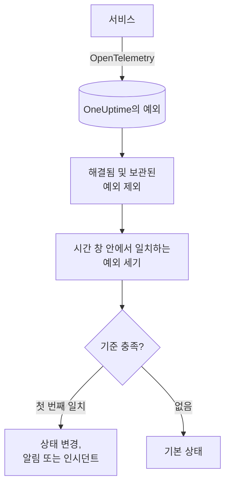

# 예외 모니터

예외 모니터는 서비스가 OneUptime에 보고하는 예외 중 필터(메시지, 예외 유형, 환경, 서비스)와 일치하는 예외를 시간 창 안에서 셉니다. 그 수가 기준을 충족하면 모니터의 상태를 바꾸거나, 알림을 만들거나, 인시던트를 선언합니다. 프로덕션의 새로운 충돌, 특정 예외 유형, 갑작스러운 오류 증가에 대해 알림을 받는 데 사용합니다.

:::cards
- [모니터 만들기](#예외-모니터-만들기): 셀 예외와 알림을 보낼 시점을 고릅니다.
- [환경](#환경): 모니터를 `production`으로 한정합니다.
- [평가 방식](#평가-방식): 무엇이 세어지고, 예외를 해결하면 어떻게 되는지.
- [기준](#기준): 조건과 기본값.
:::

## 작동 방식



OneUptime은 매분 모니터의 필터와 일치하고 시간 창 안에서 발생한 예외를 세며, 해결됨으로 표시했거나 보관한 예외는 제외합니다. 그 수를 모니터의 기준과 위에서부터 차례로 비교하고, 처음 일치하는 기준이 무슨 일이 일어날지 결정합니다. 일치하는 기준이 없으면 모니터는 기본 상태로 돌아갑니다.

## 시작하기 전에

- 서비스가 OpenTelemetry로 OneUptime에 예외를 보내고 있어야 합니다. [OpenTelemetry](/docs/telemetry/open-telemetry)를 참고하세요.
- 모니터를 환경으로 한정하려면 서비스가 리소스 속성 `deployment.environment`를 설정해야 합니다.

## 예외 모니터 만들기

:::steps
### 새 모니터 시작

**모니터**로 이동해 **모니터 생성**을 클릭합니다. 또는 예외 페이지에서 **해결** 옆의 **모니터 생성**을 클릭합니다. 새 모니터는 처음부터 그 서비스에서 그 예외의 유형을 지켜보고, 다시 발생하면 알립니다.

### Exceptions 선택

**모니터 유형**에서 **더 많은 모니터 유형**을 클릭하고 **텔레메트리** 아래의 **예외**를 선택하거나, 검색 상자에 `exceptions`를 입력합니다. **이름**을 입력하고 **다음**을 클릭합니다.

### 모니터로 알고 싶은 것 고르기

**이 모니터로 무엇을 알고 싶나요?** 아래에서 **모든 예외** 또는 **예외가 너무 많음**을 고릅니다. 어느 것을 골라도 규칙이 채워지며, 아래에서 바꿀 수 있습니다. 직접 설정하려면 **기타**를 고릅니다. **새 예외**, **해결된 예외가 다시 발생**, **예외 급증**은 처음 확인된 예외, 해결한 뒤 다시 발생한 예외, 주중 그 시간대의 평소 수준보다 크게 늘어난 경우를 알립니다.

### 셀 예외 선택

**지켜볼 예외**에서 **메시지에 포함된 단어**, **예외 유형**, **환경**을 설정합니다. 비워 둔 필터는 모든 예외와 일치합니다. 필터 아래의 **일치하는 예외**에 지금 일치하는 예외가 표시됩니다.

### 범위 좁히기(선택 사항)

**추가 필드**를 열어 텔레메트리 서비스나 인프라 엔터티로 필터링하거나, 해결됨 및 보관된 예외도 세도록 합니다.

### 알릴 조건 정하기

**알릴 조건**에서 **조건**, **예외 수**, **기간**을 고릅니다. 그 아래 문장이 규칙을 쉬운 말로 다시 알려 줍니다. 그 아래 차트는 최근 몇 시간 동안 기간마다 일치한 예외를 세고, 규칙의 숫자를 선으로 그리며, 규칙이 몇 번 알렸을지 보여 줍니다. 차트의 버튼은 그동안 규칙이 넘지 않았을 숫자를 제안합니다. **알림 기준**에서 규칙이 비교할 것을 **예외**, **새 예외**, **다시 발생한 예외**, **평소보다 증가** 중에서 고릅니다. 차트는 **예외**일 때만 그려집니다. **예외 급증**이 설정하는 **비정상적으로 높음**에는 입력할 숫자가 없으며, 대신 **민감도**를 고릅니다.

### 일어나는 일 고르기

**일어나는 일**에서 **알림 생성**, **인시던트 선언**, **둘 다** 중 하나를 고르고 제목과 심각도를 정합니다. 규칙이 일치하는 동안 모니터는 **추가 필드**에 있는 상태를 표시합니다. 더 이상 일치하지 않으면 모니터는 기본 상태로 돌아가고, 알림이나 인시던트는 저절로 해결됩니다.

### 모니터 만들기

**모니터 생성**을 클릭합니다. 모니터가 **개요** 페이지로 열리고 1분 안에 첫 평가가 실행됩니다.
:::

## 조회 대상

| 필드 | 일치 대상 | 기본값 |
| --- | --- | --- |
| **메시지에 포함된 단어** | 메시지에 이 텍스트가 포함된 예외. 대소문자를 구분하지 않습니다. | 비어 있음: 모든 예외 |
| **예외 유형** | 이 유형 중 하나의 예외. `TypeError, NullReferenceException`처럼 쉼표로 구분합니다. 유형 이름은 정확히 일치해야 합니다. | 비어 있음: 모든 유형 |
| **환경** | 이 환경 중 하나에서 온 예외. 쉼표로 구분합니다([환경](#환경) 참고). | 비어 있음: 모든 환경 |
| **기간**(**알릴 조건** 안) | 최근 5초부터 최근 24시간까지의 예외. | **지난 5분** |
| **서비스로 필터링**(**추가 필드** 안) | 선택한 서비스 중 하나에서 온 예외. | 비어 있음: 모든 서비스 |
| **인프라 엔터티로 필터링**(**추가 필드** 안) | 선택한 호스트, 파드, 컨테이너 및 기타 엔터티 중 하나에서 온 예외. | 비어 있음: 모든 엔터티 |
| **해결된 예외 포함**(**추가 필드** 안) | 해결됨으로 표시된 예외도 셉니다. | 꺼짐 |
| **보관된 예외 포함**(**추가 필드** 안) | 보관된 예외도 셉니다. | 꺼짐 |

예외가 세어지려면 설정한 모든 필터와 일치해야 합니다.

### 환경

환경은 각 예외의 OpenTelemetry 리소스 속성 `deployment.environment`에서 가져옵니다. 예외 탐색기가 `env:production`으로 필터링하는 것과 같은 값입니다. 환경을 하나 입력하거나 쉼표로 구분해 여러 개 입력합니다. 예외는 그 환경이 그중 하나와 일치하면 세어집니다.

일치는 정확해야 하며 대소문자를 구분합니다. `production`은 `Production`이나 `prod`와 일치하지 않습니다. 이 필터를 설정하면 환경이 없는 예외는 세어지지 않습니다. 환경이 없는 예외를 포함해 모든 환경의 예외를 세려면 비워 두세요.

환경 필터는 다른 모든 필터와 결합되므로, 텔레메트리 서비스 하나와 `production`으로 한정한 모니터는 그 서비스의 프로덕션 예외만 셉니다.

API로 모니터를 만들 때는 단계의 `exceptionMonitor`에서 `environments`를 환경 이름 목록으로 설정합니다.

```json
{
  "exceptionMonitor": {
    "telemetryServiceIds": [],
    "environments": ["production"],
    "exceptionTypes": [],
    "message": "",
    "includeResolved": false,
    "includeArchived": false,
    "lastXSecondsOfExceptions": 300
  }
}
```

## 평가 방식

- **매분.** 예외 모니터는 프로브가 확인하지 않으므로 설정할 간격도, **프로브 및 간격** 페이지도 없습니다.
- **예외 유형이 아니라 발생 횟수.** 모니터는 일치하는 예외가 **기간** 안에서 발생할 때마다 셉니다. 40번 발생한 예외 하나는 40으로 셉니다.
- **해결됨 및 보관된 예외는 제외됩니다.** **해결된 예외 포함**이나 **보관된 예외 포함**을 켜지 않으면, 해결됨으로 표시했거나 보관한 예외의 발생은 세어지지 않습니다. 따라서 예외를 해결됨으로 표시하면 그 예외가 연 인시던트가 닫힐 수 있습니다. 해결된 예외가 다시 발생하면 자동으로 미해결로 돌아가 다시 세어집니다.
- **예외가 없으면 개수는 0입니다.**
- **OneUptime 자체의 중단은 침묵이 아닙니다.** OneUptime 자체가 데이터를 받지 못한 시간(재시작, 업그레이드, 밀린 작업 처리 중)이 시간 창에 들어 있는 동안 확인은 기다립니다. 상태가 바뀌지 않으며, 인시던트나 알림이 열리거나 해결되지도 않습니다. [OneUptime이 데이터를 받지 못할 때](/docs/monitor/when-oneuptime-is-not-receiving)를 참고하세요.
- **기준은 위에서부터.** 처음 일치하는 기준이 결정하므로 가장 심각한 기준을 맨 위에 두세요.

모든 상태 변경은 그 이유와 함께 모니터의 **상태 타임라인**에 기록됩니다.

## 기준

예외 모니터의 기준에는 **필터 유형**이 네 가지입니다. 창 안에서 일치한 예외의 수인 **예외 수**, 그리고 아래에서 설명하는 **새 예외 수**, **재발한 예외 수**, **예외 증가율(%)** 입니다. **알릴 조건**은 기준 하나를 설정하며, 그 **조건**은 **초과**, **이상**, **미만**, **이하**, **일치**, **비정상적으로 높음**, **비정상적으로 낮음**, **비정상적으로 높거나 낮음** 중 하나입니다. 기준이 여러 개이거나 필터가 둘 이상인 기준이 필요하면 **일어나는 일**의 **추가 필드**에서 **사용자 지정 기준으로 편집**을 클릭합니다. 그곳의 각 기준에는 **필터 조건**과 **값**이 있습니다.

| 필터 조건 | 예외 수가 다음과 같을 때 일치 |
| --- | --- |
| **보다 큼** | 값보다 큼 |
| **이상** | 값 이상 |
| **보다 작음** | 값보다 작음 |
| **이하** | 값 이하 |
| **같음** | 값과 정확히 같음 |
| **같지 않음** | 값이 아닌 모든 것 |
| **비정상적으로 높음** | 이번 주의 이 시간대에 예상되는 범위보다 높음 |
| **비정상적으로 낮음** | 그 범위보다 낮음 |
| **비정상** | 어느 방향으로든 그 범위를 벗어남 |

이상 조건에는 **값**이 없습니다. **민감도**(낮음, 기본값인 보통, 높음)를 고르고, 사용자 지정 기준에서는 14일(기본값), 28일, 60일, 90일 중 **기준선 기간**도 고릅니다. 이 조건은 **예외 수**에만 있습니다. [평소와 비교한 급증](#평소와-비교한-급증)을 참고하세요.

모니터 생성에서 만든 예외 모니터는 **이 모니터로 무엇을 알고 싶나요?** 아래에서 고른 항목의 규칙으로 시작합니다.

| 선택 | 규칙 | 일어나는 일 |
| --- | --- | --- |
| **모든 예외** | **지난 5분** 동안 `0` **초과** | 알림을 만들고, 저절로 해결됩니다 |
| **예외가 너무 많음** | **지난 5분** 동안 `20` **초과** | 알림을 만들고, 저절로 해결됩니다 |
| **새 예외** | **새 예외**: **지난 10분** 동안 `0` **초과** | 알림을 만들고, 저절로 해결됩니다 |
| **해결된 예외가 다시 발생** | **다시 발생한 예외**: **지난 10분** 동안 `0` **초과** | 알림을 만들고, 저절로 해결됩니다 |
| **예외 급증** | **지난 15분** 동안 **비정상적으로 높음** | 알림을 만들고, 저절로 해결됩니다 |

API나 Terraform으로 기준 없이 만든 예외 모니터는 다음 기준으로 시작합니다.

| 기준 | 필터 | 효과 |
| --- | --- | --- |
| Check if … has exceptions | **예외 수** **보다 큼** `0` | 모니터를 오프라인으로 표시하고 인시던트를 선언합니다(자동 해결) |
| Check if … has no exceptions | **예외 수** **같음** `0` | 모니터를 온라인으로 표시합니다 |

## 새 예외, 다시 발생한 예외, 급증하는 예외

예외가 몇 번 발생했는지 외에도, 예외 모니터는 오류 추적기가 가장 먼저 보여 주는 것을 알릴 수 있습니다. 각각은 기준이 확인할 때만 읽습니다.

| 필터 유형 | 창 안에서 세는 것 |
| --- | --- |
| **새 예외 수** | 처음 확인되었고 해결되거나 보관되지 않은 일치하는 예외. |
| **재발한 예외 수** | 해결했지만 다시 발생해 아직 열려 있는 일치하는 예외. |
| **예외 증가율(%)** | 일치하는 예외 수가 평소보다 얼마나 많은지. 평소는 창 전날을 같은 길이의 창마다 나눈 값이며 최소 1건으로 봅니다. 조용한 하루 뒤의 10건은 900%입니다. |

새 예외와 다시 발생한 예외는 서비스, 예외 유형, 환경, 메시지로 걸러지고, 인프라 엔터티로도 걸러집니다. 창 안의 발생 중 하나라도 선택한 엔터티 중 하나에서 온 예외가 세어집니다.

## 평소와 비교한 급증

**예외 급증**은 고정된 숫자가 아니라 이전 주들의 같은 시간대와 기간을 비교합니다. 월요일 아침의 피크는 월요일 아침에는 평소와 같지만, 같은 수가 일요일 새벽 3시에 나오면 그렇지 않습니다. 며칠에 걸친 느린 증가도 지난주의 범위를 벗어나는 즉시 드러납니다.

| 설정 | 하는 일 | 기본값 |
| --- | --- | --- |
| **민감도** | 기간이 평소 범위에서 얼마나 벗어나야 하는지입니다. 낮음은 표준 편차 4, 보통은 3, 높음은 2입니다. | 보통 |
| **기준선 기간** (**추가 필드** 아래) | 학습에 사용할 기록의 양입니다. 14일, 28일, 60일, 90일 중에서 고릅니다. | 14일 |
| **표준 편차** (**추가 필드** 아래) | **민감도**가 정하는 값 대신 사용할 숫자입니다. | 비어 있음 |
| **최소 예외 수** (**추가 필드** 아래) | 기간 안에서 알림을 보낼 수 있는 최소 예외 수입니다. 낮음은 20, 보통은 10, 높음은 5입니다. | 비어 있음 |

- **필터를 사용합니다.** 기록은 모니터 자체의 필터로 읽으므로, 예외 유형 하나를 보는 모니터는 그 유형의 기록과 비교되며 해결되었거나 보관된 예외는 양쪽에서 모두 제외됩니다.
- **조용한 시간도 셉니다.** 예외가 없는 기간도 평소의 일부이므로 조용한 서비스의 범위는 작게 유지됩니다. **최소 예외 수** 때문에 처음 몇 건은 알리지 않고, 실제 폭증은 알립니다.
- **새 서비스는 기다립니다.** 서비스에 2주 분량의 기록이 쌓일 때까지 기준은 아직 학습 중이며, 예외가 아무리 많아도 발동하지 않습니다. 기록은 OneUptime이 예외를 보관하는 만큼만 거슬러 올라갑니다. 바꾸지 않았다면 15일이며, 보관 기간이 2주 미만인 서비스는 기록이 끝내 부족합니다.
- **알림이 이유를 말합니다.** 예상 범위와 기간이 그 범위를 얼마나 벗어났는지 알려 줍니다. 모든 검사는 같은 내용, 또는 아직 학습 중이라는 사실을 **상태 타임라인**에 기록합니다.

## 실전 예: 프로덕션 예외만

API가 프로덕션에서 예외를 던질 때마다 인시던트를 만들고, 스테이징에서는 아무 일도 없게 하려고 합니다. **모든 예외**를 고르고, **환경**을 `production`으로 설정하고, **기간**은 **지난 5분** 그대로 두고, **일어나는 일**에서 **인시던트 선언**을 고릅니다. 최근 5분 동안은 다음과 같습니다.

| 예외 | 환경 | 상태 | 세어지나요? |
| --- | --- | --- | --- |
| `TypeError` × 3 | `production` | 활성 | 예: 3 |
| `TypeError` × 40 | `staging` | 활성 | 아니요: 다른 환경 |
| `TimeoutError` × 2 | 없음 | 활성 | 아니요: 환경 없음 |
| `NullReferenceException` × 4 | `production` | 발생 후 해결됨 | 아니요: 해결됨 |

**예외 수**가 3이므로 `0` **초과**가 일치합니다. 모니터가 오프라인이 되고 인시던트가 선언됩니다. 활성 프로덕션 예외가 없는 5분이 지나면 규칙이 더 이상 일치하지 않아 모니터가 기본 상태로 돌아가고, 인시던트가 저절로 해결됩니다.

## 문제 해결

:::details 탐색기에는 예외가 보이는데 모니터는 0으로 셈
**환경** 값을 탐색기의 `env:` 필터와 비교하세요. 일치는 정확해야 하고 대소문자를 구분하며, 필터를 설정하면 환경이 없는 예외는 제외됩니다. 그다음 그 예외들이 해결됨이나 보관됨 상태인지 확인하세요. 모니터의 **기준** 페이지(**구성** 아래)를 열고 **기준 편집**을 클릭하면 **일치하는 예외**에서 필터가 일치하는 항목을 볼 수 있습니다.
:::

:::details 예외를 해결했더니 인시던트도 해결됨
예상된 동작입니다. 해결된 예외는 세어지지 않으므로 개수가 줄어 기준이 더 이상 일치하지 않았습니다. 예외가 다시 발생하면 미해결로 돌아가 다시 세어집니다. 그래도 세려면 **해결된 예외 포함**을 켜세요.
:::

:::details 예외 유형 필터가 아무것과도 일치하지 않음
**예외 유형**은 예외가 보고될 때의 유형 이름(예: `TypeError`)과 정확히 비교됩니다. 예외 탐색기에서 유형을 복사하세요.
:::

:::details 예외 급증 규칙이 알리지 않습니다
**상태 타임라인**을 확인합니다. 예상 범위, 알리는 데 필요한 수, 또는 규칙이 아직 학습 중이라는 내용이 있습니다. 서비스에는 2주 분량의 기록이 필요하므로 보관 기간이 2주 미만이면 계속 학습 중입니다. 수가 **최소 예외 수** 아래에 머문다면 **추가 필드**에서 낮추거나 더 높은 **민감도**를 고릅니다.
:::

## 다음 단계

:::cards
- [트레이스 모니터](/docs/monitor/traces-monitor): 실패한 스팬과 엔드포인트에 대해 알림을 받습니다.
- [로그 모니터](/docs/monitor/logs-monitor): 로그의 양과 내용에 대해 알림을 받습니다.
- [인시던트 및 알림 템플릿](/docs/monitor/incident-alert-templating): 유용한 알림 제목과 설명을 작성합니다.
- [OpenTelemetry](/docs/telemetry/open-telemetry): 예외를 OneUptime에 보냅니다.
:::
